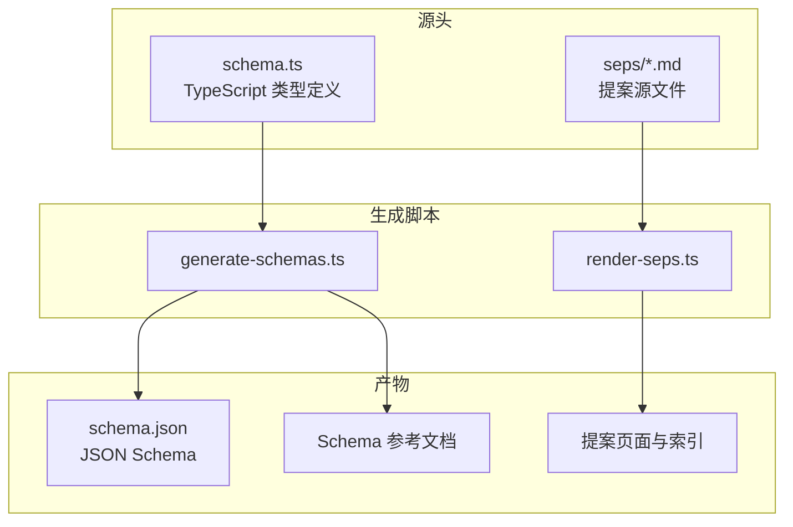

前面几页讲的是协议本身，这一页讲**承载这份协议的仓库**。理解仓库结构很重要，因为 MCP 的规范正文、Schema、文档站和提案页都不是手写的——它们从少数几个源头文件自动生成，改错地方会被校验拦下。

## 仓库的四个支柱

MCP 仓库不是一份文档，而是围绕「一份可机读的协议定义」组织起来的四类内容：

| 目录 | 角色 | 关键内容 |
| --- | --- | --- |
| `schema/` | 协议定义的事实源 | 每个版本一个目录，含 `schema.ts`（类型定义）、`schema.json`（生成的 JSON Schema）、`schema.mdx`（文档模板）与 `examples/` |
| `docs/` | 规范正文与文档站 | `docs/specification/<版本>/` 为规范性正文，`docs/docs/<版本>/` 为使用指南，另有 `docs/community/`、`docs/extensions/`、`docs/registry/` 等 |
| `seps/` | 提案源文件 | 每份 SPEC 增强提案一个 Markdown 文件，元数据写在文件头部 |
| `scripts/` | 生成与校验管线 | 把 TypeScript 编译成 JSON Schema、把 SEP 渲染成站点页面、校验示例与 MDX |

此外还有 `plugins/`（Claude Code 插件，提供 `/draft-sep`、`/search-mcp-github` 等技能）、`tools/sep-automation/`（自动处理 SEP 状态流转与维护者 ping 的 GitHub Action）和 `blog/`（Hugo 博客站点）。仓库根目录另有 `AGENTS.md`（`CLAUDE.md` 是指向它的符号链接）、`GOVERNANCE.md`、`MAINTAINERS.md`、`SECURITY.md`、`LICENSE` 等治理文件。

## Schema：一份类型定义，单向生成

MCP 的 Schema **以 TypeScript 类型为单一事实源**。每个版本目录里的 `schema.ts` 是唯一被手工维护的定义文件，所有其他形式都是它的产物：

`generate-schemas.ts` 用 `typescript-json-schema` 从 `schema.ts` 生成 `schema.json`，参数为 `--defaultNumberType integer --required`。它区分两代版本：

- **旧版**（`2024-11-05`、`2025-03-26`、`2025-06-18`）保持 **JSON Schema draft-07**，不做改写。
- **新版**（`2025-11-25`、`2026-07-28`、`draft`）转换为 **JSON Schema 2020-12**：把 `$schema` 的 URL 从 draft-07 改成 2020-12，把 `definitions` 改名为 `$defs`，并同步改写引用路径 `#/definitions/` → `#/$defs/`。

Schema 参考文档走另一条路：`schema.mdx` 是模板，`typedoc` 以 `schema.ts` 为入口把每个类型渲染成 HTML 面板，输出到 `docs/specification/<版本>/schema.mdx`。因此**生成产物一律不要手改**——仓库用 `.gitattributes` 把它们标记为 generated，并在合并冲突时禁止行级合并（`-merge`），约定解决办法是重跑 `npm run generate` 后提交。

## 版本目录与并行演进

`schema/` 与 `docs/specification/` 下并排存在同一组版本目录：`2024-11-05`、`2025-03-26`、`2025-06-18`、`2025-11-25`、`2026-07-28` 与 `draft`。`2026-07-28` 是当前已发布版本，**`draft` 是下一步改动的落点**：新协议变更先写进 `schema/draft/schema.ts`，发布时才冻结成一个新日期目录。

每个版本的 Schema 目录自包含，`2026-07-28` 这一版包含约 3200 行的 `schema.ts`、约 18 万字节的 `schema.json`，以及 `examples/` 下 88 个类型各自的请求/响应示例。

## 示例校验：让 Schema 可执行

`schema/<版本>/examples/<类型名>/*.json` 存的不是给人看的样板，而是会被自动校验的用例。`validate-examples.ts` 读取对应版本的 `schema.json`，用 **Ajv** 编译，并根据 `$schema` 字段在普通 Ajv 与 `Ajv2020` 之间选择，配合 `ajv-formats` 支持 `date-time`、`uri` 等格式，把每个示例逐个对照 Schema 校验。它同时兼容 `$defs`（新版）与 `definitions`（旧版）两种结构，所以同一套脚本能覆盖全部版本。

这形成了一个闭环：`schema.ts` 定义 → 生成 `schema.json` → 用 `schema.json` 校验手写示例。任何一环不一致，`npm run check` 都会失败。

## 生成与校验脚本一览

| 脚本 | 作用 |
| --- | --- |
| `generate-schemas.ts` | 由 `schema.ts` 生成各版本 `schema.json`；带 `--check` 时只对比不写入 |
| `render-seps.ts` | 由 `seps/*.md` 渲染提案页面与索引，并更新站点导航 |
| `validate-examples.ts` | 用 Ajv 逐个校验 `examples/` 中的 JSON 示例 |
| `check-mdx-comments.ts` | 扫描 `docs/**/*.mdx`，拦截会被生产环境 Mintlify 解析器拒绝的 MDX 内 JS 注释 |
| `pull-registry-docs.sh` | 从 `modelcontextprotocol/registry` 仓库同步 Registry 文档到本地 |

这些脚本由 `package.json` 的 npm 脚本编排：`generate` 汇总 Schema 与 SEP 的生成，`check` 汇总 TypeScript 类型检查、Schema 一致性、示例校验、MDX 校验与文档校验，构成提交前的统一入口。

## SEP 是怎么变成站点的

提案源文件放在 `seps/` 下，命名形如 `1577--sampling-with-tools.md`，文件头部携带编号、标题、状态、类型、创建时间、作者、赞助人等元数据。`render-seps.ts` 会读取全部提案，跳过 `TEMPLATE.md`、`README.md` 与 `0000-*`，然后为每份提案生成 `docs/seps/` 下对应的 MDX 页面、生成提案索引 `docs/seps/index.mdx`，并把新页面挂进文档站的导航配置 `docs/docs.json`。`seps/README.md` 只做一件事：把贡献者引向线上的 SEP 指南。

## 贡献一次协议改动

门槛不高，但顺序固定：

1. **装环境**：需要 Node.js 24 或以上。仓库提供 `.nvmrc`，`npm install` 即可就绪。
2. **改源头**：协议变更写进 `schema/draft/schema.ts`；`schema.json` 与 `docs/specification/draft/schema.mdx` 不要手改。
3. **先校验类型**：`npm run check:schema:ts` 跑 `tsc`、ESLint 与 Prettier。
4. **再生成产物**：`npm run generate:schema` 重新生成 JSON Schema 与参考文档。
5. **提交**：把源头改动与生成产物一起提交；若遇到生成文件的合并冲突，按约定重跑生成而非手工解决。

## 许可：正在从 MIT 转向 Apache-2.0

仓库的 `LICENSE` 开头就是一段许可迁移声明：项目正从 **MIT 转向 Apache-2.0**。迁移后，新增的代码与规范贡献采用 **Apache-2.0**；文档贡献（**不含规范正文**）采用 **CC-BY-4.0**；而历史上以 MIT 提交、且未明确同意再许可的贡献，仍保留 MIT 许可。因此仓库根 `README.md` 仍写着 MIT，而 `LICENSE` 已同时容纳两套条款——对外描述这个仓库的许可时，应说「正在迁移」而非「就是 MIT」。

> 依据：`README.md:5-16`、`CONTRIBUTING.md:1-148`、`LICENSE:1-8`、`.gitattributes:1-10`、`package.json:1-68`、`scripts/generate-schemas.ts:10-17`、`scripts/generate-schemas.ts:22-47`、`scripts/generate-schemas.ts:49-110`、`scripts/validate-examples.ts:1-120`、`scripts/render-seps.ts:1-446`、`scripts/check-mdx-comments.ts:1-66`、`scripts/pull-registry-docs.sh:1-36`、`seps/README.md:1-3`、`typedoc.config.mjs:1-24`
