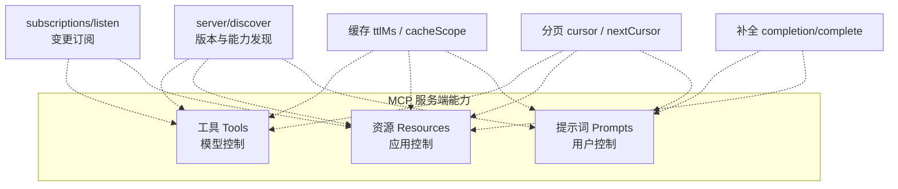
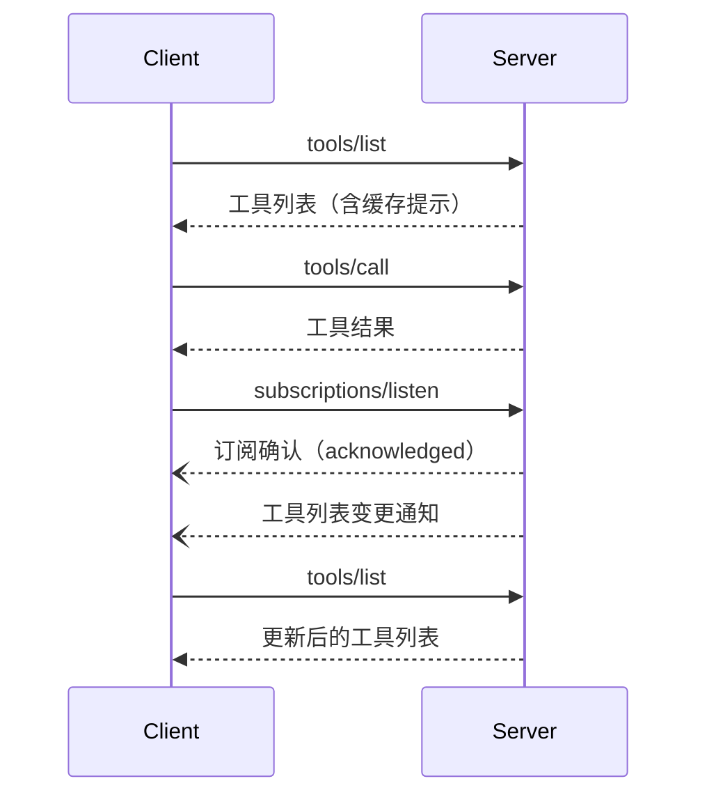

# 服务端能力

服务端是 MCP 里“提供能力”的一侧。它对外暴露的东西分成三类原语，各自面向不同的控制者：**工具（Tools）** 由模型决定何时调用，**资源（Resources）** 由宿主应用决定何时纳入上下文，**提示词（Prompts）** 由用户显式触发。除此之外，服务端还提供一组与具体能力无关的配套设施——协议版本与能力发现、变更订阅、结果缓存、列表分页、参数补全——它们把上述原语包装成可被客户端稳定消费的接口。

理解这张图的关键是：**能力必须先声明，再被调用**。服务端在响应里声明自己支持哪些能力，客户端据此决定要不要发起对应请求；没有声明却被调用的能力属于协议错误。

该看什么：实线框内是三类原语，虚线连接表示“配套设施服务于哪些原语”。工具、资源、提示词都吃缓存和分页；只有提示词与资源模板用补全；订阅主要用于工具列表与资源更新。

## 三类原语由谁控制

| 原语 | 控制者 | 典型形态 | 声明能力 |
|---|---|---|---|
| 工具 Tools | 模型（model-controlled） | 查询数据库、调用 API、执行计算 | `tools` |
| 资源 Resources | 应用（application-driven） | 文件、数据库 schema、应用数据，用 URI 标识 | `resources` |
| 提示词 Prompts | 用户（user-controlled） | 斜杠命令、预设模板 | `prompts` |

`server/index.mdx` 本身没有分节标题，只给出三类原语的简介与一张控制层级表，用斜杠命令、文件内容、API POST 三个例子说明用户、应用、模型各自的控制强度。

服务端若支持某类原语，**必须（MUST）** 声明对应能力。能力对象里还可以带可选开关，例如工具的 `listChanged`、资源的 `listChanged` 与 `subscribe`。两个开关都可以单独声明、同时声明或都不声明。

## 工具：模型控制的调用面

工具是最常被使用的一类原语。每个工具由唯一名字标识，并附带描述其入参的 JSON Schema。

**列表与调用**。客户端用 `tools/list` 发现工具，用 `tools/call` 执行。列表属于可分页、可缓存的操作；服务端返回的工具集可以为空，也可以随时间变化，但 **不得（MUST NOT）** 因连接不同而变化，也 **不得** 作为同一连接上其他请求的副作用而变化；它 **可以（MAY）** 随请求携带的授权变化——因为凭证是逐请求输入，而非连接状态。服务端 **应当（SHOULD）** 以确定顺序返回工具，便于客户端缓存并提高模型侧提示缓存命中率。

**输入与输出**。工具定义包含 `name`、可选的 `title`、`description`、可选的 `icons`、`inputSchema` 与可选的 `outputSchema`。`inputSchema` **必须** 是合法 JSON Schema（不能为 `null`），未写 `$schema` 时默认 2020-12；无参工具推荐写成显式只接受空对象的形式。若提供了 `outputSchema`，服务端 **必须** 让结构化结果符合该 schema，客户端 **应当** 校验。

**结果形态**。工具结果既可非结构化，也可结构化。非结构化内容放在 `content` 数组里，支持文本、图片、音频、资源链接、内嵌资源等类型；结构化内容放在 `structuredContent`，可以是任意 JSON 值。为兼容旧客户端，返回结构化内容的工具 **应当** 同时在文本块里带上序列化后的 JSON。

**状态化工具**。协议本身没有“状态句柄”概念。需要跨调用保持状态的服务端（购物车、浏览器上下文、数据库事务）应当由创建类工具返回一个显式句柄，并在后续调用里把这个句柄作为普通参数接受，由模型负责把它带下去。句柄设计要考虑授权（句柄是名字而非能力，需逐次校验）、不透明性、生命周期（在创建工具描述里写明过期策略）与过期错误的可恢复性。

**错误的两条通道**。协议错误（未知工具、请求结构不合规、服务端错误）用标准 JSON-RPC 错误返回；工具执行错误（API 失败、入参校验失败、业务逻辑错误）则在工具结果里以 `isError: true` 表示，携带模型可据以自我纠正的反馈。客户端 **可以** 把协议错误交给模型，但 **应当** 把执行错误交给模型以支持重试。

**`x-mcp-header`**。工具参数可通过该扩展属性镜像成 HTTP 头，便于负载均衡、代理、WAF 在不解析请求体的情况下做路由。它只能用于静态可达的原始类型参数（integer/string/boolean，不含 number），值须满足 HTTP 字段名语法、非空、大小写不敏感唯一，且不得含控制字符。Streamable HTTP 客户端 **必须** 拒绝违反约束的工具定义（从 `tools/list` 结果中剔除），并 **应当** 记录告警。敏感参数 **不应** 用此标注，因为头值对中间网络可见。

## 资源：应用控制的数据面

资源用于暴露对模型构成上下文的数据，用 URI 唯一标识。与应用侧的控制模型一致，宿主应用决定如何把资源纳入上下文——可以用树或列表让用户显式选择，也可以按启发式或模型选择自动纳入。

**读取路径**。客户端用 `resources/list` 列出资源、`resources/templates/list` 列出 URI 模板、`resources/read` 读取内容。`resources/read` **可以** 一次返回多份内容（例如读取目录资源时返回多个文件）。

**内容类型**。资源内容是文本或二进制：文本放在 `text`，二进制放在 `blob`（base64）。资源、资源模板、内容块都支持注解 `annotations`，包含 `audience`（`user`/`assistant`）、`priority`（0.0–1.0）、`lastModified`（ISO 8601）。

**常见 URI 方案**。`https://` 用于客户端能自行从网上取回的资源，服务端 **应当** 仅在此类场景使用它；`file://` 表示行为类似文件系统的资源，不要求映射到真实文件系统，可用 XDG MIME 类型标注非常规文件；`git://` 用于 Git 版本控制集成；自定义方案 **必须** 符合 RFC3986。

**错误处理**。资源不存在时服务端 **必须** 返回 `-32602`（Invalid Params），内部错误 **应当** 返回 `-32603`；为向后兼容，客户端 **应当** 同时接受旧版使用的 `-32002` 表示资源未找到。对不存在的资源，服务端 **不得** 返回空的 `contents` 数组，因为空数组有歧义。

## 提示词：用户控制的模板面

提示词用于暴露预设模板。客户端用 `prompts/list` 列出、用 `prompts/get` 获取，获取时返回一系列消息。提示词同样支持列表变更通知。提示词模板的参数可以通过补全 API 自动补全。

## 发现：调用任何东西之前

`server/discover` 是 `2026-07-28` 新增的独立 RPC，服务端 **必须** 实现。客户端可在发起其他请求前用它一次性拿到：服务端支持的协议版本集合（`supportedVersions`）、能力集合（`capabilities`）、服务端身份（`serverInfo`，含 `name` 与 `version`）、可选的 `instructions`。它的响应同样带缓存字段 `ttlMs` 与 `cacheScope`，结果类型为 `complete`。

这一设计服务于 `2026-07-28` 的无状态化改造：既然没有 `initialize` 握手，版本与能力就必须通过常规请求携带的元数据、或由客户端主动发现来获得。发现对客户端是可选的——也可以直接发起任意请求，并处理返回的版本不支持错误。

## 订阅与变更通知

当工具列表或资源列表变化时，服务端 **应当** 向已打开 `subscriptions/listen` 流、并在过滤条件里声明关心的客户端推送对应通知（`notifications/tools/list_changed`、`notifications/prompts/list_changed`、`notifications/resources/list_changed`）。对单个资源的更新，客户端在 `subscriptions/listen` 请求的 `notifications.resourceSubscriptions` 里列出 URI，服务端在流上推送 `notifications/resources/updated`，其中携带 `subscriptionId` 用于关联。

这替代了旧版的 HTTP GET 长连接与 `resources/subscribe`/`unsubscribe` RPC：服务端→客户端的长期通知统一走 `subscriptions/listen` 的结果流。服务端 **不得** 发送客户端未请求过的通知类型。

该看什么：一次典型的“发现—调用—订阅”循环。注意 `subscriptions/listen` 建立长期流后，服务端的后续通知用虚线箭头（流式推送）表示，客户端收到变更通知后重新拉取列表。

## 缓存、分页与补全

**缓存**。服务端在 `server/discover`、`tools/list`、`prompts/list`、`resources/list`、`resources/templates/list`、`resources/read` 这些返回 `resultType: "complete"` 的结果里 **必须** 带上缓存提示。缓存键由方法与影响结果的参数共同决定（例如 `resources/read` 的 `uri`、分页列表的 `cursor`）；客户端 **不得** 对方法或参数不同的请求复用缓存结果。携带 `inputResponses`/`requestState` 的 MRTR 重试结果不可缓存。字段含义：`ttlMs` 给出新鲜度窗口，`cacheScope` 说明可共享范围（如 `"public"`）。

**分页**。列表类操作用不透明游标分页：请求带 `cursor`，响应带当前页与可选的 `nextCursor`。页大小由服务端决定，客户端 **不得** 假定固定页大小。

**补全**。`completion/complete` 为提示词参数与资源模板参数提供自动补全。服务端 **必须** 声明 `completions` 能力。

**日志（已废弃）**。`logging` 能力自 `2026-07-28` 起被标记废弃（SEP-2577），规范保证其至少保留 12 个月，但新实现 **不应** 采用，应改用 stderr（stdio 场景）或 OpenTelemetry。服务端若声明该能力，仍 **必须** 按 RFC5424 严重级别发送日志通知。

## 注意

- 本页所有请求示例在原规范中出于简略省略了 `_meta`；实际每个请求 **必须** 携带必需的 `_meta` 字段（协议版本、客户端信息、客户端能力）。
- 工具注解在客户端侧默认不可信，除非来自可信服务端。
- 一个服务端可以只支持三类原语中的任意子集；未声明的原语不会被调用。

> 依据：`docs/specification/2026-07-28/server/index.mdx:1-41`、`docs/specification/2026-07-28/server/discover.mdx:1-108`、`docs/specification/2026-07-28/server/tools.mdx:21-45`、`docs/specification/2026-07-28/server/tools.mdx:45-134`、`docs/specification/2026-07-28/server/tools.mdx:135-249`、`docs/specification/2026-07-28/server/tools.mdx:250-403`、`docs/specification/2026-07-28/server/tools.mdx:404-682`、`docs/specification/2026-07-28/server/tools.mdx:683-803`、`docs/specification/2026-07-28/server/resources.mdx:22-82`、`docs/specification/2026-07-28/server/resources.mdx:83-297`、`docs/specification/2026-07-28/server/resources.mdx:298-435`、`docs/specification/2026-07-28/server/prompts.mdx:21-205`、`docs/specification/2026-07-28/server/prompts.mdx:206-336`、`docs/specification/2026-07-28/server/utilities/caching.mdx:11-110`、`docs/specification/2026-07-28/server/utilities/completion.mdx:33-133`、`docs/specification/2026-07-28/server/utilities/pagination.mdx:24-111`、`docs/specification/2026-07-28/server/utilities/logging.mdx:7-42`
