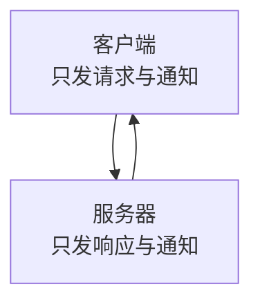
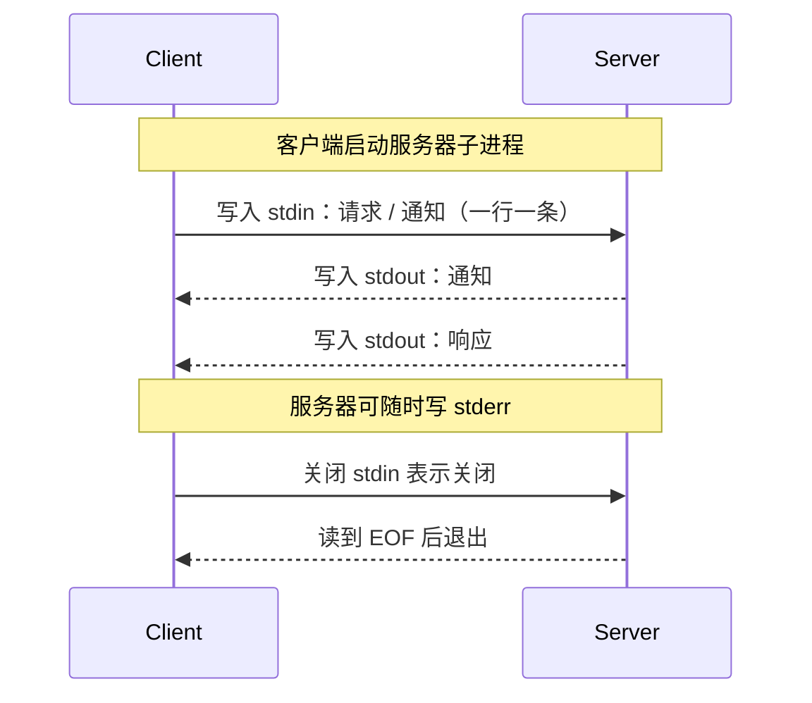
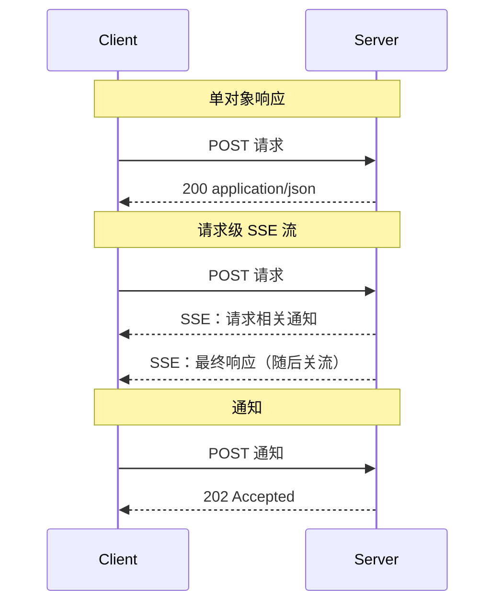

MCP 把「消息怎么传」和「消息什么意思」分成两层。前者由传输层负责，规范里叫**绑定（binding）**；后者是核心协议，在任何传输上都完全一致。`2026-07-28` 定义了两种标准传输：本地进程用的 stdio，和远程用的 Streamable HTTP。

## 传输层只负责「怎么传」

一个绑定只定义三件事：

- 消息如何**分帧与投递**；
- 请求元数据如何**随车携带**；
- 取消与终止如何**发出信号**。

它不定义消息含义——消息模式属于核心协议，每种绑定上都相同——所以同一套协议逻辑可以架在不同传输上。

| 传输 | 适用场景 | 消息信道 |
|---|---|---|
| stdio | 本地：客户端把服务器拉起为子进程 | 子进程标准输入/输出，单条双向流 |
| Streamable HTTP | 远程：服务器独立运行，服务多个客户端 | 单端点上的多次 POST，回复为单 JSON 对象或请求级 SSE 流 |

两条消息方向的规则是固定的：客户端只发**请求**和**通知**，服务器只发**响应**和**通知**；服务器不会主动发起 JSON-RPC 请求，客户端也不会发响应。

该看什么：没有第三种方向。这正是「服务器发起的交互」必须换个机制（MRTR）回传的原因。

两种标准之外，实现**可以**自建传输，但自建传输**必须**保留 JSON-RPC 消息格式、消息模式和逐请求元数据模型，并**应当**写明自己的连接建立、分帧与取消方式。跑在可靠双向字节流上（如 Unix 域套接字、TCP）的自建传输**应当**直接复用 stdio 的分帧，而不是另造一套：stdio 的分帧本质就是「字节流上换行分隔的 JSON-RPC」，只有进程生命周期部分才与标准流绑定。

## 请求元数据随消息走

所有协议元数据都放在消息体里：每条请求都在 `_meta` 的 `io.modelcontextprotocol/*` 字段中携带自己的协议版本与客户端能力。绑定**可以**额外把选定的正文字段镜像到信封（envelope）元数据，方便中间层不解析正文就能路由和观察——Streamable HTTP 就是把它们镜像进 HTTP 头。但**正文始终是唯一事实来源**，镜像了元数据的绑定必须定义不一致时如何拒绝。

## stdio：本地子进程的单流模型

客户端把服务器拉起为子进程，两端通过标准流通信：

- 服务器从 `stdin` 读、往 `stdout` 写 JSON-RPC 消息；
- 每条消息占一行，按换行分隔，**不得**包含内嵌换行；
- 服务器**可以**往 `stderr` 写 UTF-8 日志（信息、调试、错误都行）；客户端**不应**把 `stderr` 输出当作错误信号；
- 服务器**不得**往 `stdout` 写任何非 MCP 消息，客户端**不得**往 `stdin` 写任何非 MCP 消息。

单一 `stdout` 上，服务器写三类消息：对客户端请求的**响应**（按 JSON-RPC `id` 关联）、与在途请求相关的**通知**（如 `notifications/progress`、`notifications/message`）、以及活跃 `subscriptions/listen` 请求对应的**通知**（客户端须用 `_meta` 里的 `io.modelcontextprotocol/subscriptionId` 关联）。服务器**不得**往 `stdout` 写 JSON-RPC 请求——服务器发起的交互只能作为 `InputRequiredResult` 回复里的输入请求携带。

该看什么：一条共享流承担全部收发，没有请求级子流，所以取消不能靠「关流」。

关闭时，客户端**应当**先关闭子进程的输入流、等待其退出，超时再按操作系统机制强制终止（POSIX 从 `SIGTERM` 升级到 `SIGKILL`；Windows 用 `TerminateProcess` 或 Job Objects）。服务器**应当**在标准输入被关闭或读到 EOF 时尽快退出——这是唯一可移植的优雅关闭信号。服务器**也可以**自己关闭输出流并退出来发起关闭。若服务器意外退出，客户端**应当**重启它：协议是无状态的，在途请求直接丢失、重试即可，活跃的 `subscriptions/listen` 流需要在重启后重新建立。

## Streamable HTTP：单端点与请求级流

服务器是独立进程，暴露**一个**支持 POST 的端点（MCP 端点，如 `https://example.com/mcp`）。客户端的每条 JSON-RPC 请求或通知都是**一次独立的 HTTP POST**；服务器对每条请求回一个单 JSON 对象，或一条**只属于该请求**的 SSE 流（先带请求相关的通知，再带最终响应）。

服务器到客户端的交互（sampling、elicitation、roots）**不再**以独立请求发出，而是作为输入请求嵌入结果里的 `InputRequiredResult`（即 MRTR，SEP-2322）；长期变更通知（列表变更、资源更新等）通过 `subscriptions/listen` 请求的响应流持续送达。这与 `2025-03-26` 到 `2025-11-25` 版本的 Streamable HTTP 不同——那时服务器可以在 SSE 流上发请求。

该看什么：服务器按请求二选一决定回「单对象」还是「流」，客户端两种都得支持；每条请求各自成流，正是「关流即取消」能成立的前提。

安全与端点有几条硬要求：

| 措施 | 要求 | 目的 |
|---|---|---|
| 校验 `Origin` 头 | **必须**；头存在且非法时回 `403` | 防 DNS rebinding |
| 绑定地址 | 本地运行时**应当**只绑 `127.0.0.1` | 不暴露到全网卡 |
| 认证 | **应当**对所有连接实施 | 保护访问 |

发送消息：**必须**用 POST；`Accept` 头**必须**同时列出 `application/json` 与 `text/event-stream`；**必须**带上请求元数据头；正文**必须**是单个请求或通知（**不得**是响应）。正文若是通知，服务器接受时回 `202 Accepted` 且无正文，不接受时回 HTTP 错误码；正文若是请求，服务器**必须**回 `application/json` 或 `text/event-stream` 二选一，客户端**必须**都支持。

有一点容易混淆：这一版核心协议在 Streamable HTTP 上**没有**客户端到服务器的通知。唯一的客户端通知 `notifications/cancelled` 只用于 stdio；在 Streamable HTTP 上，**关闭 SSE 响应流本身就是取消信号**。收到 SSE 流时，服务器**可以**在最终响应前发与本次请求相关的通知，但**不得**在此流上发独立 JSON-RPC 请求，最终响应**应当**终止该流。`subscriptions/listen` 的响应流则长期保持打开，只送客户端订阅的通知类型；请求级通知（如 `notifications/progress`）不会走这条流。发起 SSE 流时服务器**应当**带上 `X-Accel-Buffering: no`，避免反向代理缓冲；长连接**宜**定期发以冒号开头的 SSE 注释行做保活。SSE 流**不支持**用 `Last-Event-ID` 续传。

## 元数据镜像到 HTTP 头

Streamable HTTP 会把选定正文字段镜像进 HTTP 头，好让负载均衡、网关、可观测性工具不解析正文就能路由和检查。

- `MCP-Protocol-Version`：每个 POST **必须**带，值**必须**与正文 `_meta` 里的 `io.modelcontextprotocol/protocolVersion` 一致；不一致服务器**必须**回 `400` 与 `HeaderMismatch` 错误（码 `-32020`）。服务器不支持该版本时回 `400` 加 `UnsupportedProtocolVersionError`；不支持该 RPC 方法时回 `404` 加 `-32601`。
- `Mcp-Method`：取值 `method`，所有请求都要。
- `Mcp-Name`：取值 `params.name` 或 `params.uri`，用于 `tools/call`、`resources/read`、`prompts/get`。

除标准头外，服务器**可以**用工具参数 schema 里的 `x-mcp-header` 扩展属性，把指定参数镜像成 `Mcp-Param-{name}` 头。这类参数值必须能安全转成头值；不安全的（含非 ASCII、控制字符、首尾空白，或本身形如 Base64 哨兵串）**必须**用哨兵格式编码：前缀 `=?base64?`、后缀 `?=`，中间是 UTF-8 的 Base64。标记区分大小写，必须小写；`Mcp-Name` 同理。服务器需要比对时**必须**先解码再比。

服务器在处理正文时**必须**校验头值与正文值一致（数值型按数值比较，如 `42.0` 等于 `42`），不一致或必需头缺失、格式错误时回 `400` 与 `-32020`（`HeaderMismatch`）。头名大小写不敏感（用不敏感比较），头**值**大小写敏感。

| 场景 | 客户端 | 服务器 |
|---|---|---|
| 参数有值 | **必须**发对应头 | **必须**校验头与正文一致 |
| 参数为 `null` | **必须**省略该头 | **不得**期待该头 |
| 参数不在 arguments 里 | **必须**省略该头 | **不得**期待该头 |
| 客户端漏头但正文有值 | 非合规客户端 | **必须**拒绝请求 |

`x-mcp-header` 对服务器可选，但客户端**必须**支持；不满足约束的工具定义，客户端**必须**从 `tools/list` 结果里剔除并**宜**记录告警。

## 取消、终止与重启

各传输的取消机制不同，协议层规则相同：

| 传输 | 取消在途请求的方式 |
|---|---|
| stdio | 客户端**必须**发引用请求 ID 的 `notifications/cancelled`（单流，没有可关闭的请求级流） |
| Streamable HTTP | **关闭该请求的 SSE 响应流**，服务器**必须**视为取消 |

两种情况下服务器都**应当**尽快停止工作，并**不得**再为该请求发任何消息。

## 与旧版传输的兼容

同时支持新旧两代的客户端，判断对面用哪套传输的策略不同：stdio 先探测 `server/discover`；Streamable HTTP 先发一个现代请求，若回 `400` 再**看响应体**——现代服务器也会用 `400` 表达版本不支持、能力缺失或头校验失败，因此响应体里若是可识别的现代 JSON-RPC 错误，说明对面是现代版本，应当换版本重试而不是回退；否则回退到 `initialize`（必要时再退到已弃用的 HTTP+SSE）。

**更早的 Streamable HTTP 修订**（`2025-03-26` 到 `2025-11-25`）形状不同：服务器可用 `Mcp-Session-Id` 分配会话（用 HTTP DELETE 终止）、客户端可用 HTTP GET 开独立 SSE 流接收服务器消息、服务器可在 SSE 流上发请求、流可用 `Last-Event-ID` 续传。这些都**不属于**本修订。只支持本修订的服务器收到这类旧流量时**应当**：对 GET/DELETE 回 `405 Method Not Allowed`，忽略 `Mcp-Session-Id` 且不铸造也不回显会话 ID，忽略 `Last-Event-ID`。

**HTTP+SSE 传输**（`2024-11-05`）自 `2025-03-26` 起已弃用，按特性生命周期政策归入 Deprecated，新实现**不应**采用，现有实现**应当**迁移到 Streamable HTTP，未来修订可能移除。

## 落地时要注意什么

- **先选传输再谈行为**。本地一体化场景用 stdio；远程多客户端用 Streamable HTTP。协议语义一致，但取消、元数据携带、关闭方式都不同。
- **HTTP 上取消靠关流，不靠消息**。别在 Streamable HTTP 上发 `notifications/cancelled`，也别依赖它触达服务器。
- **头与正文必须一致**。镜像头只为中间层便利，正文仍是事实来源；服务端不校验就等于给不同组件留了不同的真相来源，是安全漏洞。
- **代理需要 `X-Accel-Buffering: no`**。否则 SSE 被缓冲，实时性丢失。
- **服务器发起的交互走 MRTR，不走传输**。这版没有服务器主动请求，别按旧版实现。

> 依据：`docs/specification/2026-07-28/basic/transports/index.mdx:7-89`、`docs/specification/2026-07-28/basic/transports/stdio.mdx:7-154`、`docs/specification/2026-07-28/basic/transports/streamable-http.mdx:7-52`、`docs/specification/2026-07-28/basic/transports/streamable-http.mdx:54-164`、`docs/specification/2026-07-28/basic/transports/streamable-http.mdx:166-284`、`docs/specification/2026-07-28/basic/transports/streamable-http.mdx:286-648`、`docs/specification/2026-07-28/basic/transports/streamable-http.mdx:650-739`
