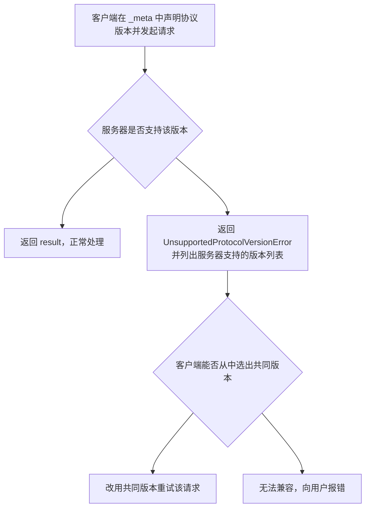

MCP 没有版本号体系里的「主版本 . 次版本 . 修订号」，它的版本就是发布日期。这带来一个直接后果：判断「两个实现能不能对话」不能看数字大小，而要理解这套按日期分版的规则，以及 `2026-07-28` 把「握手协商」改成「每条请求自带版本」之后新旧两代的分野。

## 协议按日期分版

协议版本写作 `2026-07-28` 这样的日期字符串，不是 `2.1.0`。仓库里并排保存多份版本正文（`2024-11-05` 到 `2026-07-28`，外加一份 `draft`），互不覆盖。客户端和服务器各自声明自己支持哪些版本，由运行时逐次协商，而不是靠语义化版本号推断兼容性。

这意味着「升级」不是替换一份文档，而是**新增一个日期目录**：老版本继续可查，新版本独立演进。`2026-07-28` 相对更早版本做了破坏性调整（见下文），所以选型时必须先确认对方实现的是哪一代，而不能只看「都叫 MCP」。

## 三个术语：Modern、Legacy、Dual-era

规范用三个词来描述不同代的实现。理解了它们，后面的兼容讨论就都能对上号。

| 术语 | 特征 | 对应版本 |
|---|---|---|
| Modern | 把版本、身份、能力都作为**逐请求元数据**（`_meta`）传递，不建立会话 | `2026-07-28` 及以后 |
| Legacy | 通过一次 `initialize` **握手**建立会话，之后复用该会话 | `2025-11-25` 及以前 |
| Dual-era | 同时支持 Modern 与 Legacy 两种行为 | 跨代实现 |

## 版本协商：没有握手，每条请求自带版本

旧版 MCP 在连接建立时先跑一次 `initialize`，双方确认版本与能力后才开始正常消息。`2026-07-28` 去掉了这一步：**每条请求都在 `_meta` 里声明它使用的协议版本**，服务器对每条请求独立地接受或拒绝。走 HTTP 时，版本还会额外放进 `MCP-Protocol-Version` 请求头。

该看什么：整条链路上没有「先协商、后通信」的状态。版本不匹配不会中断连接，而是表现为一次可重试的错误——客户端读到 `supported` 列表后换版本重发即可。代价是客户端必须自己实现这段重试逻辑，不能指望一次成功。

不支持请求版本时，服务器**必须**返回 `UnsupportedProtocolVersionError`，并在错误数据里列出自己支持的版本，供客户端选取。错误码是 `-32022`（协议基础页有错误码分区的完整说明）。这里的「不支持」既包括服务器完全没见过的版本，也包括它认识但主动选择了不支持的版本。

配套改动的是一条新规则：服务器**必须**实现 `server/discover`，客户端**可以**在发任何其他请求前先调用它来一次性问清服务器支持哪些版本；但这不是强制流程——客户端完全可以直接发正常请求，遇到 `UnsupportedProtocolVersionError` 再处理。换句话说，`server/discover` 是「提前探路」的可选项，不是新的握手。

## 扩展协商

核心协议之外的可选能力叫**扩展**，也在这里协商。它们出现在能力的 `extensions` 字段里：一个「扩展标识符 → 该扩展设置对象」的映射。扩展标识符必须遵守 `_meta` 的键名规则并带强制前缀，官方扩信用 `io.modelcontextprotocol/` 前缀。

| 扩展 | 标识符 | 设置内容示例 |
|---|---|---|
| MCP Apps | `io.modelcontextprotocol/ui` | 声明支持的 `mimeTypes` |
| Tasks | `io.modelcontextprotocol/tasks` | 空对象表示支持、无附加设置 |

每个扩展自己定义设置对象的 schema；空对象就表示「支持，但没有额外配置」。如果一方支持某扩展、另一方不支持，支持方**必须**退回核心协议行为，或用合适的错误拒绝该请求；扩展应当写明自己期望的回退行为。

## 与旧版握手式协议的兼容

同时支持两代的服务器叫 **Dual-era**：它看客户端怎么开场来决定行为——带 Modern 元数据的请求按本版无状态处理；收到 `initialize` 请求则切到旧版语义，作用域限定在 stdio 进程或 HTTP 会话内。一个 Dual-era 服务器**可以**在同一端点或进程上并发服务两代客户端。

需要同时对接两种服务器的**客户端**，则要靠传输层机制先判断对面是哪一代，再决定用哪套打法。

| 传输 | 判断服务器代际的方式 | 判定结果 |
|---|---|---|
| stdio | 先探测 `server/discover` | 得到 `DiscoverResult` 或现代错误 → Modern；其他错误/超时 → Legacy，回退到 `initialize` |
| Streamable HTTP | 先发一个 Modern 请求，看响应体 | 成功或现代错误 → Modern；`4xx` 且响应体不是可识别的现代错误 → Legacy，回退到 `initialize` |

两条路的核心判据一致：**一个「可识别的现代 JSON-RPC 错误」（例如 `UnsupportedProtocolVersionError`）说明对面是 Modern**，此时客户端应当换版本重试而不是回退；其他任何结果都说明对面是 Legacy。

代际是**服务器的属性，而非单条请求的属性**。因此客户端应把判定结果缓存下来（stdio 缓存在服务器进程生命周期内，HTTP 缓存在该 origin 内），也可以跨重启持久化，但一旦缓存假设失效就要重新探测。

还有一条为旧客户端着想的规则：只支持 Modern 的服务器，在收到 `initialize` 请求时**应当**把自身支持的协议版本写进错误返回。因为 Legacy 客户端没有向前回退机制，这条错误信息可能是它们唯一能呈现给用户的诊断线索。

## 兼容矩阵

下表概括客户端与服务器各代组合的预期结果，是选型和排障时最直接的参考。

| 客户端 | 服务器 | 结果 |
|---|---|---|
| Modern | Modern | 正常。`server/discover` 可选；版本不匹配时以 `UnsupportedProtocolVersionError` 呈现，客户端换版本重试 |
| Modern | Legacy | 失败。服务器可能返回实现自定义错误、保持沉默，甚至按旧语义处理某个「跨代歧义」方法。stdio 下客户端应先探测 `server/discover` 以便确定性失败，再把可操作的错误交给用户 |
| Dual-era | Modern | 正常。stdio 探测得到 `DiscoverResult` 或现代错误；HTTP 首个 Modern 请求成功或返回现代错误。客户端保持 Modern |
| Dual-era | Legacy | 正常。stdio 探测返回非现代错误或超时，回退 `initialize`；HTTP 得到不带现代错误体的 `4xx`，回退 `initialize`（必要时再退到已弃用的 HTTP+SSE 传输） |
| Legacy | Modern | 失败。stdio 下服务器以 JSON-RPC 错误拒绝 `initialize`（`initialize` 是未知方法，且请求缺少必需的 `_meta` 字段，具体错误码由实现决定）；HTTP 下请求缺少必需头，按服务器校验规则以 `400` 拒绝。Legacy 客户端没有向前回退机制 |
| Legacy | Dual-era | 正常。服务器响应 `initialize`，并按协商到的旧版协议服务该客户端 |
| Legacy | Legacy | 按旧版协议正常工作，不在本文档范围内 |

## 落地时要注意什么

- **先确认代际再写兼容代码**。`2026-07-28` 与 `2025-11-25` 及更早是两套交互模型，跨代对接属于兼容层工作，不是改个版本号就能通。
- **客户端需要重试循环**。版本不匹配表现为可重试错误，处理 `supported` 列表并换版本重发是客户端的职责。
- **Metadata 是版本协商的载体**。版本、能力、身份都在 `_meta` 里逐请求传递，这也是为什么协议可以无状态（协议基础页有 `_meta` 的完整键表）。
- **服务器在能力边界上要诚实**。只支持 Modern 的实现，也应在对 `initialize` 的错误里报出自己支持的版本，给旧客户端留下诊断线索。

> 依据：`docs/specification/2026-07-28/basic/versioning.mdx:7-27`、`docs/specification/2026-07-28/basic/versioning.mdx:29-39`、`docs/specification/2026-07-28/basic/versioning.mdx:41-78`、`docs/specification/2026-07-28/basic/versioning.mdx:80-124`、`docs/specification/2026-07-28/basic/versioning.mdx:126-183`、`docs/specification/2026-07-28/changelog.mdx:1-121`
