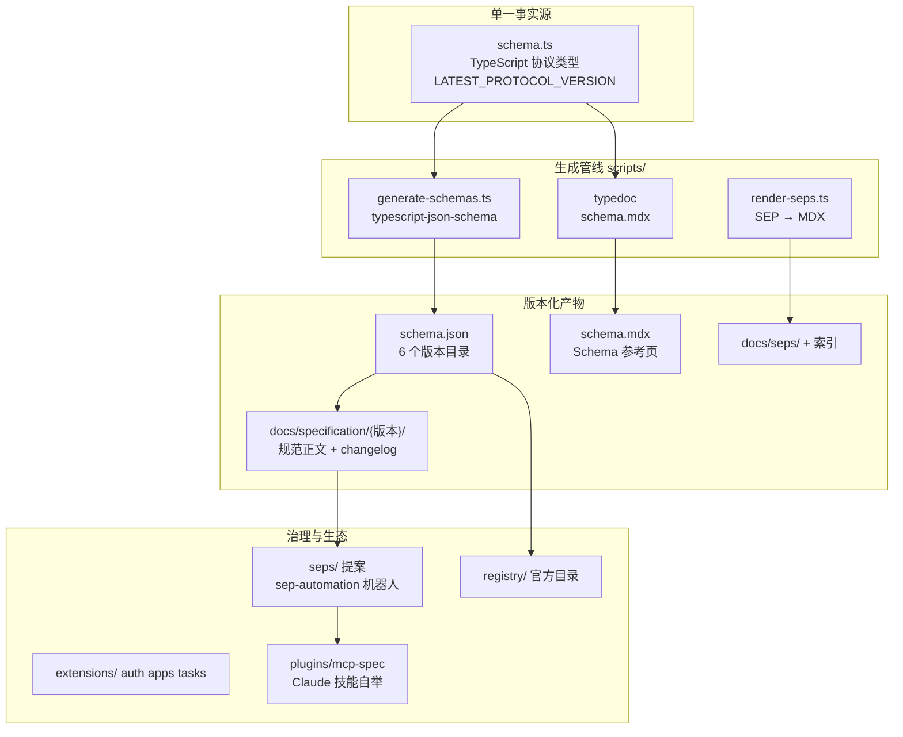

# Model Context Protocol（MCP）深度解读

> **GitHub:** [github.com/modelcontextprotocol/modelcontextprotocol](https://github.com/modelcontextprotocol/modelcontextprotocol) · **协议规范:** [modelcontextprotocol.io](https://modelcontextprotocol.io)
> **本解读按 framework 类规格产出（协议规范 + TypeScript Schema 工程，全新分析）**
> **源码根:** `schema/`（TS 单一事实源 + JSON Schema 产物）+ `docs/specification/`（版本化规范正文）+ `seps/`（SEP 提案）+ `tools/sep-automation/`（治理机器人）

## 子文档索引

- [`protocol-core.md`](protocol-core.md) — 协议核心：JSON-RPC 信封、三阶段生命周期、工具/资源/提示/采样 primitives、双传输
- [`schema-pipeline.md`](schema-pipeline.md) — Schema 工程：TypeScript 单一事实源 → JSON Schema + 文档的生成管线与版本目录演进
- [`governance-evolution.md`](governance-evolution.md) — 治理与演进：SEP 状态机、sep-automation 机器人、feature lifecycle、无状态化重构

## 根因：LLM 应用的上下文/工具集成没有标准接口

每个 LLM 应用接入外部数据源、工具、工作流时，都在**各自私有定义一套连接方式**：RAG 管道自己拼、工具调用自己包、上下文注入自己造。应用想接入多个服务要写多个适配器，服务想被多个应用复用就得重复适配——生态随之碎片化。

MCP 要解决的根本问题：**给「LLM 应用（Host）⇄ 外部数据源与工具（Server）」定义一份双方都能实现的开放协议**，让应用用一个协议接入所有 Server、Server 用一个协议被所有应用复用。它直接借鉴了 LSP 的思路——LSP 标准化了「编辑器 ⇄ 语言服务」，MCP 标准化「AI 应用 ⇄ 上下文/工具服务」[docs/specification/2025-11-25/index.mdx:42-46]()。

<!-- anchor: MCP takes some inspiration from the … and tools into the ecosystem of AI applications. -->

它不是又一个工具调用框架，而是**协议规范本身 + 一套把规范固化为可校验产物的工程体系**：用 TypeScript 类型定义协议（`schema.ts` 作单一事实源）、用生成器产出 JSON Schema 与文档（单源不漂移）、用 capability 协商 + 版本目录管理演进（稳定与进化两不误）、用 SEP 治理流程收编变更（社区决策有据可依）。
## 概览

| 维度 | 说明 |
|------|------|
| 是什么 | LLM 应用（Host）与外部数据源/工具（Server）之间的开放标准化协议 |
| 痛点 | 应用接入数据源/工具无统一接口，每个应用私有实现、生态碎片化 |
| 适用 | AI IDE/聊天应用接工具与上下文、Server 供多应用复用、跨模型/跨厂商工具互通 |
| 运行形态 | 协议规范仓库：TS Schema（单一事实源）+ 版本化规范文档 + SEP 提案 + 治理机器人 |
| 协议载体 | JSON-RPC 2.0，单向往来 Host→Server，Server 反向请求走 sampling/elicitation |
| 传输 | stdio（本地子进程）/ Streamable HTTP（含 SSE 流式返回） |
| 版本 | 目录化版本：2024-11-05 → 2025-11-25（Current）→ 2026-07-28（draft/RC） |
| 治理 | SEP 提案 + 状态机自动化 + conformance 门禁 + feature lifecycle |
| 授权 | MIT，Anthropic 发起，后移交 LF Projects 托管 |

### 核心能力清单

| 能力 | 说明 |
|------|------|
| 生命周期 | `initialize` 握手 → 能力协商 → 操作 → 关闭，版本号 + capabilities 双层协商 |
| Tools | Server 暴露可调用函数：`tools/list`/`tools/call`，`isError` 结构化错误让 LLM 自纠正 |
| Resources | 可读上下文：`resources/read` + 分页 Cursor + 订阅变更通知 |
| Prompts | 模板化工作流：`prompts/list`/`prompts/get` |
| Sampling | Server 反向请求 Host 代为调用 LLM（`sampling/createMessage`），人机回环控制 |
| Elicitation | Server 反向向用户收集结构化输入（form 表单 / url 带外交互双模式） |
| Roots | Server 查询 Host 的文件系统边界 |
| Tasks | 实验性：长耗时请求异步化，task-augmented 轮询取结果 |
| 能力协商 | 未声明即不支持；`experimental` 字段承接非标准扩展 |
| 分页/进度/取消 | `Cursor` 分页、`_meta.progressToken` 进度通知、`notifications/cancelled` |
| Extensions | 官方扩展（auth/apps/tasks）+ 协商式优雅降级 |
| Registry | 官方 MCP 服务器元数据仓库（preview，DNS 校验命名空间） |

### 技术栈一览

| 层面 | 技术 |
|------|------|
| 协议语言 | JSON-RPC 2.0 |
| Schema 单一事实源 | TypeScript（`schema/{版本}/schema.ts`） |
| JSON Schema 生成 | `typescript-json-schema` + `generate-schemas.ts`（draft-07 / 2020-12 双代） |
| Schema 文档 | `typedoc` 从 schema.ts 生成 `schema.mdx` |
| 规范文档站 | Mintlify（MDX，`docs/`） |
| SEP 文档渲染 | `render-seps.ts`（markdown → MDX + 索引 + 导航） |
| 治理机器人 | `tools/sep-automation`（GitHub App，`@octokit` + `pino`，vitest 单测） |
| 博客 | Hugo（`blog/`） |
| 自举 Agent | `plugins/mcp-spec`（Claude Code 技能：`draft-sep` / `search-mcp-github`） |

## 架构总览

仓库是「**Schema 单一事实源 + 版本化规范 + SEP 治理 + 生态扩展**」四层结构，全部围绕「协议规范如何被定义、校验、演进」组织：

### 模块职责映射

| 模块 | 路径 | 职责 |
|------|------|------|
| Schema 事实源 | `schema/{版本}/schema.ts` | 全部协议类型定义，按版本目录归档演进 |
| JSON Schema 产物 | `schema/{版本}/schema.json` | 由 `typescript-json-schema` 生成，供各语言 SDK 消费 |
| 规范正文 | `docs/specification/{版本}/` | 生命周期/传输/primitives/授权 等规范性要求 + changelog |
| SEP 提案 | `seps/` | 40+ 条协议变更提案（Draft→Final 状态机） |
| 治理机器人 | `tools/sep-automation/` | GitHub App 自动化：状态迁移、停滞提醒、dormant 关闭 |
| 扩展 | `docs/extensions/` | 核心协议之外的官方扩展（auth/apps/tasks）及协商机制 |
| 生态目录 | `docs/registry/` | 官方 MCP 服务器元数据仓库（server.json + REST API） |
| 自举技能 | `plugins/mcp-spec/` | 用 Claude Code 技能辅助撰写 SEP 与检索规范 |

## 核心模块导读

| 模块 | 关注面 | 深读 |
|------|--------|------|
| 协议核心 | JSON-RPC 信封、initialize 协商、生命周期、primitives、stdio/HTTP 传输、sampling/elicitation 反向请求 | [`protocol-core.md`](protocol-core.md) |
| Schema 工程 | TS 单一事实源 → JSON Schema + 文档、draft-07→2020-12 迁移、`--check` 一致性门禁、版本目录演进 | [`schema-pipeline.md`](schema-pipeline.md) |
| 治理演进 | SEP 状态机、sep-automation 机器人、conformance 门禁、feature lifecycle、无状态化重构 | [`governance-evolution.md`](governance-evolution.md) |

## 设计哲学：八条原则约束一切协议决策

MCP 的演进决策不是随意的，而是受 `docs/community/design-principles.mdx` 八条原则约束——这是理解「为什么协议长这样」的钥匙：

**收敛优先于选择**：一个问题上只给一条路径，宁可做更难的前置决策也不让生态碎片化（`Convergence over choice`）[docs/community/design-principles.mdx:8-12]()。

<!-- anchor: ## Convergence over choice … [Extensions](/extensions/overview) are where convergence gets tested; the specif -->

**组合优先于特化**：只提供基础原语（resources/tools/prompts），能由这些构建出来的能力就不进核心协议（`Composability over specificity`）[docs/community/design-principles.mdx:14-18]()。

<!-- anchor: ## Composability over specificity … When someone asks why MCP doesn't support a feature directly, the answer is usua -->

**互操作优先于优化**：能力协商让协议适配能力参差的参与方，而非假设人人都能力相同（`Interoperability over optimization`）[docs/community/design-principles.mdx:20-22]()。

<!-- anchor: ## Interoperability over optimization … MCP runs across clients, servers, and models of widely varying sophistication. W -->

**稳定优先于速度**：加特性容易、删特性几乎不可能，协议以十年为单位演进（`Stability over velocity`）[docs/community/design-principles.mdx:24-28]()。

<!-- anchor: ## Stability over velocity … Contributors accustomed to rapid shipping may find this pace frustrating, but su -->

**能力优先于补偿**：不为「当前模型还不够强」的临时局限添加永久结构（`Capability over compensation`）[docs/community/design-principles.mdx:30-34]()。

<!-- anchor: ## Capability over compensation … This is not license to ignore today's reality. Optional context that weaker mode -->

这三条（收敛/组合/互操作）直接解释了 MCP 的两个关键形态：**为什么用能力协商而非枚举全部特性**、**为什么 extensions 被设计成规范之外的第二层**。它们也贯穿在 [`protocol-core.md`](protocol-core.md) 的生命周期设计与 [`governance-evolution.md`](governance-evolution.md) 的「稳定优先」门禁里。

## 同类项目对比

| 维度 | MCP | ACP | LSP | A2A | Function Calling |
|------|-----|-----|-----|-----|------------------|
| 定位 | Host ⇄ 工具/上下文 | 编辑器 ⇄ 编码 Agent | 编辑器 ⇄ 语言服务 | Agent ⇄ Agent | 单模型 → 单工具 |
| 消息模型 | 单向 host→server（JSON-RPC 2.0） | 双向对等（JSON-RPC 2.0） | 双向（JSON-RPC 2.0） | Agent 间 JSON-RPC | 单次调用 |
| 角色 | Host ↔ MCP Server | Client(编辑器) ↔ Agent | Client ↔ Language Server | AgentCard 发现 | 无 |
| 会话抽象 | 有状态连接（2025-11-25 起）/ 无状态化（2026-07-28 起） | 一等公民（多会话并发） | workspace 级 | 无 | 无 |
| 反向请求 | sampling / elicitation / roots | 对等双向 | 服务端主动推送 | 对等 | 无 |
| 版本机制 | 版本目录 + capabilities | 整数 + capabilities + RFD | 版本协商 | 版本协商 | 无 |
| 权威实现 | TS Schema 单一事实源 | Rust 类型 + 生成器 | TS | TS | 各家 API |

与 ACP 的核心差异：MCP 把「Agent 调用工具」与「Agent 要权限」分开——工具/上下文走 Host→Server 单向，Server 需要用户输入或模型代答时**反手发请求**（sampling/elicitation）但要靠 Host 兜底，信任边界始终在 Host 侧；ACP 则是编辑器与 Agent 对等双向。两者互补：ACP 管编辑器⇄Agent，MCP 管 Agent⇄工具，在 ACP 会话建立时通过 `mcpServers` 衔接。

## 数据模型说明

按「数据模型主动探测」扫描：仓库内无 `*.sql` / `migrations/` / models 实体 / ORM 建表入口，未命中数据模型关注面，故不产出 `data-model.md`。协议类型本身以 TS `interface` 承载（见 [`schema-pipeline.md`](schema-pipeline.md)），不构成传统数据模型。

## 设计亮点

- **TypeScript 类型当真源**：协议规范以 TS 类型定义承载，`typescript-json-schema` 生成 JSON Schema、`typedoc` 生成文档页，CI 用 `--check` 锁死「源码-产物」一致性，杜绝文档漂移（[`schema-pipeline.md`](schema-pipeline.md)）。
- **「缺省即不支持」演进原则**：能力对象未声明即视为不支持，新特性默认关闭，老客户端永不被未知能力坑到（[`protocol-core.md`](protocol-core.md)）。
- **SEP 治理工程化**：协议变更走 RFC 化提案流程，状态机 + 停滞阈值 + conformance 门禁全部固化为机器人代码与 CI 检查，社区决策有据可查（[`governance-evolution.md`](governance-evolution.md)）。
- **用 Agent 维护协议**：仓库自带 Claude Code 技能（`draft-sep`）引导作者按治理流程产 SEP，是「AI 参与标准制定」的早期实践（[`governance-evolution.md`](governance-evolution.md)）。

## 不足与风险

- **2026-07-28 是一次破坏性重构**：移除 `initialize` 握手与 session，改为无状态 + 每次请求带版本/能力，并引入 MRTR 模式——这会打破现有 SDK 的会话假设，迁移成本高（[`governance-evolution.md`](governance-evolution.md)）。
- **规范 ≠ 实现**：本仓库只定义协议，互操作质量依赖各语言 SDK 与 registry 治理；registry 目前仍是 preview，生态碎片化风险尚存。
- **能力协商的开放性**：`experimental` 与扩展机制给了灵活性，但也意味着「同一能力的多种实现」可能在生态层重新碎片化——收敛原则只约束核心协议，约束不了外围。

## 总结

回到根因：MCP 让 LLM 应用与数据源/工具之间的集成有了标准答案。它的独特之处不止于协议语义本身（工具/资源/提示三原语 + sampling/elicitation 反向请求），更在于**把协议规范工程化**——用 TypeScript 类型当单一事实源、用生成器产出多格式产物、用 SEP 治理 + 机器人把「改协议」变成可审计的流程。这份解读覆盖协议核心、Schema 生成管线、治理演进三个关注面，是理解「现代 LLM 应用的上下文/工具层如何被标准收敛」的一份完整切片。

- [`protocol-core.md`](protocol-core.md) — 协议语义与消息模型
- [`schema-pipeline.md`](schema-pipeline.md) — 生成管线工程
- [`governance-evolution.md`](governance-evolution.md) — 治理与版本演进

> **GitHub:** [github.com/modelcontextprotocol/modelcontextprotocol](https://github.com/modelcontextprotocol/modelcontextprotocol) · **协议规范:** [modelcontextprotocol.io](https://modelcontextprotocol.io)
