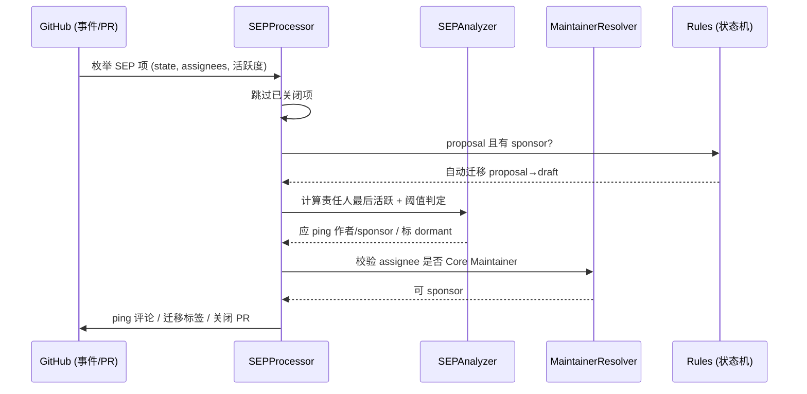

# 治理与演进：SEP 状态机、自动化机器人与版本决策

> 源码根：`tools/sep-automation/src/`（治理机器人）、`docs/community/`（治理文档）、`seps/`（提案）、`docs/specification/{版本}/changelog.mdx`（演进记录）。

被亿万客户端采用的协议，「加特性」是永久承诺，「删特性」几乎不可能（`Stability over velocity` 原则）。因此 MCP 的治理要回答的问题很具体：**一项协议变更从想法到进入规范，如何保证有技术论证、有社区共识、有可验证的实现，且过程可审计？** 答案是三层治理：SEP 提案流程（决策层）、sep-automation 机器人（执行层）、feature lifecycle（退出层）——外加 version changelog 把每次变更钉进历史。

## SEP：协议变更的 RFC 化流程

SEP（Specification Enhancement Proposal）是 MCP 提案机制，文件落在 `seps/`，头部 `Status` 字段声明生命周期状态 [seps/TEMPLATE.md:5]()。

<!-- anchor: - **Status**: Draft | In-Review | Accepted | Rejected | Withdrawn | Final | Superseded | Dormant -->

完整状态机在指南里定义 [docs/community/sep-guidelines.mdx:105-114]()：

<!-- anchor: | Status       | Meaning                                          | … | `dormant`    | No sponsor found within 6 months; can be revived | -->

| 状态 | 含义 |
|------|------|
| `draft` | 找到 sponsor，进行非正式评审 |
| `in-review` | 进入 Core Maintainers 正式评审 |
| `accepted` | 已批准，等待实现 + conformance |
| `rejected` / `withdrawn` | 被否决 / 作者撤回 |
| `final` | 实现与 conformance 齐备，合并 |
| `superseded` | 被更新 SEP 取代 |
| `dormant` | 6 个月未找到 sponsor，可复活 |

关键区分：**`dormant` ≠ `rejected`**——只是没找到 sponsor，想法仍可能有效、可复活 [docs/community/sep-guidelines.mdx:116]()。

### 门禁：prototype 前置 + conformance 收口

SEP 有两道硬门禁，写进模板 [seps/TEMPLATE.md:73-77]()：

<!-- anchor: ## Reference Implementation … Before a SEP can reach "Final" status, the reference implementation must be complete and any required [conformance test](https://modelcontextprotocol.io/community/sep-guidelines#conformance-test-requirement) merged. Include -->

- **Accepted 之前**：必须有可运行的参考实现（prototype，无需生产级）——「用真实实现说话」对应 `Demonstration over deliberation` 原则。
- **Final 之前**：参考实现必须完整，且协议行为可观察的 Standards Track SEP **必须**合并 conformance 测试。

## sep-automation：把治理流程固化成代码

治理规则如果只写在文档里，靠人肉维护必然漂移。`tools/sep-automation` 是一个 GitHub App（octokit + pino，vitest 单测），把**状态迁移合法表、停滞阈值、提醒对象、关闭策略**全部固化为可测试的 TypeScript——治理从「惯例」变成「程序」。

### 状态机与自动迁移

合法迁移表 `STATE_TRANSITIONS` 声明每个状态能到哪些状态：`proposal` 只能去 `draft` 或 `dormant` [tools/sep-automation/src/rules.ts:16-20]()。

<!-- anchor: export const STATE_TRANSITIONS: Record<SEPState, SEPState[]> = { …   proposal: ['draft', 'dormant'], -->

`final` 是终点、`dormant` 可复活回 `proposal`/`draft` [tools/sep-automation/src/rules.ts:40-44]()。

<!-- anchor:   final: [], …   dormant: ['proposal', 'draft'], -->

自动迁移规则 `AUTO_TRANSITION_RULES` 有一条黄金规则：**Core Maintainer 认领 proposal 时自动转 `draft`**——sponsor 的「认领」动作就是状态推进的触发器，不需要人工打标签 [tools/sep-automation/src/rules.ts:123-131]()。

<!-- anchor: export const AUTO_TRANSITION_RULES = { …     trigger: 'maintainer_assigned', -->

处理器里 `checkAutoTransition` 检测到 proposal 有了 sponsor assignee 就执行迁移 [tools/sep-automation/src/processor.ts:130-151]()。

<!-- anchor:   private async checkAutoTransition( …       this.config.dryRun, -->

### 停滞阈值：谁不动就提醒谁

`STALENESS_RULES` 定义了「多久没动静该提醒谁」的阈值表 [tools/sep-automation/src/rules.ts:78-100]()：

<!-- anchor: export const STALENESS_RULES: StalenessRule[] = [ …     pingTarget: 'author', -->

| 状态 | 提醒阈值 | 责任人 | 更严重的处置 |
|------|---------|--------|-------------|
| `proposal` | 90 天 | 作者 | 180 天 → dormant + 关闭 |
| `draft` | 90 天 | sponsor | — |
| `accepted` | 30 天 | 作者 | 等参考实现 |

<!-- anchor: export const STALENESS_RULES: StalenessRule[] = [ -->
<!-- anchor:   closeOnDormant: true, -->

analyzer 的实现展示了「提醒」的精细度：它计算的是**责任人自己的最后活跃时间**（不是 SEP 的 `updated_at`，那会被机器人 ping 刷新）[tools/sep-automation/src/sep/analyzer.ts:74-84]()。

<!-- anchor:   private analyzeProposal(item: SEPItem, daysSinceActivity: number): StaleAnalysis { …         reason: `Proposal inactive for ${daysSinceActivity} days (threshold: ${this.config.proposalDormantDays})`, -->

proposal 180 天无动静就同时标 dormant 并关闭；draft 90 天 ping sponsor [tools/sep-automation/src/sep/analyzer.ts:112-122]()。

<!-- anchor:   private analyzeDraft(item: SEPItem, daysSinceActivity: number): StaleAnalysis { …         reason: `Draft inactive for ${daysSinceActivity} days (threshold: ${this.config.draftPingDays})`, -->

accepted 30 天 ping 作者等实现 [tools/sep-automation/src/sep/analyzer.ts:137-147]()。

<!-- anchor:   private analyzeAccepted(item: SEPItem, daysSinceActivity: number): StaleAnalysis { …         reason: `Accepted SEP inactive for ${daysSinceActivity} days - awaiting reference implementation`, -->

### 防骚扰与审计

机器人的行为有双重守卫：ping 冷却（14 天内不重复 ping 同一 SEP）与维护者失联提醒（14 天无活动提醒）[tools/sep-automation/src/rules.ts:108-116]()。

<!-- anchor: export const MAINTAINER_INACTIVITY_DAYS = 14; … export const PING_COOLDOWN_DAYS = 14; -->

bot 评论带 `BOT_COMMENT_MARKER` 标记，既防重复也便于从历史里剔除机器人自己的活动 [tools/sep-automation/src/types.ts:72]()。

<!-- anchor-base64:ZXhwb3J0IGNvbnN0IEJPVF9DT01NRU5UX01BUktFUiA9ICc8IS0tIHNlcC1hdXRvbWF0aW9uLWJvdCAtLT4nOw== -->

配置全部可经环境变量覆盖，并强制要求认证凭据（token 或 App 私钥二选一）才启动 [tools/sep-automation/src/config.ts:67-75]()。

<!-- anchor: export function loadConfig(): Config { …       'Authentication required: set GITHUB_TOKEN or both APP_ID and APP_PRIVATE_KEY' -->

### 单次运行时序

处理器的运行顺序暴露了设计优先级：**先做自动迁移（成功则本回合不再查停滞）→ 再查停滞 → 最后查维护者问责** [tools/sep-automation/src/processor.ts:62-94]()——状态推进优先于停滞提醒，避免「刚迁移完就被 ping」的错位。

<!-- anchor:   async process(sep: SEPItem): Promise<ProcessResult> { -->
<!-- anchor:       return { results, summaryData }; // Don't check staleness if we just transitioned -->

## Feature Lifecycle：让「删除」也有章法

SEP 管「加入」，feature lifecycle 管「退出」。规范把每个特性归入三态：**Active**（当前规范内）、**Deprecated**（保留但计划删除）、**Removed**（已从 draft 删除，只留在它最后的 Final 版本文档里）[docs/community/feature-lifecycle.mdx:26-30]()。

<!-- anchor: | State          | Meaning                                                                                                                                                       | Implementer expectation                                                                                                     | -->
<!-- anchor: | **Removed**    | The feature has been deleted from `draft` and will be absent from the next Current revision. It remains documented in the Final revision it last appeared in. | Implementations targeting that next Current revision must not depend on the feature.                                        | -->

**废弃是规范变更，也要走 SEP**，且必须声明最短废弃窗口——**至少 12 个月**，从「带废弃标记的版本发布为 Current」起算；窗口内特性保持 Deprecated，之后才允许移除 [docs/community/feature-lifecycle.mdx:65-71]()。

<!-- anchor: 4. Specify the **minimum deprecation window**: the number of months, at least … that point is the feature's **earliest removal**. -->

移除后 `docs/specification/draft/deprecated.mdx` 是「谁在退出、何时退出」的唯一权威页 [docs/community/feature-lifecycle.mdx:94-98]()。

<!-- anchor: [`docs/specification/draft/deprecated.mdx`](/specification/draft/deprecated) is … spread across revision changelogs. -->

Tier 1 SDK 有义务用各自语言原生机制（`@Deprecated`/`[Obsolete]`/`Deprecated:` 文档）同步标记并尽量发出运行时警告 [docs/community/feature-lifecycle.mdx:100-113]()——废弃不是规范单方面宣布，而是规范 + SDK 双轨同步。SDK 分 tier（Tier 1/2/3，要求逐级放宽），不符合要求可触发降级流程。

<!-- anchor: ## Tier 1 SDK Obligations … logger). -->

> **Why 12 个月窗口？** 被广泛采用的协议，删除必须给所有客户端留出迁移期。这与「稳定优先于速度」原则一致：宁可让废弃特性占着规范一段时间，也不让任何实现猝不及防。

## 演进大事记：从有状态会话到无状态化

版本演进不仅是加法，2026-07-28（RC/draft 基准）是一次**破坏性重构**。对照 changelog 可见其方向 [docs/specification/2026-07-28/changelog.mdx:14]()：

<!-- anchor: 2. Make MCP stateless: remove the `initialize`/`notifications/initialized` handshake. Every request now carries its protocol version and client capabilities in `_meta` (`io.modelcontextprotocol/protocolVersion`, `io.modelcontextprotocol/clientCapabilities`). Clients SHOULD identify themselves on each request (`io.modelcontextprotocol/clientInfo`), and servers SHOULD identify themselves in each result's `_meta` (`io.modelcontextprotocol/serverInfo`). Version mismatches return `UnsupportedProtocolVersionError` ([SEP-2575](https://github.com/modelcontextprotocol/modelcontextprotocol/pull/2575)). -->

- **移除 session 与握手**：`MCP-Session-Id`、`initialize`/`notifications/initialized` 全删，每个请求在 `_meta` 里带版本与能力，版本不匹配返回 `UnsupportedProtocolVersionError`（[SEP-2575](https://github.com/modelcontextprotocol/modelcontextprotocol/pull/2575)）。
- **`server/discover`** 替代握手做能力/版本探测，客户端可在任何请求前先探明（[SEP-2575](https://github.com/modelcontextprotocol/modelcontextprotocol/pull/2575)）。
- **MRTR 取代反手请求**：Server 不再主动发 `roots/list`/`sampling/createMessage`，而是返回 `resultType: "input_required"` 的 `InputRequiredResult`，客户端在重试原请求时用 `inputResponses` 补齐 [docs/specification/2026-07-28/changelog.mdx:24]()。
- **tasks 移出核心协议**成官方扩展 `io.modelcontextprotocol/tasks`（[SEP-2663](https://github.com/modelcontextprotocol/modelcontextprotocol/pull/2663)）。

<!-- anchor: 7. Multi Round-Trip Requests (MRTR) pattern introduced which replaces the previous approach of sending server-initiated requests, such as `roots/list`, `sampling/createMessage`, or `elicitation/create`. Servers return an `InputRequiredResult` (`resultType: "input_required"`) whose `inputRequests` field carries the requests for the additional information needed to process the request. Clients respond with `inputResponses` on a retry of the original request providing the requested information. ([SEP-2322](https://github.com/modelcontextprotocol/modelcontextprotocol/pull/2322)). -->

> **Why 无状态化？** 移除 session 是对「有状态连接」的纠偏：跨请求状态让 Server 必须管理会话生命周期、承担崩溃恢复成本，而 MCP 的核心使用场景（工具/资源调用）本就无状态。代价是与 2025-11-25 的既有 SDK 会话假设不兼容——`protocol-core.md` 描述的三阶段生命周期在 2026-07-28 里被整个颠覆。这正是「Stability over velocity」的张力所在：协议要稳，但发现设计失误时也要敢于为长期正确买单。它同时验证了版本目录化（[`schema-pipeline.md`](schema-pipeline.md)）的价值——破坏性变化发生时，旧版本照常可用、新版本另起炉灶。

## 自举：用 Agent 技能维护协议

治理流程不止停留在文档与机器人，还渗透到工具链：`plugins/mcp-spec` 是一个 Claude Code 插件，带两个技能——`draft-sep`（引导作者按治理流程产 SEP）与 `search-mcp-github`（检索规范）。`draft-sep` 的 `description` 直接声明「按 MCP SEP 治理流程研究和起草 SEP」[plugins/mcp-spec/skills/draft-sep/SKILL.md:3-6]()，并用 `arguments.idea` 接住一句提案摘要。技能内部按 Phase 推进：Gate（判断是否值得走 SEP）→ Interview（采集类型/破坏性/原型/共识证据）→ 研究 → 成文——把治理规则变成模型可执行的检查单。

<!-- anchor: description: Research and draft a Specification Enhancement Proposal following the MCP SEP governance process … - name: idea -->

这是「AI 参与标准制定」的早期实践：规范仓库自己吃自己的狗粮，用 Agent 技能把「怎么提提案」从文档规范内化成可执行流程。它与机器人自动化（sep-automation）恰好互补——一个管「提交前」，一个管「提交后」。

## 全局关联：治理如何反哺协议设计

治理机制与 [`protocol-core.md`](protocol-core.md) / [`schema-pipeline.md`](schema-pipeline.md) 是同一闭环的三面：

- **SEP 门禁（prototype + conformance）**保证协议每个特性都有真实实现背书，避免「设计稿协议」——这与「收敛优先」「demonstration over deliberation」一脉相承。
- **changelog 挂 SEP 编号**让每次 schema 变化（`schema-pipeline.md` 里的版本演进）都能回溯到社区决策；`--check` 校验链则保证这些决策真正落进了产物。
- **feature lifecycle 12 个月窗口 + deprecated registry**把「删除」纳入治理，与 `Stability over velocity` 互为表里——加得慢、删得也慢，两边都要走流程。
- **机器人的停滞阈值**本质是把「社区健康度」工程化：没人推进的提案要么被提醒、要么被归档，不让治理文档停留在纸面。

## 总结

MCP 的治理体系回答了「谁来决定协议怎么变」：SEP 提案走状态机（Draft→Final），prototype 与 conformance 两道门禁保证实现先行；sep-automation 机器人把状态迁移、停滞提醒、dormant 关闭全部固化为可测试代码；feature lifecycle 用 12 个月窗口让删除也有章法；版本目录 + changelog 让每次演进可审计。而 2026-07-28 的无状态化重构则展示了这套体系如何为「重大纠偏」兜底——协议会犯错，但治理保证纠错也是公开、可追溯、有缓冲的。

> 关联阅读：协议语义本身见 [`protocol-core.md`](protocol-core.md)；Schema 单一事实源与版本目录见 [`schema-pipeline.md`](schema-pipeline.md)。
