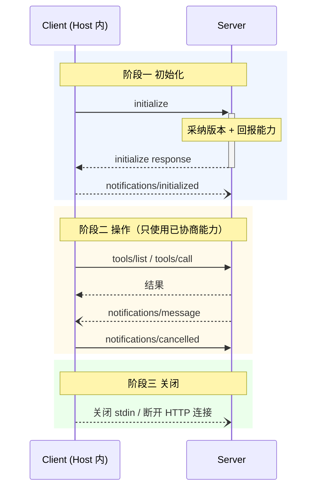

# 协议核心：JSON-RPC 单向往来与三阶段生命周期

> 源码根：`schema/2025-11-25/schema.ts`（协议类型）与 `docs/specification/2025-11-25/`（规范正文）。

MCP 的协议层要回答的问题很具体：**一个 LLM 应用（Host）如何以统一方式发现并调用任意第三方 Server 的上下文、工具与工作流，同时把「谁能动什么」的信任边界牢牢握在 Host 侧？** 答案是 JSON-RPC 2.0 之上的**单向方法集 + 反向请求机制**：Host 单向调用 Server（工具/资源/提示），而 Server 需要额外信息时**反手向 Host 发请求**（sampling 代调模型、elicitation 向用户要输入），是否满足由 Host 决定——双向语义存在，但信任方向不变。

## 协议角色与信封

规范把参与者拆成三层：**Host**（发起连接的 LLM 应用）、**Client**（Host 内的连接器）、**Server**（提供上下文与能力的服务），三者的关系定义在规范概览 [docs/specification/2025-11-25/index.mdx:35-46]()。

<!-- anchor: The protocol uses [JSON-RPC](https://www.jsonrpc.org/) 2.0 messages to establish -->
<!-- anchor: **Servers**: Services that provide context and capabilities -->

信封直接复用 JSON-RPC 2.0 的 request/notification/response 三件套。关键设计是 `Request`/`Notification` 用 `params` 字典承接方法负载、`Response` 拆分成功与错误两个变体，协议本体不关心业务方法，只约定信封：

[schema/2025-11-25/schema.ts:129-131]() 请求必须带 `id`，是可期待的
<!-- anchor: export interface JSONRPCRequest extends Request { … id: RequestId; -->

错误码沿用 JSON-RPC 标准区间（-32700 解析错误 / -32600 非法请求 / -32601 方法不存在 / -32602 非法参数 / -32603 内部错误），并预留了实现特定的 -32000 区间给 MCP 特有错误（如 URL elicitation 要求的 -32042）：

[schema/2025-11-25/schema.ts:172-177]()
<!-- anchor: // Standard JSON-RPC error codes … export const INTERNAL_ERROR = -32603; -->

版本号本身也是 schema 里的常量——`LATEST_PROTOCOL_VERSION = "2025-11-25"` 定义了当前版本基准，所有版本演进都围绕它展开：

[schema/2025-11-25/schema.ts:12]()
<!-- anchor: export const LATEST_PROTOCOL_VERSION = "2025-11-25"; -->

## 三阶段生命周期

规范定义严格的连接生命周期，确保能力协商与状态管理有固定时序 [docs/specification/2025-11-25/basic/lifecycle.mdx:10-12]()：

<!-- anchor: 1. **Initialization**: Capability negotiation and protocol version agreement -->
<!-- anchor: 3. **Shutdown**: Graceful termination of the connection -->

### 初始化：版本与能力双层协商

初始化是连接的第一段交互，客户端**必须**先发 `initialize` 请求，携带协议版本、客户端能力与实现信息；服务端**必须**回报自己的能力与信息 [docs/specification/2025-11-25/basic/lifecycle.mdx:40-51]()。

<!-- anchor: The initialization phase **MUST** be the first interaction between client and server. -->
<!-- anchor: - Client implementation information -->

版本协商采用「客户端报最新支持版本、服务端回自己支持版本、客户端不认就断开」的单轮降级：客户端发它支持的**最新**版本，服务端要么原样回复（匹配）、要么回自己支持的版本（降级），客户端若不支持服务端回的版本则断开 [docs/specification/2025-11-25/basic/lifecycle.mdx:165-172]()。

<!-- anchor: #### Version Negotiation -->
<!-- anchor: version. Otherwise, the server **MUST** respond with another protocol version it -->

能力协商紧随其后：**能力对象未声明即视为不支持**——每个可选特性由双方在初始化时显式宣布，之后的操作阶段只能使用协商通过的能力 [docs/specification/2025-11-25/basic/lifecycle.mdx:184-187]()。这层「缺省即不支持」是 MCP 向后兼容的核心机制：新特性以能力方式加入，老实现遇见未知能力静默忽略即可，不需要版本号频繁递增。

<!-- anchor: #### Capability Negotiation -->
<!-- anchor: available during the session. -->

### 操作与关闭

操作阶段双方**必须**尊重已协商的版本、只用协商过的能力 [docs/specification/2025-11-25/basic/lifecycle.mdx:212-220]()。

<!-- anchor: ### Operation … - Only use capabilities that were successfully negotiated -->

协议本身不定义关闭消息，靠传输层信号终结连接（stdio 关输入流 + 等子进程退出，超时再 SIGTERM/SIGKILL；HTTP 关闭连接）[docs/specification/2025-11-25/basic/lifecycle.mdx:222-236]()。

<!-- anchor: ### Shutdown … 3. Sending `SIGKILL` if the server does not exit within a reasonable time after `SIGTERM` -->

> **Why 单轮版本协商？** 与 ACP 的整数版本不同，MCP 用「日期字符串 + 能力协商」把破坏性变更与功能叠加拆成两个轨道：版本号只在协议语义变化时换目录，新特性一律走能力协商。代价是能力集增长后协商负载变大（2026-07-28 甚至把它推进 `_meta` 变成无状态，见 [`governance-evolution.md`](governance-evolution.md)）。

## 传输：本地子进程与远程 HTTP

传输层与协议语义解耦。**stdio** 是最简形态：客户端以子进程启动 Server，stdin/stdout 走换行分隔的 JSON-RPC 消息，stderr 留给日志且不视为错误 [docs/specification/2025-11-25/basic/transports.mdx:22-34]()。

<!-- anchor: In the **stdio** transport: -->
<!-- anchor: - The client **MUST NOT** write anything to the server's `stdin` that is not a valid MCP -->

**Streamable HTTP** 是远程形态：单一 MCP 端点同时支持 POST（客户端发消息）与 GET（打开 SSE 流收听服务端主动消息），服务端可选 SSE 流式返回；它替代了 2024-11-05 的 HTTP+SSE 传输 [docs/specification/2025-11-25/basic/transports.mdx:63-72]()。

<!-- anchor: In the **Streamable HTTP** transport, the server operates as an independent process that -->
<!-- anchor: **MCP endpoint**) that supports both POST and GET methods. For example, this could be a -->

POST 每条 JSON-RPC 消息都要带 `Accept`（json 与 event-stream 都支持），请求可能返回单个 JSON 或发起 SSE 流；SSE 流用事件 ID 做可续传游标（`Last-Event-ID` 恢复重连，事件 ID 按流唯一）[docs/specification/2025-11-25/basic/transports.mdx:86-94]()。

<!-- anchor: Every JSON-RPC message sent from the client **MUST** be a new HTTP POST request to the -->
<!-- anchor: 2. The client **MUST** include an `Accept` header, listing both `application/json` and -->

有状态会话（需要跨请求状态的服务端）用 `MCP-Session-Id` 头承载：初始化时服务端可选下发会话 ID，客户端之后所有请求都带上；服务端可随时 404 终结会话，客户端收到 404 就重新初始化 [docs/specification/2025-11-25/basic/transports.mdx:192-218]()。

<!-- anchor: ### Session Management -->
<!-- anchor: `MCP-Session-Id` header, to explicitly terminate the session. -->

> **Why 不定义协议级关闭消息？** 规范刻意把关闭完全委托给传输层——stdio 关管道、HTTP 断连接，实现者不需要协商一种「关会话」的语义。代价是协议对「优雅关闭」几乎无约束，全靠 SDK 约定；而 2026-07-28 更进一步把 session 整个移除（见 [`governance-evolution.md`](governance-evolution.md) 的无状态化）。

## 服务端三原语：Tools / Resources / Prompts

服务端能提供的能力收敛为三个原语，对应 `ServerCapabilities` 里的 `tools`/`resources`/`prompts` 三个能力对象 [schema/2025-11-25/schema.ts:386-424]()。

<!-- anchor: export interface ServerCapabilities { -->
<!-- anchor:   tools?: { -->

### Tools：模型可控的函数

工具设计成**模型可控**——语言模型基于上下文理解自动发现并调用，但协议不强制定任何具体交互形态 [docs/specification/2025-11-25/server/tools.mdx:14-20]()。

<!-- anchor: Tools in MCP are designed to be **model-controlled**, meaning that the language model can … suits their needs&mdash;the protocol itself does not mandate any specific user -->

安全上规范**必须**有人机回环：让用户能看到暴露了哪些工具、调用时有视觉指示、执行前有确认 [docs/specification/2025-11-25/server/tools.mdx:24-32]()。

<!-- anchor: For trust & safety and security, there **SHOULD** always … - Present confirmation prompts to the user for operations, to ensure a human is in the -->

`Tool` 类型的核心是 `inputSchema`（JSON Schema 描述参数）——这是协议与模型互操作的关键切口：模型看到的不是函数签名而是 schema [schema/2025-11-25/schema.ts:1249-1260]()。

<!-- anchor: export interface Tool extends BaseMetadata, Icons { … inputSchema: { -->

`tools/call` 的参数就是 `name` + `arguments` 字典 [schema/2025-11-25/schema.ts:1137-1146]()。

<!-- anchor: export interface CallToolRequestParams extends TaskAugmentedRequestParams { … arguments?: { [key: string]: unknown }; -->

工具调用结果的错误处理是 MCP 的一个精妙设计：`CallToolResult.isError` 把**工具自身的业务错误**与**协议级错误**分开——工具出错应放进 `result` 里标 `isError: true` 而非返回协议错误响应，这样 LLM 能看到错误并自我纠正 [schema/2025-11-25/schema.ts:1104-1129]()。

<!-- anchor: export interface CallToolResult extends Result { … isError?: boolean; -->

工具描述/注解被显式视为**不可信输入**（`ToolAnnotations` 全是 hint，客户端不得据此做决策）[schema/2025-11-25/schema.ts:1180-1184]()。

<!-- anchor: export interface ToolAnnotations { … title?: string; -->

### Resources：可读上下文

Resources 提供「给用户或模型看的数据」，支持分页（`Cursor` 游标）与变更订阅（`subscribe`/`listChanged`）——区别在于 Tools 是执行动作、Resources 是读取上下文。分页游标由 `PaginatedResult.nextCursor` 承载，是长列表的第一层节流手段。

### Prompts：模板化工作流

Prompts 是「用户可触发的预置提示模板」（含参数、可能内嵌资源引用），由客户端在 UI 里向用户展示、由用户发起执行——它把「引导模型做某类事情」固化成语义化入口，而非协议强制的流程。

## 客户端反向能力：Sampling / Elicitation / Roots / Tasks

这四个能力由 `ClientCapabilities` 声明，是 MCP「反手请求」的四个出口：

### Sampling：Server 让 Host 代调模型

Sampling 允许 Server 在**嵌套在其他 MCP 功能内部**发起 LLM 调用——Server 本身没有模型，它请求 Host 用其模型代为生成 [docs/specification/2025-11-25/client/sampling.mdx:16-17]()。

<!-- anchor: Sampling in MCP allows servers to implement agentic behaviors, by enabling LLM calls to … occur _nested_ inside other MCP server features. -->

请求参数 `CreateMessageRequestParams` 明确"客户端的偏好"都是可忽略的：`modelPreferences`、`systemPrompt`、`includeContext`、`temperature` 全带"MAY ignore"语义，`maxTokens` 也是「最多」而非保证 [schema/2025-11-25/schema.ts:1578-1605]()。

<!-- anchor: export interface CreateMessageRequestParams extends TaskAugmentedRequestParams { … maxTokens: number; -->

安全上同样**必须**人机回环：客户端要让用户审查采样请求、允许编辑 prompt、对生成结果先审后交 [docs/specification/2025-11-25/client/sampling.mdx:25-32]()。

<!-- anchor: For trust & safety and security, there **SHOULD** always … - Present generated responses for review before delivery -->

2025-11-25 进一步允许采样中带工具（`tools` + `toolChoice`），让 Server 通过 Host 的模型实现「工具循环」——但要求 Host 先声明 `sampling.tools` 能力，Server 不得对未声明的客户端发工具化采样 [docs/specification/2025-11-25/client/sampling.mdx:38-40]()。

<!-- anchor: Clients **MUST** declare support for tool use via the `sampling.tools` capability to receive tool-enabled sampling requests. Servers **MUST NOT** send tool-enabled sampling requests to Clients that have not declared support for tool use via the `sampling.tools` capability. -->

### Elicitation：Server 向用户收集结构化输入

Elicitation 是采样之外的另一条反向通道：Server 直接向用户请求额外信息，分 **form**（受限 JSON Schema 表单）与 **url**（OAuth 等带外交互）双模式。当请求因缺少信息无法继续时，Server 可回 `URLElicitationRequiredError`（-32042）要求先完成 url 模式交互，错误里带所需 elicitation 列表 [docs/specification/2025-11-25/client/elicitation.mdx:424-430]()。

<!-- anchor: When a request cannot be processed until an elicitation is completed, the server **MAY** return a [`URLElicitationRequiredError`](#error-handling) (code `-32042`) to indicate to the client that a URL mode elicitation is required. The server **MUST NOT** return this error except when URL mode elicitation is required. -->
<!-- anchor: Any elicitations returned in the error **MUST** be URL mode elicitations and have an `elicitationId` property. -->

### Roots 与 Tasks

Roots 是 Server 查询 Host 文件系统边界的通道（`roots/list`，Host 声明 URI 边界），Task 是实验性的异步化机制：`TaskStatus` 枚举 `working`/`input_required`/`completed`/`failed`/`cancelled` 描述长耗时请求的状态，配合 `TaskMetadata.ttl` 让客户端轮询取结果 [schema/2025-11-25/schema.ts:1306-1311]()。

<!-- anchor: export type TaskStatus = -->
<!-- anchor:   | "cancelled"; // The request was cancelled before completion -->

## 全局关联：单向协议 + 反向出口 = 信任留在 Host

回到根因——MCP 协议层的设计哲学是**把「谁有权限做什么」的裁决权集中到 Host 侧**：

- **单向往来**（Host→Server 调工具/读资源/取提示）保证 Server 永远被动：它不能主动碰 Host 的文件系统、模型或用户，这三点恰好是 MCP 安全模型的三根支柱（用户同意、数据隐私、工具安全）。
- **反向出口**（sampling/elicitation/roots）给了 Server「要」的能力，但「给不给」由 Host 裁决——Server 要模型就发 sampling 请求、要用户输入就发 elicitation 请求、要文件系统边界就查 roots，语义上是双向的，信任方向上始终单向。
- **能力协商**把兼容性决策集中到 `initialize` 一刻做完，之后操作阶段零协商，符合「收敛优先」原则；扩展能力走 `experimental` 字段或 extensions 机制（见 [`governance-evolution.md`](governance-evolution.md)），核心协议保持最小必要。
- **`isError` 结构化错误**与「注解不可信」是同一思路的两面：协议不信任 Server 的自我描述，但给模型自纠正留出空间。

与 ACP 的差异在此一目了然：ACP 让编辑器和 Agent **对等**双向（Agent 可主动要权限、要文件），MCP 则把 Agent 的「要」全部收进受控的反向请求里——一个针对编码场景的双向协作，一个针对通用工具集成的单向调用。

## 总结

MCP 协议层 = JSON-RPC 2.0 信封 + 三阶段生命周期（初始化/操作/关闭）+ 服务端三原语（工具/资源/提示）+ 客户端四个反向出口（sampling/elicitation/roots/tasks）。全部设计判断都指向一个目标：**把「LLM 应用与外部能力集成」还原成一组可协商、可演进、可互操作、且信任方向明确的单向消息**，而不是某个产品的私有集成协议。`isError` 让模型自纠正、能力协商让新旧实现共存、反向请求让 Server 也有表达权——这是它区别于 Function Calling 私有 API 的三个标志性语义。

> 关联阅读：Schema 单一事实源与生成管线见 [`schema-pipeline.md`](schema-pipeline.md)；SEP 治理、feature lifecycle 与无状态化重构见 [`governance-evolution.md`](governance-evolution.md)。
