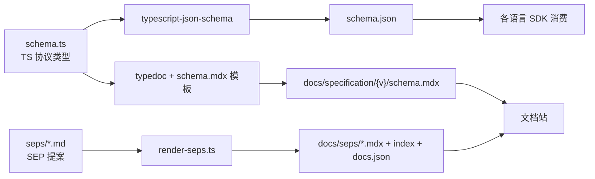

# Schema 工程：TypeScript 单一事实源与生成管线

> 源码根：`schema/{版本}/schema.ts`（事实源）、`scripts/generate-schemas.ts`、`scripts/render-seps.ts`、`typedoc.plugin.mjs`。

协议规范最大的工程风险是**文档漂移**：规范正文写一套、SDK 实现一套、Schema 产物又一套，三处各自演进。MCP 用「TypeScript 类型作单一事实源」解决这个问题——协议的所有消息结构只在一份 `schema.ts` 里定义，JSON Schema、文档页、SEP 索引全部从它（或与它同源的 markdown）程序化生成，并在 CI 里用 `--check` 模式验证产物未过时。改协议 = 改类型 + 跑生成器，产物跟着变，不存在「改了规范忘改 schema」的缝隙。

## 生成管线总览

三条生成链共享同一套铁律：**产物必须能被重新生成并逐字节对上**（`--check` 模式），对不上就报错退出，让 CI 永远知道「产物过时了」。

### JSON Schema 链：`typescript-json-schema` + 双代迁移

`schema.json` 由 `typescript-json-schema` 从 `schema.ts` 生成。脚本把版本分成两代——三个旧版本（2024-11-05 / 2025-03-26 / 2025-06-18）保持 JSON Schema **draft-07**，三个新版本（2025-11-25 / 2026-07-28 / draft）用 **2020-12** [scripts/generate-schemas.ts:10-18]()。

<!-- anchor: // Legacy schema versions that should remain as JSON Schema draft-07 -->
<!-- anchor: const ALL_SCHEMAS = [...LEGACY_SCHEMAS, ...MODERN_SCHEMAS]; -->

新旧两代不是两套生成逻辑，而是**同一产物 + 一组文本迁移**：生成后用正则把 `$schema` URL、`definitions`→`$defs`、`#/definitions/`→`#/$defs/` 逐字替换，把 draft-07 产物翻译成 2020-12 语义（新语法的 key 重命名）[scripts/generate-schemas.ts:40-47]()。

<!-- anchor:   // Replace #/definitions/ with #/$defs/ -->
<!-- anchor:   writeFileSync(schemaPath, content, 'utf-8'); -->

> **Why 文本替换而非重新生成？** `typescript-json-schema` 只输出 draft-07 风格，2020-12 只是引用指针与定义名的改写。这里暴露了一个取舍：协议迁移到 2020-12 方言是**逐步过渡**的（老版本产物原样保留、新版本走迁移），保证老 SDK 引用的 schema.json 不被悄悄改写——兼容性优先于「纯净」。

`generateSchema` 一个函数两个模式：`check` 模式下重新生成并与已落盘的 schema.json 逐字节比较（不匹配即 `✗ out of date` 返回 false）[scripts/generate-schemas.ts:52-55]()。

<!-- anchor: async function generateSchema(version: string, check: boolean = false): Promise<boolean> { -->
<!-- anchor:   const schemaJson = join(schemaDir, 'schema.json'); -->

`check` 分支先从磁盘读现有 schema.json 作比较基准 [scripts/generate-schemas.ts:57-59]()。

<!-- anchor:   if (check) { …     const existingSchema = readFileSync(schemaJson, 'utf-8'); -->

`write` 分支把 `typescript-json-schema` 的输出写进 `-o` 指定的文件 [scripts/generate-schemas.ts:91-95]()。

<!-- anchor-base64:ICB9IGVsc2UgeyDigKYgICAgICAgICBgbnB4IHR5cGVzY3JpcHQtanNvbi1zY2hlbWEgLS1kZWZhdWx0TnVtYmVyVHlwZSBpbnRlZ2VyIC0tcmVxdWlyZWQgLS1za2lwTGliQ2hlY2sgIiR7c2NoZW1hVHN9IiAiKiIgLW8gIiR7c2NoZW1hSnNvbn0iYA== -->

main 用 `Promise.all` 并行跑全部版本，任一版本过时则 `process.exit(1)`，让 CI 在「schema.ts 改了但 schema.json 没重新生成」时直接失败 [scripts/generate-schemas.ts:115-131]()。

<!-- anchor: async function main(): Promise<void> { -->
<!-- anchor:       console.log('All schemas are up to date!'); -->

### 文档链：typedoc + `@category` 模板占位

`schema.mdx`（文档站的 Schema 参考页）由 **typedoc** 生成——但 schema.ts 是接口定义文件不是类，所以仓库写了个 `typedoc.plugin.mjs`：注册 `schemaPageTemplate` 选项与 `schema-page` 输出，把 `schema.mdx` 当作**模板**（文件里全是 `## \`initialize\`` 标题 + `{/* @category \`initialize\` */}` 占位符），渲染时用 `replaceAll` 把每个占位符替换成该 `@category` 分组下的类型渲染 [typedoc.plugin.mjs:99-105]()。

<!-- anchor:   const rendered = template.replaceAll( -->
<!-- anchor:   }); -->

模板里的 `@category` 与 schema.ts 每个类型的 `@category \`initialize\`` JSDoc 注释一一对应（见 [schema/2025-11-25/schema.ts:265-267]() 的 `@category` 标注）——**类型归属哪个方法由源码注释决定，模板只是声明渲染顺序**。

<!-- anchor:  * This request is sent from the client to the server when it first connects, asking it to begin initialization. -->
<!-- anchor:  * @category `initialize` -->

漏掉任一类别直接抛错「missing from the schema page template」，防止新增方法没进文档 [typedoc.plugin.mjs:107-118]()。

<!-- anchor:   const missingCategories = reflectionEvents. -->
<!-- anchor:     ); -->

### SEP 链：`render-seps.ts` 双向渲染

`seps/*.md`（提案正文）→ `docs/seps/*.mdx`（文档站页面）+ 索引 + `docs.json` 导航。`parseSEPMetadata` 用正则从 markdown 头解析编号/状态/类型/作者/PR，文件名 `(\d+)-(.+).md` 是事实源的编号载体 [scripts/render-seps.ts:42-56]()。

<!-- anchor: function parseSEPMetadata(content: string, filename: string): SEPMetadata | null { -->
<!-- anchor:   const [, number, slug] = filenameMatch; -->

Final 状态的 SEP 会被注入「历史记录」提示——Final SEP 是时间点快照，之后的协议变化不回流（`FINAL_SEP_NOTICE`）[scripts/render-seps.ts:128-134]()。

<!-- anchor: const FINAL_SEP_NOTICE = `<Note> -->
<!-- anchor: </Note>`; -->

索引页还按状态给 SEP 打徽章色并生成状态分布摘要 [scripts/render-seps.ts:180-192]()。

<!-- anchor: function generateIndexPage(seps: SEPMetadata[]): string { -->
<!-- anchor:     {} as Record<string, number> -->

## `--check` 一致性门禁：把「不漂移」变成 CI 红线

三个生成器全部带 `--check` 模式，收拢进 `npm run check`：

- `check:schema:json` = `generate-schemas.ts --check`（schema.json 逐字节比对）
- `check:schema:md` = typedoc 输出用 `cmp` 与已落盘 schema.mdx 比对
- `check:seps` = `render-seps.ts --check`（临时目录生成 → prettier 格式化 → 逐文件比对）

`package.json` 里它们组成 `npm run check`，在 PR 上强制协议变更必须同步更新产物 [package.json:32-34]()。

<!-- anchor:     "check": "npm run check:schema && npm run check:docs && npm run check:seps", -->
<!-- anchor:     "check:seps": "tsx scripts/render-seps.ts --check", -->

`render-seps.ts` 的 check 逻辑展示了一个细节：因为要保证比对的是**格式化后**的内容，它在临时目录生成期望产物 → 用 prettier 写入 → 再与现有文件逐字节比较，任何差异都输出「File out of date」并退出码 1 [scripts/render-seps.ts:397-441]()。

<!-- anchor:   if (checkMode) { -->
<!-- anchor:     console.log("All SEP documentation is up to date."); -->

> **Why 逐字节而非「存在即可」？** 文档生成类项目常见的坑是「生成器跑了但输出变了没人发现」。MCP 用字节级比对把「生成产物过时」从默默漂移变成 CI 红牌——这是「让程序验证，不让模型自证」在工程流水线上的同构落地。

## TypeScript 类型系统的深度使用（语言惯用法维度）

schema.ts 用 TS 类型能力承载协议语义，几个设计点有迁移价值：

**信封宽、负载严**：`Request` 基接口的 `params?: { [key: string]: any }` 允许非官方扩展不破坏类型，而具体方法的 `*RequestParams` 再精确化 [schema/2025-11-25/schema.ts:65-69]()。

<!-- anchor: export interface Request { … params?: { [key: string]: any }; -->

**请求增强用继承、扩展用开放字典**：`RequestParams` 定义 `_meta`（含 `progressToken` 开放字典）[schema/2025-11-25/schema.ts:51-60]()。

<!-- anchor: export interface RequestParams { … [key: string]: unknown; -->

`TaskAugmentedRequestParams extends RequestParams` 只追加 `task` 字段——是「组合优先」原则在类型层的体现 [schema/2025-11-25/schema.ts:35-44]()。

<!-- anchor: export interface TaskAugmentedRequestParams extends RequestParams { … task?: TaskMetadata; -->

**判别联合表达信封**：`JSONRPCResponse = JSONRPCResultResponse | JSONRPCErrorResponse` 把成功/失败建模为类型级总和 [schema/2025-11-25/schema.ts:148-170]()。

<!-- anchor: export interface JSONRPCResultResponse { … export type JSONRPCResponse = JSONRPCResultResponse | JSONRPCErrorResponse; -->

**`@category` 注释即文档契约**：类型分组信息藏在 JSDoc，被 typedoc 插件消费成文档结构——注释不只是给人看的，也是生成器输入。

**`typeof` 字面量约束**：`jsonrpc: typeof JSONRPC_VERSION` 让协议版本号单一来源 [schema/2025-11-25/schema.ts:129-131]()。

<!-- anchor: export interface JSONRPCRequest extends Request { … id: RequestId; -->

这些都服务于同一个目标：**让类型定义既是运行时真源、又是文档结构、又是 schema 语义的锚**——一份投入、三处产出。

## 版本目录演进：协议长什么样由 changelog 说了算

Schema 按版本**目录归档**（`schema/2024-11-05/` … `schema/2026-07-28/` + `draft/`），每个版本目录自带一份冻结的 `schema.ts` + `schema.json`，历史版本永不改写。版本演进的事实链是：

| 版本 | schema.ts 行数 | 定位 |
|------|---------------|------|
| 2024-11-05 | 1117 | 首发：HTTP+SSE 传输、三原语雏形 |
| 2025-03-26 | 1258 | 增量（draft-07） |
| 2025-06-18 | 1613 | 增量（draft-07） |
| 2025-11-25 | 2582 | **Current**：Streamable HTTP、elicitation、tasks 实验性引入，迁移 2020-12 |
| 2026-07-28 | 3197 | 无状态化重构（RC/draft 基准） |

每个版本的「Key Changes」由 `changelog.mdx` 记录，且**每条变更都挂 SEP 编号**（如 2025-11-25 的「sampling 支持工具调用」挂 SEP-1577、「JSON Schema 2020-12 默认方言」挂 SEP-1613）——版本演进与治理流程形成闭环：`changelog → SEP → schema.ts → schema.json/schema.mdx` 全链路可追溯（详见 [`governance-evolution.md`](governance-evolution.md)）。

## 全局关联：Schema 工程如何服务协议治理

回到根因——「TypeScript 单一事实源」不是工程洁癖，而是为治理服务的：

- **版本目录冻结**让「历史协议不可变」成为物理事实：老 SDK 永远能引用老 schema.json，新 SDK 用新版本，演进不必破坏历史。
- **生成管线 + CI 锁死**让「改协议必须同步产物」成为流程红线，减少人为漂移；而 `@category` 注释驱动的文档让类型↔文档自动对齐。
- **changelog 挂 SEP 编号**把每个 schema 变化接回社区决策链——schema.ts 的每一行演进都有提案依据，治理不是事后解释而是事前裁决。
- 与 [`protocol-core.md`](protocol-core.md) 的衔接：`_meta` 开放字典（`RequestParams`）正是 2026-07-28 无状态化把版本/能力挪进 `_meta` 的类型基础；`TaskAugmentedRequestParams` 的 `task` 字段则是 tasks 异步化的入口。

## 总结

MCP 的 Schema 工程把「协议规范」变成可编译、可校验、可追溯的资产：TypeScript 类型作单一事实源，`typescript-json-schema`/typedoc/render-seps 三链生成 JSON Schema 与文档，`--check` 字节级比对把不漂移固化为 CI 红线，版本目录让演进无损、changelog 挂 SEP 让每次变更可审计。这是「规范仓库工程化」的范本——协议的权威性不靠文档口号，靠的是生成链与校验链把它们焊在一起。

> 关联阅读：协议语义本身见 [`protocol-core.md`](protocol-core.md)；SEP 治理、feature lifecycle 与无状态化重构见 [`governance-evolution.md`](governance-evolution.md)。
