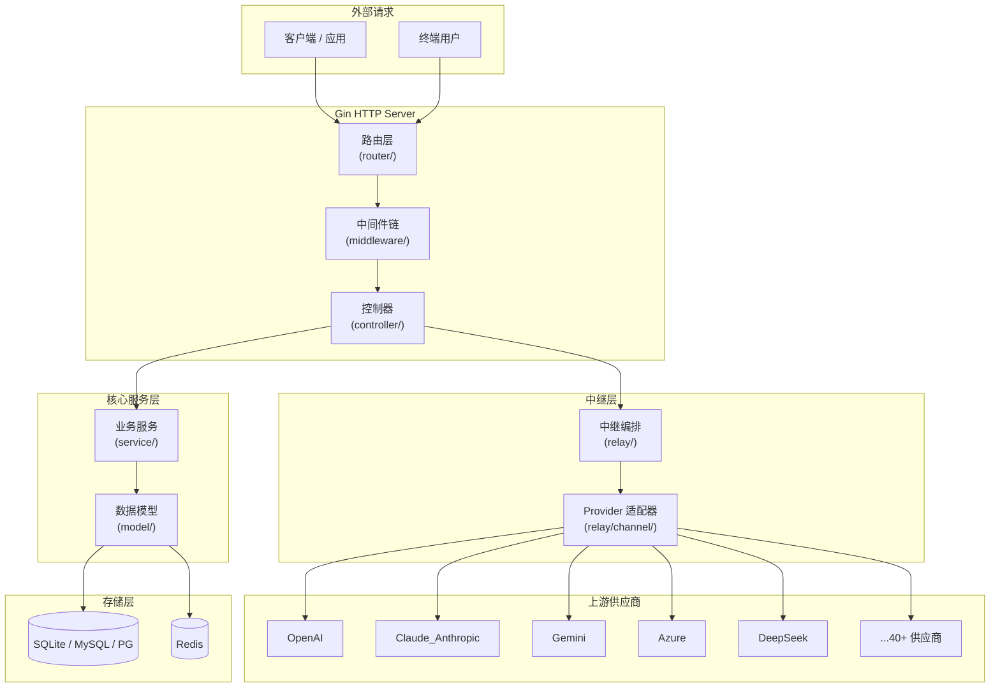
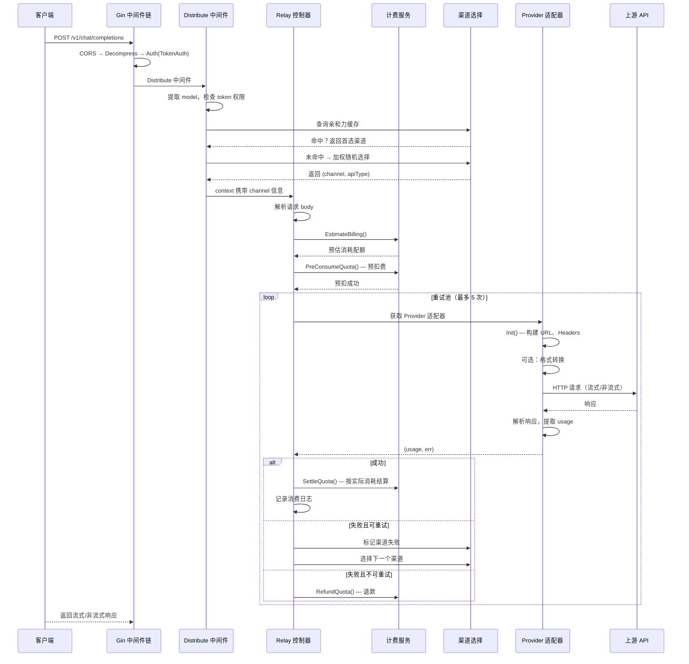
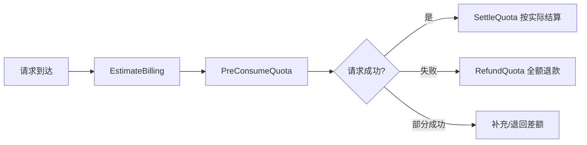

# New API — 统一 AI API 网关深度解读

> 项目地址：[QuantumNous/new-api](https://github.com/QuantumNous/new-api) | 协议：AGPL-3.0 | 语言：Go
>
> 计费系统独立深度解读：[billing.md](billing.md)

## 第一部分：快速概览

### 是什么

New API 是一个 **统一 AI API 网关和资产管理平台**。它将 40+ 上游 AI 供应商（OpenAI、Claude、Gemini、Azure、DeepSeek 等）的 API 整合到一套统一的接口后面，并提供用户管理、计费结算、速率限制、管理面板等配套能力。

### 解决什么根本问题

AI 爆发带来了一个现实问题：**没有一家供应商能满足所有需求**。不同的模型在不同的场景下各有优劣，企业需要同时接入多个供应商。这带来了几个痛点：

- **接口碎片化** — 每个供应商的 API 格式、认证方式、错误处理不同，集成成本高
- **计费混乱** — 各供应商计价规则不同，缺乏统一的使用统计和成本控制
- **管理分散** — 密钥分发、额度分配、访问控制需要在多个平台分别配置
- **容灾困难** — 某个供应商不可用时，需要手动切换

New API 的核心价值在于：**提供一个统一接入层，让上层应用只需对接一套 API，底层供应商的差异由网关屏蔽**。

### 适用场景

- 企业内部统一管理多个 AI 模型供应商的 API 访问
- SaaS 平台需要向终端用户提供 AI 能力并计费
- 开发者希望在多个供应商之间做负载均衡和故障转移
- 需要细粒度权限控制和用量审计的场景

### 核心能力清单

| 能力 | 说明 |
|------|------|
| **统一 API 接入** | 兼容 OpenAI API 格式，支持 Chat、Completion、Embedding、Image、Audio、Rerank、Responses 等接口 |
| **多供应商聚合** | 内置 40+ 供应商适配器，支持自定义供应商 |
| **格式自动转换** | OpenAI ⇄ Claude ⇄ Gemini 请求格式自动互转 |
| **渠道分发** | 加权随机选择、亲和力缓存、故障隔离、跨组重试 |
| **计费结算** | 预扣费 → 消耗 → 退款生命周期，支持钱包余额 + 订阅套餐双资金池 |
| **阶梯定价** | 表达式引擎支持的动态/阶梯定价，无需改代码即可调整计价规则 |
| **速率限制** | 全局/用户/模型级速率限制，支持 Redis 分布式计数 |
| **认证体系** | JWT Token、API 密钥、WebAuthn 无密码登录、OAuth 集成、2FA |
| **权限管理** | 多角色（Guest/User/Admin/Root）+ Casbin 细粒度授权 |
| **管理面板** | React 19 现代 UI + React 18 经典 UI，支持一键切换 |
| **多数据库** | SQLite / MySQL / PostgreSQL，日志库额外支持 ClickHouse |
| **多实例部署** | Redis + 数据库租赁实现多主节点协调 |

### 技术栈一览

| 层级 | 技术 |
|------|------|
| 语言 | Go 1.25 |
| Web 框架 | Gin |
| ORM | GORM v2 |
| 数据库 | SQLite / MySQL 5.7+ / PostgreSQL 9.6+ |
| 缓存 | Redis (go-redis) + 内存缓存 |
| 认证 | JWT (golang-jwt)、WebAuthn (go-webauthn)、Casbin 授权 |
| 前端 (默认) | React 19 + TypeScript + Rsbuild + Base UI + Tailwind v4 |
| 前端 (经典) | React 18 + TypeScript + Rsbuild + Semi Design |
| i18n | go-i18n (后端) + i18next (前端) |
| 支付 | Stripe / EPay / Creem |

---

## 第二部分：架构深读

### 整体架构



架构采用明确的 **四层隔离**：

| 层 | 目录 | 职责 | 依赖 |
|----|------|------|------|
| **路由层** | `router/` | 端点注册、路由分组、中间件装配 | 仅依赖 middleware + controller |
| **中间件层** | `middleware/` | 横切关注点：认证、限流、渠道分发、日志、CORS | 依赖 service + model |
| **控制层** | `controller/` | HTTP 请求处理、参数解析、响应组装 | 依赖 service + relay |
| **服务层** | `service/` | 业务逻辑编排：计费、渠道选择、格式转换、权限 | 依赖 model + common |
| **模型层** | `model/` | GORM 数据模型 + 数据库访问 | 依赖 common |
| **中继层** | `relay/` | API 代理编排 + Provider 适配器 | 依赖 common + types |

### 启动流程

```
main.go
  │
  ├─ 1. 读取环境变量 / 系统配置
  │    ・数据库 DSN、Redis 地址、OAuth 配置、系统选项
  │
  ├─ 2. 初始化数据库
  │    ・连接主数据库（SQLite/MySQL/PG）
  │    ・连接日志数据库（同上 + ClickHouse）
  │    ・GORM AutoMigrate 自动建表
  │
  ├─ 3. 初始化 Redis
  │    ・连接 Redis（可选，降级为内存缓存）
  │    ・启动缓存同步：Options、Channel、AuthzPolicy
  │
  ├─ 4. 初始化 i18n 和 OAuth 服务
  │
  ├─ 5. 启动后台协程
  │    ・通道缓存同步（定时刷新供应商列表）
  │    ・选项缓存同步
  │    ・授权策略同步（Casbin）
  │    ・配额数据更新
  │    ・系统任务轮询（通道测试、模型同步、日志清理等）
  │
  ├─ 6. 注册 Gin 路由
  │    ・API 路由（管理接口）
  │    ・Relay 路由（代理接口）
  │    ・Dashboard 路由
  │    ・Web 路由（前端静态资源）
  │    ・Authz 路由
  │    ・Video 路由
  │    ・Channel 路由（特殊）
  │
  └─ 7. 启动 HTTP 服务（含优雅关闭）
```

### 核心请求链路：一次 Chat Completion 的完整旅程



### 模块职责划分

| 模块 | 文件数 | 关键职责 |
|------|--------|----------|
| `router/` | 10 | 路由注册、中间件装配、路由分组 |
| `controller/` | 76 | 请求处理、参数校验、响应格式 |
| `middleware/` | 25 | 认证、限流、渠道分发、审计、CORS |
| `service/` | 62 | 计费、渠道选择、格式转换、权限、配额 |
| `model/` | 49 | GORM 模型、数据库 CRUD、迁移 |
| `relay/` | 20+ | 中继编排、流式处理、任务轮询 |
| `relay/channel/` | 41 适配器 | Provider 适配器（每个供应商一个目录） |
| `common/` | 30+ | 工具函数：JSON、密码、Redis、限流、配额数学 |
| `dto/` | — | 请求/响应数据结构 |
| `types/` | — | 共享类型定义 |
| `constant/` | — | 系统常量 |
| `setting/` | — | 系统配置管理 |
| `pkg/` | 5 | billingexpr 表达式引擎、缓存库、性能指标 |

---

## 第三部分：核心实现详解

### 一、Provider 适配器体系

#### Adaptor 接口设计

所有供应商通过统一的 `Adaptor` 接口接入。该接口定义在 `relay/channel/adapter.go`：

```go
type Adaptor interface {
    Init(meta *types.RelayMeta)
    GetRequestURL(meta *types.RelayMeta) (string, error)
    SetupRequestHeader(c *gin.Context, req *http.Request, meta *types.RelayMeta) error
    ConvertRequest(c *gin.Context, relayMode int, request *types.GeneralOpenAIRequest) (any, error)
    DoRequest(c *gin.Context, meta *types.RelayMeta, requestBody io.Reader) (any, error)
    DoResponse(c *gin.Context, resp *http.Response, meta *types.RelayMeta) (usage any, err *types.OpenAIErrorWithStatusCode)
}
```

每个实现只需关注自身逻辑：

| 方法 | 职责 |
|------|------|
| `Init` | 初始化渠道元数据（API Key、Base URL） |
| `GetRequestURL` | 构建上游请求地址 |
| `SetupRequestHeader` | 设置认证 Headers（API Key、Bearer Token 等） |
| `ConvertRequest` | 将 OpenAI 格式请求转换为供应商私有格式 |
| `DoRequest` | 发起 HTTP 请求（可选重写默认行为） |
| `DoResponse` | 解析上游响应，提取 usage 信息 |

#### 工厂模式与适配器注册

`relay/channel/factory.go` 提供一个 `GetAdaptor(apiType int) Adaptor` 工厂函数，通过 `apiType` 常量（如 `APITypeOpenAI=1`、`APITypeAnthropic=14`）分发到正确适配器：

```go
func GetAdaptor(apiType int) Adaptor {
    switch apiType {
    case constant.APITypeAnthropic:
        return &claude.Adaptor{}
    case constant.APITypeGemini:
        return &gemini.Adaptor{}
    case constant.APITypeOpenAI:
        return &openai.Adaptor{}
    // ... 40+ 分支
    }
}
```

复用模式方面，许多供应商（如 OpenRouter、SiliconFlow、DeepSeek）共享 OpenAI 适配器，只需在 `Init` 中覆盖 Base URL 即可。差异较大的供应商（Claude、Gemini、Cohere）则需要完整的适配器实现。

#### 格式转换机制

格式转换是整个适配器体系中最有技术含量的部分。核心场景：**客户端用 OpenAI 格式请求，网关自动转换为供应商原生格式**。

以 OpenAI → Claude 转换为例，实现在 `service/convert.go`：

```
OpenAI ChatCompletion Request
  → 提取 messages（system/user/assistant/tool）
  → 转换为 Claude Messages 格式
  → 提取 tools（function calling）
  → 转换为 Claude ToolUse 格式
  → 设置 Claude 特有参数（thinking、max_tokens 等）
  → Claude Messages Request
```

反向转换（Claude → OpenAI）同样支持，用于响应体归一化。Gemini 的转换类似，但需要额外处理 Grounding 内容（Google 搜索/Gmail 引用结果）。

### 二、计费与结算系统

计费系统是 New API 中设计最严谨的部分。采用 **预扣费 → 消耗确认 → 差额结算/退款** 的三段式生命周期。

#### BillingSession — 统一计费会话

`service/billing_session.go` 中的 `BillingSession` 封装了整个计费流程：



核心设计要点：

1. **双资金池**：支持 `wallet`（用户余额）和 `subscription`（订阅套餐）两种资金来源，可通过 `subscription_first / wallet_first / subscription_only / wallet_only` 配置扣费优先级。

2. **预扣费**：请求发起前，根据预估用量从可用资金池中扣除。如果余额不足，直接拒绝请求——避免了请求完成后无法扣费的窘境。

3. **结算与退款**：请求完成后，根据实际 `usage` 进行多退少补。流式请求的场景下，实时统计 token 消耗，在流结束时一次性结算。

#### 阶梯定价表达式引擎

`pkg/billingexpr/` 实现了一个轻量级表达式引擎，用于描述复杂的阶梯/动态定价规则。例如：

```
// 按 token 数量阶梯定价
tiered(rate, price_per_1k_tokens): 0-1000:0.01, 1001-10000:0.008, 10001+:0.005
```

设计文档见 `pkg/billingexpr/expr.md`。表达式会被解析为抽象语法树，在运行时根据实际用量计算价格。这使得定价规则可以配置化，无需修改代码即可调整计费逻辑。

#### 计费安全守恒

计费系统最核心的约束：**绝不允许因算术溢出或未验证输入导致负数扣费（即充值）**。项目通过多层防御实现：

1. **饱和转换** — `common.QuotaFromFloat` 将 float 乘积转换为 int32 配额时进行饱和（clamp）处理，防止溢出回绕
2. **边界验证** — 所有用户可控的乘数（图片数量、视频时长、分辨率）在到达计费计算前必须通过边界验证
3. **OneOf 校验器** — 基于 tokens、字符数、时长、像素等不同单位的定价，使用 `OneOf` 校验确保不会匹配到不兼容的定价维度
4. **乘数映射保护** — `types.PriceData.AddOtherRatio` 拒绝非正数、NaN、+Inf 的比率

### 三、渠道分发机制

渠道分发是网关的核心功能之一，实现路径：请求 → `Distribute` 中间件 → 渠道选择 → 请求转发。

#### 加权随机选择

`middleware/distributor.go` 中的 `CacheGetRandomSatisfiedChannel` 函数实现渠道选择：

1. 根据请求的 `model` 和 `group` 筛选可用渠道
2. 对符合条件渠道按权重（`weight` 字段）进行加权随机选择
3. 权重越高，被选中的概率越大——用于在不同供应商之间分配流量比例

#### 渠道亲和力缓存

为了减少频繁切换渠道带来的连接开销，引入亲和力缓存：

- 每个 token + model 组合缓存一个首选渠道 ID
- 后续请求优先使用该渠道
- 缓存过期后重新选择

#### 故障隔离与自动禁用

- 连续失败 N 次的渠道会被自动禁用
- 禁用后不再参与渠道选择，直到管理员手动启用或系统定时检测恢复
- 失败的请求进入重试池，选择下一个可用渠道

#### 跨组重试

当请求在当前 group 内所有渠道都失败时，允许跨 group 重试（由 `RetryModel` 定义）。这提供了一种故障转移机制：主用渠道不可用 → 备用渠道接管。

### 四、双前端与嵌入式部署

#### Go embed + 双 SPA

New API 通过 Go 1.16 引入的 `//go:embed` 指令将两个独立的前端 SPA 嵌入到同一个 Go 二进制中：

```go
//go:embed web/default/dist/*
var staticFS embed.FS

//go:embed web/classic/dist/*
var classicStaticFS embed.FS
```

`web-router.go` 根据系统设置中的 `theme` 变量决定服务哪个前端。切换主题无需重启服务——修改配置后即时生效。

#### 默认前端（`web/default/`）

- React 19 + TypeScript + Rsbuild + Base UI + Tailwind v4
- 基于 TanStack Router 的文件系统路由
- Zustand 状态管理 + TanStack Query 数据获取
- 国际化支持 6 种语言（en/zh/fr/ru/ja/vi）
- 图表使用 @visactor/vchart + recharts

#### 经典前端（`web/classic/`）

- React 18 + TypeScript + Semi Design（字节跳动设计系统）
- 同一套后端 API，不同 UI 实现
- 主要用于兼容旧版用户的使用习惯

---

## 第四部分：设计模式与工程实践

### 接口驱动设计

整个适配器体系围绕 `Adaptor` 接口展开 —— 这是典型的 **Strategy 模式**。新的供应商只需实现接口约定的 6 个方法即可接入，无需修改网关核心逻辑。配合工厂方法 `GetAdaptor`，实现了 **开闭原则**：对拓展开放（新增适配器），对修改关闭（核心中继代码不变）。

### 行为驱动 vs 层级驱动

项目没有采用纯 DDD 的 Entity/ValueObject/Aggregate 分层，而是按 HTTP 处理流程分层（Router → Controller → Service → Model）。这是务实的选择：对于 API 网关这种 IO 密集型系统，行为驱动分层比领域驱动分层更自然 —— 请求路径清晰，每个层的职责一目了然。

### 计费的 Saga 模式

计费的三段式生命周期（PreConsume → Settle/Refund）本质上是 **Saga 模式**：一个分布式事务拆分为多个本地事务，每个步骤都有补偿操作（Refund）。当前实现是单机版本的 Saga（所有操作在同一进程内完成），但接口设计上可以扩展到跨服务场景。

### 防御性计费设计的原则

1. **乐观预扣 + 悲观校验** — 先验地拒绝非法输入，而不是在计费时做异常处理
2. **饱和转换优先于溢出检查** — 与其检查会不会溢出，不如保证溢出不会造成止损之外的影响
3. **乘法链每个环节验证** — 不是仅在最终结果处做一次校验，而是从输入到输出的每个转换步骤都施加约束
4. **不可绕过性** — 验证既在 DTO 层进行（请求结构体验证），也在适配器层重复（防止通过 passthrough 字段绕过）

### 跨数据库兼容策略

GORM 的 ORM 抽象层处理了 90% 的跨方言问题，但剩下的 10% 需要手动处理：

- 保留字段 `group` 和 `key` —— 使用 `commonGroupCol` / `commonKeyCol` 变量自动选择引号风格
- 布尔值 —— 使用 `commonTrueVal` / `commonFalseVal`（MySQL/SQLite 用 `1/0`，PostgreSQL 用 `true/false`）
- 迁移 —— 使用类型检查分支 (`common.UsingMainDatabase`)，对不同数据库生成不同的 DDL

---

## 第五部分：部署与配置

### 部署方式

| 方式 | 说明 |
|------|------|
| **Docker** | 官方 Dockerfile + docker-compose.yml，一键启动 |
| **二进制部署** | 单文件部署，无外部依赖（SQLite 模式下） |
| **Docker Compose** | 含 Redis + MySQL + New API 的完整编排 |

### 配置项一览

通过环境变量配置：

| 变量 | 说明 | 默认值 |
|------|------|--------|
| `SQL_DSN` | 主数据库连接串 | `new-api.db` (SQLite) |
| `LOG_SQL_DSN` | 日志数据库连接串 | 同主库 |
| `REDIS_CONN_STRING` | Redis 连接串 | 无（降级内存缓存） |
| `SESSION_SECRET` | Session 密钥 | 自动生成 |
| `GIN_MODE` | Gin 运行模式 | `release` |
| `HTTPS_LISTEN_ADDR` | HTTPS 监听地址 | 无 |

### 多实例部署

New API 支持多实例水平扩展：

1. 所有实例共享同一个 Redis 和数据库
2. 通过数据库中的 `system_instances` 表注册实例身份
3. 后台任务通过数据库租赁机制分发 — 每个任务在同一时刻只由一个实例执行
4. 缓存通过 Redis 广播更新，实例间状态同步

### 优雅关闭

`main.go` 使用 `signal.Notify` 监听 `SIGINT` 和 `SIGTERM`，收到退出信号后：

1. 停止接受新请求（`http.Server.Shutdown`）
2. 等待正在处理的请求完成
3. 关闭数据库连接
4. 关闭 Redis 连接

---

## 第六部分：同类对比

| 维度 | New API | One API (上游) | LiteLLM (Python) | OpenRouter (SaaS) |
|------|---------|----------------|-------------------|-------------------|
| **语言** | Go | Go | Python | — |
| **供应商数量** | 40+ | ~20 | 100+ | 200+ |
| **部署复杂度** | 低（单二进制） | 低（单二进制） | 中（Python 依赖） | 零（托管） |
| **协议转换** | ✓ (OpenAI↔Claude↔Gemini) | ✗ | ✓ | ✗ |
| **计费系统** | 预扣+结算+退款+表达式 | 简单计费 | 按 Provider 计费 | 按使用付费 |
| **订阅管理** | ✓ (多套餐/资金池) | ✗ | ✗ | ✓ |
| **双前端** | ✓ (2 套 React SPA) | ✗ | ✗ | — |
| **多数据库** | SQLite/MySQL/PG | SQLite/MySQL/PG | 无内置 | — |
| **格式转换** | 深度(3 向互转) | 基础 | 基础(仅 OpenAI 格式) | 不转换 |
| **WebAuthn** | ✓ | ✗ | ✗ | ✓ |
| **性能** | 高（Go 编译） | 高（Go 编译） | 中（Python GIL） | — |

**New API 的差异化价值**：与上游 One API 相比，增加了格式转换、计费系统、订阅管理、双前端等能力；与 LiteLLM 相比，Go 编译的单二进制部署更简洁，性能更好；与 OpenRouter 托管服务相比，支持私有化部署和数据自控。

---

## 质量清单检查

- [x] 核心能力清单 — 在快速概览中以表格列出
- [x] 技术栈一览 — 在快速概览中以表格列出
- [x] 架构总览图 — Mermaid graph TB 展示模块划分
- [x] 启动流程或请求链路 — 启动流程 ASCII 图 + 请求链路时序图
- [x] 关键代码引用 — 引用 `relay/channel/adapter.go` 接口定义、`service/billing_session.go` 计费会话
- [x] 项目根因 — 在快速概览中说明 "解决什么根本问题"
