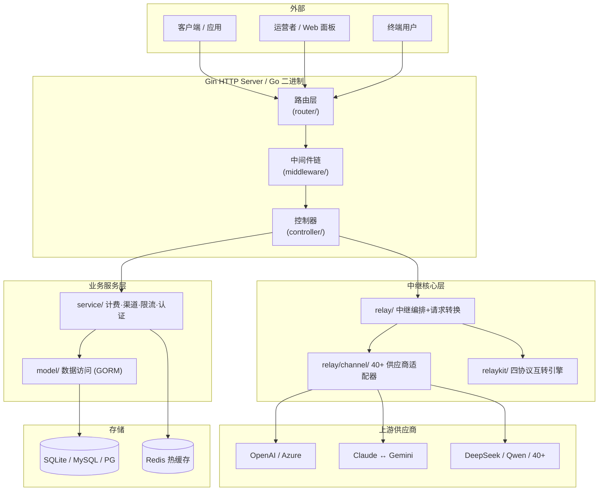
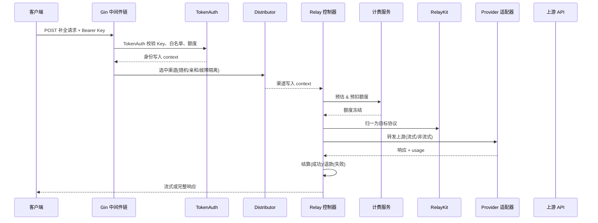

# New API — 统一 AI API 网关与资产管理平台深度解读

> 项目地址：[QuantumNous/new-api](https://github.com/QuantumNous/new-api)（原 Calcium-Ion/new-api） | 协议：AGPL-3.0 | 语言：Go + React
>
> 【本解读按 ai-infra 类规格产出】本文是 `new-api/` 的主文档，负责概览、架构总览、核心模块导读与总结；深度关注面按主题拆入一组子文档（见「子文档索引」）。

## 子文档索引

- [`relaykit-format.md`](relaykit-format.md) — RelayKit 独立 module：Chat/Responses/Claude/Gemini 四协议互转引擎（质量矩阵、多跳路径）
- [`channel-relay.md`](channel-relay.md) — 渠道分发（加权随机/亲和缓存/故障隔离/跨组重试）+ 40+ Provider 适配器体系
- [`billing.md`](billing.md) — 计费结算：BillingSession 预扣/结算/退款生命周期、双资金池、billingexpr 表达式定价引擎
- [`data-model.md`](data-model.md) — 数据模型：热路由/热计费/冷账本三层持久化、核心表、读写路径、缓存一致性
- [`auth-rbac.md`](auth-rbac.md) — 认证与授权：API Key/JWT 三层身份、Casbin 细粒度 RBAC、OAuth/WebAuthn/2FA
- [`deployment.md`](deployment.md) — 部署与可观测：单二进制交付、多实例任务租约协调、优雅关闭

## 概览：网关要解决的「多供应商碎片化」

AI 爆发带来一个现实困境：**没有一家供应商能满足所有需求**——不同模型在成本、延迟、能力、可用性上各有取舍，企业通常要同时接入 OpenAI、Claude、Gemini、Azure、DeepSeek 等多家。上游的差异横跨四个维度：

- **接口碎片化**：各家 API 格式、认证方式、错误语义不同，集成成本高
- **计费混乱**：计价规则各说各话，缺乏统一用量统计与成本控制
- **管理分散**：密钥、额度、访问控制在多个平台分别配置，无法做集中审计
- **容灾困难**：某家供应商不可用时需手动切换，缺乏自动故障转移

New API 的解法是**一个统一接入层屏蔽上游差异**：下游只对接一套 OpenAI 兼容接口（以及 Claude/Gemini/Responses 等协议），由网关负责把请求分发到 40+ 供应商之一、做格式互转、按实际用量计费结算。同时它内建了用户/令牌/额度管理，让一台网关同时服务「内部团队共享」或「面向终端用户计费的 SaaS」两类场景。正是这份「网关 + 资产管理」的双重定位，使它区别于单纯的代理中转项目。

### 核心能力清单

| 能力 | 说明 |
|------|------|
| 统一 API 接入 | OpenAI Chat/Responses、Claude Messages、Gemini、Embedding、Image、Audio、Rerank、Realtime 等 |
| 多供应商聚合 | 40+ 供应商适配器，复用/定制并存；高级自定义渠道（Advanced Custom）支持任意协议 |
| 格式互转 | 四协议（Chat/Responses/Claude/Gemini）互相转换，见 [`relaykit-format.md`](relaykit-format.md) |
| 渠道分发 | 加权随机 + 优先级分层 + 亲和缓存 + 故障隔离 + 跨组重试，见 [`channel-relay.md`](channel-relay.md) |
| 计费结算 | 预扣→结算→退款生命周期、钱包+订阅双资金池、表达式驱动阶梯定价，见 [`billing.md`](billing.md) |
| 认证授权 | API Key/JWT 三层身份、Casbin 细粒度 RBAC、OAuth(Discord/Telegram/OIDC)、WebAuthn、2FA，见 [`auth-rbac.md`](auth-rbac.md) |
| 数据存储 | SQLite/MySQL/PostgreSQL 三库兼容，日志库支持 ClickHouse，见 [`data-model.md`](data-model.md) |
| 多实例部署 | Redis + 数据库租约实现多主节点任务去重与状态同步，见 [`deployment.md`](deployment.md) |
| 现代前端 | React 19 + Rsbuild + Base UI 单 SPA，`//go:embed` 打进单个 Go 二进制 |

### 技术栈一览

| 层级 | 技术 |
|------|------|
| 语言 | Go（后端）/ React 19 + TypeScript（前端） |
| Web 框架 | Gin |
| ORM / 数据库 | GORM v2；SQLite / MySQL ≥5.7.8 / PostgreSQL ≥9.6；日志库可 ClickHouse |
| 缓存 | Redis (go-redis) + 进程内存缓存（HybridCache） |
| 认证 | golang-jwt、go-webauthn、Casbin |
| 协议转换 | 自研独立 module `relaykit/relayconvert`（gin-free、可脱离主模块复用） |
| 前端构建 | Rsbuild + Bun + Tailwind v4 + Base UI |

## 架构总览：四层隔离 + 中继双支柱

核心是**四层隔离 + 中继双支柱**的分层：

| 层 | 目录 | 职责 | 依赖 |
|----|------|------|------|
| 路由层 | `router/` | 端点注册、中间件装配、路由分组 | middleware + controller |
| 中间件层 | `middleware/` | 认证、限流、渠道分发、日志、请求 ID | service + model |
| 控制层 | `controller/` | HTTP 请求处理、参数解析、中继编排 | service + relay |
| 服务层 | `service/` | 计费、渠道选择、转换调度、权限 | model + common |
| 模型层 | `model/` | GORM 实体 + 数据访问 + Redis 缓存 | common |
| 中继核心 | `relay/` + `relaykit/` | 请求转换 + 供应商适配器 + 四协议互转 | common + types |

「中继双支柱」指它把「渠道选择」与「协议转换」拆成两条正交抽象：分发中间件只负责**选出一个渠道写进 gin context**，适配器链只负责**把请求转到具体供应商**；二者通过 `RelayInfo` 松耦合。协议语义翻译从主模块进一步拆成了独立的 `relaykit/` module——只做 DTO 建模与转换、不碰网络/计费/数据库，可被任何其他 Go 网关复用（这是比 one-api 上游更本质的工程演进）。

### 模块职责与子文档映射

| 模块 | 关键职责 | 深读入口 |
|------|----------|----------|
| `relaykit/` | 四协议互转引擎、多跳路径、usage 归一 | [`relaykit-format.md`](relaykit-format.md) |
| `relay/` + `relay/channel/` | 中继编排、40+ 适配器、渠道分发 | [`channel-relay.md`](channel-relay.md) |
| `service/billing*` + `pkg/billingexpr/` | 计费生命周期、表达式定价 | [`billing.md`](billing.md) |
| `model/` | 实体、迁移、缓存一致性、锁 | [`data-model.md`](data-model.md) |
| `middleware/` + `service/authz/` + `oauth/` | 认证、Casbin、OAuth/WebAuthn | [`auth-rbac.md`](auth-rbac.md) |
| `docker-compose*` / `main.go` | 交付、多实例、可观测 | [`deployment.md`](deployment.md) |

## 核心链路：一次 Chat Completion 的完整旅程

网关最核心的请求链路是「Chat/Responses 类补全」。它把认证、分发、计费、转换、转发串成一条事务性流水线（完整计费时序见 [`billing.md`](billing.md)）：

启动流程、多实例协调与优雅关闭见 [`deployment.md`](deployment.md)。

## 设计精华：从分层到可复用协议的演进

把各子文档的观察收束起来，New API 有几个贯穿式的设计取向值得单独点出：

- **协议层独立成库（relaykit）**：把「什么协议长什么样、如何互相翻译」从网关主链路里剥成一个可独立测试、可被外部复用的 module。这是对「网关 = 路由 + 转发」传统模板的最大改进——语义翻译是所有网络代理里最值得固化的部分。见 [`relaykit-format.md`](relaykit-format.md)。
- **计费以安全为第一公民**：饱和转换（防溢出回绕）、双变体语义（Strict 失败优先 / Checked 先夹后报）、幂等退款——把「绝不能因算术问题把用户余额扣成负数」从缺陷修复提升到结构约束。见 [`billing.md`](billing.md)。
- **数据三条轨：热路由 / 热计费 / 冷账本**：能在内存完成的（渠道索引、定价）绝不下库，能在 Redis 原子完成的（钱包/令牌预扣）绝不落锁，必须记账的（余额、日志、流水）保证幂等审计。见 [`data-model.md`](data-model.md)。
- **单一二进制 + 零协调组件的分布式**：多实例任务去重完全托付数据库主键/条件更新 + 租约心跳，免去 Consul/etcd，把「伪分布式」做到实用的最终一致。见 [`deployment.md`](deployment.md)。

## 同类对比

| 维度 | New API | One API（上游） | LiteLLM | OpenRouter（托管） |
|------|---------|----------------|---------|-------------------|
| 语言 | Go | Go | Python | — |
| 供应商数 | 40+ | ~20 | 100+ | 200+ |
| 协议互转 | 深（四协议矩阵，独立 relaykit module） | 基础 | 基础 | 少 |
| 计费系统 | 双资金池 + 表达式引擎 | 简单 | 按 Provider | 托管计费 |
| 部署 | 单二进制 + SQLite；多实例 DB 租约 | 单二进制 | Python 依赖 | 零 |
| WebAuthn/2FA | ✓ | ✗ | ✗ | ✓ |
| 可复用转换层 | ✓（relaykit） | ✗ | ✗ | — |

**差异化定位**：与上游 One API 相比，它把协议转换抽成独立可复用 module、补齐了订阅/表达式计费等资产化能力；与 LiteLLM 相比，Go 单二进制的交付与性能更省心；与 OpenRouter 相比，支持私有化部署与数据自控。

## 总结

New API 解决的根本问题是「多 AI 供应商碎片化下的统一接入、统一计费、统一管理」。其架构价值不在某一个模块，而在**分层与解耦的组合**：四层 HTTP 层次、中继双支柱、独立协议转换层、安全置顶的计费、三条轨的数据持久化——每一层都可独立演进而不破坏整体。

### 值得借鉴

- 协议层做成独立、可复用、可穷举测试的 module（受 golden tests 保护）
- 计费安全用「饱和 + 双变体 + 幂等」的结构手段而非事后补丁
- 数字资产分「热/温/冷」三轨放置，用 Redis 原子性替代 DB 锁做热路径扣减
- 多实例去重用「DB 主键/条件更新 + 租约心跳」，零协调组件但够用

> 各关注面的深度分析、权衡与设计决策，见文首「子文档索引」中的六篇子文档。
