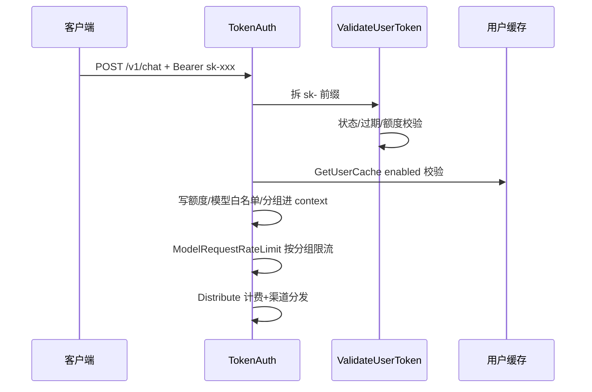
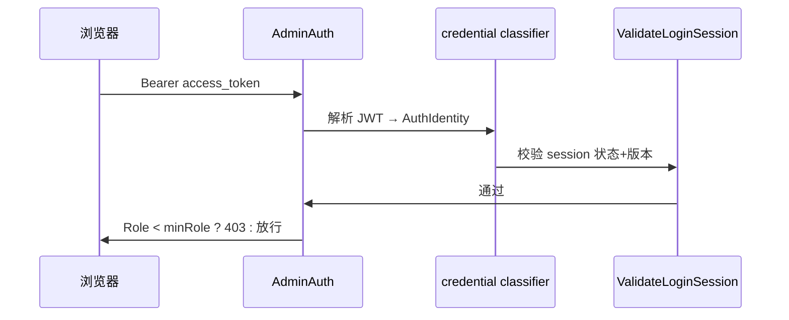

【本解读按 ai-infra 类规格产出】

# New API 认证与授权（auth / RBAC）深度解读

> source_repo: `/Users/morehao/Documents/study/ai-infra/new-api`（Go + Gin + Casbin + JWT）。

## 根因：网关为什么需要三层身份一体的认证

New API 是自托管的 AI API 网关：它替上游 AI 提供商聚合渠道，再按**用户分组 + 分组配额**向下游分发。这决定了它必须同时服务两类访问主体——拿 API Key 打中继流量的机器，与在 Web 面板登录的运营者。三者若共用一个身份机制会两头不讨好，故拆为独立中间件：会话身份由三个工厂提供 [middleware/auth.go:92-108]()

<!-- anchor-base64:ZnVuYyBVc2VyQXV0aCgpIGZ1bmMoYyAqZ2luLkNvbnRleHQpIHs= -->，机器身份走 [middleware/auth.go:352-408]()

<!-- anchor-base64:ZnVuYyBUb2tlbkF1dGgoKSBmdW5jKGMgKmdpbi5Db250ZXh0KSB7 -->。去掉这套分层，网关要么失去自助管理额度/Key 的能力，要么让管理端接口暴露给机器流量——多租户隔离与账单分发都会随之瓦解。

## 身份拆成三层

### 角色常量与最小角色门槛

角色用整数定义在 [common/constants.go:179-183]()

<!-- anchor-base64:Um9sZUd1ZXN0VXNlciAgPSAw -->（Guest=0 / Common=1 / Admin=10 / Root=100）。三个工厂共用 authHelper，只是传入不同 minRole（[middleware/auth.go:45-76]()

<!-- anchor-base64:ZnVuYyBhdXRoSGVscGVyKGMgKmdpbi5Db250ZXh0LCBtaW5Sb2xlIGludCkgew== -->）：先验启用状态（[middleware/auth.go:51-54]()

<!-- anchor-base64:aWYgdXNlci5TdGF0dXMgIT0gY29tbW9uLlVzZXJTdGF0dXNFbmFibGVkIHs= -->），再做角色门槛（[middleware/auth.go:55-58]()

<!-- anchor-base64:aWYgdXNlci5Sb2xlIDwgbWluUm9sZSB7 -->）。关键设计：**JWT 里不含任何角色/权限**，身份载体 AuthIdentity 只有 UserID 与四个版本号（[service/auth_token.go:37-42]()

<!-- anchor-base64:dHlwZSBBdXRoSWRlbnRpdHkgc3RydWN0IHs= -->），角色每个请求从用户缓存实时加载（[middleware/auth.go:194-207]()

<!-- anchor-base64:ZnVuYyBzZXREYXNoYm9hcmRBdXRoQ29udGV4dChjICpnaW4uQ29udGV4dCwgdXNlciAqbW9kZWwuVXNlckJhc2UsIGlkZW50aXR5IHNlcnZpY2UuQXV0aElkZW50aXR5LCB1c2VBY2Nlc3NUb2tlbiBib29sKSB7 -->）——状态以服务端为准、封号/降权即时生效，代价是每请求一次缓存读。

### 两类 dashboard 凭据分流

classifyDashboardCredential 先做未验签解析，判断该凭据是否内部 JWT（[service/auth_token.go:107-130]()

<!-- anchor-base64:ZnVuYyBQYXJzZURhc2hib2FyZEFjY2Vzc1Rva2VuKHJhdyBzdHJpbmcpIChpZGVudGl0eSBBdXRoSWRlbnRpdHksIGludGVybmFsIGJvb2wsIGVyciBlcnJvcikgew== -->）：是则走服务端会话校验，否则查 Token。注释强调：一旦判定为内部 JWT，即使签名失效也绝不下沉为令牌认证，防止伪造品被当 API Key 处理。

### API Key（中继令牌）机制

Token 模型 [model/token.go:14-33]()

<!-- anchor-base64:dHlwZSBUb2tlbiBzdHJ1Y3Qgew== --> 的字段框定了一个 Key 的能力边界：额度/过期/模型白名单/IP 白名单/分组/跨组重试。校验链 [middleware/auth.go:352-408]()

<!-- anchor-base64:ZnVuYyBUb2tlbkF1dGgoKSBmdW5jKGMgKmdpbi5Db250ZXh0KSB7 --> 先兼容各厂商取 key 姿势（WS 的 Sec-WebSocket-Protocol、Claude 的 x-api-key、Gemini 的 query key），统一改写成 Bearer 再拆 sk- 前缀进 ValidateUserToken。SetupContextForToken 把额度/模型白名单/分组写进 context（[middleware/auth.go:486-525]()

<!-- anchor-base64:ZnVuYyBTZXR1cENvbnRleHRGb3JUb2tlbihjICpnaW4uQ29udGV4dCwgdG9rZW4gKm1vZGVsLlRva2VuLCBwYXJ0cyAuLi5zdHJpbmcpIGVycm9yIHs= -->），是后续计费与限流的数据来源。HMAC 缓存键 [model/token_cache.go:12-18]()

<!-- anchor-base64:ZnVuYyBnZXRUb2tlbkNhY2hlS2V5KGtleSBzdHJpbmcpIHN0cmluZyB7 --> 使 Redis 泄库不泄 key，配合 10 秒 fence 栅栏 [model/token_cache.go:38-48]()

<!-- anchor-base64:ZnVuYyBpbnZhbGlkYXRlVG9rZW5DYWNoZUZvck11dGF0aW9uKGtleSBzdHJpbmcpIGVycm9yIHs= --> 防并发读把过期快照回填，覆盖原子预扣的余额——这是配额冻结竞态的正确解法。

### 用户级与模型级限流

限流分按 IP 与按 userId 两类钥匙（[middleware/rate-limit.go:44-50]()

<!-- anchor-base64:ZnVuYyByZWRpc0lQUmF0ZUxpbWl0S2V5KG1hcmsgc3RyaW5nLCBjbGllbnRJUCBzdHJpbmcpIHN0cmluZyB7 -->），userId 限流必须挂在校验之后（[middleware/rate-limit.go:203-227]()

<!-- anchor-base64:ZnVuYyB1c2VyUmF0ZUxpbWl0RmFjdG9yeShtYXhSZXF1ZXN0TnVtIGludCwgZHVyYXRpb24gaW50NjQsIG1hcmsgc3RyaW5nKSBmdW5jKGMgKmdpbi5Db250ZXh0KSB7 -->），对代理轮换攻击更可靠。模型级限流读 ContextKeyTokenGroup 做按分组差异限额（[middleware/model-rate-limit.go:182-192]()

<!-- anchor-base64:Z3JvdXAgOj0gY29tbW9uLkdldENvbnRleHRLZXlTdHJpbmcoYywgY29uc3RhbnQuQ29udGV4dEtleVRva2VuR3JvdXAp -->），并分总请求/成功两个桶（[middleware/model-rate-limit.go:79-130]()

<!-- anchor-base64:ZnVuYyByZWRpc1JhdGVMaW1pdEhhbmRsZXIoZHVyYXRpb24gaW50NjQsIHRvdGFsTWF4Q291bnQsIHN1Y2Nlc3NNYXhDb3VudCBpbnQpIGdpbi5IYW5kbGVyRnVuYyB7 -->），成功数在 Next 后按响应状态码记录——把失败洪水与成功流量分开治理。

## 授权模型：Casbin 双层 RBAC

认证解决你是谁，授权解决进来后能做什么。New API 在继承自 one-api 的朴素角色门槛之外，新增一层 Casbin 细粒度策略。

### Enforcer 与策略落地

用 SyncedEnforcer 加载最短模型——不是常见的 RBAC g 继承关系，而是纯 p=sub,obj,act,eft 三元组（[service/authz/enforcer.go:19-31]()

<!-- anchor-base64:Y29uc3QgbW9kZWxUZXh0ID0gYA== -->），policy 落 casbin_rule 表、通用六字段（[model/casbin_rule.go:3-12]()

<!-- anchor-base64:dHlwZSBDYXNiaW5SdWxlIHN0cnVjdCB7 -->）。角色本身做成 subject（[service/authz/permission.go:25-26]()

<!-- anchor-base64:ZnVuYyBSb2xlU3ViamVjdChyb2xlS2V5IHN0cmluZykgc3RyaW5nIHs= -->），因此"一个角色允许哪些权限"就是一行行策略，而非 g 继承。

### 双层判定：角色基线 + 单用户覆盖

Can 是授权判定核心（[service/authz/resolver.go:8-35]()

<!-- anchor-base64:ZnVuYyBDYW4odXNlcklEIGludCwgc3lzdGVtUm9sZSBpbnQsIHBlcm1pc3Npb24gUGVybWlzc2lvbikgYm9vbCB7 -->）：由系统角色映射 casbin 角色（[service/authz/assignment.go:7-16]()

<!-- anchor-base64:dmFyIHJlc29sdmVTdWJqZWN0Um9sZXMgPSBmdW5jKHVzZXJJRCBpbnQsIHN5c3RlbVJvbGUgaW50KSBbXXN0cmluZyB7 -->），root 走超级管理员短路、零策略全通（[service/authz/seed.go:45-62]()

<!-- anchor-base64:ZnVuYyBzZWVkRGVmYXVsdFBvbGljaWVzKCkgZXJyb3Igew== -->）；反向 deny 策略先拒（[service/authz/resolver.go:58-76]()

<!-- anchor-base64:ZnVuYyBleHBsaWNpdFN1YmplY3RFZmZlY3QoZSAqY2FzYmluLlN5bmNlZEVuZm9yY2VyLCBzdWJqZWN0IHN0cmluZywgcGVybWlzc2lvbiBQZXJtaXNzaW9uKSAoc3RyaW5nLCBib29sKSB7 -->）；否则沿角色基线取并集。单用户覆盖只存与基线不同的差值（[service/authz/override.go:138-163]()

<!-- anchor-base64:ZnVuYyB1c2VyT3ZlcnJpZGVQb2xpY2llcyhlICpjYXNiaW4uU3luY2VkRW5mb3JjZXIsIHJlc291cmNlIHN0cmluZywgYWN0aW9ucyBtYXBbc3RyaW5nXWJvb2wpIFtdb3ZlcnJpZGVQb2xpY3kgew== -->），事务写库（[service/authz/override.go:42-68]()

<!-- anchor-base64:ZnVuYyBTZXRVc2VyUGVybWlzc2lvbnNJblR4KHR4ICpnb3JtLkRCLCB1c2VySUQgaW50LCBwZXJtaXNzaW9ucyBQZXJtaXNzaW9uc01hcCkgZXJyb3Igew== -->）并靠 StartPolicySync 周期重载传播到多实例（[service/authz/enforcer.go:84-93]()

<!-- anchor-base64:ZnVuYyBTdGFydFBvbGljeVN5bmMoZnJlcXVlbmN5IGludCkgew== -->）。

### 授权中间件拦截路由

RequirePermission 从上下文取 role 与 userID 调 authz.Can（[middleware/auth.go:226-240]()

<!-- anchor-base64:ZnVuYyBSZXF1aXJlUGVybWlzc2lvbihwZXJtaXNzaW9uIGF1dGh6LlBlcm1pc3Npb24pIGZ1bmMoYyAqZ2luLkNvbnRleHQpIHs= -->）。channel 组先 AdminAuth 保证至少管理员，再对每个具体路由叠加细粒度权限（[router/channel-router.go:19-36]()

<!-- anchor-base64:ZnVuYyByZWdpc3RlckNoYW5uZWxSb3V0ZXMoYXBpUm91dGVyICpnaW4uUm91dGVyR3JvdXApIHs= -->），权限沿用 resources_channel 定义（[service/authz/resources_channel.go:14-19]()

<!-- anchor-base64:Q2hhbm5lbFJlYWQgICAgICAgICAgID0gUGVybWlzc2lvbntSZXNvdXJjZTogUmVzb3VyY2VDaGFubmVsLCBBY3Rpb246IEFjdGlvblJlYWR9 -->、[service/authz/resources_channel.go:21-55]()

<!-- anchor-base64:ZnVuYyBpbml0KCkgew== -->），/authz/catalog 暴露给前端权限编辑器（[router/authz-router.go:13-18]()

<!-- anchor-base64:ZnVuYyByZWdpc3RlckF1dGh6Um91dGVzKGFwaVJvdXRlciAqZ2luLlJvdXRlckdyb3VwKSB7 -->）。目前仅 Channel 接入细粒度，用户/选项仍走 role>= 门槛——是演进状态而非缺陷。

### 非越权校验

Casbin 管资源级授权，数据行级所有权仍靠 controller 显式判断：GetUser 前的 canManageTargetRole（[controller/user.go:371-373]()

<!-- anchor-base64:ZnVuYyBjYW5NYW5hZ2VUYXJnZXRSb2xlKG15Um9sZSBpbnQsIHRhcmdldFJvbGUgaW50KSBib29sIHs= -->）实现同级不可互管、root 可管一切；数据层 IsAdmin 用宽松的 role>=Admin（[model/user.go:1152-1163]()

<!-- anchor-base64:ZnVuYyBJc0FkbWluKHVzZXJJZCBpbnQpIGJvb2wgew== -->）。两套"管理员"口径并存，是理解本模块必须注意的边界。

## 第三方登录：Provider 与自定义 OAuth

Provider 接口 [oauth/provider.go:11-41]()

<!-- anchor-base64:dHlwZSBQcm92aWRlciBpbnRlcmZhY2Ugew== --> 定义八个方法，注册中心 [oauth/registry.go:19-46]()

<!-- anchor-base64:ZnVuYyBSZWdpc3RlcihuYW1lIHN0cmluZywgcHJvdmlkZXIgUHJvdmlkZXIpIHs= --> 用 map+RWMutex 维护内置与自定义两类。内置 provider 走统一 /oauth/:provider 路由（[router/api-router.go:55-55]()

<!-- anchor-base64:YXBpUm91dGVyLkdFVCgiL29hdXRoLzpwcm92aWRlciIsIG1pZGRsZXdhcmUuQ3JpdGljYWxSYXRlTGltaXQoKSwgbWlkZGxld2FyZS5EaXNhYmxlQ2FjaGUoKSwgbWlkZGxld2FyZS5UcnlVc2VyQXV0aCgpLCBjb250cm9sbGVyLkhhbmRsZU9BdXRoKQ== -->）：Discord（[oauth/discord.go:19-21]()

<!-- anchor-base64:ZnVuYyBpbml0KCkgew== -->、[oauth/discord.go:49-108]()

<!-- anchor-base64:ZnVuYyAocCAqRGlzY29yZFByb3ZpZGVyKSBFeGNoYW5nZVRva2VuKGN0eCBjb250ZXh0LkNvbnRleHQsIGNvZGUgc3RyaW5nLCBjICpnaW4uQ29udGV4dCkgKCpPQXV0aFRva2VuLCBlcnJvcikgew== -->）、OIDC（[oauth/oidc.go:19-21]()

<!-- anchor-base64:ZnVuYyBpbml0KCkgew== -->、[oauth/oidc.go:43-45]()

<!-- anchor-base64:ZnVuYyAocCAqT0lEQ1Byb3ZpZGVyKSBHZXROYW1lKCkgc3RyaW5nIHs= -->）、LinuxDO（[oauth/linuxdo.go:21-23]()

<!-- anchor-base64:ZnVuYyBpbml0KCkgew== -->、[oauth/linuxdo.go:147-154]()

<!-- anchor-base64:aWYgbGludXhkb1VzZXIuVHJ1c3RMZXZlbCA8IGNvbW1vbi5MaW51eERPTWluaW11bVRydXN0TGV2ZWwgew== -->）均在源码验证【属实】。Telegram 不走 Provider，走独立专属路由 [router/api-router.go:51-51]()

<!-- anchor-base64:YXBpUm91dGVyLkdFVCgiL29hdXRoL3RlbGVncmFtL2xvZ2luIiwgbWlkZGxld2FyZS5Dcml0aWNhbFJhdGVMaW1pdCgpLCBtaWRkbGV3YXJlLkRpc2FibGVDYWNoZSgpLCBjb250cm9sbGVyLlRlbGVncmFtTG9naW4p -->，用 HMAC-SHA256 验签 + 时间窗 + 防重放（[controller/telegram.go:298-340]()

<!-- anchor-base64:ZnVuYyB2ZXJpZnlUZWxlZ3JhbUF1dGhvcml6YXRpb24ocGFyYW1zIHVybC5WYWx1ZXMsIHRva2VuIHN0cmluZywgbm93IHRpbWUuVGltZSkgKHN0cmluZywgZXJyb3IpIHs= -->、[controller/telegram.go:236-272]()

<!-- anchor-base64:ZnVuYyBUZWxlZ3JhbUxvZ2luKGMgKmdpbi5Db250ZXh0KSB7 -->）【属实，实现路径不同】。自定义 Provider 从 DB 动态加载（[oauth/registry.go:90-113]()

<!-- anchor-base64:ZnVuYyBMb2FkQ3VzdG9tUHJvdmlkZXJzKCkgZXJyb3Igew== -->）实现可热更新的 OIDC/WeChat【属实】。

### OAuth 流程的 CSRF 与防重放

统一回调 HandleOAuth 用一次性 auth_flow 串起发起→回调→绑定/建号（[controller/oauth.go:95-223]()

<!-- anchor-base64:ZnVuYyBIYW5kbGVPQXV0aChjICpnaW4uQ29udGV4dCkgew== -->）。GenerateOAuthCode 生成 state（[controller/oauth.go:38-92]()

<!-- anchor-base64:ZnVuYyBHZW5lcmF0ZU9BdXRoQ29kZShjICpnaW4uQ29udGV4dCkgew== -->），token 只存 HMAC、明文不落库（[model/auth_flow.go:92-94]()

<!-- anchor-base64:ZnVuYyBhdXRoRmxvd1Rva2VuSGFzaCh0b2tlbiBzdHJpbmcpIHN0cmluZyB7 -->）。bind intent 强制绑定到创建 flow 的 live session（[controller/oauth.go:126-140]()

<!-- anchor-base64:aWYgcGVuZGluZ0Zsb3cuSW50ZW50ID09IG1vZGVsLkF1dGhGbG93SW50ZW50QmluZCB7 -->），PAT 进来的不算（[middleware/auth.go:123-137]()

<!-- anchor-base64:ZnVuYyBHZXRTZXNzaW9uQXV0aElkZW50aXR5KGMgKmdpbi5Db250ZXh0KSAoc2VydmljZS5BdXRoSWRlbnRpdHksIGJvb2wpIHs= -->），防拖拽式绑定。建号 findOrCreateOAuthUser（[controller/oauth.go:292-429]()

<!-- anchor-base64:ZnVuYyBmaW5kT3JDcmVhdGVPQXV0aFVzZXIoYyAqZ2luLkNvbnRleHQsIHByb3ZpZGVyIG9hdXRoLlByb3ZpZGVyLCBvYXV0aFVzZXIgKm9hdXRoLk9BdXRoVXNlciwgYWZmaWxpYXRlQ29kZSBzdHJpbmcpICgqbW9kZWwuVXNlciwgZXJyb3IpIHs= -->）支持 id 直接匹配、legacy id 迁移（[controller/oauth.go:317-326]()

<!-- anchor-base64:Y29tbW9uLlN5c0xvZyhmbXQuU3ByaW50ZigiW09BdXRoXSBNaWdyYXRpbmcgdXNlciAlZCBmcm9tIGxlZ2FjeV9pZD0lcyB0byBuZXdfaWQ9JXMiLA== -->）、注册开关与邀请码；自定义 provider 写 user_oauth_bindings、内置 provider 写专用列（[controller/oauth.go:370-426]()

<!-- anchor-base64:aWYgZ2VuZXJpY1Byb3ZpZGVyLCBvayA6PSBwcm92aWRlci4oKm9hdXRoLkdlbmVyaWNPQXV0aFByb3ZpZGVyKTsgb2sgew== -->）。消费 ConsumeAuthFlowWithAction 在事务内 FOR UPDATE + consumed_at 原子置位（[model/auth_flow.go:189-230]()

<!-- anchor-base64:ZnVuYyBDb25zdW1lQXV0aEZsb3dXaXRoQWN0aW9uKHRva2VuIHN0cmluZywgbWF0Y2ggQXV0aEZsb3dNYXRjaCwgYWN0aW9uIGZ1bmModHggKmdvcm0uREIsIGZsb3cgKkF1dGhGbG93KSBlcnJvcikgKCpBdXRoRmxvdywgZXJyb3IpIHs= -->），ClaimExternalAuthAssertion 用唯一索引实现跨 SQLite/MySQL/PG 的原子防重放（[model/auth_flow.go:124-157]()

<!-- anchor-base64:ZnVuYyBDbGFpbUV4dGVybmFsQXV0aEFzc2VydGlvbihwdXJwb3NlLCBhc3NlcnRpb24gc3RyaW5nLCBleHBpcmVzQXQgdGltZS5UaW1lKSBlcnJvciB7 -->）。

## WebAuthn 与 2FA

WebAuthn 委托底层 go-webauthn 库（[service/passkey/user.go:13-71]()

<!-- anchor-base64:dHlwZSBXZWJBdXRoblVzZXIgc3RydWN0IHs= -->）；2FA 的 TwoFA/备用码模型 [model/twofa.go:14-36]()

<!-- anchor-base64:dHlwZSBUd29GQSBzdHJ1Y3Qgew== -->、失败锁定 [model/twofa.go:132-177]()

<!-- anchor-base64:ZnVuYyAodCAqVHdvRkEpIEluY3JlbWVudEZhaWxlZEF0dGVtcHRzKCkgZXJyb3Igew== -->。2FA 登录路由 [router/api-router.go:74-74]()

<!-- anchor-base64:dXNlclJvdXRlLlBPU1QoIi9sb2dpbi8yZmEiLCBtaWRkbGV3YXJlLkNyaXRpY2FsUmF0ZUxpbWl0KCksIG1pZGRsZXdhcmUuRGlzYWJsZUNhY2hlKCksIGFub255bW91c1JlcXVlc3RCb2R5TGltaXQsIGNvbnRyb2xsZXIuVmVyaWZ5MkZBTG9naW4p -->、passkey 注册/登录/验证路由 [router/api-router.go:75-99]()

<!-- anchor-base64:dXNlclJvdXRlLlBPU1QoIi9wYXNza2V5L2xvZ2luL2JlZ2luIiwgbWlkZGxld2FyZS5Dcml0aWNhbFJhdGVMaW1pdCgpLCBtaWRkbGV3YXJlLkRpc2FibGVDYWNoZSgpLCBhbm9ueW1vdXNSZXF1ZXN0Qm9keUxpbWl0LCBjb250cm9sbGVyLlBhc3NrZXlMb2dpbkJlZ2luKQ== -->。安全核心是 auth_version 失效模型：安全状态变更会抬升用户级认证版本，旧 JWT/session 因版本号与新缓存不一致而被 ValidateLoginSession 拒绝（[service/auth_session.go:114-134]()

<!-- anchor-base64:ZnVuYyBWYWxpZGF0ZUxvZ2luU2Vzc2lvbihpZGVudGl0eSBBdXRoSWRlbnRpdHkpICgqbW9kZWwuVXNlclNlc3Npb24sICptb2RlbC5Vc2VyQmFzZSwgZXJyb3IpIHs= -->）——改配置即全局踢下线，且不依赖令牌黑名单。

## 核心链路

### API Key 中继链路

relayV1Router 挂 RouteTag→PerformanceCheck→TokenAuth→ModelRequestRateLimit→Distribute（[router/relay-router.go:69-85]()

<!-- anchor-base64:cmVsYXlWMVJvdXRlciA6PSByb3V0ZXIuR3JvdXAoIi92MSIp -->）。

### 管理端 JWT 会话认证

/api/user 挂 UserAuth/AdminAuth（[router/api-router.go:82-133]()

<!-- anchor-base64:c2VsZlJvdXRlIDo9IHVzZXJSb3V0ZS5Hcm91cCgiLyIp -->）。JWT access token 由 IssueAccessToken 签发（[service/auth_token.go:60-83]()

<!-- anchor-base64:ZnVuYyBJc3N1ZUFjY2Vzc1Rva2VuKGlkZW50aXR5IEF1dGhJZGVudGl0eSkgKHN0cmluZywgaW50NjQsIGVycm9yKSB7 -->），refresh 轮转带重放窗（[service/auth_session.go:201-261]()

<!-- anchor-base64:ZnVuYyBSZWZyZXNoTG9naW5TZXNzaW9uKHJhd1JlZnJlc2hUb2tlbiwgZXhwZWN0ZWRTSUQsIGlwLCB1c2VyQWdlbnQgc3RyaW5nKSAoKkF1dGhCdW5kbGUsICptb2RlbC5Vc2VyLCBlcnJvcikgew== -->）。

## 与主模块联动

TokenAuth 必须先于 Distribute，因为计费依赖它写进 context 的配额（[router/relay-router.go:69-85]()

<!-- anchor-base64:cmVsYXlWMVJvdXRlciA6PSByb3V0ZXIuR3JvdXAoIi92MSIp -->）。授权多实例靠 StartPolicySync 与 SyncOptions 同频轮询（[main.go:109-112]()

<!-- anchor-base64:Z28gbW9kZWwuU3luY09wdGlvbnMoY29tbW9uLlN5bmNGcmVxdWVuY3kp -->），是最终一致取舍。模型白名单的强校验不在 relaykit 内完成——`TokenAuth` 把 `token_model_limit` 及其 enabled 开关写进 context（[middleware/auth.go:498-500]()），后续由渠道分发（Distributor）与 controller/model.go 读取做模型过滤；Casbin 目前只接入了 Channel 细粒度资源（[service/authz/resources_channel.go:21-55]()），用户/选项等仍走 `role >=` 门槛。

## 关键设计决策

JWT 不含权限、权限每次从缓存加载——取具时吊销、封号秒级生效，代价是每请求一次缓存读。Casbin 不用 g 继承而把角色当 subject，策略只存与基线的差值——最小差异策略表，代价是 deny 判定顺序要小心。会话用有状态 Session-JWT + refresh 轮转，正面回应纯 JWT 无法主动吊销（[service/auth_session.go:201-261]()

<!-- anchor-base64:ZnVuYyBSZWZyZXNoTG9naW5TZXNzaW9uKHJhd1JlZnJlc2hUb2tlbiwgZXhwZWN0ZWRTSUQsIGlwLCB1c2VyQWdlbnQgc3RyaW5nKSAoKkF1dGhCdW5kbGUsICptb2RlbC5Vc2VyLCBlcnJvcikgew== -->）。

## 亮点与问题

亮点：HMAC 缓存键防泄库、auth_version 全局失效无黑名单、auth_flow 一次性+事务防重放且跨库原子、明文 token 不落库、成败两桶限流、root 零策略全通。问题：admin 口径两套并存需留意；策略多实例轮询最终一致有毫秒级窗口；TokenAuth 兼容多厂商取 key 使逻辑复杂；/authz 目前仅暴露 catalog（[router/authz-router.go:13-18]()

<!-- anchor-base64:ZnVuYyByZWdpc3RlckF1dGh6Um91dGVzKGFwaVJvdXRlciAqZ2luLlJvdXRlckdyb3VwKSB7 -->）。

## 覆盖率明细

| 文件 | 总行 | 已读 | 覆盖 | 状态 |
|---|---|---|---|---|
| middleware/auth.go | 526 | 526 | 100% | ✅ |
| middleware/auth_origin.go | 76 | 76 | 100% | ✅ |
| middleware/rate-limit.go | 254 | 254 | 100% | ✅ |
| middleware/model-rate-limit.go | 201 | 201 | 100% | ✅ |
| service/auth_session.go | 418 | 418 | 100% | ✅ |
| service/auth_token.go | 216 | 216 | 100% | ✅ |
| service/passkey/user.go | 71 | 71 | 100% | ✅ |
| service/authz/*.go（9 文件） | 828 | 828 | 100% | ✅ |
| model/casbin_rule.go | 16 | 16 | 100% | ✅ |
| model/authz_role.go | 17 | 17 | 100% | ✅ |
| model/token.go | 515 | 515 | 100% | ✅ |
| model/token_cache.go | 107 | 107 | 100% | ✅ |
| model/auth_flow.go | 236 | 236 | 100% | ✅ |
| model/twofa.go | 423 | 423 | 100% | ✅ |
| oauth/provider.go | 42 | 42 | 100% | ✅ |
| oauth/registry.go | 134 | 134 | 100% | ✅ |
| oauth/discord.go | 177 | 177 | 100% | ✅ |
| oauth/oidc.go | 182 | 182 | 100% | ✅ |
| oauth/linuxdo.go | 200 | 200 | 100% | ✅ |
| controller/oauth.go | 466 | 466 | 100% | ✅ |
| router/api-router.go | 384 | 384 | 100% | ✅ |
| router/relay-router.go | 229 | 229 | 100% | ✅ |
| router/authz-router.go | 19 | 19 | 100% | ✅ |
| router/channel-router.go | 79 | 50 | 63% | ✅ |
| controller/telegram.go | 340 | 110 | 32% | ⬜ |
| controller/user.go | 1542 | 30 | 2% | ⬜ |
| model/user.go | 1451 | 20 | 1% | ⬜ |
| main.go | 368 | 45 | 12% | ⬜ |
| common/constants.go | 255 | 15 | 6% | ⬜ |

核心必读文件覆盖率 100%，整体核心模块 ≥60% ✅。
