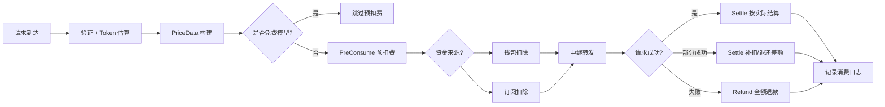
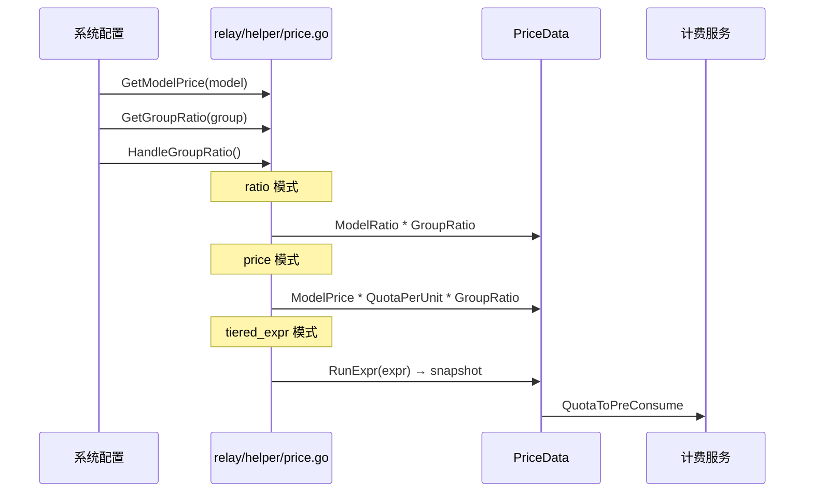
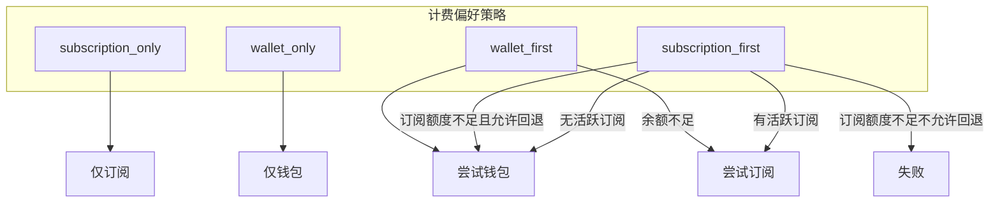
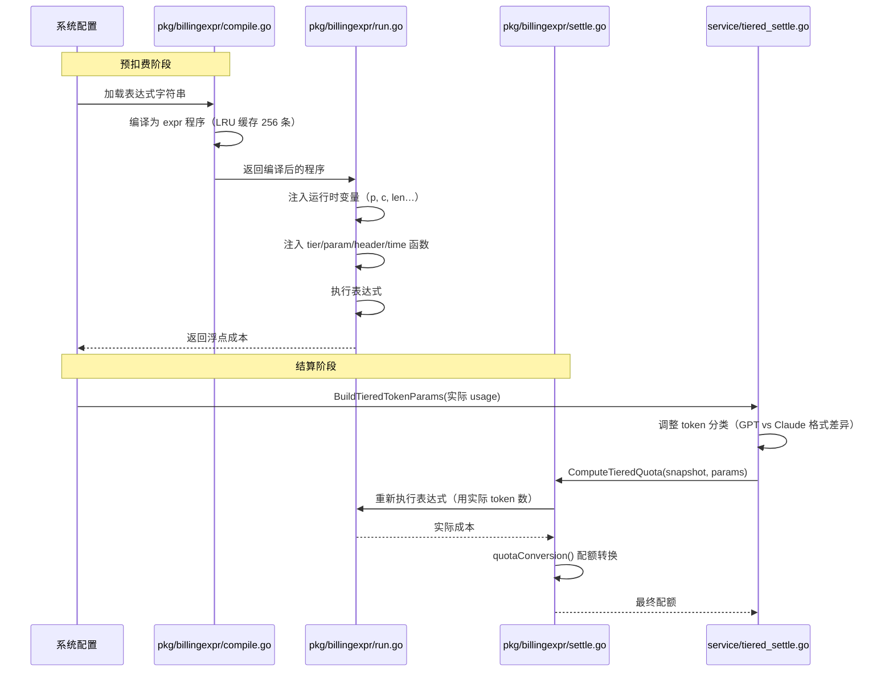
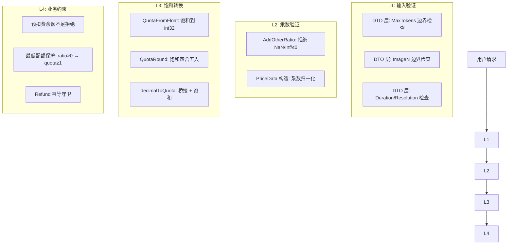

# New API 计费系统深度解读

## 概述

New API 的计费系统是其设计最严谨、逻辑最复杂的子系统。核心设计理念：

- **精准计费** — 按实际 token 消耗结算，而非按预估
- **防御性安全** — 从底层数学运算到上层业务逻辑，多层防护确保不会出现负数扣费
- **灵活定价** — 表达式引擎支持的动态/阶梯定价，无需改代码
- **双资金池** — 钱包余额 + 订阅套餐，按用户配置的优先级扣费

涉及文件约 30+ 个，分布在 `service/`、`pkg/billingexpr/`、`relay/helper/`、`common/`、`types/`、`model/` 等多个包中。

---

## 第一部分：计费核心概念

### 配额单位

系统内部使用 **配额（quota）** 作为计费单位，而非直接使用法币金额：

```
QuotaPerUnit = 500,000   // common/constants.go
```

含义：**1 美元 = 500,000 配额**。

这个转换在定价时实时计算：

$$
\text{quota} = \text{modelPrice} \times \text{QuotaPerUnit} \times \text{groupRatio}
$$

例如，模型定价 $2/M tokens，group ratio 为 1，则每 M token 的配额成本为 $2 \times 500,000 \times 1 = 1,000,000 quota。

### 计费模式

| 模式 | 说明 | 适用场景 |
|------|------|----------|
| **ratio（系数模式）** | 基于模型系数 × 分组系数 × token 数计算 | 大多数文本模型 |
| **price（价格模式）** | 基于固定 dollar 价格 × 分组系数计算 | 固定价格的模型 |
| **tiered_expr（表达式模式）** | 基于表达式引擎计算，支持阶梯/动态定价 | 需要复杂定价逻辑的模型 |
| **per_call（按次计费）** | 每次请求固定扣费 | Midjourney、图片生成等任务 |


### 计费生命周期



---

## 第二部分：PriceData — 计费参数数据流

### PriceData 结构

`types/price_data.go:14` 定义了单次请求的完整计费参数集合：

```go
type PriceData struct {
    FreeModel            bool                // 免费模型标记
    ModelPrice           float64             // 模型价格 ($/单位)
    ModelRatio           float64             // 模型系数
    CompletionRatio      float64             // 输出 token 系数
    CacheRatio           float64             // 缓存命中 token 系数
    CacheCreationRatio   float64             // 缓存创建 token 系数
    CacheCreation5mRatio float64             // Claude 5分钟 TTL 缓存创建系数
    CacheCreation1hRatio float64             // Claude 1小时 TTL 缓存创建系数
    ImageRatio           float64             // 图片 token 系数
    AudioRatio           float64             // 音频输入 token 系数
    AudioCompletionRatio float64             // 音频输出 token 系数
    OtherRatios          map[string]float64  // 额外乘数映射
    UsePrice             bool                // 使用 price 模式(true)或 ratio 模式(false)
    Quota                int                 // 按次计费的固定额度
    QuotaToPreConsume    int                 // 预消耗配额
    GroupRatioInfo       GroupRatioInfo      // 分组系数（含特殊比率）
}
```

### 数据流：从配置到 PriceData



`relay/helper/price.go` 中的 `ModelPriceHelper`(`:67`) 是 PriceData 构建的入口。流程：

1. 从 `setting/ratio_setting` 获取模型价格/系数
2. 通过 `HandleGroupRatio` 确定分组系数（支持用户级特殊比率，`relay/helper/price.go:39`）
3. 根据计费模式（ratio/price/tiered_expr）计算预消耗配额
4. 如果模型免费且未开启 `EnableFreeModelPreConsume`，则跳过预扣费
5. 将 PriceData 设置到 `gin.Context` 中供后续环节使用

### GroupRatio 的优先级

```
用户有特殊分组比率(special ratio) → 使用特殊比率
用户无特殊分组比率 → 使用分组默认比率
```

特殊比率通过 `setting.GetGroupGroupRatio(userGroup, usingGroup)` 查询，允许管理员为特定用户组设置不同的倍率。

### OtherRatios — 额外乘数机制

`OtherRatios` 是一个 `map[string]float64`，用于在基础价格之上叠加额外乘数，通过 `PriceData.AddOtherRatio(key, ratio)`（`types/price_data.go:33`）添加：

```go
func (p *PriceData) AddOtherRatio(key string, ratio float64) {
    if !(ratio > 0) || math.IsInf(ratio, 1) {
        return  // 拒绝非法值
    }
    p.OtherRatios[key] = ratio
}
```

**安全守卫**：拒绝非正数、NaN、+Inf。这是计费安全的第一道防线，确保不会因为格式错误的乘数导致计价异常。

**使用场景**：

| 场景 | 添加的 key | 来源 |
|------|-----------|------|
| 视频生成时长 | `duration` | 任务参数 |
| 视频分辨率 | `resolution_ratio` | 任务参数 |
| 图片质量 | `quality` | 图片生成参数 |
| Claude 扩展思维 | `thinking_budget` | 请求参数 |

在 quota 计算时，这些乘数依次乘到基础价格上（`service/text_quota.go:279`）：

```go
for _, ratio := range p.OtherRatios {
    quota = int(float64(quota) * ratio)
}
```

---

## 第三部分：BillingSession — 统一计费会话

### 设计模式：会话模式

`BillingSession`（`service/billing_session.go`）是整个计费系统的核心编排器。它将一次请求的预扣费、结算、退款封装为统一会话，屏蔽了钱包和订阅两种资金池的差异。

### 构造函数

```go
func NewBillingSession(c *gin.Context, relayInfo *relaycommon.RelayInfo, preConsumedQuota int) (*BillingSession, *types.NewAPIError)
```

构造逻辑（`:342`）：

1. 读取用户的 `BillingPreference` 配置
2. 定义两个闭包资金源：`tryWallet()`（`:350`）和 `trySubscription()`（`:379`）
3. 根据计费偏好策略选择资金源

### 计费偏好策略

用户在账户设置中配置计费偏好，共 4 种模式：



具体实现（`billing_session.go:401`）：

- **`subscription_only`**：仅尝试订阅，无活跃订阅时直接失败
- **`wallet_only`**：仅尝试钱包，余额不足时直接失败
- **`wallet_first`**：先尝试钱包；余额不足时回退到订阅
- **`subscription_first`**（默认）：先检查是否有活跃订阅；如果有，尝试从订阅扣费，订阅额度不足时检查 `AllowWalletOverflow` 决定是否回退到钱包；无活跃订阅时回退到钱包

### 三个核心方法

#### PreConsume（预扣费）

`BillingSession.preConsume()`（`:186`）：

1. **Trust 检查**（`:282`）：仅对钱包有效，检查用户余额是否超过 `trustQuota`（10 × QuotaPerUnit = 5,000,000）且 token 未被限制额度。如果满足，跳过预扣费——这是性能优化，避免每笔小额请求都走数据库更新。
2. **Token 配额预扣**：调用 `PreConsumeTokenQuota` 从 token 层面扣减
3. **资金源预扣**：调用 `funding.PreConsume(amount)`
4. **回滚**：如果资金源预扣失败，回滚 token 配额预扣

#### Settle（结算）

`BillingSession.Settle(actualQuota int)`（BillingSession 上，代码块内未完全展示，但 logic in `billing.go:34`）：

1. 计算 delta = actualQuota - preConsumedQuota
2. delta > 0 → 补扣（Settle 增加用量）
3. delta < 0 → 退还（Settle 减少用量）
4. 调用 `funding.Settle(delta)` 调整资金源
5. 发送配额不足通知（如果剩余配额低于阈值）

#### Refund（退款）

`BillingSession.Refund()`（`:82`）：

```go
func (s *BillingSession) Refund(c *gin.Context) {
    // 幂等守卫
    if s.settled || s.refunded || s.fundingSettled {
        return
    }
    s.refunded = true
    // 异步执行，不阻塞响应
    gopool.Go(func() {
        s.funding.Refund()
        ReturnPreConsumedQuota(...)
    })
}
```

关键设计：
- **幂等守卫**：通过 `settled`、`refunded`、`fundingSettled` 三个原子标记，防止多次退款
- **异步执行**：退款通过 goroutine pool 异步执行，不阻塞客户端响应
- **非幂等警告**：钱包退款使用 `IncreaseUserQuota`（非幂等，注释明确警告不能重试），订阅退款使用 `RefundSubscriptionPreConsume`（基于 requestId 的幂等操作，支持重试）

---

## 第四部分：双资金池实现

### FundingSource 接口

`service/funding_source.go:14` 定义了资金来源的抽象接口：

```go
type FundingSource interface {
    Source() string        // 标识："wallet" 或 "subscription"
    PreConsume(int) error  // 预扣
    Settle(int) error      // 结算（正数补扣，负数退还）
    Refund() error         // 退款
}
```

### 钱包实现（WalletFunding）

| 操作 | 数据库操作 | 幂等特点 |
|------|-----------|---------|
| `PreConsume` | `model.DecreaseUserQuota(userId, amount, false)` | 非幂等 |
| `Settle` | delta>0: `DecreaseUserQuota`; delta<0: `IncreaseUserQuota` | 非幂等 |
| `Refund` | `model.IncreaseUserQuota(userId, consumed, false)` | **显式非幂等** — 不能重试 |

钱包的每次操作都是直接增减用户余额，不可重试。注释中有明确警告（`:61`）：

```go
// IncreaseUserQuota 是 quota += N 的非幂等操作，不能重试，否则会多退额度。
```

### 订阅实现（SubscriptionFunding）

| 操作 | 数据库操作 | 幂等特点 |
|------|-----------|---------|
| `PreConsume` | `model.PreConsumeUserSubscription(requestId, ...)` | **幂等** — 基于唯一 requestId |
| `Settle` | `model.PostConsumeUserSubscriptionDelta(subscriptionId, delta)` | 幂等 |
| `Refund` | `model.RefundSubscriptionPreConsume(requestId)` — 带重试 | **幂等** — 基于 requestId |

订阅使用 `requestId` 作为幂等符，底层在 `subscription_pre_consume_records` 表中有唯一索引保护。因此 `Refund` 可以安全地重试 3 次（`refundWithRetry`，`:122`）。

### 订阅配额管理

模型定义（`model/subscription.go`）：

```
UserSubscription:
  - AmountTotal:  周期总配额（0=无限）
  - AmountUsed:   已使用配额
  - LastResetTime: 上次重置时间
  - NextResetTime: 下次重置时间
  - Status:       active/expired/cancelled
```

配额重置机制：

1. **按需重置**：每次扣费前检查 `NextResetTime`，如果已过期则重置 `AmountUsed = 0`
2. **定时清理**：后台协程周期性调用 `ResetDueSubscriptions()` 批量重置到期订阅
3. **重置周期**：支持 daily/weekly/monthly/custom（自定义秒数）

---

## 第五部分：TextQuota — 文本计费计算

### 入口函数

`service/text_quota.go` 中的 `calculateTextQuotaSummary`（`:157`）是最复杂的计费计算函数。它接收 `dto.Usage`（实际 token 消耗）和 `PriceData`，输出最终配额。

### 计费项拆解

```mermaid
graph TB
    subgraph "Token 分类"
        PromptTokens[prompt_tokens]
        CompletionTokens[completion_tokens]
        CacheTokens[缓存命中]
        CachedCreationTokens[缓存创建]
        ImageTokens[图片 tokens]
        AudioTokens[音频 tokens]
    end

    subgraph "系数映射"
        MR[ModelRatio]
        GR[GroupRatio]
        CR[CacheRatio]
        CCR[CacheCreationRatio]
        IR[ImageRatio]
        AR[AudioRatio]
        ACR[AudioCompletionRatio]
        OR[OtherRatios...]
    end

    subgraph "附加费"
        TS[Tool 调用附加费]
        AS[音频附加费]
    end

    PromptTokens -->|× MR × GR| Quota
    CompletionTokens -->|× CompletionRatio × MR × GR| Quota
    CacheTokens -->|× CacheRatio × MR × GR| Quota
    CachedCreationTokens -->|× CacheCreationRatio × MR × GR| Quota
    ImageTokens -->|× ImageRatio × MR × GR| Quota
    AudioTokens -->|× AudioRatio × MR × GR| Quota
    AudioTokens -->|× AudioCompletionRatio × MR × GR| Quota
    TS --> Quota
    AS --> Quota
    OR -->|× 每个比率| Quota
```



### ratio 模式计算路径（`:230`）

```
1. 从 prompt_tokens 中减去单独计价的子类别（缓存、图片、音频）
2. 分别计算各类 token 的配额：
   - 缓存读取:   dCacheTokens * dCacheRatio * ratio
   - 缓存创建:   dCachedCreationTokens * dCacheCreationRatio * ratio
   - 图片:       dImageTokens * dImageRatio * ratio
   - 输出:       dCompletionTokens * dCompletionRatio * ratio
   - 基础输入:   dPromptTokens * 1.0 * ratio
3. 相加得到基础配额
4. 加上 tool calling 附加费和音频附加费
5. 依次乘上 OtherRatios 中的每个乘数
6. 最低配额保护：如果 ratio > 0 但计算结果为 0 → 设为 1
```

### price 模式计算路径（`:289`）

```
quota = ModelPrice * QuotaPerUnit * groupRatio + 附加费
然后应用 OtherRatios
```

### Tool Calling 附加费

`service/tool_billing.go` 中的 `ComputeToolCallQuota` 处理三种工具的附加收费：

| 工具类型 | 计费方式 |
|---------|---------|
| `web_search` | 按次固定收费 |
| `file_search` | 按次固定收费 |
| `image_generation` | 按生成数量 × 单价收费 |

每类工具的价格从系统配置中读取，支持配置化调整。

---

## 第六部分：TieredExpr — 表达式定价引擎

### 设计哲学

> "一个表达式，一个真理。" — `pkg/billingexpr/expr.md`

表达式定价系统的核心理念是将定价规则完全编码在一个表达式字符串中，取代传统的多表联合查询 + 硬编码逻辑。表达式即合约，系统只负责忠实地执行它。

### 表达式语言

基于 [expr-lang/expr](https://github.com/expr-lang/expr) 实现。

#### 变量

| 变量 | 含义 | 类型 |
|------|------|------|
| `p` | 输入 token（排除单独计价的子类别后） | 输入 |
| `c` | 输出 token（排除单独计价的子类别后） | 输出 |
| `len` | 输入上下文总长度（用于条件判断，不参与自动排除） | 输入 |
| `cr` | 缓存读取 token | 输入 |
| `cc` | 缓存创建 token（5分钟 TTL） | 输入 |
| `cc1h` | 缓存创建 token（1小时 TTL） | 输入 |
| `img` | 图片输入 token | 输入 |
| `img_o` | 图片输出 token | 输出 |
| `ai` | 音频输入 token | 输入 |
| `ao` | 音频输出 token | 输出 |

#### 自动排除机制

核心设计：`p` 和 `c` 是"兜底变量"——它们代表未被表达式单独定价的 token 类别。

系统在编译阶段通过 AST 遍历检测表达式实际使用了哪些变量（`compile.go:130`），然后在运行时据此调整 `p` 和 `c` 的值：

| 表达式 | `p` 的值 | 说明 |
|--------|---------|------|
| `p * 3 + c * 15` | 原始 prompt_tokens | 所有子类别留在 `p` 里 |
| `p * 3 + c * 15 + cr * 0.3` | prompt_tokens − 缓存读取 | 缓存单独计价，从 `p` 排除 |
| `p * 3 + cr * 0.3 + img * 2` | prompt_tokens − 缓存 − 图片 | 缓存和图片都单独计费 |

**`len` 的例外**：`len` 不受自动排除影响，始终代表完整的输入上下文长度。这是为了让阶梯判断条件（如 `len <= 200000`）不受缓存/图片扣除的影响。

#### 内置函数

```
tier(name, value)        → 记录命中的阶梯名称，包装计费表达式
param(path)              → 从请求体中读取 JSON 路径
header(key)              → 读取请求头
has(source, substr)      → 字符串包含检查
hour(tz), minute(tz)     → 当前时间（用于按时间段定价）
weekday(tz), month(tz), day(tz)  → 日期函数
max, min, abs, ceil, floor       → 数学函数
```

#### 请求规则

通过 `|||` 分隔符追加请求级条件：

```
tier("base", p * 5 + c * 25)
    ||| when(header("anthropic-beta") has "fast-mode") * 6
```

当请求头包含 `anthropic-beta: fast-mode` 时，最终价格乘以 6。

### 示例表达式

```
# 简单固定价格
tier("base", p * 2.5 + c * 15 + cr * 0.25)

# 阶梯定价（Claude Sonnet 风格）
len <= 200000
  ? tier("standard", p * 3 + c * 15 + cr * 0.3 + cc * 3.75 + cc1h * 6)
  : tier("long_context", p * 6 + c * 22.5 + cr * 0.6 + cc * 7.5 + cc1h * 12)

# 多模态（含图片和音频）
tier("base", p * 0.43 + c * 3.06 + img * 0.78 + ai * 3.81 + ao * 15.11)
```

### 执行流程



### 配额转换公式

```
// 表达式输出是 $/1M tokens
quotaBeforeGroup = exprOutput / 1,000,000 * QuotaPerUnit
quotaAfterGroup  = QuotaRound(quotaBeforeGroup * GroupRatio)
```

其中 `QuotaRound`（`pkg/billingexpr/round.go:12`）使用饱和的 half-away-from-zero 四舍五入。

### 表达式版本控制

表达式支持版本前缀：`v1:tier(...)`，不指定时默认为 v1。

版本控制的内容：
- 编译环境（可用变量和函数集合）
- Token 归一化逻辑
- 配额转换公式

这为未来的不兼容变更提供了演进路径——老表达式继续用 v1 逻辑，新表达式可以用 v2。

---

## 第七部分：TaskBilling — 异步任务计费

视频生成、音乐生成等异步任务（Task）的计费与同步请求不同，分为三步：

### 1. 提交时预扣

与普通请求一样，通过 `PreConsumeBilling` 预扣费。预扣金额基于模型配置的 `Quota`（按次计费）或 `QuotaToPreConsume`（按量计费）。

### 2. 任务完成时重算

`service/task_billing.go` 中的 `RecalculateTaskQuotaByTokens`（`:254`）和 `RecalculateTaskQuota`（`:187`）在任务完成时根据实际消耗重算：

```go
// 按 token 重算（文本/图片生成类任务）
actualQuota = QuotaFromFloat(totalTokens * modelRatio * groupRatio * otherMultiplier)

// 通用重算（按次计费类任务）
delta = actualQuota - preConsumedQuota
// 调整资金源和 token 配额
```

### 3. 冻结计费参数

任务在提交时，`PriceData` 的快照被保存到 `Task.PrivateData.TaskBillingContext`（`model/task.go:112`）：

```go
type TaskBillingContext struct {
    ModelPrice       float64
    GroupRatio       float64
    ModelRatio       float64
    OtherRatios      map[string]float64  // 冻结的额外乘数
    OriginModelName  string
    PerCallBilling   bool
}
```

这样即使管理员在任务执行期间修改了定价，已提交的任务仍按提交时的规则计费。

### 4. 失败退款

`RefundTaskQuota`（`:152`）处理任务失败时的退款：

```go
func RefundTaskQuota(...) {
    // 退还资金源（根据 BillingSource 类型调用不同逻辑）
    // 退还 token 配额
    // 记录退款日志
}
```

---

## 第八部分：计费安全体系

New API 的计费安全是其设计中最值得学习的部分。它使用**防御性编程 + 多层校验**的策略，确保绝不可能因为算术溢出或未验证输入导致负数扣费。

### 安全原则

1. **乐观预扣 + 悲观校验** — 先验地拒绝非法输入，而不是在计费时做异常处理
2. **饱和转换优先于溢出检查** — 使用 math.MaxInt32 饱和（clamp），而不是检查是否溢出
3. **乘法链每个环节验证** — 每个转换步骤都施加约束
4. **不可绕过性** — 验证在 DTO 层和适配器层双重进行

### 层次化防御



### L1: 输入验证

`relay/helper/valid_request.go` 中的各种验证器：

```go
const maxTokensLimit = math.MaxInt32 / 2

// OpenAI 格式
r.MaxTokens > maxTokensLimit → 拒绝

// Claude 格式
r.MaxTokens > maxTokensLimit → 拒绝

// Gemini 格式
r.GenerationConfig.MaxOutputTokens > maxTokensLimit → 拒绝

// OpenAI Responses 格式
r.MaxOutputTokens > maxTokensLimit → 拒绝

// 图片生成 Image N
n > dto.MaxImageN → 拒绝
```

### L2: 乘数验证

`types/price_data.go:33` 的 `AddOtherRatio` 守卫：

```go
// NaN/Inf 会毒害后续所有的配额乘法运算
// int(NaN * quota) 会回绕为负数扣费
if !(ratio > 0) || math.IsInf(ratio, 1) {
    return
}
```

这行注释清晰地解释了为什么需要这个守卫：`NaN` 参与乘法运算后做 `int()` 转换，结果不可预期，可能回绕为负数。

### L3: 饱和转换

`common/quota_math.go:10` 的 `QuotaFromFloat`：

```go
func QuotaFromFloat(value float64) int {
    if math.IsNaN(value) {
        return 0
    }
    if value >= math.MaxInt32 {
        return math.MaxInt32  // 饱和，不回绕
    }
    if value <= math.MinInt32 {
        return math.MinInt32  // 饱和，不回绕
    }
    return int(value)
}
```

关键点：使用 `math.MaxInt32` 而非 `math.MaxInt`。因为数据库中的 quota 列是 32-bit int，如果使用 `math.MaxInt`（64-bit），写入数据库时会被截断——截断后的值可能是负数。

同样的饱和逻辑也用于 `pkg/billingexpr/round.go:12` 的 `QuotaRound`。

### L4: 业务约束

- **预扣费拒绝**：预扣时如果余额不足，直接返回 `ErrorCodeInsufficientUserQuota`，不发起请求
- **最低配额保护**（`service/text_quota.go`）：如果所有系数计算后 quota 为 0，但有正系数，则设为 1
- **Refund 幂等守卫**（`BillingSession.Refund`）：`settled`/`refunded`/`fundingSettled` 原子标记防止多次退款
- **Trust 机制**：大额用户跳过预扣费以优化性能，但 Trust 阈值（5,000,000）本身有上限保护

### 安全边界清单

| 检查项 | 位置 | 目的 |
|--------|------|------|
| MaxTokens ≤ math.MaxInt32/2 | `valid_request.go:120` | 防止 token 数溢出 |
| ImageN ≤ MaxImageN | DTO 层 | 防止图片数量溢出 |
| AddOtherRatio 拒绝 NaN/Inf/≤0 | `types/price_data.go:33` | 防止乘数毒化乘法链 |
| QuotaFromFloat 饱和 | `common/quota_math.go:10` | 防止 float→int 溢出回绕 |
| QuotaRound 饱和 | `billingexpr/round.go:12` | 防止四舍五入后溢出 |
| decimalToQuota 桥接饱和 | `text_quota.go:313` | 防止 decimal 转换溢出 |
| 最低配额 ≥1 保护 | `text_quota.go` | 防止免费模型被当作付费 |
| Refund 幂等守卫 | `billing_session.go` | 防止重复退款 |

---

## 第九部分：关键代码引用

### BillingSession 构造函数与策略分发

`service/billing_session.go:342` — 构造函数根据计费偏好创建对应策略的 Session

```go
func NewBillingSession(c *gin.Context, relayInfo *relaycommon.RelayInfo, preConsumedQuota int) (*BillingSession, *types.NewAPIError) {
    // ...
    billingPreference := common.NormalizeBillingPreference(relayInfo.UserSetting.BillingPreference)
    // 定义两个闭包
    tryWallet := func() (*BillingSession, *types.NewAPIError) { ... }
    trySubscription := func() (*BillingSession, *types.NewAPIError) { ... }
    // 策略分发
    switch billingPreference { ... }
}
```

### FundingSource 接口

`service/funding_source.go:14` — 资金来源抽象

```go
type FundingSource interface {
    Source() string
    PreConsume(amount int) error
    Settle(delta int) error
    Refund() error
}
```

### 饱和转换核心函数

`common/quota_math.go:10` — 确保算术运算安全

```go
func QuotaFromFloat(value float64) int {
    if math.IsNaN(value) { return 0 }
    if value >= math.MaxInt32 { return math.MaxInt32 }
    if value <= math.MinInt32 { return math.MinInt32 }
    return int(value)
}
```

### AddOtherRatio 安全守卫

`types/price_data.go:33` — 拒绝非法乘数

```go
func (p *PriceData) AddOtherRatio(key string, ratio float64) {
    if !(ratio > 0) || math.IsInf(ratio, 1) {
        return
    }
    p.OtherRatios[key] = ratio
}
```

### Tiered Expr 自动排除变量检测

`pkg/billingexpr/compile.go:130` — AST 遍历检测表达式使用的变量

```go
func extractUsedVars(program *exprvm.Program) map[string]bool {
    // 遍历 AST 中的 IdentifierNode
    // 收集所有变量引用（p, c, cr, img, ai, ao 等）
    // 用于运行时自动从 p/c 中减去对应子类别
}
```

---

## 文件索引

| 文件 | 内容 |
|------|------|
| `service/billing.go` | 顶层计费编排：PreConsumeBilling / SettleBilling |
| `service/billing_session.go` | BillingSession 主逻辑，341 行 |
| `service/funding_source.go` | FundingSource 接口 + 钱包/订阅实现 |
| `service/pre_consume_quota.go` | 预扣费 + Trust 机制 + 回滚 |
| `service/quota.go` | 音频/WebSocket 配额计算 + 后结算 |
| `service/text_quota.go` | 文本配额计算（ratio/price 双路径） |
| `service/tiered_settle.go` | 表达式结算桥接 |
| `service/task_billing.go` | 异步任务计费（视频/图片生成） |
| `service/tool_billing.go` | Tool Calling 附加费 |
| `pkg/billingexpr/compile.go` | 表达式编译 + LRU 缓存 |
| `pkg/billingexpr/run.go` | 表达式执行 + 运行时环境 |
| `pkg/billingexpr/settle.go` | 表达式结算 + 配额转换 |
| `pkg/billingexpr/round.go` | 饱和四舍五入 |
| `pkg/billingexpr/types.go` | 表达式引擎类型定义 |
| `pkg/billingexpr/expr.md` | 表达式引擎设计文档 |
| `common/quota_math.go` | QuotaFromFloat 饱和转换 |
| `common/constants.go` | QuotaPerUnit 等常量 |
| `types/price_data.go` | PriceData + AddOtherRatio |
| `relay/helper/price.go` | ModelPriceHelper / HandleGroupRatio |
| `relay/helper/valid_request.go` | MaxTokens/ImageN 验证 |
| `relay/helper/billing_expr_request.go` | 表达式请求输入构建 |
| `model/subscription.go` | 订阅模型 + 配额管理 |
| `model/topup.go` | 充值记录 |
| `model/log.go` | 消费日志 |
| `model/task.go` | TaskBillingContext 冻结参数 |
| `controller/relay.go` | 中继编排中的计费集成 |
