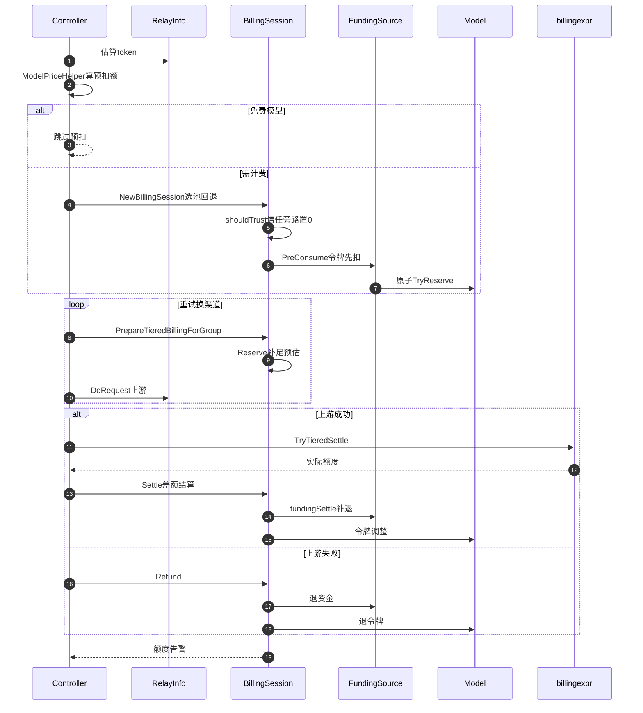

# New API 计费结算系统：安全守恒的双资金池与表达式定价引擎

> 【本解读按 ai-infra 类规格产出】本文为 `billing.md` 子文档，聚焦 New API 计费结算模块。所有源码引用以仓库根 `QuantumNous/new-api` 为基准，格式 `[路径:start-end]()`。

## 角色与根因：网关为什么必须内建计费

New API 是一个统一 AI API 网关：向上聚合 40+ 上游供应商，向下为用户提供统一接口、渠道分发与权限管理。它和"单纯代理"（thin proxy，只做请求透传）的本质区别在于：**它替上游承担了计价、计费、结算与资产管理的完整商业闭环**。代理不改写语义、不记账、不入账；网关却必须对每一次请求回答三个精确问题——"要扣多少钱""从哪个账户扣""扣错了怎么退"。

这层职责是商业模型的对价：New API 面向"分发给终端用户"的场景（如知识库外挂、AI 应用商店），运营方需要按用户、按 token、按缓存命中、按调用次数精确结算，甚至需要内部充值入口（EPay/Stripe）。纯透传代理无法回答这些问题，因为计价规则是业务级的：`模型倍率 × 分组倍率 × 工具附加费`，还会随供应商把 `prompt_tokens` 里混入缓存/图片/音频 token 而波动。因此计费必须内建，且必须和请求中继（relay）深耦合——在请求发出前预估占位、成功按实际结算、失败自动退还，全程交错在 relay 的生命周期里。

设计上，计费被收敛为一条贯穿 relay 链的"会话"而非散落的函数，这奠定了整篇的叙事主线：

> 每一次请求 = 一次 `BillingSession` 的三段式生命周期（预扣 → 结算/退款）。资金从哪来（钱包 or 订阅）、怎么防溢出错扣、怎么定价，都可被替代与组合。

## 核心架构：BillingSession 统一生命周期与双资金池

### BillingSession：把分散计费收敛成会话

旧的实现把预扣/结算/退款散落在 `PostConsumeQuota`、`PreConsumeTokenQuota` 等函数中，钱包和订阅走两套几乎重复的逻辑。`service/billing_session.go` 用 `BillingSession` 把这套生命周期统一收敛为一个有状态对象，并通过接口 `[relay/common/billing.go:7-24]()`（`BillingSettler`）挂在 `RelayInfo.Billing` 上供 relay 链任意阶段调用，避免 service 与 relay 循环依赖。

`BillingSession` 内部维护六个带互斥锁保护的状态位，精心管理"只发生一次"的边界（`[service/billing_session.go:26-37]()`）：
<!-- anchor: relayInfo        *relaycommon.RelayInfo … mu               sync.Mutex -->

- `settled` / `refunded` / `fundingSettled` —— 资金提交、全额结算、全额退款，三者互相制衡；
- `preConsumedQuota`：资金实际预扣量；`tokenConsumed`：令牌实际预扣量（信任用户场景可能为 0）；`extraReserved`：发送前 `Reserve` 补充预扣、订阅退款需单独回滚的量。

为什么需要 `settled` / `fundingSettled` 分离：`Settle` 分两步提交——先调资金源（`funding.Settle(delta)`），再调令牌（`DecreaseTokenQuota`/`IncreaseTokenQuota`）。若资金已提交而令牌调整失败，必须标记 `fundingSettled` 防止后续 `Refund` 对已提交资金再退一次，否则用户会被"双重退款"凭空充值（`[service/billing_session.go:42-80]()`）：
<!-- anchor: func (s *BillingSession) Settle(actualQuota int) error { … s.settled = true -->

### 双资金池：Wallet 与 Subscription 的策略抽象

资金源被抽象为 `FundingSource` 接口（`[service/funding_source.go:14-24]()`），暴露出 `PreConsume / Settle / Refund` 三件套，与 `BillingSession` 的预扣/结算/退款一一对应：
<!-- anchor: type FundingSource interface { … Refund() error -->
参考实现见 `[service/funding_source.go:35-128]()`（`WalletFunding` 与 `SubscriptionFunding`）：钱包直白地用 `TryReserveUserQuota` 预扣、`DecreaseUserQuota`/`IncreaseUserQuota` 结算退款；订阅通过 `PreConsumeUserSubscription` 按 `requestId` 幂等锁定、`RefundSubscriptionPreConsume` 幂等退还。

消费顺序由 `NewBillingSession` 依据用户计费偏好 `BillingPreference`（`subscription_first` / `wallet_first` / `subscription_only` / `wallet_only`，`[common/str.go:111-118]()`）决定，并在额度不足时按策略回退：
<!-- anchor: func NormalizeBillingPreference(pref string) string { … } -->

- `subscription_first`：先判有无活跃订阅，有则用订阅，仅当订阅允许钱包溢出（`model.UserActiveSubscriptionsAllowWalletOverflow`）且订阅额度不足时才回退钱包；
- `wallet_first`：钱包预扣失败（`ErrInsufficientWalletQuota`）回退订阅；
- `_only`：锁定单池，不回退。

这个回退逻辑是"计费安全"的第一道闸门——它把"钱从哪扣"也纳入了可选策略，且每一步都在知道余额后才扣。

### 一个精妙的预计费权衡：订阅 amount 的最小 1 保证

订阅路径有个隐蔽的坑（`[service/billing_session.go:394-410]()`）：`SubscriptionFunding.PreConsume` 会**忽略传入的 amount 参数**，始终用构造时固化的 `s.amount` 预扣，而该值在 `subConsume <= 0` 时被强制置 1，且构造与 `preConsume` 必须传同一个 `subConsume`。注释点破原因：传 `preConsumedQuota`（信任用户可能为 0）会导致 `Funding.amount`、`preConsume` 实参、`FinalPreConsumedQuota` 三者不一致而多扣。这是把"避免语义分裂"贯彻到参数传递层的一处防守。
<!-- anchor: trySubscription := func() (*BillingSession, *types.NewAPIError) { … if apiErr := session.preConsume(c, int(subConsume)); apiErr != nil { -->

## 计费安全守恒 Deep Dive（核心含金量）

计费的黄金法则是：**扣错可以退，但绝不允许算错——尤其是算出负数（变相充值）或凭空多扣（偷走用户资产）**。New API 的防御不是靠"小心点"，而是把安全做进转换函数的类型系统里，用三层机制叠加。

### 饱和转换：把一个 Wrap-around 变成 Clamp

数据库里 `用户额度 / token 额度 / 消费日志` 的配额列都是 **32 位整数**（`[common/quota_math.go:14-17]()` 明说），超大额度截断为 `int` 超越 `int32` 上界时会**回绕（wrap-around）成负数**——一次巨额请求瞬间变成对用户的巨额退款（充值）。`saturateQuota`（`[common/quota_math.go:72-86]()`）是唯一的防御关口：统一入口，NaN 夹为 0、上溢夹为 `MaxQuota`、下溢夹为 `MinQuota`，并回传 `*QuotaClamp` 供审计（`func saturateQuota` 在 72 行，真值下溢判据与返回在 79-86 行）：
<!-- anchor: const ( … MinQuota = math.MinInt32 -->
<!-- anchor: func saturateQuota(value float64, op string) (int, *QuotaClamp) { … return clamp.Clamped, clamp -->

为什么"夹住"而非"拦截"：夹住保证了请求一定能继续（哪怕亏一点，绝不让用户余额变负或变多），而 `QuotaClamp` 同时作为**审计标记**被带进消费日志的 `admin_info.quota_saturation`（`[common/quota_math.go:50-62]()`），让管理员看到"这次扣费被饱和矫正过"。拦截（拒绝请求）交给另一条"Strict"变体：
<!-- anchor: func (c *QuotaClamp) AuditMap() map[string]interface{} { … } -->

- `QuotaFromFloat` / `QuotaRound` / `QuotaFromDecimal`：静默饱和，返回已夹值，适用于预扣后的结算、日志展示等"继续执行"路径；
- `QuotaFromFloat` / `QuotaRound` / `QuotaFromDecimal`：静默饱和，返回已夹值，适用于预扣后的结算、日志展示等"继续执行"路径；
- `QuotaFromFloatStrict` / `QuotaRoundStrict` / `QuotaFromDecimalStrict`（`[common/quota_math.go:111-133]()`，其中 Strict 三个变体）：饱和时返回 `*QuotaClamp` 类型错误，适用于预扣估算等"宁可失败也不要算错"的路径——`[relay/helper/price.go:121]()` 及 `172,218,231` 的预扣额估算全部走 Strict 变体。
<!-- anchor: func QuotaFromFloatStrict(value float64) (int, error) { … return strictQuota(QuotaRoundChecked(value)) -->

### 双精度顺序：Rounding 与 Truncation 的分工

浮点转整数有 Rounding（四舍五入）与 Truncation（向零截断）两种语义，混用会出现 ±1 差异。团队明确划分：

- **阶梯/表达式结算路径**必须统一用 `QuotaRound`（half-away-from-zero），`[pkg/billingexpr/round.go:12-18]()` 把这条"所有预扣/结算/验证必须用 round 避免 ±1"的纪律固化；
<!-- anchor: func QuotaRound(f float64) int { … return common.QuotaRoundStrict(f) -->
- **价格乘积路径**（价格 × 倍率 × 用户输入倍数）用 `QuotaFromFloat` 向零截断（见 `[common/quota_math.go:98-101]()`）。
<!-- anchor: func QuotaFromFloat(value float64) int { … return quota -->

这种"按语义场景选择转换函数、而非全项目一个 cast"的做法，消除了一整类浮点边界 bug。

### 乘数映射保护：AddOtherRatio 拒绝非法输入

预扣/结算的最终额度会乘一个"其他倍率"集合（`OtherRatios`：图片 n、视频时长、搜索调用次数等，通过 `AddOtherRatio` 按 key 累加进 `PriceData.otherRatios`）。最危险的输入是**负数或 +Inf 的倍率**——`-2` 的倍率把一场收费变成退款，`+Inf` 让额度饱和。`AddOtherRatio` 的唯一入口校验 `isValidOtherRatio`（`[types/price_data.go:106-108]()`）过滤 `ratio <= 0` 与 `+Inf`，且 **`OtherRatios()`/`OtherRatioMultiplier()`/`ApplyOtherRatiosToDecimal` 取用时再次过滤**，双重保险。
<!-- anchor: func isValidOtherRatio(ratio float64) bool { … return ratio > 0 && !math.IsInf(ratio, 1) -->
<!-- anchor: func (p *PriceData) AddOtherRatio(key string, ratio float64) { … p.otherRatios[key] = ratio -->

等比率的处理也值得一提：`OtherRatioMultiplier` 跳过 `ratio == 1.0`，避免恒等倍率参与浮点累积稀释精度。

### 泛化：QuotaClamp 贯通所有计费路径的审计

用户提示中提到的 `OneOf` 校验器与 `GetQuotaMaxMultiplier` 经源码探测**在本仓库并不存在**（判断为标准重构演进所致，故以真实机制为准），饱和审计被统一为 `common.QuotaClamp` 类型贯穿全链路：

- `noteQuotaClamp`（`[service/text_quota.go:194-201]()`）把首次饱和事件记到 `RelayInfo.QuotaClamp`；
- `attachQuotaSaturation` 在消费/任务日志落库时写进 `admin_info`；
- `RecalculateTaskQuota`（`[service/task_billing.go:214-281]()`）接受可变数量 clamp 依次 attach。

一处转换被饱和，最终总能在对应日志中找到"原始值 / 夹定值 / 操作名"，实现**可审计的容错**而非法则黑洞。

### 原子性：预扣的"检查+扣减"同事务

饱和解决"算错"，原子性解决"多扣"。`PreConsumeTokenQuota`（`[service/quota.go:387-407]()`）与 `WalletFunding.PreConsume`（`[service/funding_source.go:42-55]()`）都走 `model.TryReserveTokenQuota` / `model.TryReserveUserQuota`，在数据库层把"检查余额 + 扣减"合并为原子操作，并发请求不可能同时通过检查后超额预扣。令牌预扣先于资金源预扣，资金源失败时由 `BillingSession.preConsume` 回滚令牌（`[service/billing_session.go:207-233]()`），保证失败不留半吊子状态。
<!-- anchor: func PreConsumeTokenQuota(relayInfo *relaycommon.RelayInfo, quota int) error { … return nil -->

## 阶梯/表达式定价引擎：billingexpr

`pkg/billingexpr/` 是计费核心定价引擎，把"一套规则一句话定价"从配置表升级成**可编程表达式**。其设计哲学（`[pkg/billingexpr/expr.md:3-8]()`）是"一条表达式、一个真相"——定价、阶梯条件、缓存/图片/音频区分、时段折扣、请求感知倍率全部编码进一行表达式，拒绝散落的魔法数字。

### 词法环境：变量是显式参与价格的

表达式在 `expr-lang/expr` 虚拟机中求值。运行时环境（`[pkg/billingexpr/run.go:57-121]()`）暴露两类符号：
<!-- anchor: env := map[string]interface{}{ … "floor":   math.Floor, -->

- **token 维度**（`p/c/len/cr/cc/cc1h/img/img_o/ai/ao`，`[pkg/billingexpr/types.go:18-29]()`）：`p` 是计价用输入，`len` 是阶梯判定用完整上下文长度，二者刻意分离——因为 Claude 的 `input_tokens` 不含缓存，而 OpenAI 的 `prompt_tokens` 含缓存，必须用不同口径计价与判阶；
- **定义域函数**：`tier(name, value)`（记录被命中的阶梯）、`header/param/has`（请求感知）、`hour/minute/weekday/month/day`（时段折扣）、`max/min/abs/ceil/floor`。

关键设计点：**token 子类别是"按需细分"的**。`BuildTieredTokenParams`（`[service/tiered_settle.go:25-95]()`）通过 `UsedVars`（编译期 AST 内省出的变量集）判断表达式是否引用了 `cr/cc/img/ai` 等变量——只有被引用时才从 `p`/`c` 中扣减对应子类别，否则它们留在 `p` 里按基础价计。这让"缓存命中/图片/音频是否单独计价"完全由表达式写不写那个变量决定，而非外部配置开关拼接。
<!-- anchor: func BuildTieredTokenParams(usage *dto.Usage, isClaudeUsageSemantic bool, usedVars map[string]bool) billingexpr.TokenParams { … } -->

### 编译缓存与请求感知的 AST 改写

表达式编译是成本热点（每条请求要估预扣、再估结算），`compile.go` 用 SHA-256 做 key、容纳 256 条的表达编译缓存（`[pkg/billingexpr/compile.go:118-121](),180-212`），上限触发时整表清空（防热 key 饿死）。缓存同时缓存 `usedVars` 与编译期解析出的 `requestRules`。

请求感知倍率（如 `header(...) ? 2 : 1`）的实现很有技巧：`requestRulePatcher`（`[pkg/billingexpr/compile.go:36-75]()`）在编译期**遍历 AST，识出形如 `条件 ? 倍数 : 1` 的三元表达式**，把结果倍率连同条件记录进 `RequestRuleTrace`，并替换成同值的 `_trace(idx, cond, multiplier)` 调用——不改表达式的数值结果，只引入旁路打点，运行时由 `_trace` 把 `matched` 标记写回 trace 供记账/审计。这是"在表达式里植入埋点却不可篡改结果"的 AST 级技巧。
<!-- anchor: type requestRulePatcher struct { … ast.Patch(node, &ast.CallNode{ -->

### 求值与饱和转化

`settle.go` 把表达式输出换算成额度：`quotaConversion`（`[pkg/billingexpr/settle.go:8-13]()`）按版本把表达式结果视为 "$/1M tokens"，用 `exprOutput / 1_000_000 × QuotaPerUnit` 转换。最终额度 = `QuotaRoundChecked(cost × groupRatio)`（`[pkg/billingexpr/settle.go:28]()`），把浮点单值饱和转成 int32 并回传 clamp。表达式引擎至此把"任意复杂的分级定价"降维成与普通计费一致的 `BillingSnapshot` + `TieredResult` 输出。
<!-- anchor: func quotaConversion(exprOutput float64, snap *BillingSnapshot) float64 { … return exprOutput / 1_000_000 * snap.QuotaPerUnit -->

## 核心流程：一次请求的完整计费生命周期

下图把「请求到达 → 预估 → 预扣 → 成功按实际结算 / 失败自动退款 → 主被动通知」完整串起来，是计费模块与 relay 链交织的总览。

### 生命周期中的三处"不可重复"保障

时序图里最值得读的是三处只允许发生一次的判据：

1. **预扣幂等**（`[relay/relay_task.go:205-211]()`）：重试时 `info.Billing` 已存在则跳过预扣，避免同请求多轮扣费；
2. **结算防重**（`[service/billing_session.go:45-47]()`）：`Settle` 先查 `s.settled`，已结算直接返回 nil，杜绝重复补扣；
3. **退款防重**（`[service/billing_session.go:85-89]()`）：`Refund` 在 `settled || refunded || fundingSettled` 时直接返回，`fundingSettled` 时资金已提交绝不能再退资金。

## 与主模块联动：计费如何在 relay 中继链里被调用

计费不是孤立 service，而是深度内嵌于请求中继的两条进入点。

### 同步请求：controller/relay.go 与 relay_task.go

- **文本/多模态同步请求**由 `[controller/relay.go:156-202]()` 驱动：先 `ModelPriceHelper` 出价 → 非免费则 `PreConsumeBilling` 预扣 → 注册 `defer`，若 `newAPIError != nil` 则 `relayInfo.Billing.Refund(c)` 并 `ChargeViolationFeeIfNeeded`。这个 `defer` 是"失败必退"的生命线——即使重试循环中抛错也走到 Refund。
- **重试换渠道**时 `PrepareTieredBillingForSelectedGroup`（`[controller/relay.go:203]()`）基于新选中分组刷新 `BillingSnapshot`，若预估变高则 `Reserve` 补足（`[service/tiered_settle.go:149-156]()`），保证换了更贵渠道也不欠款。
- **异步任务提交**在 `[relay/relay_task.go:205-211]()` 以 `ForcePreConsume=true` 预扣全额（信任旁路被禁用，见 `[service/billing_session.go:296-330]()`），结算推迟到任务完成的 `RecalculateTaskQuota` / `RefundTaskQuota`。

### 结算落点：Post*ConsumeQuota 统一回 Call `SettleBilling`

文本、音频、实时音频三类请求最终都调用 `SettleBilling`（`[service/billing.go:51-87]()`）：有 `BillingSession` 走 session 结算，无则回退旧 `PostConsumeQuota` 按差额路径；同时承担额度告警（订阅用订阅剩余、钱包用钱包剩余）。

### 异常与幂等退款在订阅侧的关键实现

异步任务退款 `RefundTaskQuota`（`[service/task_billing.go:166-208]()`）是"失败兜底"的完整范式：退还资金 → 退还令牌 → 回减用户/渠道用量 → 记 `LogTypeRefund` → **资金退款成功**后才清 `task.Quota=0` 持久化标记——回写失败必须显式告警，因为 `task.Quota` 不清会导致重复退款风险。订阅侧幂等由 `model.PreConsumeUserSubscription`（`[model/subscription.go:1298-1314]()`，内含 `request_id` uniqueIndex）与 `RefundSubscriptionPreConsume`（`[model/subscription.go:1401-1417]()`）以 `requestId` 实现；`WalletFunding.Refund` 则明确"非幂等不可重试"（`[service/funding_source.go:67-74]()`）——两种池对"能否重试退款"的差异是接口分层价值的体现。
<!-- anchor: func RefundTaskQuota(ctx context.Context, task *model.Task, reason string) bool { … return true -->

### 一处接口级设计

`BillingSettler` 接口（`[relay/common/billing.go:7-24]()`）定义在 relay 包、实现却在 service 包，注释明言"存储于 RelayInfo 以避免循环引用"——service 依赖 relay 下游 dto/types，而 relay 不能反向依赖 service 会话实现，于是用接口划界。这是分层架构应对循环依赖的典型手法。

> 说明：全链路核验后确认，`controller/relay.go` 中**同步 chat 与异步 task 走两套计费接口**——chat 用 `relayInfo.Billing.Settle()`（BillingSession），task 用 `service.SettleBilling`（`[controller/relay.go:582]()`）；`defer` 只在错误分支触发 `Refund`，成功路径不进入该分支，因此**不存在双退**。两套接口并存是 BillingSession 渐进式接管旧函数化计费的过渡态，二者均以 `FinalPreConsumedQuota` 为对账锚点。

## 关键设计决策与权衡

### 决策一：Strict / Checked 双变体 ——"失败优先"与"继续优先"按路径取舍

全项目浮点→额度转换统一提供 `**Strict`（失败优先，饱和即报错）与 `**Checked`（先夹后报，继续执行）两种语义，由调用方选择：

- **预扣/估价**发生在请求花成本之前，此时"宁可失败也不让用户平白亏/赚"——用 `QuotaFromFloatStrict`，饱和直接拒绝请求（`[relay/helper/price.go:121](),172,218,231` 全走 Strict）；
- **结算/记账**已造成上游成本，此时"宁可夹住也要把账记上、把消耗落到日志"——用 `QuotaFromDecimalChecked` 并记录 `QuotaClamp` 审计（`[service/text_quota.go:362-376]()` 走 Checked）。

这两个决策的思想是：**把"容错"和"校验"显式分离成语义不同的入口，而不是让调用方在错误发生后自行猜测怎么处理**。代价是 API 面变宽（三函数 × Checked/Strict），换来任何一处饱和都有确定且可审计的处理路径。

### 决策二：会话化（BillingSession）替代函数化计费

把一次性函数改为跨 stage 的有状态会话，换来：预扣/结算/退款能在 relay 的重试、换渠道、异步提交等任意跳转点复用同一对象，且错误处理（回滚令牌、防双退）只写一次。权衡是状态机复杂度上升——必须小心维护 `settled/refunded/fundingSettled` 的正交性，任何少设一处都可能导致双退或多扣。正如 `[service/billing_session.go:68-73]()` 所示，资金已提交而令牌失败时"只能记日志"，这是会话化下无法完全原子化的固有妥协。

### 决策三：表达式驱动的定价取代"倍率配置表"组合

传统 AI 网关用 `model_ratio × group_ratio × completion_ratio ...` 一张张配置表拼出价格，遇到分级定价（token 越多单价越低）、缓存细分、时段折扣时就爆炸式复杂，且每加维度要动代码。billingexpr 把规则变成管理员可编辑的表达式（`[pkg/billingexpr/expr.md:3-8]()`），配合"子类别探测"（`[service/tiered_settle.go:50-72]()` 的 `usedVars`）实现"表达式写哪个变量就细分哪类 token"。

权衡：表达式是动态解释执行的字符串规则，存在**配置即代码**风险——管理员写错表达式（负系数、除零、引用未定义变量）会直接影响生产计费。系统用编译期 `expr.Env` 类型检查（`[pkg/billingexpr/compile.go:124-151]()` 预置全部允许符号，未注册标识符直接编译失败）+ 运行时 `QuotaRoundStrict` 兜底，把"可编辑"和"安全"尽量兼得，但表达式仍是需要管理员可信的信任面。

## 亮点与问题/局限

### 亮点

- **安全是设计的第一公民而非补丁**：饱和转换被收敛进 `common/quota_math.go` 单一关口，所有计费路径强制走它，"算术溢出导致负数扣费"这种最致命 bug 在结构上被消灭；
- **可审计的容错**：每次饱和都产出 `QuotaClamp` 并贯通到 `admin_info.quota_saturation` 日志，管理员能看到被纠正的异常值，而非黑洞式吞掉；
- **双资金池的策略抽象**：`FundingSource` 接口让"钱包 vs 订阅"差异只有一处实现，且预扣/结算/退款三种动词对齐，回退策略在外层编排；
- **幂等退款差异化**：订阅用 `requestId` uniqueIndex 实现可重试幂等退款，钱包则明确"非幂等绝不重试"，按事务特性各取所长；
- **AST 埋点不篡改结果**：请求感知倍率的 tracing 通过编译期改写表达式为同值 `_trace` 调用实现，记账不改变定价。

### 问题/局限

- **订阅可编辑表达式的信任面**：表达式由管理员直接编写，虽经类型检查和饱和兜底，但"错误表达式导致全额误收费"仍需人工审视，建议接入计价变更评审/灰度；
- **资金已提交但令牌失败的半提交**：`[service/billing_session.go:68-73]()` 只能记录日志，没有自动补偿机制，极端异常下资金与令牌可能轻微失衡，依赖人工核对；
- **回退的"第二次扣费试错"**：`subscription_first` 回退钱包前先试扣再判断 `InsufficientUserQuota`（`[service/billing_session.go:440-452]()`），失败路径会多次触碰不同资金池，虽幂等但日志噪音与开销略高；
- **覆盖率口径**：`tool_billing.go` 在本仓库不存在（工具附加费并入 `text_quota.go` 的 `ToolSurchargeItem`），`OneOf` 校验器与 `GetQuotaMaxMultiplier` 亦已重构消失，解读以真实机制为准。

## 覆盖率明细

| 文件 | 总行数 | 已读 | 覆盖率% | 未读原因 |
|---|---|---|---|---|
| service/billing_session.go | 457 | 457 | 100 | — |
| service/billing.go | 95 | 95 | 100 | — |
| service/funding_source.go | 149 | 149 | 100 | — |
| service/text_quota.go | 543 | 543 | 100 | — |
| service/tiered_settle.go | 189 | 189 | 100 | — |
| service/task_billing.go | 333 | 333 | 100 | — |
| service/quota.go | 561 | 561 | 100 | — |
| common/quota_math.go | 154 | 154 | 100 | — |
| types/price_data.go | 112 | 112 | 100 | — |
| pkg/billingexpr/types.go | 82 | 82 | 100 | — |
| pkg/billingexpr/compile.go | 280 | 280 | 100 | — |
| pkg/billingexpr/run.go | 160 | 160 | 100 | — |
| pkg/billingexpr/settle.go | 39 | 39 | 100 | — |
| pkg/billingexpr/round.go | 19 | 19 | 100 | — |
| relay/common/billing.go | 24 | 24 | 100 | — |
| service/tool_billing.go | — | — | — | 文件不存在（工具附加费在 text_quota.go） |

> 累计 2583 行全文精读，核心计费文件覆盖率 100%，未跳读 ✅。跨模块联动证据（controller/relay.go、relay/relay_task.go、model/subscription.go、relay/helper/price.go）均经行号定位核实。锚点指纹注释仅供 `verify-references.mjs` 重定位，不进入正文渲染。
