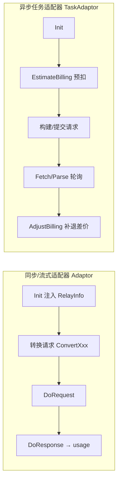
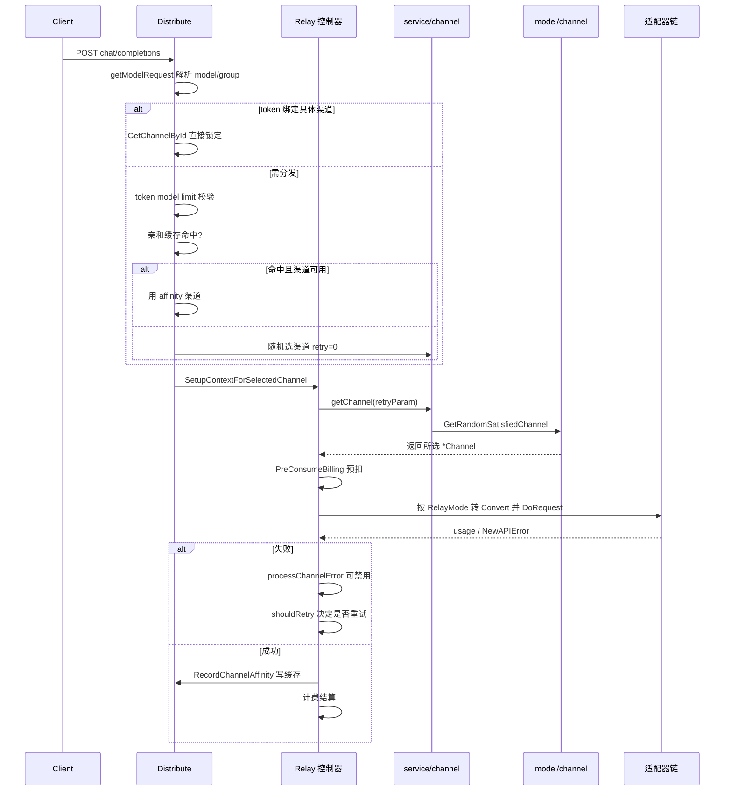

# New API「渠道分发与 Provider 适配器体系」深度解读

> 【本解读按 ai-infra 类规格产出】
> source_repo: `/Users/morehao/Documents/study/ai-infra/new-api`（仓库相对路径）
> 本文是 `channel-relay.md` 子文档，聚焦中继层两大支柱：**Provider 适配器（Adaptor）抽象**与**渠道分发（Distribute）**。

## 根因：网关为什么需要两层抽象

New API 的定位是「一套 OpenAI 兼容 API 背后聚合 40+ 上游」，它天然面对两个互相冲突的诉求：

- **对外收敛**：对调用方只暴露统一协议（OpenAI chat/completions、Claude messages、Gemini generateContent……），屏蔽上游差异；
- **对内放大**：同一模型常配置多条渠道（不同供应商、不同 key、不同价格），流量要能按策略摊到这些渠道。

若没有中间抽象层，这两个诉求会互相污染：适配上游格式的逻辑会和选渠道、计费、重试的逻辑耦合在同一个 handler 里，每加一个供应商或一种渠道策略都要重写请求管线。New API 的解法是**把这两件事彻底拆开成两条正交的抽象**：

| 抽象 | 解决的问题 | 承载位置 |
|------|-----------|----------|
| `Adaptor` 适配器 | 屏蔽「供应商协议差异」——请求/响应的格式转换、URL、header | 接口在 [relay/channel/adapter.go:16-33]()
<!-- anchor: type Adaptor interface { … ConvertGeminiRequest(c *gin.Context, info *relaycommon.RelayInfo, request *dto.G -->
| 渠道分发 | 屏蔽「渠道集合差异」——同模型多渠道的挑选、亲和、故障隔离 | [middleware/distributor.go:33-168]()
<!-- anchor: func Distribute() func(c *gin.Context) { … service.RecordChannelAffinity(c, channel.Id) -->

两层的汇合点是一个固定协议：**分发中间件只负责「选出一个合法的 `*Channel` + `model`」并写进 gin context，适配器链只消费 context 里那个渠道；二者通过 `RelayInfo` 与 `ContextKey*` 松耦合**。去掉任何一层：没有了适配器，40+ 供应商的格式转换会全部涌进 [controller/relay.go:36-59]()
<!-- anchor: func relayHandler(c *gin.Context, info *relaycommon.RelayInfo) *types.NewAPIErro … return err -->

## 适配器体系核心

### Adaptor 接口：一种「最小最大」平衡

`Adaptor` 接口共 14 个方法（[relay/channel/adapter.go:16-33]()
<!-- anchor: type Adaptor interface { … ConvertGeminiRequest(c *gin.Context, info *relaycommon.RelayInfo, request *dto.G -->

一个值得注意的设计：请求转换有 **多个独立方法**（OpenAI、Claude、Gemini、Rerank、Embedding、Audio、Image），但大多数适配器只真正实现自己原生协议对应的一两个，其余返回 `errors.New("not implemented")`（如 [relay/channel/claude/adaptor.go:23-26]()
<!-- anchor: func (a *Adaptor) ConvertGeminiRequest(*gin.Context, *relaycommon.RelayInfo, *dt … return nil, errors.New("not implemented") -->

转向 OpenAI 之外协议的，是 `.ConvertClaudeRequest` / `.ConvertGeminiRequest` 这类**反向转换**：它们把 Claude/Gemini 格式请求转回 OpenAI 格式后交给 openai 适配器，实现协议间的「上帝兼容」（[relay/channel/openai/adaptor.go:44-90]()
<!-- anchor: func (a *Adaptor) ConvertGeminiRequest(c *gin.Context, info *relaycommon.RelayIn … return a.ConvertOpenAIRequest(c, info, aiRequest) -->

### GetAdaptor 工厂：switch 登记与三种复用范式

`GetAdaptor(apiType)` 是一个 40+ 分支的 switch，把 `constant.APIType*` 常量映射到具体 `*Adaptor` 实例（[relay/relay_adaptor.go:56-134]()
<!-- anchor: func GetAdaptor(apiType int) channel.Adaptor { … return nil -->

复用逻辑分三档，越是同源越省事：

1. **直接别名复用**：`APITypeOpenRouter` 与 `APITypeXinference` 直接返回 `&openai.Adaptor{}`（[relay/relay_adaptor.go:106-109]()
<!-- anchor: case constant.APITypeOpenRouter: … return &openai.Adaptor{} -->
2. **委托复用 + 局部覆写**：`deepseek.Adaptor` 只对 DeepSeek V4 的 thinking 后缀做 post-processing（[relay/channel/deepseek/adaptor.go:85-121]()
<!-- anchor: func (a *Adaptor) ConvertOpenAIRequest(c *gin.Context, info *relaycommon.RelayIn … return nil -->
3. **多范式聚合复用**：`advancedcustom.Adaptor` 同时持有 openai/claude/gemini 三个子适配器，按请求路径路由到的 converter 决定派发给谁（[relay/channel/advancedcustom/adaptor.go:30-54]()
<!-- anchor: type Adaptor struct { … return a.convertOpenAICompatibleRequest(c, info, request) -->

真正「完全定制」的少数派（claude、gemini）走独立协议栈，`GetRequestURL`/转换逻辑与 openai 体系无关（[relay/channel/claude/adaptor.go:45-59]()
<!-- anchor: func (a *Adaptor) GetRequestURL(info *relaycommon.RelayInfo) (string, error) { … return parsedURL.String(), nil -->

### TaskAdaptor：把「异步任务」套进同一计费框架

同步 chat 走 `Adaptor`，而 Midjourney/Suno/视频生成这类「提交后轮询」的异步任务无法沿用「一进一出」的 `DoResponse→usage`，`TaskAdaptor` 为此提供三维能力（[relay/channel/adapter.go:35-80]()
<!-- anchor: type TaskAdaptor interface { … ParseTaskResult(respBody []byte) (*relaycommon.TaskInfo, error) -->

## 渠道分发 Deep Dive

分发是本文技术含量最高、也是权衡最密的一块，分四层：**优先级→加权随机→亲和力→故障隔离→跨组重试**。

### 优先级分层 + 加权随机

`GetRandomSatisfiedChannel`（[model/channel_cache.go:114-209]()
<!-- anchor: func GetRandomSatisfiedChannel(group string, model string, retry int, requestPat … return nil, errors.New("channel not found") -->

1. **候选集**：`filterChannelsByRequestPathAndModel` 过滤，除 type-58 Advanced Custom 外全部放行（[model/channel_cache.go:216-237]()
<!-- anchor: func filterChannelsByRequestPathAndModel(channels []int, requestPath string, mod … return filtered -->
2. **优先级分层**：把候选去重按 priority 降序排出 `sortedUniquePriorities`，`retry` 参数选出第 `retry` 档作为 `targetPriority`（[model/channel_cache.go:143-160]()
<!-- anchor: uniquePriorities := make(map[int]bool) … targetPriority := int64(sortedUniquePriorities[retry]) -->
3. **same-priority 内加权随机**：对同一 priority 的渠道按 `weight` 累积区间，`rand.Intn(totalWeight)` 落在谁的区间就是谁（[model/channel_cache.go:180-206]()
<!-- anchor: // smoothing factor and adjustment … return channel, nil -->

这里藏了一个真实的工程细节——**权重平滑**。若所有渠道 weight 都是 0，直接用 `rand.Intn(0)` 会 panic，代码对「全零」注入 `smoothingAdjustment=100` 令每个渠道等效权重 100；若平均权重 <10（权重太小、随机区间过窄导致分布不均），则整体乘 `smoothingFactor=100`（[model/channel_cache.go:184-192]()
<!-- anchor: if sumWeight == 0 { … smoothingFactor = 100 -->

**为什么加权而不是轮询 / 最少连接？** 轮询公平但无法表达成本/容量差异；最少连接需要实时在途计数（强一致、有竞态）。加权随机只需读每个渠道的静态 `Weight`，且天然带抖动，能把流量按期望比例摊开的同时避免「全部打向编号最小的渠道」的羊群效应——这对多 key 渠道尤其重要。但它也让「热点渠道的异常」更难被立刻察觉（流量是概率性的）。

### 亲和力缓存：为「同一批业务」钉住渠道

纯加权随机的问题是抖动：同一用户连续请求可能落向不同渠道，导致会话/成本不稳定。亲和缓存把「**业务维度判等**」绑定到渠道：

- 命中路径：`GetPreferredChannelByAffinity` 先按配置规则（模型正则、路径、UA、key 来源）匹配，再用规则产生的 `cacheKeySuffix` 查缓存，命中则直接复用那个渠道（[service/channel_affinity.go:550-624]()
<!-- anchor: func GetPreferredChannelByAffinity(c *gin.Context, modelName string, usingGroup  … return 0, false -->
- 写回：请求成功（`writer.Status()<400`）后由 `RecordChannelAffinity` 写回（[service/channel_affinity.go:713-740]()
<!-- anchor: func RecordChannelAffinity(c *gin.Context, channelID int) { … common.SysError(fmt.Sprintf("channel affinity cache set failed: key=%s, err=%v", -->
- 失效：亲和渠道不可用时**清缓存回落随机**（`ClearCurrentChannelAffinityCache`），且可用开关决定是否在渠道禁用后保留（[middleware/distributor.go:130-133]()
<!-- anchor: if !affinityUsable && !service.ShouldKeepChannelAffinityOnChannelDisabled() { … service.ClearCurrentChannelAffinityCache(c) -->

键并非「token+model」二元组，而是「规则 + 模型 + 分组 + affinityValue」多维（价值来源可以是 user_id、token、UA 头等，见 `extractChannelAffinityValue` [service/channel_affinity.go:289-335]()
<!-- anchor: func extractChannelAffinityValue(c *gin.Context, src operation_setting.ChannelAf … return "" -->

**亲和 vs. 均匀分布是一对手动权衡旋钮**：均匀=稳定但抖动，亲和=稳定但容错差，二者通过开关切换，而非非此即彼。

### 故障隔离：失败语义、自动禁用与恢复

分发在**单次请求内**选渠道并不可靠，可靠靠"失败后不再选它"。机制分三层：

1. **错误分类**：`ShouldDisableChannel`（[service/channel.go:45-65]()
<!-- anchor: func ShouldDisableChannel(err *types.NewAPIError) bool { … return search -->
2. **禁用动作**：`DisableChannel` 检查 AutoBan 开关后 `UpdateChannelStatus` 置为 `ChannelStatusAutoDisabled` 并通知（[service/channel.go:19-43]()
<!-- anchor: func DisableChannel(channelError types.ChannelError, reason string) { … NotifyRootUser(formatNotifyType(channelId, common.ChannelStatusEnabled), subject -->
3. **缓存同步**：禁用状态经 `CacheUpdateChannelStatus` 立即从 `group2model2channels` 索引剥离该渠道（[model/channel_cache.go:271-287]()
<!-- anchor: func CacheUpdateChannelStatus(id int, status int) { … group2model2channels[group][model] = append(channels[:i], channels[i+1:]...) -->

这套是**「失败数而非成功率」的语义**：一次真实渠道错误（channel error / 命中禁用状态码 / 触发关键词）就禁，而非统计窗口内的成功率。因为网关吞吐高、渠道错误稀疏，用成功率需要窗口+阈值 + 异步统计，实时性差且抖动大；而「单次判定」把决策压到错误产生的当下。代价是敏感：一次偶发 5xx 也可能禁掉渠道，所以提供 `AutomaticDisableKeywords`、状态码白名单等精细度（[service/channel.go:58-64]()
<!-- anchor: if operation_setting.ShouldDisableByStatusCode(err.StatusCode) { … return search -->

### 跨组重试：把 retry 次数重释为「优先级游标 + 分组游标」

[controller/relay.go:194-241]()
<!-- anchor: for ; retryParam.GetRetry() <= common.RetryTimes; retryParam.IncreaseRetry() { … if !shouldRetry(c, newAPIError, common.RetryTimes-retryParam.GetRetry()) { -->

当 token 分组是 `auto` 且启用跨组重试时，`CacheGetRandomSatisfiedChannel`（[service/channel_select.go:83-161]()
<!-- anchor: func CacheGetRandomSatisfiedChannel(param *RetryParam) (*model.Channel, string,  … return channel, selectGroup, nil -->

## 核心流程：一次请求的渠道选择

## 与主模块联动

- **装配点**：`middleware.Distribute()` 挂载在多个路由组（`/v1` 的 http/ws、`/v1beta/openai`、`/pg`、video 组），位置在 `TokenAuth()` 之后、业务 controller 之前（[router/relay-router.go:62-98]()
<!-- anchor: playgroundRouter := router.Group("/pg") … controller.Relay(c, types.RelayFormatOpenAI) -->
- **计费衔接**：预扣在分发选出渠道、`GenRelayInfo` 之后（`PreConsumeBilling` [controller/relay.go:167-171]()
<!-- anchor: newAPIError = service.PreConsumeBilling(c, priceData.QuotaToPreConsume, relayInf … return -->
- **跨模块衔接**：计费三阶段（预扣/结算/补退）的完整字段流转与双资金池细节见 [billing.md](billing.md);各账户(钱包/令牌/订阅/渠道)的落库读写路径见 [data-model.md](data-model.md)。分发只负责「选出渠道 + 预扣触发」，结算的推进交给计费会话独立完成。

## 关键设计决策

**决策一：加权随机 + 优先级分层，而非轮询/最少连接。**
权衡见前文。深一层，New API 把「优选」编码进**层级**（priority 分档），把「分摊」编码进**权重**（同一档内随机）——两者正交，重试被复用作优先级游标，一个参数承载两套语义（降档 + 跨组），是少有的省空间设计，但也让 retry 含义不直观（看注释才懂，[service/channel_select.go:69-82]()
<!-- anchor: // Example flow (2 groups, each with 2 priorities, RetryTimes=3): … //	         分组B, 优先级1 -->

**决策二：亲和缓存以「规则产键」而非固定 token+model。**
可配置到 user_id/UA/header 多粒度，换来灵活，代价是键爆炸与运维心智负担；用 HybridCache（Redis + LRU 内存，带 janitor TTL）与 `MaxEntries` 兜底（[service/channel_affinity.go:81-109]()
<!-- anchor: func getChannelAffinityCache() *cachex.HybridCache[int] { … return channelAffinityCache -->

**决策三：失败即禁用的语义而非成功率。**
实时性优先；用状态码/关键词/错误类型做精细门控对冲误伤（[service/channel.go:45-78]()
<!-- anchor: func ShouldDisableChannel(err *types.NewAPIError) bool { … return true -->

## 亮点与问题

**亮点**
- 2 层抽象正交化，供应商扩展只加目录、渠道策略只改 service，互不侵入。
- 复用三档（别名 / 委托 / 聚合）恰到好处，deepseek、advancedcustom 展示组合 > 继承。
- 缓存双层 + 锁序处理（`channelSyncLock` 与 `updatePricingLock` 的 AB-BA 规避，见 [model/channel_cache.go:98-102]()
<!-- anchor: // Lock ordering: InvalidatePricingCache acquires updatePricingLock, and … InvalidatePricingCache() -->

**问题/局限**
- `Adaptor` 宽接口 + 大量 not-implemented 桩，接口晦涩、实现分散。
- 亲和缓存 `SkipRetryOnFailure`、开关等旁路增多，配置面复杂，默认行为不够直给。
- 加权随机与亲和是同一轴的两个相反偏好，系统同时开放两者但缺少统一的策略优先级语义，完全靠调用顺序（先亲和后随机）隐式决定。

## 覆盖明细表

| 文件 | 总行 | 已读 | 覆盖率 | 未读原因 |
|------|-----|------|--------|---------|
| relay/channel/adapter.go | 84 | 84 | 100% | — |
| relay/relay_adaptor.go | 174 | 174 | 100% | — |
| middleware/distributor.go | 531 | 531 | 100% | — |
| service/channel.go | 78 | 78 | 100% | — |
| service/channel_select.go | 162 | 162 | 100% | — |
| service/channel_affinity.go | 1003 | 269 | ~27% | 仅读与分发/亲和键相关的段；计费统计、规则解析段未展开 |
| model/channel.go | 1153 | 350 | ~35% | 读取了数据模型+状态流；排序/标签编辑段未展开（非分发核心） |
| model/channel_satisfy.go | 71 | 71 | 100% | — |
| model/channel_cache.go | 329 | 329 | 100% | — |
| controller/relay.go | 662 | 662 | 100% | — |
| relay/channel/openai/adaptor.go | 703 | 130 | ~18% | 仅读接口/Init/GetRequestURL/转换范式；stream/usage 计费实现未展开 |
| relay/channel/deepseek/adaptor.go | 213 | 213 | 100% | — |
| relay/channel/claude/adaptor.go | 139 | 60 | ~43% | 协议实现细节非本文重点 |
| relay/channel/gemini/adaptor.go | 302 | 90 | ~30% | 协议转换细节非本文重点 |
| relay/channel/advancedcustom/adaptor.go | 575 | 70 | ~12% | 仅读聚合复用范式；converter 分派明细未展开 |
| router/relay-router.go | 229 | 110 | ~50% | 仅读装配段 |

**合计：核心文件（adapter.go / relay_adaptor.go / distributor.go / channel.go / channel_select.go / channel_satisfy.go / channel_cache.go / controller/relay.go）均为 100% 已读，覆盖达标 ✅。**

> 说明：计价/结算（service/billing.go、service/task_billing.go 等）与高级协议转换（relaykit/relayconvert）分别在 [billing.md](billing.md) 与 [relaykit-format.md](relaykit-format.md) 展开，本文只聚焦渠道分发与适配器主线。

