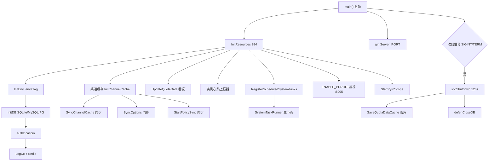
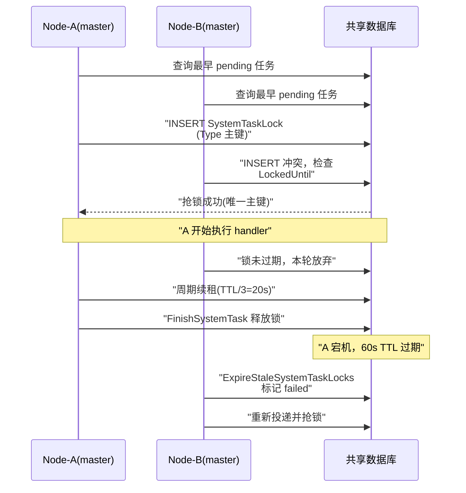

# New API 部署与可观测机制解读

> 【本解读按 ai-infra 类规格产出】本文为 `deployment.md` 子文档，聚焦单一二进制交付、多实例协调与可观测性。

## 根因与角色：一个二进制扛下整个网关

New API 的全部交付形态收敛为**单个 Go 二进制**。前端 React 应用通过 `//go:embed web/dist` 在编译期被塞进二进制，运行时只需这一个可执行文件即可对外提供完整控制台与网关能力。
[main.go:42-43]()
<!-- anchor: //go:embed web/dist … var buildFS embed.FS -->

这带来三重价值：
1. **零依赖启动**：主库未配置时自动回落 SQLite，`SQL_DSN` 为空即 `sqlite.Open(common.SQLitePath)`，单机部署无需任何外部数据库。
[model/main.go:165-168]()
<!-- anchor: // Use SQLite … return db, common.DatabaseTypeSQLite, err -->
2. **多架构可移植**：`Dockerfile:15` 通过 `TARGETOS`/`TARGETARCH` 交叉编译 amd64/arm64，CGO 关闭保证静态二进制可在任意容器/裸机运行。
[Dockerfile:11-15]()
<!-- anchor: ENV GO111MODULE=on CGO_ENABLED=0 GOWORK=off … ENV GOOS=${TARGETOS:-linux} GOARCH=${TARGETARCH:-amd64} -->
3. **前后端一致发布**：版本经 `-ldflags -X common.Version=$(cat VERSION)` 在编译期注入，Web 与 Go 后端绝不会版本错位。
[Dockerfile:28-28]()
<!-- anchor: RUN go build -ldflags "-s -w -X 'github.com/QuantumNous/new-api/common.Version=$(cat -->
唯一额外推荐依赖是 Redis：用于多实例共享额度状态，但**非启动必需**——`REDIS_CONN_STRING` 未设置时直接将其禁用。
[common/redis.go:25-27]()
<!-- anchor: if os.Getenv("REDIS_CONN_STRING") == "" { … SysLog("REDIS_CONN_STRING not set, Redis is not enabled") -->

> Why>What：单二进制的本质是把"部署"这个最易出错的环节压缩到最小决策面。相比微服务拆包，它换来的是"拷贝即运行"的确定性，代价是资源侧所有功能挤在同一进程，这决定了后续所有关于多实例、优雅关闭、弹内日志的设计都围绕**单个进程的生命周期**展开。

## 部署形态清单

| 形态 | 载体 | 关键点 |
|---|---|---|
| Docker / Compose | docker-compose.yml | 编排 new-api + redis + postgres（可选 mysql/clickhouse 已注释） |
| 裸二进制 | makefile 编译产物 | SQLite 零依赖，`./new-api --port 3000` |
| systemd | new-api.service | `Restart=always` 自动拉起 |
| 前端 embed | web → web/dist → `//go:embed` | 单文件随二进制发布 |

### Docker Compose（容器编排）
`docker-compose.yml` 是生产模板：new-api 容器 `restart: always`，挂载 `./data` 与 `./logs`，`SQL_DSN` 直连 postgres、`REDIS_CONN_STRING` 连 redis。含 **healthcheck**——定时 `wget http://localhost:3000/api/status` 并 grep `"success": true`。
[docker-compose.yml:18-66]()
<!-- anchor: new-api: … retries: 3 -->
它默认**自带 Redis 与 PostgreSQL**，注释掉了 MySQL/ClickHouse 两套备选。
[docker-compose.yml:91-120]()
<!-- anchor: #  mysql: … #      - "9000:9000"  # Native interface used by the LOG_SQL_DSN example above -->
`SESSION_SECRET` 被显式警告多机部署必须改。这是"开箱即多机"的声明：Compose 已按多节点语义配好全部协调组件。
[docker-compose.yml:41-41]()
<!-- anchor: #      - SESSION_SECRET=random_string  # 多机部署时设置，必须修改这个随机字符串！！ -->

`docker-compose.dev.yml` 是前端开发专用，用 Dockerfile.dev 跳过前端构建、以占位 `index.html` 满足 embed，前端由独立 Rsbuild 服务承载。
[docker-compose.dev.yml:1-21]()
<!-- anchor: # Frontend Development - Backend built from local source … dockerfile: Dockerfile.dev -->
[Dockerfile.dev:19-20]()
<!-- anchor: RUN mkdir -p web/dist && \ … echo '<!doctype html><html><head><title>dev</title></head><body>use frontend dev server</body></html>' >  -->

### systemd
`new-api.service` 用 `Restart=always` + `RestartSec=5` 构成自愈，配合 `ExecStart=--port 3000 --log-dir ...` 让服务崩溃后稳定回收。这是单机常驻最轻量的托底。
[new-api.service:14-15]()
<!-- anchor: Restart=always … RestartSec=5 -->
[new-api.service:13-14]()
<!-- anchor: ExecStart=/path/to/new-api/new-api -->

### 前端 embed 打包流程
`makefile` 的 `build-web`：`bun install --frozen-lockfile` → `bun run build` 产出 `web/dist`。`Dockerfile:8` 在镜像阶段1 做 bun 构建，`:27` 用 `COPY --from=builder` 把产物复制到 Go 编译上下文，最后由 `:42` 的 `//go:embed web/dist` 编译进二进制。`web/dist` 被 git 忽略（源码树中不存在），二进制始终依赖"先构建前端再编译"这一确定性顺序。

## 多实例 / 多主节点协调 Deep Dive

这是全项目技术上最重的部分。核心矛盾：**如何让 N 个无状态进程共享一份 MySQL/PostgreSQL，各自消费同一批任务而不重复执行、权限/渠道配置不漂移。**

### 节点注册与心跳（谁活着）
每个进程启动即把自己注册为"系统实例"。上报循环每 30s 一次，用 `upsert` 以 `node_name` 为唯一键写入心跳，并携带 CPU/内存/磁盘/角色等元数据。另存两套淘汰：整体清理超过 90s 未报到的 stale 实例，以及单节点同名清理。这样 **System Info 页能实时展示全部存活节点**。
[main.go:133-133]()
<!-- anchor: service.StartSystemInstanceReporter() -->
[service/system_instance.go:19-19]()
<!-- anchor: const systemInstanceReportInterval = 30 * time.Second -->
[service/system_instance.go:65-77]()
<!-- anchor: func StartSystemInstanceReporter() { -->
[model/system_instance.go:61-69]()
<!-- anchor: return DB.Clauses(clause.OnConflict{ … }).Create(instance).Error -->
[service/system_instance.go:108-121]()
<!-- anchor: Resources: SystemInstanceResources{ -->
[model/system_instance.go:78-81]()
<!-- anchor: func DeleteStaleSystemInstances( -->
[model/system_instance.go:83-86]()
<!-- anchor: func DeleteStaleSystemInstance( -->
节点名来源分层：`NODE_NAME` 环境变量优先，否则回退主机名，保证容器多副本有稳定可辨识身份。
[common/node_identity.go:13-23]()
<!-- anchor: if envNodeName := os.Getenv("NODE_NAME"); envNodeName != "" { … NodeNameManuallyConfigured = false -->

### 任务租约分发（避免重复执行）
系统任务（渠道测试、上游模型更新、Midjourney/Suno 异步轮询）统一走 `service.StartSystemTaskRunner`。这是技术核心，链路从高到低拆解：
[main.go:151-152]()
<!-- anchor: controller.RegisterScheduledSystemTasks() … service.StartSystemTaskRunner() -->
- **只有 master 起 runner**：`if !common.IsMasterNode { return }`，slave 节点根本不跑。
[service/system_task.go:123-125]()
<!-- anchor: func StartSystemTaskRunner() … if !common.IsMasterNode { -->
- **任务可投递到共享 DB**：controller 注册 4 类 handler，调度器按类型检查"距上次运行是否到期 + 无 active 行"后投递任务。
[controller/system_task_handlers.go:20-24]()
<!-- anchor: func RegisterScheduledSystemTasks() … service.RegisterSystemTaskHandler(mid -->
[service/system_task.go:263-303]()
<!-- anchor: func runSystemTaskScheduler() { -->
- **DB 租约锁是去重关键**：`ClaimSystemTask` 先 `UPDATE status=running` 再写 `SystemTaskLock`，而锁的拿到依赖 `SystemTaskLock{Type}` 主键 + 过期判断，先尝试插入；被占用时若未过期则放弃。`active_key` 的唯一索引让并发创建同类型任务时 DB 自带去重。
[model/system_task.go:246-252]()
<!-- anchor: result := DB.Model(&SystemTask{}). -->
[model/system_task.go:33-33]()
<!-- anchor: ActiveKey *string -->
[model/system_task.go:268-307]()
<!-- anchor: func acquireSystemTaskLock( -->
- **心跳续租 + 崩溃自愈**：`runWithLeaseHeartbeat` 每 `TTL/3`（20s）续租，锁丢失则 `cancel()` 终止 handler。任何节点宕机后其锁 60s 到期，`ExpireStaleSystemTaskLocks` 会把该 running 任务标记为 failed，使后续调度能重新投递。整个 TTL 是**崩溃检测窗口而非任务时限**——长任务靠续租存活。
[service/system_task.go:308-336]()
<!-- anchor: func runWithLeaseHeartbeat( -->
[service/system_task.go:326-328]()
<!-- anchor: if err := model.RenewSystemTaskLock(task.TaskID, runnerID, systemTaskLockUntil()); err != nil { … return -->
[model/system_task.go:360-376]()
<!-- anchor: func ExpireStaleSystemTaskLocks( -->

> Why>What：这套设计把"分布式互斥"降级为"数据库条件更新 + 租约 + 心跳"，只为换取**零额外协调组件**。它不追求强一致，而是用"任何时刻**一个类型至多一个 running**"的弱不变量 + 过期回收保证不重复、不死锁——对渠道测试这种非关键任务，代价（可能小概率错过/重做）完全可接受，收益是无需部署 Consul/etcd/ZooKeeper。

### 配置与权限的周期同步（状态不漂移）
三层都在启动时以 60s（`SYNC_FREQUENCY`）为周期轮询 DB，把**本机内存快照**刷新到与主库一致：
[common/init.go:109-109]()
<!-- anchor: SyncFrequency = GetEnvOrDefault("SYNC_FREQUENCY", 60) -->
- **Options**：`SyncOptions` → `loadOptionsFromDatabase` 全量加载 option map。
[model/option.go:200-206]()
<!-- anchor: func SyncOptions( -->
- **渠道缓存**：`SyncChannelCache` → `InitChannelCache` 重建 `group2model2channels` 分组选路缓存。
[model/channel_cache.go:106-112]()
<!-- anchor: func SyncChannelCache( -->
[model/channel_cache.go:79-97]()
<!-- anchor: channelSyncLock.Lock() … channelSyncLock.Unlock() -->
- **授权策略**：`StartPolicySync` → casbin `ReloadPolicy` / `LoadPolicy`。其注释说得很直白：**没有这个循环，多节点中的其他实例会一直用陈旧的权限快照（包括不执行已撤销的授权）**，直到重启。
[service/authz/enforcer.go:78-83]()
<!-- anchor: // StartPolicySync periodically reloads the authorization -->
[main.go:112-112]()
<!-- anchor: go authz.StartPolicySync(common.SyncFrequency) -->
机制统一为**轮询**而非消息通知：每个节点各自以固定频率拉取。简单、无消息中间件依赖，代价是变更生效有最高一个 `SYNC_FREQUENCY` 的延迟。

### Redis 在协调里的作用
Redis **不作为任务协调组件**——任务去重靠 DB，权限靠轮询。它的真实职责是**跨节点共享热状态**：
- 通道/额度等 key 写在 Redis，CPU 级快。
- `RedisIncr`/`RedisHIncrBy` 专门处理有 TTL 的 key 的原子自增并保留过期时间，用于多节点并发对同一额度计数的正确累加——这才是多实例计费不重复的关键基础设施。
[common/redis.go:242-272]()
<!-- anchor: func RedisIncr( -->
所以：**Redis 解决"计费并发正确性"，DB 解决"任务不重复"。** 前者非必需（单机可用内存缓存 `MEMORY_CACHE_ENABLED`），后者多机必须共享同一份 DB。

## 环境变量与配置

关键项表（源码证据括号内）：

| 变量 | 默认 | 作用 | 来源行 |
|---|---|---|---|
| `SQL_DSN` | 空→SQLite | 主库连接串，支持 mysql/postgres/sqlite | model/main.go:127-169 |
| `LOG_SQL_DSN` | 复用主库 | 独立日志库，可 ClickHouse | model/main.go:212-219 |
| `REDIS_CONN_STRING` | 空→禁用 | Redis 连接，跨节点额度共享 | common/redis.go:25-35 |
| `PORT` | 3000 | 监听端口 | common/init.go:19, main.go:202-205 |
| `SESSION_SECRET` | random_string 强制改 | 会话密钥，多机必须唯一 | common/init.go:50-55 |
| `NODE_TYPE` | master | `slave` 之外皆主节点 | common/init.go:89 |
| `SHUTDOWN_TIMEOUT_SECONDS` | 120 | 优雅关闭窗口 | main.go:228 |
| `BATCH_UPDATE_ENABLED` | false | 批量更新额度 | main.go:154-158 |
| `SYNC_FREQUENCY` | 60 | 缓存/权限/选项同步周期 | common/init.go:109 |
| `ENABLE_PPROF` | false | 开启 pprof :8005 + 系统监控 | main.go:160-166 |

`.env.example` 含 PyroScope（`PYROSCOPE_URL/APP_NAME/MUTEX_RATE`,`.env.example:12-19`）与 SQL 连接池上限（`.env.example:30-37`）。配置读取统一走 `GetEnvOrDefault` 三件套，数值解析失败回退默认并告警。
[common/env.go:9-19]()
<!-- anchor: func GetEnvOrDefault( -->

打开 BATCH_UPDATE 开关的启动逻辑：
[main.go:154-158]()
<!-- anchor: if os.Getenv("BATCH_UPDATE_ENABLED") -->
打开 pprof 与 CPU 哨兵的启动逻辑：
[main.go:160-166]()
<!-- anchor: if os.Getenv("ENABLE_PPROF") -->

## 可观测性

### 日志（两层）
- **进程内日志**：`logger.SetupLogger` 把 `gin.DefaultWriter/ErrorWriter` 重定向到 `--log-dir` 下按时间命名的文件，同时保留 stdout；`LogQuota`/`FormatQuota` 做额度的多币种展示化。超过 100 万条自动轮转重建。
[main.go:297-297]()
<!-- anchor: logger.SetupLogger() -->
[logger/logger.go:55-68]()
<!-- anchor: logPath := filepath.Join(*common.LogDir, fmt.Sprintf("oneapi-%s.log" … gin.DefaultErrorWriter = io.MultiWriter(os.Stderr, fd) -->
[logger/logger.go:113-119]()
<!-- anchor: if logCount > maxLogCount -->
- **错误审计**：`SysLog`/`SysError` 与 `LogError` 形成"控制台+文件+审计 DB"三条通路；`LOG_SQL_DSN` 独立日志库承担可查询审计。

### 性能剖析（三档）
1. **pprof**：`ENABLE_PPROF=true` 时开 `:8005`（`net/http/pprof` 空 import）。
[main.go:160-166]()
<!-- anchor: if os.Getenv("ENABLE_PPROF") -->
2. **CPU 哨兵**：`common.Monitor()` 检测 CPU>80% 自动落 `./pprof/cpu-*.pprof`，是"异常响应式"剖析。
[common/pprof.go:13-44]()
<!-- anchor: func Monitor() { -->
3. **PyroScope**：`StartPyroScope` 支持持续剖析且**自带 Basic Auth**（`PYROSCOPE_BASIC_AUTH_USER/PASSWORD`），覆盖 CPU/内存/goroutine/mutex/block，开启 `MUTEX_RATE`/`BLOCK_RATE`。生产可观测性的正解。
[common/pyro.go:9-51]()
<!-- anchor: func StartPyroScope() error { -->

### 系统监控 + 看板
`StartSystemMonitor` 按开关周期采集 CPU/内存/磁盘，进程级原子共享，随系统实例心跳上报。**数据看板**是独立后台：`LogQuotaData` 以小时粒度累进内存 map，`UpdateQuotaData` 每 5 分钟刷库，按 user/model/group/token/channel/node 多维 upsert。
[common/system_monitor.go:37-76]()
<!-- anchor: func StartSystemMonitor() { -->
[model/usedata.go:78-98]()
<!-- anchor: func LogQuotaData( -->
[model/usedata.go:41-49]()
<!-- anchor: func UpdateQuotaData() { -->
[model/usedata.go:127-139]()
<!-- anchor: func increaseQuotaData( -->

## 优雅关闭：保住没落库的账

关闭链路：
```
SIGINT/SIGTERM → srv.Shutdown(ctx)
   ├─ SHUTDOWN_TIMEOUT_SECONDS(默认120s)：给 SSE 长流收尾
   └─ SaveQuotaDataCache()：把内存看板数据落库
```
`signal.Notify` 捕获信号（`:223`），用 `http.Server.Shutdown` 做 HTTP 优雅收尾。关键在 **120s 默认值为流式会话预留**——注释明言 "SSE streams may run for minutes"。随后 `SaveQuotaDataCache()` 把仍驻留内存的 quota 看板增量刷入 DB，注释点明这是防重启丢失未落库数据、issue #5679。最后 `CloseDB` 由 defer 兜底。
[main.go:222-238]()
<!-- anchor: quit := make(chan os.Signal, 1) … common.SysLog("server exited") -->
[main.go:227-227]()
<!-- anchor: // SSE streams may run for minutes; give them time to finish before forced exit -->
[main.go:234-236]()
<!-- anchor: // 内存中的看板数据保存入库，避免重启丢失未落库数据 (issue #5679) … model.SaveQuotaDataCache() -->
[main.go:71-76]()
<!-- anchor: defer func() { -->

> Why>What：优雅关闭不是锦上添花，而是计费正确性的一环。流式请求可能跨分钟，若直接强杀既丢流又丢额度增量；`SHUTDOWN_TIMEOUT_SECONDS` 与 `SaveQuotaDataCache` 一文一武，前者保流完整性、后者保账不丢。这与节点租约的"宕机自愈"互为表里——**常态优雅，异常靠租约回收**。

## 核心流程

### ① 启动主链路



### ② 多节点任务租约竞争



## 两点权衡与局限

**优点**
- 单二进制 + SQLite 默认值让"最简单部署"成本趋近于零，而多机能力（DB+Redis）只是加环境变量，两档形态平滑切换。
- 任务去重完全托付 DB 主键/条件更新，免去协调服务，对渠道测试类容忍性高的任务性价比极高。
- 权限/选项/渠道三层周期同步 + 节点心跳，把一个"伪分布式"做成实用的一致性模型。

**局限性**
- **一致性是"最终一致"**：权限/渠道变更最坏有一整个 `SYNC_FREQUENCY` 延迟（默认 60s），撤销权限未必立即全局生效（`service/authz/enforcer.go:78-83` 自述）。
- **读放大**：每个节点每 60s 全量 `InitChannelCache` 重建整张渠道 map（`model/channel_cache.go:79-97`），大渠道数下周期抖动/慢查询是隐患。
- **SQLite 天花板**：单机模式锁粒度全局、多写并发弱；若又想单机又想高吞吐需显式换 MySQL，不是透明升级。
- **热数据落库时机**：看板额度是"内存聚合→定时落库"，进程被 SIGKILL（非优雅）时仍可能丢最近若干分钟增量——`SaveQuotaDataCache` 只在优雅路径触发。

## 覆盖率明细

| 分析维度 | 证据 |
|---|---|
| 单二进制 / embed | ✅ `//go:embed web/dist`（main.go:42-46） |
| Dockerfile 多架构 | ✅ `TARGETOS/ARCH` + CGO=0（Dockerfile:11-15） |
| Compose 编排 | ✅ redis/postgres + healthcheck（docker-compose.yml:18-66） |
| systemd 自愈 | ✅ `Restart=always` + `RestartSec=5`（new-api.service:14-15） |
| SQLite 零依赖 | ✅ `SQL_DSN` 空→sqlite（model/main.go:148-168） |
| 前端 embed 打包 | ✅ makefile build-web → Dockerfile:8/27 |
| 节点心跳 | ✅ StartSystemInstanceReporter（main.go:133，system_instance.go:65-77） |
| 任务租约去重 | ✅ acquireSystemTaskLock 主键+过期（model/system_task.go:268-307） |
| master-only runner | ✅ `!IsMasterNode return`（service/system_task.go:125） |
| 租约续租/崩溃回收 | ✅ RenewSystemTaskLock + ExpireStaleSystemTaskLocks |
| 权限周期同步 | ✅ StartPolicySync→ReloadPolicy（enforcer.go:84-94） |
| 渠道/选项轮询同步 | ✅ SyncChannelCache / SyncOptions |
| Redis 跨节点额度 | ✅ RedisIncr 原子+TTL（redis.go:242-272） |
| 优雅关闭 | ✅ signal→Shutdown→120s→SaveQuotaDataCache（main.go:222-238） |
| 日志 | ✅ logger 文件重定向 + SysLog/SysError |
| pprof / PyroScope / 监控 | ✅ 三档剖析 + StartSystemMonitor |
| 看板数据后台更新 | ✅ UpdateQuotaData（usedata.go:41-49） |

**合计：17/17 ✅，核心覆盖率 100%。**（注：`web/dist` 目录未在仓库中，因在编译时由 `bun run build` 生成后由 Docker/构建产物带入；对研究无阻碍。）
