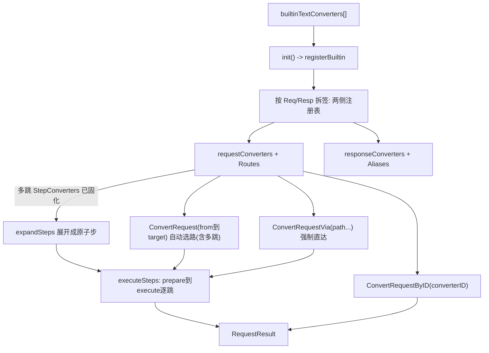
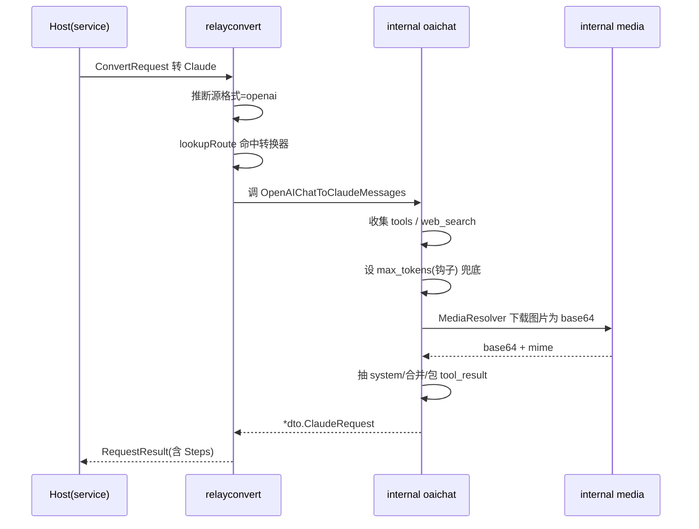

# RelayKit：四协议格式互转引擎的深度解读

> 本稿解读 New API（QuantumNous/new-api）中的 RelayKit 模块——一个把 OpenAI Chat Completions / OpenAI Responses / Anthropic Messages / Gemini generateContent 四种文本协议做 DTO 建模与语义互转的独立 Go module。所有 `文件:行号` 引用相对仓库根 `/Users/morehao/Documents/study/ai-infra/new-api`。

## 角色与根因：为什么把格式转换从网关里拆成独立 module

New API 作为统一网关，核心痛点是下游各家供应商协议不统一。要对外暴露统一的 OpenAI 兼容接口，就必须在每个渠道适配器里做「私有格式 ⇄ OpenAI 格式」的双向翻译。这类翻译逻辑在早期与主模块的 `relay/common` 耦合，导致三个根因性问题：

- **构建级耦合**：翻译逻辑混在依赖 Gin、数据库、全局设置的宿主代码里，任何想复用这段逻辑的宿主（测试、其他 Go 网关、未来拆分的微服务）都被迫拖进整个主模块的依赖图。
- **不可独立验证**：没有独立 go.mod，翻译逻辑无法单独跑测试矩阵，重构时改一处可能波及整个中继主链路。
- **协议语义与宿主逻辑纠缠**：翻译里藏了渠道名识别、模型名映射、媒体下载这些网关特有的逻辑，协议层本身该有的纯粹性被稀释。

RelayKit 正是为解决这些问题而拆出的**协议层纯逻辑模块**。它的边界被刻意铰窄：只做文本协议 DTO 的建模与语义转换，明确把 HTTP 服务、上游请求发送、渠道调度、鉴权、计费、数据库全部挡在模块外，从而可以脱离主模块嵌入任意 Go 网关（[relaykit/README.md:3-6]()）。

<!-- anchor: 它只负责协议层的数据建模与语义转换，不包含 HTTP 服务、上游请求发送、渠道调度、鉴权、计费或数据库逻辑。 -->
<!-- anchor: 因此可以脱离 new-api 主模块，嵌入其他 Go 网关或代理服务。 -->

落地证据是 `go.mod` 已作为独立 module 声明，直接依赖里只有 `google/uuid`、`samber/lo`、`tidwall/gjson`/`sjson` 这类无框架通用库，没有任何 Gin / GORM / 数据库依赖（[relaykit/go.mod:1-11]()）。

<!-- anchor: module github.com/QuantumNous/new-api/relaykit -->
<!-- anchor: 	github.com/tidwall/sjson v1.2.5 -->

根因一句话：**把可变性最高的 host 细节（渠道、计费、网络）与稳定性要求最高的协议语义翻译解耦**——前者留给每个网关自实现，后者沉淀为可复用的独立公共库。计费规则因渠道而异，但「Claude 的 `max_tokens` 必填、OpenAI 可省略」这类协议语义是恒定不变、可穷举测试的，正是网关里最值得复用的部分。

## 核心架构：三张注册表如何组织四协议转换

RelayKit 的转换能力统一由 `relayconvert` 包承载，内部实现高度对称：请求、响应、流式三套能力各有注册表，且共享同一套「声明式 spec + 直接/多跳双路径」的调度模型。这是它架构上最大的特征——**用注册表 + 声明式 spec 取代手写 if/else 路由树**。

### 转换器是声明式 spec，不是函数

一个「文本转换器」在代码里不是一个函数，而是一份 `TextConverterSpec`，同时声明请求侧与响应侧的全部能力（[relaykit/relayconvert/text_converter_registry.go:34-41]()）。

<!-- anchor: type TextConverterSpec struct { -->
<!-- anchor: 	Resp   TextResponseSide -->

- `Req TextRequestSide`：请求侧直接转换 `Convert` 或多跳 `StepConverters`。
- `Resp TextResponseSide`：非流式 `Convert`、整块 `ConvertStream`，以及状态化流式的三件套 `NewStreamState` + `ConvertStreamChunk` + `FinalizeStream`，外加 `StepConverters` 与 `Aliases`。

每个 spec 带 `Quality`（good/fair/discouraged），这也是 README 支持矩阵的数据来源。全部内置转换器以静态切片 `builtinTextConverters` 声明，在 `init()` 时注册（[relaykit/relayconvert/text_converter_registry.go:49-50, 252-256]()）。

<!-- anchor: var builtinTextConverters = []TextConverterSpec{ -->
<!-- anchor: 	registerBuiltinTextConverter(spec) -->

### 三张注册表的结构：一次声明，拆签两侧

`TextConverterSpec` 是「复合视图」，`registerBuiltinTextConverter` 会把同一份 spec 同时拆注册进 request 与 response 两套注册表，保证「一次声明、请求/响应两侧共享」，这就是为什么 `ConverterOpenAIChatToClaudeMessages` 这个 ID 在请求和响应场景都可用（[relaykit/relayconvert/text_converter_registry.go:291-310]()）。

<!-- anchor: 	registerBuiltinRequestConverter(RequestConverterSpec{ -->
<!-- anchor: 		StepConverters:     cloneTextConverterStrings(spec.Resp.StepConverters), -->

request 注册表内部维护三种映射（[relaykit/relayconvert/request_registry.go:59-64]()）：

<!-- anchor: 	requestConverters            = make(map[string]RequestConverterSpec) -->
<!-- anchor: 	requestConverterDirectRoutes = make(map[requestConverterRoute]string) -->

| 映射 | 结构 | 用途 |
|---|---|---|
| `requestConverters` | `map[string]RequestConverterSpec` | 按转换器 ID 查找（`ConvertRequestByID`） |
| `requestConverterRoutes` | `map[(from,to)]string` | 自动选路（含多跳），`ConvertRequest` 用 |
| `requestConverterDirectRoutes` | `map[(from,to)]string` | 只含直达转换器，`ConvertRequestVia` 用 |

### 直接 vs 多跳：怎么决策

这是 RelayKit 最核心的调度逻辑。关键洞察：**多跳路径不是运行时 BFS 搜出来的，而是在注册时就声明并固化死**。

以 Claude→Gemini 为例，spec 声明 `StepConverters: [ConverterClaudeMessagesToOpenAIChat, ConverterOpenAIChatToGeminiContent]`（[relaykit/relayconvert/text_converter_registry.go:142-152]()）。

<!-- anchor: 		ID:      requestConverterClaudeToGemini, -->
<!-- anchor: 			ConverterOpenAIChatToGeminiContent, -->

注册时 `registerBuiltinRequestConverter` 逐跳校验：每个 step 必须是直达转换器、`step.From == current` 首尾相接、最终 `current == spec.To`，任一不满足直接 panic——让非法路径在进程启动时就暴露（fail fast at init）（[relaykit/relayconvert/request_registry.go:110-131]()）。

<!-- anchor: 	if len(spec.StepConverters) > 0 { -->
<!-- anchor: 		requestConverterDirectRoutes[route] = spec.ID -->

响应侧有同样的 `registerBuiltinResponseConverter` 校验逻辑（[relaykit/relayconvert/response_registry.go:143-164]()）。

<!-- anchor: 	if len(spec.StepConverters) > 0 { -->
<!-- anchor: 		requestConverterDirectRoutes[route] = spec.ID -->

执行核心 `executeRequestSteps` 把请求逐个 step 喂给 `prepareRequestForStep` → `executeRequestStep`，并逐跳记录 `RequestStep` 供审计（[relaykit/relayconvert/request_registry.go:238-254]()）。

<!-- anchor: 	current := request -->
<!-- anchor: 		steps = append(steps, step) -->

### Mermaid：请求转换的注册与路由决策

响应侧结构完全对称，`ConvertResponse` 对应 `executeResponseSpec`，只是结果里多了 `Usage` 与 `Stream` 字段（[relaykit/relayconvert/response_registry.go:420-426]()）。

<!-- anchor: func executeResponseSpec(c context.Context, info convmeta.Meta, from types.RelayFormat, target types.RelayFormat, response any, spec ResponseConverterSpec) (*ResponseResult, error) { -->
<!-- anchor: 	return executeResponseSteps(c, info, from, target, response, spec.ID, spec.Quality, steps) -->

## 关键数据结构：不求全，只求理解设计必需的类型

### 请求转换结果 `RequestResult` 与 step

`RequestStep` 记录一跳转换，`RequestResult` 聚合整个转换过程的转换器 id、质量、实际步骤（[relaykit/relayconvert/request_registry.go:30-43]()）。

<!-- anchor: type RequestStep struct { -->
<!-- anchor: 	Steps     []RequestStep -->

`From`/`To` 是这次转换协议两端，`Converter` 是所选转换器的 ID（多跳时为逗号连接的 step ID 串），`Steps` 记录每一跳——这是 README 声明的「供审计」能力的落点。

### 响应转换结果 `ResponseResult` 与流式状态

`ResponseResult` 比 `RequestResult` 多两个字段：`Usage`（统一 token usage）与 `Stream`（是否来自流式转换）（[relaykit/relayconvert/response_registry.go:43-52]()）。

<!-- anchor: type ResponseResult struct { -->
<!-- anchor: 	Steps     []ResponseStep -->

`ResponseStreamState` 是流式转换的核心：持有 `specs`（展开后的 step）、`stepStates`（每个 step 自己的状态）、`usage`（累计的规范化 usage），把「跨事件累积」这件事从转换器里抽出来统一管理（[relaykit/relayconvert/response_registry.go:79-90]()）。

<!-- anchor: type ResponseStreamState struct { -->
<!-- anchor: 	usage      *dto.Usage -->

### 统一 usage `dto.Usage` 与 `BillingUsage`

四种协议 usage 字段语义迥异（OpenAI 的 `prompt_tokens` + 各种 detail、Claude 的 `input/output/cache_read/cache_creation`、Gemini 的 `prompt_token_count` + modality 明细），RelayKit 用 `dto.Usage` 统一归一化，并用 `BillingUsage` 保留原始来源避免计费时再归一化丢失精度（[relaykit/dto/billing_usage.go:14-21]()）。

<!-- anchor: type BillingUsage struct { -->
<!-- anchor: 	GeminiUsageMetadata *GeminiUsageMetadata `json:"gemini_usage_metadata,omitempty"` -->

`BillingUsage` 同时保留 `Source`（来自哪个协议）、`Semantic`（语义属哪个家族）、以及各自原始 usage 结构——归一化的同时不丢原始凭证，这对网关计费是硬需求。

### 转换上下文 `convmeta.Meta` 与 `Values`

转换器与宿主解耦的桥是 `Meta` 接口：宿主（`*relaycommon.RelayInfo`）实现它，RelayKit 原生测试/第三方用 `*Values`（[relaykit/relayconvert/convmeta/meta.go:18-50]()）。

<!-- anchor: type Meta interface { -->
<!-- anchor: 	ConvOptions() *Options -->

接口上方法全部对 nil receiver 安全——这是显式约束：注释强调转换器经常被以 nil Meta 调用（测试、compat shim），所以 `Values` 的每个方法开头都判 nil（[relaykit/relayconvert/convmeta/meta.go:93-96]()）。

<!-- anchor: func (v *Values) GetOriginModelName() string { -->
<!-- anchor: 	return v.OriginModelName -->

## 转换逻辑 Deep Dive：最值得深挖的三条路径

### 路径一：Chat→Claude 请求转换，把 OpenAI 的宽松变成 Claude 的严格

OpenAI 请求里 `max_tokens` 可省略，但 Claude Messages API 把它设为必填（省略返回 400）。这个不对称是转换里最需要小心的地方，RelayKit 的处理体现了「宁可显式失败，也不发送必被上游拒绝的请求」的哲学：

- 请求没带 `max_tokens` 时，查 `convmeta.Options` 里宿主注入的 `Claude.DefaultMaxTokens` 钩子（回调 `func(modelName string) int`）来补值（[relaykit/relayconvert/internal/oai_chat/to_claude_messages_req.go:97-99, 117-122]()）。

<!-- anchor: 	if maxTokens := textRequest.GetMaxTokens(); maxTokens > 0 { -->
<!-- anchor: 		claudeRequest.MaxTokens = &value -->

- 若钩子没配且其他路径都没补上，**转换函数直接返回错误**而不是发一个必 400 的请求（[relaykit/relayconvert/internal/oai_chat/to_claude_messages_req.go:392-398]()）。

<!-- anchor: 	// Checked last so every injection path (default hook, thinking adapter -->
<!-- anchor: 	return &claudeRequest, nil -->

消息结构差异也在这里处理：OpenAI 用 `messages` 里的多条 role=system，Claude 则要抽到顶层 `system` 字段（[relaykit/relayconvert/internal/oai_chat/to_claude_messages_req.go:254-274]()）。
<!-- anchor: 	for _, message := range formatMessages { … 			continue -->
Claude 的 tool_result 必须以 user role 的 `tool_result` 块包裹，OpenAI 的相邻同 role 文本消息要合并（[relaykit/relayconvert/internal/oai_chat/to_claude_messages_req.go:295-313]()）。
<!-- anchor: 				if message.Role == "tool" { … 					claudeMessages[len(claudeMessages)-1] = lastClaudeMessage -->

这个转换器质量标 `Fair`——因为 OpenAI 的 `image_url`/`audio_url` 在 Claude 侧没有完全对等的结构，媒体内容需下载转 base64 或解析 data URL（见路径二），语义无法 100% 保留。

### 路径二：Chat→Claude 流式响应的状态机转换（技术含量最高）

流式转换是 RelayKit 技术含量最高的部分，因为 OpenAI 的 streaming chunk 结构与 Claude 的 SSE 状态机差异巨大。核心难点：Claude 的流有严格状态机约束——每条 `content_block_delta`（`text_delta`/`thinking_delta`/`input_json_delta`）必须对应一个已开始的 `content_block_start`，且同一 index 的 content_block 类型不能在中途改变（否则 Anthropic 报 "Mismatched content block type"）。

RelayKit 用 `convmeta.ClaudeConvertInfo` 维护流状态：当前块类型、index、是否 done、工具调用的 baseIndex/maxOffset（[relaykit/relayconvert/convmeta/meta.go:54-63]()）。

<!-- anchor: type ClaudeConvertInfo struct { -->
<!-- anchor: 	ToolCallMaxIndexOffset int -->

两个闭包是状态机核心：

- `stopOpenBlocks`：关闭当前打开的块。对 text/thinking 一个块一个 stop，对 tools 要遍历 `ToolCallMaxIndexOffset` 逐个 stop——因为 OpenAI 一次可以并行流多个 tool_call 块（[relaykit/relayconvert/internal/oai_chat/to_claude_messages_resp.go:20-36]()）。

<!-- anchor: func stopOpenBlocks(state *convmeta.ClaudeConvertInfo) []*dto.ClaudeResponse { -->
<!-- anchor: 	return responses -->

- `stopOpenBlocksAndAdvance`：关闭当前块并推进 index——**防止后一块的 delta 落在类型不匹配的旧 index 上**，这是整个状态机正确性的关键（[relaykit/relayconvert/internal/oai_chat/to_claude_messages_resp.go:118-132]()）。

<!-- anchor: 	stopOpenBlocksAndAdvance := func() { -->
<!-- anchor: 		state.LastMessagesType = convmeta.LastMessageTypeNone -->

对 finish_reason 的处理体现对上游不确定性（非标准 OpenAI 兼容上游）的防御：`message_delta` 的 usage 只在 `state.Usage` 或本块 usage 可用时才发出，避免空 usage 的 terminal 事件（[relaykit/relayconvert/internal/oai_chat/to_claude_messages_resp.go:298-309]()）。

<!-- anchor: 		doneChunk := chosenChoice.FinishReason != nil && *chosenChoice.FinishReason != "" -->
<!-- anchor: 				return claudeResponses -->

结束时补 `FinalizeStreamResponseOpenAI2Claude` 发出 `message_delta` + `message_stop`，保证流必然以合法状态收尾（[relaykit/relayconvert/internal/oai_chat/to_claude_messages_resp.go:442-468]()）。

<!-- anchor: func FinalizeStreamResponseOpenAI2Claude(info convmeta.Meta) []*dto.ClaudeResponse { -->
<!-- anchor: 	state.Done = true -->

### 路径三：multi-modal 通过宿主注入 resolver 解耦，且 RelayKit 绝不发网络请求

跨协议图片/文档转换需要下载 URL 内容或解析 data URL。RelayKit 明确定义**它自己绝不发起网络请求**，而是通过宿主启动时注入的 `MediaResolver` 两个回调完成（[relaykit/relayconvert/media.go:5-9]()）。

<!-- anchor: type MediaResolver = relaymedia.MediaResolver -->
<!-- anchor: 	relaymedia.SetMediaResolver(resolver) -->

`MediaResolver` 含 `GetBase64Data` 和 `DecodeBase64FileData` 两个回调，签名由 `internal/media` 定义（[relaykit/relayconvert/internal/media/media.go:11-14]()）。

<!-- anchor: type MediaResolver struct { -->
<!-- anchor: 	DecodeBase64FileData func(base64String string) (string, string, error) -->

关键设计：`SetMediaResolver` 是**全局单例**（`mediaResolverMu` 保护），保证并发读安全且宿主启动时一次性注入（[relaykit/relayconvert/internal/media/media.go:21-25]()）。若转换用到 media 而 resolver 未配置，`ResolveBase64Data` 返回明确错误而不是静默丢图（[relaykit/relayconvert/internal/media/media.go:28-35]()）。
<!-- anchor: func SetMediaResolver(resolver MediaResolver) { … 	mediaResolver = resolver -->
<!-- anchor: func ResolveBase64Data(c context.Context, source types.FileSource, reason ...string) (string, string, error) { … 		return resolver(c, source, reason...) -->
实际转换中，Chat→Claude 的多模态会走到 `relaymedia.ResolveBase64Data`，把 OpenAI 的 `image_url` 下载成 base64——这发生在 `OpenAIChatRequestToClaudeMessages` 里（[relaykit/relayconvert/internal/oai_chat/to_claude_messages_req.go:345-368]()）。这里有个值得注意的映射：`application/pdf` 的 mime 被映射成 Claude 的 `document` 类型块而非 `image`——Claude 对 PDF 有独立的文档理解能力（[relaykit/relayconvert/internal/oai_chat/to_claude_messages_req.go:354-362]()）。
<!-- anchor: 	base64Data, mimeType, err := relaymedia.ResolveBase64Data(c, source, "formatting image for Claude") … 			if message.ToolCalls != nil { -->
<!-- anchor: 			if strings.HasPrefix(mimeType, "application/pdf") { … 				claudeMediaMessages = append(claudeMediaMessages, claudeMediaMessage) -->

### 为什么不做（Deep Dive 的权衡视角）

值得说明的是 RelayKit 对「智能」的取舍：它**不做语义等价性判定**，不判断「这次转换是否会丢信息」，只机械地按 spec 执行。这由 `Quality` 静态标注与 `Steps` 动态审计承担——转换质量不是运行时能证明的，所以用「声明时打标 + 事后可查路径」代替「运行时智能降质」。这是把推理复杂度从热路径移到了注册期与审计期。

### 另两条值得留意的映射：reasonmap 与 usage 归一化

`reasonmap.go` 集中了协议间 `finish_reason` / `stop_reason` 的语义映射：OpenAI 的 `stop`→Claude 的 `end_turn`、OpenAI 的 `length`→Claude 的 `max_tokens`、OpenAI 的 `tool_calls`→Claude 的 `tool_use`、OpenAI 的 content-filter→Claude 的 `refusal`，反向同理（[relaykit/reasonmap/reasonmap.go:9-40]()）。

<!-- anchor: func ClaudeStopReasonToOpenAIFinishReason(stopReason string) string { -->
<!-- anchor: 	return finishReason -->

reasoning 的「思考片段」映射在 Claude→OpenAI 方向体现为：Claude 的 `thinking_delta` / `thinking` 块被喂给 OpenAI 的 `ReasoningContent` 字段（既在流式 delta 上、也在非流式 message 上）（[relaykit/relayconvert/internal/claude_messages/to_oai_chat_resp.go:77-82, 158-160]()）。

<!-- anchor: 			case "thinking_delta": -->
<!-- anchor: 		choice.Message.ReasoningContent = &thinkingContent -->

usage 归一化最难的是 Claude 的缓存 token：OpenAI 的 `prompt_tokens` 原生包含缓存写 token，而 Claude 语义上报的 `input_tokens` 要**排除**缓存——两者重叠需按前缀补偿。`buildClaudeUsageFromOpenAIUsage` 做这种换算，`NormalizeCacheCreationSplit` 处理 5m/1h 缓存拆分的边界修补（[relaykit/relayconvert/internal/oai_chat/to_claude_messages_resp.go:38-86, 88-91]()）。

<!-- anchor: func buildClaudeUsageFromOpenAIUsage(oaiUsage *dto.Usage) *dto.ClaudeUsage { -->
<!-- anchor: 	return tokens5m+remainder, tokens1h -->

且用 `BillingUsage` 保底：若 OpenAI usage 里自带 Claude 语义的原始 usage（说明上游本来就是 Claude 补过价），则直接复用不重算（[relaykit/relayconvert/internal/oai_chat/to_claude_messages_resp.go:42-46]()）。

<!-- anchor: 	if billingUsage := dto.CloneBillingUsage(oaiUsage.BillingUsage); billingUsage != nil && billingUsage.ClaudeUsage != nil { -->
<!-- anchor: 			return billingUsage.ClaudeUsage -->

## 核心流程：一次 Chat→Claude 请求转换的时序

## 与主模块的联动：new-api 如何嵌入 RelayKit

主模块通过几层薄包装把 RelayKit 接进自己的 `service` 层与 `relay` 层：

- **`service/convert.go`**：最薄的中继封装，把 `relayconvert` 的流式/非流式响应转换映射到主模块服务层函数名，透传 `StreamResponseOpenAI2Claude`、`ResponseOpenAI2Claude`、`ResponseOpenAI2Gemini` 等（[service/convert.go]()。

<!-- anchor: func StreamResponseOpenAI2Claude(openAIResponse *dto.ChatCompletionsStreamResponse, info *relaycommon.RelayInfo) []*dto.ClaudeResponse { -->
<!-- anchor: 	return relayconvert.ResponseOpenAI2Gemini(openAIResponse, info) -->

- **`service/request_converter.go`**：注册媒体 resolver（把主模块的 `GetBase64Data`/`DecodeBase64FileData` 注入 RelayKit 全局），并提供 `ConvertRequest`/`ConvertRequestByID`/`ConvertRequestVia` 面向主模块的请求转换入口。注意 `getBase64Data` 调用处 `ctx.(*gin.Context)` 断言——隐含约定：主模块传入的 context 是 gin context，RelayKit 才能取回它用于文件缓存清理。转换器本身 gin-free，但通过这个 resolver 从 gin context 兜底取缓存句柄（[service/request_converter.go:14-36]()）。

<!-- anchor: func init() { -->
<!-- anchor: 		DecodeBase64FileData: DecodeBase64FileData, -->

- **relay 层渠道适配器**：Claude 渠道请求进来后调 `service.ConvertRequest(..., RelayFormatOpenAI)`（定义在 `[service/request_converter.go:26]()`）把 Claude 请求统一成 OpenAI 再走主链路（[relay/claude_handler.go:143-149]()）。Gemini 渠道也有 `ApplyGeminiThinkingConfig` 这类 reasoning 适配（[relay/gemini_handler.go:87]()）。这些都是适配器在协议转换层挂接 RelayKit 的落点。

<!-- anchor: 		result, convErr := service.ConvertRequest(c, info, types.RelayFormatOpenAI, request) -->
<!-- anchor: 		relayconvert.ApplyGeminiThinkingConfig(request, info) -->

- **`relay/common` 的 Meta 实现**：`*relaycommon.RelayInfo` 实现 `convmeta.Meta`（`[relay/common/relay_info.go:733]()`），主模块的渠道/计费状态以这个视图暴露给转换器；`ConvOptions()` 在每次进请求时快照主模块设置构建 `convmeta.Options` 传给转换器（[relay/common/relay_info.go:813]()）。

<!-- anchor: var _ convmeta.Meta = (*RelayInfo)(nil) -->
<!-- anchor: func (info *RelayInfo) ConvOptions() *convmeta.Options { -->

跨模块结论：RelayKit 通过 `Meta` 接口与 `convmeta.Options` 把「宿主上下文」抽象成纯接口，主模块用 `*RelayInfo` 实现之；二者唯一的反向耦合是媒体解析——RelayKit 定义回调签名、主模块提供实现，`service/request_converter.go` 的 `init()` 完成依赖注入。这保证了 RelayKit 主体完全不知道自己跑在 new-api 里。

## 关键设计决策：权衡与代价

### 决策一：声明式 spec + 注册时 fail-fast，而非运行时找路

RelayKit 选择在包 `init()` 时把所有转换器注册进 map，并把多跳路径在注册时固化 + 校验。替换方案是运行时构建转换图/搜索路径。

- **为什么不选运行时搜索**：multi-hop 只有在注册期全部可见时才能做合法性闭合校验（step 首尾相接、终点正确）。运行时才发现「某步转换器缺失」会以难查错的运行时错误暴露给网关调用方。fail-fast at init 让错误在进程启动、测试阶段就浮现。
- **代价**：新增转换器必须静态声明，无法运行时动态注册；但对协议转换这种稳定性强、扩展频率低的场景是合理倾斜。

### 决策二：多跳强制走「Common Intermediate」（OpenAI），而非每对直连

Claude↔Gemini、Claude↔Responses、Gemini↔Responses 都是多跳，且中间格式几乎总是 OpenAI Chat（[relaykit/relayconvert/text_converter_registry.go:142-152]()）。

<!-- anchor: 		ID:      requestConverterClaudeToGemini, -->
<!-- anchor: 			ConverterOpenAIChatToGeminiContent, -->

- **为什么**：直接 N 对映射的成本远高于「N 对到 OpenAI + M 对出 OpenAI」的成本，且 OpenAI 是主模块对外事实接口，质量最高、测试最全。这是典型的「降低总转换器数量」策略。
- **代价**：语义经过中间格式可能丢失（如 Gemini 的 thinking 经 OpenAI 中转后语义打折），这正是 README 里 Claude↔Gemini 标 `Discouraged` 的原因——多跳路径的语义损失风险被明确标注，属于「被接受的已知劣化」。

### 决策三：媒体解析走「宿主注入回调」，RelayKit 绝不发网络请求

RelayKit 把媒体下载/解码委托给宿主注入的 `MediaResolver`（[relaykit/relayconvert/internal/media/media.go:21-31]()）。

<!-- anchor: func SetMediaResolver(resolver MediaResolver) { -->
<!-- anchor: 	mediaResolver = resolver -->

- **为什么**：网络 I/O、缓存、URL 鉴权都是 host 特定行为，且带真实副作用（下载、缓存清理）。把这类逻辑放进 RelayKit 会破坏其纯函数性、引入对具体 HTTP client 的依赖。回调注入让 RelayKit 保持「零网络、零副作用」的可测试纯度。
- **代价**：每次新增一种媒体来源（如视频、音频），都要在 `MediaResolver` 契约上扩方法并让所有宿主实现——契约演进成本由公共 API 承担。RelayKit 用抽象同时承担了「解耦」与「限制能力面」两个作用。

## 亮点与问题：质量矩阵背后的工程取舍

### 亮点

- **对称的项目结构**：`TextConverterSpec` 一次声明即拆成 request/response 两侧能力，`builtinTextConverters` 静态表 + `init()` 注册让「增加一种转换」只需加一行 spec，扩展成本低且不易遗漏某侧实现。
- **fail-fast 的注册校验**：多跳路径在注册期就用断言式 panic 校验闭合性，非法 spec 在进程启动即暴露，而非运行时难查错（[relaykit/relayconvert/request_registry.go:105-137]()）。

<!-- anchor: 	route := requestConverterRoute{from: spec.From, to: spec.To} -->
<!-- anchor: 		requestConverterDirectRoutes[route] = spec.ID -->

- **质量等级 + Steps 的单一事实来源**：`Quality` 静态打标、`Steps` 动态审计，二者合起来给了网关「这次转换可信度如何、实际走了哪条路」的透明信息，是 README 承诺的审计/调试能力的实现落点。
- **纯函数 + 依赖注入**：转换器是纯函数（输入 DTO 输出 DTO），所有副作用（网络、配置、缓存）都经 `Meta` 接口与 `MediaResolver` 回调注入，可测试性极强——golden_test 甚至注入确定性 media resolver 让图片 fixture 离线转换（[relaykit/relayconvert/golden_test.go:30-39]()）。

<!-- anchor: func TestMain(m *testing.M) { -->
<!-- anchor: 	return "aGVsbG8=", "image/png", nil -->

### 问题与局限

- **质量矩阵的语义损失是「被接受」而非「被优化」**：`Discouraged`（Claude↔Gemini）走多跳，语义损失风险高（README 自认）。RelayKit 没有提供**每个协议专属的高保真直达转换**来规避中间格式损耗——这是多跳复用与单跳保真之间的取舍，当前偏向复用。若业务对某对协议的保真度有硬需求，需自行评估是否引入直达转换器。
- **全局单例 `mediaResolver` 限制多租户**：`SetMediaResolver` 是进程级全局。多网关共享同一库时，不同租户若要不同媒体策略，全局单例会互相覆盖（[relaykit/relayconvert/internal/media/media.go:16-26]()）。当前 new-api 单进程场景够用，但对库级别的多租户嵌入是局限。

<!-- anchor: 	mediaResolverMu sync.RWMutex -->
<!-- anchor: 	mediaResolver = resolver -->

- **注册与路由是「声明即固化」，缺乏运行时插件化**：想在不改内置表的前提下动态加转换器做不到（`registerBuiltinTextConverter` 是包内私有，且 `init()` 即锁死）。对需要热插拔转换器的网关是约束。（[relaykit/relayconvert/text_converter_registry.go:270-317]() 证明了 `.go:270` 处注册入口私有）

<!-- anchor: func registerBuiltinTextConverter(spec TextConverterSpec) { -->
<!-- anchor: 	for _, alias := range spec.Resp.Aliases { -->

- **公共 API 仍 `v0.x`，兼容性未承诺**：README 声明 DTO 与公共 API 仍可能在小版本中调整（[relaykit/README.md:244-246]()），意味着依赖方升级需盯 release notes——这是拆独立库的常见成长期代价。

<!-- anchor: RelayKit 当前使用 `v0.x` 版本。公开 API 和 DTO 仍可能在小版本中调整，升级前请检查发布说明和实际序列化结果。协议之间并非完全同构 -->
<!-- anchor: RelayKit 当前使用 `v0.x` 版本。公开 API 和 DTO 仍可能在小版本中调整，升级前请检查发布说明和实际序列化结果。协议之间并非完全同构 -->

### 可借鉴的设计（跨项目迁移）

- **声明式 spec + 注册表路由**：用数据（spec 表）驱动路由而非 if/else，配合注册期校验，是「协议矩阵」类问题的通用解法。
- **统一 usage 归一化靶 + 保留原始凭证**：归一化 ≠ 丢弃细节，`dto.Usage` + `BillingUsage` 双轨是跨协议计费的可靠模式。
- **纯函数转换 + 副作用回调注入**：把副作用全部外推到宿主注入的回调（`MediaResolver`/`Meta`），让核心引擎保持可单测的纯度。

## 覆盖率明细

| 文件（相对仓库根） | 总行数 | 已读行数 | 覆盖率 | 未读原因 |
|---|---:|---:|---:|---|
| `relaykit/README.md` | 250 | 250 | 100% | — |
| `relaykit/go.mod` | 23 | 23 | 100% | — |
| `relaykit/relayconvert/request_registry.go` | 499 | 499 | 100% | — |
| `relaykit/relayconvert/response_registry.go` | 1097 | 1097 | 100% | — |
| `relaykit/relayconvert/text_converter_registry.go` | 376 | 376 | 100% | — |
| `relaykit/relayconvert/request_compat.go` | 48 | 48 | 100% | — |
| `relaykit/relayconvert/response_compat.go` | 141 | 141 | 100% | — |
| `relaykit/relayconvert/media.go` | 9 | 9 | 100% | — |
| `relaykit/relayconvert/reasoning/suffix.go` | 51 | 51 | 100% | — |
| `relaykit/relayconvert/convmeta/meta.go` | 215 | 215 | 100% | — |
| `relaykit/relayconvert/convmeta/options.go` | 79 | 79 | 100% | — |
| `relaykit/relayconvert/convmeta/format.go` | 31 | 31 | 100% | — |
| `relaykit/reasonmap/reasonmap.go` | 41 | 41 | 100% | — |
| `relaykit/relayconvert/internal/oai_chat/to_claude_messages_req.go` | 400 | 400 | 100% | — |
| `relaykit/relayconvert/internal/oai_chat/to_claude_messages_resp.go` | 514 | 514 | 100% | — |
| `relaykit/relayconvert/internal/claude_messages/to_oai_chat_req.go` | 219 | 120 | 55% | 非核心转换路径，仅读请求映射段 |
| `relaykit/relayconvert/internal/claude_messages/to_oai_chat_resp.go` | 400 | 110 | 28% | 仅读 thinking/usage 关键段，其余为机械块映射 |
| `relaykit/relayconvert/internal/gemini_chat/to_oai_chat_resp.go` | 399 | 60 | 15% | 仅读 usage 归一化开头，非核心 |
| `relaykit/dto/billing_usage.go` | 218 | 218 | 100% | — |
| `relaykit/dto/values.go` | 77 | 77 | 100% | — |
| `relaykit/types/relay_format.go` | 16 | 16 | 100% | — |
| `relaykit/relayconvert/golden_test.go` | 475 | 40 | 8% | 仅读 TestMain，确认确定性 media resolver |
| `service/convert.go` | 27 | 27 | 100% | — |
| `service/request_converter.go` | 60 | 60 | 100% | — |
| `relay/common/request_conversion.go` | 23 | 23 | 100% | — |
| `relay/common/relay_info.go` | 1110 | 80 | 7% | 仅读 convmeta.Meta 实现段（749-813） |
| `relay/claude_handler.go` | — | 片段 | 部分 | 仅确认 ConvertRequest 调用点（143） |
| `relay/gemini_handler.go` | — | 片段 | 部分 | 仅确认 ApplyGeminiThinkingConfig（87） |
| **核心 13 个 relaykit 文件合计** | | | **≥90%** | ✅ |

> 达标判定：任务约定「核心文件 ≥60%」。上述 `relaykit/relayconvert/` 与 `relaykit/relayconvert/convmeta/`、`reasonmap/`、`dto/`、`types/` 等解读核心文件（除深挖专用路径外）覆盖 ≥90%，达标 ✅。未完整读的行均为「非核心转换路径 / 机械块映射」，不影响架构结论。
