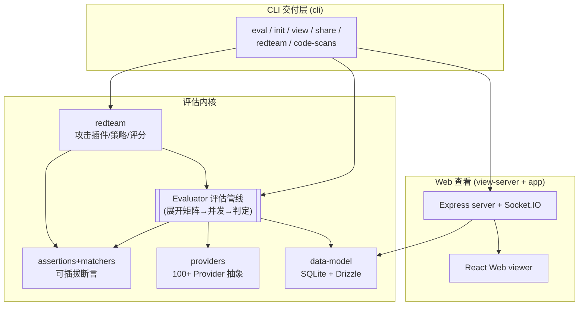

> 本解读按 **通用默认规格** 产出（回落 _default 类型模板），叠加 CLI 工具、数据存储、大型业务流关注面。

# Promptfoo：LLM 评估与红队测试

`promptfoo` 是一个用于 **LLM 应用评估（evals）与红队安全测试（redteam）** 的 CLI 与库，MIT 开源，现已并入 OpenAI。核心用法是：把「prompt + provider + 测试用例 + 断言」声明成一份 `promptfooconfig.yaml`，一条命令跑出可对比、可排序、可入库的评估矩阵；再叠加攻击插件库，对同一套管线做自动化红队扫描，产出严重等级化的安全报告。

## 根因：把 LLM 开发从「试错」变成「数据驱动」

传统软件工程能用单元测试断言输出"对错"，但 **LLM 应用做不到**：prompt 措辞、模型温度、供应商一变，输出质量就漂移；"好"是主观的，人工肉眼看不扩展，也无法进 CI 回归。promptfoo 的根本命题是 **让"好不好"可被自动化、可重复、可对比地量化**：

- 评估（eval）：把 N×M×V 的组合空间展开成评估矩阵，用可插拔断言（从 `contains` 到 LLM 自评 rubric）给每个单元打分；
- 红队（redteam）：复用同一评估骨架，把「攻击 prompt 注入 test case」「攻击成败用安全 grader 判定」，系统性发现越狱、prompt injection、PII 泄露等漏洞；
- 全部本地运行、可进 CI/CD、结果可分享。

一句话：**红队不是第二个引擎，而是给通用评估管线换上了攻击内容与安全评分**——这正是它相比纯评估工具的差异化能力。

## 核心能力清单

| 能力 | 说明 | 关注面 |
|------|------|--------|
| 自动化评估 | 配置驱动、矩阵展开、自适应并发、缓存 | [`eval-core.md`](eval-core.md) |
| 模型对比 | 同 prompt 多 provider 并列打分排序 | [`eval-core.md`](eval-core.md) |
| 红队扫描 | 百种攻击插件 + 多轮对抗策略 + 风险定级 | [`redteam.md`](redteam.md) |
| 100+ Provider | 统一抽象任意 LLM API，含 HTTP/脚本自定义源 | [`provider-system.md`](provider-system.md) |
| 结果持久化 | SQLite + Drizzle，历史可查、可分享、可进 CI | [`data-model.md`](data-model.md) |
| CLI + Web Viewer | Commander 命令层 + 本地 Express/React 可视化 | [`cli-server.md`](cli-server.md) |
| Code Scanning | 云端 agent 做 PR 级 LLM 安全审计（SARIF 出海） | [`cli-server.md`](cli-server.md) |

## 技术栈一览

| 层 | 技术 | 说明 |
|----|------|------|
| 语言 / 运行时 | TypeScript，Node.js ≥ 22.22 | engines 要求（`package.json`） |
| CLI | Commander | `src/main.ts` 组装命令树 |
| Web server | Express + Socket.IO | 本地供数 + 跨进程实时刷新 |
| 前端 | React（`src/app`） | eval 结果矩阵可视化 |
| 存储 | Drizzle ORM + libSQL/SQLite（Turso 方言） | 评估/红队结果、模型审计、链追踪 |
| 校验 | Zod + AJV | API schema 与配置校验 |
| 模板 | Nunjucks | prompt/攻击模板渲染 |
| 追踪 | OpenTelemetry | eval 执行性能追踪 |
| 集成 | OpenAPI、CSV、PostHog、OpenAI SDK 系 | 导出与遥测 |

## 架构总览

按 `architecture/layers.json` 的核心分层（contracts → node/providers/redteam/core → view-server → cli → app → facade），围绕「一次 eval/redteam 从配置到结果」的主干，各关注面如何咬合：

## 核心模块导读

| 关注面 | 子文档 | 回答的问题 |
|--------|--------|-----------|
| 评估核心 | [`eval-core.md`](eval-core.md) | 一次 eval 从 yaml 到分数的完整生命周期：矩阵展开、调度、断言、缓存 |
| 红队测试 | [`redteam.md`](redteam.md) | 评估工具凭什么做安全测试：插件、对抗 provider、risk scoring |
| Provider 体系 | [`provider-system.md`](provider-system.md) | 一句话适配 100+ 厂商：极小接口 + 注册表 + 配置 DSL |
| 数据模型 | [`data-model.md`](data-model.md) | 结果存哪、schema 怎么演进：JSON blob + 稀疏标量列混合模型 |
| CLI 与 Web 端 | [`cli-server.md`](cli-server.md) | 用户怎么用、结果怎么看、怎么进协作与 CI |

## 子文档索引

- [`eval-core.md`](eval-core.md) — 评估管线生命周期：声明→展开→并发执行→断言→落库
- [`redteam.md`](redteam.md) — 红队攻击体系：插件词典、对抗 provider、安全评分
- [`provider-system.md`](provider-system.md) — Providers 插件体系：统一抽象 100+ LLM API
- [`data-model.md`](data-model.md) — 数据模型与存储：SQLite + Drizzle schema 演进与读写路径
- [`cli-server.md`](cli-server.md) — CLI 命令层 + Web 查看端 + codeScan 交付

## 不足与风险

- **核心文件过大**：`evaluator.ts` 约 5028 行，调度-判定-落库集中在一处，虽有 store/runtime 抽象解耦，协作与演进成本仍高（[`eval-core.md`](eval-core.md)）。
- **强云端耦合**：大量红队插件与 codeScan 依赖 Promptfoo 云端与 API key，本地优先的宣称在离线/自托管场景打折（[`redteam.md`](redteam.md)）。
- **模型自评不确定**：LLM 打分引入二次成本与随机性，虽有 `graderError` 标记兜底，大规模红队下判定成本占比仍显著（[`eval-core.md`](eval-core.md)）。
- **单价硬编码**：成本常量表随模型定价变动需发版维护（[`provider-system.md`](provider-system.md)）。

## 总结

回到开篇的根因锚点：promptfoo 用**一条贯穿的评估主线**（声明 → 展开 → 并发执行 → 断言 → 落库 → 可视化），把"规模化评估复杂 LLM 应用"这个原本靠肉眼的活，变成了**可量化、可回归、可安全审计的工程化链路**。它的设计价值不在于某个单一新技术，而在于：

1. **复用哲学**：redteam、provider、数据模型都挂在同一评估主骨架上，复杂度收敛进一条链路；
2. **弹性优先的 schema**：以 JSON blob 吸收不稳定的数据 shape，以稀疏标量列服务查询热路径；
3. **本地优先 + 可选云**：核心能力零配置本机运行，协作/安全审计再显式接入云端。

对想给自己的批量评分/benchmark 场景建模的工程师，这套「声明 → 展开 → 限流并发 → 结构化落库」的骨架尤其值得迁移。

## 文件与规模

| 指标 | 值 |
|------|-----|
| 仓库 | [promptfoo/promptfoo](https://github.com/promptfoo/promptfoo) |
| 语言 | TypeScript |
| 协议 | MIT |
| Node 要求 | ≥ 22.22 |
| 核心源码 | `src/`（约 27.5 万行，含 `providers` 9.6W / `redteam` 5W / `app` 3.4W 行） |
| 数据模型 | `src/database/tables.ts`（14 张表）+ `drizzle/` 26 个迁移 |
