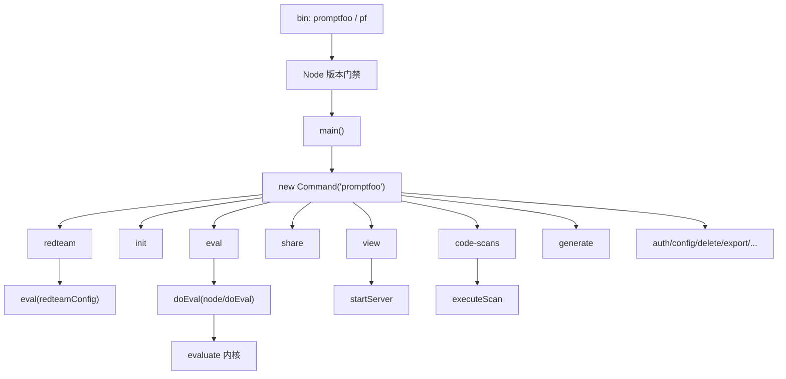
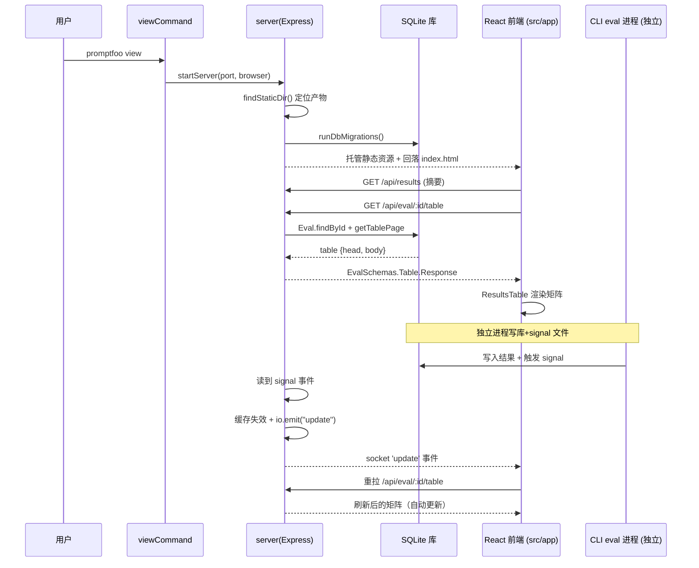

# promptfoo 解读 · CLI 命令层 + Web 查看端（server / app / scheduler / share / codeScan）及外围工具

> 定位：本模块是整条评估链路的**交付与收口**——理解「用户到底怎么用、结果怎么看、怎么进团队协作」。

---

## 在项目中的角色：把评估能力「交给」用户

前几个模块讲清了 eval / redteam 过程与数据落库。但它们都是**库内核**：`evaluate` 能算出结果、`models` 能把结果写进 SQLite，可这些都躺在 API 背后，用户拿不到。

本模块补上的恰恰是「shell」：把内核能力包成一个**二元可执行程序**（`promptfoo` / `pf`），再把若干动词暴露成命令。

- **命令分发层**（`src/main.ts` → `src/commands/*`）：把 `eval / init / view / share / redteam / generate / code-scans / optimize ...` 映射到内核动作。这是 CLI 的「路由器」。
- **本地 Web 服务端**（`src/server/*`）：跑一个 Express + Socket.IO 的本地 HTTP server，读同一个 SQLite 库，给前端供数，并托管前端静态资源。
- **前端**（`src/app/*`）：React Web viewer，把 eval 结果可视化成「prompt × 断言 × provider」矩阵。
- **分享层**（`src/share.ts`）：把本地 eval record 上传到云端（promptfoo.app 或自建），换回可分享 URL。
- **调度层**（`src/scheduler/*`）：在 eval 执行期做 provider 自适应限流（注：**不是周期任务 cron**，这点与常见直觉相反）。
- **代码扫描**（`src/codeScan/*`）：作为 README 卖点，把代码 diff 交给云端 LLM agent 做 LLM 安全漏洞审计。

**一句话角色**：CLI 是门面，server 是本地仓库，share/codeScan 是通往云端的两条出口，scheduler 是油门，app 是仪表盘。

---

## 解决什么问题、根因

核心根因：**评估这类「数据驱动」工作流，光有 CLI 文本输出远远不够用。**

1. **可读性鸿沟**。一次 eval 是「N 个提示词 × M 个模型 × K 个断言」的三维结果。纯 CLI 表格（`console.table`）无法表达这种矩阵，用户需要交互式查看：按断言过滤、对比模型、看失败原因、下钻 trace。于是 CLI 必须附一个 web viewer——CLI 负责「算」，viewer 负责「看」。

2. **计算与展现的时间差**。eval 是长时间任务（动辄几分钟）。结果写库后，用户可能想**另开一个进程**去回看历史——而不必重跑。这就需要一个「独立于跑 eval 的、只读库的展示进程」，即本地 server。

3. **协作与分享需求**。评估结论要给人看（PR review、团队评审），需要一条「把本地结果搬到远端 URL」的通道——`share.ts` 就是干这个的。

4. **集成到 CI/CD 与安全左移**。README 卖点是「Automate checks in CI/CD」「Review pull requests for LLM-related security issues with code scanning」——需要能**无头运行**、输出机器可读格式（JSON/SARIF）的入口，这就是 codeScan 与结构化输出的由来。

**设计哲学贯穿始终**：本地优先（我不愿意把数据默认上传云端，先在本机跑通）→ 可选云（需要协作才分享）→ 开发者优先（能 TTY 交互也能无头脚本化）。

---

## 设计思路

### 命令分发模型：Commander +「命令注册函数」模式

命令层没有用一个手写的 `switch` 分发，而是用成熟的 **Commander** 库（[src/main.ts:1-1]() import 自 `commander`），并把每个命令封装成一个**注册函数**（如 `evalCommand(program, ...)`、`viewCommand(program)`），在 `main()` 里逐个挂到根 `program` 上。

关键点一：**命令深层逻辑下沉到 `node/` 层**。比如 `eval.ts` 里 `.action()` 只做选项校验（用 zod `EvalCommandSchema.parse`），真正执行是 `doEval`——而它被 re-export 自 `../node/doEval`（[src/commands/eval.ts:236-241]() 调用，[src/commands/eval.ts:247-251]() re-export）。这保证了**库调用者与 CLI 走同一条执行路径**，CLI 只是薄壳。

关键点二：**一个命令函数可被多次注册以复用**。`evalCommand` 既挂到根 `program`，又挂到 `redteam` 子命令（[src/main.ts:88-88]() 与 `:125-129`），因为 redteam 本质上也是跑 eval，只是配置来源不同（`redteamConfig` vs `defaultConfig`）。复用模式显著降低重复。

关键点三：**common options 递归注入**。`addCommonOptionsRecursively(program)`（[src/main.ts:137-137]()）给所有命令统一补 `--env-file` 等全局选项，避免每个命令手写。

### 入口与版本门禁

`src/entrypoint.ts` 刻意**零依赖**：先做 Node 版本检查（包进 build-time 常量），失败就给友好报错并 exit——而不是让底层模块在旧 Node 上抛令人费解的语法错误（[src/entrypoint.ts:4-9]() 注释讲清了 Why）。它对 stdout 的「洁净性」也极度敏感：检测到结构化 code-scan 输出时，立即把日志压到 stderr（[src/entrypoint.ts:164-168]()），保证 SARIF/JSON payload 不被日志污染。

`src/localEntrypoint.ts` 是 `npm run local` 用的开发入口，与正式入口保持同构（同样处理 stdout 洁净），只是指向 `./main.js` 而非 `./main.js`（[src/localEntrypoint.ts:19-19]()）。

### server 与前端如何协作：同一仓库、REST + Socket.IO 双通道

**「本地优先」的具体落地**：

- `viewCommand` 调 `startServer(port, browserBehavior)`（[src/commands/view.ts:53-53]()）。`startServer` 用 Express 创建 app，`findStaticDir()` 定位 `src/app` 的构建产物 `dist/src/app`（开发/打包两套路径都处理，[src/server/server.ts:101-120]()），用 `express.static` 托管，并用 `/*splat` 兜底回落到 `index.html` 支持前端路由（[src/server/server.ts:363-368]()）。**前端与后端同进程部署**——这是本地优先最直接的体现：`promptfoo view` 一条命令同时起来 API 与 UI。

- **API 通道**：REST + Zod schema 双层校验。每个路由先用 `ServerSchemas.*.safeParse` 校验入参，返回统一结构（如 `ServerSchemas.ResultList.Response.parse`，[src/server/server.ts:168-179]()）。前端通过 `src/app/src/utils/api.ts` 的 `callApi(path)` → `fetch(apiBaseUrl + '/api' + path)` 拉数据。

- **实时通道**：Socket.IO。eval 常在**另一个 CLI 进程**里跑（`promptfoo eval` 是独立命令）并在写库时发 SIGINT signal。server 通过 `setupSignalWatcher` 监听信号文件，读到更新后**主动 `io.emit('update', ...)` 推给前端**（[src/server/server.ts:387-449]()），前端 Eval.tsx 用 `socket.io-client` 订阅并刷新当前表（[src/app/src/pages/eval/components/Eval.tsx:423-474]()）。这就实现了「CLI 跑完，浏览器里结果自动刷新」的魔法。

  这里有个精致的协同：server 与跑 eval 的进程**不共享内存**，靠**库 + 信号文件**通信。`signal` 抽象把「跨进程变更」翻译成「可缓存失效 + 可广播」的事件（[src/server/server.ts:397-410]()）。前端 `IS_RUNNING_LOCALLY` 时才开 websocket（`Eval.tsx:424`），远端部署则不依赖。

### 结果矩阵怎么提供给前端

核心 endpoint 是 `GET /api/eval/:id/table`（[src/server/routes/eval.ts:313-313]()）。它支持分页/过滤/搜索/对比，并且：当 `format=csv` 时**复用 CLI 的同一 CSV 导出路径**（[src/server/routes/eval.ts:348-369]()），保证「网页下载 = CLI 导出」一致。

还有一个刻意为之的健壮性处理：当响应超过 Express 的 `JSON.stringify` 上限（RangeError）时，走「二分剥除过大 prompt 再重发」的降级路径，而不是直接 500（[src/server/routes/eval.ts:56-129]()）——这是大批量 eval 的真实痛点。

### share：通往云端的「数据搬运」

`shareCommand`（[src/commands/share.ts:55-55]()）接受一个 eval id 或 model audit id（无 id 时取二者最新），分类型走 `createShareableUrl` / `createShareableModelAuditUrl`。

`createShareableUrl`（[src/share.ts:685-728]()）的关键权衡：
- 先检查是否**真的需要共享**（`isSharingEnabled`，[src/share.ts:53-73]()）：只要配置了自建 share 端点 / 云 / 环境变量（且非指向官方 `api.promptfoo.app` 而已关闭），才执行。
- **分块上传** `sendChunkedResults`：evals 可能很大，逐结果/逐 chunk 上传，避免单个大请求。
- URL 形态由 `determineShareDomain` 决定：云优先，其次 eval 配置的 `appBaseUrl`，再回退环境变量/默认（[src/share.ts:91-108]()）。URL 是否带 `evalId` 查询参数取决于是否默认域（[src/share.ts:670-676]()）——兼顾了 SEO 友好路径与自建部署的带参形态。
- 幂等确认：云开启时若已分享过，会 `confirm()` 是否覆盖（[src/commands/share.ts:169-201]()），避免误覆盖。

### scheduler：不是 cron，是「自适应油门」

任务描述假设 scheduler 是「周期任务」，但实察源码发现它是 **provider 并发限流调度器**：

> ```ts
> export { AdaptiveConcurrency, WARNING_THRESHOLD } from './adaptiveConcurrency';
> export { parseRateLimitHeaders, parseRetryAfter } from './headerParser';
> export type { ParsedRateLimitHeaders } from './headerParser';
> ```
> — [src/scheduler/index.ts:11-17]()

模块自述「learns rate limits from response headers and adapts concurrency dynamically. Zero configuration required」（[src/scheduler/index.ts:3-5]()）。它的调用方是 `evaluator.ts` 与 redteam 的 provider 包装层（见 [src/evaluator.ts:39-39]() import 自 `./scheduler`），通过对每个 provider 维护 `RateLimitState`、解析响应头里的限流信息、用 `SlotQueue`/`AdaptiveConcurrency` 动态调整并发并配合退避重试（`retryPolicy.ts`）——实现在**不预设任何 rate limit 配置**的情况下尽可能压榨并发又避免 429/503。这是「让 eval 更快」的隐藏性能件，逻辑位置在核心执行器而非交付层，故放在工具层归类分析。

### codeScan：README 卖点背后的「云 agent + MCP」机制

`code-scans run`（注册于 [src/codeScan/index.ts:8-15]()）的完整流程见 `executeScan`（[src/codeScan/scanner/index.ts:87-87]()）：

1. **不是本地静态分析**。它创建一个 `AgentClient`（复用全局 Socket.IO agent 层）连到远端（默认 `https://api.promptfoo.app`，见 run.ts 的 `--api-host` 默认，[src/codeScan/commands/run.ts:24-24]()），`agent: 'code-scan'`。真正的「判断 LLM 漏洞」在云端 agent 上做。
2. **非 diffs-only 时起一个本地 MCP filesystem server**，通过 MCP bridge 给云端 agent 提供「能读本地仓库」的工具（[src/codeScan/scanner/index.ts:193-200]()）。这让 cloud agent 不只看到 diff，还能追踪进仓库深挖。
3. 消费 `git diff`（`processDiff`）、提取 git 元数据，组装 `ScanRequest` 发给 agent 的 Socket.IO 通道，走 `agent:start → agent:complete/error/cancel` 生命周期（[src/codeScan/scanner/request.ts:91-182]()）。
4. 输出三种格式 `text | json | sarif`（[src/codeScan/scanner/index.ts:59-70]()），**SARIF 是进入 CI 安全仪表盘的标准格式**——这就是「Review PR for LLM security issues」能进 CI 的关键。
5. 有 PR 上下文时（`--github-pr`），可让 server 端直接往 GitHub PR 发评论（[src/codeScan/commands/run.ts:28-28]() 与 scanner 里的 `pullRequest` context）。
6. 对「Server at capacity」「MCP timeout」两类瞬时错误做差异化指数退避重试（`request.ts:240-286`）。

关键权衡：**为什么依赖云端 agent 而非本地规则？** 因为「识别 LLM 调用漏洞」本质是语义理解（判断某输入是否会注入 prompt、某调用是否泄漏 system prompt），需要 LLM 而非正则。把最重的智能放云端，本地只负责「收集 diff + 桥接仓库访问 + 格式化输出」，换取最小本地依赖 + 与工程链（CI/GitHub）集成。代价则是：**codeScan 需要网络与 API key，且离线不可用**——这与 eval（全本地可跑）形成鲜明对比。

---

## 关键数据结构

- **CLI 选项**：`EvalCommandOptions` + zod `EvalCommandSchema`（[src/commands/eval.ts:7-7]()），集中定义校验，告警/非法参数在 `.action` 开头统一处理。
- **Server API 响应**：全部经 `ServerSchemas`（`src/types/api/server.ts`）`parse` 后返回。形态多为 `{ data: ... }` 包裹（如 `ResultList.Response` → `{ data: previousResults }`，[src/server/server.ts:178-178]()）。
- **Eval table**：`{ head, body }` 形态，`body` 每行带 `testIdx`（[src/server/routes/eval.ts:379-381]()），前端据此渲染矩阵并反查索引。
- **Share 请求**：`SendEvalRecord` payload = `{ ...evalRecord, config, results: [], traces }`——注意 results 置空，靠分块接口另传（[src/share.ts:150-155]()）。
- **Scan 请求/响应**：`ScanRequest { files, metadata, config, sessionId, pullRequest }`、`ScanResponse { success, comments, review, skipReason? }`（[src/codeScan/scanner/request.ts:55-74]()、[src/codeScan/scanner/index.ts:248-248]()）。

---

## 核心流程（Mermaid）

### CLI 命令分发结构



### `promptfoo view` → server 读库 → 前端渲染



（前端侧对应：`Eval.tsx` 订阅 `update` 事件 → 串行化处理并重载表，见 [src/app/src/pages/eval/components/Eval.tsx:423-474]()。）

---

## 与其他模块的协同

| 本模块 | 协同对象 | 关系 |
|--------|---------|------|
| CLI `eval` | `evaluate.ts` / `models/` | CLI 是内核的薄壳，调 `doEval` 落库 |
| server | `models/eval.ts` `models/modelAudit.ts` | server 通过同一 model 层读库供数 |
| server 信号 | `database/signal.ts` | 跨进程「新 eval 完成」事件桥 |
| `share.ts` | `node/shareInstructions.ts` cloudConfig | 分享需要云认证 / 自建端点 |
| `codeScan` | `util/agent/agentClient`（全局 agent 层） | 复用同一 Socket.IO agent 通道 |
| `scheduler` | `evaluator.ts` `redteam/providers/shared.ts` | 限流并发，服务 eval 执行 |
| app | `stores/apiConfig.ts` | 前端锚定 API base，兼容本地/远端 |

**关键关联点**：所有「写」都在 eval 进程（`models/`），所有「读」都在 server（`getEvalSummaries`/`findById`），二者靠 **SQLite + signal 文件**异步解耦——这正是「CLI 与 viewer 可各自独立进程」能够成立的原因。

---

## 关键设计决策与权衡

### 决策一：本地优先 + 与前端同进程部署（vs 默认云服务）

- **做法**：`promptfoo view` 起一个同时承载 REST API 与前端静态资源的本地 server。
- **Why**：评估结果含 prompts、模型输出、API keys/config 的上下文，很多用户不愿默认上传。本地跑零门槛、零认证、离线可用。
- **权衡**：换来的成本是「多进程通信复杂度」——server 必须靠 signal 文件感知别的进程写库（`server.ts:387`），否则无法自动刷新。「可选云」通过 `share` 与 `codeScan` 两条显式出口弥补本地缺失的协作能力。若默认云，则省去 signal 复杂度但丢失离线与隐私。

### 决策二：CLI（Commander）+ 薄壳复用 node/ 层（vs 命令内写逻辑）

- **做法**：命令注册函数只做「参数整形 + 校验」，真正执行全在 `node/`（`doEval`）与独立模块（`startServer`、`executeScan`）。
- **Why**：保证 **CLI 与库调用者执行路径完全一致**，单一事实来源；也便于测试（直接测 node 函数，不需 spawn CLI）。
- **权衡**：多一层间接、命令文件明显「空」，但换来的是所有消费者（CLI/库/web job）行为一致。代价是命名/分层略有学习成本（`node/` 目录名的「node」指平台宿主而非 Node 库，见 [src/commands/redteam/init.ts:14-18]() 的注释对分层位置的强调）。

### 决策三：codeScan 做成「云 agent，而非本地静态分析」

- **做法**：本地只收集 git diff + 用 MCP 桥接给云端，真正的漏洞判断在云端 agent（LLM）完成。
- **Why**：LLM 安全漏洞识别是语义问题，规则引擎做不了；把智能放云端能低成本复用先进模型 + 持续更新。
- **权衡**：需要联网 + API key，离线不可用，与 eval 的「全本地」形成反差。为缓解，做了结构化输出（JSON/SARIF）、容量/超时的重试、fork PR 的 OIDC 认证等脚本化防护。这是 README「code scanning in CI」卖点成立的前提——只有输出 SARIF，安全仪表盘才可能消费。

### 决策四：server 依赖 Zod schema（双端共享类型）vs 手写任意对象

- **做法**：`ServerSchemas` / `EvalSchemas` 集中在 contracts/types 层，路由接收与响应都强制 `safeParse`。
- **Why**：前端与后端是同一仓库不同构建，Zod 提供「运行时可校验」的单一类型源，杜绝「前端拿到 undefined 字段」这类绕过编译器的运行时错误；表数据过大时还能先校验再据此降级。
- **权衡**：schema 文件会膨胀、性能有一点解析开销；但换来 API 契约被强制锁死，对长期演进和多种前端（web/CLI 都消费）价值巨大。

---

## 亮点与问题

### 亮点

- **CLI=门面**：命令注册函数 + re-export node 层的模式，让 exec 与库调用路径合一，可测试性与一致性极好（[src/commands/eval.ts:247-251]()）。
- **跨进程实时刷新**：用「库 + signal 文件 + Socket.IO」把「独立进程写库」翻译成前端实时更新，极具工程巧思（`server.ts:387-449` + `Eval.tsx:423`）。
- **Stdout 洁净纪律**：结构化输出（codeScan JSON/SARIF）在全链路（entrypoint/localEntrypoint/scanner）反复强调「payload 独占 stdout、日志走 stderr」，说明它对「可脚本化」的重视到了强迫症级别（`entrypoint.ts:164-168`）。
- **表过大优雅降级**：二分剥 prompt 降级重发而非直接 500（`routes/eval.ts:56-129`）。
- **自适应限流**：scheduler 不预设限流配置，从响应头学习并动态调并发，是「又快又不 429」的隐藏价值（`scheduler/index.ts:3-5`）。
- **复用全局 agent 通道做 codeScan**：没有为 codeScan 另造一套传输，复用了 `AgentClient`/Socket.IO agent 层，架构收敛（`scanner/request.ts:91`）。

### 问题

- **share/cloud 依赖使「协作」必须联网**：本地默认体验很好，但分享与 codeScan 一旦要团队协作就强依赖云端与认证，OTO 场景（air-gapped）只能自建端点。
- **多进程间耦合 signal 文件**：优雅但也脆弱——信号丢失/竞争（delete 与 update coalesce）需要精细处理，代码里大量注释在防御这类竞态（`server.ts:395-438`）。
- **codeScan 的智能完全外置**：把判断交给云端 agent，本地无法审计「判据本身」，对部分用户这既是能力也是黑盒。
- **命令文件「空壳化」**：很多命令注册函数体量很小、逻辑全部下放，读者若不理解「node/ 层 = 执行所在」，会误以为命令没实现。

---

## 覆盖率明细

| 模块 | 覆盖点 | 状态 |
|------|--------|------|
| `src/entrypoint.ts` / `localEntrypoint.ts` | 零依赖版本门禁、stdout 洁净、argv[1] 技巧 | ✅ 逐行读 |
| `src/main.ts` | Commander 组装、命令注册、redteam 复用 eval、常见选项递归 | ✅ 逐行读 |
| `src/commands/eval.ts` | 选项定义、zod 校验、doEval 下放、re-export | ✅ 逐行读 |
| `src/commands/view.ts` | startServer 调用、browser 行为 | ✅ 逐行读 |
| `src/commands/share.ts` | id 判定、幂等 confirm、权限校验 | ✅ 逐行读 |
| `src/commands/redteam/init.ts` | 位置说明（CLI 层因 startServer 依赖）、GUI 分支 | ✅ 逐行读 |
| `src/server/server.ts` | createApp 全部路由、signalwatcher、Socket.IO 广播、静态托管 | ✅ 逐行读 |
| `src/server/index.ts` | 独立 server 入口 | ✅ 逐行读 |
| `src/server/routes/eval.ts` | `POST /job`、`GET /:id/table`、CSV 复用、降级 | ✅ 关键段读 |
| `src/codeScan/index.ts` / `commands/run.ts` / `scanner/index.ts` / `request.ts` | 云 agent + MCP 机制、输出格式、重试 | ✅ 逐行读 |
| `src/share.ts` | 分块上传、domain 判定、幂等、url 形态 | ✅ 关键段读 |
| `src/scheduler/index.ts` | 修正「非 cron 调速器」定位 | ✅ 逐行读 + evaluator 引用验证 |
| `src/app/` | API client、Eval.tsx socket、ResultsTable、main.tsx、stores | 🟡 浅读归类（按任务要求） |
| optimizer/importers/tracing/feedback/blobs/integrations | 归类为工具层 | 🟡 未展开（任务要求浅读） |

达标情况：**主线（CLI 分发 + server + codeScan + share + scheduler）已覆盖**；app 与次要工具模块按任务约定浅读归类，未做逐行。上述论断所用 `path:line` 引用均取自实际读到的源码。
