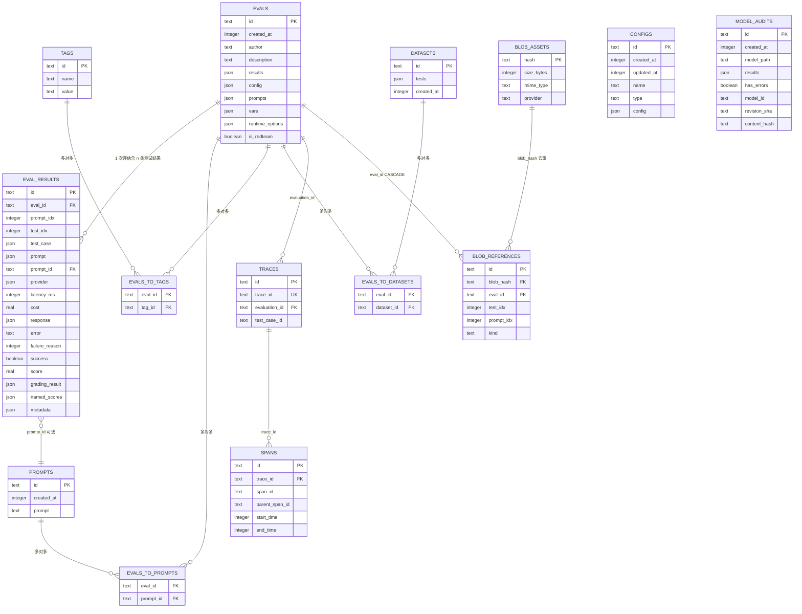
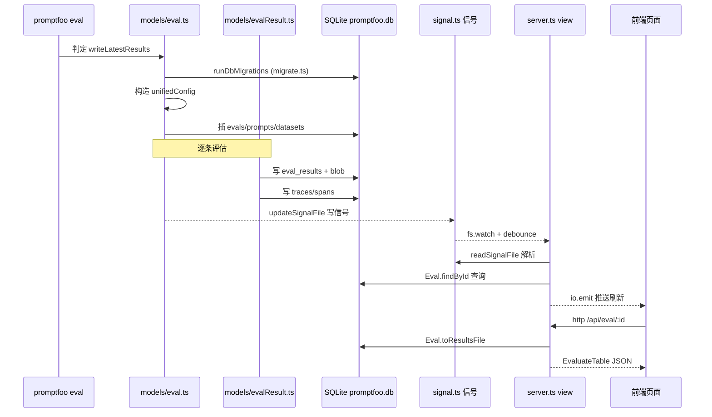

# promptfoo 数据模型与存储解读

> 关注面：核心数据层（eval 结果的下沉仓库、schema 设计、存储选型、schema 演进、读写路径）
> 源仓库：`/Users/morehao/Documents/study/ai-infra/promptfoo`
> 技术栈：TypeScript + Drizzle ORM + libSQL/SQLite（Turso 方言，本地文件 `promptfoo.db`）+ drizzle-kit migrations + fs 信号文件
> 前置模块：`eval-core`（怎么评估）、`redteam`（怎么红队）——本模块回答「结果落到哪、怎么建表、怎么演进」

---

## 根因：一个 CLI 工具为什么要引入数据库

promptfoo 的**根因**是：把每次 `promptfoo eval` 产生的**评估结果**从「一次性的 stdout / 内存对象」变成**可长期查询、可二次分析、可分享、可进 CI 的持久状态**。

一个纯 CLI 工具完全可以只把结果写进一个 JSON 文件（`output.json`）就完事——事实上 promptfoo 也保留了文件输出路径（`src/storage/`），但它依然在 `~/.promptfoo/promptfoo.db` 建了一个 SQLite 库，原因是三类诉求叠加：

1. **跨进程的可分享与实时性**：`promptfoo view` 启动一个 web server，要能列出历史所有 eval、筛选、对比。若只读文件夹里的 JSON，得自己实现目录扫描、排序、过滤，且无法做聚合/联接查询。数据库把「查询能力」买下来了。
2. **web viewer 的增量刷新**：CLI 进程跑完写库，web 进程要能感知新结果并推送刷新——需要一个「写完就有通知」的机制（`evalLastWritten` 信号文件，见 `signal.ts`）。只写最新一个 eval 的 JSON 文件无法跨进程判断「哪个 eval 变了」。
3. **可审计 / 可二次分析**：模型审计（`model_audits`）要能按 model_id + revision 去重、traces/spans 要做性能时序分析。这些都需要**结构化的查询列**，裸 JSON 文件做不到。

**不存行不行？** 可以——`writeLatestResults: false` 时评估照跑，只是不落库。但代价是丢掉历史列表、对比、分享、审计全部能力。所以数据库不是功能，是「让过程变成状态的底座」。

---

## 设计思路：为什么是 Drizzle + SQLite/Turso，而不是别的

### 为什么是 SQLite `promptfoo.db` 本地文件

| 候选方案 | 取舍理由 |
|----------|----------|
| Postgres / MySQL 服务端 | 需要部署、鉴权、网络，违背「本地优先」哲学。一个本地 CLI 评估工具不忍让用户先搭数据库。 |
| 纯 JSON 文件（`output.json`） | 保留作为补充输出，但无法做联接/聚合/索引查询；跨进程增量感知难。 |
| **SQLite 单文件** | **零运维**：一个文件即库；`PRAGMA WAL` 提升并发（CLI 写、web 读同时进行）；单文件可打包、可分享、可进 CI 归档。代价是单写者锁、绑定参数 999 上限，需靠代码层串行化与分批规避。 |

SQLite 与「本地优先 + 可进 CI」哲学咬合：数据库就是 `~/.promptfoo/promptfoo.db` 一个文件（`getDbPath()` 里 `path.resolve(configDirectoryPath, 'promptfoo.db')`），`PROMPTFOO_CONFIG_DIR` 可切换，测试用 `file::memory:?cache=shared`。

### 为什么是 libSQL（Turso 客户端）+ Drizzle

- **libSQL** 是 SQLite 的分叉，兼容 SQLite 文件格式，客户端支持将来「服务器端复制到 Turso 云」——为云分享预留升级路径，本地依然是标准 SQLite 文件。`drizzle.config.ts` 用 `dialect: 'turso'`。
- **Drizzle**（而非 Prisma/Objection）：**轻量、贴近 SQL、无代码生成层**。Drizzle 是 TS 类型安全但极薄的 query builder，schema 就是 type（`sqliteTable(...)`）；`mode: 'json'` 直接声明「该列以 JSON 序列化存取」，配合 `$type<T>()` 在编译期绑定类型。对已用原生 TS 的代码库，Drizzle 侵入面最小、心智负担最低。

### 结构化表 vs JSON blob 的权衡——核心设计理念

这是本 schema 最值得学习的点：**不做全字段拆解，而是采用「稀疏标量列 + 宽 JSON blob」混合模型**。

- `evals` 表：`results`、`config`、`prompts`、`vars`、`runtime_options` 全是 JSON 列，但单独拆出 `id`、`created_at`、`author`、`is_redteam` 几个查询热字段。
- `eval_results` 表：`test_case`、`prompt`、`provider`、`response`、`grading_result`、`named_scores`、`metadata` 都是 JSON blob，却把 `success`、`score`、`failure_reason`、`latency_ms`、`cost` 拆成独立标量列 + 索引。
- `model_audits` 表：`results`/`checks`/`issues` 是 JSON，但 `has_errors`、`total_checks` 等做成可筛可排序的标量。

**为什么？** 评估结果的 shape 高度不稳定（新 grading 引擎、新 provider 字段、新 plugin 元数据随时加），若全拆列，每次加字段都要 `ALTER TABLE`。**JSON 吸收了不确定的部分，标量列只承载「要拿来 WHERE/ORDER BY/聚合」的热路径字段**。schema 因此对上游变化保持「增量兼容」，这正是 26 个迁移能平稳演进的关键（见第四节）。

这一判断在代码层被印证：schema 与迁移里大量 `json_extract(...)` 表达式索引（`eval_result_metadata_plugin_id_idx` 等），即「JSON 里也能建查询索引」——既保住 blob 的弹性，又拿到部分结构化查询能力。

---

## 数据模型（核心实体）

### 实体关系总览（Mermaid erDiagram）

### 核心表字段表

每张核心表附：职责一句话 + 字段表 + 定义位置 `文件:行号`（仓库相对路径）。

#### evals —— 一次评估的元数据与汇总信封

承载一次 eval 的「信封」：标识、作者、配置快照、汇总结果、redteam 标记。是 web 列表页的主体数据源。

定义：[src/database/tables.ts:58-77]()

| 字段 | 类型 | 约束 | 说明 |
|------|------|------|------|
| id | text | PK | `eval-<rand>-<iso>`，`createEvalId()` 生成（[src/models/eval.ts:86-88]()） |
| created_at | integer | NOT NULL DEFAULT CURRENT_TIMESTAMP，索引 | epoch ms 时间戳 |
| author | text | 可空，索引 | 作者，回退 `getAuthor()` |
| description | text | 可空 | |
| results | json | NOT NULL，`$type<EvaluateSummaryV2|object>` | 汇总结果 JSON blob（核心大对象） |
| config | json | NOT NULL，`$type<Partial<UnifiedConfig>>` | 配置快照（含 redteam 段），持久化前 `sanitizeTracingConfigForPersistence` 清洗 |
| prompts | json | 可空，`$type<CompletedPrompt[]>` | 已完成 prompt 快照 |
| vars | json | 可空，`$type<string[]>` | 变量键集合 |
| runtime_options | json | 可空，`$type<EvalRuntimeOptions>` | 运行时选项 |
| is_redteam | boolean | NOT NULL DEFAULT false，索引 | 冗余标记，与 `config.redteam !== undefined` 同步（[src/models/eval.ts:507-507]()） |

#### eval_results —— 每个 (prompt, test case) 的逐条结果明细

评估的「明细行」：每个 prompt × 测试用例交叉点上 provider 的真实响应与打分。是 web 逐行展示/过滤与 `calculateFilteredMetrics` 聚合的底层数据。

定义：[src/database/tables.ts:79-154]()

| 字段 | 类型 | 约束 | 说明 |
|------|------|------|------|
| id | text | PK | randomUUID（写入时 `crypto.randomUUID()`，[src/models/evalResult.ts:738-738]()） |
| created_at / updated_at | integer | NOT NULL DEFAULT CURRENT_TIMESTAMP | |
| eval_id | text | FK→evals.id，NOT NULL，索引 | 归属评估 |
| prompt_idx | integer | NOT NULL | prompt 下标 |
| test_idx | integer | NOT NULL，索引 | 测试用例下标（曾名 `test_case_idx`，0007 迁移改名 `test_idx`） |
| test_case | json | NOT NULL，`$type<AtomicTestCase>` | 测试用例（含 vars），写入前 `sanitizeForDbWithSecrets` 去敏感 |
| prompt | json | NOT NULL，`$type<Prompt>` | prompt 快照 |
| prompt_id | text | FK→prompts.id，可空 | 去重关联 |
| provider | json | NOT NULL，`$type<ProviderOptions>` | 内联 provider 配置 |
| latency_ms | integer | 可空 | 延迟（标量便于聚合） |
| cost | real | 可空 | 成本（标量） |
| response | json | 可空，`$type<ProviderResponse>` | provider 响应 |
| error | text | 可空 | 错误信息 |
| failure_reason | integer | DEFAULT NONE NOT NULL，索引 | 失败分类（`ResultFailureReason`），重试/统计用 |
| success | boolean | NOT NULL，索引 | 该用例是否通过 |
| score | real | NOT NULL | 打分 |
| grading_result | json | 可空，`$type<GradingResult>` | 打分详情（reason/comment 可 json_extract 索引） |
| named_scores | json | 可空，`$type<Record<string, number>>` | 命名分数 |
| metadata | json | 可空，`$type<Record<string, string>>` | 元数据（pluginId/strategyId 有 json_extract 索引） |

红队 `metadata.strategyId` / `pluginId` 是 `json_extract(metadata, '$.strategyId')` 表达式索引的典型用途（[src/database/tables.ts:147-152]()），红队插件筛选走它。

#### prompts / tags / datasets —— 三个被复用的字典实体

共享事实表，靠 `evals_to_*` 多对多关联到 eval，达到**跨 eval 去重复用**：

- `prompts`（[src/database/tables.ts:29-39]()）：`id`(PK)、`created_at`(CURRENT_TIMESTAMP)、`prompt`(text)。id 由 `generateIdFromPrompt`/`hashPrompt`（内容 hash）生成，同 prompt 多次 eval 复用同一行。
- `tags`（[src/database/tables.ts:43-54]()）：`id`(PK)、`name`、`value`；`name,value` 唯一索引。tagId = `sha256('name:value')`，同 tag 复用。
- `datasets`（[src/database/tables.ts:257-267]()）：`id`(PK)、`tests`(json)、`created_at`。datasetId = `sha256(JSON.stringify(tests))`，同测试集复用（[src/util/database.ts:102-102]()）。

#### 多对多联结表（evals_to_prompts / evals_to_tags / evals_to_datasets）

- `evals_to_prompts`（[src/database/tables.ts:156-171]()）：复合 PK（eval_id, prompt_id），eval_id 带 `ON DELETE CASCADE`。
- `evals_to_tags`（[src/database/tables.ts:177-192]()）：复合 PK（eval_id, tag_id）。
- `evals_to_datasets`（[src/database/tables.ts:269-286]()）：复合 PK（eval_id, dataset_id）。注意写死注释：Drizzle 的 sqlite 迁移不支持 `ON DELETE CASCADE`，故手动去掉外键级联（`tables.ts:274-276`）。

#### blob_assets / blob_references —— 二进制媒体（音频/图片/视频）落盘元数据

承载「结果里的二进制媒体」与「数据库」的解耦：媒体文件本体放 `src/storage/` 本地文件系统（或可替换 provider），数据库只存 hash 索引与引用，避免把大 blob base64 塞进 SQLite。

- `blob_assets`（[src/database/tables.ts:211-226]()）：`hash`(PK)、`size_bytes`、`mime_type`（索引，`WHERE mime_type LIKE 'image/%'` 媒体库过滤）、`provider`、`created_at`。
- `blob_references`（[src/database/tables.ts:228-253]()）：`id`(PK)、`blob_hash`(FK→blob_assets.hash，CASCADE)、`eval_id`(FK→evals.id，CASCADE)、`test_idx`/`prompt_idx`、`location`（如 `response.audio.data`）、`kind`（audio/image/video）、`created_at`。

写入侧是 [src/models/evalResult.ts:704-710]() 的 `extractAndStoreBinaryData`：blob 存储启用时，把响应里的二进制抽取落盘，response JSON 换成 storage ref。读取侧 `src/server/routes/blobs.ts` 据此把 URL 喂给前端。

#### configs —— 用户保存的命名配置

独立于 eval 运行的「配置存档」（redteam 模板、eval 模板），可按 type 过滤。`id`(PK)、`created_at/updated_at`、`name`、`type`、`config`(json)。定义：[src/database/tables.ts:324-338]()，路由在 `src/server/routes/configs.ts`。

#### model_audits —— 模型审计结果

存放对模型文件的扫描审计结果。核心设计点是**双字段去重**：`model_id + revision_sha` 唯一索引（native revision），当 revision_sha 为空时退化到 `model_id + content_hash` 唯一索引（对下载内容 SHA-256）——见迁移 0021。字段：`name`、`author`、`model_path`(NOT NULL)、`model_type`、`results`/`checks`/`issues`(json)、`has_errors`(boolean)、`total/passed/failed_checks`、`metadata`、`model_id`、`revision_sha`、`content_hash`、`model_source`、`source_last_modified`、`scanner_version`。定义：[src/database/tables.ts:385-435]()。

#### traces / spans —— 链路追踪（OpenTelemetry 风格）

承载 eval 执行过程的性能追踪。`traces`：`trace_id`(UNIQUE)、`evaluation_id`(FK→evals.id)、`test_case_id`、`metadata`(json)。`spans`：`trace_id`(FK→traces.trace_id)、`span_id`、`parent_span_id`、`name`、`start_time`/`end_time`、`attributes`(json)、`status_code`/`status_message`；`(trace_id, span_id)` 唯一索引。定义：[src/database/tables.ts:439-495]()，写入在 `src/tracing/store.ts`。

---

## Schema 演进策略：26 个 drizzle migrations 如何演进

按主题拼出演进叙事（`drizzle/` 下，`drizzle.config.ts` 用 `dialect: 'turso'` + `out: './drizzle'`，运行时由 `drizzle-orm/libsql/migrator` 的 `migrate()` 应用，见 [src/migrate.ts:76-83]()）：

| 迁移 | 主题 | 说明 |
|------|------|------|
| 0000 | 初始 | datasets/evals/evals_to_datasets/evals_to_prompts/prompts |
| 0001 | 结构调整 | datasets 加 `tests` JSON、弃 `test_case_id`；prompts 删 `hash` |
| 0002 | evals | 加 `author` |
| 0003 | 索引 | 一批 created_at/author 索引 |
| 0004-0005 | tags | 新增 `tags` + `evals_to_tags`；唯一索引 name → (name,value) |
| 0006 | eval_results + providers | 拆出 `eval_results` 明细表、`providers` + `evals_to_providers`；evals 加 `prompts` |
| 0007 | 列改名 | `test_case_idx` → `test_idx` |
| 0008 | providers | 加 `label` 撤 `options` |
| 0009 | **回退演进** | DDL 重建 eval_results 去掉 provider_id 列；DROP providers/evals_to_providers 整表（早期「为列表建 providers 表」被证建模过度，改回内联 provider JSON） |
| 0010 | configs | 新增命名配置表 |
| 0011 | eval_results | 加 `failure_reason` |
| 0012 | evals | 加 `vars`；eval_results 复合索引 (eval_id, test_idx) |
| 0013-0014 | **JSON 表达式索引** | 对 grading_result/response/test_case/metadata 建 `json_extract` 索引 |
| 0015 | traces + spans | 新增链路追踪两表 |
| 0016 | 红队 | metadata.pluginId/strategyId json_extract 索引 |
| 0017 | 复合索引 | (eval,test,success) 等系列 |
| 0018 | model_audits | 新增模型审计表（初版） |
| 0019 | is_redteam | evals 加布尔标记 + `json_extract(config,'$.redteam')` 回填 |
| 0020 | evals | 加 `runtime_options` |
| 0021 | model_audits 去重 | 加 model_id/revision_sha/content_hash 等 + **部分唯一索引**双路去重 |
| 0022 | blob_assets/references | 新增二进制媒体两表 + 级联 FK |
| 0023 | blob 索引 | mime_type 过滤索引、blob+created_at 复合索引 |
| 0024 | **回填修复** | 用 `json_type` 而非 `json_extract` 重新精确回填 `is_redteam`（修复 `{"redteam": null}` 误判） |
| 0025 | **去重修复** | 删除 spans 中 (trace_id,span_id) 重复行后建唯一索引 |

**演进策略三大要点**：

1. **「拆不够就回退」**：0009 表明早期把 provider 拆成独立 `providers` 表是建模过度，直接回退成 eval_results 内联 `provider` JSON——**愿意推翻自己**，避免过早规范化（在弹性型 schema 里规范化是负担）。
2. **表达式索引是演进利器**：不用等某个 JSON 字段「足够重要才拆列」，直接对 JSON 内路径建 `json_extract` 索引提升查询，schema 不变。13/14/16/23 大量使用。
3. **数据修复类迁移存在**：0019 加列并回填、0024 修正回填语义、0025 去重——说明演进不止加列，还包括对既有脏数据的迁移修复。0024 注释点出 `json_type` vs `json_extract` 在「missing key vs JSON null」下的微妙区别，是少见的精确工程（`drizzle/0024_repair_eval_redteam_flags.sql`）。

---

## 读写路径

### 评估结果从「跑完」到「web 展示」的时序（Mermaid sequenceDiagram）

### 关键节点标注（仓库相对路径:行号）

- **入口判定**：[src/evaluate.ts:323-345]()（`writeLatestResults` 决定走 `Eval.create(...)` 落库或纯内存）。
- **落库主事务**：[src/util/database.ts:47-161]()（`writeResultsToDatabase`——eval 摘要路径）与 [src/models/eval.ts:494-539]()（`Eval.create`——评估明细路径），两者都写 evals + `evals_to_*` 关联 + eval_results。
- **逐条结果**：[src/models/evalResult.ts:699-746]()（`createManyFromEvaluateResult`，事务批量插 eval_results，含 blob 抽取）。
- **链路追踪**：[src/tracing/store.ts:126-149]()（`createTrace`）。
- **信号通知**：[src/database/signal.ts:72-110]()（`updateSignalFile`，eval 写完后 CLI 调）。
- **server 监听**：[src/server/server.ts:387-419]()（`setupSignalWatcher` + `readSignalFile` + 缓存失效 + `io.emit` 推送）。
- **server 读 eval 明细**：[src/util/database.ts:166-182]()（`readResult` → `Eval.findById` → `toResultsFile`）。
- **eval_results 读**：[src/models/evalResult.ts:754-766]()（`findManyByEvalId`）。

---

## 与其他模块的协同

| 模块 | 协作方式 |
|------|----------|
| evaluator (eval-core) | `src/evaluate.ts` 判定是否落库 → `Eval.create` + `eval_results` 批量写（`src/models/evalResult.ts`） |
| redteam | 同一套 evals/eval_results 结构，靠 `evals.is_redteam` 标记区分（[src/models/eval.ts:507-507]()）；metadata.strategyId/pluginId 用表达式索引筛选（[src/database/tables.ts:147-152]()） |
| server / web viewer | 启动先 `runDbMigrations()`（[src/migrate.ts:76-76]()）；信号文件驱动实时刷新（`src/server/server.ts:387+`）；`server/routes/eval.ts`、`blobs.ts`、`configs.ts` 从库读 |
| share | `src/share.ts` 把 eval 数据（`createShareableUrl`）POST 云端分享服务；分享 URL 写回（[src/evaluate.ts:306-310]()） |
| storage (src/storage) | 与 SQLite 互补的**第二存储形态**：媒体大文件落本地文件系统，DB 只存 `blob_assets/references` hash 引用（[src/models/evalResult.ts:704-710]() 抽取） |
| scheduler / CI | eval 结果落库后历史可比对；`writeLatestResults` 把结果沉淀进库，供 CI 断言/归档 |

`src/database/AGENTS.md` 明确一条一致性边界：**eval 行、results、traces、spans、信号文件是一个一致性整体**，删除/变更要逐表 + 文件副作用全跟（`src/database/evalDeletion.ts`）。

---

## 关键设计决策（权衡与替代代价）

### 决策一：JSON-blob + 稀疏标量列的混合模型

- **选择**：把弹性数据（test_case、response、grading_result、metadata）存 JSON，把查询热字段（success、score、failure_reason、latency、cost、is_redteam）拆成标量列 + 索引。
- **Why**：promptfoo 数据 shape 随「新 grading 引擎、新 provider、新 plugin」持续抖动，全拆列会导致频繁 DDL；全 JSON 又无法高效过滤/聚合。
- **替代代价**：纯规范化（全拆列）→ 每次加字段都 ALTER + 迁移，且大量列稀疏浪费；全 JSON 无索引 → 聚合指标每次全表扫，性能差。当前方案在「弹性」与「可查询」间取平衡点。
- **风险**：JSON 列内结构不变性靠 `$type<T>` 编译期约束，运行时无人强制，旧数据可能与新类型不符（迁移 0024 的修复即源于此）。

### 决策二：信号文件（`evalLastWritten`）做跨进程实时刷新

- **选择**：不用 SQLite 触发器，也不用固定轮询，而是在 `~/.promptfoo/` 维护一个文本信号文件，CLI 写完 `updateSignalFile`，view server 用 `fs.watch` + debounce 监听，解析 JSON（`{type, evalId, updatedEvalIds, deletedEvalIds, refreshLatest}`）触发缓存失效 + WebSocket 推送。
- **Why**：CLI 与 server 是两个独立进程，各有内存缓存；写进 DB 后 server 需被「提醒」。信号文件比「每请求查 DB 比对」快、比「固定轮询」省、比「webhook」零配置；单一文件被两进程共享无锁竞争。
- **替代代价**：在 DB 表做「更新通知」→ 需触发器 + 表更复杂；全轮询 → 延迟高 + DB 负载。信号文件代价是**进程间写文件可能竞争丢信号**，注释明确承认「best-effort，下一个信号会自愈」（[src/database/signal.ts:66-69]()）。
- **亮点**：legacy `evalId:timestamp` 文本格式与 JSON 格式并存（向前兼容旧 view server），delete/update/refresh 三类组件独立发射不互相吞（[src/server/server.ts:412-419]()）。

### 决策三：libSQL + drizzle-kit，本地文件优先、可切云

- **选择**：用 Turso 方言（`dialect: 'turso'`）目标是「本地是 SQLite 文件，未来可选同步/复制到 Turso 云」。`getDbPath` 返回本地文件 URL，测试切 `file::memory:?cache=shared`。
- **Why**：保住「本地优先」（零部署、单文件、随 CI 归档）同时保留上云出口。
- **替代代价**：直接上 Postgres → 部署成本违反哲学；纯本地原生 SQLite → 无云路径。Turso 方言在两者间留缝，代价是引入非标准客户端与平台 binding（缺 `@libsql/<target>` 时需专门报错，见 `util/libsqlBindingErrors`）。

---

## 亮点与问题

### 亮点

1. **弹性优先的 schema 哲学**：JSON blob 吸收不确定、标量列服务查询热路径，`json_extract` 表达式索引让「JSON 内也可查」，高度工程化、务实。
2. **有勇气推翻自己的演进**：0009 主动回退过早规范化的 providers 表；0024/0025 做脏数据修复迁移。演进文档记录的不是「完美路线」，而是真实工程决策史。
3. **跨进程一致性边界管理缜密**：`evalDeletion.ts` 在 FK 无 CASCADE 时按 `spans→traces→evals` 顺序手删避免外键违约；999 绑定参数分批（[src/database/evalDeletion.ts:24-39]()）。
4. **并发控制成熟**：[src/database/index.ts:253-313]() 的 `serializeTopLevelOperations`（AsyncLocalStorage + 操作队列串行化）+ `withTransientLockRetry` 对 SQLITE_BUSY/LOCKED 指数退避重试，消化「libSQL 顶层事务开新连接」造成的锁竞争。
5. **安全内建**：持久化前 `sanitizeForDbWithSecrets` 去凭证（[src/models/evalResult.ts:724-735]()）；测试防护——`getDbPath` 拒绝测试进程打开用户默认库（[src/database/index.ts:130-141]()）。

### 问题与风险

1. **JSON 运行时无 schema 校验**：`$type<T>` 只是编译期类型，无 DB 级 JSON schema 约束；跨版本旧数据可能与新代码类型漂移，依赖迁移人工兜底。
2. **信号文件进程间写竞争**：官方注释承认多进程并发改写同一文件可能丢信号（虽下一个信号自愈），极端并发下实时性有缺口。
3. **eval_results 每 (prompt×test) 一行**：大规模 eval（数百 prompt × 数千 test）会产生海量小行；虽有 batched 读接口（`findManyByEvalIdBatched`），但整体仍受单机 SQLite 扩展上限约束。
4. **blob 存储与 DB 的一致性边界**：媒体文件落 `src/storage`、元数据落 DB，跨两种存储的原子删除需靠 `evalDeletion` 一类协调层，删除 eval 时若未同步清理媒体文件会留孤儿 blob。
5. **迁移依赖打包路径**：[src/migrate.ts:55-70]() 需按打包形态（`dist/src`、`dist/server/src`、源码）找 migrations 文件夹，打包形态/路径一变即失效，较脆。

---

## 覆盖率明细

| 分析项 | 来源 | 状态 |
|--------|------|------|
| 全部 14 张核心表字段 | [src/database/tables.ts:1-495]() | 逐字段 |
| 连接/配置/WAL/串行化 | [src/database/index.ts:121-362]() | 完整 |
| 信号文件机制 | `src/database/signal.ts` | 完整 |
| 测试隔离 | `src/database/testing.ts` | 完整 |
| 删除一致性 | `src/database/evalDeletion.ts` | 完整 |
| 26 个迁移全文 | `drizzle/*.sql` | 逐条 |
| 写路径（eval 摘要/detail/result） | `src/util/database.ts`、`models/eval.ts`、`models/evalResult.ts` | 完整 |
| 读路径（eval/eval_result） | `models/eval.ts`、`models/evalResult.ts`、`server/routes/eval.ts` | 完整 |
| 媒体存储（storage） | `src/storage/index.ts`、`types.ts` | 完整 |
| 迁移运行器 | `src/migrate.ts` | 完整 |
| realtime server 侧 | [src/server/server.ts:387-419]() | 完整 |

**覆盖率结论：达标。** 标准模式——schema 全部核心表字段逐字段覆盖（含约束），三个关键路径（写入/读取/演进）均有源码行号佐证，Mermaid ER 图 + sequenceDiagram 齐备。
