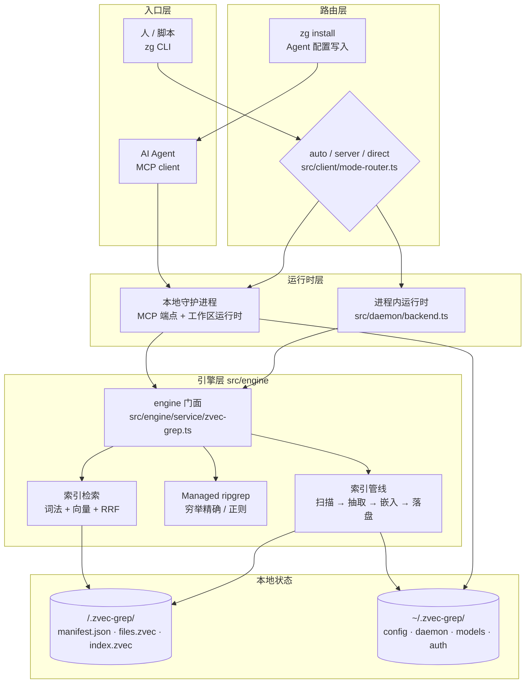
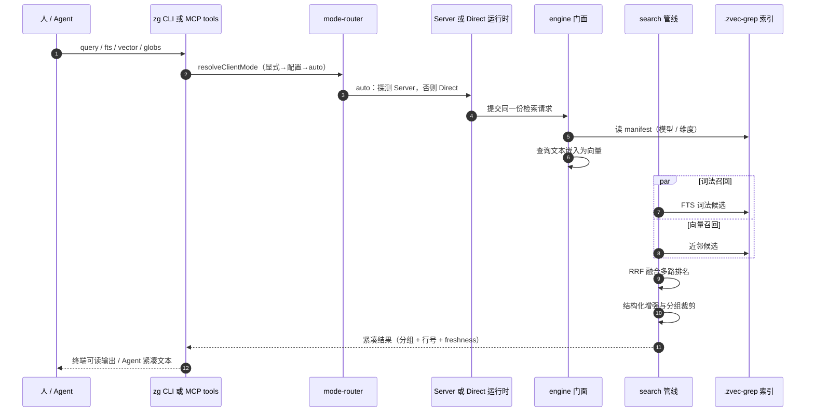

# zvec-grep — 面向人与 Agent 的本地优先混合检索层

> **仓库：** [github.com/zvec-ai/zvec-grep](https://github.com/zvec-ai/zvec-grep)
> **版本 / 协议：** `0.2.1`，Apache-2.0，Node.js ≥ 22
> **本解读按 `ai-infra`（主）⊗ `framework`（副，CLI + SDK + MCP 工具契约）类规格产出**（全新分析，非增量 patch）
> 被分析源码根（真源验证根）：`/Users/morehao/Documents/study/ai-agent/zvec-grep`（commit `d4e8a3e`）

## 子文档索引

- [`hybrid-retrieval.md`](hybrid-retrieval.md) — 混合检索与排序：query group、FTS + 向量双路召回、两级 RRF 融合、结果紧凑化
- [`indexing-pipeline.md`](indexing-pipeline.md) — 索引管线：文件发现与过滤、结构感知抽取（tree-sitter 符号 / Markdown 分节）、分片、增量更新
- [`embeddings.md`](embeddings.md) — Embedding 子系统：模型目录、Model2Vec / llama.cpp / transformers.js 多后端、worker 池、产物下载与缓存
- [`execution-modes.md`](execution-modes.md) — Direct / Server 双执行形态：模式路由、守护进程与工作区运行时、watcher 与每小时对账、刷新策略
- [`mcp-and-agents.md`](mcp-and-agents.md) — MCP 服务与 Agent 集成：toolset 收敛、zod 工具契约、结果格式、`zg install` 配置改写与行为引导注入
- [`storage-layout.md`](storage-layout.md) — 持久化数据模型：`.zvec-grep/` 与 `~/.zvec-grep/` 的实体、字段、存储选型、schema 演进与读写路径
- [`security-boundary.md`](security-boundary.md) — 授权与信任边界：loopback-only、Bearer token、远端 Embedding 一次性/工作区授权、日志脱敏
- [`typescript-engineering.md`](typescript-engineering.md) — TypeScript 工程惯用法：zod 单一事实源、错误分类跨进程传播、worker_threads 并发、原子写与锁

## 根因：把"该用哪种检索"从调用者手里拿走

检索一个工作区，今天要拼三套彼此不通的东西：`grep`/`rg` 快而精确，但只认字面，问不出"哪里校验了凭据"；向量库能按语义召回，却要自己搭切分、嵌入、增量、忽略规则，且给不出可核对的行号；代码搜索服务（Sourcegraph 一类）能力全，但把代码搬去了别人的服务器。

真正稀缺的不是某一种检索，而是**"这次该用词法还是语义"这个判断本身**——人做烦，Agent 更容易做错：要么退化成大规模 `grep` 扫描把上下文烧光，要么调用一个纯向量库拿到一堆无法回源验证的相似片段。

zg 的根因命题因此是：**用一套本地索引同时提供词法排序与语义召回，并把精确/正则穷举路径纳入同一接口与同一输出契约，让调用者不再选择检索工具**。同一份索引与同一套结果格式，既服务终端的 `zg`，也经本地 MCP Server 服务 Agent——因此"人和 Agent 各有一套搜索栈"这件事被消掉。

这个命题解释了后面几乎所有设计取舍：索引必须本地、可增量、能给出可点击的来源位置；默认工具面必须收敛到极致，避免 Agent 误用；执行形态可以提供常驻与一次性两种，但**搜索语义必须完全一致**。

## 概览

| 维度 | 说明 |
|------|------|
| 是什么 | 本地优先的混合检索层（CLI + 本地 MCP Server + 可嵌入 SDK），统一 ripgrep、zvec FTS 词法检索、向量检索 |
| 痛点 | grep 无语义、向量检索要用自己搭且不可回源、代码搜索服务把数据搬上云；Agent 被迫在多种工具间做选择 |
| 适用场景 | Agent 的跨文件/调用链/数据流问答与语义发现；人在大仓里找"不知道叫什么"的东西；CI 中一次性检索 |
| 运行形态 | Direct（进程内一次性）/ Server（常驻守护进程，MCP 端点）/ 可编程 SDK（`createZvecGrep`） |
| 交互面 | `zg` CLI、Streamable HTTP MCP（`127.0.0.1:7999/mcp`）、stdio 桥、npm 库 |
| 索引位置 | 工作区 `<root>/.zvec-grep/`；全局配置与守护进程状态 `~/.zvec-grep/` |
| 授权 | Apache-2.0；Node.js ≥ 22；ESM |

### 核心能力清单

| 能力 | 说明 |
|------|------|
| 混合检索 | 词法（zvec 内置 FTS + jieba 分词）与向量两路候选，两级 RRF 按排名融合，支持多 query group 与 `--fuse` |
| 穷举精确检索 | 内嵌 `@vscode/ripgrep` 二进制，支持常见 rg 匹配/上下文/glob/type 选项，无需索引与模型 |
| 结构感知抽取 | tree-sitter 解析 C/C++/Go/Java/JS/TS/Python/Rust 等，生成 symbol、签名与 breadcrumb；Markdown 按标题分节 |
| 多格式覆盖 | 代码、Markdown、文本、结构化数据（CSV/JSON/JSONC/TOML/YAML）、显式选入的位图图像；二进制文档与压缩包当前跳过 |
| 本地 Embedding | 内置 Model2Vec / ONNX / GGUF 模型目录（`potion-*`、`jina-*`、`embeddinggemma-300m`、`qwen3-embedding-0.6b` 等），首次使用时下载并缓存 |
| 远端 Embedding（需授权） | 经显式授权后可选用 Qwen 托管文本/多模态嵌入；授权与凭证分离 |
| Agent 集成 | `zg install` 一键写入 Codex / Claude Code / Qwen Code / Qoder / OpenCode / Cursor 的 MCP 配置与行为引导 |
| 双执行形态 | `auto` / `server` / `direct` 三种模式共用同一 engine，差别只在进程生命周期与协调 |
| 增量新鲜度 | watcher 驱动的目录级变更压缩 + 每小时全量对账；结果显式标注 `fresh` / `possibly_stale` |
| 诊断 | `--debug` / `--trace` / `zg status` 暴露逐文件失败、截断片段数与索引状态 |

### 技术栈一览

| 层面 | 技术 |
|------|------|
| 语言 / 运行时 | TypeScript（ESM），Node.js ≥ 22，`tsc` 直编无打包器，`node:test` |
| 检索引擎 | `@zvec/zvec`（向量 + 标量列 + FTS 全文索引）、RRF 两级按排名融合 |
| 精确检索 | `@vscode/ripgrep`（内嵌 rg 二进制，managed rg 子进程） |
| 结构抽取 | `web-tree-sitter` + `tree-sitter-wasms`（WASM 语法） |
| Embedding 运行时 | Model2Vec（静态向量，`worker_threads` 池）、`@huggingface/transformers`（ONNX）、`node-llama-cpp`（GGUF，可选依赖）、Qwen 远端 API |
| 契约 / 校验 | `zod` v4（MCP 工具 schema、配置、引擎类型）、官方 `@modelcontextprotocol/*` SDK 2.0.0 |
| 配置改写 | `jsonc-parser`（改写各 Agent 配置时保留 JSONC 注释与无关设置） |
| 可编程接口 | `createZvecGrep` + 全套导出类型（`src/index.ts`） |

## 架构总览

zg 的分层只有一件事要说清：**入口不同、执行形态不同，但落到同一个 engine**。



图里最值得注意的一条边是 `Router` 分出 `Server` 与 `Direct` 后立刻**重新汇合到同一个 `Facade`**——这正是 zg 的核心架构声明：执行形态不是检索路径的分叉点。

### 模块职责映射（目录树）

```text
src/
├── cli/                # 命令行：参数解析、命令分发、输出格式、安装器、managed rg
│   ├── args.ts         #   --mode/--refresh/--embedding 等全部选项解析
│   ├── commands.ts     #   命令执行编排
│   ├── install.ts      #   6 种 Agent 的 MCP 配置与 guidance 写入/卸载（最大单文件）
│   ├── managed-rg.ts   #   内嵌 ripgrep 的调用与结果owns
│   └── format/         #   human / compact / status / debug / progress 输出
├── client/             # CLI 侧客户端：模式路由与到 daemon 的调用
│   ├── mode-router.ts  #   auto/server/direct 选择（全文仅 36 行）
│   └── daemon-client.ts
├── daemon/             # 常驻 Server：HTTP/MCP 宿主、运行时编排、watcher、任务调度
│   ├── http-server.ts  #   Streamable HTTP MCP + Bearer 校验
│   ├── runtime-manager.ts / root-runtime.ts   # 每工作区运行时与生命周期
│   ├── watch-manager.ts / change-set.ts       # 文件事件压缩与增量刷新
│   ├── index-coordinator.ts / job-scheduler.ts# 索引任务排队与进度
│   ├── model-pool.ts   #   跨请求复用已加载模型
│   └── root-lease.ts   #   单实例租约
├── engine/             # 与执行形态无关的检索引擎（最大模块，约 2.2 万行）
│   ├── service/        #   engine 门面：zvec-grep.ts、lexical.ts、structure-enrichment.ts
│   ├── pipeline/       #   indexing/（扫描+索引）与 search/（召回+融合）
│   ├── extraction/     #   code/ markdown/ text/ image/ 抽取器与 tree-sitter 适配
│   ├── models/         #   模型目录、解析、后端（model2vec/llama-cpp/transformers-js/qwen）、产物下载
│   ├── storage/        #   layout（磁盘布局）+ zvec（集合读写）
│   ├── config.ts       #   全局配置与 zod 校验
│   ├── manifest.ts / index-status.ts   # 索引元数据与状态
│   └── types.ts / errors.ts
├── mcp/                # MCP 契约层：tools/schemas/toolset/result-format/stdio-bridge
├── authorization/      # 远端数据外发授权：manager/planner/prompt/store/target/operation
├── observability/      # trace context
└── prompts/            # 注入 Agent 的检索行为引导文本
```

## 链路：一次索引检索的全程

人的 `zg "..."` 与 Agent 的 `zvec_grep_search` 走的是同一条引擎链路，差别只在入口与执行形态：



其中 `auto` 语义值得单独强调：它**不会**为了这次请求去启动一个缺失的 Server，只在已就绪时复用；否则原地 Direct 执行 [src/client/mode-router.ts:18-28]()
<!-- anchor: export async function routeByMode<T>(options: { …     : options.direct(); -->

这把"要不要常驻进程"从一个正确性问题降级成了一个性能问题——两种形态调用的是同一个 engine，搜索行为不因形态而变。

## 核心模块导读

| 关注面 | 一句话定位 | 深读 |
|--------|-----------|------|
| 混合检索与融合 | 词法 + 向量双路召回如何用 RRF 合成一个排名，query group 与 `--fuse` 语义如何定义 | [`hybrid-retrieval.md`](hybrid-retrieval.md) |
| 索引与抽取管线 | 从工作区文件到可检索 fragment：过滤规则、tree-sitter 结构抽取、分片与增量维护 | [`indexing-pipeline.md`](indexing-pipeline.md) |
| Embedding 子系统 | 14 个内置模型的目录与解析、四种后端运行时、worker 池、产物下载与缓存 | [`embeddings.md`](embeddings.md) |
| 执行形态与守护进程 | Direct/Server 的进程模型、工作区运行时生命周期、watcher 与每小时对账 | [`execution-modes.md`](execution-modes.md) |
| MCP 与 Agent 集成 | 默认只暴露一个工具的取舍、zod 工具契约、结果格式、六种宿主配置改写 | [`mcp-and-agents.md`](mcp-and-agents.md) |
| 持久化数据模型 | `.zvec-grep/` 与 `~/.zvec-grep/` 的实体与字段、存储选型、演进与读写路径 | [`storage-layout.md`](storage-layout.md) |
| 授权与信任边界 | loopback-only 假设、Bearer 与远端外发授权的分离、凭证与数据授权解耦 | [`security-boundary.md`](security-boundary.md) |
| TypeScript 工程惯用法 | 类型即契约（zod 单一事实源）、错误跨进程传播、worker 并发、原子写与锁 | [`typescript-engineering.md`](typescript-engineering.md) |

## 项目规模

| 指标 | 数值 |
|------|------|
| 源码 | 133 个 TypeScript 文件，约 41,300 行（`src/`） |
| 其中 engine | 约 22,000 行（`src/engine/`） |
| 测试 | 65 个 `node:test` 文件，约 24,800 行（`test/`），含 unit / integration / e2e / package 分层 |
| 文档 | `docs/` 9 篇（Agent / CLI / MCP / Pipeline / Architecture / Server / Embedding / Roadmap） |
| 评测 | `benchmarks/` 两套配对 A/B 基准（BrowseComp-Plus、SWE-QA-Bench） |
| 版本 / 协议 | 0.2.1 / Apache-2.0，public preview |
| 构建 | `tsc` 直编到 `dist/`，无打包器；`c8` 覆盖率门禁 80% |

## 同类定位对比

| 方案 | 语义召回 | 精确/正则 | 结构化切分 | 数据位置 | 与 Agent 的关系 |
|------|---------|----------|-----------|---------|----------------|
| `grep` / ripgrep | 无 | 强（穷举、极快） | 无（按行） | 本地 | 靠 Agent 原生工具调用 |
| ast-grep / semgrep | 无 | 结构模式匹配（需写规则） | AST 级 | 本地 | 需自建规则 |
| Sourcegraph / 云代码搜索 | 有（部分） | 有 | 有 | 云端服务 | 需服务端与账号 |
| 编辑器内代码库索引（闭源） | 有 | 有 | 有 | 本地 | 绑定特定编辑器，不对 shell/其他 Agent 开放 |
| 自建 RAG（向量库 + 分块脚本） | 有 | 需另配 | 需自建 | 本地 | 需自己拼装并解决回源定位 |
| **zvec-grep** | 有（本地模型默认） | 有（内嵌 rg，同一接口） | 有（tree-sitter 符号 / breadcrumb） | 本地（远端嵌入需显式授权） | 一等公民：MCP + 六种宿主安装器 |

差异不在"某一项更强"，而在**把这几项收进同一套索引、同一份输出契约与同一套本地信任模型**；代价是引入了索引维护、模型运行时与守护进程这些 grep 世界不存在的复杂度（见下文"不足与风险"）。

## 评测数据（项目自述）

项目自带配对 A/B 评测，Baseline 与 Treatment 仅差"是否使用 zg"。BrowseComp-Plus（100 例 × 3 trials，Codex + gpt-5.6-sol）的公开结果如下：

| 指标 | Baseline | Treatment | 相对变化 |
|------|---------:|----------:|---------:|
| Accuracy (%) | 98.67 | 99.00 | +0.33 pp |
| 平均 input tokens | 1,675,379.50 | 1,046,115.41 | −37.56% |
| 平均 tool calls | 25.42 | 14.36 | −43.52% |
| 平均 Agent 时间（秒） | 259.39 | 159.31 | −38.58% |
| 平均文档 ID 提及次数 | 3,975.13 | 734.73 | −81.52% |

数据取自仓库内报告 [benchmarks/browse-comp-plus/LATEST_REPORT.md:16-26]()
<!-- anchor: | Accuracy (%) | 98.67 | 99.00 | 0.33 pp | - | … | Average document ID mentions | 3,975.13 | 734.73 | -3,240.40 | −81.52% | -->

需要注意这是**特定模型、特定任务集、三次重复下的自测口径**，项目自己在 README 中提示"重复运行均值更可靠"、"用户提示词敏感"。把"答案质量基本持平而 token/工具调用显著下降"读作核心收益，比读作"检索更准"更符合数据；把"更准"当作卖点与数据不符。

## 不足与风险

- **格式覆盖有明确空窗**：`.pdf`、Office 文档、压缩包、可执行产物、媒体与数据库文件当前在抽取前就被跳过——多格式能力集中在"代码 + 文本 + 结构化数据"。图片虽支持，但既需显式选入、也要求所选模型接受图像 [docs/04-pipeline.md:107-114]()
  <!-- anchor: The following binary formats are currently skipped before extraction: …   `.sqlite`. -->
- **文档口径与源码不一致（BM25 vs FTS）**：项目文档把索引检索的词法路径称作 "BM25/FTS" [docs/05-architecture.md:60-60]()
  <!-- anchor: | Indexed retrieval | Intent, related concepts, and ranked keywords | BM25/FTS and -->
  但源码里词法检索完全委托给 zvec 的全文索引（`ZVecIndexType.FTS` + jieba 分词 + lowercase 过滤）[src/engine/storage/zvec.ts:920-922]()
  <!-- anchor: indexType: ZVecIndexType.FTS, … filters: ["lowercase"], -->
  仓库内既不存在 BM25 实现、依赖里也没有任何词法打分库，且该分数从不参与融合——按"内置全文索引"而非"BM25"理解更准确。这是 README 宣称强于源码支撑的一处，本解读按源码口径书写。
- **仍是 public preview**：项目自述仍在"让安装、更新、卸载在现有平台与集成上可靠"、"加固增量索引、新鲜度、Server 恢复与并发工作区访问"、"稳定 CLI/MCP 契约与索引兼容策略"阶段 [docs/08-roadmap.md:13-22]()
  <!-- anchor: ## Now — make the public preview dependable …   compatibility policy before a stable release. -->
  这意味着索引兼容性、恢复语义与并发路径都还可能变动；把 0.2.x 当稳定存储格式依赖是有风险的。
- **部分宿主集成尚未真机验证**：Qoder IDE 的 `elicitation/create` 兼容路径，项目明确写"仍需在真实 Qoder IDE 会话中做端到端冒烟测试，不应视为所有 IDE 构建都会遵循该指令" [docs/01-agents.md:109-115]()
  <!-- anchor: Qoder IDE uses the exact native tool name `ask_user_question`, but its official … be treated as proof that every IDE build follows the instruction. -->
- **信任模型依赖"本机可信"**：Server 仅监听 loopback、默认不设 token；同机其他进程、本地 HTTP 无 TLS 都是该假设下的残余风险。授权边界详见 [`security-boundary.md`](security-boundary.md)。
- **新鲜度是"概率保证"而非"强一致"**：watcher 可能静默丢事件，因此用每小时全量对账兜底；期间结果为 `possibly_stale`。要求强一致的场景需要 `--refresh wait` 主动付代价。
- **静态嵌入模型有输入上限**：如 `local/potion-code-16m-v2` 输入上限 1,024 token，超长输入由 provider 截断并在索引中记录 `truncated_fragments`——长函数/长文档的语义召回会退化，需要放大模型或收窄索引范围 [docs/07-embedding.md:188-193]()
  <!-- anchor: zvec-grep uses the selected model's input limit when it creates fragments, but … Inspect the index after changing models or file scope: -->
- **评测规模有限**：BrowseComp-Plus 100 例、SWE-QA-Bench 20 任务；结论的方向性可信，但幅度不宜外推到所有仓库。

## 可借鉴的设计

1. **把"要不要常驻"设计成性能问题，而不是正确性问题。** Direct 与 Server 共用 engine，模式路由只决定进程边界 [src/client/mode-router.ts:18-28]()；同一个系统既有 CI 可用的零副作用形态，又有跨会话复用模型与后台刷新的形态，而两者结果语义相同。相比之下，很多工具把"服务化"做成两套实现，随后在两条路径上长期漂移。
   <!-- anchor: export async function routeByMode<T>(options: { …     : options.direct(); -->
2. **工具面主动收敛，把判断写进文档而不是堆工具。** 默认 MCP toolset 只暴露一个 `zvec_grep_search` [src/mcp/toolset.ts:3-5]()，精确查询交还宿主原生的 grep/rg；"何时该用 zg"通过安装时注入的行为引导文本传达。这是对"工具越多 Agent 越容易误用"的正确反应——但代价是能力发现性下降（只有 `full` toolset 才有索引管理工具）。
   <!-- anchor: export const DEFAULT_MCP_TOOLSET = "agent"; … export type McpToolset = "agent" | "full"; -->
3. **检索结果必须可回源验证。** 分片携带 breadcrumb 与行号区间、输出按文件分组，使语义召回的结果能立刻被精确阅读/核对，而不是停在相似度分数上 [docs/03-mcp.md:103-105]()。这是把"向量检索"接入 Agent 工作流的关键工程条件。
   <!-- anchor: freshness: fresh … matched: 16-18 -->
4. **用 RRF 回避跨量纲分数不可比，并干脆丢弃分数。** 词法匹配分与向量余弦相似度没有共同标尺，按分数加权需要调参且随语料漂移；zg 的实现只用排名（`score += 1/(60+rank)`），把这层调参整体消掉 [docs/05-architecture.md:63-64]()，代价是无法利用分差信息（例如"命中 5 次"与"命中 1 次"在融合后不再有强弱之分）。取舍细节见 [`hybrid-retrieval.md`](hybrid-retrieval.md)。
   <!-- anchor: Indexed search can combine lexical and vector candidates and fuse their ranks … with reciprocal rank fusion (RRF). Managed ripgrep is exhaustive by default and -->
5. **凭证与数据外发授权分离。** 配置远端 provider 的 API key 不等于允许把工作区内容发出去；后者需要显式一次性或工作区级授权 [docs/07-embedding.md:147-158]()。这种"默认不外发、外发需具名授权"的分层，是本地优先工具能被企业接受的前提。
   <!-- anchor-base64:Q3JlZGVudGlhbHMgY29uZmlndXJlIGFjY2VzcyB0byBhIHByb3ZpZGVyOyB0aGV5IGRvIG5vdCBhdXRob3JpemUgZGF0YSDigKYgemcgLS1hdXRoIHJldm9rZQ== -->

## 总结

zg 解决的不是"检索不够好"，而是"检索这件事需要调用者做太多选择、且选择错误会直接烧掉 Agent 的上下文"。它用一个本地索引把词法排序、语义召回与精确穷举收进同一接口，用同一个 engine 支撑一次性与常驻两种形态，再用一个极窄的 MCP 工具面把它交给 Agent——代价是引入了索引维护、模型运行时与守护进程的全部复杂度，并在格式覆盖（PDF/Office 暂缺）、强一致性（worse-case 只能给 `possibly_stale`）与稳定契约（public preview）上留下了明确的边界。它值得学的不是某个算法，而是**"默认本地 + 能力收敛 + 结果可回源"这三件事如何一起构成 Agent 时代基础设施的可用性前提**。

## 附：引用校验说明

本文所有 `[路径:行号]()` 引用均以 `/Users/morehao/Documents/study/ai-agent/zvec-grep` 为根、经 `verify-references.mjs` 首末行双锚点程序重定位；Mermaid 图经 `check-mermaid.mjs` 校验。未通过定位的引用会在此列出并标 `[UNVERIFIED]`。
