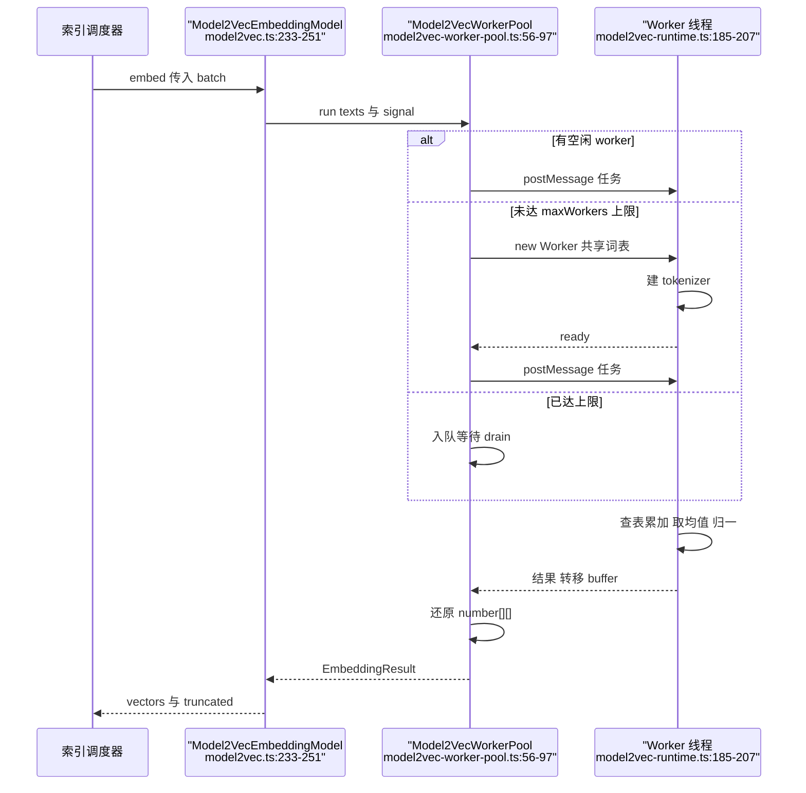
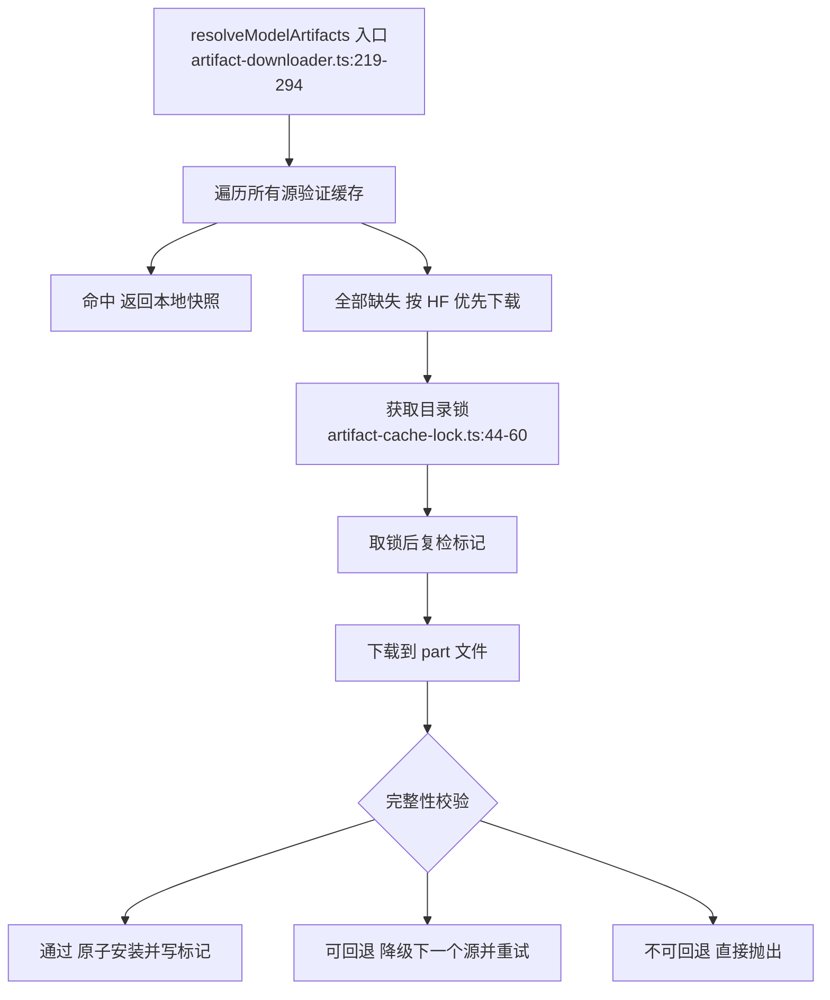

# zvec-grep Embedding 模型子系统：多后端、worker 池与产物缓存

> 本解读按 `ai-infra` ⊗ `framework` 类规格产出（全新分析）。

## 关注面定位：模型子系统是 local-first 承诺的落点

zg 把 ripgrep、FTS 词法检索、向量检索三路统一到一套接口，但"文件、索引、本地模型不出本机"这条最硬的承诺几乎全部由 Embedding 子系统兑现：目录层把可用模型收敛成静态 catalog，后端层把四种运行时的差异挡在 `EmbeddingModel` 接口之后，下载层把权重从 Hugging Face / ModelScope 搬进本机缓存，`EmbeddingModelPool` 让常驻 Server 只付一次加载代价。下文按"目录 → 后端 → 池化 → 解析 → 下载 → 向量契约 → 生命周期"推进，每节回答同一个问题：为了让一次 `zg` 调用既快又不出本机，这里放弃了什么。

## 模型目录：catalog 是唯一的模型真源

`EMBEDDING_MODEL_CATALOG` 以 `provider/model` 形式的 reference 为键，是"哪些模型可用"的唯一事实来源——CLI 帮助、环境变量校验、工厂分发都只读它，没有第二处模型清单 [src/engine/models/catalog.ts:6-13]()
<!-- anchor: export const EMBEDDING_MODEL_CATALOG = { … cacheFile: "hf_ggml-org_embeddinggemma-300M-Q8_0.gguf", -->
一个条目同时编码四类信息：**身份**（reference / provider / model）、**来源**（`uri`，或 `repo`+`revision` 加 `sources.huggingFace`/`sources.modelScope` 双源）、**产物**（每个文件的 `path`/`size`/`sha256`）、**运行时契约**（`dimension`/`metric`/`format`/`contextSize`/`maxBatchSize`）[src/engine/models/catalog.ts:24-36]()
<!-- anchor: artifacts: [ … maxBatchSize: 16, -->
把下载产物连同字节数与独立 sha256 直接写进 catalog 是关键取舍：清单因此变"重"，上游换个权重就要改 catalog；换来的是下载层无需任何远端元数据查询即可完成完整性与缓存指纹比对——网络被彻底移出信任路径，这比"能离线跑"更严格。内置 14 个模型按定位分四档：

| reference | 后端 | 维度 | 输入 | 定位 |
|---|---|---|---|---|
| `local/potion-code-16m-v2` | model2vec | 256 | 文本 | **内置默认**，32 MB 权重，冷启动最快 |
| `local/potion-retrieval-32m` / `potion-multilingual-128m` | model2vec | 512 / 256 | 文本 | 静态词向量，CPU 检索档 |
| `local/embeddinggemma-300m` / `qwen3-embedding-0.6b` | llama-cpp | 768 / 1024 | 文本 | GGUF，质量优先、可 GPU 加速 |
| `local/bge-small-en-v1.5`、`all-minilm-l6-v2`、`multilingual-e5-small`、`jina-embeddings-v2-base-code`、`gte-modernbert-base`、`nomic-embed-text-v1.5` | transformers-js | 384~768 | 文本 | ONNX，纯 JS、无原生依赖 |
| `qwen/text-embedding-v4` / `qwen3.7-text-embedding` / `qwen/qwen3-vl-embedding` | qwen | 1024 / 2560 | 文本 / 文本+图像 | 唯一远端档，`qwen3-vl` 是唯一接受图像的模型 |

model2vec 条目的字段形状与另两类本地后端明显不同：它不用 `uri`，而是显式给出 `modelFile`/`embeddingTensor`/`tokenizerFile`，并声明 `normalize`、`maxBatchSize: 256` 与 `defaultConcurrency: 2` [src/engine/models/catalog.ts:228-234]()
<!-- anchor: "local/potion-retrieval-32m": { … revision: "6fc8051fab2a1e0ee76689cf08c853792ac285e7", -->
qwen 条目是另一端：完全没有 `artifacts` 与 `sources`，只有 `defaultEndpoint` 与 token 上限，因为权重在服务端 [src/engine/models/catalog.ts:71-81]()
<!-- anchor: "qwen/text-embedding-v4": { … maxInputTokens: 8192, -->
catalog 的严格性由类型层强制：整体 `as const` 后按 `backend`/`kind` 做 `Extract` 派生子类型，于是"给 model2vec 传 `uri`""给 qwen 取 `contextSize`"在编译期就不可表达，工厂分支也能被穷尽检查。工厂本身只做两件事：查 catalog，取不到就抛 `EMBEDDING_CATALOG_MODEL_NOT_FOUND`；取到就按 `catalogEntry.backend` 分派到对应后端类 [src/engine/models/factory.ts:31-41]()
<!-- anchor: switch (catalogEntry.backend) { … return unsupportedCatalogEntry(catalogEntry); -->
"先查目录再建实例"意味着用户无法指向任意 HF 仓库：可离线、可校验的封闭目录换来了不可扩展，这是 local-first 对可复现性的让步。

## 四类后端的适用与取舍

### model2vec：不跑 Transformer 的静态嵌入

它的向量就是把句子切成 token、在静态词表里查行、取均值、可选 L2 归一，没有前向计算，因此 CPU 上也能到毫秒级；代价是无法建模上下文，表达力受限于词表平均，所以被定位成"默认档"而非"质量档"。实现细节见下一节。

### llama-cpp：GGUF 与"可选依赖"

`node-llama-cpp` 是 optionalDependency，缺失时不静默降级，而是抛出带修复提示的 `LLAMA_CPP_MISSING_DEPENDENCY` [src/engine/models/backends/llama-cpp.ts:95-105]()
<!-- anchor: const moduleName = "node-llama-cpp"; … "Install optional dependency node-llama-cpp or reinstall zvec-grep with optional -->
选它的理由是 GGUF 量化生态与 GPU/CPU 通吃，代价是原生二进制：需要按平台构建、可能触发 CMake，且 GPU 初始化在真实机器上会失败。zg 为此设计逐级回退并**记忆失败模式**：GPU init 失败即把该 device 记进 `failedGpuInitModes` 并改走 CPU，后续模型直接跳过已知失败的模式，避免每次加载都重试一遍昂贵的原生初始化 [src/engine/models/backends/llama-cpp.ts:325-333]()
<!-- anchor: this.llama = await load(requestedGpu); … this.llama = await this.loadCpuCompatibleLlama(load, downloadProgress); -->
并行度也不是拍脑袋：有 VRAM 时按"空闲显存 25% / 每上下文约 150 MB"估算并封顶 8，否则退回 1，多上下文并行只在真有余量时才开 [src/engine/models/backends/llama-cpp.ts:625-648]()
<!-- anchor: private async resolveParallelism(): Promise<number> { … return 1; -->
GGUF 还有一个专门失败模式：某些镜像/代理会把 HTML 错误页当文件返回。zg 在加载前嗅探前 4 字节是否为 `GGUF` magic，不是就**删除该文件**并按 HTML/非 GGUF 区分报错，避免坏缓存永久留存 [src/engine/models/backends/llama-cpp.ts:811-823]()
<!-- anchor: const header = sniff.subarray(0, 4); … unlinkSync(filePath); -->

### transformers-js：纯 JS 的 ONNX 档

`@huggingface/transformers` 走 ONNX Runtime，无需原生编译，覆盖面最广（内置 6 个模型，含代码专用与 multilingual）。它把归一化与池化策略交给 pipeline，用 catalog 的 `pooling`/`normalize`/`dtype` 参数化，并以 `local_files_only: true` 锁死本地加载 [src/engine/models/backends/transformers-js.ts:354-357]()
<!-- anchor: dtype: this.entry.dtype, … ? { session_options: { executionProviders: [executionProvider] } } -->
加载路径是"先解析本地产物 → 建 pipeline → 设备失败则 CPU 重建"，并把 `model_max_length` 覆写成 catalog 的 `maxInputTokens`，让显式截断与 pipeline 内部限制保持一致 [src/engine/models/backends/transformers-js.ts:258-298]()
<!-- anchor: private async loadPipeline( … return pipeline; -->
`device` 到 execution provider 的映射按平台分流：显式 `cuda` 用 CUDA，`metal`/`vulkan` 折成 WebGPU，Windows 走 DirectML，Linux x64 走 CUDA，其余 WebGPU [src/engine/models/backends/transformers-js.ts:481-503]()
<!-- anchor: function resolveExecutionProvider( … return "webgpu"; -->

### qwen：唯一远端后端，也是唯一多模态后端

qwen 后端的构造本身就带策略：没有 API key 直接构造失败，并提示三条获取路径 [src/engine/models/backends/qwen.ts:96-99]()
<!-- anchor: const apiKey = options.apiKey?.trim() ?? ""; … code: this.errorCode("MISSING_API_KEY"), -->
它也是唯一声明 `inputKinds: ["text", "image"]` 并在 `limits` 里带 `maxImageBytes` 的条目，图像以 base64 内联进请求 [src/engine/models/backends/qwen.ts:283-294]()
<!-- anchor: this.info = { … maxImageBytes: entry.maxImageBytes, -->
远端不可控，所以它靠超时而不是重试：请求信号是用户取消信号与 60 s `AbortSignal.timeout` 的 `any` 组合，避免一次远端卡死拖垮整个索引 [src/engine/models/backends/qwen.ts:586-588]()
<!-- anchor: function remoteEmbeddingSignal(signal: AbortSignal | undefined): AbortSignal { … return signal ? AbortSignal.any([signal, timeout]) : timeout; -->

### 为什么保留四个后端

四种后端对应四种**互斥的约束组合**：model2vec 换 CPU 上的确定性延迟，transformers-js 换零原生依赖与最广模型覆盖，llama-cpp 换量化质量与 GPU 吞吐，qwen 换"本地不放权重"时的质量上限。只留一个就必须在"无原生依赖""能用 GPU""覆盖多语言/代码""多模态"之间丢掉至少三项。代价是四套产物布局、四套失败语义与四倍维护面——本篇后面每一节都能看到这笔账。

## model2vec worker pool：把 CPU 密集的查表搬出事件循环

model2vec 的每批嵌入是 `token 数 × 维度` 的纯 JS 循环：512 维、batch 256、上千 fragment 时单批就是百万级浮点累加。放在主线程会让 daemon 在索引期间无法响应任何 MCP 请求，因此 zg 用 `worker_threads` 池化；同时 `useWorkerPool` 仅在**未注入依赖**时为真，测试可注入假 tokenizer/词表从而走进程内路径 [src/engine/models/backends/model2vec.ts:99-99]()
<!-- anchor: this.useWorkerPool = Object.keys(dependencies).length === 0; -->
词表通过 `SharedArrayBuffer` 共享：读 safetensors 时就分配共享内存，池化前再经 `sharedStaticEmbeddingTable` 幂等包装，于是 N 个 worker 共享同一份（multilingual-128m 可达 512 MB）权重，而不是每个 worker 各复制一份 [src/engine/models/backends/model2vec.ts:449-459]()
<!-- anchor: const sharedBuffer = new SharedArrayBuffer(tensorByteLength); … : new Float32Array(sharedBuffer), -->
建池时传入 tokenizer 目录、维度、dtype、行数与共享 buffer，`start()` 失败会先 `dispose()` 再抛出，避免半初始化的池泄漏 [src/engine/models/backends/model2vec.ts:235-247]()
<!-- anchor: const workerPool = new Model2VecWorkerPool({ … this.workerPool = workerPool; -->

池的并发度默认取 `availableParallelism()`，并留出显式覆盖参数 [src/engine/models/backends/model2vec-worker-pool.ts:38-46]()
<!-- anchor: constructor( … this.maxWorkers = Math.max(1, Math.floor(maxWorkers)); -->
任务分发只有三态：有空闲 slot 就派发、未达上限就新开 worker、否则入队——没有中心调度器，也没有工作窃取 [src/engine/models/backends/model2vec-worker-pool.ts:85-94]()
<!-- anchor: const idle = this.slots.find( … this.queue.push(job); -->
这里其实有**两层并发控制**：外层是索引管线的自适应调度器（model2vec 的 `defaultConcurrency` 为 2），内层才是这个池。池的 `maxWorkers` 是容量上限而非目标值——`run()` 只在没有空闲 slot 时才新开 worker，所以常规情况下池只会养到调度器允许的并发数，`availableParallelism` 只是防止其他调用方打爆 CPU。

worker 空闲时 `unref()`，有任务时 `ref()` 回来，因此 Direct 模式下不会因为持有 worker 而拒绝退出 [src/engine/models/backends/model2vec-worker-pool.ts:161-168]()
<!-- anchor: if (response.type === "ready") { … this.drain(); -->
失败处理是"slot 级隔离"：`error` 与 `exit` 都走 `failSlot`，终止该 worker、拒绝其正在执行的任务、从池中移除并 `drain()` 补位，异常退出不会毒化整个池 [src/engine/models/backends/model2vec-worker-pool.ts:140-147]()
<!-- anchor: worker.on("error", (error) => { … new Error(`Model2Vec worker exited unexpectedly with code ${code}`), -->
worker 出参用 transfer list 转移 `Float32Array.buffer` 实现零拷贝，但父线程仍需把它还原成 `number[][]` 交给上层接口——接口是数组的数组，零拷贝只覆盖了进程边界这一段 [src/engine/models/backends/model2vec-worker.ts:30-43]()
<!-- anchor: const flatVectors = new Float32Array( … port.postMessage(response, [flatVectors.buffer]); -->
每个 worker 各自从本地文件重建 tokenizer，这是共享内存方案的遗留成本：词表共享了、tokenizer 没有（multilingual 的 `tokenizer.json` 有 18 MB，乘以并发数就是额外内存）。用共享内存而非消息传递权重，换来的正是这种"启动稍慢但稳态内存低"的取舍。一个未被显式处理的边界是：全部 token 都落在 `unk` 时 token 列表为空，函数直接返回全零向量而不是报错，而余弦相似度对零向量无定义，只能依赖 zvec 侧度量实现兜底 [src/engine/models/backends/model2vec-runtime.ts:181-182]() [WIP]
<!-- anchor: if (tokenIds.length === 0) { … return vector; -->
归一化就在同一条热路径上：先按 token 数取均值，再对平方和开方求倒数做 L2 归一，只有 `normalize` 为真且范数非零时才执行 [src/engine/models/backends/model2vec-runtime.ts:185-207]()
<!-- anchor: for (let index = 0; index < tokenIds.length; index++) { … vector[column] *= inverseNorm; -->

## 模型解析优先级与远端 provider 分支

解析函数是一条线性优先级链，前一档存在即短路返回：显式参数 → 已索引模型（`existing`）→ `ZVEC_GREP_EMBEDDING` → 全局配置 `defaults.embedding` → 内置默认 [src/engine/models/resolution.ts:15-16]()
<!-- anchor: if (options.explicit !== undefined) return options.explicit; … if (options.existing !== undefined) return options.existing; -->
环境变量不是"取到就用"：它必须能在 catalog 查到，否则抛出 `EMBEDDING_ENVIRONMENT_INVALID` 并提示 `zg --help models`，把拼写错误挡在索引创建之前而不是等到下载 404 [src/engine/models/resolution.ts:18-33]()
<!-- anchor: const environmentReference = nonEmptyEnvironmentValue( … return environmentReference ?? options.globalDefault ?? options.fallback; -->
这条链与 `zg --help environment` 文档化的优先级一致，只是文档以"新建索引"为视角，把 `existing` 折叠进"已索引模型保持不变"的说明里（`--embedding > ZVEC_GREP_EMBEDDING > Global config > Built-in local`）[src/cli/help.ts:581-585]()
<!-- anchor: Precedence: … Qwen environment credential      ZVEC_GREP_API_KEY > DASHSCOPE_API_KEY > QWEN_AP -->
兜底是 `local/potion-code-16m-v2`，与"默认给 Agent 最省的可用档"一致 [src/engine/service/zvec-grep.ts:82-82]()
<!-- anchor: const DEFAULT_LOCAL_EMBEDDING = "local/potion-code-16m-v2"; -->
`existing` 只对已有索引生效且**高于**环境变量，这是"索引 manifest 是存储模型真源"的直接后果：往已建索引的工作区 `export ZVEC_GREP_EMBEDDING=...` 不会悄悄换掉查询模型。daemon 侧在请求级允许覆盖环境变量并带上同一兜底，保证两种执行形态默认语义一致 [src/daemon/backend.ts:1173-1180]()
<!-- anchor: const reference = resolveEmbeddingReference({ … fallback: DEFAULT_LOCAL_EMBEDDING, -->
**远端分支在配置解析层还有一道互斥校验**：`local/` 前缀的模型带 `endpoint`、远端模型带 `device` 都直接报错，避免"给本地模型配了个远端地址"这类静默无效配置 [src/engine/config.ts:71-82]()
<!-- anchor: const provider = providerFromEmbedding(reference); … "device is only supported for local embedding models", -->
API key 取值顺序按 provider 定制：qwen 认 `ZVEC_GREP_API_KEY` → `DASHSCOPE_API_KEY` → `QWEN_API_KEY`，其他 provider 只认 `ZVEC_GREP_API_KEY`，兼顾兼容性与不过度扩散凭据来源 [src/engine/config.ts:463-475]()
<!-- anchor: function environmentApiKey( … return values.map(nonEmptyEnvironmentValue).find(Boolean); -->
本地 provider 的模型原样返回，只有 qwen 被包装，而包装的正是 local-first 的守门人：每次 `embed` 都先过 `remoteEmbeddingAuthorizationGuard`，把 provider、model、endpoint、purpose、内容种类与数量交给授权存储校验，未授权即拒绝——**文本离开本机必须显式授权**，且授权粒度细到"文本还是图像、发多少条" [src/engine/service/zvec-grep.ts:1448-1463]()
<!-- anchor: const authorize = remoteEmbeddingAuthorizationGuard({ … contentCount: contents.length, -->

## 产物下载与缓存：双源、指纹锁与完整性

`resolveModelArtifacts` 的第一条规则是：**任何网络请求之前先把所有源的缓存验一遍**。这样一份完整的 ModelScope 快照可以直接命中，完全避开一次注定失败的 Hugging Face 尝试 [src/engine/models/artifact-downloader.ts:237-247]()
<!-- anchor: source, … return resolvedResult(source, manifest); -->
只有全部缺失才下载，且失败后按源顺序回退：主源错误被记住，次源再失败时把两个错误合成 `ModelArtifactResolutionError`，而不是只报最后一个 [src/engine/models/artifact-downloader.ts:259-274]()
<!-- anchor: } catch (error) { … throw error; -->
回退不是无条件的：只有网络、超时、完整性错误以及 HTTP 403/404/408/429/5xx 才允许换源；400/401 这类请求本身有问题的错误立刻抛出——换镜像不可能修好鉴权失败，早失败比晚失败更省时间 [src/engine/models/artifact-downloader.ts:75-85]()
<!-- anchor: this.fallbackAllowed = … (status >= 500 && status <= 599))); -->
缓存目录有三套布局，各有原因：llama-cpp 把单个 GGUF 平铺在 `modelCacheDir` 根下并用 catalog 的 `cacheFile` 命名，ModelScope 版本退到 `modelscope/llama-cpp/<repo>/<rev>` 子目录 [src/engine/models/backends/llama-cpp.ts:607-617]()
<!-- anchor: cacheDirectory: this.modelCacheDir, … "llama-cpp", -->
model2vec 用 `<cache>/model2vec/<repo 以 -- 替换斜杠>/<revision>`，因为下游 tokenizer 需要 `local_files_only` 的本地目录结构；transformers-js 则直接对齐 ONNX 运行时的 `<cache>/<repo>/<revision>` 约定 [src/engine/models/backends/model2vec.ts:296-300]()
<!-- anchor: cacheDirectory: join( … huggingFace.revision, -->
命中快路径靠一个 `.complete` 标记：它记录每个产物的 size/mtimeMs/ctimeMs，指纹由 catalog 版本、源仓库、revision 与全部产物摘要序列化后取 sha256 前 24 位构成，因此**改 catalog 的任一 sha256 就会生成新锁与新标记，旧缓存自然失效且不会被误用** [src/engine/models/artifact-downloader.ts:494-505]()
<!-- anchor: const fingerprint = createHash("sha256") … source.cacheDirectory, -->
标记存在时只做 stat 比对即可返回，避免每次启动都对几百 MB 权重重算 sha256；标记缺失或不匹配才走全量哈希慢路径 [src/engine/models/artifact-downloader.ts:545-592]()
<!-- anchor: async function hasValidCompleteMarker( … return true; -->
慢路径逐个产物做流式 sha256，与 catalog 声明的值不一致即视为未缓存——**catalog 里的 sha256 是缓存判据，不只是下载后校验** [src/engine/models/artifact-downloader.ts:606-625]()
<!-- anchor: async function validateArtifact( … return hash.digest("hex") === artifact.sha256.toLowerCase(); -->
下载前必须取到目录锁，锁参数与网络超时都有默认值：响应头 10 s、读空闲 30 s、锁轮询 250 ms、过期 10 min、心跳 30 s [src/engine/models/artifact-downloader.ts:142-147]()
<!-- anchor: const DEFAULT_RESPONSE_HEADER_TIMEOUT_MS = 10_000; … const MANIFEST_VERSION = 1; -->

锁不是简单的 `mkdir` 抢占，而是一套可识别陈旧持有者的协议：先在暂存目录写好带 token/pid/hostname 的 owner 文件，再 `rename` 发布一个**已初始化且非空**的目录——并发发布者无法互相覆盖，也不会把 owner 写进别人的锁目录 [src/engine/models/artifact-cache-lock.ts:80-98]()
<!-- anchor: await mkdir(stagingPath); … await rm(stagingPath, { recursive: true, force: true }); -->
心跳兼作围栏：刷新只更新自己那个 token 文件的时间戳，而一旦当前锁目录已被接管者替换，该 token 文件必然不存在，刷新就会失败，被顶替的持有者立即失效 [src/engine/models/artifact-cache-lock.ts:108-111]()
<!-- anchor: // A replaced directory cannot contain this owner's unique token. Updating … lastHeartbeat = now; -->
陈旧判定有两个条件：唯一持有者的进程已死，或最新心跳超过 10 分钟 [src/engine/models/artifact-cache-lock.ts:218-224]()
<!-- anchor: function isAbandoned( … options.dependencies.now() - observation.newestHeartbeat >= options.staleMs -->
"进程已死"只认 `ESRCH`：`EPERM` 等其余错误一律视为不确定、继续按心跳过期处理，避免在容器或不同用户场景下误删活锁 [src/engine/models/artifact-cache-lock.ts:283-288]()
<!-- anchor: process.kill(owner.pid, 0); … return isErrorCode(error, "ESRCH"); -->
安装用原子 `rename`，并先记录目标文件的原 identity；Windows 上目标被占用时 rename 会失败，于是先把旧文件挪到唯一名字再装新文件，失败则回滚——跨平台语义差异被集中在这一个函数里 [src/engine/models/artifact-downloader.ts:882-914]()
<!-- anchor: async function installDownloadedArtifact( … await rename(partialPath, destination); -->
这些重活最终服务的是"离线可用"：产物一旦完整落盘，后续加载全部走 `local_files_only: true` 的本地路径。失败语义也围绕离线设计——`onProgress` 只是可选回调，没有回调时降级为 `stderr` 警告，保证无 UI 的 CLI 与 MCP 场景都能拿到可诊断信息 [src/engine/models/download-progress.ts:26-39]()
<!-- anchor: const values = [...artifacts.values()]; … totalBytes, -->

## 归一化、度量与"换模型必须重建"

**zg 自己只对 model2vec 做归一化**：dtype 为 F16 时先展开半精度查表，再累加、取均值、按需 L2 归一 [src/engine/models/backends/model2vec-runtime.ts:185-207]()
<!-- anchor: for (let index = 0; index < tokenIds.length; index++) { … vector[column] *= inverseNorm; -->
transformers-js 把 `pooling` 与 `normalize` 交给 pipeline，自己不做后处理 [src/engine/models/backends/transformers-js.ts:354-357]()
<!-- anchor: dtype: this.entry.dtype, … ? { session_options: { executionProviders: [executionProvider] } } -->
llama-cpp 与 qwen 返回后端原始向量，zg 不做二次归一化。这可以接受，因为 14 个条目的 `metric` 全是 `cosine`，而 zvec 的 COSINE 度量本身会处理尺度：**归一化在 zg 是"显式声明而非处处执行"**，catalog 的 `normalize` 字段才是契约，缺失的归一化由度量兜底。至于 `node-llama-cpp` 的 `getEmbeddingFor` 内部是否已 L2 归一，本仓库内无对应代码，未能确认 [WIP]。

维度校验发生在接口边界而非存储层：`BaseEmbeddingModel.validateResult` 逐向量比对 `info.dimension`，不符即抛 `EMBEDDING_DIMENSION_MISMATCH`，连非有限值一起拦下——任何后端的返回都要先过这道闸才能进入索引管线 [src/engine/models/embeddings.ts:201-206]()
<!-- anchor: if (vector.length !== this.info.dimension) { … context: `model=${this.info.reference} vectorIndex=${vectorIndex} expectedDimens -->
真正的强约束落盘在 manifest：索引 manifest 持久化 `provider`/`model`/`dimension`/`metric` 四项，缺一即视为 schema 非法、无法读回 [src/engine/manifest.ts:113-123]()
<!-- anchor: function isEmbeddingSchema(value: unknown): boolean { … value.metric === "euclidean") -->
打开索引时这四项被逐一比对，维度或度量不符直接抛专用的 `EMBEDDING_DIMENSION_MISMATCH` / `EMBEDDING_METRIC_MISMATCH` [src/engine/service/workspace-index.ts:163-185]()
<!-- anchor: if (expected.dimension !== current.info.dimension) { … current.info.metric, -->
度量不是元数据装饰：建表时它被翻译成 zvec 的 HNSW `metricType`，与维度一起写进向量列定义 [src/engine/storage/zvec.ts:935-940]()
<!-- anchor: name: ENTITY_VECTOR_FIELD, … metricType: metricToZvec(embedding.metric), -->
daemon 侧在动索引之前就把这条规则推到用户面前：已有索引的模型与请求模型不一致时报 `EMBEDDING_MODEL_MISMATCH`，并明确提示用 `rebuild` [src/daemon/backend.ts:200-207]()
<!-- anchor: existing && … `Existing model ${existing.provider}/${existing.model} does not match requested  -->
**为什么必须显式重建而不能"混着用"**：向量空间由模型定义，A 模型的 768 维与 B 模型的 768 维虽然形状相同却不可比，余弦值没有语义；HNSW 图是在旧空间里连的边，新旧向量混入同一个图会让近邻关系彻底失真。维度不同时更直接——向量列定长，物理上写不进去。所以 zg 选择"检测到不匹配就拒绝服务并提示重建"，而不是静默重嵌入或做维度投影：前者保证查询结果始终解释得通，代价是换模型必须全量重算。这条规则也解释了为什么解析链里 `existing` 要压过环境变量：manifest 才是索引真实向量空间的记录。

## 模型生命周期：Server 池化 vs Direct 逐进程

两种执行形态共用同一 engine，差别正在这里。Server 侧 `EmbeddingModelPool` 的默认策略是"只留一个、闲置 15 分钟释放" [src/daemon/model-pool.ts:64-81]()
<!-- anchor: constructor(options: EmbeddingModelPoolOptions = {}) { … this.logger = options.logger; -->
加载是单飞的：`entry.loading` 让并发请求共用同一次加载 Promise，已完成则记一条 `model.cache_hit` 日志 [src/daemon/model-pool.ts:107-121]()
<!-- anchor: if (!entry.model) { … this.logger?.event("model.cache_hit", { model_id: entry.logIdentity }); -->
池键不是模型名，而是 reference 加运行时指纹（endpoint、缓存目录、device，以及 API key 的 HMAC），因此"同一个模型但不同 apiKey/device"不会被错误复用 [src/engine/service/zvec-grep.ts:177-186]()
<!-- anchor: export function embeddingModelPoolKeyForIdentity( … return [reference, fingerprint].join("/"); -->
指纹对 apiKey 用进程内密钥做 HMAC，既能让键区分不同凭据，又不把明文 key 写进日志或键值 [src/engine/service/zvec-grep.ts:1492-1503]()
<!-- anchor: function providerOptionsFingerprint(options: { … return `${providerApiKeyIdentity(options.apiKey)}:${publicOptionsFingerprint}`; -->
`maxLoadedModels` 为 1 时，加载第二个模型会触发 LRU 淘汰：只淘汰无租约（`leases === 0`）且最久未用的条目，正在被请求持有的模型不会被踢掉 [src/daemon/model-pool.ts:223-236]()
<!-- anchor: private async trimIdleEntries(exceptKey: string): Promise<void> { … await this.disposeEntry(candidates.shift()!); -->
这就是 Server 模式的收益与代价：跨请求复用省掉几百 MB 权重的重复加载与原生后端初始化，代价是常驻内存乘以默认 1 个模型、以及切换模型时的淘汰-重载抖动；`maxLoadedModels` 可调，是把内存换延迟的旋钮。

Direct 模式没有池。每次 CLI 调用自行构造服务、在首次 `embed` 时惰性加载模型、命令结束即 `close()` 释放 [src/cli/commands.ts:791-799]()
<!-- anchor: const embedding = implicitEmbeddingReference(options); … await service.close(); -->
`close()` 会统一释放构造时传入的模型（`borrowed` 除外）以及所有恢复出来、已退休的模型，避免临时模型泄漏 [src/engine/service/zvec-grep.ts:493-509]()
<!-- anchor: async close(): Promise<void> { … this.closed = true; -->
于是 Direct 的单次代价 = 进程启动 + 模型加载（+ llama-cpp 可能的原生后端初始化/构建），每次调用都重付一遍；回报是零常驻进程、无守护状态、无跨请求污染。两端共享同一套磁盘产物缓存，而 `prepare()` 只在本地 provider 时被索引管线显式等待——远端模型没有本地资源可准备，本地模型则可在批量嵌入开始前把下载与建池一次做完，把失败暴露在索引真正开跑之前 [src/engine/pipeline/indexing/index.ts:738-741]()
<!-- anchor: const prepareModel = … : undefined; -->
并发档位同样按形态固化在模型信息里：远端文本模型初始 8、上限 12，远端多模态初始 4、上限 8，本地模型读 catalog 的 `defaultConcurrency`（model2vec 为 2）——远端受配额限制、本地受 CPU 限制，所以两套默认值差距明显 [src/engine/pipeline/indexing/index.ts:1455-1465]()
<!-- anchor: const remote = model.info.provider === "qwen"; … const max = remote ? (multimodal ? 8 : 12) : localDefault; -->

## 模块依赖与全局关联

依赖方向单向，这决定了该子系统容易替换也容易测：`catalog.ts` 只被 `factory.ts`/`resolution.ts`/CLI 帮助读取；`artifact-downloader` 只依赖 `artifact-cache-lock`，四个后端都通过同一个 `resolveModelArtifacts` 取产物（且都支持注入 mock，测试无需网络，正如 model2vec 用依赖注入绕过 worker 池）；`embeddings.ts` 定义接口并承担全部输入/输出校验，四个后端只实现 `doEmbed`；上层 `pipeline/indexing` 只认 `EmbeddingModel` 接口与 `info`，完全不感知后端种类。

连回四条设计哲学：**local-first** 体现在封闭 catalog、双源校验缓存、目录锁与"远端必须显式授权"；**一套引擎两种形态**体现在 Direct 与 Server 共用同一份解析链、同一批后端、同一套缓存，差别只在 `EmbeddingModelPool` 的有无；**为 Agent 优化**体现在默认选最小模型、`prepare()` 把下载与建池提前、进度与警告在无 UI 时降级为 stderr；**两条检索路径**则要求向量侧必须可复现——manifest 里的维度与度量就是那条路径可复现的凭证，也是"换模型必须重建"这条硬规则的来源。
