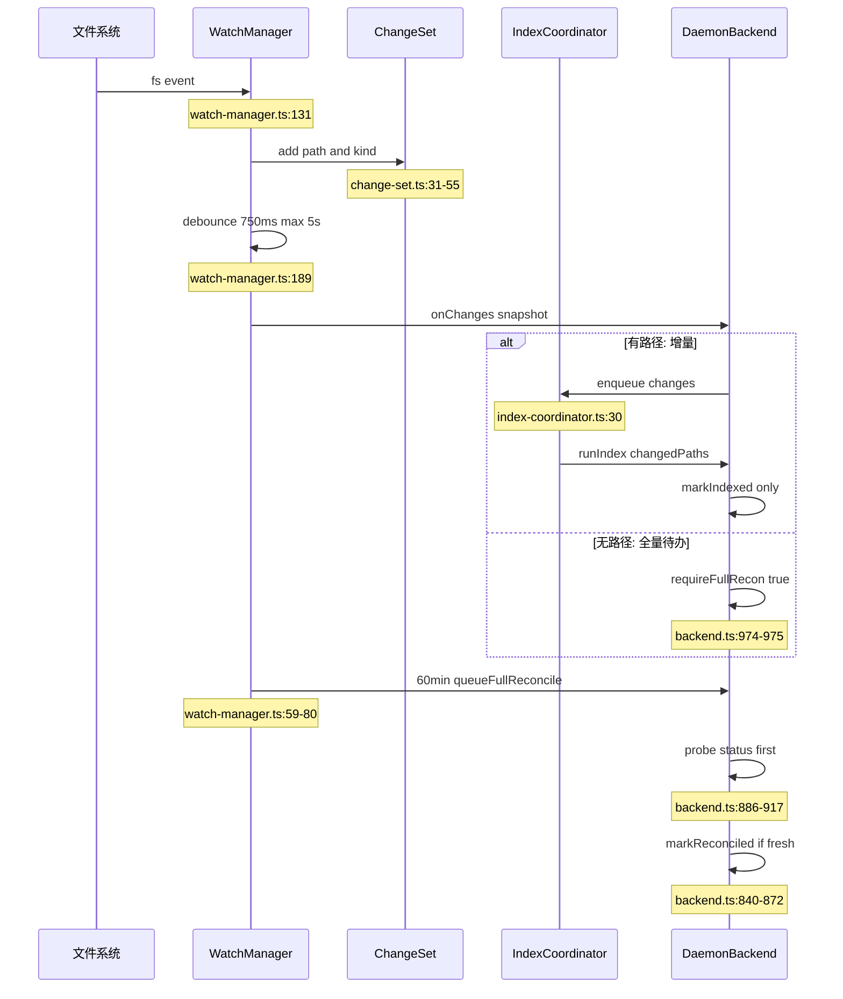
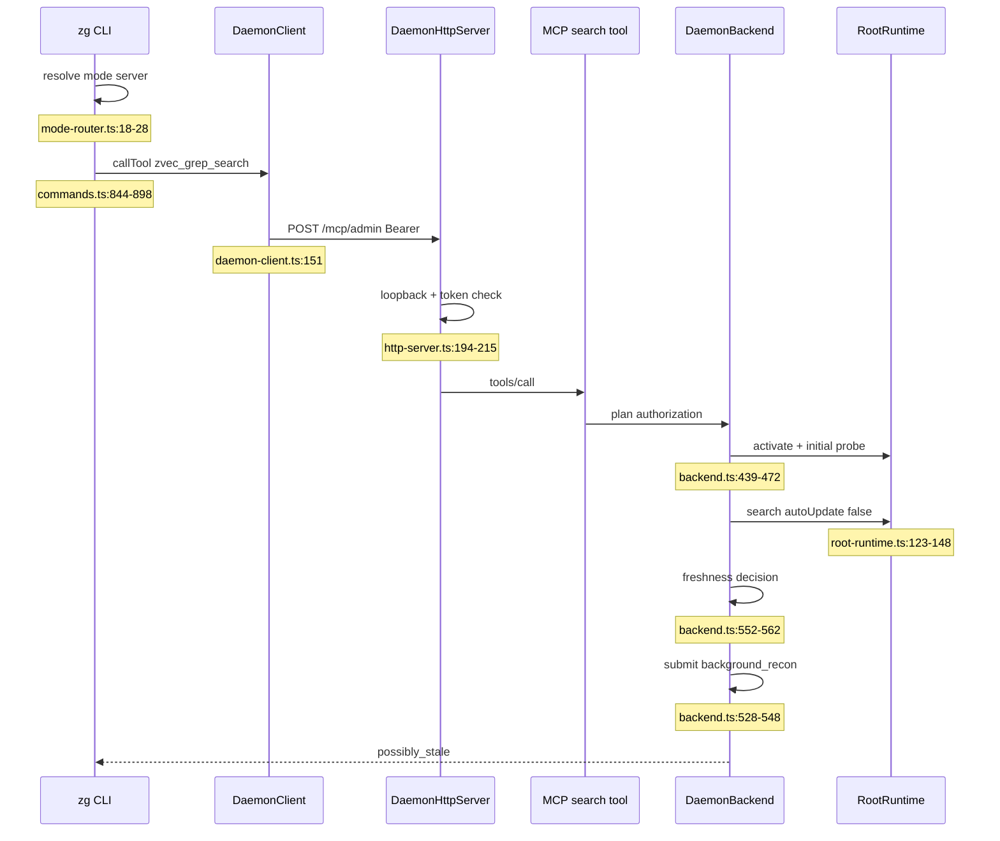

# zg 执行形态与守护进程：Direct / Server 双形态与运行时编排

> 本解读按 `ai-infra` ⊗ `framework` 类规格产出（全新分析）。

## 为什么同一个引擎要有两种跑法

local-first 检索的默认形态本该是「用完即走」，但 Agent 与重复检索需要跨进程复用三样东西：昂贵的 embedding 模型、带记忆的索引状态、以及一个能在没人搜索时继续守夜的后台刷新者。zg 没有为此写两套引擎，而是把同一 engine 套上不同宿主：Direct 是当前进程，Server 是常驻守护进程，差别只在进程生命周期与协调层。于是模式切换不改变搜索语义，只改变「用谁的资源、什么时候刷新、状态归谁」，这也让 `auto` 的降级成为安全操作而不是语义妥协。

## 模式选择算法

### 优先级链与非法值处理

`--mode` 显式值 > `ZVEC_GREP_MODE` > `~/.zvec-grep/config.json` 的 `client.mode` > `"auto"`，四层回落 [src/client/mode-router.ts:4-11]()
<!-- anchor: export function resolveClientMode( … return configured ?? "auto"; -->
环境变量里出现非法值时直接抛错，而不是静默回退到 auto [src/client/mode-router.ts:31-35]()
<!-- anchor: function parseMode(value: string | undefined): ZvecGrepClientMode | undefined { … throw new Error("ZVEC_GREP_MODE must be direct, server, or auto"); -->
取舍很明确：拼错的 `ZVEC_GREP_MODE=servr` 若静默退化为 Direct，脚本会以为自己在用共享 daemon，却悄悄在每个进程里重新加载模型——这是最难排查的一类配置错误，宁可在入口失败。

### auto 只认「已就绪」，不认「还活着」

路由本体只有三个分支：`direct` 本地执行，`server` 直接远端，`auto` 先问服务是否可用 [src/client/mode-router.ts:18-28]()
<!-- anchor: export async function routeByMode<T>(options: { … : options.direct(); -->
可用性判定不是「端口能连上」，而是 `serverStatus().ready` [src/cli/commands.ts:960-961]()
<!-- anchor: async function daemonIsReady(home?: string): Promise<boolean> { … return (await serverStatus(home)).ready; -->
它要求 instance.lock 记录存在、同主机、pid 存活、`/healthz` 返回 200，且 `record.ready` 已置位，因此「进程活着但还没 markReady」不会被采用，避免把尚未装好模型与 watcher 的半成品当服务端。DaemonClient 每次 `callTool` 都新建一条 `StreamableHTTPClientTransport` 并带 Bearer token，共享状态全在 daemon 侧，客户端会话用完即弃 [src/client/daemon-client.ts:151-155]()
<!-- anchor: const transport = new StreamableHTTPClientTransport( … headers: token ? { Authorization: `Bearer ${token}` } : {}, -->
### auto 为什么不主动拉起缺失的 Server

结构性证据：`routeByMode` 只接受一个布尔判定函数，自身没有任何 spawn / start 入口；`startServer` 在整个 CLI 中只出现在 `--server on` 分支。也就是说 auto 在类型上就做不到「顺手起一个 daemon」。取舍有三条：其一是延迟，CLI 每次调用都是短进程，而冷启动 daemon 要 spawn Node、读或创建 token、载入请求状态签名 key、绑端口再轮询到 ready，一次只读搜索没理由为它排队；其二是副作用，daemon 是持久副作用（进程、4 小时 watcher、inotify 句柄、常驻模型内存），不该由一次 search 隐式产生；其三是契约，`auto` 的含义必须是「能省则省，不能就用本地」，否则脚本无法预测它会不会起进程，需要硬契约时应显式 `--mode server`（不可用即失败）。

## Server 单实例语义

### home 级实例锁：一个 home 只允许一个 daemon

锁文件是 `<home>/daemon/instance.lock`，记录 pid、hostname、instanceToken、serverUrl、ready、mcpToolset [src/daemon/server-controller.ts:55-64]()
<!-- anchor: const path = join(daemonHome(home), "instance.lock"); … mcpToolset, -->
发布方式刻意不用 `rename` 而用「临时文件 + hard link」：rename 会静默覆盖竞争者记录，而 link 在目标已存在时返回 EEXIST，于是「先发布者胜」成为原子事实；只有记录属于同主机死进程时才 unlink 重试 [src/daemon/server-controller.ts:75-97]()
<!-- anchor: for (let attempt = 0; attempt < 3; attempt++) { … throw new Error("Could not acquire the zvec-grep server instance lock."); -->
存活判定只靠 pid 加 `/healthz`：`markReady` 在监听成功后把 `ready` 置真、之后不再周期性落盘，代价是「假活」——进程在但服务卡死时 `running` 为真而 `ready` 为假，由 `/healthz` 的 1 秒超时兜住 [src/daemon/server-controller.ts:142-162]()
<!-- anchor: export async function serverStatus( … mcpToolset: record.mcpToolset, -->
### on / off / status / run 各自做什么

`on` 先探活，已 ready 直接返回；否则以 detached + stdio ignore 方式 spawn 一个 `--server run` 子进程并立即 unref，再轮询到 ready（默认 10 秒上限）[src/daemon/server-controller.ts:219-224]()
<!-- anchor: const child = spawn(process.execPath, args, { … child.unref(); -->
`off` 读出记录后先拒绝「停止自己」，再带 token 发 `POST /control/shutdown`，随后等进程退出（默认 30 秒），超时才升级 SIGTERM、2 秒宽限后再 SIGKILL，且每次发信号前都重新比对 instanceToken，避免误杀已换代的 daemon [src/daemon/server-controller.ts:244-262]()
<!-- anchor: const token = await resolveClientToken({ home, tokenFile }); … if (error instanceof ShutdownResponseError) throw error; -->
`status` 输出 `stopped / starting / ready` 三态以及 pid、URL、MCP toolset [src/cli/commands.ts:569-573]()
<!-- anchor: if (parsed.options.serverAction === "status") { … throw new Error("zvec-grep server is not ready"); -->
`run` 走前台 `runDaemonForeground`，先抢实例锁再监听，因此第二个 `run` 在拿锁阶段就失败，而不是先占端口再报错；收到 SIGINT / SIGTERM 后按 backend → httpServer → instanceLock → 日志 flush 的顺序收尾。

`--check-ready` 对脚本友好之处在于它回答两个不同问题：`zg --server status --check-ready` 检查「守护进程是否就绪」，保留全部人类可读输出，只在 ready 为假时返回非 0；而 `zg --status --check-ready` 检查「workspace 索引是否 ready」，CLI 也把该开关限制在这两条命令上。于是它既能被人读又能被脚本判，且 `starting` 与 `stopped` 可区分——比只探端口的健康检查更诚实。
## Workspace runtime 生命周期

### 创建：按 canonical root 惰性、单飞

搜索路径 `activate()` 要求「已有索引 + 有 embedding schema」，否则抛 INDEX_MISSING，而不是顺手替用户建索引 [src/daemon/runtime-manager.ts:90-97]()
<!-- anchor: if (!info.indexed || !info.workspaceIndex?.embedding) { … this.aliases.set(canonicalRequestedRoot, canonicalRoot); -->
读路径绝不写盘、建索引必须显式授权；索引路径 `activateForIndex()` 才允许创建 [src/daemon/runtime-manager.ts:201-262]()
<!-- anchor: private async getOrCreate( … return runtime; -->
`getOrCreate` 用 `creating` map 做单飞、用 `aliases` 归一符号链接，因此同一 workspace 经不同路径访问会共享 runtime 与同一份 root 租约。
### 4 小时 idle：谁在续命

每个 root 一个 idle timer，search / index 的 `beginActivity` 与 watcher 文件事件都会重置它 [src/daemon/runtime-manager.ts:265-282]()
<!-- anchor: private touchRuntime(canonicalRoot: string): void { … this.idleTimers.set(canonicalRoot, timer); -->
默认 4 小时 [src/daemon/config.ts:9-11]()
<!-- anchor: export const DEFAULT_WATCHER_IDLE_TIMEOUT_MS = 4 * 60 * 60_000; … "ZVEC_GREP_WATCHER_IDLE_TIMEOUT_SECONDS"; -->
可用 `ZVEC_GREP_WATCHER_IDLE_TIMEOUT_SECONDS` 覆盖、`0` 表示不回收；到点时先看 `activeReaders / activeOperations / writerPending / watcherPending`，忙就 1 秒后重试，闲才真正回收 [src/daemon/runtime-manager.ts:285-306]()
<!-- anchor: private async evictIfIdle(canonicalRoot: string): Promise<void> { … await this.evict(canonicalRoot); -->
回收动作是清 statusCache / 诊断 / 运行时缓存，并在 evict hook 里关闭该 root 的 watcher [src/daemon/backend.ts:144-148]()
<!-- anchor: onRuntimeEvicted: async (root) => { … await this.closeWatcher(root); -->
再 `runtime.close()`（依次关读会话缓存、释放模型租约、释放 root 租约）。关键细节：hourly reconciliation 只置 pending、不调 `onActivity`，所以它不会延长 deadline——「周期性对账不续命」正落在这一行行为上。

### workspace-read-session-cache 解决什么

打开一个 workspace 读会话要持有模型租约并打开 zvec 索引，每次搜索重开就是重复付这笔钱。缓存持有一个句柄，`withRead` 复用它，`activeReaders` 归零后按 idle TTL（默认 60 秒）关闭，并让同一句柄上的操作串行 [src/daemon/workspace-read-session-cache.ts:24-45]()
<!-- anchor: async withRead<R>(operation: (handle: T) => Promise<R>): Promise<R> { … this.scheduleIdleClose(); -->
串行的理由很硬：单个 zvec 读句柄并非并发安全，串行的代价远小于并发读的未定义行为。runtime 侧再按 model key 分代，请求的模型变了就关旧代开新代，句柄与模型租约成对释放 [src/daemon/root-runtime.ts:123-148]()
<!-- anchor: return this.runGenerationSerial(async () => { … autoUpdate: false, -->
## Direct 形态的代价与不共享的状态

| 状态 | Server 形态 | Direct 形态 |
| --- | --- | --- |
| 模型池 / 读会话缓存 / watcher / job 队列 / 状态与授权缓存 | daemon 进程内共享 | 无，每进程一份 |
| 索引文件（`.zvec-grep/`） | 共享（磁盘） | 共享（磁盘） |
| 索引写权 | 由 per-root daemon 租约独占 | 仅在无 daemon 持租约时可写 |
| 刷新 | 后台刷新 + 可等待 | 只有 `--refresh wait` 同步刷新 |

真正防止两种形态互相踩踏的是引擎层而非 daemon：写操作（index / drop / disable）先 `assertDaemonWriteAllowed` [src/engine/utils/daemon-lease.ts:118-132]()
<!-- anchor: export function assertDaemonWriteAllowed( … throw daemonLeaseActiveError(root, initial?.pid ?? 0); -->
daemon 用自己的 instanceToken 豁免；Direct 没有 token，必须先抢 guard 目录（`mkdir` 原子语义）再看 `daemon.json` 里的 pid / instanceToken，若租约属于活着的 daemon 就抛 `ZVEC_GREP.ENGINE.DAEMON_LEASE_ACTIVE`，并在错误上下文里给出「改用 `--mode auto`」的处置建议。租约平时由 RootLeaseManager 维护：每 root 引用计数 + instanceToken 标识实例，出现「同主机死 pid」或「租约文件 30 秒未更新」才允许抢占 [src/daemon/root-lease.ts:104-137]()
<!-- anchor: const existing = await readLeaseFile(path); … "Another daemon owns index writes for this root.", -->
并每 5 秒原子刷新 `updatedAt` 作为脉搏 [src/daemon/root-lease.ts:158-192]()
<!-- anchor: private startHeartbeat( … }, 5_000); -->
写操作本身另有引擎 home 级写锁（单写多读、6 小时陈旧清理），所以「另一个进程正在重建索引」是锁忙而非数据损坏。

Direct 的代价逐条算：其一模型重复加载，没有池，每个进程自行创建 embedding 模型，冷启动成本每次照付；其二没有 watcher，自然没有后台刷新，`--refresh background` 会被显式降级为 off [src/client/search-policy.ts:26-29]()
<!-- anchor: const wait = options.refresh === "wait"; … autoUpdate: wait, -->
其三 `--refresh wait` 把刷新成本压回当前进程（先同步索引再搜索）。收益同样真实：无需安装/守护 daemon（CI 友好）、失败发生在前台、资源生命周期严格跟随进程。`zg --rg` 这类 managed ripgrep 不需要索引与模型，因此绕过 mode 路由直接本地执行。

## watcher 与索引一致性

### 事件到 change-set：目录级压缩

WatchManager 在非 Linux 平台用一次递归 `watch(root)`；Linux 上退化为逐目录注册，因为 Node 的递归 watch 会遍历整棵树给每个文件注册 inotify、无视索引排除规则，足以吃光 `fs.inotify.max_user_watches` [src/daemon/watch-manager.ts:447-452]()
<!-- anchor: // Linux always uses per-directory watchers. Node's recursive watcher is not … return platform === "linux"; -->
事件进 ChangeSet 时按「能被更大范围覆盖就丢」压缩：已被某个 rescan 目录或删除前缀覆盖的路径直接忽略，`.gitignore` 变更升级为父目录 rescan，删除进 `deletedPrefixes`（整棵子树），目录进 `rescanDirectories`，只有普通文件才进 `touchedFiles` [src/daemon/change-set.ts:31-55]()
<!-- anchor: add(path: string, kind: ChangeKind, isDirectory = false): void { … this.enforcePathBudget(); -->
路径数超过预算（默认 1000）时，策略是「扩大范围而不是升级全量」：把叶子路径提升到父目录继续折叠直到收敛 [src/daemon/change-set.ts:117-149]()
<!-- anchor: private enforcePathBudget(): void { … break; -->
源码注释写明了理由：大批量下精确的 watcher 事件依然可信，扩到父目录只是为了有界内存，不该因为「量大」就当成「可能丢事件」去触发全量扫描。这个区分让「大仓库密集写入」不会退化成一次全库重嵌入。

### flush：debounce 与失败回灌

事件记录后经 750ms debounce、最长 5 秒强制 flush 一次 [src/daemon/watch-manager.ts:189-207]()
<!-- anchor: private scheduleFlush(): void { … this.maxWaitTimer.unref?.(); -->
flush 失败时，整批 change 连同 `forceFullReconcile` 一并合并回 ChangeSet 并重排 flush，这是「带路径且要求全量」的唯一来源——失败的那批事件不再被当作精确可信 [src/daemon/watch-manager.ts:211-229]()
<!-- anchor: private async flush(): Promise<void> { … this.scheduleFlush(); -->
watcher 自身报错、注册失败或拿不到 filename 时立即请求全量对账，并指数退避重建 watcher（100ms 起、上限 5s），稳定 1 秒后清零错误计数 [src/daemon/watch-manager.ts:256-269]()
<!-- anchor: watcher.on("error", () => { … this.queueFullReconcile(); -->

### 增量执行与 fresh 证据链

带 `changedPaths` 的更新跳过前后两次 workspace 状态扫描，只有全量对账才做收尾扫描。收尾时先 `flushPending()` 把 watcher 残余事件并入，再 `inspectRoot(includeStatus)`、`refreshPaths()` 给新增目录补 watcher，最后用 `indexStatusIsFresh` 判定；判为 fresh 才 `markReconciled`，否则不装作成功，而是重新置一个「可探测的全量待办」，避免「修不好 → 下次又全量 → 又修不好」的雪崩 [src/daemon/backend.ts:840-872]()
<!-- anchor: if (includeFinalStatus) { … scanDiagnostics, -->
### 为什么还要 hourly full reconciliation

watcher 是尽力而为：inotify 队列会溢出、递归 watch 有平台差异、挂起/休眠期间事件会丢、注册失败只有一次机会。于是有四条兜底：每 60 分钟定时请求全量对账（同时每 30 秒检查「距上次检查是否已超过 90 秒」，超过说明刚经历过休眠或长阻塞，补一次全量）[src/daemon/watch-manager.ts:59-128]()
<!-- anchor: start(): void { … this.lastResumeCheckAt = now; -->
watcher 报错时立即全量（见上节）；以及 Linux 逐目录注册带来的持久成本约束 [src/daemon/watch-manager.ts:447-452]()
<!-- anchor: // Linux always uses per-directory watchers. Node's recursive watcher is not … return platform === "linux"; -->
但「全量」被设计成先探测再动手：hourly 只置 `requireFullReconciliation(probeAllowed=true)`，真正干活前先跑一次 `inspectRoot(includeStatus)` 的廉价状态扫描，状态全 0 就直接 `markReconciled`，只有确有漂移才索引 [src/daemon/backend.ts:886-917]()
<!-- anchor: const probeBeforeUpdate = … runtime.markIndexed(targetRevision); -->
这就是「每小时全量」没变成「每小时重嵌入」的原因：watcher 负责发现，状态扫描负责证实，昂贵扫描只在证实时发生。纯全量待办（无路径）在 backend 里只置一个待办就返回，不建任务 [src/daemon/backend.ts:974-975]()
<!-- anchor: if (changes.forceFullReconcile && pathCount === 0) { … runtime.requireFullReconciliation(true); -->
带路径的事件才交给 IndexCoordinator：它 merge 进自己的 pending、`markDirty()` 拿目标 revision，并以 `followupIfRunning` 提交任务 [src/daemon/index-coordinator.ts:30-75]()
<!-- anchor: enqueue( … return submitted.job; -->
任务真正开始执行时才取 pending 快照并清空，因此任务运行期间到达的事件自然成为下一批，而不是丢在队列外。

## 刷新策略矩阵与 fresh 判定

| 策略组合 | `freshness` | 是否更新 | 备注 |
| --- | --- | --- | --- |
| server + `background`（默认） | `eventual` | 是（后台提交） | 返回当前索引结果，按需排 background_reconcile |
| server + `wait` | `wait_for_fresh` | 是（等待） | 循环到对账完成且 watcher 无新事件 |
| server + `off` | `eventual` | 否 | 只查不修 |
| direct + `wait` | `wait_for_fresh` | 是（同步） | 索引与搜索在同一进程完成 |
| direct + `background` | `eventual` | 否 | 显式告警并按 off 处理 |
| direct + `off`（默认） | `eventual` | 否 | 纯查询 |

Server 侧默认 `background`，即 `autoUpdate = refresh !== "off"` [src/client/search-policy.ts:16-19]()
<!-- anchor: const refresh = options.refresh ?? "background"; … autoUpdate: refresh !== "off", -->
Direct 侧只有 `wait` 才更新 [src/client/search-policy.ts:26-29]()
<!-- anchor: const wait = options.refresh === "wait"; … autoUpdate: wait, -->
`wait_for_fresh` 会循环到「搜索前后 watcher epoch 不变、且不再需要对账」才返回，否则重试 [src/daemon/backend.ts:1061-1070]()
<!-- anchor: private async waitForFresh( … return updateJob; -->

### `possibly_stale` 的触发条件

freshness 只由三件事决定：运行时是否有已知变更、watcher 是否还有未 flush 的 pending、以及是否存在「非 background_reconcile」的活跃任务 [src/daemon/backend.ts:552-562]()
<!-- anchor: const job = updateJob ?? this.scheduler.getByRoot(runtime.canonicalRoot); … : "fresh"; -->
`hasKnownChanges` 为真意味着 `indexedRevision < dirtyRevision`，或存在一个**不可探测**的全量待办。这里有个容易误读的点：runtime 刚创建时 `reconciledFullEpoch` 初值为 -1、小于 `fullReconciliationEpoch` 初值 0，所以「激活后的第一次搜索默认保守地报告 possibly_stale」，直到一次 fresh 探测把它记为已对账。反过来，hourly 的待办是**可探测**的，因此探测发现不一致之前它并不把结果标脏——「hourly reconciliation 在证实漂移前保持 fresh」正由此成立；`background_reconcile` 被排除在活跃任务之外也是同一逻辑：它是对账流程本身，真正把状态标脏的是它探测出的结果。若漂移成立且 `autoUpdate` 为真，才排一个后台对账；窄路径任务已终态失败时不重排，避免重试风暴 [src/daemon/backend.ts:528-548]()
<!-- anchor: runtime.needsReconciliation() && … options.authorization, -->
`--refresh wait` 走 `waitForFresh` 循环：每次先 settle 已知变更再探测（探测本身用一次廉价状态扫描代替昂贵的全量索引），而「已知路径任务失败/取消」会被升级为抛错，而不是默默返回旧结果——`wait` 的契约是「要么新，要么明确失败」[src/daemon/backend.ts:1085-1091]()
<!-- anchor: !runtime.requiresFullReconciliation() && … "Known index changes did not complete successfully.", -->

## 索引任务调度

### 并发 1、单飞与失败传播

调度器默认 `concurrency = 1`、最多 3 次尝试、重试基数 250ms [src/daemon/job-scheduler.ts:78-82]()
<!-- anchor: constructor(options: JobSchedulerOptions = {}) { … this.logger = options.logger; -->
这与模型池「最多驻留 1 个模型」互相印证：嵌入与索引是 CPU / IO 密集，多路并发只会争抢同一个模型与同一份磁盘，收益为负。每 root 用 `activeByRoot` 单飞：运行中再提交 watch 或 rebuild 会合并进一个 followup，且最多保留一个，后到事件继续 merge 进去 [src/daemon/job-scheduler.ts:93-111]()
<!-- anchor: const active = this.activeByRoot.get(input.canonicalRoot); … return { job: snapshot(active), reused: true }; -->
排队按 reason 优先级：`manual` 4 > `fresh_query` 3 > `watch` 2 > `background_reconcile`/`reconcile` 1，同级 FIFO [src/daemon/job-scheduler.ts:387-398]()
<!-- anchor: function priority(reason: JobReason): number { … return 1; -->
pump 在 running 少于并发上限时取队首执行 [src/daemon/job-scheduler.ts:206-227]()
<!-- anchor: private pump(): void { … void this.runJob(job); -->
`run` 回调 `report(progress)` 写入 `job.progress` 并广播给 progressListeners，监听器抛错被吞掉——进度观察者绝不能改变索引结果 [src/daemon/job-scheduler.ts:233-247]()
<!-- anchor: await job.run((progress) => { … this.finish(job, "succeeded"); -->
CLI 把它转成 MCP progress notification，DaemonClient 用 `resetTimeoutOnProgress` 让长任务不被空闲超时打断，这也是 Agent 侧不必轮询 `index_status` 的原因。`cancelRoot` 与 daemon 关闭都通过 AbortController 取消：排队中的任务立刻终结、重试定时器清掉、followup 递归取消，运行中的任务靠 signal 传到引擎的索引循环 [src/daemon/job-scheduler.ts:168-174]()
<!-- anchor: cancelRoot(canonicalRoot: string): boolean { … return true; -->
失败只在 `DaemonError.retryable` 或引擎锁忙（`ZVEC_GREP.ENGINE.LOCK.BUSY`）时重试，退避 `250ms × 2^(attempt-1)` [src/daemon/job-scheduler.ts:257-273]()
<!-- anchor: isRetryable(error) && … this.pump(); -->
其余直接落到 `failed`，再由 `waitForFresh` 升级为抛错。把「锁忙」归入可重试，使「另一个进程正在重建索引」不会变成终态失败，与引擎 home 级写锁的陈旧清理策略配合。

## 收尾：两形态是同一组取舍的两端

Direct 把状态压进进程：零运维、可预测、每次付模型加载费，失败在前台。Server 把状态抬到 daemon：一次加载多处复用、watcher 守夜、脚本可等就绪，代价是必须维护单实例锁、per-root 租约、idle 回收，以及「标注可能过期」的诚实。zg 用同一个 engine 与同一套 freshness 语义把两端焊在一起：`auto` 默认「能省则省」，`--mode server` 给脚本硬契约，`--refresh wait` 给「必须最新」的场景，`possibly_stale` 则把「我知道可能旧了、旧在哪、后台正在做什么」写进协议——宁可标注不确定，也不假装新鲜，这正是 local-first 检索层对 Agent 友好的关键。
