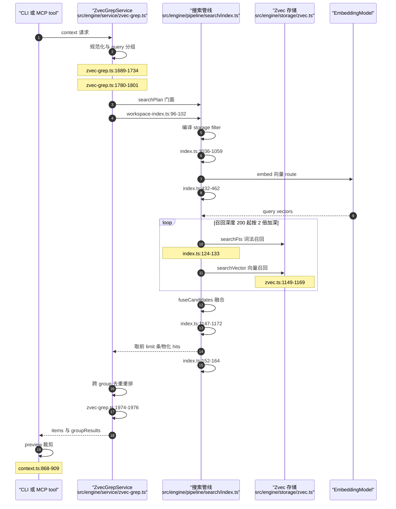

# zvec-grep 混合检索与排序：双路召回与两级 RRF 融合

> 本解读按 `ai-infra` ⊗ `framework` 类规格产出（全新分析）。

## 索引检索要回答的真问题：两路分数不可比，谁说了算

词法路径擅长精确术语、标识符、配置键；向量路径擅长意图、同义改写与跨表述召回。两条路各自给出有序列表后，问题立刻从「召回」变成「融合」：FTS 分数与 HNSW 余弦相似度既不同量纲，也不保证同向单调，加权求和前必须先归一化、再靠语料试出权重。zg 的答案是**整体丢弃分数，只用排名做两级 RRF**——代价是无法利用分差信息：rank 1 与 rank 2 的差距，和 rank 1 与 rank 200 的差距被同等对待。

融合表达式只有一个位置，就是 `fuseCandidates`：遍历候选的每条 recall trace，命中且带 rank 就累加 `1 / (RRF_K + rank)`，`RRF_K` 为 60。 [src/engine/pipeline/search/index.ts:1152-1156]()
<!-- anchor: for (const recall of candidate.recall) { … candidate.score += 1 / (RRF_K + recall.rank); -->

这个取舍贯穿全篇：正因为融合只看 rank，zg 才能把词法打分完全外包给 zvec，而不需要理解它的分数语义。

## 一次索引检索请求的完整阶段链

阶段链的每一步都有明确归属。入口先做路径分派：`options.rg` 为真时直接走 managed ripgrep，完全不加载 Embedding 模型、也不打开索引。 [src/engine/service/zvec-grep.ts:415-417]()
<!-- anchor: if (options.rg) { … return this.contextFromRg(startRoot, request, options, timings); -->

索引侧先把请求规范化成 query group：`query`/`queries` 的每一条生成一个 primary group，`routes` 里的额外路由各自成为一个 supplemental group；每个 primary group 同时展开成 fts 与 vector 两条 route——「混合检索」是默认形态，而不是要求调用方自己拼两条路。 [src/engine/service/zvec-grep.ts:1689-1734]() [src/engine/service/zvec-grep.ts:1780-1798]()
<!-- anchor: function normalizeContextRequest( … groups, -->
<!-- anchor: function contextGroups( … routes: [route], -->

group 与 route 最终被翻译成 `SearchPlan` 交给 engine 门面，门面不做检索语义，只把 storage 与 embeddingModel 注入管线。 [src/engine/service/workspace-index.ts:96-102]()
<!-- anchor: searchPlan(plan: SearchPlan): Promise<SearchPlanResult> { … storage: this.storage, -->

管线内部依次是：校验并解析路由、把路径/类型/时间/符号过滤器编译成 storage filter、批量嵌入向量路由的查询、自适应深度召回。 [src/engine/pipeline/search/index.ts:96-133]()
<!-- anchor: const normalized = timings.timeSync("search_plan", () => … candidates, -->

然后是融合、按 limit 裁剪、把候选物化成带 evidence 的 hits。 [src/engine/pipeline/search/index.ts:152-164]()
<!-- anchor: const fused = timings.timeSync("fusion", () => fuseCandidates(candidates)); … visible.map((candidate) => candidateToHit(candidate, limit, trace)), -->

多 group 时每个 group 各自跑完整条管线，返回后在 service 层做**第二级 RRF**：先摊平所有 group 的 items，再做跨 group 去重与重排。 [src/engine/service/zvec-grep.ts:972-978]()
<!-- anchor: const groupItems = searches.map((search, index) => … groups.filter((group) => group.role === "primary").map((group) => group.id), -->

最后是面向 Agent 的紧凑化：按 preview 级别裁剪源码窗口与 outline。 [src/cli/format/context.ts:868-909]()
<!-- anchor: function sourceLinesForPreview( … sourceLineMarker(item, line), -->

## 词法路径：打分完全外包给 zvec，zg 只消费排名

`searchFts` 内部没有任何打分逻辑，它把查询原样交给 zvec 的 `querySync`，`fts: { matchString: query }` 走原生 FTS 索引，`topk` 就是本轮召回深度。 [src/engine/storage/zvec.ts:293-308]()
<!-- anchor: searchFts( … return docsToHits(docs, "fts", this); -->

FTS 字段在下标时就声明为 `ZVecIndexType.FTS`，分词器固定为 jieba，只叠一层 lowercase。这解释了 zg 为何能同时处理中文注释与驼峰标识符，也划出了边界：分词行为在**建索引时**固化。 [src/engine/storage/zvec.ts:916-924]()
<!-- anchor: name: ENTITY_TEXT_FIELD, … filters: ["lowercase"], -->

分数只是从 zvec 的 doc 上原样搬运，进入 recall trace 供 `--trace` 观察，从不参与融合决策。 [src/engine/storage/zvec.ts:1149-1169]()
<!-- anchor: function docsToHits( … return hits; -->

换句话讲，zg 里没有 BM25 实现，依赖清单里也没有任何词法打分库。 [package.json:70-81]()
<!-- anchor: "@huggingface/tokenizers": "^0.1.3", … "zod": "4.2.0" -->

这是一个「不重复造轮子」的选型：打分下推到原生引擎，zg 省掉索引结构、打分函数与调参面；代价同样明确——分数语义是 zvec 的黑盒，既无法调词法打分参数，也无法向用户解释单个命中的分数构成。而这条路径必须依赖持久化索引，与「无需索引」相对的那一半哲学边界，正好由 managed ripgrep 补上。

## 向量路径：查询向量、topK、度量与归一化

查询向量按 route 批量生成，批次大小受模型自身 `maxBatchSize` 约束，并显式声明 `purpose: "query"`——检索是**非对称**任务，文档与查询必须走不同编码模板。 [src/engine/pipeline/search/index.ts:432-462]()
<!-- anchor: async function embedVectorRoutes( … return vectorsByRoute; -->

非对称的落点是 queryPrefix：默认模型 `local/bge-small-en-v1.5` 为查询拼上 BGE 的指令前缀，文档侧不拼。同一份产物在检索侧与索引侧走不同文本，这件事只能在模型适配层做，不能在服务层拼字符串。 [src/engine/models/backends/transformers-js.ts:510-524]()
<!-- anchor: function formatText( … return prefix ? `${prefix}${text}` : text; -->

归一化同样是模型声明的属性，而非检索侧的临时修补：schema 里 `normalize: true`；transformers.js 后端不做二次加工，直接把它交给 pipeline 的 `normalize` 选项。 [src/engine/models/catalog.ts:161-166]() [src/engine/models/backends/transformers-js.ts:306-311]()
<!-- anchor: dimension: 384, … maxInputTokens: 512, -->
<!-- anchor: const tensor = await pipeline(texts, { … max_length: this.entry.maxInputTokens, -->

对不自带归一化的后端（model2vec 静态词向量），zg 在运行时的词嵌入里手写 L2 归一化，使入库向量与查询向量落在同一单位球面上——否则 cosine 与内积的等价关系不成立。 [src/engine/models/backends/model2vec-runtime.ts:199-210]()
<!-- anchor: let squaredNorm = 0; … return vector; -->

度量与维度来自索引 manifest 记录的 embedding schema，建集合时映射成 zvec 的 metric 枚举。 [src/engine/storage/zvec.ts:963-980]()
<!-- anchor: function metricToZvec(metric: string): ZVecMetricType { … context: `metric=${metric}`, -->

向量索引固定为 HNSW，度量由 schema 决定。 [src/engine/storage/zvec.ts:934-940]() 打开索引时还会把 embedding schema 与当前模型的 provider/model/dimension/metric 逐项比对，任一不符都带 expected/actual 详情拒绝打开，而不是静默降级。 [src/engine/service/workspace-index.ts:130-187]()
<!-- anchor: vectors: { … metricType: metricToZvec(embedding.metric), -->
<!-- anchor: private validateEmbeddingSchema(current: EmbeddingModel): void { … current.info.metric, -->

topK 不是固定值，而是自适应加深：初始 200，若「候选数不足目标（limit×5 且至少 50）且至少一路已饱和」就以 2 倍加深，上限 2000。「饱和」的判定是该路返回的命中数达到了本轮深度，即「可能还有更多」。 [src/engine/pipeline/search/index.ts:76-82]()
<!-- anchor: const DEFAULT_LIMIT = 7; … const RECALL_MIN_TARGET_CANDIDATES = 50; -->

这条循环把「召回不足」当成可观测信号而不是静默降级：候选够多就停在 200，够了就不再浪费；候选稀疏才继续加深，最坏情况以 10 倍成本换回召回。 [src/engine/pipeline/search/index.ts:520-559]()
<!-- anchor: function collectAdaptiveRecall(input: { … depth = Math.min(depth * RECALL_GROWTH_FACTOR, RECALL_MAX_DEPTH); -->

此处需要点明一处现状：`RankingModel` 接口与 `SearchHitTrace.ranking` 字段都已声明，为独立 rerank 阶段预留了位置，但当前检索链路只填充 `fusion` 阶段，没有接入任何 rerank 模型。 [src/engine/models/ranking.ts:13-27]()
<!-- anchor: export interface RankingModel { … dispose(): Promise<void>; -->

## RRF 融合：k 常数、按 rank 而非 score、两级串联

### 第一级：route 内融合

`RRF_K = 60` 是模块级常量，与 `DEFAULT_LIMIT`、召回深度常量放在同一处。

融合时遍历的是 `candidate.recall` 而不是 `sources`，所以同一候选在多条 route（含 `preferSymbol` 追加的那条）上命中会**多次计分**，这正是「多路共识优先」的实现；`sources` 只用来在输出上标记 `matchedBy`。 [src/engine/pipeline/search/index.ts:464-518]()
<!-- anchor: function addRecallHits( … candidates.set(candidate.id, candidate); -->

### 第二级：query group 间融合

service 层对多 group 结果做同构的第二次 RRF，k 常数同样取 60：一个 item 在多个 group 中命中时，其跨组总分是各 group 内 RRF 项之和。 [src/engine/service/zvec-grep.ts:1974-1976]()
<!-- anchor: function contextGlobalRrfScore(item: ZvecGrepContextItem): number { … (score, match) => score + 1 / (CONTEXT_GROUP_RRF_K + match.rank), -->

排序是多级字典序比较：跨组 RRF 总分 → 最佳组内 rank → 最小 group 序号 → 去重键。后三级都是确定性 tie-break，保证同分结果顺序稳定可复现——对会反复检索同一问题的 Agent 而言，这直接决定了输出缓存是否可命中。 [src/engine/service/zvec-grep.ts:1962-1972]()
<!-- anchor: function compareContextGlobalRank( … contextItemDedupeKey(left).localeCompare(contextItemDedupeKey(right)) -->

### 去重与截断

去重在融合之前就已完成，粒度是「实体」而不是「片段」：候选表的 key 是 `fragment.group ?? fragment.id`，同一符号被切成多个 chunk 时共享同一个 group，因此天然只占一个候选位。这也意味着**跨路去重是免费的**，不需要在融合后做额外的集合运算。 [src/engine/pipeline/search/index.ts:670-672]()
<!-- anchor: function publicEntityId(fragment: EntityFragment): string { … return fragment.group ?? fragment.id; -->

第一级融合后按 `limit` 硬裁剪；跨 group 阶段用同样的实体/区间键再删一次重复。 [src/engine/service/zvec-grep.ts:2015-2020]()
<!-- anchor: function contextItemDedupeKey(item: ZvecGrepContextItem): string { … return ["range", item.file.absolutePath, JSON.stringify(item.range)].join( -->

跨组阶段有个容易被忽略的设计：它**没有全局总量上限**，而是「每个 primary group 先保底取 1 条（最多 6 条 coverage），其余按全局 RRF 顺序补足」，再把所有未选中候选原样接在后面。token 预算因此由「每组 limit」控制，而不是由全局截断控制。 [src/engine/service/zvec-grep.ts:1873-1915]() 上游的 `contextGroupLimit` 规定：不显式传 limit 时，group 数 ≤3 用 10，超过 3 则用 30/组数 向上取整。 [src/engine/service/zvec-grep.ts:1659-1673]()
<!-- anchor: for (const groupId of coverageGroupIds) { … rank: index + 1, -->
<!-- anchor: function contextGroupLimit( … return Math.max(1, Math.ceil(DEFAULT_CONTEXT_TOTAL_LIMIT / safeGroupCount)); -->

### 为什么是 RRF 而不是加权分数融合

把两路分数加权求和，必须先解决三件事：不同度量（词法分无上界、cosine 有界）、可能相反的单调方向、跨查询不可比的分数分布。归一化（min-max 或 z-score）要额外的全量统计，权重还要按语料调参，且换 Embedding 模型就得重调。RRF 只用 rank，因此对任何单调打分函数都成立，也天然抗离群分数——代价是丢弃分差，两路分数接近时无法体现「更接近」。 [src/engine/pipeline/search/index.ts:1147-1172]()
<!-- anchor: function fuseCandidates(candidates: Map<string, Candidate>): Candidate[] { … return fused; -->

一个佐证：`score` 被完整保留在 evidence 与 trace 里，却没有出现在任何融合表达式中，这是「可观测但不参与决策」的刻意分工。 [src/engine/types.ts:300-309]()
<!-- anchor: export type SearchRecallTrace = { … reason?: string; -->

## symbolTypes 与 preferSymbol：硬过滤与软投票的分工

`symbolTypes` 是**硬过滤**：它被编译进 storage filter，对本次 plan 的所有 route 生效，语义是「候选域只允许这些符号类型」。 [src/engine/pipeline/search/index.ts:1046-1058]()
<!-- anchor: const symbolTypes = … ...(symbolTypes !== undefined ? { symbolTypes } : {}), -->

在 storage 层，所有过滤条件以 `AND` 串联后下推给 zvec，符号名与符号类型都走倒排索引字段；空值集合被编译成「永不匹配」的哨兵条件，避免「空 IN」退化成不过滤。 [src/engine/storage/zvec.ts:1315-1323]()
<!-- anchor: if (filter.symbolNames) { … return clauses.length > 0 ? clauses.join(" AND ") : undefined; -->

`preferSymbol` 相反，是**软投票**：它为每条 route 追加一条同查询、但额外约束 `symbol_name IN (查询里抽出的标识符)` 的 FTS 路由。命中这条路由的候选会多拿一份 RRF 权重，但不会把其它候选排除在外。 [src/engine/pipeline/search/index.ts:578-597]()
<!-- anchor: const symbolNames = extractSymbolNames(route.query); … symbolNames, -->

抽词规则很轻：正则取出 `[A-Za-z_~][A-Za-z0-9_:~]*` 形式的 token，剔除 `class`/`function`/`type` 这类问句关键词，`A::B` 形式保留限定名。也就是说它假设「用户会把标识符写进自然语言问句」。 [src/engine/pipeline/search/index.ts:707-738]()
<!-- anchor: function extractSymbolNames(query: string): string[] { … return [...names]; -->

两者的差别正是它们值得分开的原因：Agent 在语义问句里顺带给出已确认的符号名时，硬过滤能大幅收窄搜索域、提升精度，但一旦猜错就直接查空；软投票则把「这是个线索」与「这是硬约束」区分开，召回保持安全。工具描述里同样写死了这层语义——`query`/`queries` 是 primary 混合组，`fts`/`vector` 只是补充路线，「是检索路线，不是硬约束」。 [src/mcp/tools.ts:237-237]()
<!-- anchor: "`query` creates one primary hybrid FTS-plus-vector group; `queries` creates one -->

### 结构增强：给「没有元数据的那一路」补语义

上面两者都只作用于索引路径。managed ripgrep 只有行号与文本，没有符号边界、没有 heading、没有 scope，Agent 拿到的是一堆裸片段。`structure-enrichment` 因此独立成层：对命中文件重新做 tree-sitter 抽取，找出**最小包含命中区间**的结构片段，把实体 id、range 与 metadata 挂回结果。 [src/engine/service/structure-enrichment.ts:23-30]()
<!-- anchor: export async function enrichLexicalItemsWithStructure( … const selectedFiles = new Set(matchedFiles.slice(0, fileLimit)); -->

容器选择是「行数最少优先，其次符号特异性（有符号名 > 只有类型 > 只有 heading）」，用确定性比较而非打分排序，保证同一命中永远挂到同一个容器上，结果可复现。 [src/engine/service/structure-enrichment.ts:202-219]()
<!-- anchor: function smallestContainingFragment( … return best; -->

代价被两道上限夹住：最多富化 100 个文件，超限只标 `truncated`；单文件还受类型相关的 maxFileSizeBytes 限制，超大文件直接跳过而不是部分解析。 [src/engine/service/structure-enrichment.ts:15-15]() [src/engine/service/structure-enrichment.ts:171-173]()
<!-- anchor: export const RG_STRUCTURE_ENRICH_FILE_LIMIT = 100; -->
<!-- anchor: if (info.size > resolveMaxFileSizeBytes(detected.kind, maxFileSizeBytes)) { … return null; -->

这一层之所以值得单独存在，是因为它**只标注、不重排**：ripgrep 的穷举语义不能被任何相关性重排破坏，而索引路径本来就自带实体元数据、不需要补。同一份「补元数据」的收益，在两条路径上由两个完全不同的机制支付。 [src/engine/service/zvec-grep.ts:684-696]()
<!-- anchor: const structuralEnrichment = await timings.time( … items.length === 0 ? rgEmptyReason(rgResult.diagnostics) : undefined; -->

## freshness：两个粒度，两种判定

结果里的 freshness 其实是两个不同概念。**条目级** `status: fresh | possibly_stale` 逐条判定：先把索引记录的 indexedTime 与文件当前 mtime 比较，索引更新则 fresh；文件更新时再用内容 hash 复核一次，hash 相同仍算 fresh——这样「touch 过但没改内容」的文件不会被误报为陈旧。 [src/engine/service/zvec-grep.ts:2141-2167]()
<!-- anchor: function fileFreshnessStatus(file: FileInfo): "fresh" | "possibly_stale" { … return "possibly_stale"; -->

**响应级** freshness 由守护进程给出，回答的是「整个索引是否还有已知未落盘的变更」，依据是 watcher 待处理标记与后台索引任务状态；判定为 possibly_stale 时才附带 background_refresh 快照，让 Agent 自己决定先用手上的结果还是等待。 [src/daemon/backend.ts:557-562]()
<!-- anchor: const freshness = … : "fresh"; -->

暴露策略同样做了 token 取舍：条目级状态只在 `possibly_stale` 时才打印一行，fresh 是默认值、不占 token。 [src/cli/format/context.ts:699-701]()
<!-- anchor: if (item.status === "possibly_stale") { … lines.push("status: possibly_stale"); -->

之所以敢逐条做 `statSync`（必要时再加一次 sha256），是因为条目数量已被 limit 压得很小；反过来若对全库做同样检查，就退回到「每次搜索都全量扫描」，那正是索引要消除的成本。两种 granularity 的分工也对应两种误判：条目级回答「我读到的这段内容是否还等于磁盘上的文件」，响应级回答「索引本身是否正在追平工作区」。

## 结果紧凑化：token 花在「可判断」而不是「完整」

Agent 侧默认只输出**文本**，并且默认丢弃 structuredContent——注释里给出的理由很直接：逐条 outline 加完整源码会主导 Agent 的上下文；改用 `short` preview 保留有界片段，足以判断相关性而不必再开文件。 [src/mcp/tools.ts:488-497]()
<!-- anchor: // Mirror the compact rg output: return agent-formatted text only and drop … preview: "short", -->

`short` 的具体形状是几条常量：源码窗口最多 10 行、命中前保留 2 行上下文、outline 最多 7 行，单行再截到 160 字符。窗口以命中行为锚点居中，首尾被裁掉时用 `...` 标记，保证 Agent 知道这里被截断了。 [src/cli/format/context.ts:33-41]()
<!-- anchor: marker: ":" | "-" | undefined; … const HUMAN_PREVIEW_MAX_LINE_LENGTH = 120; -->

内容角色区分进一步省 token：当实体正文只是「骨架」（例如类声明）而命中落在更具体的片段上时，正文降级为 `outline`、命中片段升级为 `content`，两者都带 range，Agent 不必猜哪段是源码、哪段是概览。 [src/engine/service/zvec-grep.ts:2032-2051]()
<!-- anchor: function contextItemTarget(hit: SearchHit): ContextItemTarget { … outline, -->

还有一个隐性成本项：`score` 默认不打印，只有 `--trace` 才出现——RRF 分数量纲对 Agent 没有解释力，暴露它只会诱发误用。 [src/cli/format/context.ts:206-221]()
<!-- anchor: function agentRankedItemHeader( … return `#${item.rank}${selection} matchedBy=${item.matchedBy}${score} ${item.fil -->

按文件分组只在**没有相关性顺序**的场景启用：managed ripgrep 路径（同文件多命中合并展示）与人类终端视图；索引路径的 Agent 输出保持 rank 平铺，因为 rank 本身就是 RRF 语义，按文件重排会让「最相关在前」失效。 [src/cli/format/context.ts:654-680]()
<!-- anchor: function groupContextItems( … left.file.relativePath.localeCompare(right.file.relativePath), -->

多 group 时还会额外插一行说明选择策略，让 Agent 明白某条结果是因为覆盖某个 primary group 才被保底选中，而不是误以为它是全局最相关。 [src/cli/format/context.ts:154-162]()
<!-- anchor: if (queryGroups.length > 1) { … "selection: primary-group coverage then global_fill; prioritized<=6; all candida -->

## 与 managed ripgrep 的边界：穷举与排序抽样不能互相吞并

两条路径的分工写在工具描述里：索引检索用于「措辞或位置未知，或答案需要架构、生命周期、调用关系、依赖、数据/控制流、设计理由、跨文件综合」；精确查找（已知定义、字面量、文件名、配置键、错误信息、正则、穷举出现列表）才先用 rg。 [src/mcp/tools.ts:230-243]()
<!-- anchor: function searchRoutingRules(exactTool: string, focusedTools: string): string[] { … "Do not launch a sub-agent solely to locate workspace material.", -->

`zvec_grep_rg` 的描述则强调 exhaustive 与 AST-enriched，并声明「除非显式 `| head -N`，结果是穷举的」。穷举是**语义承诺**而非性能选项——所以这条路完全不加载 Embedding、不读索引。 [src/mcp/tools.ts:562-564]()
<!-- anchor: title: "Search with managed ripgrep", … "Run exhaustive, AST-enriched ripgrep across code or non-code workspace material -->

CLI 层进一步把互斥关系编码成参数校验：`--rg` 不能与 `--preview`、`--trace`、`--prefer-symbol`/`--symbol-type` 同用，把「索引专属概念」挡在穷举路径之外。 [src/cli/args.ts:863-873]()
<!-- anchor-base64:aWYgKG9wdGlvbnMucmcgJiYgb3B0aW9ucy5wcmV2aWV3KSB7IOKApiB0aHJvdyBuZXcgRXJyb3IoIi0tcmcgY2Fubm90IGJlIGNvbWJpbmVkIHdpdGggaW5kZXhlZCBzeW1ib2wgb3B0aW9ucyIpOw== -->

反过来，索引路径不可能穷举：它按 RRF 取前 limit 条并把 coverage 标记为 `ranked_sample`，rg 路径则是 `rg_exhaustive`，被显式 head 限流时降级为 `rg_truncated`。 [src/engine/service/types.ts:128-129]()
<!-- anchor: export type ZvecGrepContextCoverage = … "ranked_sample" | "rg_exhaustive" | "rg_truncated"; -->

不让一条路径包办的理由是两者的失败模式相反：索引路径会「漏」（采样、分词、向量漂移），rg 路径会「多」（正则误配、结果海量而没有优先级）。一个负责「找出最值得读的几段」，一个负责「证明某物在哪、有多少处」；把它们塞进同一个排序器，只会让穷举结果被无意义的 RRF 分数污染，或让语义召回被迫退化成子串匹配。这也解释了 zg 为什么把 coverage、matchedBy、status 这些**不确定性标记**一路带到输出层：Agent 必须知道手上的答案是排序抽样的最佳几条，还是穷举全集，才能决定是否继续检索。

## 与整体设计哲学的连接

回到开篇那条主线：zg 用 RRF 换取「两路分数可比性」这一难题的消失，换来的是对自身打分实现的**无知**——它可以不知道 zvec 的 FTS 分数是 BM25 还是别的什么，也可以整块替换 Embedding 模型而不动融合逻辑，这正是「一套引擎，两种执行形态」成立的前提：Direct 与 Server 共享同一份融合语义，差别只在进程生命周期。为 Agent 优化输出则决定了上面每一层的「减法」取向——丢弃 structuredContent、隐藏 score、限长 preview、只在 stale 时打印状态，都是把 token 预算从「完整」挪到「可判断」；而两条互补路径的边界，则让「穷举」与「排序抽样」各自保留自己的语义承诺，不被对方的排序器吞掉。全程 local-first：向量与 FTS 打分、RRF 融合、freshness 的文件比对都发生在本机，唯一的出网点仍是对远端 Embedding 的显式授权。
