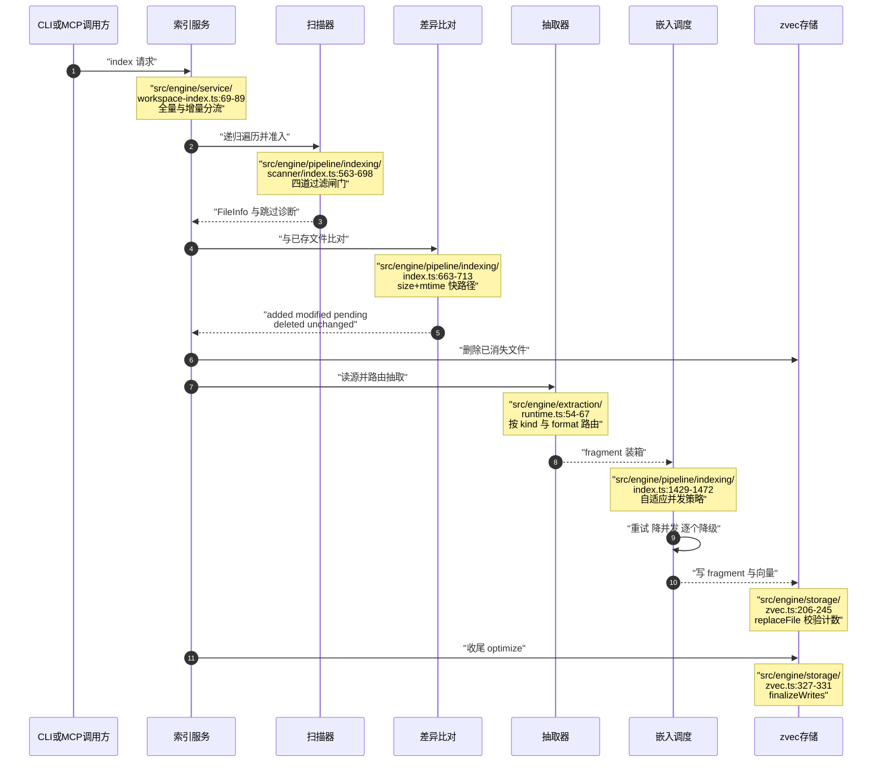

# zvec-grep 索引管线：scan → extract → embed → store

> 本解读按 `ai-infra` ⊗ `framework` 类规格产出（全新分析）。

## 这条管线要解决的根因

README 把 **Multi-format search** 列为五个卖点之一：同一套接口要同时吃下源码、文档与结构化数据，还要保留可点击的结构与行号 [README.md:59-61]()。
<!-- anchor: - **Multi-format search** — search source code, documents, and structured data … - **Less searching, less context** — ranked, source-linked results surface the -->
检索侧（RRF 融合、FTS、向量）能走多远完全由索引侧决定：只有等长滑窗文本的索引，只能回答「某文件某段文字」，给不出 `symbolType`、`signature`、标题路径与精确行区间。所以这条管线的设计目标不是「把文件变成向量」，而是**在固定向量预算下尽可能多地把结构信息编码进可检索单元**——每一步都在做同一个取舍：牺牲多少通用性，换回多少可定位的结构。

## 阶段链：从工作区到 `.zvec-grep/`

`WorkspaceIndex.index()` 是唯一入口，把「全量协调」与「按变更路径」两个分支收敛到同一组下游函数，差别只在发现范围，不在抽取或嵌入语义 [src/engine/service/workspace-index.ts:69-89]()。
<!-- anchor:   index(options: IndexOptions = {}): Promise<IndexResult> { …       : indexWorkspace(context); -->



`indexWorkspaceUnchecked` 是全量编排者：跑一遍 pass，有失败则整批再跑一遍 retry pass，随后 optimize，最后决定返回还是抛错 [src/engine/pipeline/indexing/index.ts:234-283]()。
<!-- anchor: async function indexWorkspaceUnchecked( …   return result; -->

`indexFiles` 是发动机：按 fragment 总数装箱、批满即 flush、文件分片数超 `maxBatchSize` 时绕过批次单独提交 [src/engine/pipeline/indexing/index.ts:828-882]()。
<!-- anchor:     for (const file of files) { …         await flushBatch(); -->
落盘只在 `commitFile` 发生一次，带硬校验：`fragments.length` 必须等于向量数，否则按位置配错会把 B 文件的向量挂到 A 文件的 fragment 上，检索将静默返回错误答案 [src/engine/storage/zvec.ts:206-245]()。
<!-- anchor:   replaceFile( …     this.persistFile(indexedFile); -->

## 发现与准入：四道闸门与它们的顺序

扫描不是「遍历 + 交给抽取器」，而是一串独立过滤器，顺序本身即设计。第一道是硬编码的 `.git` 与 `.zvec-grep`：**唯一无法被任何 include/glob 覆盖**的排除项——前者是 VCS 元数据，后者是索引自己 [src/engine/pipeline/indexing/scanner/index.ts:120-120]()。
<!-- anchor: const HARD_SKIP_HIDDEN_NAMES = new Set([".git", ".zvec-grep"]); -->
`pathCanBeScanned` 固定后续链路：隐藏名 → ignore 规则（含 `!` 反选）→ root `exclude`/`include` → 文件隐藏策略 [src/engine/pipeline/indexing/scanner/index.ts:460-489]()。
<!-- anchor: function pathCanBeScanned( …     matchesRootPatterns(relativePath, rootPath) -->
`walk` 又把它拆开重排：先判目录能否下潜（`maxDepth`、ignore、嵌套 git 仓库、`realpath` 去环），再对文件依次做「硬跳过 → ignore → 隐藏 → root 模式 → 文件选择」 [src/engine/pipeline/indexing/scanner/index.ts:563-698]()。
<!-- anchor: async function walk( …       files.push(file); -->

**glob 与 `-t/--type` 是 AND 而非覆盖**：必须同时满足「glob 命中」「type include 命中」「type exclude 未命中」 [src/engine/utils/file-selection.ts:64-77]()。
<!-- anchor: export function matchesFileSelection( …   return includedByGlob && includedByType && !excludedByType; -->

### 准入判决与类型感知大小上限

`readFileInfo` 是终审，顺序为：空文件 → 未知扩展名 → 大小超限 → 二进制嗅探 [src/engine/pipeline/indexing/scanner/index.ts:1074-1163]()。
<!-- anchor: async function readFileInfo( …     format: detected.format, -->
上限按 `kind` 分档而非一刀切：code 1 MiB、data 16 MiB、text 256 MiB、image 10 MiB，`--max-filesize` 可整 root 覆盖 [src/engine/file-size-policy.ts:3-24]()。
<!-- anchor: export const DEFAULT_MAX_CODE_FILE_SIZE_BYTES = 1 * 1024 * 1024; …       return DEFAULT_MAX_IMAGE_FILE_SIZE_BYTES; -->
为什么 text 敢给 256 MiB 而 code 只给 1 MiB：文本被切成上千片段后代价随字节线性增长但可控；源码一旦到 MB 级几乎必然是生成物，tree-sitter 解析 1 MiB 以上源码的收益远低于其 CPU 与内存成本。未知扩展名走 `unsupported`——`detectFileType` 对未知扩展名的默认结论是 `kind: "text"`，只有命中压缩包/可执行/文档/媒体/数据库那几组二进制扩展名才返回 `null` [src/engine/file-type.ts:162-193]()。
<!-- anchor: export function detectFileType( …   return { kind: "text", format: extension ? extension.slice(1) : "text" }; -->
二进制探测只在 `kind !== "image"` 时执行（图片本身就是二进制，且走多模态嵌入）：读前 8192 字节，遇 `\0` 立即判定，否则以控制字符占比 > 30% 判定 [src/engine/pipeline/indexing/scanner/index.ts:1193-1220]()。
<!-- anchor: async function isLikelyBinaryFile(path: string): Promise<boolean> { …     await handle?.close().catch(() => undefined); -->
这里藏着一个关键优化：若文件已在已知表中且 `contentHash`、`sizeBytes`、`lastModifiedTime` 三者都未变，直接返回轻量 `FileInfo`，**跳过 8 KiB 二进制嗅探** [src/engine/pipeline/indexing/scanner/index.ts:1126-1152]()。
<!-- anchor:   const lastModifiedTime = Math.trunc(info.mtimeMs); …     return null; -->
对增量索引而言，这把「未变更大文件」的成本从每次读 8 KiB 降到一次 stat，是增量真正省时间的关键之一。

### 为什么跳过不等于失败

被跳过者计入 `FileScanDiagnostics`，按 `empty`/`too_large`/`unsupported`/`binary` 四类计数，最多留 20 个样本 [src/engine/pipeline/indexing/scanner/index.ts:1167-1189]()。
<!-- anchor: const MAX_SKIPPED_FILE_SAMPLES = 20; …     diagnostics.skippedSamples.push(skipped); -->
关键在 `readFileInfo` 返回 `null`——它们从不进入 `scan.files`，也就不进入 diff 的 added/modified/pending，更不进入失败统计。**「准入被排除」与「抽取/嵌入失败」性质不同**：前者是策略决定的预期行为（用户选择不索引它），后者是管线在承诺索引后没做到。混在一起会让 `filesFailed` 失去可操作性——用户无法区分「模型配置坏了」与「仓库里有个 300 MiB 日志」。跳过只影响 `filesScanned` 的口径（只计准入通过者）与诊断计数。一个不易察觉的推论：曾入库、后来膨胀超限的文件会因为不再出现于扫描结果而被判 `deleted`，旧文档随之删除，否则检索会继续返回已不存在的内容。

## 抽取路由：按「结构信息密度」而非扩展名

`routeSource` 四选一，顺序刻意把最具体的条件放前：图片源 → `kind === "code"` → `format === "markdown"` → 其余纯文本 [src/engine/extraction/runtime.ts:54-67]()。
<!-- anchor: function routeSource(source: Source): ExtractorRoute { …   return "text"; -->
路由基于扫描期已定的 `kind`/`format` 静态映射，而非抽取期嗅探内容：好处是纯函数、无 I/O、可预测；代价是错判无法在抽取期纠正，因此二进制探测成了兜底。

这个双文本设计贯穿所有抽取器，是理解整套分片策略的钥匙。

### CodeExtractor：从语法树到可定位符号

入口门是 `hasGrammar(format) && resolveAdapter(format)`：有适配器但无 wasm 语法、或有语法但无适配器，都直接回退纯文本 [src/engine/extraction/code/extractor.ts:37-109]()。
<!-- anchor:   async extractForIndexing( …     return extracted; -->
语法可用性由显式 `format → wasm` 表决定，只覆盖 c/cpp/go/java/javascript/jsx/python/rust/tsx/typescript 十种 [src/engine/extraction/code/tree-sitter/grammar.ts:7-17]()。
<!-- anchor: const LANGUAGE_WASM_MAP: Record<string, string> = { …   typescript: "typescript", -->
`withParser` 每次新建 parser、用完立即 `delete()` tree 与 parser，`parse` 或语法加载失败一律返回 `null` 而不抛错 [src/engine/extraction/code/tree-sitter/parser.ts:4-37]()。
<!-- anchor: export async function withParser<T>( …     parser.delete(); -->
这是「语法崩溃不拖垮整批」的具体落法：wasm 边界一旦抛错就会让整个文件计入 `filesFailed`，返回 `null` 只让该文件降级为纯文本，语义检索仍可用，只少了符号元数据。

`walkCodeNode` 是结构抽取核心：靠适配器的 `entityTypes`/`scopeTypes` 区分「产生一个可检索符号」与「只加深 breadcrumb」，并按 `shouldEnterScope`/`shouldIndexEntity` 做语言特例抑制 [src/engine/extraction/code/extractor.ts:224-276]()。
<!-- anchor: function walkCodeNode( …       walkCodeNode(child, adapter, breadcrumb, out); -->
节点一旦被认定为实体便不再下潜（仅 `!isEntity` 才继续递归），避免类内方法既作成员又作独立实体重复出现——重复即重复向量，会直接污染 top-k。`LanguageAdapter` 就是这套契约的完整形状：两个集合 + 七个可选钩子 [src/engine/extraction/code/adapter.ts:13-50]()。
<!-- anchor: export type LanguageAdapter = { …   return format in ADAPTERS ? ADAPTERS[format as StructuredCodeFormat] : null; -->
大实体走三层降级。第一层：节点文本不超预算即整块成片。第二层：超预算时先产出 `group: ""` 的 **outline 主片**（头部 + members 列表，或头部 + calls 列表），再加入按语句分组切出的正文窗口 [src/engine/extraction/code/extractor.ts:281-320]()。
<!-- anchor: function codeEntityToSearchFragments( …     ].map((window) => codeEntityWindowToFragment(source, entity, window)), -->
第三层 `splitLargeNode`：优先按语法子节点（函数体语句序列）成组切分，单条语句本身超预算才退回按行、再退回按字符 [src/engine/extraction/code/extractor.ts:354-448]()。
<!-- anchor: function* splitLargeNode( …       statements.length - 1, -->
必须优先按语句：按行切会把函数体切在任意一行中间，任何语义单元都横跨两片；按语句切至少保证边界落在语法单元之间。outline 主片则为「整体意图」服务——2000 行类的成员列表比它任意 3600 字符片段更能回答「这个类大概做什么」。代码分片默认 3600 字符、重叠 540（15%），重叠必须非负且严格小于块大小。

Vue/Svelte 不在 tree-sitter 表里，处理方式是正则抠出 `<script>` 块、按 `lang` 重路由到 js/ts/tsx/jsx 适配器，再把行号与偏移量**映射回原文件坐标** [src/engine/extraction/code/extractor.ts:995-1053]()。
<!-- anchor: function isScriptBlockFormat(format: string): boolean { …   return line; -->
这暴露了一条硬约束：分片里的行号必须**面向原文件**，因为检索结果最终要变成 `file:line` 交给用户点开；任何局部坐标系都必须在离开抽取器前翻译回全局坐标。

### families 与 languages 各自解决什么

十种格式的语法节点命名差异极大：C 家族的函数藏在 `declaration`/`function_declarator` 的声明符嵌套里，JS/TS 的函数可以藏在 `variable_declarator` 的箭头函数或导出对象的 `pair` 里。两层抽象正是为两类差异分设。

js-ts family 的 `hasFunctionValue` 解决「值声明何时其实是函数」：它会穿透 `call_expression` 与 `arguments`，因此 `const handler = memoize(() => {...})` 也能被认成函数而非普通变量 [src/engine/extraction/code/families/js-ts.ts:116-135]()。
<!-- anchor: function hasFunctionValue(node: TSNode): boolean { …   return node.namedChildren.some((child) => containsFunctionValue(child)); -->
languages 只承载该语言独有的语法节点名。`TYPESCRIPT_ADAPTER` 的全部内容就是两组节点类型集合加钩子绑定：`entityTypes` 列 14 种产生符号的节点、`scopeTypes` 列 6 种加深 breadcrumb 的节点，实现全部复用 family [src/engine/extraction/code/languages/typescript.ts:13-46]()。
<!-- anchor: export const TYPESCRIPT_ADAPTER: LanguageAdapter = { …   extractModifiers: extractJavascriptTypescriptModifiers, -->
收益是新增语言通常只需 30~90 行的 `languages/*.ts`（Python 只额外处理装饰器的进入作用域与 `async`/`@staticmethod` 修饰符），算法层完全不动；代价是 family 里会累积语言间的微妙分支——比如装饰器作用于类还是函数的知识只能写在语言层，无法下沉。当适配器未给 `classifyNode` 时，`classifyCodeNode` 用节点类型名子串兜底（含 `class`/`struct`/`impl` → `class`，含 `interface`/`trait` → `interface`），这是明知的启发式：让未显式适配的变体仍得到粗略分类，代价是可能误分类。

### Markdown：用标题栈代替滑窗

Markdown 的策略是「先分节、节内不过大就整节成片、过大才滑窗」。`scanHeadings` 支持 ATX 与 setext 两种语法，并**跟踪三反引号与 `~~~` 围栏状态**，因此代码块里的 `# 注释` 不会被误判成标题 [src/engine/extraction/markdown/extractor.ts:198-244]()。
<!-- anchor: function scanHeadings(lines: readonly string[]): Heading[] { …   return headings; -->
`buildSections` 用标题栈算 breadcrumb：遇级别不高于栈顶者先弹栈，栈中剩余标题文本序列即该节祖先路径 [src/engine/extraction/markdown/extractor.ts:247-286]()。
<!-- anchor: function buildSections( …   return sections; -->
于是 `metadata.scope` 天然是 `安装::配置::代理`，命中片段时可直接告知用户它在文档何处，无需模型自行推断；首标题之前的引导段也会单独成节，避免前言丢失。一节若被切成多窗口，先产出 `group` 主片（内容是标题路径 outline），再产出各窗口并统一挂到该 group 下 [src/engine/extraction/markdown/extractor.ts:72-106]()。
<!-- anchor:       if (windows.length > 1) { …         continue; -->
这与代码 outline 是同一模式：**摘要片 + 内容片共享 group，命中任一内容片都能升级到摘要片**。切分点不是硬截断而是打分选点（标题行 100 分、连续空行 70、列表项 35、引用 25，且 ≥70% 位置才允许断开），在语义边界断开让单片尽量自洽，代价是片段长度不均、可能短于预算。

### 无结构时的回退

三条回退路径都指向 `extractPlainTextFragments`：按行聚合到 `maxChunkChars`，长行用标点/空白打分选切点，超长时按行重叠滚动 [src/engine/extraction/text/extractor.ts:88-181]()。
<!-- anchor: function chunkText( …   return chunks; -->
Markdown 无标题、代码无语法/无适配器/解析失败/产出为空，都回退纯文本 [src/engine/extraction/code/extractor.ts:112-120]()。
<!-- anchor:   private fallback( …     ).map((fragment) => ({ fragment })); -->
回退是**覆盖率优先于精度的降级**：tree-sitter 无法解析的新语言文件仍应以粗粒度文本进入索引并可被语义检索，只失去符号元数据。这与「解析失败即 filesFailed」相反——后者会让一门新语言在 zg 里完全不可检索。

## 分片表示：fragment、group 与 metadata

原子输出是 `EntityFragment`：id + 可选 group + fileId + range + content + 可选 metadata [src/engine/types.ts:184-190]()。
<!-- anchor: export type EntityFragment = { …   metadata?: EntityMetadata; -->

```ts
export type EntityFragment = {
  id: string;
  group?: string;
  fileId: string;
  range: Range;
  content: Content;
  metadata?: EntityMetadata;
};
```

`id` 由 `sha256(fileId + "\0" + index)` 生成，index 是文件内片段序号 [src/engine/extraction/ids.ts:3-4]()。
<!-- anchor: export function makeEntityId(fileId: string, index: number): string { …   return sha256Text(`${fileId}\0${index}`); -->
种子取「文件 ID + 序号」而非「内容 + 序号」是有意的：内容一改 ID 全变会让向量库无法按 ID 覆盖而只能先删后写；按位置编号后，只要结构稳定，改一个函数体只影响它自己那片向量，其余 ID 不变。

**`group` 是摘要片/派生片的归属指针**：主片 `id === group`，内容片只有 `group`。存储层用 `publicEntityId = group ?? id` 把一组分片对外折叠成**一个**实体，`publicEntityIds` 只收集主片 [src/engine/storage/zvec.ts:742-755]()。
<!-- anchor: function publicEntityId(fragment: EntityFragment): string { …   return [...ids]; -->
写入前 `validateFragmentGroups` 强制两条不变量：fragment id 文件内唯一，每个 group 恰有一个主片 [src/engine/storage/zvec.ts:758-799]()。
<!-- anchor: function validateFragmentGroups( …           context: `fileId=${fileId} group=${groupId} majorCount=${majorCount}`, -->
把「一个超大函数」建模成「1 主片 + N 内容片」换来两个能力：嵌入仍按预算切小片（向量质量不退化），而命中任一片都能经 group 回到完整符号（用户可展开而非只看 3600 字符）。`entityCount` 数的正是主片而非片段总数。

行号范围两侧各有来源：代码侧 `nodeToWindow` 取 tree-sitter 节点的 row 与 byte index 并 `+1` 转 1-based 行号 [src/engine/extraction/code/extractor.ts:341-349]()。
<!-- anchor: function nodeToWindow(node: TSNode): CodeWindow { …       endOffset: node.endIndex, -->

落盘时 metadata 被拍平成可过滤标量：代码落 `symbol_type`/`symbol_name`/`symbol_scope`/`symbol_signature`/`symbol_doc`/`symbol_modifiers`/`node_type`，Markdown 落 `heading`/`heading_level` 并复用 `symbol_scope` 存标题路径 [src/engine/storage/zvec.ts:1017-1045]()。
<!-- anchor: function metadataToFields( …       heading_level: metadata.level, -->
对定位的价值可以直接量化：命中的是一条向量，返回给用户的却是 `relativePath + startLine-endLine + symbolType symbolName + scope`。结构信息不是检索时解析文件补上的，而是索引期就作为可过滤字段存进同一个向量文档。Local-first 的代价也在此：`symbol_doc`（前导注释正文）被一并索引，等于源码内容多存一份，换来「按注释语义检索函数」的能力。

## 嵌入预算：为什么必须先算账

`EmbeddingModelInfo.limits` 暴露 `maxBatchSize` 与可选 `maxInputTokens`，`inputKinds` 声明支持的内容类型 [src/engine/models/embeddings.ts:47-59]()。
<!-- anchor: export type EmbeddingModelInfo = Readonly<{ …     maxImageBytes?: number; -->
`inputKinds` 在 `prepareFile` 里是最后一道过滤：只有模型支持的内容类型才进入待嵌入集合，因此纯文本模型遇图片是「丢弃该 fragment」而非「把二进制塞给 API」 [src/engine/pipeline/indexing/index.ts:899-932]()。
<!-- anchor: async function prepareFile( …       failedReason: markFileFailed(ctx, file, error, "prepare"), -->
预算换算的核心是**用字符数估算 token**，因为抽取器只能按字符切而限制在 token。默认 185 字符 ≈ 100 token（英文散文），token 密集文本改用 100 字符 ≈ 100 token [src/engine/pipeline/indexing/input-budget.ts:3-8]()。
<!-- anchor: const DEFAULT_CHARS_PER_100_TOKENS = 185; … const CHUNK_OVERLAP_PERCENT = 15; -->
于是 `maxChunkChars = maxInputTokens × 每百 token 字符数 ÷ 100`，重叠固定取块大小 15% [src/engine/pipeline/indexing/input-budget.ts:10-25]()。
<!-- anchor: export function indexChunkOptions( …   return { maxChunkChars, chunkOverlapChars }; -->
判定很朴素：非 ASCII 字母、数字、除空格与制表符外的字符都算「密集」，密集占比超 30% 即切保守系数；长文本用 16 KiB 窗口、8 KiB 步长滑动采样，**任一窗口命中即整体按密集处理** [src/engine/pipeline/indexing/input-budget.ts:28-56]()。
<!-- anchor: function isTokenDenseText( …     isTokenDenseWindow(text, lastWindowStart, TOKEN_DENSE_WINDOW_CHARS) -->
为什么是「任一命中即保守」而非按主体比例投票：漏判的代价是请求被服务端截断（向量只覆盖前 512 token），误判的代价只是多切几片、多花一点嵌入成本——两个方向代价不对称。

元数据也吃预算且被显式限额 25%：`chunkOptionsForMetadata` 先从块预算扣掉 metadata 文本长度（含 1 字符分隔符）再交给切分器，保证「metadata 前缀 + 正文」整体不超预算 [src/engine/extraction/vector-content.ts:29-47]()。
<!-- anchor: export function chunkOptionsForMetadata( …   return { maxChunkChars, chunkOverlapChars }; -->
`vectorContentForFragment` 最终把 metadata 拼在正文之前作为嵌入输入。让 `symbol: function parseConfig` / `signature: (path: string) => Config` / `scope: Loader::parse` 这类文本进模型，是因为它们本身就是极强的语义信号，让向量空间里的「函数名 + 签名」更接近自然语言查询；代价是挤占 25% 正文预算，大函数正文被切得更碎 [src/engine/extraction/vector-content.ts:6-25]()。
<!-- anchor: export function vectorContentForFragment( …     text: `${metadata}\n${embeddingContent.text}`, -->

### 批处理、重试与降级阶梯

按 **fragment 数**而非文件数装箱是正确性要求：一个文件可有上千小片段，按文件数装箱会让单次请求远超模型上限。嵌入失败后有四层降级，从粗到细：整批重试（指数退避 + 抖动，限流 6 次、瞬时错误 3 次）→ 整批退化为逐文件 → 文件内退化为逐 fragment → 单片段失败才记账 [src/engine/pipeline/indexing/index.ts:1262-1294]()。
<!-- anchor: async function embedFragmentBatch( …       onTerminalFailure, -->

阶梯的动机是**把故障粒度最小化同时把成功最大化**：一次 400 很可能只是批里某个 fragment 触发服务端限制，整批放弃会连累几十个正常文件；逐个重试能隔离问题，代价是请求数暴涨，故只在批次已失败后启用。

并发侧是自适应调度器：远端初始 8（多模态 4）、上限 12（多模态 8），本地按 `defaultConcurrency`；显式传 `--embedding-concurrency` 时上下限都锁死为该值 [src/engine/pipeline/indexing/index.ts:1429-1472]()。
<!-- anchor: function createEmbeddingScheduler( …     adaptive: max > 1, -->
`AdaptiveEmbeddingScheduler` 的收敛策略不对称：连续成功 `max(4, 并发×2)` 次才 +1，一次可重试失败即减半（下限 `min`），限流还设置全局冷却窗口让所有任务一起等 [src/engine/pipeline/indexing/index.ts:1476-1555]()。
<!-- anchor: class AdaptiveEmbeddingScheduler implements EmbeddingScheduler { …       retryableFailures: this.retryableFailures, -->
「慢涨快跌」是面对限流的标准选择：涨太快会被再次打回，跌太慢则恢复期吞吐起不来；冷却窗口全局而非每任务独立，避免 N 个任务各自退避后又在同一时刻打满。

最后**被截断的输入被记账而非忽略**：嵌入结果的 `truncated` 索引集合被翻译成文件级 `truncatedFragmentCount` 写入 `indexStatus` [src/engine/pipeline/indexing/index.ts:971-985]()。
<!-- anchor:     const truncatedInputIndexes = new Set(embedding.truncated); …       offset += file.fragments.length; -->
这是「预算估算失准」的可观测性出口：预算是启发式的，必然有估错；记录「这片向量其实只覆盖前半段」后，用户才能在 `zg --status` 看到 `fragmentsTruncated` 并据此调小上限或换模型，而不是默默接受一个质量下降的索引。

## 增量、重建与三种破坏性操作

### 变更判定：三级递进

`computeDiffFromFiles` 是刻意设计的三级漏斗 [src/engine/pipeline/indexing/index.ts:663-713]()。
<!-- anchor: async function computeDiffFromFiles( …   return { added, modified, pending, deleted, unchanged }; -->

### 路径级增量

`WorkspaceIndex.index()` 在 `changedPaths` 非空时改走 `indexWorkspacePaths` [src/engine/service/workspace-index.ts:87-89]()。
<!-- anchor:     return options.changedPaths && options.changedPaths.length > 0 …       : indexWorkspace(context); -->
`runPathIndexPass` 只扫这些路径（目录走 `scanDirectoryPath`、文件走 `scanFilePath`），比对基准由「精确路径命中」加「前缀命中」拼出，以覆盖目录级变更对已有子文件的连带影响 [src/engine/pipeline/indexing/index.ts:360-423]()。
<!-- anchor: async function runPathIndexPass( …     scanned.diagnostics, -->
关键限制：路径级增量**看不到未上报的删除**——文件被删时必须有调用方把父目录当变更路径上报。守护进程 watcher 正是这么做的：把 `touchedFiles`、`rescanDirectories`、`deletedPrefixes` 合并为 `changedPaths`，只有判定需要强制全量协调时才置空 [src/daemon/backend.ts:934-960]()。
<!-- anchor:       run: async (changes, report, signal) => { …           signal, -->

### `--rebuild` / `--reset-paths` / `--drop` 的语义差别

三者常被混用，但实现层级完全不同。`--reset-paths` 只改**配置**不动数据：剥掉继承来的 root path 上全部文件选择设置，只留 `absolutePath` 与 `recursive` [src/engine/service/zvec-grep.ts:1275-1282]()。
<!-- anchor: function resetRootPathFilters(rootPath: string | RootPath): string | RootPath { …     recursive: rootPath.recursive, -->

因为 `resetWorkspaceIndex` 只在 `options.rebuild || !isWorkspaceIndexed(existing)` 时被调用，`--reset-paths` 单独使用会**保留整个索引**，随后走普通 diff：新放开的文件变 `added`，被排除的变 `deleted` [src/engine/service/zvec-grep.ts:240-261]()。
<!-- anchor:             const rootPaths = resolveIndexRootPaths( …               resetWorkspaceIndex(location); -->
所以它的代价等同一次普通增量索引，不必重嵌未变文件，适合「当初加了过窄 glob，现在想放开」。

这与「Direct 与 Server 走同一 engine」同源：破坏性操作属于服务层编排，不属于引擎语义。

`--drop` 最简单也最彻底：有 manifest 才执行，在 home 写锁内删掉 manifest 与存储并返回是否删除了东西；无 manifest 直接返回 `false` [src/engine/service/zvec-grep.ts:338-353]()。
<!-- anchor:   async dropIndex(options: ZvecGrepInfoOptions = {}): Promise<boolean> { …         return true; -->
`--rebuild` 与 `--drop` 的落地动作其实是同一个函数 [src/engine/service/root.ts:42-44]()。
<!-- anchor: export function resetWorkspaceIndex(location: WorkspaceIndexLocation): void { …   deleteWorkspaceIndexStorage(location.home); -->
差别只在调用位置与意图：`--rebuild` 是「删完立刻重建」，`--drop` 是「删完就结束」，且非交互 shell 下缺 `--yes` 会直接报错。

## 失败处理与统计口径

**单文件失败绝不中断整批**，但必须留下可追溯记录。三条失败路径都收敛到同一记账函数：`prepareFile` 捕获读取/抽取异常并把原因写进 `indexStatus.error` [src/engine/pipeline/indexing/index.ts:926-932]()。
<!-- anchor:   } catch (error) { …       failedReason: markFileFailed(ctx, file, error, "prepare"), -->
`markFileFailed` 把 `indexedTime` 置 `null` 并落盘——这个 `null` 就是下一轮索引把该文件判为 `pending` 的依据，形成「失败即自动重试」的闭环 [src/engine/pipeline/indexing/index.ts:1898-1918]()。
<!-- anchor: function markFileFailed( …   return oneLine(`${stage}: ${errorToMessage(error)}`); -->
失败原因被规范化成单行 `stage: code: message (context)`，stage 取 `prepare`/`embed`/`commit`，因此 `failedFileReasons` 能直接回答「读不出来还是嵌不进去」 [src/engine/pipeline/indexing/index.ts:1917-1918]()。
<!-- anchor: function fileFailureReason(stage: string, error: unknown): string { …   return oneLine(`${stage}: ${errorToMessage(error)}`); -->

统计侧只是三个累加器：`filesFailed`、`failedFiles`、`failedFileReasons` [src/engine/pipeline/indexing/index.ts:1131-1139]()。
<!-- anchor: function recordFileFailed( …     stats.failedFileReasons.push(`${file.relativePath}: ${reason}`); -->
嵌入失败在 `embedAndCommitFile` 的 catch 里被转化成文件级失败而非抛出，但错误属 fatal 类别时重新抛出让整批短路 [src/engine/pipeline/indexing/index.ts:1055-1064]()。
<!-- anchor:   } catch (error) { …     onProgress(stats, finishedFileDetail(false, file.file.relativePath)); -->
`commitFile` 是唯一「已拿到向量但写盘失败」的路径，同样只记账不抛出 [src/engine/pipeline/indexing/index.ts:1068-1107]()。
<!-- anchor: function commitFile( …     return false; -->
「fatal 类别」集中在 `shouldFailFastEmbeddingError` [src/engine/pipeline/indexing/index.ts:1616-1620]()。
<!-- anchor: function shouldFailFastEmbeddingError( …   return classifyEmbeddingRetry(error, model).failFast; -->
它把错误分两类：**文件级可恢复**（单文件内容问题、单片段问题）与**环境级致命**（缺 API key、401/403/404、模型名或维度不被支持、本地模型下载/加载失败、远端请求失败）。后者的共同点是「重试任何文件都不会成功」，于是立即抛出中止整批——继续跑只会重复同一错误 N 次并浪费配额。这正是 `failFast` 分类器的意义：区分「这个文件坏了」与「你的环境坏了」。

一处明确例外是取消：`throwIfIndexCancelled` 各处检查 `signal.aborted` 并抛取消错误，取消错误**不**走 `markFileFailed`，故不污染 `filesFailed` [src/engine/pipeline/indexing/index.ts:1111-1127]()。
<!-- anchor: function throwIfIndexCancelled(ctx: IndexContext): void { …         context: workspaceIndexContext(ctx.workspaceIndex), -->
被取消的文件在存储里保持原状，下次按 `unchanged`/`pending` 正常处理——把用户主动取消算成失败会让重试策略被无意义触发。

### `filesScanned` 与 `filesFailed` 的口径

`buildIndexResult` 各字段来源不同，理解它们才能正确解读输出：`filesScanned` 取最终一轮 pass 的扫描数，`filesAdded/Modified/Pending/Deleted` 把首轮与所有重试轮**累加**，`filesUnchanged` 只取首轮（重试轮不该再有 unchanged），`filesFailed` 取最终一轮——重试是「再给一次机会」，最终结果才是有意义的结论 [src/engine/pipeline/indexing/index.ts:586-605]()。
<!-- anchor:   const firstPass = passes[0]; …     filesFailed: finalPass.stats.filesFailed, -->
重试只触发一次，且只在首轮有失败时触发——既给瞬时故障第二次机会，又不让环境损坏时反复重试 [src/engine/pipeline/indexing/index.ts:250-265]()。
<!-- anchor:   if (firstPass.stats.filesFailed > 0) { …         progressBase, -->

`filesScanned` **不含**准入跳过的文件（它们只在 `scanDiagnostics.skippedFiles`），也不含被 ignore/glob 排除者。正确读法是「本次真正进入管线的候选文件数」，而非「工作区文件数」。

若最终仍有失败，管线先发 `done` 进度事件再抛 `FILES_FAILED` [src/engine/pipeline/indexing/index.ts:277-283]()。
<!-- anchor:   if (result.filesFailed > 0) { …   return result; -->
「部分成功也抛错」有争议但合理：成功文件已提交落盘、索引可用，但退出码非零才能让 CI/Agent 感知异常；错误上下文会带上失败计数、前 5 个失败路径与原因，以及针对「是否重试过」的不同 hint。

`getWorkspaceIndexStatus` 从存储侧独立重算同一口径：按 `indexedTime === null` 过滤 pending，再从中挑有 `error` 者作 failed，并累加 `entityCount` 与 `truncatedFragmentCount` [src/engine/pipeline/indexing/index.ts:177-191]()。
<!-- anchor: export async function getWorkspaceIndexStatus( …     const failedFiles = pendingFiles.filter( -->
落盘侧的失败记录是 `storage.markFileFailed`：先删该文件所有旧文档，再写一条 `indexedTime: null` 的记录 [src/engine/storage/zvec.ts:263-277]()。
<!-- anchor:   markFileFailed(file: FileInfo, error: string): void { …     this.persistFile(this.filesById.get(file.id)!); -->
「先删旧文档」不可省略：否则同一 file id 下会同时存在新写入的部分文档与失败前的旧文档，检索会返回已过期内容。

## 回连设计哲学

每个取舍都能挂回四条主线。**Local-first** 决定了约束是「预算」而非「质量」：本地小模型 `maxInputTokens` 只有 256~1024（对比远端 text-embedding 的 8192/128000），所以 token 密集检测、25% 元数据预算、metadata 拼进正文都是为小窗口量身定做；本地模型下载失败被归类为 environment-fatal 而非 file-fatal，因为它影响的是本机环境而非某个文件。**一套引擎、两种形态**体现在边界上：`indexWorkspace` 不关心调用方是 CLI 还是守护进程，`changedPaths` 让 watcher 复用同一个 diff pass，而 `--rebuild`/`--drop` 的清空动作留在服务层。**为 Agent 优化输出**由分片表示承担：`symbol_type`/`scope`/`heading`/行号被拍平成可过滤字段，一次检索就能拿到「哪个文件的哪个符号的哪几行」，不必再发一次读文件调用——less context 的来源之一。最后，**两条互补检索路径**在此定型：索引侧靠 outline 主片 + 内容片 + metadata 前缀追求语义召回与结构定位，而 `.lock`/`*.min.*`/`node_modules` 这些「精确搜索仍需要、语义索引却是噪声」的东西被默认排除——它们随时可被 managed ripgrep 精确命中。
