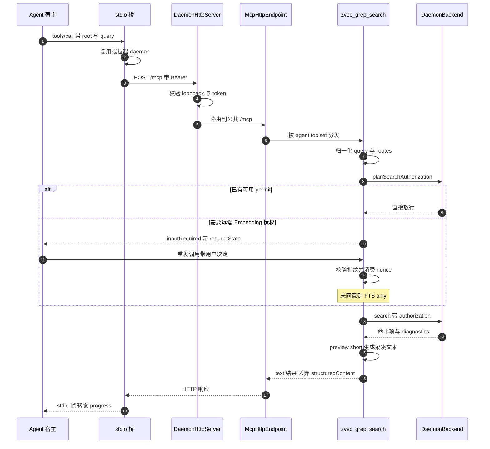

# zvec-grep 的 MCP 服务与 Agent 集成

> 本解读按 `ai-infra` ⊗ `framework` 类规格产出（全新分析）。

## 关注面定位：MCP 是 zg 的第二张脸

README 把「Ready for humans and agents」列为核心卖点，落到代码上就是一句话：同一个常驻 daemon 同时提供 CLI 与 MCP 两个面，搜索语义完全一致，差别只在调用方与结果呈现。MCP 侧不是 CLI 的壳——它有独立的 schema 契约、结果格式、授权交互通道与默认工具集策略。理解这一面，才能解释 zg 为什么需要常驻守护进程、为什么需要一个约三百行的授权状态机，以及为什么它宁可只给 Agent 一个工具。

一个必须先说清的前提：Agent 侧的 MCP 连接几乎都是 stdio，而 zg 的 MCP 服务是 Streamable HTTP。夹在中间的那层桥，是本关注面最容易被忽略、也最能体现设计取舍的模块。

## 传输层：一个 daemon，两个 MCP 端点

HTTP 路由在同一个 `node:http` server 上先按路径分流：`/healthz` 走健康检查，`/control/shutdown` 走带 token 的优雅停机，之后才落到 MCP 路径 [src/daemon/http-server.ts:166-171]()。
<!-- anchor: if (url.pathname === "/healthz") { … writeJson(response, 200, { status: "ok" }); -->
MCP 挂载点不是单一的 `/mcp`，而是 `/mcp` 与 `/mcp/admin` 两个入口，默认对外只暴露前者 [src/daemon/http-server.ts:194-199]()。
<!-- anchor: const mcpEndpoint = … : undefined; -->

两个端点的差异不是「开关」，而是两套完整参数：公共端点使用 daemon 启动时决定的 toolset，管理端点固定 `full`，并额外打开 `acceptEmbeddingEnvironmentMeta` 与 `includeSearchStructuredContent` [src/daemon/http-server.ts:69-79]()。
<!-- anchor: this.adminMcpEndpoint = new McpHttpEndpoint( … { modernOnly: true }, -->
这样 CLI 需要的一次性 apiKey/device 覆盖、有序 `routes`、结构化返回都不必通过 flag 泄漏到公共端点，公共 schema 干脆不含凭据字段；反过来，代价是多维护一个端点实例与一套 schema。

安全边界是三层叠加。构造期强制 loopback，非 loopback host 直接抛错——daemon 持有本机文件读取权限，绝不能监听外网 [src/daemon/http-server.ts:47-48]()。
<!-- anchor: if (!isLoopbackHost(options.host)) { … throw new Error("Daemon HTTP server requires a loopback host."); -->
每个 MCP 请求再校验 `Host` 与 `Origin`，拒绝非 loopback 来源，防的是浏览器侧的 DNS rebinding 与跨源访问 [src/daemon/http-server.ts:205-214]()。
<!-- anchor: !validHost(request.headers.host) || … return; -->
最后才是可选的 Bearer 校验，用 `timingSafeEqual` 做定长比较 [src/daemon/http-server.ts:296-315]()。
<!-- anchor: function validBearerToken( … return expected === undefined || validBearerToken(header, expected); -->
默认不配 token 是刻意的：在 loopback 加 origin 校验之下，本机单用户场景没必要强制密钥；token 留给共享机器或需要防止同机其它进程调用的场合。

协议版本走双轨。现代路径由 SDK 的 `createMcpHandler` 承接，并显式配置 `legacy: "reject"`，把当前规范版本交给 SDK 原生的多轮往返处理器 [src/mcp/http-transport.ts:72-77]()。
<!-- anchor: this.modern = createMcpHandler( … this.modernNodeHandler = toNodeHandler(this.modern); -->
旧客户端那套 `initialize` 加 `mcp-session-id` 的握手由手写兼容层兜底，带 30 分钟空闲 TTL 与 256 个会话上限 [src/mcp/http-transport.ts:20-21]()。
<!-- anchor: const LEGACY_SESSION_IDLE_TTL_MS = 30 * 60 * 1_000; … const MAX_LEGACY_SESSIONS = 256; -->
兼容层还要求初始化前不得出现其它请求，否则报错而不是隐式建会话 [src/mcp/http-transport.ts:156-166]()。
<!-- anchor: if (!isInitializeRequest(body)) { … return; -->
为什么要保留这条腿：生态里仍有大量只实现旧握手的宿主，直接砍掉等于不可用；而给它设上限，是为了让「兼容」不变成内存泄漏入口。

## stdio-bridge：给只会 stdio 的宿主做协议桥

`zg --server --stdio` 不是第二个 MCP 实现，而是一个双向代理：先确保共享 daemon 就绪 [src/mcp/stdio-bridge.ts:36-44]()。
<!-- anchor: const status = await startServer({ … throw new Error("zvec-grep server became ready without an MCP URL"); -->
然后用一个 `Client` 通过 Streamable HTTP 连上 daemon，Bearer token 走统一的 `resolveClientToken` [src/mcp/stdio-bridge.ts:95-107]()。
<!-- anchor: const token = await resolveClientToken({ … await upstream.connect(upstreamTransport); -->
同时用一个 `Server` 通过 `StdioServerTransport` 面向宿主 [src/mcp/stdio-bridge.ts:139-163]()。
<!-- anchor: const downstreamTransport = new StdioServerTransport(); … await downstream.connect(downstreamTransport); -->
所以「stdio 消息被转成什么」的答案是：转成同一个 daemon 的 HTTP `POST /mcp` JSON-RPC 请求，回程再把响应与通知转回 stdio 帧。

转发不是搬字节。`_meta` 必须原样带上——`progressToken` 决定宿主能否收到进度，`traceparent` 决定 daemon 侧日志能否串成一条链路；因此转发函数把原始 meta 合并进 `params._meta`，并把上游 progress 回调重新包装成下游认识的 `notifications/progress` [src/mcp/stdio-bridge.ts:252-271]()。
<!-- anchor: const forwardedRequest: JSONRPCRequest = meta … params: { ...progress, progressToken }, -->
这条链路暴露了一个易踩的坑：SDK 的 elicitation 分发走方法级处理器而非通用 fallback，所以桥必须显式注册 `elicitation/create` 转发，否则 daemon 发起的授权提问永远到不了宿主 [src/mcp/stdio-bridge.ts:203-224]()。
<!-- anchor: upstream.setRequestHandler("elicitation/create", async (request, context) => { … throw new Error(REMOTE_EMBEDDING_ELICITATION_UNSUPPORTED_MESSAGE, { -->
桥还必须把 daemon 的身份与 `instructions` 重新发布给宿主，否则 Agent 根本看不到那段路由规则 [src/mcp/stdio-bridge.ts:109-116]()。
<!-- anchor: const downstream = new Server( … instructions: upstream.getInstructions(), -->

生命周期上，桥是「薄」的：宿主断开只结束代理，daemon 继续活着，下次连接直接复用索引与常驻模型。为此有一个 2 秒轮询的监控，一旦 pid 或 serverUrl 变化、或连续三次读不到锁，就关闭下游并抛出「daemon 在桥连接期间停止」[src/mcp/stdio-bridge.ts:151-154]()。
<!-- anchor: daemonFailure = new Error( … finish(); -->
判断函数本身只关心 running/pid/serverUrl 三者 [src/mcp/stdio-bridge.ts:186-192]()。
<!-- anchor: connected: DaemonControlStatus, … current.serverUrl !== connected.serverUrl -->
连续三次而非一次，是因为锁文件瞬时不可读是含糊信号，立即断开会把正常的重启抖动放大成宿主侧的工具报错。

## 两个 toolset：默认只留一个搜索工具

`agent` 与 `full` 的差别写在一个布尔分支里：`zvec_grep_search` 无条件注册，其余工具全部被 `if (full)` 包住 [src/mcp/tools.ts:339-342]()。
<!-- anchor: const toolset = options.toolset ?? DEFAULT_MCP_TOOLSET; … if (full) { -->
`full` 才有的 `zvec_grep_index` 在同一处声明了 `readOnlyHint: false`、`destructiveHint: true` 等注解，供宿主做二次确认界面 [src/mcp/tools.ts:344-355]()。
<!-- anchor: "zvec_grep_index", … openWorldHint: true, -->
`zvec_grep_rg` 同样只属于 `full` [src/mcp/tools.ts:558-570]()。
<!-- anchor: if (full) { … openWorldHint: false, -->
命名、schema、注解与 handler 都在注册点就近声明，而不是分散到路由表之后。

为什么默认砍到只剩一个？三条理由在源码里都能对上。其一是上下文成本：工具定义进入每一轮请求，六个 schema 是持续的输入 token 开销，也会稀释模型的选择注意力。其二是破坏性与不可逆性：`zvec_grep_index` 能创建、重建、删除持久索引，而删掉一个已建好的索引是不可逆的昂贵操作，`destructiveHint: true` 正是对这一点的显式声明。其三是能力重复：穷举式精确检索宿主本来就有，公共工具描述直接写「Use native Grep or rg instead when exact lookup alone is sufficient」，让 Agent 用原生工具做已知字面量检索，比再给它一个 `zvec_grep_rg` 更省上下文、也更贴合宿主既有习惯。因此两套 `instructions` 与描述文本都随 toolset 分叉，`full` 变体改口指向 `zvec_grep_rg` [src/mcp/tools.ts:259-267]()。
<!-- anchor: export const ZVEC_GREP_AGENT_MCP_INSTRUCTIONS = formatPromptRules( … "When an index is missing and literal or regex search can answer the task, u -->

默认值由三层决定，并被进程级锁定。常量 `DEFAULT_MCP_TOOLSET = "agent"` 与 `resolveMcpToolset` 定义了优先级：显式参数优先于环境变量 `ZVEC_GREP_MCP_TOOLSET`，都没有才用默认值 [src/mcp/toolset.ts:1-5]()。
<!-- anchor: export const MCP_TOOLSET_ENV = "ZVEC_GREP_MCP_TOOLSET"; … export type McpToolset = "agent" | "full"; -->
解析函数只有一行核心逻辑，把「未指定」与「指定了非法值」区分开 [src/mcp/toolset.ts:14-18]()。
<!-- anchor: export function resolveMcpToolset( … const value = explicitValue ?? environmentValue; -->
`startServer` 把决定权收在这里，并且发现已运行的 daemon toolset 与请求不一致时拒绝复用，要求先 `--server off` 再重启，而不是悄悄热切换 [src/daemon/server-controller.ts:183-198]()。
<!-- anchor: const environmentToolset = process.env[MCP_TOOLSET_ENV]; … `zvec-grep server is already running with MCP toolset "${current.mcpTool -->
做成进程级而非请求级的原因很直接：工具集变化会同时改变 `tools/list` 契约与 `instructions`，请求级切换会让宿主缓存的工具表与真实注册面不一致。

## schema 即契约：zod 是唯一事实源

工具的输入输出契约全是 zod v4 对象，直接交给 `server.registerTool`；SDK 负责在 `tools/list` 时转成 JSON Schema、在调用时校验，`z.infer` 再把同一份定义变成 TS 类型导出给 backend 与归一化层。于是「模型看到的 schema」「服务端校验」「内部类型」三者不会漂移。边界值因此集中声明：查询组上限 32、查询长度 4000、路径过滤 128、返回条数 50 [src/mcp/schemas.ts:4-8]()。
<!-- anchor: export const MCP_MAX_QUERY_GROUPS = 32; … export const MCP_MAX_SEARCH_LIMIT = 50; -->
描述与上限也同源，`boundedString` 统一挂 `.max()` 与 `.describe()`，前者是服务端硬约束，后者就是模型读到的字段说明 [src/mcp/schemas.ts:10-20]()。
<!-- anchor: const boundedString = (description: string) => … .describe(description); -->

schema 分叉处藏着一条安全判断：公共搜索 schema 不含 `apiKey`、`device`、`endpoint`，只有 CLI 专用变体才 extend 出这些字段，代码注释给出的理由是不把这些放进公共 schema，Agent 就无法发明占位 API key、或对远端索引强行指定本地 device [src/mcp/schemas.ts:241-245]()。
<!-- anchor: // Public agents search with the configured workspace runtime. Keeping credentia … export const zvecGrepSearchInputSchema = z.object({ -->
`zvec_grep_rg` 的 `command` 同样在 schema 层写死「必须以 `rg` 开头、只做参数解析、绝不经过 shell」，把注入面限定在参数解析器内 [src/mcp/schemas.ts:291-301]()。
<!-- anchor: export const zvecGrepRgInputSchema = z.object({ … "The command MUST start with `rg`; it is parsed as arguments and never exe -->

`root` 必须绝对路径，这条约束被写了两遍：schema 层用 `.refine(isAbsolute)` 让 Agent 在参数校验阶段就得到明确报错 [src/mcp/schemas.ts:47-53]()。
<!-- anchor: export const absoluteRootSchema = z … .describe("Absolute workspace root visible to the daemon."); -->
daemon 层再查一次并抛 `ROOT_NOT_ABSOLUTE` [src/daemon/runtime-manager.ts:334-337]()。
<!-- anchor: if (!isAbsolute(requestedRoot)) { … "root must be an absolute path.", -->
原因是进程模型：daemon 是 detached 子进程，它的 cwd 与 Agent 的 cwd 毫无关系，相对路径会静默指向错误的树；更深一层，索引标识、`~/.zvec-grep` 下的运行时注册与根租约都以规范化绝对根为键，相对路径会让同一目录产生多个身份。

`normalizeSearchInput` 是模型形状到引擎形状的防腐层：把 `query` 与 `queries` 合并成统一的 `queries`，把 `fts`/`vector` 折叠成有序 `routes`，四者皆空时报出可读错误 [src/mcp/input-normalization.ts:105-122]()。
<!-- anchor: const queries = [ … "zvec_grep_search requires query, queries, fts, or vector.", -->
列表字段统一 trim、丢弃空串、空则返回 `undefined`，让引擎不必到处判断 `string | string[] | undefined` [src/mcp/input-normalization.ts:163-171]()。
<!-- anchor: export function normalizePlainStringList( … return normalized.length > 0 ? normalized : undefined; -->
wire schema 之所以用 union 接受单值或数组，纯粹是为了迁就模型的输出习惯。

## 结果格式：紧凑文本是默认，结构化是例外

公共 MCP 搜索只返回文本，`structuredContent` 被刻意丢弃。代码注释把代价写得明确：结构化内容会带上每条命中项的 outline 与完整源码，从而主导 Agent 上下文；改为纯文本并配 `preview: "short"`，让每条命中保留有界片段，Agent 据此判断相关性、不必再补一次文件读取 [src/mcp/tools.ts:488-495]()。
<!-- anchor: // Mirror the compact rg output: return agent-formatted text only and … preview: "short", -->
只有管理端点才返回结构化内容，而且还会清空跨组列表里的 `items`，避免同一批 item 被序列化两次 [src/mcp/tools.ts:502-504]()。
<!-- anchor: indexing: response.indexing, … // cross-group list. Avoid serializing every full item twice. -->
这个「默认窄、例外宽」的方向与常见 MCP 服务器相反，但符合 Agent 的真实成本结构：token 花在上下文里，不花在带宽上。

省 token 的手段是常量化而非启发式：`short` 模式下源码窗口最多 10 行、匹配点前 2 行上下文、outline 最多 7 行、单行截断 160 字符 [src/cli/format/context.ts:37-41]()。
<!-- anchor: const SHORT_SOURCE_MAX_LINES = 10; … const HUMAN_PREVIEW_MAX_LINE_LENGTH = 120; -->
每条 item 的头部固定为 `#rank matchedBy=... path:start-end`，并可选带 `groups:` 与 `matched:`，使 Agent 不读文件就能判断该位置是否正是所需 [src/cli/format/context.ts:206-220]()。
<!-- anchor: function agentRankedItemHeader( … return `#${item.rank}${selection} matchedBy=${item.matchedBy}${score} ${item.f -->

这里需要修正一处官方表述：文档说响应「groups ranked results by file」，但索引检索路径实际是按 rank 排序的平铺列表 [src/cli/format/context.ts:134-146]()。
<!-- anchor: function agentContextLines( … const items = [...result.items].sort(compareContextItems); -->
按文件分组只发生在 rg 路径上 [src/cli/format/context.ts:232-261]()。
<!-- anchor: function agentRgContextLines( … return lines; -->
这不是 bug：rg 结果天然是「同一文件多行命中」，聚合才能省掉重复路径；索引结果来自跨文件排序，强行分组反而破坏 rank 语义。另有一份更啰嗦的 `contextText`（每项带完整 content 与 file 对象）作为结构化调用者的文本镜像 [src/mcp/result-format.ts:30-51]()。
<!-- anchor: export function contextText(result: ZvecGrepContextResult): string { … return lines.join("\n"); -->

## 进度心跳与超时治理：把「等人」从超时里摘出来

这里有三个独立问题。第一个是超时上限：SDK 没有「禁用超时」模式，于是代码把一个近似无穷的上界写成常量，并注明它只是安全网，真正让长等待可行的是 progress 心跳 [src/mcp/progress-heartbeat.ts:3-8]()。
<!-- anchor: export const REMOTE_AUTHORIZATION_HEARTBEAT_MS = 15_000; … export const LONG_RUNNING_MCP_TIMEOUT_MS = 2_147_483_647; -->
第二个是心跳本身：`withProgressHeartbeat` 只在请求确实带 `progressToken` 时才启用，先立刻发一次、之后每 15 秒一次，用 `unref` 定时器并保证同一时刻只有一个在途通知 [src/mcp/progress-heartbeat.ts:18-31]()。
<!-- anchor: export async function withProgressHeartbeat<T>( … const intervalMs = options.intervalMs ?? REMOTE_AUTHORIZATION_HEARTBEAT_MS; -->
没有 token 就整体跳过，避免给不支持进度的宿主刷无意义通知。

心跳真正解决的是「人类的阅读时间」。远端 Embedding 授权要弹披露表单让用户读 provider、endpoint 与将外发的内容，这个延迟由人决定，任何固定超时都可能把一次仅因用户在思考而变慢的请求判死，所以 CLI 把「等用户输入」这一步包进心跳 [src/client/daemon-client.ts:109-118]()。
<!-- anchor: answer = await withProgressHeartbeat( … { message: "Waiting for Remote Embedding authorization input." }, -->
整个 `callTool` 同时设置近似无穷超时与 `resetTimeoutOnProgress: true`，让进度通知真正起到续期作用 [src/client/daemon-client.ts:168-185]()。
<!-- anchor: const result = await client.callTool( … resetTimeoutOnProgress: true, -->

第三个是索引进度上报。服务端的 reporter 按 `indexProgressMessage` 节流，并特意抑制「模型下载/准备结束、进入 indexing 但尚未带 embedding stage」那一段的重复进度，避免进度条来回跳 [src/mcp/tools.ts:654-664]()。
<!-- anchor: function createMcpIndexProgressReporter(extra: ServerContext): { … const modelStage = progress.embedding?.stage; -->
宿主侧还有最后一层，安装器会把工具超时（默认 600 秒）写进宿主配置 [src/cli/install.ts:314-343]()。
<!-- anchor: await updateJsoncMcpSettings({ … isManaged: isManagedJsonMcpServer, -->

## 请求级状态：一次 tools/call 内完成的授权往返

`request-metadata.ts` 只有 14 行，却定义了一个跨端约定：远端 Embedding 环境标识放在 `_meta` 的 `io.zvec-grep/embedding-environment` 键下，且只在端点显式开启时才被读取 [src/mcp/request-metadata.ts:1-13]()。
<!-- anchor: export const EMBEDDING_ENVIRONMENT_META_KEY = … return normalized.length > 0 ? normalized : undefined; -->
这与 schema 分叉是同一逻辑的两半：公共 schema 已经关掉凭据与设备字段，如果 `_meta` 还能夹带，那个洞就白堵了，所以只有管理端点打开这个开关。

`request-state.ts` 解决的是更硬的问题：授权必须绑定「用户当时看到的那次操作」，且不可重放。状态载荷是一组指纹——工具名、参数、授权目标、披露数据各一个 sha256 [src/mcp/request-state.ts:202-213]()。
<!-- anchor: export function remoteEmbeddingRequestState( … disclosureFingerprint: fingerprint(plan.disclosure), -->
签名密钥持久化在 `~/.zvec-grep/mcp-request-state.key`，以 0600 创建并校验长度 [src/mcp/request-state.ts:158-159]()。
<!-- anchor: export function mcpRequestStateKeyPath(home?: string): string { … return join(home ?? defaultHome(), "mcp-request-state.key"); -->
TTL 是 10 分钟，内存中已消费集合上限 4096 [src/mcp/request-state.ts:19-30]()。
<!-- anchor: const REQUEST_STATE_KEY_BYTES = 32; … disclosureFingerprint: string; -->
签名还绑定 `method` 与 `clientId`，使一次授权无法跨客户端挪用 [src/mcp/request-state.ts:190-198]()。
<!-- anchor: export function createRemoteEmbeddingRequestStateCodec( … `${ctx.mcpReq.method}\0${ctx.http?.authInfo?.clientId ?? "anonymous"}`, -->
为什么值得这么重：这是整个 local-first 承诺唯一被削弱的地方——只有显式同意后才会把文本发往远端；若状态可重放或在工具间调包，一次旧批准就可能替另一次不同的外发（不同 provider、endpoint、披露范围）背书。

往返过程是：handler 先向 backend 要授权计划，已有可用许可就直接放行；否则铸造 requestState 并返回 `inputRequired`，其中挂一个 elicitation 表单 [src/mcp/tools.ts:791-797]()。
<!-- anchor: result: inputRequired({ … remote_embedding_authorization: inputRequired.elicit({ -->
表单选项里只有在「存在本地替代路径」时才出现 `use_local_search` [src/mcp/tools.ts:813-827]()。
<!-- anchor: oneOf: [ … { const: "cancel", title: "Cancel" }, -->
宿主答复后 SDK 会用同一个 `tools/call` 把 requestState 与答复一起重发，服务端先逐字段校验指纹 [src/mcp/tools.ts:739-743]()。
<!-- anchor: const expectedState = remoteEmbeddingRequestState(tool, args, plan); … throw new ProtocolError(-32602, "Invalid or expired requestState"); -->
再一次性消费 nonce，把重放彻底堵死 [src/mcp/tools.ts:763-763]()。
<!-- anchor: if (!(await options.requestStateReplayGuard?.consume(echoedState))) { -->
接受则签发 permit，拒绝则抛出「未发送任何远端数据」的明确错误 [src/mcp/tools.ts:773-781]()。
<!-- anchor: throw new Error( … authorization: await backend.grantRemoteEmbedding(plan, scope), -->
选择 FTS-only 时不是简单报错，而是把请求改写成纯词法路线并关闭后台更新——用户拒绝外发仍应得到有用的本地结果 [src/mcp/tools.ts:840-851]()。
<!-- anchor: function ftsFallbackSearch( … autoUpdate: false, -->
授权计划与许可的数据结构定义在 authorization 模块 [src/authorization/types.ts:30-35]()。
<!-- anchor: export type RemoteEmbeddingAuthorizationPlan = { … grantPath: string; -->
当宿主根本不支持 elicitation 时，统一抛出一条可执行提示，而不是让 Agent 猜 [src/authorization/prompt.ts:13-14]()。
<!-- anchor: export const REMOTE_EMBEDDING_ELICITATION_UNSUPPORTED_MESSAGE = … "The connected MCP host does not support the Remote Embedding authorization in -->

[WIP] 客户端侧的自动重发循环由 SDK（`@modelcontextprotocol/client`）的多轮往返机制实现，不在本仓库内；可核验的仓库证据是 `src/client` 与 `src/cli` 都没有引用 requestState，却注册了 `elicitation/create` 处理器，且 `test/mcp-modern-http.test.mjs` 中一次 `callTool` 恰好产生一次 elicitation、一次授权、一次检索。

## zg install：把配置写进六种宿主

安装目标是一张声明式表，六个宿主各自带可执行文件名探测与（Qoder 特有的）IDE 探测钩子 [src/cli/install.ts:67-111]()。
<!-- anchor: const AGENT_INSTALLERS: readonly AgentInstaller[] = [ … uninstall: uninstallQoderIntegration, -->
探测在 `detectAgentInstallers` 里并发进行，可执行文件命中或 `detect` 钩子为真即算存在 [src/cli/install.ts:655-668]()。
<!-- anchor: async function detectAgentInstallers(): Promise<Set<string>> { … available: executableDetected || (await installer.detect?.()) === true, -->

格式差异不是审美问题，而是各宿主真实解析器的差异。Codex 用 TOML 托管块，令牌走 `bearer_token_env_var`，并写入 `default_tools_approval_mode = "approve"` [src/cli/install.ts:2305-2321]()。
<!-- anchor: function codexConfigBlock(options: InstallAgentOptions): string { … ${ZVEC_GREP_CONFIG_END}`; -->
Claude Code 是 JSON 的 `mcpServers`，另外要往 `settings.json` 的 `permissions.allow` 注入命名空间权限 [src/cli/install.ts:119-121]()。
<!-- anchor: const CLAUDE_MCP_PERMISSION = "mcp__zvec_grep__*"; … const NAMESPACED_RG_TOOL = "mcp__zvec_grep__zvec_grep_rg"; -->
权限写入是幂等的增删：存在则加、卸载时只删自己那条 [src/cli/install.ts:1198-1218]()。
<!-- anchor: Array.isArray(currentAllow) && … else delete root.permissions; -->
OpenCode 用 JSONC 的 `mcp` 容器、`{env:VAR}` 插值，并允许尾逗号 [src/cli/install.ts:314-343]()。
<!-- anchor: await updateJsoncMcpSettings({ … isManaged: isManagedJsonMcpServer, -->
Qwen Code 的远端字段叫 `httpUrl` 而非 `url`，还要 `alwaysLoadTools: true`——注释解释得很直白：否则 Qwen 会把 MCP schema 藏到 `tool_search` 之后，托管的搜索工具在第一轮就不可直接调用 [src/cli/install.ts:1533-1543]()。
<!-- anchor: function qwenMcpServer(options: InstallAgentOptions): Record<string, unknown> { … trust: true, -->
Qoder 同时配 CLI 与 IDE，且 IDE 条目用 `type: "sse"` 指向 Streamable HTTP 端点 [src/cli/install.ts:1598-1620]()。
<!-- anchor: function qoderIdeMcpServer( … Authorization: `Bearer \${${options.mcpTokenEnv}}`, -->
[WIP] Qoder IDE 声明 `sse` 却指向 `/mcp` 这一 Streamable HTTP 端点，两者是否真能互通未在仓库内验证；其余宿主的字段名与插值语法都能在安装器里直接读到。

JSONC 注释保留是这类改写的核心难点。写入路径走 `modify` + `applyEdits`，并用从原文推断的格式化选项，从而只改目标属性、不动周围格式与注释 [src/cli/install.ts:1758-1766]()。
<!-- anchor: function editJsonWithComments( … formattingOptions: jsonFormattingOptions(source), -->
删除更麻烦：`modify(..., undefined)` 会连带丢掉附着在该属性上的注释，所以先扫描 token 判断有无注释 [src/cli/install.ts:1771-1785]()。
<!-- anchor: function hasJsoncComments(source: string): boolean { … return false; -->
确认有注释后改走按节点区间手工删属性加逗号 [src/cli/install.ts:1788-1793]()。
<!-- anchor: function removeJsoncPropertyPreservingComments( … if (!root) return source; -->
理由是这些文件属于用户、并存着别的服务器配置与注释，任何「解析成对象再整体重写」都会造成大面积 diff。

幂等与冲突处理靠「托管标记 + 管理判定」。标记块重跑时替换块内容而不是追加 [src/cli/install.ts:2026-2050]()。
<!-- anchor: const next = replaceMarkedBlock( … : existing; -->
JSON 类配置则在 `zvec_grep` 条目上判断是否由我们管理，遇到非托管同名条目直接报错并要求 `--force`，而不是覆盖用户手写配置 [src/cli/install.ts:1060-1065]()。
<!-- anchor: existingServer !== undefined && … `Existing unmanaged zvec_grep MCP server found in ${options.path}. Re-run -->
每次写入都是临时文件加 `fsync` 加 `rename`，并保留原文件权限、解析符号链接，保证崩溃不会留下半截配置 [src/cli/install.ts:2079-2104]()。
<!-- anchor: async function writeTextFileAtomic( … throw error; -->
[WIP] 仓库里没有 `.bak` 备份，也没有跨文件事务：若装到第二个宿主时失败，第一个宿主的文件已被原子地改写并保留。缓解手段只有「先全量预检、再写入」与单文件原子性，跨 agent 回滚确实缺失。

`--yes` 与非 TTY 走同一条无人值守路径：跳过选择提示、按探测结果装 `auto` [src/cli/install.ts:542-546]()。
<!-- anchor: parsed.options.yes === true || … return installersFromTokens(["auto"], detected); -->
传输层同时默认 stdio [src/cli/install.ts:559-563]()。
<!-- anchor: parsed.options.yes === true || … return "stdio"; -->
这是 CI 与「由 Agent 自己执行安装」场景的必需项——提示一旦无人应答，安装器就挂住。Token 注入只允许在 HTTP 传输下使用，且不写明文，而是写宿主的变量引用语法（Claude/Cursor/Qwen/Qoder 用 `${VAR}`、OpenCode 用 `{env:VAR}`、Codex 用 `bearer_token_env_var`），因为这类配置文件常被同步或提交。stdio 模式写入的启动命令统一是 `zg --server --stdio` 加可选 `--mcp-toolset` [src/cli/install.ts:1981-1990]()。
<!-- anchor: function stdioArgs(mcpToolset?: McpToolset): string[] { … return ["zg", ...stdioArgs(mcpToolset)]; -->

## guidance：为什么行为规则不放在工具描述里

`zvec-grep-guidance.ts` 本身只有三条「工作区是否构成证据源」的规则 [src/prompts/zvec-grep-guidance.ts:1-5]()。
<!-- anchor: export const ZVEC_GREP_WORKSPACE_EVIDENCE_RULES = [ … ] as const; -->
外加一个把规则渲染成列表的格式化函数 [src/prompts/zvec-grep-guidance.ts:7-11]()。
<!-- anchor: export function formatPromptRules( … return [heading, ...rules.map((rule) => `- ${rule}`)].join("\n"); -->
这份极小的常量被两个通道复用：MCP `instructions`（随 toolset 分叉）与安装器写进宿主自己的指导文件（`CLAUDE.md`、`AGENTS.md`、`QWEN.md` 等），例如宿主指导块中的检索路由段落 [src/cli/install.ts:2343-2358]()。
<!-- anchor: return `${ZVEC_GREP_AGENTS_START} … "Before broad file reads or delegating workspace discovery, use the appropriat -->

为什么不靠工具描述？因为要传达的内容大部分根本不属于这个工具：规则要同时说清何时**不该**调用 zg（无关的开卷问题、外部事实、网页内容）、何时改用宿主的原生工具、以及何时停止检索。安装器写出的精确检索路线被表述为「`zvec_grep_rg`，当宿主列出了它；否则用原生 Grep 或 `rg`」——工具描述无法指名别的工具 [src/cli/install.ts:2331-2331]()。
<!-- anchor: const exactLookupRoute = `\`${rgTool}\` when it is listed by the current host; -->
此外，描述只在模型挑选工具时被读到，而「这个问题该不该落到本工作区」的判断发生在挑选之前；`instructions` 在 initialize 时下发并被 stdio 桥原样转发，宿主指导文件则进入系统提示、每轮都在场。代价是同一套规则存在于两个投递通道，编辑时必须同步，否则行为会随宿主分叉。

一个具体的失败恢复流程也写在指导文件里：Qoder 类宿主因不支持 `elicitation/create` 而返回 51500 时，Agent 被告知这不是 MCP 连接或工具缺失问题，应改用宿主自带的用户提问工具、拿到明确同意后执行 `zg --auth grant` 再重试一次，且不得退回大范围文件读取或静默放行 [src/cli/install.ts:2336-2340]()。
<!-- anchor: `When \`${searchTool}\` needs \`remote_embedding_authorization\` and the curre … "If the user cancels, the grant command fails, or interactive user input is un -->

## 错误与超时：哪些是数据，哪些是异常

失败被分成两类，分界线是「Agent 能否据此决策」。索引任务的失败是数据：`state: failed` 与错误码、上下文一起放进结构化结果，工具调用本身仍然成功 [src/mcp/tools.ts:391-399]()。
<!-- anchor: const structuredContent = { … scan_diagnostics: result.scanDiagnostics, -->
文本侧同步给出 `error_code` 与 `error_message`，Agent 能据此决定重试、换 embedding 还是放弃 [src/mcp/tools.ts:413-414]()。
<!-- anchor: `error_code: ${result.error.code}`, … `error_message: ${result.error.message}`, -->
契约类与不可恢复错误才是异常：requestState 不匹配或重放抛 `ProtocolError(-32602)` [src/mcp/tools.ts:739-743]()。
<!-- anchor: const expectedState = remoteEmbeddingRequestState(tool, args, plan); … throw new ProtocolError(-32602, "Invalid or expired requestState"); -->
SDK 会把它转成工具级错误，CLI 客户端再把 `isError` 还原成抛出的 Error [src/client/daemon-client.ts:191-194]()。
<!-- anchor: if (result.isError) { … throw new Error(text ?? `${name} failed`); -->

HTTP 层用正确的状态码而非一律 200：越界 host 或 origin 是 403，缺 token 是 401 并带 `WWW-Authenticate: Bearer` [src/daemon/http-server.ts:205-214]()。
<!-- anchor: !validHost(request.headers.host) || … return; -->
请求体过大或 JSON 非法是 413 与 400，且返回 JSON-RPC 形状的错误体 [src/daemon/http-server.ts:234-241]()。
<!-- anchor: const tooLarge = error instanceof RequestBodyTooLargeError; … id: null, -->
daemon 不可达时，stdio 桥由那套 2 秒监控把下游断开，宿主看到的是 MCP 连接结束，而不是某个工具莫名超时 [src/mcp/stdio-bridge.ts:151-154]()。
<!-- anchor: daemonFailure = new Error( … finish(); -->
整套机制里没有传输层重试与退避，这是有意留白：本地环回场景下叠加退避只会让失败反馈更慢、更难解释。

## 全链路时序：Agent 经 MCP 调用 zvec_grep_search

图中每一步的源码位置：stdio 桥的启动与转发在 `src/mcp/stdio-bridge.ts:36-44` 与 `src/mcp/stdio-bridge.ts:252-271`，HTTP 挂载与鉴权在 `src/daemon/http-server.ts:194-199` 与 `src/daemon/http-server.ts:205-214`，SDK 处理器在 `src/mcp/http-transport.ts:72-77`，工具入口与紧凑结果在 `src/mcp/tools.ts:434-521`，归一化在 `src/mcp/input-normalization.ts:105-122`，授权往返的三个关键点在 `src/mcp/tools.ts:791-797`、`src/mcp/tools.ts:739-743` 与 `src/mcp/tools.ts:840-851`。

## 与整体设计哲学的连接

MCP 这一面不是独立模块，而是四个主张的放大器。**Local-first** 在这里是两层：服务只监听 loopback、只服务本机 Agent；唯一的外发通道被 requestState、指纹与一次性消费层层锁住，拒绝外发时还有 FTS-only 退路——代价是一套签名与重放防护状态机。**一套引擎、两种形态** 体现得最直接：`/mcp` 与 CLI 最终都落到同一个 backend，stdio 桥只是把 stdio 帧改写成对同一个 daemon 的 HTTP 请求，于是 Agent 与人类看到同一份索引、同一份排序。**为 Agent 优化输出** 是默认值层面的决定：默认 toolset 只留一个工具、默认结果只有紧凑文本、默认索引任务后台执行，宽的那一档被收进管理端点与 CLI。**两条互补检索路径** 则靠提示层而非 schema 约束协同：schema 表达检索路线，`instructions` 与宿主指导文件教模型「先判断证据源、再选精确或语义、够了就停」。

压缩成一句可迁移的经验：面向 Agent 的 MCP 服务器，真正的产品设计不在协议实现，而在三处默认值——默认暴露多少工具、默认返回多少内容、默认允许什么副作用。zg 的选择是全部收紧，把宽能力放到另一个端点，再用提示层把「何时该用、何时不该用」讲清楚。
