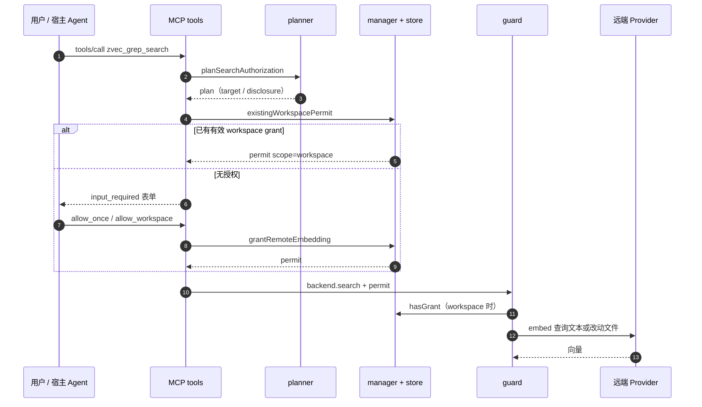

# zvec-grep 授权与信任边界

> 本解读按 `ai-infra` ⊗ `framework` 类规格产出（全新分析）。
> 关注面：local-first 定位下"字节是否离开本机"这一不变量的实现与残余风险。

## 信任边界总览：默认不鉴权是一个可辩护的默认值

zg 的威胁模型不是"谁在网络上"，而是"字节是否离开本机"。它的第一道边界在监听地址解析阶段：任何非 loopback 的 `host` 直接被拒绝，Server 只能绑 `127.0.0.1` / `::1` / `localhost` [src/daemon/config.ts:71-73]()。
<!-- anchor:     throw new DaemonError( …       "Server MVP only supports loopback listen addresses.", -->

这套判定由 `isLoopbackHost` 唯一实现，大小写归一后只承认三个字面量，因此 `0.0.0.0`、局域网 IP、容器网桥地址都进不来 [src/daemon/config.ts:86-90]()。
<!-- anchor:   const normalized = host.toLowerCase(); …     normalized === "localhost" -->

HTTP server 构造时再断言一次，避免有人绕过 `parseListenAddress` 直接 new 出监听对象 [src/daemon/http-server.ts:47-48]()。
<!-- anchor:     if (!isLoopbackHost(options.host)) { …       throw new Error("Daemon HTTP server requires a loopback host."); -->

与 loopback 配套的是单实例：`instance.lock` 用 `link` 而非 `rename` 发布，因为 `rename` 会静默覆盖竞争对手的记录，而 `link` 在目标已存在时返回 `EEXIST`，从而保证同一 `~/.zvec-grep` 下只有一个 daemon 持有索引写权限 [src/daemon/server-controller.ts:78-87]()。
<!-- anchor:           // rename, link fails with EEXIST if a competing daemon published firs …             processIsAlive(existing.pid) -->

因此"默认不鉴权"的论证是：没有远程可达面（loopback-only）+ 没有第二个进程会抢服务（单实例）时，token 只是同机用户之间的隔离手段，而不是网络攻防手段。代价是这条论证完全依赖 loopback 假设；一旦有人用反向代理、SSH 端口转发或容器 `-p` 把 7999 暴露出去，Server 对任何能到达该端口的主体都是裸的。这正是"何时必须开 token"的判据：多用户主机、共享 CI、任何非本机可达路径。

开启方式的最小约束是长度而非复杂度：token 少于 32 字符直接报 `INVALID_TOKEN`，这挡掉的是"随手用 `dev`/`1234`"的低熵凭证 [src/daemon/config.ts:141-144]()。
<!-- anchor:   if (token.length < 32) { …       "Server token must contain at least 32 characters.", -->

token 来源有两条且互斥：`ZVEC_GREP_SERVER_TOKEN`（显式环境变量优先）或 `ZVEC_GREP_SERVER_TOKEN_FILE`（文件内容 `trim()` 后校验，并强制 `chmod 0600`）[src/daemon/config.ts:95-113]()。
<!-- anchor:   options: { …   return { token, tokenFile }; -->

客户端侧同样先环境变量、再 token-file，最后回退到 `~/.zvec-grep/daemon/token`；值得注意的是这个默认路径只被读取、从不由 daemon 自动生成，所以"没配 token"时它返回 `undefined` 而不是一个隐式共享密钥 [src/daemon/config.ts:117-136]()。
<!-- anchor:   options: { …     throw error; -->

客户端携带方式统一为 `Authorization: Bearer <token>`：stdio bridge 把它注入上游 HTTP transport [src/mcp/stdio-bridge.ts:99-103]()，
<!-- anchor:   const upstreamTransport = new StreamableHTTPClientTransport( …         headers: token ? { Authorization: `Bearer ${token}` } : {}, -->

`zg --install` 则把 `Bearer {env:VAR}` 占位符写进 Agent 配置，让宿主自己从环境变量取值，避免 token 落进 agent 配置文件 [src/cli/install.ts:335-336]()。
<!-- anchor:                   headers: { …                     Authorization: `Bearer {env:${options.mcpTokenEnv}}`, -->

服务端的校验是"可选但严格"：`validRequestToken` 在未配置 token 时无条件放行，配置后强制走 Bearer 分支 [src/daemon/http-server.ts:311-315]()。
<!-- anchor: function validRequestToken( …   return expected === undefined || validBearerToken(header, expected); -->

比较用 `timingSafeEqual` 且先比长度，避免逐字节短路比较泄露 token 前缀 [src/daemon/http-server.ts:303-307]()。
<!-- anchor:   const actual = Buffer.from(header.slice("Bearer ".length), "utf8"); …     timingSafeEqual(actual, expectedBuffer) -->

除 token 外还有 Host 与 Origin 双重校验：`Host` 必须是 loopback 字面量、`Origin`（若存在）必须是 `http:` + loopback，这是防 DNS rebinding 的标准动作，也顺带挡住浏览器页面发起的跨站请求 [src/daemon/http-server.ts:205-214]()。
<!-- anchor:       !validHost(request.headers.host) || …       return; -->

控制面 `POST /control/shutdown` 与数据面同权，同样要求 Host 合法 + token 正确 [src/daemon/http-server.ts:175-191]()。
<!-- anchor:     if (url.pathname === "/control/shutdown") { …       return; -->

至此可以回答"为什么默认不开鉴权"：这是把安全预算集中到"数据不出本机"这条唯一重要的不变量上，而不是分散到一个同机进程本就能绕过的 HTTP 认证层。接下来要看的，是这条不变量的第二道闸门。

## 两道互相独立的闸门：MCP Bearer token 与远端 Embedding 授权

Bearer token 保护的是**传输与调用面**——谁可以对本机 daemon 发起 `tools/call`；它完全不表达"这段文本允许发给 Qwen"。远端 Embedding 授权保护的是**数据外发面**——哪些字节、去哪个 endpoint；它不关心调用者是谁。两者在代码里也确实没有耦合：token 校验发生在 `handleRequest` 的 HTTP 层，Embedding 授权发生在 model 的 `embed()` 调用链上。

把两者混为一谈的最常见误解是"配了 API key 就等于授权外发"。zg 明确反对这一点：API key 是 provider 凭证（能不能调用），Embedding 授权是数据同意（允许不允许发送），CLI 只有 `--allow-remote` 或 workspace grant 才会放行。这也是为什么 elicitation 不可用时给出的提示强调"这不代表缺 API 凭证" [src/authorization/prompt.ts:13-14]()。
<!-- anchor: export const REMOTE_EMBEDDING_ELICITATION_UNSUPPORTED_MESSAGE = …   "The connected MCP host does not support the Remote Embedding authorization in -->

远端只有在被显式选中时才存在：embedding reference 的解析顺序是 `explicit` → 已有索引记录 → `ZVEC_GREP_EMBEDDING` → 全局默认，远端模型不会作为"隐式 fallback"凭空出现 [src/engine/models/resolution.ts:12-33]()。
<!-- anchor: export function resolveEmbeddingReference( …   return environmentReference ?? options.globalDefault ?? options.fallback; -->

授权交互在 MCP 语义上还有一个独立要求：它必须绑定到同一个请求主体。request-state codec 把签名载荷的绑定键设为 `method + authInfo.clientId`，因此 A 客户端发起的授权不能由 B 客户端回放 [src/mcp/request-state.ts:192-198]()。
<!-- anchor:   ttlSeconds = REQUEST_STATE_TTL_SECONDS, …       `${ctx.mcpReq.method}\0${ctx.http?.authInfo?.clientId ?? "anonymous"}`, -->

于是"token 保护谁在调用、Embedding 授权保护数据去哪"成为两条真正正交的轴，下面的模块划分也沿这条轴展开。

## authorization 模块职责：plan / target / store / permit / guard / prompt

`src/authorization/` 的划分不是按文件类型，而是按"一次授权决策的生命周期"切的：

| 模块 | 职责 | 关键点 |
| --- | --- | --- |
| `planner.ts` | 判断"这次操作是否需要远端外发"，产出 `plan` | 只认 `qwen` provider；区分 query/index |
| `target.ts` | 把 root 集合 + provider/model/endpoint 规范化为不可伪造的指纹 | `realpath` 归一 + sha256 |
| `store.ts` | grant 的落盘、HMAC 签名与校验 | 写在 workspace 内，密钥在 home |
| `operation.ts` | 运行时 permit 传递与最终放行闸门 | `AsyncLocalStorage` + guard |
| `manager.ts` | 对外的"查/发"两方法门面 | 与 store 解耦 |
| `prompt.ts` | 人类可读的授权话术与披露数据 | 只显示 endpoint host |

一次授权决策的核心数据结构是 `RemoteEmbeddingAuthorizationPlan`，它把"什么操作 / 发给谁 / 发什么数据 / 授权写哪"四件事绑成一条记录 [src/authorization/types.ts:31-35]()。
<!-- anchor:   operation: RemoteEmbeddingOperation; …   grantPath: string; -->

### 触发条件：远端 provider 被选中且确有文本要外发

索引侧的触发是"provider 是 qwen"且"确实需要 embedding"（rebuild、needsUpdate、未建索引或索引不新鲜四者之一）[src/authorization/planner.ts:15-21]()。
<!-- anchor:   if (input.model.provider !== "qwen") return undefined; …   if (!needsEmbedding) return undefined; -->

配套的披露数据在创建索引场景下是 `workspaceContent: "changed"` 或 `"full"`（`!indexed` 或 rebuild 时为 full），`queryText` 为 false [src/authorization/planner.ts:38-48]()。
<!-- anchor:     disclosure: { …     grantPath: store.grantPath(target), -->

搜索侧更细：必须已有索引且索引 schema 的 provider 是 qwen，且模型身份与索引一致（不一致直接抛错而非静默换模型）[src/authorization/planner.ts:59-78]()。
<!-- anchor:   const schema = input.info.workspaceIndex?.embedding; …   if (!usesVector && !updatesIndex) return undefined; -->

只有"要用向量"或"要顺带更新索引"才产生 plan；`operation` 因此在 `query` / `index` / `query_and_index` 三者间切换，披露项也相应地在"只发查询文本"与"发改动文件"之间切换 [src/authorization/planner.ts:93-104]()。
<!-- anchor:     operation: usesVector …     grantPath: store.grantPath(target), -->

### once 与 workspace：作用域差异与授权结果存放

`once` 与 `workspace` 的差别只有一处落盘点，却决定了整个系统的可用性体验：`grant(plan, scope)` 只在 `scope === "workspace"` 时写 store，`once` 仅返回一个内存 permit [src/authorization/manager.ts:17-28]()。
<!-- anchor:     plan: RemoteEmbeddingAuthorizationPlan, …     return createRemoteEmbeddingOperationPermit(plan.target, scope); -->

workspace grant 的持久形态包含 root 集合、workspaceFingerprint、provider/model/endpoint、targetFingerprint 与 HMAC 签名 [src/authorization/types.ts:47-58]()。
<!-- anchor:   version: 1; …   signature: string; -->

它被写在**工作区内**的 `.zvec-grep/authorization.json`，即授权跟仓库走而不是跟用户走：换一台机器 checkout 同一仓库时，旧 grant 因签名字段无法验证而失效 [src/authorization/store.ts:39-43]()。
<!-- anchor:     const root = target.workspaceRoots[0]; …     return join(root, ".zvec-grep", GRANT_FILE); -->

签名的对象是除 `signature` 外的整个 grant 记录，用 HMAC-SHA256 + 稳定序列化（键排序）计算，所以任何字段被改动都会导致校验失败 [src/authorization/store.ts:75-76]()。
<!-- anchor:       ...unsigned, …       signature: sign(unsigned, key), -->

校验时先比长度再用 `timingSafeEqual`，与 token 校验同构 [src/authorization/store.ts:210-219]()。
<!-- anchor:     grant: RemoteEmbeddingWorkspaceGrant, …       timingSafeEqual(actualBytes, expectedBytes) -->

签名密钥是 32 字节随机数，存在 `~/.zvec-grep/authorization-signing.key`（可用 `ZVEC_GREP_AUTHORIZATION_KEY_FILE` 覆盖），目录 0700、文件 0600，并用 `flag: "wx"` + `EEXIST` 兜底处理并发创建 [src/authorization/store.ts:234-250]()。
<!-- anchor:     const existing = await this.readSigningKey(); …       return concurrent; -->

target 指纹把 workspace 指纹、provider、model、endpoint 一起哈希，因此"换模型/换 endpoint/给 root 集合加一个目录"都会让旧授权自动失效，无需显式 revoke [src/authorization/target.ts:28-33]()。
<!-- anchor:   return sha256( …       input.endpoint, -->

### planner 如何被放行决策消费：permit + guard

真正说"外发"的是 `remoteEmbeddingAuthorizationGuard`：它从 `AsyncLocalStorage` 取出 permit，逐项比对 capability、provider、model、endpoint，任一不符就抛授权错误 [src/authorization/operation.ts:43-59]()。
<!-- anchor:     const permit = operationPermit.getStore(); …         "Workspace grant is missing, invalid, or revoked.", -->

失败时抛出带稳定 code 的 `EngineError`，便于上层与 Agent 判断"这是授权问题不是网络问题" [src/authorization/operation.ts:66-70]()。
<!-- anchor:   request: RemoteEmbeddingRequest, …     code: "ZVEC_GREP.ENGINE.AUTH.REMOTE_EMBEDDING_REQUIRED", -->

远端模型在 service 层被包装成 `authorizedModel`，只有 qwen provider 才套这层壳，`embed()` 先过 guard 再真正发请求 [src/engine/service/zvec-grep.ts:1448-1469]()。
<!-- anchor:   const authorize = remoteEmbeddingAuthorizationGuard({ …   return authorizedModel; -->

一个关键设计点是：workspace scope 的 permit **每次** embed 都会重新 `store.hasGrant()`，因此用户在另一终端 `zg --auth revoke` 后，正在运行的长任务会立刻在下次调用时被拒绝，而不是靠内存态缓存撑到结束 [src/authorization/operation.ts:43-59]()。
<!-- anchor:     const permit = operationPermit.getStore(); …         "Workspace grant is missing, invalid, or revoked.", -->

### 决策流

图中的落点：MCP 侧授权往返在 `src/mcp/tools.ts:764-781`，plan 生成在 `src/authorization/planner.ts:52-106`，permit 放行闸门在 `src/authorization/operation.ts:43-59`。

## 被拒绝之后：降级而不是静默

拒绝路径在 CLI 与 MCP 两条入口上语义一致，但交互手段不同。CLI 的优先级是：已有 workspace permit 直接放行；`--allow-remote` 发一次性 permit；非 TTY（CI/管道）直接报错并给出可复制命令，而不是阻塞等待 [src/cli/auth.ts:139-151]()。
<!-- anchor:   if (existing) return { authorization: existing }; …       ].join("\n"), -->

交互式 TTY 则提供 "Allow once / Allow for this workspace / Use FTS only / Cancel" 四选项，选 3 走本地 FTS，其他输入一律抛"declined. No remote data was sent." [src/cli/auth.ts:179-188]()。
<!-- anchor:       return { authorization: await manager.grant(plan, "once") }; …       "Remote Embedding authorization was declined. No remote data was sent.", -->

MCP 侧先查已有 permit，没有则返回 `input_required` 而不是让 `tools/call` 挂起；重放时先校验 requestState 与当前 tool/args/target/disclosure 指纹一致，再消费 nonce，最后才按 decision 发 grant [src/mcp/tools.ts:764-781]()。
<!-- anchor:       throw new ProtocolError(-32602, "Invalid or expired requestState"); …       authorization: await backend.grantRemoteEmbedding(plan, scope), -->

`use_local_search` 的降级不是"少发一点"，而是显式重写检索计划：把所有 query/route 压成 `fts` 路由，并把 `autoUpdate` 置 false、`freshness` 置 `eventual`，从根上消除产生向量的可能 [src/mcp/tools.ts:841-852]()。
<!-- anchor:   input: NormalizedSearchInput, …     freshness: "eventual", -->

CLI 侧对应地把 context 请求降级为 FTS-only，并在同一条 `withRemoteEmbeddingOperationPermit` 包裹内执行，保证 permit 的作用域与降级决策一致 [src/cli/commands.ts:749-758]()。
<!-- anchor:     const authorizationResolution = plan …       () => zvecGrep.context(effectiveContextRequest), -->

授权的对外契约在 backend 接口上被压缩成四个可选方法，MCP 层因此可以在不知道 store 细节的情况下完成"查/发/降级" [src/mcp/tools.ts:216-222]()。
<!-- anchor:   existingRemoteEmbeddingPermit?( …   ): Promise<RemoteEmbeddingOperationPermit>; -->

CLI 的 index 路径也走同一闸门：plan → `authorizeCliPlan` → `withRemoteEmbeddingOperationPermit` 包住整个索引作业，因此索引过程中任何一次 `embed()` 都继承同一 permit [src/cli/commands.ts:424-429]()。
<!-- anchor:     const authorizationResolution = plan …       authorizationResolution.authorization, -->

这里的设计取舍值得与业界对比：多数本地工具要么"配置了远端就默认外发"（快，但违背 local-first），要么"每次调用都弹窗"（安全，但 Agent 场景不可用）。zg 用 `once`（当前操作）+ `workspace`（按 target 指纹持久）两级粒度，在"零打扰"与"可审计同意"之间取了一个显式的中间点；代价见最后一节。

## 日志与可观测性：默认不记录可能泄密的字段

daemon 的结构化日志在写入前做字段级过滤：键名匹配 `token|api.?key|authorization|query` 的一律丢弃，其余字符串超过 512 字符则截断 [src/daemon/logger.ts:53-63]()。
<!-- anchor: function sanitizeFields(fields: LogFields): LogFields { …   return safe; -->

仓库身份用 `rootIdentity` / `opaqueIdentity` 计算 sha256 前 16 位十六进制，而不是原始绝对路径：日志因此可用于跨事件关联与计数，但把用户名、目录结构、客户项目名这些高熵标识留在进程外 [src/daemon/logger.ts:41-42]()。
<!-- anchor: export function rootIdentity(root: string): string { …   return createHash("sha256").update(root).digest("hex").slice(0, 16); -->

这个取舍的边界要说清：过滤是**键名驱动**的，若某个上游调用把查询文本塞进一个不含 `query` 的键（例如 `description`），脱敏不会命中。因此它是一道防"顺手 log 整个对象"的护栏，而非形式化的数据分级机制。

## 多工作区 / 多 root：租约把写权限收敛到单个 daemon

同一 daemon 可以服务多个 root，但每个 root 的索引写权限由一个 `RootLeaseManager` 管理：内部按 root 维护引用计数，第一次 acquire 时创建租约并启动心跳，release 时减计数，归零才真正删除文件 [src/daemon/root-lease.ts:33-53]()。
<!-- anchor:     let managed = this.leases.get(root); …         await this.release(root, managed!); -->

创建租约时先取一个 `daemonLeaseGuard`，再以 `wx` 独占创建 lease 文件；若文件已存在则区分"是自己"、"是同机死进程"、"是废弃文件"三种情况分别接管或报 `INDEX_BUSY` [src/daemon/root-lease.ts:72-87]()。
<!-- anchor:     const path = daemonLeasePath(root); …         "Another daemon is changing the root lease.", -->

心跳每 5 秒把 `updatedAt` 原子替换写回，且写入前重新核对 `pid`/`instanceToken`，防止"进程被 kill 后重启、旧心跳把别人的租约覆盖掉" [src/daemon/root-lease.ts:158-192]()。
<!-- anchor:   private startHeartbeat( …     }, 5_000); -->

隔离的层次因此是：全局单 daemon（instance.lock）→ 每 root 单写者（root-lease）→ 每 root 独立 runtime/索引目录。真正的越权面不在写隔离，而在读范围：MCP 的 `root` 是请求参数，daemon 不会把它限制在"启动时的工作目录"。任何持有可选 token 的客户端（默认即本机任意进程）都可以对文件系统内任意可读目录发起 `zvec_grep_search`，只要该目录下已有索引或允许建索引。这是 local-first 工具普遍接受的取舍——它等价于"能读你文件的进程本来就能读你的文件"，但意味着 **token 的语义是"能否使用这个 daemon"，而不是"能查哪些 root"**。

## 不足与风险

loopback 假设是整个默认安全模型的地基，也是最脆的一环。代码层面只拦"直接绑非 loopback"，无法感知外部把端口转发进来；此时无 token 的 Server 对转发源完全开放，且没有 TLS，Bearer 头在本地回环上是明文（同机进程、`tcpdump` 级别的观察者均可读）。如果部署在共享主机或容器平台，必须显式配 token，并理解 token 只提供"共享密钥"级别的认证，没有用户身份、没有过期、没有轮换。

授权粒度存在一处容易被忽略的粗放：workspace grant 绑定的是 `(root 集合, provider, model, endpoint)` 指纹，**不绑定内容、时间或额度**。用户在弹窗里看到的是当时的 disclosure 文字（"changed workspace files"/"selected workspace files"），一旦授权，后续任何一次全量 rebuild 都会把整个工作区重新发给 provider，而不会再问一次。对"授权一次、长期有效"的仓库这是特性，对内容敏感的工作区则是显著风险；缓解手段只有定期 `zg --auth revoke` 与 `zg --auth status`。

凭证与密钥的落盘都依赖文件权限而非操作系统级保险箱。provider API key 写在全局配置里（目录 0700、文件 0600）[src/engine/config.ts:115-116]()，
<!-- anchor: const GLOBAL_CONFIG_DIRECTORY_MODE = 0o700; … const GLOBAL_CONFIG_FILE_MODE = 0o600; -->

写入路径也强制同样的 mode [src/engine/config.ts:162-163]()。
<!-- anchor:       directoryMode: GLOBAL_CONFIG_DIRECTORY_MODE, …       fileMode: GLOBAL_CONFIG_FILE_MODE, -->

但 signing key 与 API key 对**同一 OS 用户下的任何进程**都是可读的：能读 `~/.zvec-grep/authorization-signing.key` 的进程就能伪造任意 workspace grant。HMAC 在这里防的是"grant 文件被拷到另一台机器/另一个用户后被当有效"以及"手工改 JSON 改模型或 endpoint"，不是防本机同用户提权。同理，`.zvec-grep/authorization.json` 被写在工作区内，若用户没有把它加进 `.gitignore`，会把 root 路径、provider、model、endpoint 暴露在提交历史里（签名字段本身无害，因为密钥不在仓库内）；本仓库自己的 `.gitignore` 列出了 `.zvec-grep/`，但 `zg --install` 并不会替用户写这条规则。

重放防护有容量与持久性边界。request-state nonce 的已消费集合有 4096 条上限，超过即视为饱和并拒绝新状态；持久化版本的 `consume` 用 `wx` 空文件做 tombstone 并带 10 分钟 TTL。daemon 走持久化实现 [src/daemon/runtime.ts:79-80]()，
<!-- anchor:     requestStateReplayGuard: …       new PersistentRemoteEmbeddingRequestStateReplayGuard(options.home), -->

而进程内嵌/测试形态默认是内存实现 [src/mcp/http-transport.ts:55-57]()。
<!-- anchor:       requestStateReplayGuard: …         new InMemoryRemoteEmbeddingRequestStateReplayGuard(), -->

内存版本在进程重启后丢失全部 tombstone，理论上留下一个 10 分钟的重放窗口；对已落盘 grant 的 `once` 决策也只影响单次交互，影响面有限，但这是"降级实现换来简单性"的明确代价。

最后是两处可观测性不足：[WIP] grant 记录里没有任何"谁批准了这次授权"的主体标识（没有用户/客户端字段），审计只能靠文件时间戳；[WIP] 授权提示只显示 endpoint 的 host 而不显示完整 URL 与模型指纹 [src/authorization/prompt.ts:33-49]()，
<!-- anchor: ): string { …   return lines.join("\n"); -->

用户在批准时无法核对"是否真的是我期望的那个 endpoint 路径"。这两点目前都缺少代码支撑，不宜凭空推断其行为。

把以上放回整体：zg 用"loopback + 单实例 + 可选 Bearer"守住进程边界，用"plan → 显式同意 → 签名 grant → 每次调用重新校验"守住数据外发边界，两者刻意不互相替代。对 local-first 定位而言这是自洽的；真正的残余风险集中在 loopback 假设被破坏、workspace grant 的时间粒度，以及同机同用户进程的凭证可读性上——它们都不是实现 bug，而是这套边界设计中需要用户自己承担的部分。
