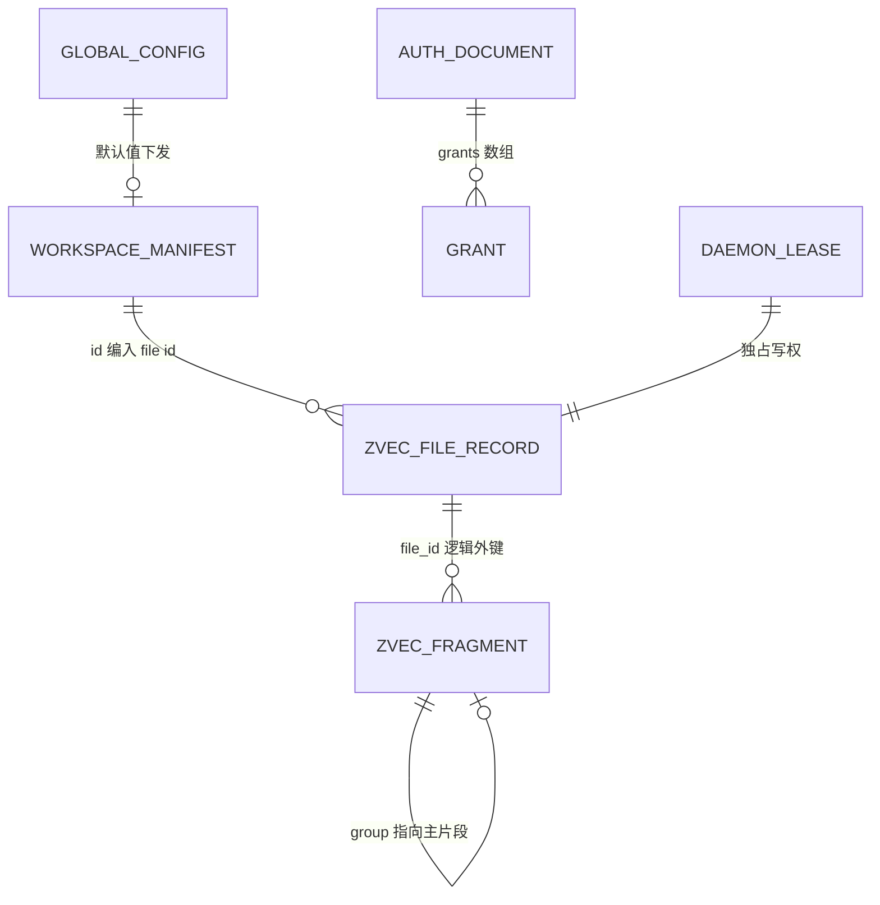
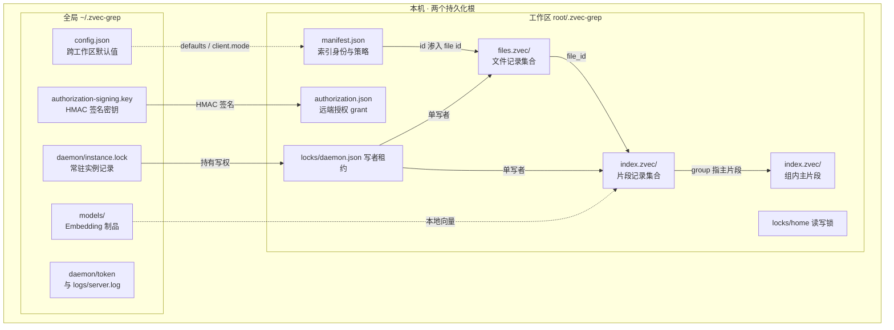
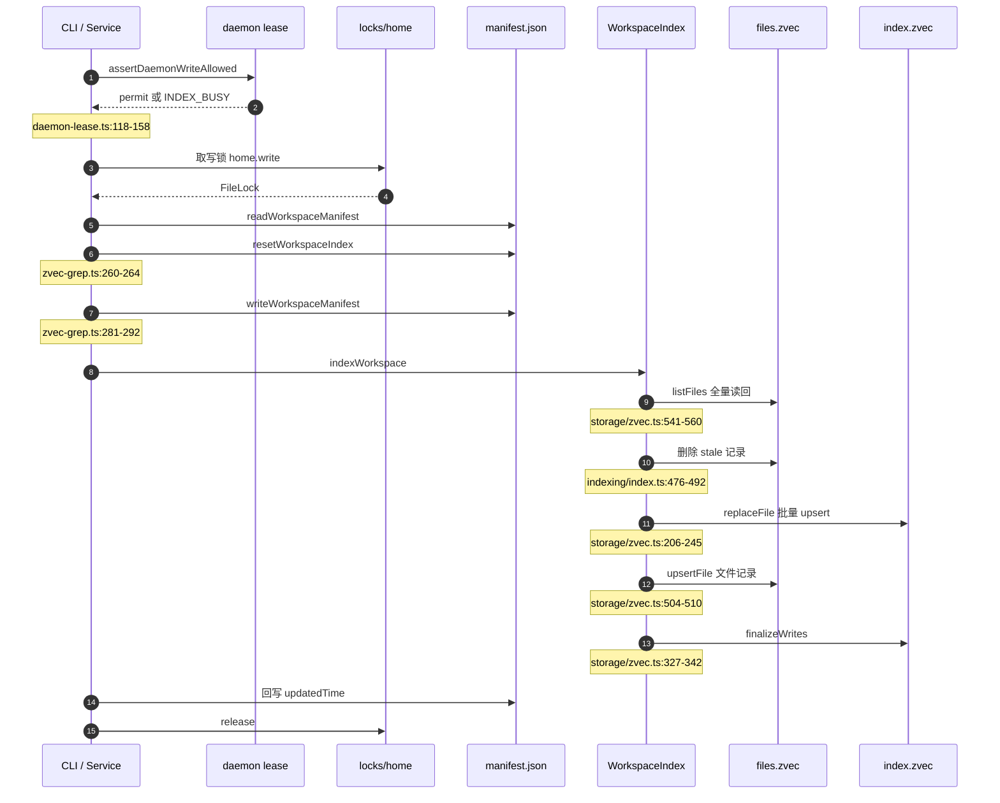
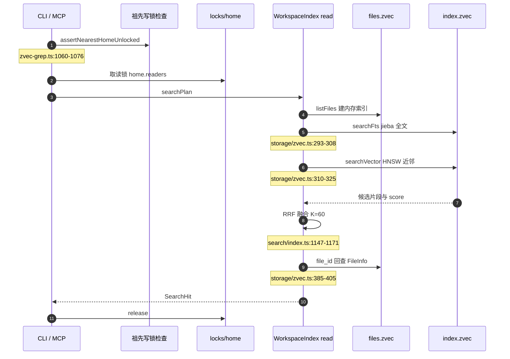

# zvec-grep 持久化数据模型与磁盘布局：manifest 加两个 zvec 列式集合

> 本解读按 `ai-infra` ⊗ `framework` 类规格产出（全新分析）。

## 关注面定位：这里没有一张关系表，但有一整套持久化契约

zg 的"数据模型"不是 `CREATE TABLE`，而是**两个磁盘根、三类载体**：工作区根 `<root>/.zvec-grep/` 承载索引本体与工作区级授权，用户根 `~/.zvec-grep/` 承载跨工作区的默认值、守护进程实例状态与模型制品；索引本体又拆成"一份人可读的 JSON 元数据"加"两个 `@zvec/zvec` 列式集合目录"。仓库里既没有 `.sql`，也没有 `migrations/`、`entities/`、`*.prisma`——按数据模型主动探测的判据，本项目命中的不是建表脚本，而是**目录布局与 schema 构造函数**，所以下文的"表"是 JSON 文档、zvec 集合与带记录 schema 的锁定文件。

工作区侧的路径是不可配置的常量：集合目录名由 layout 层拼出 [src/engine/storage/layout.ts:4-5]()
<!-- anchor: const FILES_ZVEC = "files.zvec"; … const ENTITIES_ZVEC = "index.zvec"; -->
，manifest 文件名与它的文档版本号定义在 manifest 层 [src/engine/manifest.ts:8-9]()
<!-- anchor: export const WORKSPACE_MANIFEST_FILE = "manifest.json"; … export const CURRENT_MANIFEST_VERSION = 1; -->
，"工作区根"本身则由 `.zvec-grep` 这一目录名决定，且 home 若已存在会先 `realpath` 归一化，保证软链接进出不影响索引身份 [src/engine/service/root.ts:10-23]()
<!-- anchor: export const ZVEC_GREP_DIR = ".zvec-grep"; … return join(resolve(root), ZVEC_GREP_DIR); -->
。全局侧同样是常量：配置固定落在 `~/.zvec-grep/config.json`，守护进程状态落在其 `daemon/` 子目录 [src/engine/config.ts:118-119]()
<!-- anchor: export function globalConfigPath(): string { … return resolve(homedir(), ".zvec-grep", "config.json"); -->
。这种"不可配置"是刻意的——只有路径固定，local-first 的边界才能被一句话验证：索引到底在不在项目目录里。

## 实体总览：逻辑基数与物理布局

先看逻辑关系。这里**不用外键、也不做引用完整性校验**，所有关联都是"约定 id + 查询时回查"：文件记录与片段记录靠 `file_id` 相等，片段组内靠 `group` 指向主片段，授权文档靠 `targetFingerprint` 去重。正因没有约束层，下面的关系图表达的是"设计意图上的基数"，而不是"数据库会拒绝非法写入"。

其中 `WORKSPACE_MANIFEST → ZVEC_FILE_RECORD` 不是普通外键，而是**身份渗透**：manifest 的 `id` 被拼进 file id 的哈希输入 [src/engine/pipeline/indexing/scanner/index.ts:1237-1238]()
<!-- anchor: function makeFileId(workspaceIndexId: string, absolutePath: string): string { … return sha256Text(`${workspaceIndexId}\0${normalizePath(absolutePath)}`); -->
，manifest 换 id，全部文件记录就在寻址意义上立即失效。这也解释了 manifest 为什么不能当"可随手删除的说明书"。

物理布局是两个根、两棵子树。工作区树里每个路径都能随项目一起拷贝、一起 `rm -rf`；全局树里每个路径都是机器级资源，删掉只影响体验，不影响任何工作区索引的正确性。

`files.zvec` 与 `index.zvec` **是目录不是文件**：`.zvec` 只是命名习惯，zvec 会在该路径下建自己的集合文件与一把 `LOCK`，因此打开失败要按 "lock" 类错误做退避重试 [src/engine/storage/zvec.ts:815-844]()
<!-- anchor: function openZvecCollection( … cause: lastError, -->
。集成测试正是用"往目录里塞一个 marker 文件"来证明重建会整目录清空 [test/integration/service.test.mjs:925-948]()
<!-- anchor: const filesMarker = join(workspaceHome, "files.zvec", "legacy-marker"); … assert.equal(await readFile(authorizationPath, "utf8"), "preserve"); -->
。

## 核心实体与字段表

### manifest.json：工作区的身份与策略载体

它把"这个目录里的索引是什么、按什么策略建、绑定哪个向量空间"写成人可读的一条记录，类型就是 `WorkspaceIndexInfo` 再加两个工作区级字段 [src/engine/manifest.ts:14-16]()
<!-- anchor: export type WorkspaceManifest = WorkspaceIndexInfo & { … embeddingRuntime: EmbeddingRuntimeConfig; -->
，被继承的基础字段定义在通用类型层 [src/engine/types.ts:208-217]()
<!-- anchor: export type WorkspaceIndexInfo = { … updatedTime: number; -->
。

| 字段 | 类型 | 约束（主/外键、索引、非空、默认） | 说明 |
|------|------|--------------------------------------|------|
| `manifestVersion` | 字面量 `1` | 非空；不等于 1 即整份文档无效 | JSON 文档的格式版本门，是第一道闸，不做兼容降级 |
| `id` | string | 非空；创建时 `randomUUID()` | 工作区索引身份。它参与 file id 哈希，改 id 等于让全部既有文件记录失去寻址 |
| `name` | string | 非空 | 展示名，默认取 root 目录 basename |
| `path` | string | 非空 | 指向 `.zvec-grep` 目录自身（即 home），不是项目根 |
| `rootPaths` | `RootPath[]` | 非空且长度 > 0，每项须过 `isRootPath` | 索引范围契约：绝对路径加 recursive/include/exclude/globs/fileTypes/hidden/noIgnore/maxDepth/maxFileSizeBytes/follow |
| `indexPolicy` | `"enabled"` 或 `"disabled"` | 可选 | `disabled` 保留 manifest 与数据但拒绝检索，是"不删数据的软关闭" |
| `embedding` | `{provider,model,dimension,metric}` 或 `null` | `null` 或四字段齐全、dimension > 0、metric 限于 cosine/dot/euclidean | 向量空间契约，同时决定向量列宽度与 HNSW 度量，是"必须重建"的根因 |
| `indexVersion` | integer 或 `null` | `null` 或整数 | 列式 schema 的语义版本 |
| `createdTime` / `updatedTime` | number（毫秒） | 非空且有限 | 索引成功与失败都会回写 `updatedTime`，是"这轮跑过没有"的痕迹 |
| `embeddingRuntime` | `{apiKey?,endpoint?,device?}` | 非空对象，内部字段可选 | 工作区级 runtime 覆盖。apiKey 若显式持久化就明文落在工作区里，这也是它能被单工作区携带的原因 |

字段级要点：`rootPaths` 的子字段白名单是一长串可选谓词，缺项即表示"继承扫描默认值" [src/engine/types.ts:46-60]()
<!-- anchor: export type RootPath = { … follow?: boolean; -->
；`indexVersion` 取自 `CURRENT_INDEX_VERSION` 常量，与 `embedding`、`indexPolicy` 一起构成"是否已索引"的判据 [src/engine/types.ts:197-197]()
<!-- anchor: export const CURRENT_INDEX_VERSION = 1; -->
。写入只有一条路径——临时文件加 rename 的原子替换，目录与文件分别固定为 `0700`/`0600` [src/engine/manifest.ts:40-46]()
<!-- anchor: export function writeWorkspaceManifest( … fileMode: WORKSPACE_MANIFEST_MODE, -->
。

### files.zvec：文件记录集合（`zvec_grep_files`）

它是增量索引的状态机：每个被扫描文件一条 doc，保存 diff 判据（size、mtime、contentHash）与索引结果状态。schema 由 `createFilesSchema` 构造 [src/engine/storage/zvec.ts:593-640]()
<!-- anchor: function createFilesSchema(): ZVecCollectionSchema { … stringField("entity_ids_json"), -->
，读写封装在 `ZvecFileMetaStore`，它把集合 doc 与两份内存 map 一起维护 [src/engine/storage/zvec.ts:465-519]()
<!-- anchor: class ZvecFileMetaStore { … this.needsOptimize = true; -->
。

| 字段 | 类型 | 约束（主/外键、索引、非空、默认） | 说明 |
|------|------|--------------------------------------|------|
| doc `id` | string | 主键（集合内唯一），等于 `sha256(workspaceIndexId \0 absolutePath)` | 内容寻址替代自增：同一工作区同一路径 id 稳定，跨工作区天然隔离 |
| `file_id` | STRING | 非空，INVERT 索引 | 与 doc id 同值。冗余成独立可过滤列，是为了支持按它批量删除与按 id 前缀分区扫描 |
| `absolute_path` | STRING | 非空，INVERT 索引 | 规范化（`resolve`）后的绝对路径，用于路径前缀过滤 |
| `relative_path` | STRING | 非空，无索引 | 展示用；列表读回后按它排序，保证输出顺序稳定 |
| `root_path` | STRING | 非空，无索引 | 归属哪个 `rootPath`（一个工作区可以有多 root） |
| `size_bytes` | INT64 | 非空 | diff 第一道闸：size 与 mtime 都没变就免读文件 |
| `last_modified_time` | INT64 | 非空 | diff 第一道闸的另一半 |
| `content_hash` | STRING | 可空，INVERT 索引 | sha256 内容哈希，只在 size/mtime 变化后才计算，避免每次索引全量读盘 |
| `kind` | STRING | 非空，INVERT 索引 | `text`/`code`/`data`/`image` |
| `format` | STRING | 非空，无索引 | 具体格式串 |
| `has_index_status` | BOOL | 非空 | 列式集合没有嵌套对象，"状态是否存在"必须显式拍成一个布尔位 |
| `indexed_time` | INT64 | 可空 | `null` 表示 pending（待索引或上次失败待重试）；非空即已成功 |
| `entity_count` | INT32 | 非空，默认 0 | 公开实体数（组只算主片段），status 汇总直接累加它 |
| `token_count` | INT32 | 可空 | 诊断用，仅部分后端上报 |
| `truncated_fragment_count` | INT32 | 可空 | 因输入预算被截断的片段数 |
| `error` | STRING | 可空，无索引 | `markFileFailed` 写入的失败原因；pending 且带它就会进入 `failedFiles` |
| `entity_ids_json` | STRING | 非空 | 公开实体 id 的 JSON 数组。把有序 id 列表塞进一个字符串列，让"按文件列实体"变成一次 doc 读取，代价是失去对单个 id 的索引能力 |

字段级要点：内容哈希的计算被刻意推迟到"size 或 mtime 变了"之后才发生 [src/engine/pipeline/indexing/index.ts:1880-1894]()
<!-- anchor: async function withContentHash(file: FileInfo): Promise<FileInfo> { … contentHash: sha256Bytes(bytes), -->
，这是把"读盘算哈希"从每轮索引的固定成本变成只在疑似变更时的条件成本。

### index.zvec：片段记录集合（`zvec_grep_entities`）

一条 doc 等于一个 `EntityFragment`（大实体的分片），三种检索形态合于一集合：`text` 走 FTS、`embedding` 走 HNSW、标量列走 INVERT。schema 由 `createSchema` 构造 [src/engine/storage/zvec.ts:891-940]()
<!-- anchor: function createSchema( … metricType: metricToZvec(embedding.metric), -->
；文本列显式声明 jieba 分词与 lowercase 过滤 [src/engine/storage/zvec.ts:916-922]()
<!-- anchor: name: ENTITY_TEXT_FIELD, … filters: ["lowercase"], -->
，向量列显式声明 HNSW 与度量映射 [src/engine/storage/zvec.ts:934-940]()
<!-- anchor: vectors: { … metricType: metricToZvec(embedding.metric), -->
。

| 字段 | 类型 | 约束（主/外键、索引、非空、默认） | 说明 |
|------|------|--------------------------------------|------|
| doc `id` | string | 主键，等于 `sha256(fileId \0 index)` | 片段 id，确定性生成，让同一文件同一位置的片段可复现 |
| `group` | STRING | 可空，INVERT 索引 | 非空时指向组内主片段 id；主片段存大纲或签名摘要，子片段存窗口正文 |
| `file_id` | STRING | 非空，INVERT 索引 | 事实上的外键指向 `files.zvec`；删文件即按它批量删片段 |
| `content_kind` | STRING | 非空 | `text` 或 `image`，决定 `content_base64` 是否存在 |
| `content_hash` | STRING | 可空，无索引 | 从文件记录冗余下来的哈希，便于命中后校验来源 |
| `metadata_kind` | STRING | 可空，无索引 | `code` 或 `markdown`，决定其余元数据列怎么解释 |
| `symbol_type` | STRING | 可空，INVERT 索引 | `module/class/interface/function/value/alias`；加索引是为了让按符号类型的过滤下推到存储层 |
| `symbol_name` | STRING | 可空，INVERT 索引 | 符号名，`preferSymbol` 与按名过滤的落点 |
| `symbol_scope` / `symbol_signature` / `symbol_doc` / `symbol_modifiers` / `node_type` | STRING | 可空，无索引 | 展示与重排用的元数据；modifiers 用空格连接的字符串表达数组 |
| `heading` / `heading_level` | STRING / INT32 | 可空，无索引 | Markdown 标题路径与层级 |
| `text` | STRING | 非空，FTS 索引（jieba 加 lowercase） | 唯一被全文索引的列。图像不单独建列，而是写 `[image:<format>]` 占位 |
| `embedding` | VECTOR_FP32(dimension) | 非空，HNSW，度量由 manifest 决定 | 列宽即 `manifest.embedding.dimension`，不可就地变更，这是 dimension 变化必须重建的物理原因 |
| `fragment_index` | INT32 | 非空 | 组内顺序 |
| `range_json` | STRING | 非空 | 序列化后的 `Range` 联合类型。列式集合没有联合类型，只能降级成 JSON 字符串，代价是范围过滤无法下推 |
| `content_base64` | STRING | 可空 | 图像原文内联进列，代价是集合体积随图片线性增长 |
| `image_format` | STRING | 可空 | `png/jpeg/webp/gif`，与 `content_kind=image` 配套 |

字段级要点：`group` 有一个不变量——每组必须恰好一个主片段（`id === group`），由写入前的校验强制 [src/engine/storage/zvec.ts:758-798]()
<!-- anchor: function validateFragmentGroups( … code: "ZVEC_GREP.ENGINE.STORAGE.INVALID_FRAGMENT_GROUP", -->
；`Range` 的六种形态以 JSON 承载 [src/engine/types.ts:97-142]()
<!-- anchor: export type FileRange = { … | PageRegionRange; -->
。另一个容易忽略的设计是 doc 里**只存 `file_id`、不存路径快照**，读取时用内存里的 `filesById` 回查文件记录 [src/engine/storage/zvec.ts:385-402]()
<!-- anchor: docToStoredFragment(doc: ZVecDoc): StoredEntityFragment | null { … metadata: parseMetadata(doc.fields), -->
：好处是路径改名不必重写任何片段，代价是任何读操作都必须先把 `files.zvec` 全量载入内存。

### index status：不落盘的派生视图

`WorkspaceIndexStatus` 不是持久化实体，而是"集合内已有记录"与"现场扫描"求差得到的视图 [src/engine/types.ts:275-291]()
<!-- anchor: export type WorkspaceIndexStatus = { … deletedFiles: FileInfo[]; -->
，计算入口把 file 记录分成已索引、pending、失败三堆再叠加 diff 结果 [src/engine/pipeline/indexing/index.ts:177-229]()
<!-- anchor: export async function getWorkspaceIndexStatus( … context: workspaceIndexContext(workspaceIndex), -->
。

| 字段 | 类型 | 约束 | 说明 |
|------|------|------|------|
| `filesScanned` / `filesStored` | number | 派生 | 现场扫描到的文件数对比集合里已有的记录数 |
| `filesIndexed` / `entitiesIndexed` / `fragmentsTruncated` | number | 派生 | 由 `indexedTime` 非空的文件记录聚合 `entityCount` 与 `truncatedFragmentCount` 得到 |
| `filesPending` / `filesFailed` | number | 派生 | pending 定义为 `indexedTime === null`；失败的 pending 再按 `error` 是否出现细分 |
| `filesAdded` / `filesModified` / `filesDeleted` / `filesUnchanged` | number | 派生 | 来自 size 加 mtime 再到内容的 diff 结果 |
| `pendingFiles` / `failedFiles` / `addedFiles` / `modifiedFiles` / `deletedFiles` | `FileInfo[]` | 派生 | 明细数组，元素直接取自文件记录，不做额外落盘 |

不落盘的理由是避免状态漂移：一旦有独立状态文件，就可能出现"状态说已索引、集合里其实没有"。代价是每次查状态都要真扫一遍目录，因此"要不要自动刷新"必须由一个廉价判据决定——只要计数里出现任何非零增量就触发刷新 [src/engine/index-status.ts:8-17]()
<!-- anchor: export function indexStatusNeedsRefresh( … status.filesFailed > 0), -->
。

### 全局 config：跨工作区的默认值唯一来源

它让同一台机器上的所有工作区共享默认 embedding、模型缓存位置、客户端形态与服务监听地址，类型是一份带版本号的浅层文档 [src/engine/config.ts:47-53]()
<!-- anchor: export type ZvecGrepGlobalConfig = { … server?: ZvecGrepServerConfig; -->
。

| 字段 | 类型 | 约束（非空/默认/校验） | 说明 |
|------|------|------------------------|------|
| `version` | 字面量 `1` | 非空；不等于 1 直接报错 | 与 manifest 同样的显式版本门，且拒绝未知字段 |
| `defaults.embedding` | string（`provider/model`） | 可选、非空 | 未显式指定 embedding 时的默认引用 |
| `defaults.modelCacheDir` | string | 可选、非空 | 覆盖默认的 `~/.zvec-grep/models` 制品缓存目录 |
| `providers.<name>.apiKey` | string | 可选、非空 | 全局 API key 存放点，与工作区级 `embeddingRuntime.apiKey` 形成两级 |
| `models.<ref>.endpoint` | string | 可选；必须是合法 http(s) URL；`local/*` 引用禁止该项 | 按模型引用覆盖远端端点 |
| `models.<ref>.device` | `auto`/`cpu`/`metal`/`vulkan`/`cuda` | 可选；非 `local/*` 引用禁止该项 | 按模型引用覆盖本地推理设备 |
| `client.mode` | `direct` / `server` / `auto` | 可选 | 决定请求走进程内还是守护进程，直接改变"谁持有写权" |
| `client.serverUrl` | string | 可选、非空 | MCP 端点覆盖；缺省时由 server 的 host 与 port 拼出 |
| `server.host` | string | 可选；必须是 loopback | 安全边界：服务端只监听本机，其它地址直接拒绝 |
| `server.port` | number | 可选；正整数且不超过 65535 | 默认 7999 |

字段级要点：`local/*` 与 device、远端与 endpoint 的互斥校验不是防呆，而是因为两类模型的可配置项不同，混填会让后续解析链取到无意义字段，宁可在读取时就报错 [src/engine/config.ts:250-259]()
<!-- anchor: if (reference.startsWith("local/") && endpoint !== undefined) { … `models.${reference}.device is only supported for local models`, -->
；真正取值时按"显式参数到工作区快照到全局 provider 配置再到环境变量"的顺序回退 [src/engine/config.ts:103-107]()
<!-- anchor: apiKey: … environmentApiKey(provider, environment) ?? -->
。

### authorization grant store：唯一允许数据外出的凭据

远端 Embedding 是 local-first 的例外通道，所以它有一份独立、可签名、可逐工作区撤销的凭据文档。文档与单条 grant 的类型定义在一起 [src/authorization/types.ts:46-58]()
<!-- anchor: export type RemoteEmbeddingWorkspaceGrant = { … signature: string; -->
，落盘位置固定在工作区内的 `authorization.json` [src/authorization/store.ts:38-43]()
<!-- anchor: grantPath(target: Pick<RemoteEmbeddingTarget, "workspaceRoots">): string { … return join(root, ".zvec-grep", GRANT_FILE); -->
。

| 字段 | 类型 | 约束（主/外键、索引、非空、默认） | 说明 |
|------|------|--------------------------------------|------|
| 文档 `version` | 字面量 `1` | 非空 | 文档版本门；不匹配即当作空文档处理，不抛错 |
| 文档 `grants` | grant 数组 | 非空，可为空数组 | 同一 `targetFingerprint` 只保留一条：授权时先过滤旧记录再追加，天然幂等 |
| grant `id` | string（uuid） | 非空 | 单条授权标识 |
| grant `capability` | 字面量 `"remote_embedding"` | 非空常量 | 能力名，防止别的用途复用这份文档 |
| grant `scope` | 字面量 `"workspace"` | 非空常量 | 授权粒度只到工作区，没有全局开关 |
| grant `workspaceRoots` | string[] | 非空 | 一次授权可覆盖多个 root；写 grant 时对每个 root 各写一份文档，形成多副本 |
| grant `workspaceFingerprint` | string | 非空 | 工作区指纹，与根路径集合一起锁定授权对象 |
| grant `provider` / `model` / `endpoint` | string | 非空 | 被授权的远端目标三元组 |
| grant `targetFingerprint` | string | 非空，逻辑主键 | grant 与 revoke 的匹配键 |
| grant `grantedAt` | number（毫秒） | 非空 | 授权时间 |
| grant `signature` | hex string | 非空 | `HMAC-SHA256(stableStringify(unsigned), key)`，校验用 `timingSafeEqual` 防时序侧信道 |
| 签名密钥 | 32 字节随机数的 hex 文本 | 全局路径、`0600`、以 `wx` 标志创建 | 存在全局根而非工作区，于是文档本身不可自证：把工作区整份拷到另一台机器后签名对不上，授权自动失效 |

### 锁、租约与运行态：文件级布局替代 schema

这一层没有结构化 schema，但有**记录级 schema**，所以用"文件路径 + 记录字段"表说明。所有锁共用同一原语：`mkdir` 的原子性充当抢锁，锁目录内的 `lock.json` 记录持有者 [src/engine/utils/lock.ts:21-26]()
<!-- anchor: export type FileLockInfo = { … operation: string; -->
；读锁落在 `home.readers/<pid>-<token>/` 以支持多读者，写锁落在 `home.write` 独占 [src/engine/utils/lock.ts:357-362]()
<!-- anchor: function writeLockPath(lockPath: string): string { … return `${lockPath}.readers`; -->
。

| 文件路径 | 记录类型与字段 | 约束与默认 | 说明 |
|----------|----------------|-----------|------|
| `<root>/.zvec-grep/locks/home/lock.json` | `FileLockInfo{token,pid,hostname,startedAt,operation}` | token 为 uuid；目录存在即锁存在 | 工作区索引的读写锁根 |
| `<root>/.zvec-grep/locks/daemon.json` | `DaemonLeaseRecord{pid,hostname,instanceToken,createdAt,updatedAt}` | `0600`；`updatedAt` 由 5 秒心跳原子重写 | 把"谁能写这个 root"收敛到单进程 |
| `<root>/.zvec-grep/locks/daemon.guard/owner.json` | 同一 `DaemonLeaseRecord` | `0700` 目录加 `0600` 文件 | 租约自身的互斥守卫，stale 时先整体 rename 隔离再删 |
| `~/.zvec-grep/locks/config` | 同读/写锁结构 | 全局互斥 | 保护 `config.json` 的读改写 |
| `<root>/.zvec-grep/authorization-store` | 同读/写锁结构 | 工作区互斥 | 保护授权文档的读改写 |
| `~/.zvec-grep/daemon/instance.lock` | `DaemonInstanceRecord`：pid、hostname、instanceToken、startedAt、updatedAt、serverUrl、ready、mcpToolset | `0600`；用 `link` 发布而非 rename | 常驻实例唯一性：`link` 在目标已存在时以 `EEXIST` 失败，而 rename 会静默覆盖别人的记录 |
| `~/.zvec-grep/daemon/token` | 至少 32 字符的 bearer token | `0600` | 客户端凭据；也可用环境变量或 token 文件覆盖 |
| `~/.zvec-grep/daemon/logs/server.log` | JSONL：timestamp、event、trace_id、其余业务字段 | `0600`，串行 append | 事件流；字段名命中 token、api_key、authorization、query 的一律丢弃，超 512 字符截断 |
| `~/.zvec-grep/models/` | 各后端自己的制品目录加完成标记与目录锁 | 缓存目录 | 模型制品是机器级资源，多工作区共享一份下载 |

字段级要点：锁过期判定只在**同主机**时才用 pid 存活，跨主机只能退回时间过期，因为 pid 在别的机器上没有意义 [src/engine/utils/lock.ts:236-252]()
<!-- anchor: function isStaleLock( … return expired; -->
。租约的心跳也把"记录仍是自己的"作为写回前提，token 不匹配就不覆盖 [src/daemon/root-lease.ts:158-194]()
<!-- anchor: private startHeartbeat( … return timer; -->
；日志字段的白名单式丢弃，则是为了不让 bearer token 与用户查询原文落进长期保留的文本文件 [src/daemon/logger.ts:53-61]()
<!-- anchor: function sanitizeFields(fields: LogFields): LogFields { … : value; -->
。

## 存储选型：为什么是 zvec 集合加 JSON，而不是 SQLite

**为什么用 `@zvec/zvec`。** zg 的检索语义要求"同一次查询里既做词法排序、又做向量近邻、还按标量条件过滤"，这三件事必须落在同一份数据上。用 SQLite 的 FTS5 加一个独立向量库意味着三套 id 空间、两次去重，而过滤要么在向量库里做不了、要么退化成"先取 topk 再在应用层丢弃"。zvec 允许在**同一个集合**里声明 FTS 列、HNSW 向量列与 INVERT 标量列，标量索引只是一个统一的字段选项 [src/engine/storage/zvec.ts:946-951]()
<!-- anchor: function indexedStringField(name: string, nullable = false) { … indexParams: { indexType: ZVecIndexType.INVERT }, -->
，并且 `querySync` 接受过滤谓词随查询一起下发 [src/engine/storage/zvec.ts:293-324]()
<!-- anchor: searchFts( … return docsToHits(docs, "vector", this); -->
，于是文件、组、符号名、符号类型四类过滤被拼成 `AND` 连接的谓词串直接交给存储层。这里还有一个语义细节：过滤值列表为空时不能简单丢掉该条件——空列表意味着"什么都不要匹配"，所以 zg 注入一个恒假的谓词而不是宽化查询 [src/engine/storage/zvec.ts:1326-1330]()
<!-- anchor: function buildNonEmptyInFilter( … return values.length > 0 ? buildInFilter(field, values) : NO_MATCH_FILTER; -->
。

**代价是什么。** 列式库没有 SQL 的"无 limit 全表扫描"：枚举全部文件记录必须指定 topk，因此 zg 设了 10 万上限，并在超过时按 `file_id` 的十六进制前缀递归分裂成多个区间分别查询 [src/engine/storage/zvec.ts:541-589]()
<!-- anchor: export function queryFileMetadataDocs( … queryFileMetadataPartition(collection, `${prefix}${suffix}`, maxTopk), -->
。这是选型的直接成本，不是实现瑕疵。此外集合写入是 upsert 加 delete 语义，需要显式合并才能回收空间，所以存储层用一个 `needsOptimize` 标志把合并推迟到收尾阶段 [src/engine/storage/zvec.ts:327-342]()
<!-- anchor: async finalizeWrites(): Promise<void> { … this.collection.closeSync(); -->
。

**为什么 manifest 用 JSON 而不是表。** 它是"单条、低频写、人可能要读要改"的记录：`indexPolicy` 可能被人工或 Agent 直接改成 `disabled`，`embeddingRuntime.apiKey` 需要一眼可审，而 `info` 与检索前置判断必须在**完全不打开集合**的情况下完成——JSON 只要一次同步读取加一次校验 [src/engine/manifest.ts:23-37]()
<!-- anchor: export function readWorkspaceManifest(home: string): WorkspaceManifest | null { … return value; -->
。若把 manifest 塞进 zvec 或 SQLite，每次查状态都要先付打开集合或建连接的代价，还要处理 schema 不匹配时的半可用状态。代价是没有约束层：字段校验只能手写成一长串谓词，于是必须靠显式版本号兜底。反过来，文件级记录**没有**放进 manifest，因为它的规模随项目文件数增长，且需要按路径前缀与 id 前缀查询——manifest 保持 O(1) 是刻意的。

**为什么工作区级与全局级要分开。** 判据只有一条：数据归属"项目"还是"机器"。索引、manifest、授权文档属于项目，必须能整体搬走、随项目删除、且不泄漏到别的项目；全局配置、模型制品、签名密钥、daemon 实例状态属于机器，前者是个人偏好，后者是几个 GB 的共享资源与机器上唯一的常驻服务。这条边界在集成测试里被钉死：`--rebuild` 递归清空两个集合目录，却把 `authorization.json` 原样保留 [test/integration/service.test.mjs:925-948]()
<!-- anchor: const filesMarker = join(workspaceHome, "files.zvec", "legacy-marker"); … assert.equal(await readFile(authorizationPath, "utf8"), "preserve"); -->
；而签名密钥放全局，使授权无法随工作区一起被复制走。

## Schema 演进：三道版本门加一次显式重建

zg 没有迁移框架，它的演进策略是"**版本不匹配就拒绝服务，并让用户显式重建**"，而不是自动 DDL 或双写。代价是牺牲平滑升级，换来"绝不出现新旧向量混用"的强保证。

第一道门是 `manifestVersion`：校验器把它当首要条件，不等就判定文档无效并抛错 [src/engine/manifest.ts:70-89]()
<!-- anchor: function isWorkspaceManifest(value: unknown): value is WorkspaceManifest { … isEmbeddingRuntime(value.embeddingRuntime) -->
。第二道门是 `indexVersion`，在 `WorkspaceIndex` 构造函数里比对 `CURRENT_INDEX_VERSION`，不匹配时错误上下文直接给出重建命令 [src/engine/service/workspace-index.ts:113-120]()
<!-- anchor: private validateIndexVersion(): void { … detail("actual", this.info.indexVersion), -->
。第三道门更细：即使版本号一致，`embedding` 的 provider、model、dimension、metric 仍要逐个与当前模型比对，任一不符就抛对应错误（下面引用以 provider 检查为例，其余三项结构相同）[src/engine/service/workspace-index.ts:135-143]()
<!-- anchor: if (expected.provider !== current.info.provider) { … current.info.provider, -->
。为什么这三项必须重建而不能迁移：dimension 变了向量列的物理宽度就变了，metric 变了 HNSW 图里的距离语义就错了，provider 或 model 变了整个向量空间不可比——它们都不是"再算一遍就能对齐"的。

`--rebuild` 的实现方式很直接但信息量很大：先删除 manifest 与两个集合目录，然后**用一个全新的随机 `id` 造 manifest** [src/engine/service/zvec-grep.ts:260-264]()
<!-- anchor: if (options.rebuild || !isWorkspaceIndexed(existing)) { … const existingAfterRebuild = options.rebuild ? null : existing; -->
。由于 file id 是 `sha256(workspaceIndexId, absolutePath)`、片段 id 是 `sha256(fileId, index)`，换 id 等于让所有旧 id 在寻址意义上不存在；这比"打版本戳后过滤"更彻底，因为不需要任何清理逻辑，旧记录根本不会被命中。新 manifest 的构造同时把 `indexVersion` 与 embedding 快照重新写上 [src/engine/service/zvec-grep.ts:1337-1348]()
<!-- anchor: return { … embeddingRuntime, -->
。

崩溃一致性靠两件事叠加。**原子替换**：manifest 与全局配置走"写临时文件再加 rename"，同步版在 json 层实现 [src/engine/utils/json.ts:80-102]()
<!-- anchor: export function writeJsonFileSync( … renameSync(tmpPath, path); -->
，异步版额外对权限类与占用类错误做 5 到 320 毫秒的指数退避重试，因为覆盖被占用的文件在某些平台会失败 [src/engine/utils/atomic-file.ts:6-20]()
<!-- anchor: export async function replaceFileAtomically( … await unlink(temporaryPath).catch(() => undefined); -->
——rename 在同一文件系统内是原子的，读者要么见旧文件要么见新文件，不会读到半截内容。**锁**：写者持 `home.write` 期间不允许有活跃读者，写锁获取会先抢到独占目录再回查读者目录 [src/engine/utils/lock.ts:210-233]()
<!-- anchor: function hasActiveReaders(lockPath: string, staleMs: number): boolean { … return active; -->
。至于集合内部的写，zg 不假设它事务安全：文件替换的次序是"先标记脏、再删旧 doc、再批量 upsert、最后写文件记录" [src/engine/storage/zvec.ts:206-245]()
<!-- anchor: replaceFile( … this.persistFile(indexedFile); -->
，中途崩溃留下的中间态是可恢复的——文件记录若仍是 pending，下一轮 diff 会把它重新放进待索引集合 [src/engine/pipeline/indexing/index.ts:683-684]()
<!-- anchor: if (existing.indexStatus?.indexedTime === null) { … pending.push(await withContentHash(file)); -->
。

并发写的保护不是限流，而是**把写者数量收敛到一**：进程内是读写锁，跨进程是 daemon 租约。任何写入前都会检查该 root 是否已有活跃租约，活着就拒绝并提示改用 auto 模式让 daemon 代劳 [src/engine/utils/daemon-lease.ts:118-158]()
<!-- anchor: export function assertDaemonWriteAllowed( … throw daemonLeaseActiveError(root, record.pid); -->
；租约文件 30 秒未被心跳刷新即视为废弃可抢。还有一个容易忽略的保护：检索启动前会**沿祖先目录逐级检查写锁**，任何一级有活跃写者就快速失败，避免在别人正重建父工作区索引时读到半成品 [src/engine/service/zvec-grep.ts:1060-1074]()
<!-- anchor: function assertNearestWorkspaceHomeUnlocked( … current = parent; -->
。这种"锁外置、不做写限流"的取向也意味着：并发问题必须在锁层被消灭，而不是靠排队缓解。

## 读写路径

图内路径为节省宽度做了省略，完整路径见正文引用。

**索引写入路径**：先取 daemon 许可，再取工作区写锁，然后"先落 manifest、再落数据、最后回写时间"；单个文件失败会被标成 failed，而不是让整轮索引崩掉。

写入路径里最关键的一处顺序是"**先写 manifest 再写数据**" [src/engine/service/zvec-grep.ts:281-292]()
<!-- anchor: const manifest = prepareWorkspaceManifest( … writeWorkspaceManifest(location.home, manifest); -->
：manifest 落盘意味着这个工作区此后自认为"已索引"，所以它必须在数据之前就位；否则一旦数据先落盘而 manifest 缺失，查状态会报未索引，而集合里已经躺着无法解释的记录。反过来，若这轮索引失败，manifest 仍会带着新的 `updatedTime` 被回写一遍，因为"跑过并且失败了"本身就是要持久化的事实 [src/engine/service/zvec-grep.ts:317-323]()
<!-- anchor: } catch (error) { … throw error; -->
。

**检索读取路径**：读侧不打任何写盘，唯一例外是开启自动更新时，读会先做一次廉价状态检查、必要时升级为写锁刷新。

读路径的骨架是"召回、融合、物化"：先算过滤谓词与向量路由，再按初始召回深度做自适应召回 [src/engine/pipeline/search/index.ts:89-133]()
<!-- anchor: export async function searchWorkspaceIndex( … candidates, -->
，召回结果只保留排名与候选，最后由 RRF 融合并按文件分组物化 [src/engine/pipeline/search/index.ts:152-163]()
<!-- anchor: const fused = timings.timeSync("fusion", () => fuseCandidates(candidates)); … visible.map((candidate) => candidateToHit(candidate, limit, trace)), -->
。RRF 只吃排名不吃分数 [src/engine/pipeline/search/index.ts:1147-1171]()
<!-- anchor: function fuseCandidates(candidates: Map<string, Candidate>): Candidate[] { … return fused; -->
，因此 FTS 的词法分与 HNSW 的距离不必量纲可比；代价是彻底放弃分差信息，一个"遥遥领先"的向量命中与一个"勉强命中"的候选在融合里权重相同。这条链路上没有一次写盘——只读存储把任何写操作直接判错 [src/engine/storage/zvec.ts:441-445]()
<!-- anchor: private assertWritable(operation: string): void { … context: `operation=${operation}`, -->
；唯一例外是自动更新路径先取**读锁**跑状态扫描，发现需要刷新才升级为**写锁**执行增量索引 [src/engine/service/zvec-grep.ts:543-569]()
<!-- anchor: private async refreshWorkspaceIndexForContext( … const existing = readWorkspaceManifest(location.home); -->
。注意这一步不做锁升级（先释放再获取），因此存在"刚检查完就被别人改掉"的窗口——zg 接受它，因为最坏结果是多索引一次，而不是读到不一致的数据。

## 全局关联：这套布局如何兑现 local-first 与两形态共享

回到四条设计哲学。**local-first** 在这里不是口号而是可检查的属性：索引、manifest、授权文档全在工作区目录内，`.zvec-grep` 还被扫描器硬编码排除，索引永远不会索引自己 [src/engine/pipeline/indexing/scanner/index.ts:120-120]()
<!-- anchor: const HARD_SKIP_HIDDEN_NAMES = new Set([".git", ".zvec-grep"]); -->
；唯一出境通道是远端 Embedding，而它必须持有一份带 HMAC 签名的工作区授权，签名密钥却在全局根，于是"把工作区拷走"不能连同授权一起拷走。**为 Agent 优化**体现在读取侧的稳定性上：文件记录提供路径、mtime、size 与内容哈希，使检索结果可以只携带精确行区间与相对路径，而不必把文件内容塞进上下文。**两条互补检索路径**则解释了为什么一个集合里同时有 FTS 列与向量列：managed ripgrep 完全不经索引，索引侧的两路排名在同一集合上召回再用 RRF 合并 [src/engine/pipeline/search/index.ts:633-638]()
<!-- anchor: return input.storage.searchFts(route.query, input.depth, route.filter); … ? input.storage.searchVector(vector, input.depth, route.filter) -->
。

**Direct 与 Server 共享同一份磁盘状态**是这套布局最需要谨慎的推论。两种形态打开的是同一对集合、同一份 manifest，差别只在进程生命周期与协调：Server 常驻并缓存只读会话，Direct 每次自己开 [src/engine/service/zvec-grep.ts:103-111]()
<!-- anchor: export function openWorkspaceReadSession( … throw workspaceIndexMissingError(start, "undecided"); -->
。共享状态的直接后果是**必须有人仲裁谁能写**，这正是工作区级 daemon 租约存在的理由——它不放在全局根，因为写权冲突是按 root 发生的：一个 daemon 可同时服务多个 root，但每个 root 同时只能有一个写者，租约获取本身还要经过 guard 目录的二次互斥 [src/daemon/root-lease.ts:71-142]()
<!-- anchor: private async createLease(root: string): Promise<DaemonLeaseRecord> { … guard.release(); -->
。间接后果是 zvec 自己的集合锁也会冲突：两个进程同时打开同一集合时，后到者可能拿到 lock 类错误，zg 用最多八次、100 毫秒起步的指数退避把它吸收掉 [src/engine/storage/zvec.ts:815-844]()
<!-- anchor: function openZvecCollection( … cause: lastError, -->
。换句话说，zg 没有要求 zvec 具备多进程并发能力，而是用"工作区读写锁加 daemon 租约加打开重试"三层把并发挡在存储引擎之外——这也解释了为什么每次打开集合都要付一次全量列举的代价：它把"打开"当作一次排他性状态同步，而不是一次廉价的连接建立。
