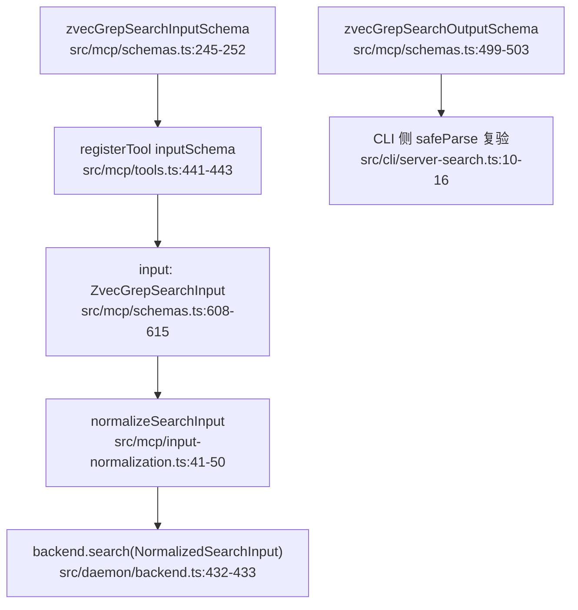
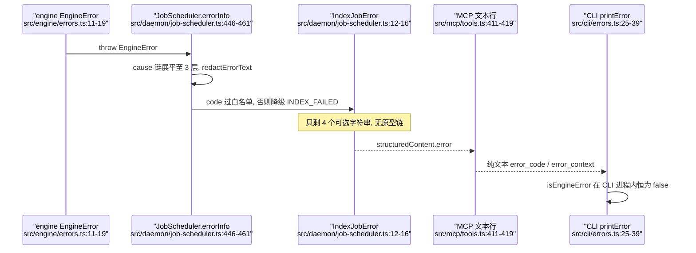

# zvec-grep 的 TypeScript 工程惯用法：边界 zod 契约、错误分层降级、worker 并发与无打包器构建

> 本解读按 `ai-infra` ⊗ `framework` 类规格产出（全新分析）。

## 边界即契约：zod 只活在进程门口

zg 的运行时校验面窄得出奇：全仓 `z.object` 只出现在 `src/mcp/schemas.ts` 与 `src/mcp/tools.ts` 两处，也就是 MCP 工具定义这条进出的缝。这不是疏忽，而是把「不可信输入」精确定位到唯一真正不可信的地方——Agent 传进来的 tool arguments，以及 daemon 回吐给 CLI 的 structured content；引擎内部（扫描、抽取、融合、向量存储）全是纯 TS 类型，零运行时校验。 [src/mcp/schemas.ts:245-252]()
<!-- anchor: export const zvecGrepSearchInputSchema = z.object({ …       "Whether to search immediately or wait for the active index to become fres -->
同一个 schema 同时承担三种身份：MCP 工具定义（直接传给 SDK 的 `inputSchema`）、内部类型（`z.infer` 导出的 `ZvecGrepSearchInput`），以及默认值来源。 [src/mcp/schemas.ts:248-256]()
<!-- anchor:   freshness: z …     .default(true) -->
默认值随契约走这点值得停一下：若 `.default(true)` 写在 handler 里，「CLI 直连引擎」与「经 daemon 调用」两条路径就要各写一份默认，而「一套引擎、两种执行形态」的前提正是不允许这种分叉。代价则是 `z.infer` 把每个 `.default()` 擦成可选，类型层面看不出「调用后一定有值」——只有真正 parse 过的地方才知道。

`union([string, array])` 是本仓最高频的 schema 惯用法，把「单值或列表」压成一个 schema（`boundedStringList`、`pathFilterInputSchema`、`timeInputSchema`）。 [src/mcp/schemas.ts:13-20]()
<!-- anchor: const boundedStringList = (description: string) => …     .describe(description); -->
代价是 `z.infer` 出的是 `string | string[] | undefined`，每个消费者都得自己收窄——`normalizePlainStringList` 就是这个代价的收银台。 [src/mcp/input-normalization.ts:163-171]()
<!-- anchor: export function normalizePlainStringList( …   return normalized.length > 0 ? normalized : undefined; -->
收益也直接：Agent 可以写 `"queries": "rrf fusion"` 而不必知道这里其实是数组，少一次因参数形状失败的重试，正好落在「为 Agent 优化输入输出」这条哲学上。

校验确实发生在 schema 层，有可验证的痕迹：契约测试直接读 *线上* 的 `tool.inputSchema.properties.fileTypes.description`，断言 `.describe()` 的文案原样出现在 JSON Schema 里，说明 SDK 把 zod 转成了 JSON Schema 而不是把 zod 对象当黑盒。 [test/mcp-contract.test.mjs:396-397]()
<!-- anchor:     assert.match( …       tool.inputSchema.properties.fileTypes.description, -->
输出方向同理，而且兼作版本漂移探测器：daemon 的 structured content 由 `zvecGrepSearchOutputSchema` 描述， [src/mcp/schemas.ts:499-503]()
<!-- anchor: export const zvecGrepSearchOutputSchema = z.object({ …   result: searchResultSchema, -->
CLI 拿到后不信任地再 parse 一次，失败就直接告诉用户「升级后没重启 daemon」。 [src/cli/server-search.ts:10-16]()
<!-- anchor:   const parsed = zvecGrepSearchOutputSchema.safeParse(value); …     throw new Error(INCOMPATIBLE_SERVER_SEARCH_MESSAGE); -->
一个 `safeParse` 顶掉了一整套协议版本协商——代价是把「不兼容」和「真的坏了」归成同一句提示。

最有意思的一处不是类型技巧，而是 **schema 的字段裁剪**：公开给 Agent 的搜索 schema 故意 *不包含* `apiKey` / `device` / `endpoint`，源码注释写明理由是防止 Agent 臆造占位 API key 或给远端索引挑本地设备； [src/mcp/schemas.ts:241-247]()
<!-- anchor: // Public agents search with the configured workspace runtime. Keeping credentia …   ...searchFields, -->
CLI 需要的运行时覆盖与有序 route 则用 `.extend()` 单独开一个内部 schema。 [src/mcp/schemas.ts:269-277]()
<!-- anchor: /** Internal daemon-admin schema preserving CLI runtime overrides and route orde …       "Ordered supplemental retrieval groups. Internal CLI transport only.", -->
这是「不可表示非法状态」最经济的一版：不靠 `never`、不靠校验规则，靠 *字段根本不存在*。代价是两个 schema 必须保持字段同步，而 CLI 与 Agent 走的是不同契约，契约测试必须同时覆盖两份。

反例值得点出：磁盘上的 `~/.zvec-grep/config.json` *不走* zod，走的是手写 parser + 字段白名单。 [src/engine/config.ts:492-501]()
<!-- anchor: function assertKnownFields( …       throw invalidConfig(path, `${field}.${key} is not supported`); -->
理由是它要的不是「合法/非法」二值，而是「`defaults.device is not supported`」这种能直接怼到用户脸上的字段级路径，最终包成携带 `code` 与多行 `context` 的 `EngineError`。 [src/engine/config.ts:507-509]()
<!-- anchor:   return new EngineError("zvec-grep global config is invalid", { …     context: `path=${path}\ndetail=${detail}`, -->
所以本仓的真实规则不是「一律用 zod」，而是**用 schema 的地方只需判断合法性，用 parser 的地方需要解释为什么不合法**——前者面向机器，后者面向人。

## 判别联合：`as const` 目录表 + `Extract` + `never`

模型后端的选择是本仓最漂亮的判别联合用法，而且判别依据不是手写 union 而是**数据表**：`EMBEDDING_MODEL_CATALOG` 是 `as const` 字面量对象，各条目自带 `backend` 字面量，条目类型由 `Extract<…, { backend: "model2vec" }>` 从表本身派生。 [src/engine/models/catalog.ts:565-568]()
<!-- anchor: } as const; …   (typeof EMBEDDING_MODEL_CATALOG)[keyof typeof EMBEDDING_MODEL_CATALOG]; -->
工厂则用 switch 分发，兜底函数签名是 `(entry: never): never`。 [src/engine/models/factory.ts:66-69]()
<!-- anchor: function unsupportedCatalogEntry(entry: never): never { …     context: JSON.stringify(entry), -->
好处是新增模型只是往表里加一条，漏接线一定编译失败而不是运行时才炸——运行时零注册表。代价要讲清楚：`as const` 让整个目录成为深度只读的巨大字面量类型，TS 要为几十个条目实例化类型、错误信息变长；`entry.model` 这类二级判别还要再嵌一层 switch；`Extract` 又把类型名与字面量字符串硬绑在一起。

不是每个 union 都配 `never` 兜底，分清哪一类需要是关键：**对外可扩展**的判别联合（模型后端）必须有，**封闭的三值枚举**则不必。`routeByMode` 就用两个提前 return 打发掉 `direct`/`server`，剩下的 default 直接当 `auto`。 [src/client/mode-router.ts:24-28]()
<!-- anchor:   if (options.mode === "direct") return options.direct(); …     : options.direct(); -->
三个值穷尽时 TS 无法证明 default 不可达，硬加 `never` 只是噪音；而目录表每个版本都会长，兜底能在编译期拦住「加了后端忘了接线」。这是同一句「穷尽检查」在不同开放度下的两种成本收益。

**同一份判别联合被写了两遍**，这是本仓最值得注意的重复：引擎侧的 `Range` 是六个成员的手写 union， [src/engine/types.ts:136-142]()
<!-- anchor: export type Range = …   | PageRegionRange; -->
MCP 侧的 `rangeSchema` 是等价的 `z.union`。 [src/mcp/schemas.ts:318-345]()
<!-- anchor: const rangeSchema = z.union([ …     height: z.number().nonnegative(), -->
为什么接受这份重复？因为引擎必须能在**没有 zod、没有 MCP SDK** 的情况下作为库被 import（`src/index.ts` 的导出面正是引擎 + 类型），让领域层反向依赖传输层的校验库是不可接受的。代价是加一种 range 要改两处，且只有 zod 那一侧有运行时防线；收益是 `dist/index.js` 的依赖图干净，Direct 模式不必加载 zod——能少加载一个依赖就少加载一个，这正是 local-first 的直接推论。
「用返回值而非异常表达正常控制流」也是同一种判别联合：远端嵌入授权结果是 `kind: "ready" | "input_required"` 的联合，handler 可以提前 `return resolution.result`。 [src/mcp/tools.ts:716-722]()
<!-- anchor: type RemoteEmbeddingAuthorizationResolution = …   | { kind: "input_required"; result: InputRequiredResult }; -->
这不是错误，而是一次交互往返——MCP 的 elicitation 语义如此，用异常表达反而会让调用方分不清「失败」与「请你确认」。

## 错误分层：`code` 是接口，`context` 是文本

三层 `errors.ts` 的角色可以从体积直接读出来：engine 89 行、daemon 10 行、cli 177 行。engine 定义词汇表，daemon 加语义位，cli 只负责呈现。

**engine 层。** 错误码类型本身是被前缀常量约束的模板字面量类型， [src/engine/errors.ts:1-3]()
<!-- anchor: export const ENGINE_ERROR_CODE_PREFIX = "ZVEC_GREP.ENGINE"; … export type EngineErrorCode = `${typeof ENGINE_ERROR_CODE_PREFIX}.${string}`; -->
`EngineError` 只带三样东西：`code`、`context`、原生 `cause`。 [src/engine/errors.ts:11-19]()
<!-- anchor: export class EngineError extends Error { …     this.context = options.context; -->
注意 `context` 是**多行 `key=value` 字符串**而不是结构化对象，由 `errorDetails([detail("lock", path), …])` 拼装。 [src/cli/errors.ts:87-97]()
<!-- anchor: function formatContextLine(line: string): string[] { …     : [trimmed]; -->
这个选择放弃了程序化取值，换来三件事：能直接塞进日志行、能原样穿过 JSON 与线程边界、能被 CLI 通用渲染。**代价是真实的**：CLI 拿到文本后要把它重新拆回键值对来排版，`parseKeyValuePairs` 用正则反向解析自己刚拼出来的东西。 [src/cli/errors.ts:48-77]()
<!-- anchor: export function modelDownloadFailureMessage( …     : "Failed to download model."; -->
这是「错误码稳定、上下文不稳定」的自然后果——只要码没变，上下文格式改了最多让提示退化成原样文本，不会让分类失效。
同时 `redactErrorText` 把带凭据的 URL、Bearer、`sk-` 前缀统一抹掉，而且**在错误产生的层做**而不是在打印时做。 [src/engine/errors.ts:50-71]()
<!-- anchor: export function redactErrorText(value: string, maxLength: number): string { …     : `${redacted.slice(0, maxLength - 1)}…`; -->
local-first 下 API key 绝不允许经由一条异常消息溜进日志文件，所以脱敏必须发生在最早的、知道 `context` 里可能有什么的那一层。

**daemon 层只加一个语义位。** `DaemonError` 十行，多出来的唯一信息是 `retryable`。 [src/daemon/errors.ts:1-8]()
<!-- anchor: export class DaemonError extends Error { …     this.name = "DaemonError"; -->
不用子类树表达可重试，是因为重试决策发生在调度器里，它需要的是个布尔值而不是 `instanceof` 阶梯；把「可重试」做成字段，daemon 层就不必知道 engine 的错误分类学。

### 跨进程传播：异常降级成纯数据

真正的进程边界上异常**不能过去**：daemon 侧把它压成 `IndexJobError`——四个可选字符串，没有任何原型链。 [src/daemon/job-scheduler.ts:12-16]()
<!-- anchor: export type IndexJobError = { …   cause?: string; -->
压缩有三个设计点。其一，`cause` 链被**展平**而不是嵌套，向下最多走 3 层，去重后拼成 `code: message; code: message`。 [src/daemon/job-scheduler.ts:509-520]()
<!-- anchor:   for (let depth = 0; cause !== undefined && depth < 3; depth++) { …     cause = nestedCause(cause); -->
深度 3 是经验值：Promise 重试一层、模型加载一层、下载一层，正好把根因露出来，再深就是噪音。
其二，错误码要**过白名单正则**才允许出境，不合规一律退化成 `INDEX_FAILED`； [src/daemon/job-scheduler.ts:563-565]()
<!-- anchor: function safeErrorCode(code: string): string | undefined { …   return /^[A-Z][A-Z0-9_.-]{0,127}$/.test(value) ? value : undefined; -->
而这条正则与输出 schema 里 `jobErrorSchema.code` 的约束**逐字相同**。 [src/mcp/schemas.ts:312-316]()
<!-- anchor: const jobErrorSchema = z.object({ …   cause: z.string().max(512).optional(), -->
两处对齐不是巧合：若只在校验侧设限，一个来自第三方 SDK 的畸形 `code`（内含路径或换行）会先写进 job 快照，再让 `outputSchema` 校验失败，把一次可解释的失败变成一次协议错误；在**产生**处过滤比在**出口**拒绝更安全。
其三，这些字段到了 MCP 工具层被重新摊平成 agent 能读的文本行 `error_code:` / `error_message:` / `error_context:` / `error_cause:`。 [src/mcp/tools.ts:411-419]()
<!-- anchor:                 ...(result.error …                         ? [`error_cause: ${result.error.cause}`] -->

**降级的最后一段是丢失。** CLI 从 daemon 收到的是工具结果文本，`isError` 为真时只抛一个普通 `Error(text)`； [src/client/daemon-client.ts:191-193]()
<!-- anchor:       if (result.isError) { …         throw new Error(text ?? `${name} failed`); -->
于是 `printError` 里那个 `isEngineError` 分支只对 Direct 模式生效， [src/cli/errors.ts:25-39]()
<!-- anchor:   if (isEngineError(error)) { …     return; -->
Server 模式下列不出 `Code:` / `Details:`。结果 CLI 的退出码只有 0 和 1 两档。 [src/cli/index.ts:43-44]()
<!-- anchor:     printError(error, { color: errorColor, debug }); …     process.exitCode = 1; -->
这是刻意的取舍：错误码继续以**文本**出现在 `error_code:` 行里供 Agent 读，但不再以类型身份参与 CLI 控制流。代价是「两种执行形态语义一致」出现缺口——同一句查询在 Direct 下能打印错误码，在 Server 下不能；也没做区分退出码（如 2=参数错、3=锁冲突），脚本永远只需判断非零，却无法从退出码区分「没找到」和「服务不可达」。

## worker_threads：把纯 CPU 的向量化挤出事件循环

model2vec 的嵌入算法是纯 CPU 的同步计算：对每个 token id 在静态词表里取一行、累加、除以 token 数、可选归一化。 [src/engine/models/backends/model2vec-runtime.ts:173-210]()
<!-- anchor: function embedStaticTokenList( …   return vector; -->
分词那步也不行——它调用的 `tokenizer.encode` 是同步 wasm 调用，只把结果包成了 Promise 的壳。 [src/engine/models/backends/model2vec-tokenizer.ts:30-32]()
<!-- anchor:     const ids = tokenizer.encode(text, { …     }).ids; -->
**这就是「为什么 worker 而不是 async」的确切答案**：`async` 只让出事件循环，不会把 CPU 工作搬走；当热路径是一次同步 wasm encode 加一轮 O(tokens × dimension) 的数值循环时，`await` 得再频繁也照样把线程钉死。而本项目里「线程被钉死」的后果比一般 CLI 严重得多——Server 形态下同一进程还要响应 MCP 请求、跑文件 watcher、回进度心跳，Direct 形态下还要处理 SIGINT 与进度输出。所以选 worker 不是性能优化，是保住「一套引擎、两种执行形态」不互相拖死的前提。

池子参数从机器来而不是从常量来：`maxWorkers = availableParallelism()`； [src/engine/models/backends/model2vec-worker-pool.ts:40-46]()
<!-- anchor:     maxWorkers = availableParallelism(), …     this.maxWorkers = Math.max(1, Math.floor(maxWorkers)); -->
分发逻辑是「有空闲 slot 就投喂，没到上限就新起，否则排队」。 [src/engine/models/backends/model2vec-worker-pool.ts:85-94]()
<!-- anchor:       const idle = this.slots.find( …         this.queue.push(job); -->
注意每个 slot 同时只持有一个 job（`slot.job`），所以**背压就是队列长度，而且队列无上限**。

### 两层并发：内层 fan-out，外层准入

真正的准入控制在外层的 `AdaptiveEmbeddingScheduler`， [src/engine/pipeline/indexing/index.ts:731-733]()
<!-- anchor:   const embeddingScheduler = createEmbeddingScheduler( …     ctx.embeddingModel, -->
它按 `requestedConcurrency` 或模型自带的 `defaultConcurrency` 定策略，并在失败时折半、连续成功时递增。 [src/engine/pipeline/indexing/index.ts:1429-1434]()
<!-- anchor: function createEmbeddingScheduler( …     resolveEmbeddingConcurrencyPolicy(requestedConcurrency, model), -->
于是实际形态是：外层最多 2 个并发批次（model2vec 目录条目给的就是 2），每批内部再被 worker 池拆到 N 个核。两层而不是一层，是因为外层还要服务远端 Embedding（要处理限流与自适应退避），而内层只对 model2vec 存在；合成一层就得让调度策略知道「当前后端是本地还是远端」，反而更耦合。代价是并发度可解释性变差——用户设 `--embedding-concurrency 2` 并不意味着只有 2 个线程在算。

### 共享词表与结果搬运

词表从 safetensors 直接读进 `SharedArrayBuffer`， [src/engine/models/backends/model2vec.ts:449-459]()
<!-- anchor:     const sharedBuffer = new SharedArrayBuffer(tensorByteLength); …           : new Float32Array(sharedBuffer), -->
再由 `sharedStaticEmbeddingTable` 转成共享视图，作为 `workerData` 交给每个 worker。 [src/engine/models/backends/model2vec.ts:234-245]()
<!-- anchor:         const sharedTable = sharedStaticEmbeddingTable(staticTable); …           await workerPool.start(); -->
这一手省掉的是**每个 worker 复制一份 F16 词表**——目录里这份 artifact 是 129 MB，四个 worker 就少复制约 400 MB 常驻内存。 [src/engine/models/catalog.ts:248-256]()
<!-- anchor:         size: 129210456, …           "7d75cbc54318138807c401b0f0c9721117c628b39de8e8e0edb6cb17e0ee7d18", -->
F16 词表在内存里是 `Uint16Array`，靠一张预先算好的 65536 项半精度查表展开成 float，且只算一次并缓存。 [src/engine/models/backends/model2vec-runtime.ts:213-233]()
<!-- anchor: let cachedHalfFloatValues: Float32Array | null = null; …   return values; -->
这是本仓少见的「用查表换功能缺失」决策：Node 22 没有 `Float16Array`，而逐元素 `DataView.getFloat16` 解码有可测量开销，256 KB 的表一次性摊掉更划算；代价是每个 worker 各持一份表。

结果回传走结构化克隆的快速路径：worker 把 `number[][]` 拍平成一个 `Float32Array` 并**转移** ArrayBuffer， [src/engine/models/backends/model2vec-worker.ts:30-43]()
<!-- anchor:     const flatVectors = new Float32Array( …     port.postMessage(response, [flatVectors.buffer]); -->
主线程再展开回 `number[][]`。 [src/engine/models/backends/model2vec-worker-pool.ts:296-310]()
<!-- anchor: function workerEmbeddingResult( …   return { vectors, truncated: response.truncated }; -->
为什么绕这一圈？因为 `EmbeddingModel.embed` 的契约返回 `vectors: number[][]`，要同时服务四种后端。用 transferable 换零拷贝传输、再付一次拷贝回到统一契约，是**契约一致性优先于单点性能**；代价是每批一次 O(n × d) 的展开。

### 错误、终止与取消的真实边界

跨线程和跨进程一样 `instanceof` 失效：worker 只序列化 `name` / `message` / `stack` 三项。 [src/engine/models/backends/model2vec-worker.ts:46-54]()
<!-- anchor:     port.postMessage({ …     } satisfies Model2VecWorkerResponse); -->
所以 `EngineError` 一定是在**主线程侧**重新包装出来的，业务含义（`MODEL2VEC_EMBED_FAILED`）由知道自己上下文的那一层加。

池子对异常的处置偏激进但正确：worker 的 `exit` 只要不是主动关闭就算失败，直接把 slot 从池里摘掉、终止、拒绝在飞 job； [src/engine/models/backends/model2vec-worker-pool.ts:253-268]()
<!-- anchor:   private failSlot(slot: WorkerSlot, error: unknown): void { …     this.drain(); -->
同时它**校验响应与 job 的配对**，收到的 `id` 对不上当前 `slot.job.id` 就判定失序并整个废掉这个 slot。 [src/engine/models/backends/model2vec-worker-pool.ts:173-179]()
<!-- anchor:     const job = slot.job; …       return; -->
对一个「一个 slot 一个 job」的池子，失序在正确实现下不该发生——所以这不是防御性编程，而是**把不变量违约当成崩溃处理**：宁可让这一批失败，也不能把 A 文档的向量配给 B 文档，那会静默污染索引。

生命周期上有一处很关键：slot 空闲时 `worker.unref()`，派活时 `ref()`。 [src/engine/models/backends/model2vec-worker-pool.ts:167-168]()
<!-- anchor:         slot.worker.unref(); …         this.drain(); -->
没有这一行，一次 `zg` 直连查询结束后进程会因为还挂着 worker 而无法退出。而池子是否启用本身也有个有意思的判据：**注入了依赖就不开 worker 池**， [src/engine/models/backends/model2vec.ts:99-99]()
<!-- anchor:     this.useWorkerPool = Object.keys(dependencies).length === 0; -->
于是单测注入 fake tokenizer/词表时走同进程同步路径，否则每个用例都要起真 worker，既慢又难 mock。
**取消是协作式且只到调度粒度**：abort 只能从队列里摘掉还没派发的 job，已 postMessage 出去的算力收不回来，只在结果回来时被 `settled` 判定丢弃。 [src/engine/models/backends/model2vec-worker-pool.ts:72-81]()
<!-- anchor:       job.abort = () => { …         reject(abortError(signal)); -->
这是线程模型的硬边界，不是实现疏忽：没有抢占式取消，就别假装有。
**综合代价清单**：每个 worker 一份 tokenizer 与词表视图、一次 `workerData` 克隆（只克隆 `tokenizerSource` 等字符串与 SAB 引用，不含词表本身，所以便宜）、重复的 JS 堆与 isolate 启动开销，以及跨线程消息必定走结构化克隆。这些加起来让 worker 只对**批量化**任务划算——单条文本嵌入在 worker 里跑不如同步跑，目录里的 `defaultConcurrency: 2` 与外层批调度正是为了把批量做起来。

## 无打包器：`tsc` 直编 + `node:test` 跑 `dist`

构建配置小到可以整段读完：`NodeNext` 模块解析、ES2022 目标、`strict`、`declaration`。 [tsconfig.json:3-6]()
<!-- anchor:     "target": "ES2022", …     "types": ["node"], -->
配合 `"type": "module"`，`NodeNext` 的直接后果是**源码里所有相对 import 都手写 `.js` 后缀**。 [src/daemon/config.ts:1-5]()
<!-- anchor: import { chmod, readFile } from "node:fs/promises"; … import { DaemonError } from "./errors.js"; -->
tsc 不做扩展名重写，于是 `dist` 里的 import 与 `src` 一对一同构，产出可以**直接被 node 执行**，打包器、`ts-node`、`tsx`、path alias 重写全部不需要。代价是三样：手写 `.js` 后缀对新人反直觉、不能使用 `paths` 别名、没有 tree-shaking（对 CLI/守护进程无所谓，对 `exports` 出去的库面有一点体积代价）。

`exports` 只开 `.` 一个入口，只有 `types` + `import` 两个条件、**没有 `require`**。 [package.json:21-24]()
<!-- anchor:   "exports": { …       "import": "./dist/index.js" -->
这是明确放弃 CJS 消费者：`require("@zvec/zvec-grep")` 不可用。换来的收益是不必维护 dual build、不必处理「双重加载导致两个 `EngineError` 类」的问题——这一点在使用 `instanceof` 做错误分类的代码里是致命的：`isEngineError` 一旦因双包失效，所有错误分类会静默退化成通用分支。这是一个把语言模块模式与错误处理策略绑在一起的构建决定，不只是便利性问题。
`bin` 指向编译产物， [package.json:27-28]()
<!-- anchor:   "bin": { …     "zg": "dist/cli/index.js" -->
而 `build` 就是一条 `tsc -p tsconfig.json`。 [package.json:37-43]()
<!-- anchor:   "scripts": { …     "prepack": "npm run build", -->
**`postbuild` 的 chmod 是为了补 tsc 不做的另一半**：tsc 会原样保留源文件首行的 shebang（`src/cli/index.ts` 第 1 行是 `#!/usr/bin/env -S node --liftoff-only`），但**不会设置文件的可执行位**。没有这个 `chmod 0o755`，`npm link` 后直跑 `zg` 会失败——npm 安装时自己会修 bin 权限，但开发期的本地链接与 `./dist/cli/index.js` 直跑不会。把修复放进 `postbuild` 而不是 `build`，是为了让 `npm run build` 与 `prepack` 两条路径都覆盖到。

测试跑的是**编译产物**而非源码：契约测试从 `../dist/mcp/tools.js` import。 [test/mcp-contract.test.mjs:10-10]()
<!-- anchor: } from "../dist/mcp/tools.js"; -->
取舍很清楚：迭代慢几秒（全量 tsc），覆盖率统计的是编译后 JS 而非源码映射，但**测试对象与发布对象完全同一**——`test:package` 才能真的验证 npm 包装后的 CLI 行为，而这是双执行形态项目最容易出问题的地方（路径、`import.meta.url`、worker 文件定位）。worker 的定位正依赖这套同构：用 `import.meta.url` 拼 `./model2vec-worker.js`， [src/engine/models/backends/model2vec-worker-pool.ts:41-43]()
<!-- anchor:     private readonly workerUrl = new URL( …       import.meta.url, -->
只有「`.ts` → `.js` 一对一同构」成立，dist 里才找得到那个文件；打包器若把两个文件合成一个 chunk，这行就会指向不存在的文件。这是无打包器带来的隐性契约。
测试命令一律带 `--test-concurrency=1`：daemon、lease、索引测试共享 `~/.zvec-grep` 与固定端口，只能串行。没有容器化隔离，就只能把「本地优先」的代价记在测试基础设施上。

**Node ≥22 的约束**在 `engines` 里声明、在 CI 矩阵里以 22.13.0 为下限、并在 `CONTRIBUTING.md` 复述。源码里能确认的下限需求是 `AbortSignal.any`（≥20.3）。把下限定在 22 而非 20 的**唯一决定性证据我没有找到** [WIP]：可能是 MCP SDK 2.0 与 `@huggingface/transformers` 3.x 自身的 engines 要求、`--liftoff-only` 启动路径，以及 CI 只验证 22.13+/24/26 的现实共同决定；不编造理由，留待对照依赖的 `engines` 字段确认。

## 原子写与租约：rename 是边界，租约不是

临时文件名带 pid 与 UUID，且用 `flag: "wx"` 独占创建，再 rename 覆盖目标，最后 `finally` 清理残留 tmp。 [src/engine/utils/atomic-file.ts:11-20]()
<!-- anchor:   const temporaryPath = `${path}.${process.pid}.${randomUUID()}.tmp`; …     await unlink(temporaryPath).catch(() => undefined); -->
两步的意义不同：`wx` 保证**两个进程不会写同一个 tmp**，`rename` 保证**读者永远看不到半个文件**——POSIX 下 rename 覆盖是原子的，读者要么拿到旧 inode 要么拿到新的。
重试列表短而具体（`EACCES / EBUSY / EEXIST / EPERM`，退避 5→320 ms，最后一次 rename 不再吞异常）。 [src/engine/utils/atomic-file.ts:4-4]()
<!-- anchor: const REPLACE_RETRY_DELAYS_MS = [5, 10, 20, 40, 80, 160, 320] as const; -->
这四个码几乎全部来自 Windows：杀毒软件、Search Indexer 或另一个进程瞬间持有目标文件句柄时 `MoveFileEx` 会以这些码失败。**终态仍会抛**——第七次之后的 rename 若还失败，错误原样冒泡，因为那是真问题（权限、只读文件系统）而不是瞬时竞态。
**行为边界要说清：这条路只保证「不撕裂」，不保证「不丢失」。** 全仓写路径里没有 `fsync`，`rename` 前不刷盘、后不刷目录，崩溃或断电可能丢掉最近一次「已经成功返回」的写入。 [src/engine/utils/json.ts:95-102]()
<!-- anchor:     writeFileSync(tmpPath, text, { …     renameSync(tmpPath, path); -->
对 manifest、索引状态这类**可从工作区重建**的数据这是明智取舍（省掉每次写入的 fsync 延迟，在每文件级别的索引更新上很可观）；但对 `~/.zvec-grep/config.json` 这类用户输入，理论上存在「写入返回成功但重启后消失」的窗口——代价是明确的，不是疏漏。
`replaceFileAtomically` 全仓只有两个调用点，且都在 daemon 状态上：实例锁记录， [src/daemon/server-controller.ts:129-131]()
<!-- anchor:     // Keep the old record readable until the complete replacement is ready. …       mode: 0o600, -->
以及 workspace daemon lease 的心跳刷新。 [src/daemon/root-lease.ts:165-180]()
<!-- anchor:         const guard = acquireDaemonLeaseGuard(root, this.instanceToken); …             { mode: 0o600 }, -->
为什么这两处用它而 manifest 走 `json.ts`？因为这两个文件是**并发读者随时会读的单条状态**（任何 `zg` 启动都要读它判断 daemon 是否活着），一次撕裂读会直接导致误判「daemon 已死」。

锁原语是 `mkdirSync(lockPath)` 成功后写 `lock.json`； [src/engine/utils/lock.ts:45-49]()
<!-- anchor:       mkdirSync(lockPath); …         `${JSON.stringify(info, null, 2)}\n`, -->
用目录而不是文件，是因为 `mkdir` 的原子失败语义在所有主流文件系统上都成立（`EEXIST` 即「已持有」），且目录天然携带一个可写的持有者记录（token / pid / hostname / startedAt / operation），默认陈旧阈值 6 小时。 [src/engine/utils/lock.ts:29-35]()
<!-- anchor: type FileLockOptions = { … const DEFAULT_STALE_LOCK_MS = 6 * 60 * 60 * 1000; -->
stale 判定不是单纯看 `startedAt + 6h`：**同主机且 pid 已不存在**就立刻判定陈旧，超时只作为跨主机或无记录时的兜底。 [src/engine/utils/lock.ts:241-252]()
<!-- anchor:   const now = Date.now(); …   return expired; -->
没有这一步，一次 SIGKILL 会让该工作区的索引锁死整整 6 小时。代价是判定依赖 pid 复用——pid 被回收给新进程时会误认为持有者还活着，但方向是保守的（拒绝写）而非危险的（并发写）。
**读写锁的语义是 fail-fast，不是阻塞排队**：写者先抢 `lock.write` 目录，再检查 `lock.readers/` 下有无活跃读者，有就**释放写锁并直接抛错**而不是等待； [src/engine/utils/lock.ts:167-184]()
<!-- anchor: function acquireWriteLock( …   throw readLockBusyError(lockPath, options.operation); -->
读锁则在 `lock.readers/<pid>-<token>` 下登记自己的目录，并在登记完成后**再确认一次**写锁是否出现。 [src/engine/utils/lock.ts:120-154]()
<!-- anchor:   for (let attempt = 0; attempt < 2; attempt++) { …         release: () => releaseFileLock(readerPath, info), -->
这个「登记后复检」补的是经典竞态：读者检查时没有写者，读者登记期间写者拿到写锁并看到没有读者——两次确认把窗口关上。失败时抛的是带完整持有者信息的 `EngineError`。 [src/engine/utils/lock.ts:303-310]()
<!-- anchor:   return new EngineError("Index unavailable", { …       detail("ownerHost", owner?.hostname), -->
放弃阻塞等待换来的是：不引入队列、不做公平性、不会因为持锁进程卡住而死等；代价是重试责任转移给调用方，用户也可能看到「索引不可用」这种实际上等两秒就能好的错误。
释放时必须**校验 token**：stale 清理可能已把旧 owner 的锁目录删掉，同一路径被新 owner 重建，旧 owner 的 `release()` 若不核对 token 就会删掉别人的锁。 [src/engine/utils/lock.ts:187-193]()
<!-- anchor: function releaseFileLock(lockPath: string, owner: FileLockInfo): void { …   rmSync(lockPath, { recursive: true, force: true }); -->
这是整个锁模块里最关键的一行，也是「超时可抢占的锁」必须配套的东西——只要允许抢占，就必然有 ABA。

`daemon.json` + `daemon.guard` 目录是另一套机制：前者是「谁有权写这个 root」的声明，后者是刷新声明时的互斥体，guard 的陈旧判定同样先看 pid、再看 30 秒的 `updatedAt` 窗口。 [src/engine/utils/daemon-lease.ts:173-196]()
<!-- anchor: function guardIsStale(path: string): boolean { …     return Date.now() - statSync(path).mtimeMs > 30_000; -->
为什么不用同一套锁？因为临界区尺度差了两个数量级：文件锁保护**秒级的索引写入**，daemon lease 保护**整个进程生命周期的写权限**。用 6 小时的语义表达「这台机器上还有一个 daemon 活着」会让崩溃恢复慢到不可接受，反过来用 30 秒窗口保护一次索引写入又太脆。两套机制、两种超时，是刻意的。

| 场景 | file lock | daemon lease | 结论 |
| --- | --- | --- | --- |
| 持锁进程被 SIGKILL | pid 探活立即判陈旧 | guard 判 `!processIsAlive` | 秒级恢复 |
| 主机断电 / 内核崩溃 | 依赖 6h `startedAt` 超时 | 依赖 30s `updatedAt` 超时 | 有误判窗口 |
| 系统时钟回拨 | `Date.now()` 差值变小，判定偏保守 | 同上 | 安全方向 |
| 跨主机共享文件系统 | 主机名不同，只能靠 6h 超时 | 同上，30s | 误判窗口最大 |
| 写入中途崩溃 | rename 前崩则旧文件完好，后崩则新文件完好 | 同 | 无撕裂，可能有丢失 |
| 两进程同写一文件 | `wx` 独占创建，第二个失败 | guard 目录 EEXIST | 无交错写 |

## 这些惯用法如何连回整体

四条设计哲学在语言层面各有对应物。**local-first** 落在两处：`redactErrorText` 在错误产生处抹掉凭据而不是在打印处，以及 `Range` 被写两遍以让引擎不依赖 `zod`、`dist/index.js` 的依赖图保持干净。**一套引擎、两种执行形态**既决定了 worker 池的存在理由（否则 Server 被嵌入计算钉死），也暴露了它最大的缺口（错误码在 Server 路径上退化成文本、退出码只有 0/1）。**为 Agent 优化输出**直接塑造了 schema：`describe()` 文案进 JSON Schema、`.default()` 收进契约、`apiKey`/`device` 从 Agent 可见的 schema 里删掉，以及 `jobErrorSchema.code` 与 `safeErrorCode` 用同一条正则把畸形错误码挡在 Agent 的上下文之外。**两条互补检索路径**体现在类型分层上：索引侧的结构化 `SearchHit` / `SearchPlan` 与 ripgrep 侧的 `ZvecGrepRgInput` 各有独立 schema，只在 `ZvecGrepContextOptions` 这一层汇合成同一份紧凑输出。

需要标注的不确定项只有一处：**Node 22 下限中「必须 22 而非 20」的决定性单一证据未在源码中找到** [WIP]，其余结论均可沿本文引用直接核对。
