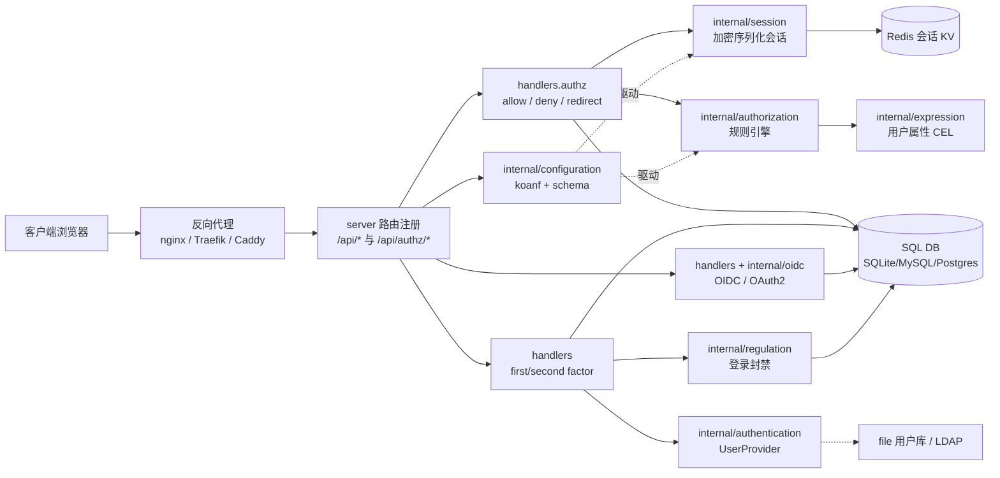
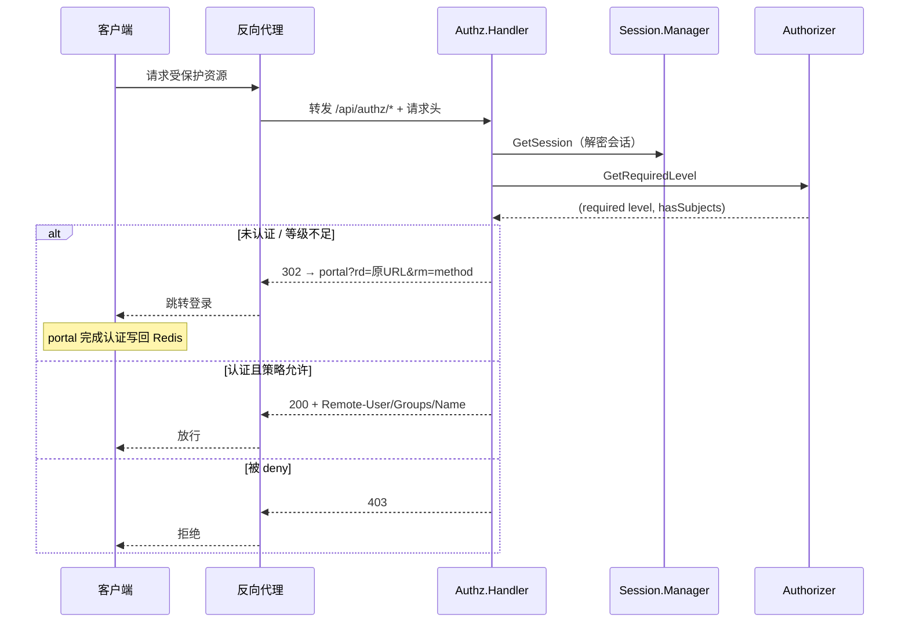

# Authelia — 反向代理伴生的自托管认证/授权 SSO 网关

> **仓库:** [github.com/authelia/authelia](https://github.com/authelia/authelia) · **目录:** [auth/authelia](.) · **解读基线:** `v4.39.26`（`f6fb0a3`）
>
> 本解读按**通用默认规格**产出（Authelia 不属于注册表的规格化类型），叠加「产品类型维度」关注面（可部署服务 + 有数据存储 + 较长业务流 + Go 语言）。正文所有 `文件:行号` 引用均以本地源码 `/Users/morehao/Documents/study/auth/authelia` 为根，经程序重定位校验。
>
> **本版增量更新说明（4.39.26）**：由 `0b553eb` 增量到 `v4.39.26`（323 提交）。要点：storage 加密 AAD 行级化（schema 26）与迁移 V0026~V0029、OIDC 资源指示器（RFC8707）与 consent 请求绑定强化、端点限流配置化、内嵌静态资源预压缩；并修正了此前被误记为风险的 `{user}`/`{group}` 域名匹配实现。逐版本清单见 [`CHANGELOG.md`](CHANGELOG.md)。

## 子文档索引

- [`auth-flow.md`](auth-flow.md) — 请求校验主链路：四种反代集成、Session 加密会话、FirstFactor、regulation 与端点限流
- [`authorization-rules.md`](authorization-rules.md) — 细粒度访问控制规则引擎（first-match-wins + 策略类型 + AMR）
- [`authentication-factors.md`](authentication-factors.md) — 多因子认证：file/LDAP 用户库（含连接池）、WebAuthn、TOTP、Duo、认证等级
- [`oidc.md`](oidc.md) — OIDC / OAuth2 Provider：外包 fosite fork + 自留授权策略，Resource Indicators，OpenID Certified
- [`data-model.md`](data-model.md) — 数据存储层：三后端同构 schema、flyway 迁移、行级 AAD 的列级 AES-GCM 加密
- [`deployment.md`](deployment.md) — 配置系统（koanf 五源装载 + 强 schema 校验 + secret 注入）与 HA 部署
- [`CHANGELOG.md`](CHANGELOG.md) — 各版本变更汇总

## 一句根因

自建应用缺一个**统一、自托管、可审计、自持全套数据**的认证与授权底座。Authelia 把这个能力放进「反向代理旁路」：反代把每个请求转发给它的 `/api/authz/*` 端点，它用「身份会话 + 访问控制规则」裁决 **allow / deny / redirect**，再靠标准 HTTP 状态码让反代执行。身份、凭据、令牌、配置全部落进自己控制的存储；对比 Keycloak / ZITADEL 的「重 IAM 平台」路线，Authelia 走「小而专、专注反代旁路」，同时用 OpenID Certified™ 的 OIDC 实现向第三方应用输出标准身份契约。

## 项目概览

**是什么**：开源认证与授权（Authentication & Authorization）服务器。通过一个自托管 Web portal 提供双因子认证（2FA）与单点登录（SSO），作为 nginx / Traefik / Caddy / Envoy / HAProxy 等反向代理的伴生组件，对每个请求做 allow/deny/redirect 裁决。

**解决的痛点**：

- 反向代理只能做「有没有 header / 命不命中 location 规则」层面的判断，无法理解「这个用户是谁、是否通过 2FA、对某 URL+method 有没有权限」。
- 自建应用各自实现登录 → 认证/授权控制点分散、不可审计、升级 2FA 要改业务代码。
- 现成 SSO 方案要么重（Keycloak Java 栈）、要么封闭（Auth0/Okta）、要么不是为「反代旁路」这个姿势设计。

**适用场景**：

- 自托管家庭/内网服务（Nginx+Authelia 一份配置护住所有子应用）
- 基于 Traefik / Caddy / Envoy Gateway 的容器/云原生栈统一 SSO + MFA
- 需要细粒度按「子域 / 用户 / 组 / URI / 方法 / 网络 / 1FA-2FA 策略」控制访问的站点
- 需要标准 OIDC/OAuth2 让第三方应用接入的组织内身份服务

### 核心能力清单

| 能力 | 说明 |
|------|------|
| 反向代理伴生校验 | ForwardAuth / ExtAuthz / AuthRequest / Legacy 四种反代集成模式，统一 allow/deny/redirect（[`auth-flow.md`](auth-flow.md)） |
| 多因子认证 | Security Keys/WebAuthn（含 passkey 无密码登录）、TOTP、Duo 推送，one/show 因子双类（[`authentication-factors.md`](authentication-factors.md)） |
| 细粒度访问控制 | 声明式规则表：subdomain/user/group/URI/method/network，per-rule 1FA/2FA 策略，正则与 `{user}`/`{group}` 占位（[`authorization-rules.md`](authorization-rules.md)） |
| OIDC/OAuth2 | OpenID Certified™（Basic/Implicit/Hybrid/FormPost/Config OP），含 PKCE/Device/Client Credentials/Resource Indicators（RFC8707）（[`oidc.md`](oidc.md)） |
| HA 高可用 | Remote DB（MySQL/Postgres/SQLite）+ Redis 共享会话 KV，多副本横向扩展（[`deployment.md`](deployment.md)） |
| 暴力防护 | regulation 封禁 + 时序攻击延迟 + 可配置的逐端点 rate limit（[`auth-flow.md`](auth-flow.md)） |
| 强配置校验 | koanf 五源装载 + schema 强校验 + secret 文件注入 + 配置生成（[`deployment.md`](deployment.md)） |
| 数据自持 | SQL 三后端同构 schema、flyway 迁移、行级 AAD 的敏感列 AES-GCM（[`data-model.md`](data-model.md)） |

### 技术栈一览

| 层面 | 技术 |
|------|------|
| 语言 | Go（后端单二进制）、TypeScript/React + Tailwind CSS + shadcn/Base UI（`web/` portal 前端，embed 进二进制） |
| HTTP | fiber（fasthttp-based）、自定义中间件链 |
| OIDC/OAuth2 | `authelia.com/provider/oauth2`（Authelia 维护的 fosite fork）+ `internal/oidc` 粘合层 |
| 配置 | koanf + mapstructure + 自定义 decode hooks + 自研 schema/validator |
| 存储 | SQLite / MySQL / PostgreSQL（三后端同构迁移）+ Redis（session，支持 Sentinel/Cluster） |
| 认证引擎 | go-crypt（argon2id/bcrypt/scrypt/pbkdf2/sha2crypt）、go-webauthn、Duo push、CEL（用户属性表达式） |
| QUIC/协议相关 | faillite（session）、rawlink 等 |

## 架构总览

一条请求（上方），配几张支撑形态图：

### 核心模块导读

| 模块（目录） | 在系统中的角色 | 深读 |
|------|------|------|
| `internal/handlers` authz + firstfactor | 反代裁决主入口 + 登录编排，四种反代模式与 session/regulator 协同 | [`auth-flow.md`](auth-flow.md) |
| `internal/session` / `internal/regulation` | 加密会话（Redis 事实源）+ 登录封禁（存储层真封禁） | [`auth-flow.md`](auth-flow.md) |
| `internal/authorization` / `internal/expression` | 授权规则引擎（first-match-wins）+ 用户属性 CEL | [`authorization-rules.md`](authorization-rules.md) |
| `internal/authentication` / `webauthn` / `totp` / `duo` / `ntp` | 多因子认证与用户库（file/LDAP + 连接池） | [`authentication-factors.md`](authentication-factors.md) |
| `internal/oidc` + oidc handlers | OIDC/OAuth2 Provider（协议外包 fosite fork，策略自留） | [`oidc.md`](oidc.md) |
| `internal/storage` | SQL 数据存储层（三后端迁移 + 行级 AAD 的列级加密） | [`data-model.md`](data-model.md) |
| `internal/configuration` / `server` / `commands` | 配置装载校验 + 服务路由 + CLI 运维命令 | [`deployment.md`](deployment.md) |

## 核心链路一览

未登录请求如何走到 portal（主干），详见 [`auth-flow.md`](auth-flow.md)：

## 总结

Authelia 的价值不是发明新协议，而是把「身份与会话的判定」从应用挪到**网关旁路**，用一份**声明式规则表**对外部请求做细粒度裁决，又用**标准 OIDC** 向内部应用输出身份。它的工程取舍非常有代表性：

- **协议外包、策略自留**：OIDC 交给自有 fosite fork，本地只写与自身强耦合的授权/consent/claims 逻辑，同时 Authorization 层复用同一套 level 判定。
- **认证与授权分离**：认证决定「等级」（know/have 因子类别），授权只消费「等级」判放行；AMR 提供「用什么认证」的事实但不越权污染授权红线。两个核心入口代码可见全貌：反代裁决统一走 `Authz.Handler`（取目标对象 → 认证 → 取所需等级 → allow/deny/redirect）（[internal/handlers/handler_authz.go:157-253]()）；
<!-- anchor: func (authz *Authz) Handler(ctx AuthzContext) { -->
所需等级由 `Authorizer.GetRequiredLevel` 依据规则表 first-match-wins 算出（[internal/authorization/authorizer.go:55-60]()）。
<!-- anchor: func (p *Authorizer) GetRequiredLevel(subject Subject, object Object) (hasSubjec -->
- **配置即代码 + 强 schema**：一处 schema 定义同时产出运行时校验、文档、jsonschema、模板注释；未知 key 启动期即拦。
- **数据落库、会话入 Redis**：凭据/令牌事实源在 SQL，活跃会话在 Redis，天然支撑 HA，且关键列 AES-GCM 落库可审计。

值得学什么：反代伴生（旁路校验 + 状态码驱动）的设计姿势、`UserProvider`/因子接口解耦多因子、AMR 等级模型、SECRET 文件注入与 schema 强校验的配置工程、三后端同构迁移 + 行级 AAD 的存储演进。若在对比 ZITADEL/Keycloak（重 IAM 云平台）、Tinyauth（同一命题的极简实现）时用 Authelia 的分寸感理解，会更容易看清每家的取舍。
