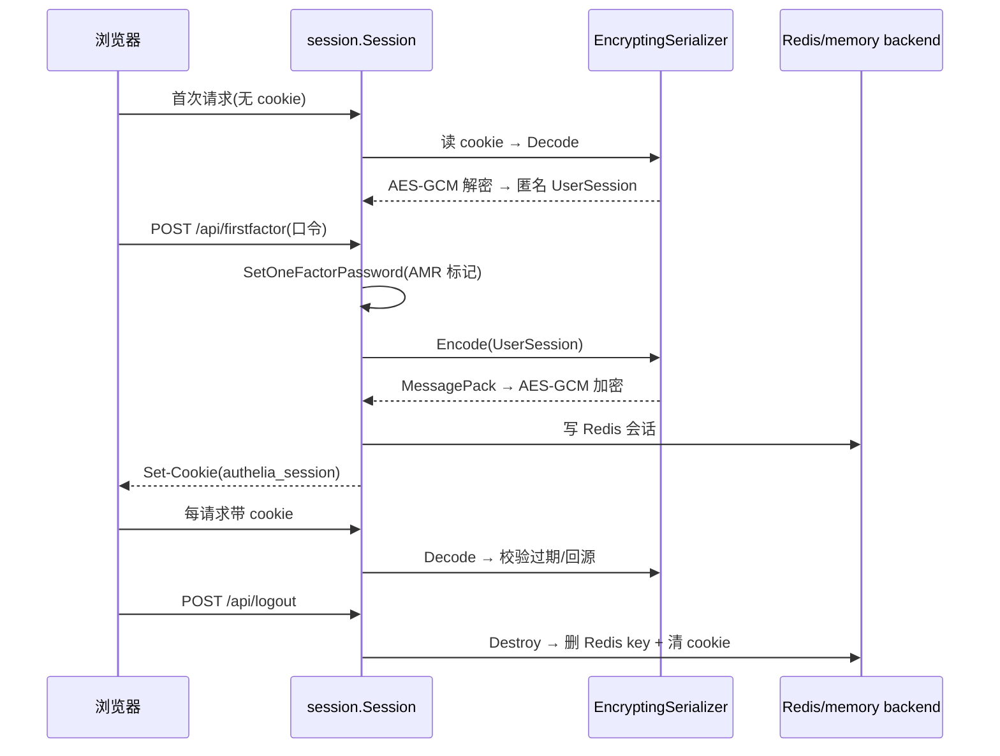
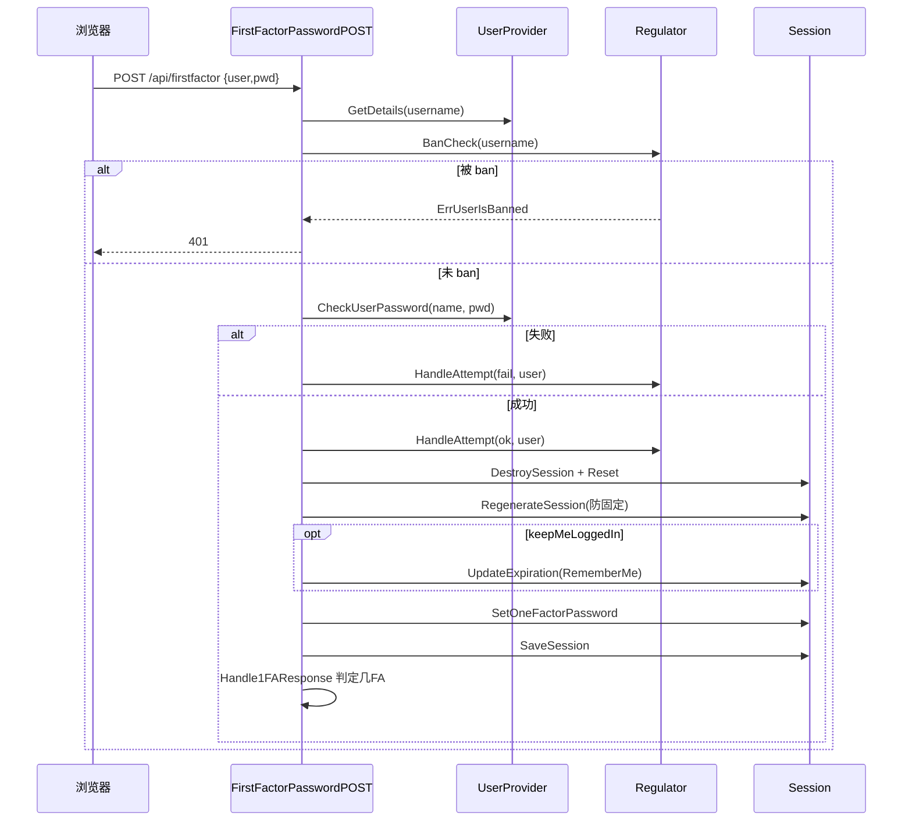
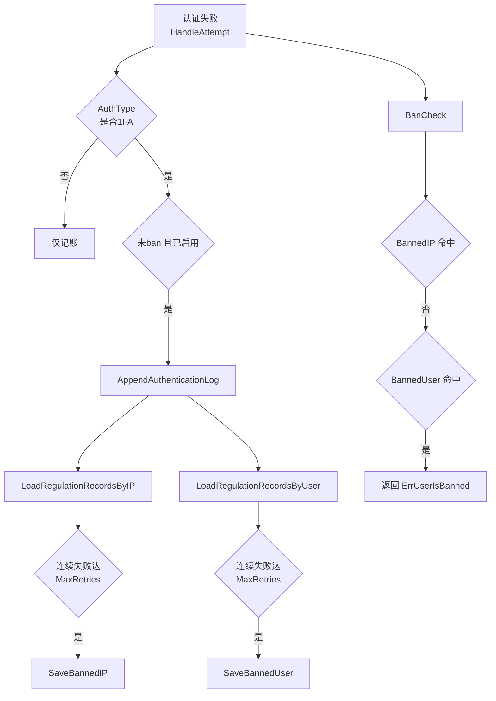

# 请求校验主链路：反代集成、Session、FirstFactor 与登录限流

> 源码根 `/Users/morehao/Documents/study/auth/authelia`。这是 Authelia「反代伴生」这一灵魂关注面的深读：对外它是 verify 网关，对内它是认证 + 会话 + 门卫三层。

## 为什么这一层是灵魂

Authelia 对外界暴露的核心契约就是 `verify`。去掉 authz 链路，它只剩一个「自带的登录门户」——用户能登录、能看到 `/api/state` 返回自己已认证，但没有任何一条请求会被拦截校验，反代伴生定位随之失效。README 的两句宣传 "companion for reverse proxies by allowing, denying, or redirecting requests" 与 "Access restriction after too many invalid authentication attempts" 正对应本文两条主线：**authz 请求裁决** 与 **regulation 登录限流**。

一句话：**authz 是对外主入口，session 是它的记忆，regulation 是它的门卫**。

## 根因：反代能拦流量，但没有身份与策略

nginx/traefik/caddy/envoy 只能在「有没有某个 header、是否命中某条 location 规则」层面做事，无法理解「这个用户是谁、是否通过 2FA、他能不能访问这个 URL+method」。根因是：**反代有能力拦截流量但没有身份与策略，应用有业务价值但没有统一的 verify 点**。Authelia 用「反代旁路 + cookie 会话 + 可配 ACL」把两者缝起来：

- 反代把请求转给 authz 端点（各反代能力不同 → 产生四种实现）；
- Authelia 用自己的 cookie 会话记住「用户是谁、认证到什么等级」，用 ACL 规则回答「这个 subject 访问这个 object 需要什么等级」；
- 通过 HTTP 状态码（200/401/403/302）让反代执行裁决——反代是被动的执行器，不持有判断逻辑。

## 四种反向代理集成模式

核心差异在两处：**怎么决定目标 URL+method**（读哪些头），以及**怎么处理未授权**（回什么状态码/跳不跳 portal）。公共骨架 `Authz.Handler` 只写一次，依赖 builder 注入四组行为函数 [internal/handlers/handler_authz_builder.go:78-108]()。
<!-- anchor: func (b *AuthzBuilder) WithEndpointConfig(config schema.ServerEndpointsAuthz) *AuthzBuilder { -->

| 实现 | 目标 URL 来源 | method 来源 | 未授权处理 | 反代代表 |
|---|---|---|---|---|
| ForwardAuth | `X-Forwarded-Proto/Host/URI` | `X-Forwarded-Method` | 302/303 跳 portal（XHR 或非 html → 401） | Traefik/Caddy/Skipper |
| ExtAuthz | `X-Forwarded-Proto` + 请求行 Host + authz_path | 请求行 Method | 通用跳转 | Envoy |
| AuthRequest | `X-Original-URL` | `X-Original-Method` | 302 → portal | ingress-nginx |
| Legacy | `X-Original-URL` 优先回退 X-Forwarded-* | `X-Forwarded-Method` 优先回退请求行 | 依方法 302/303，或 Basic 挑战 | 旧版 nginx 等 |

为什么四种并存而不抽象成一种协议：反代的鉴权转发能力差异太大（auth_request 只能透传有限头、ForwardAuth 走 X-Forwarded-*、Envoy ext_authz 是 gRPC 桥接每次收到完整 HTTP 请求）。**为每种反代的「原生转发模型」提供最贴合的实现**，语义忠实、集成成本最低；代价是公共逻辑必须小心抽取（已通过函数注入字段做到）。

4.39.21 起「取 object」这一步被进一步收敛：Legacy 策略的 `handleAuthzGetObjectLegacy` 不再自己拼装，而是交给 `authorization.NewObjectMethodURLOrSchemeHostPath`——有 `X-Original-URL` 就用它，否则用 scheme/host/path 拼；host 与 path 分别取 `ctx.GetXForwardedHost()`（回退请求行 Host）与 `ctx.GetXForwardedURI()`（回退请求行 path）[internal/handlers/handler_authz_impl_legacy.go:15-29]()。这类「缺头就回退到请求行」的容错让反代只透传部分头时不再直接 400，也是该版 `did` 式纵深防御的一部分。
<!-- anchor: func handleAuthzGetObjectLegacy(ctx AuthzContext) (object authorization.Object,  … return *requestedObject, nil -->

裁决主骨架 [internal/handlers/handler_authz.go:157-252]()：取 object → 校验安全 scheme 且命中 session cookie 域 → `authn()` 跑策略链 → `Authorizer.GetRequiredLevel` 拿规则要求 → `isAuthzResult` 三态裁决 → 各自回复。

<!-- anchor: func (authz *Authz) Handler(ctx AuthzContext) { -->
<!-- anchor: 		switch isAuthzResult(authn.Level, required, ruleHasSubject) { -->

关键裁决判据 `isAuthzResult` [internal/handlers/handler_authz_util.go:37-52]()：

<!-- anchor: func isAuthzResult(level authentication.Level, required authorization.Level, ruleHasSubject bool) AuthzResult { -->

| 规则要求 required | 实际等级 level | 结果 | 说明 |
|---|---|---|---|
| `Bypass` | 任意 | Authorized | bypass 即放行 |
| `Denied` | 非匿名 | Forbidden | 已认证仍被禁 → 明确 403 |
| `Denied` | 匿名且规则无 subject | Forbidden | 匿名且无主体依赖 → 也可 403 |
| `OneFactor` | ≥ OneFactor | Authorized | |
| `TwoFactor` | ≥ TwoFactor | Authorized | |
| 其余 | — | Unauthorized | 需登录/提级 |

授权通过时回 200 并把 `Remote-User / Remote-Groups / Remote-Name / Remote-Email` 头注入响应，反代转交给上游应用做身份透传 [internal/handlers/handler_authz_common.go:37-52]()。
<!-- anchor: func handleAuthzAuthorizedStandard(ctx AuthzContext, authn *Authn) { -->

## Session 生命周期

**设计要点与权衡**：

- **为何 session 用「加密序列化存 Redis」而非 JWT**（全项目最深的取舍）：JWT 无状态自包含、天然分布式，但不可主动撤回、可变字段（LastActivity/AMR/RefreshTTL）改写需重签发。Authelia 作为「需立刻封禁」的安全网关选择 **authenticated session**——可即时吊销（Redis DEL），可变真值一次读写；代价是维护服务端存储与密钥轮换，放弃「无状态天然横扩」。
- **加密序列化**：`EncryptingSerializer` 设为 `EncodeFunc/DecodeFunc`，先 MessagePack marshal 再 `utils.Encrypt`（256-bit AES-GCM），输出 `nonce|ciphertext|tag` [internal/session/encrypting_serializer.go:34-70]()。**完整性由 AES-GCM 的认证标签（AEAD）保证，而非独立 HMAC**。session 密钥由配置 secret 经 `DeriveLegacyCryptographicKey`（SHA256 压缩）派生。
<!-- anchor: func (e *EncryptingSerializer) Encode(src session.Dict) (data []byte, err error) { -->
- **为什么都持久化加密态**：fasthttp/session 的 provider 只存字节块，「你是谁」靠加密 dict；Redis 泄露时明文不可读。这是「数据落库、会话入 Redis」哲学的体现。
- 会话后端：配置 Redis 时用 fasthttp/session 的 redis provider（可 Sentinel 高可用），否则内置 memory；KeyPrefix 均 `authelia-session`。

## FirstFactor 登录

要点 [internal/handlers/handler_firstfactor_password.go:70-165]()：
<!-- anchor: userPasswordOk, err := ctx.Providers.UserProvider.CheckUserPassword(details.Username, bodyJSON.Password) -->

- 口令校验前先 `BanCheck`，命中则记录失败并 401——regulation 在认证入口即拦截。
- 成功先 `DestroySession` 再 `NewDefaultUserSession`，随后 `RegenerateSession`（换 session id 防固定），`keepMeLoggedIn` 才 `UpdateExpiration(RememberMe)`。
- `SetOneFactorPassword` 是**认证事实登记**：写第一因子时间戳、LastActivity、打 AMR 标记（`UsernameAndPassword=true`）。
- `Handle1FAResponse` 判断目标 URL 的 `GetRequiredLevel`：需 2FA 就暂不跳转返回 OK；只需 1FA 且目标安全则回 redirect。Passkey 1FA（`EnablePasskeyLogin`）同构但走 WebAuthn challenge。

## regulation 登录限流

 

核心逻辑 [internal/regulation/regulator.go:31-67]()：`HandleAttempt` 记 `AuthenticationAttempt` 入 storage，仅当「失败、未封禁、启用 regulation、类型为 1FA」才进入封禁判定（避免 2FA 失败也触发封禁风暴）。`expires` 在 FindTime 时间窗内数**连续**失败（遇第一条成功即停），够 `MaxRetries` 就返回封禁到期点——封禁期内继续失败不重置到期，成功登录会打破连续计数。按 IP 与按用户分别封禁，落 `BannedIP`/`BannedUser`。
<!-- anchor: func (r *Regulator) HandleAttempt(ctx Context, successful bool, ban *Ban, requestURI, requestMethod, authType string) { -->

**「延迟 + 随机」与「封禁」的分工**：时序延迟对应**中间件层**的 `TimingAttackDelay`（`internal/middlewares/timing_attack_delay.go`），而 regulation 是**存储层**的真封禁，两者叠加防御：

- 认证端点用 `NewTimingAttackDelay(10, time.Second)` 让成功/失败响应耗时趋同、加随机抖动，防时间侧信道推断用户名是否有效。
- 中间件 `RateLimiter`（令牌桶，默认桶实现 `NewIPRateLimitBucket` 基于 `golang.org/x/time/rate`）给第二因子与 OIDC 端点防爆破，超量回 429 + Retry-After。

### 端点限流：配置驱动 + 集中回收

> **演进说明(4.39.26)**：此前本文写的是 `NewIPRateLimit` 单中间件；该 API 已被 `NewRateLimiter` + 可配置桶取代。

限流从「几个写死的 IP 限流器」演进为**配置驱动的端点限流体系**：

- **逐端点配置**：每个受保护端点对应 `server.endpoints.rate_limits.<endpoint>`，可配 `enable` 与多档 `buckets`（每档 `period` + `requests`），由 `WithRateLimitConfig` 装载；默认值见 [internal/configuration/schema/server.go:62-75]()。
<!-- anchor: // ServerEndpointRateLimits represents the rate limiter configuration for each e … OpenIDConnectRevocation                 ServerEndpointRateLimit `koanf:"openid_c -->
  **该版新增的档位是 `second_factor_password`**（默认 5 分钟 30 次 / 60 分钟 40 次）：passkey 无密码登录可能回落到口令补 2FA，这条新路径此前没有任何限流。
- **配置即开关**：`enable: false` 时 `WithRateLimitConfig` 清空 buckets，中间件退化为透传——「关掉某端点限流」不需要改路由代码。
- **集中垃圾回收**：令牌桶的过期清理不再各自为政，改为限流器实现 `GarbageCollectorProvider` 契约，由 `middlewares` 的中央 `GarbageCollector` 统一调度 [internal/middlewares/garbage_collector.go:13-18]()。
<!-- anchor: // GarbageCollectorProvider represents the required methods to support periodic  … GarbageCollectionFrequency(ctx context.Context) (frequency time.Duration) -->
- **状态码豁免**：`WithRateLimitExemptStatusCodes` 让「明确成功」的响应（如 PAR 的 201、token 的 200）不计入配额，避免正常流量被自己的成功响应拖进限流。

关键权衡：**时序延迟在单实例内存**（滑动平均），低延迟无存储依赖但多实例不共享；**封禁落在 Redis-backed storage**，天然跨实例共享、支持 HA。Authelia 把「防侧信道」放无状态中间件、「防爆破」放有状态存储层——两种失效模式互补。**限流桶本身也仍是实例内存**（`IPRateLimitBucket` 是带 RWMutex 的 `map[string]*BucketLimiter`），所以多副本部署下限流阈值实际被放大到「副本数 × 配置值」；这是它与 regulation 封禁的关键差异，也是分布式部署时需要知道的取舍。

## 中间件：认证门槛与安全默认

- `Require1FA`/`RequireElevated` 保护 portal 内部需登录的 API（/api/configuration、/api/user/info、TOTP/WebAuthn 变更端点等）。`Require1FA` 检查 `AuthenticationLevel ≥ OneFactor` 否则 403；`RequireElevated` 额外校验「升级会话」（Elevations）未过期且 IP 匹配。
- 严格安全默认：只接受 https/wss 目标、session cookie Secure+HttpOnly、跳转限域内域名（`IsSafeRedirectionTargetURI`）。
- 「错误永不产生已认证身份」的纪律：认证策略链出错不升级身份，`Get` 初始化即把 Level 置 `NotAuthenticated`、Username 置 `<anonymous>`，杜绝把失败当匿名放行的隐患 [internal/handlers/handler_authz_authn.go:217-300]()。
<!-- anchor: func (s *HeaderAuthnStrategy) Get(ctx AuthzContext, _ session.Manager, object *authorization.Object) (authn *Authn, err error) { -->

## 全局关联

这一层是「认证 vs 授权」分界的主战场：**认证（FirstFactor 建立等级）** 与 **授权（Authorizer 判放行）** 在此交汇，`authentication.Level` 与 `authorization.Level` 是两个不同枚举，靠 `isAuthzResult` 比较代码映射。session 是记忆（存 AMR 与时间戳），regulation 是门卫（记失败并封禁），authorization 是裁判（读等级给策略）——四者在一次请求里各司其职，正是 Authelia「小而专、反代旁路」哲学的落地处。
