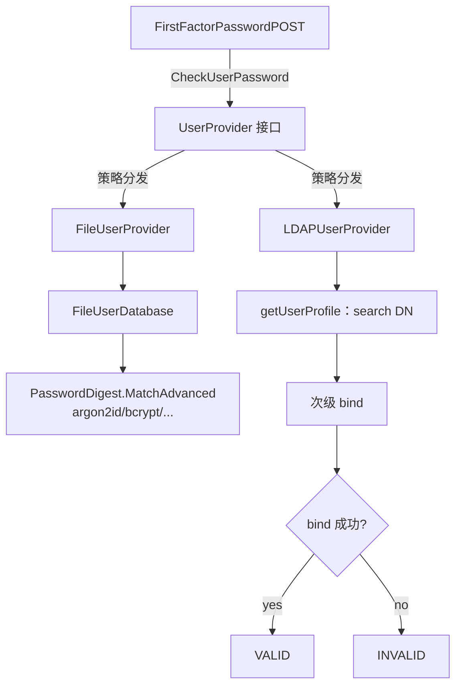
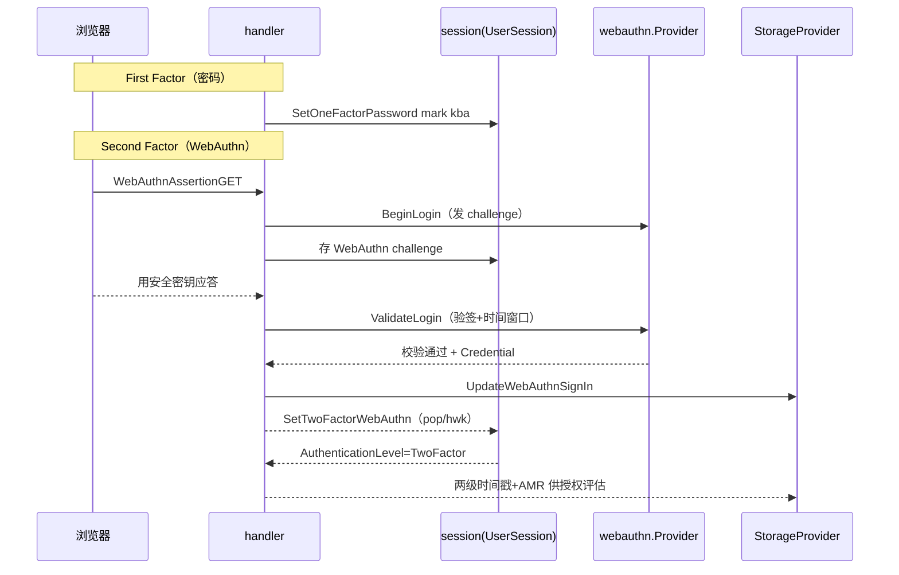

# 多因子认证：用户库、认证等级、WebAuthn / TOTP / Duo

> 源码根 `/Users/morehao/Documents/study/auth/authelia`。Authelia 是反代伴生认证网关，安全模型的核心筹码就是**多因子**；本关注面是「认证 vs 授权」分离这条设计哲学里**认证这一半的全部实现**。

## 角色与根因

去掉它，系统退化为「单口令登录 + 静态会话」：反代旁路人人都能拿一张登录过的 cookie 冒充任何用户，`two_factor` 授权规则形同虚设，密码重置也不再需要邮箱身份验证。

根因：自建应用需要「强身份证明」但往往只有口令这一个弱因子；引入多因子时面临四个纠缠问题——因子种类碎片化（TOTP/FIDO2/Duo/passkey 各有各的协议与硬件假设）、认证状态如何量化、密码凭证离线存储的泄露风险、WebAuthn/TOTP 是时间敏感防重放协议。Authelia 的解法是 **UserProvider 接口 + 认证等级枚举 + 因子 Provider 接口 + session 内 AMR** 四件套，把「多样因子」收敛成「一个等级值、一组方法引用」，让上层授权只认等级、不认具体因子。

关注面边界：`internal/authentication`（用户存储层 file/LDAP + 密码哈希）、`internal/webauthn`/`totp`/`duo`（三种第二因子的纯实现）、`internal/ntp`（时钟偏差校验）、`internal/notification`（邮件/Webhook 通知）、`internal/handlers`（first/second factor 编排）、`internal/session`+`authorization`（承载认证等级与 AMR）。

## 设计思路

- **放弃「把因子逻辑写进 handler」**：TOTP/WebAuthn/Duo 各自抽象成 `Provider` 接口，handler 只调 `Validate`/`Assertion`/`AuthCall`，换实现不碰 handler。
- **放弃「用户存储直接操作数据库」**：file 与 LDAP 统一在 `UserProvider` 接口后，`CheckUserPassword`/`UpdatePassword` 语义对上层一致，底层差异被完全封装。`[internal/authentication/user_provider.go:12-29]()` 定义 `CheckUserPassword`/`GetDetails`/`UpdatePassword`/`ChangePassword` 等统一门面。

  <!-- anchor: type UserProvider interface { … Close() (err error) -->
- **放弃「把认证等级写死在每个 handler」**：等级计算收敛到 `session.UserSession.AuthenticationLevel()`，handler 只管打标记，避免各写一套 `if` 链。

## 用户存储：file 用户库 vs LDAP

两个实现面对同一 `UserProvider` 接口，但「密码验证」的根本机制天差地别：

- **file 用户库**：`[internal/authentication/file_user_provider.go:90-101]()` 的 `CheckUserPassword` 用 go-crypt 的 `algorithm.Digest.MatchAdvanced(password)` 比对哈希。哈希算法启动时由配置解析成 `crypt.Hash`——`NewFileCryptoHashFromConfig` 支持 `argon2id`（默认）/`sha2crypt`/`pbkdf2`/`scrypt`/`bcrypt`，每种参数全可配。用户信息与哈希读入内存 `FileUserDatabase`（RWMutex 保护），文件被 watcher 改动可热重载，写回时权限 `0600`。热重载会经 `LoadAliases` **重建** email/CI 别名映射——此前重载不重置别名表，会让失效别名残留、进而让「查不到用户」返回误导性错误（4.39.21 修复）[internal/authentication/file_user_provider_database.go:90-110]()。
  <!-- anchor: func (p *FileUserProvider) CheckUserPassword(username string, password string) (match bool, err error) { … return details.Password.MatchAdvanced(password) -->
  <!-- anchor: // LoadAliases performs the loading of alias information from the database. … return nil -->

- **LDAP**：`[internal/authentication/ldap_user_provider.go:88-292]()` 的 `CheckUserPassword` 语义不是比哈希，而是「能否用这组凭据 bind 成功」——先无凭据查用户 DN（`getUserProfile`），再 `bind(username+password)`。改密按服务器能力分支：AD 走 `unicodePwd` UTF-16LE modify + `MsftServerPolicyHints`、支持 `PwdModify` 扩展的走 RFC 3062 ExOp、否则回退 `userPassword` modify。

  <!-- anchor: func (p *LDAPUserProvider) CheckUserPassword(username string, password string) (valid bool, err error) { … if profile, err = p.getUserProfile(client, username); err != nil { -->

**关键权衡**：file 是「自管哈希的离线存储」（泄露文件即泄露全部哈希，虽加了盐和强算法），LDAP 是「目录服务器托管的在线服务」（密码明文归目录管，Authelia 无法审计密码历史）。统一接口掩盖差异，另有 `cached.go` 的口令缓存（HMAC 摘要 + 有效期 + `singleflight` 合并并发验证）做性能优化——`[internal/authentication/cached.go:49-61]()` 的 `Check` 用 `singleflight` 把并发同名校验合并为一次真正落库的密码比较。

  <!-- anchor: func (c *CredentialCacheHMAC) Check(ctx Context, username, password string) (valid, cached bool, err error) { … raw, err, _ = c.group.Do(key, c.check(ctx, username, password, sum)) -->

### LDAP 连接池：装饰器而非分支

LDAP 的连接管理抽象成 `LDAPClientFactory` 接口（`Initialize`/`GetClient`/`ReleaseClient`/`Close`），有两个实现：`StandardLDAPClientFactory` 每次 `GetClient` 新建、用完关闭；`PooledLDAPClientFactory` 则是一个**装饰器**——包住另一个 factory，用带缓冲的 channel 维护固定大小连接池 [internal/authentication/ldap_client_factory.go:130-152]()。
<!-- anchor: // PooledLDAPClientFactory is a LDAPClientFactory that takes another LDAPClientF … sleep   time.Duration -->

三个值得注意的设计点：

- **池化是包装而非 `if pooling` 分支**：`NewPooledLDAPClientFactory` 包装标准 factory，未开启池化时行为完全等同标准实现，上层（`LDAPUserProvider`）对是否池化无感知。
- **非常规凭据自动降级为不池化**：`poolOptions` 比较请求的 address/username/password 与配置默认值，任一不同就改走一次性连接（典型场景是按用户 DN 做二次 bind），避免把携带不同身份的连接混进同一个池 [internal/authentication/ldap_client_factory.go:226-235]()。
<!-- anchor: func (f *PooledLDAPClientFactory) poolOptions(opts ...LDAPClientFactoryOption) ( … return unpooled, options -->
- **错误语义区分关闭态**：`ErrPoolClosed`（取用时池已关闭）与 `ErrPoolClosedInitialize`（关闭后又尝试 initialize）分开，便于上层区分「临时不可用」与「生命周期用错」。

4.39.21 修的是「池化客户端被错误跳过」：选择逻辑此前会让部分客户端被不当跳过，既可能让个别连接长期闲置，也可能让少数连接过载——这是连接池实现里的经典 bug 类型，正确性依赖 round-robin 计数器与 `closing` 状态机的配合。

## 认证等级模型

认证状态被量化为 `[internal/authentication/types.go:358-368]()` 的三值 `Level`（`NotAuthenticated`/`OneFactor`/`TwoFactor`），TOTP、Duo、WebAuthn、passkey 无论协议差异，最终都落进这一个等级值。

<!-- anchor: type Level int … TwoFactor -->

等级计算完全收敛在 `[internal/session/user_session.go:29-141]()` 的 `AuthenticationLevel(passkey2FA bool)`：

<!-- anchor: func (s *UserSession) AuthenticationLevel(passkey2FA bool) authentication.Level { … default: -->

1. `Username == ""` → `NotAuthenticated`
2. `FactorPossession() && FactorKnowledge()` → `TwoFactor`
3. 配置启用 passkey 单步 2FA（`passkey2FA`）且 `WebAuthn && WebAuthnUserVerified` → `TwoFactor`
4. 只命中一个 factor 类别 → `OneFactor`
5. 兜底 → `NotAuthenticated`

**精妙之处**：TOTP、Duo、WebAuthn-second-factor 都属于「have」因子，密码属于「know」因子。所以「口令+TOTP」「口令+安全密钥」「口令+Duo」都是合法 2FA；而「口令+口令」（两个 know）不算——由 `FactorPossession()`/`FactorKnowledge()` 的 and 关系天然保证。

handler 侧只负责「成功后在 session 打 AMR 标记」：`SetOneFactorPassword`（置 `KnowledgeBasedAuthentication`）、`SetTwoFactorTOTP`/`SetTwoFactorDuo`/`SetTwoFactorWebAuthn`（置对应因子并记时间戳）。授权链路消费该等级：`handler_authz_util.go` 把 `authentication.Level` 与规则要求的 `authorization.Level` 比较决定 allow/deny。

## WebAuthn 流程：注册、断言、NTP 防重放

- **注册登记（seed）**：`WebAuthnRegistrationPUT` 下发 attestation challenge，`POST` 对响应做 `w.CreateCredential` 校验，构造 `model.NewWebAuthnCredential` 落库（含 AAGUID/AttestationType/SignCount）。落库前用 `[internal/webauthn/util.go:43-64]()` 的 `ValidateCredentialAllowed` 做过滤策略——`ProhibitBackupEligibility` 禁可备份凭据直接报错、AAGUID 白名单命中即放行、否则按黑名单逐一拒绝。

  <!-- anchor: func ValidateCredentialAllowed(config *schema.WebAuthn, credential *model.WebAuthnCredential) (err error) { … return nil -->
- **登录断言**：`WebAuthnAssertionGET` 发 challenge → `WebAuthnAssertionPOST` 用 `w.ValidateLogin` 校验，比对 `credential.KID` 后 `UpdateSignInInfo` 更新 sign count、检查 `CloneWarning`（克隆检测），成功后 `SetTwoFactorWebAuthn`。
- **挑战与会话绑定**：`WebAuthn` 会话数据（含 challenge）存在 session 里，保证「发 challenge 的和应答的必须是同一会话」。AMR 在 post 阶段由 `AuthenticatorAttachment == CrossPlatform` 推导 `WebAuthnHardware`（否则 `WebAuthnSoftware`），结合 `HasUserPresent/HasUserVerified` 进入 `AuthenticationMethodRefs`。

**NTP 为何在认证模块里**：TOTP 靠时间步长、WebAuthn 靠时间窗口防重放，服务器时钟不准会既拒合法用户又扩大攻击窗口。`[internal/ntp/ntp.go:29-39]()` 的 `StartupCheck` 用 SNTP 四时间戳公式估算时钟偏移，超过 `MaximumDesync` **直接拒绝启动**——把时钟正确性提升为认证前置条件。

<!-- anchor: func (p *Provider) StartupCheck() (err error) { … return errors.New("the system clock is not synchronized accurately enough with the configured NTP server") -->

偏移由 `[internal/ntp/util.go:72-79]()` 的 `calcOffset` 依 `((T2-T1)+(T3-T4))/2` 计算。

<!-- anchor: func calcOffset(t1, t2, t3, t4 time.Time) time.Duration { … return offset -->

## 第二因子替代性

- 可用性：`AvailableSecondFactorMethods()` 根据配置 `TOTP.Disable`/`WebAuthn.Disable`/`DuoAPI.Disable` 返回可用方法清单；只在 `IsSecondFactorEnabled()` 时下发。
- 偏好：`SetDefaultPreferred2FAMethod` 在「配置可用方法 ∩ 用户已注册设备」里定偏好（优先 TOTP→WebAuthn→Duo）；`MethodPreferencePOST` 支持用户显式改偏好并存 SQL。
- **passkey skip 2FA**：当一个 WebAuthn 凭据本身 user-verified，它既是 first factor 又具备第二因子强度；配置 `EnablePasskey2FA` 时 `AuthenticationLevel` 的 branch 3 允许单个 passkey 直达 `TwoFactor`——这是唯一「单步达成 2FA」的特例。

## 密码重置与用户枚举防护

passwordless reset：`ResetPasswordIdentityStart` 全库查用户 email → 构造含 JWT 的验证链接 → `[internal/notification/notifier.go:16-19]()` 的 `Notifier.Send` 发邮件。**用户枚举防护**：handler 无论成功失败都回 200，且带 `NewTimingAttackDelay` 恒定延迟，抹平「用户是否存在」的时间差。重置成功经 `PasswordPolicy.Check` 强度校验 → `UserProvider.UpdatePassword`（file 重新 hash 写回；LDAP 走目录改密分支），并再发「密码已变更」通知邮件。

<!-- anchor: type Notifier interface { … Send(ctx context.Context, recipient mail.Address, subject string, et *templates.EmailTemplate, data any) (err error) -->

## 其他模块协同

- **session 存认证等级**：`UserSession` 持时间戳 + AMR，等级每次从 AMR 现算保证一致。
- **storage 存凭据**：WebAuthn 凭据、TOTP 配置、用户偏好 2FA 方法、IdentityVerification 落 SQL；file 库单独走 file 后端。
- **regulation 联动**：每次认证成功/失败打 `doMarkAuthenticationAttempt`，失败的计数驱动限流封禁。
- **ntp 前置**：StartupCheck 时钟校验失败服务器不启动。

## 关键设计决策

1. **用「因子类别（know/have）」而非「步骤数」定义 2FA**：按步骤数会把两个 knowledge（双密码）误判为 2FA，把 passkey-only 误判为 1FA；用 AMR 的 `FactorPossession()×FactorKnowledge()` 交集语义准确且符合 RFC8176 的 `mfa`。代价是每次评估需从 AMR 现算。
2. **WebAuthn 同时充当 first（passkey）与 second（安全密钥）因子**：复用挑战机制与存储模型换取无密码登录而不新增协议层；代价是等级推导复杂——同一 flag（userVerified）在不同配置下推导不同等级，必须显式传 `passkey2FA` 参数。这是理解该模块的关键，也是最容易踩坑处。
3. **file 与 LDAP 共用一个 `UserProvider` 门面却拥有完全不同密码哲学**：统一接口让上层无感切换；代价是接口被「语义拉伸」——`CheckUserPassword` 在 file 是密码学比较、在 LDAP 是 bind，错误类型/可审计性/密码历史保留完全不同，`ChangePassword` 的弱密码/约束错误需各自映射到统一 sentinel error。

## 亮点与问题

**亮点**：等级推导单一入口 + AMR 作为底层语义，不易出现「A 处认为 2FA 完成、B 处没有」的不一致；强因子多样性可配置且默认保守（argon2id、禁可备份凭据）；`doMarkAuthenticationAttempt` 贯穿所有因子把失败也喂给 regulation；防用户枚举 + 防时序侧信道（统一 200 + 恒定延时）；时钟作为认证前置硬门槛。

**问题/权衡**：passkey2FA 特例增加认知负担（同一 flag 推导不同等级，`AuthenticationLevel(passkey2FA bool)` 是洁癖与灵活的妥协）；file 库「读整表进内存」（RWMutex + 常驻），适合小规模自托管、不适合企业级；LDAP 改密走目录服务器，Authelia 无法感知目录端策略，只能靠 RootDSE discovery 尽力而为；AMR 与具体因子的绑定（`ChannelBrowser`/`ChannelService`、`sms`=Duo）在上游因子语义演进时需回 amr.go 对齐，属隐性耦合。
