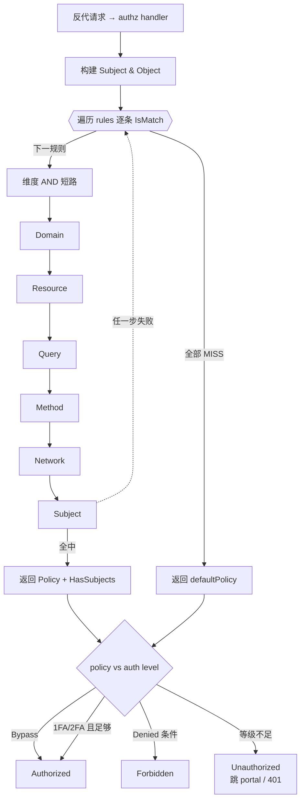

# 细粒度访问控制规则引擎（authorization + expression）

> 源码根 `/Users/morehao/Documents/study/auth/authelia`。授权是「你是谁能访问什么」的决策核心。`internal/authorization` 实现 access control rules 匹配引擎，`internal/expression` 是规则里「可配置用户属性」的条件求值器。

## 角色与根因

去掉 `authorization` 后：反代转发到 `/api/authz/*` 的每个请求都无法得到 allow/deny/redirect 判定，「反代伴生网关」直接失效；`handler_authz.go` 调 `Authorizer.GetRequiredLevel` 决定放行策略、`response.go`/`handler_configuration.go` 依赖 `IsSecondFactorEnabled` 联动，这些调用点全部断掉。

根因：自建应用的认证（你是谁）与授权（你能拿什么）混在业务代码里，控制点分散、升级 2FA 或加规则都要改应用。Authelia 把授权上收到反代旁路，用一份**声明式规则表**描述，靠近请求入口集中裁决；认证结果（session + AMR）与授权规则解耦，规则只管「匹配身份 + 匹配对象 → 策略」。

## 设计思路

- **编译时把 schema 转成多层 matcher，运行时代价小**：`NewAuthorizer` → `NewAccessControlRules` 一次性把配置转成内部 `[]*AccessControlRule`，每维度是一个小 matcher 实例（`SubjectMatcher`/`ObjectMatcher`/`SubjectObjectMatcher` 等接口见 `types.go`）。每个请求只做「逐规则顺序 IsMatch」线性扫描，无排序、无预索引，匹配即停。
- **放弃「按 specificity 自动排序」（关键修正）**：代码里**没有任何 `sort` 调用**。规则保持配置顺序、**首条命中即生效（first-match-wins）**。代价是「更具体的规则必须写前面」成为运维纪律（校验器只对 `*.x` 写法给 warning）；换来行为完全可预测、可读配置即结果。

[internal/authorization/authorizer.go:51-56]() 首条命中立即返回，就是「第一个匹配者赢」的唯一判据：

<!-- anchor: func (p *Authorizer) GetRequiredLevel(subject Subject, object Object) (hasSubjects bool, level Level) { -->
<!-- anchor: 	return false, p.defaultPolicy -->

```go
for _, rule := range p.rules {
    if rule.IsMatch(subject, object) {
        p.log.Tracef(traceFmtACLHitMiss, "HIT", rule.Position, subject, object, object.Method, rule.Policy)
        return rule.HasSubjects, rule.Policy
    }
}
return false, p.defaultPolicy
```

## 规则匹配算法（first-match-wins，全维度 AND 短路）

单条规则 `AccessControlRule.IsMatch` 是**全条件 AND** [internal/authorization/access_control_rule.go:54-80]()：Domains → Resources → Query → Methods → Networks → Subjects 逐个短路，任一维度不满足即整条不匹配。各维度规则（空列表 = 该维度视为恒真）：
<!-- anchor: func (acr *AccessControlRule) IsMatch(subject Subject, object Object) (match bool) { -->

- **Domains**：逐 domain `IsMatch` 任一命中即真。`AccessControlDomainMatcher` 分四种：普通精确匹配（EqualFold）、`*.` 后缀通配、`{user}` 域名前缀注入用户名、`{group}` 注入分组——后两者让「谁的子域谁访问」这类规则变成依赖身份的规则，因此在构造时置位 `HasSubjects`。
- **DomainRegex/Resources**：正则含命名分组 `User`/`Group` 时校验捕获值与 subject 的 username/groups 相等，否则纯串匹配。
- **Query**：外层组间 OR、组内子规则 AND；支持 `present/absent/equal/equal not/pattern/not pattern` 六种 operator。
- **Methods**：装载时已 `strings.ToUpper`，`IsStringInSlice` 匹配。
- **Networks**：`net.IPNet.Contains(subject.IP)`，空列表恒真。
- **Subjects**：匿名身份直接返回 true（让主页/错误页可被放行到认证流程）；非匿名走 `MatchesSubjectExact` 匹配 user/group/oauth2:client。

**`HasSubjects` 是关键的元信息**：只要规则里出现依赖身份的匹配（subject、`{user}`/`{group}` 域、User/Group 命名分组），它就被置位。它向下游传递「对匿名用户，规则含身份条件意味着这条 deny 不能简单判定，必须允许先认证」。

## 策略类型（Level）语义

`Level` 枚举：`Bypass(0) < OneFactor(1) < TwoFactor(2) < Denied(3)` [internal/authorization/const.go:6-18]()。字符串→枚举未知值一律落 `Denied`（默认安全）。
<!-- anchor: Bypass Level = iota -->

真正的授权判定不在 authorization 包内，而在 handler 的 `isAuthzResult` [internal/handlers/handler_authz_util.go:33-48]() 把「要求策略」与「实际认证等级」比较：
<!-- anchor: func isAuthzResult(level authentication.Level, required authorization.Level, ruleHasSubject bool) AuthzResult { -->

- `required == Bypass` → Authorized
- `required == Denied && (非匿名 || (匿名且规则无subject))` → Forbidden
- `one/two_factor && level >= 对应等级` → Authorized，否则 Unauthorized（跳 portal / 401）

## AMR（Authentication Methods Reference）

**关键发现：AMR 不参与 one/two_factor 的硬判定**。硬判定只看 `authentication.Level`（单调比较 `IsAuthLevelSufficient`）。AMR 回答「用户用哪些方法/因子/通道认证过」，被统一建模成 `AuthenticationMethodsReferences` [internal/authorization/amr.go:57-68]()：
<!-- anchor: type AuthenticationMethodsReferences struct { -->

- 组合语义：`FactorKnowledge`（知道：口令）vs `FactorPossession`（拥有：OTP/Duo/WebAuthn）；`MultiFactorAuthentication = FactorKnowledge() && FactorPossession()`；`ChannelBrowser`/`ChannelService` 通道分类。
- 作用：是 OIDC claim（`amr`）与审计的事实源，不污染授权红线。一句话：**Level 决定「够不够」，AMR 决定「用什么够的」**。

## expression：可配置用户属性求值（而非 ACL 的 subject DSL）

**修正背景**：authorization 的 subject 走的是 `user:`/`group:`/`oauth2:client:` 前缀字符串 + 二维数组表达 AND/OR（`util.go schemaSubjectToACLSubject`），**不是** CEL 表达式。`internal/expression` 实际是**可配置的用户属性求值器**，主要被 OIDC claims 水合复用（`oidc/claims.go`），属不同层的条件机制。

- `UserAttributeResolver`：把 `username/groups/email` 等用户字段 + `Definitions.UserAttributes` 里配置的 CEL 表达式暴露成变量；
- 编译缓存：启动时 `env.Compile` + `env.Program` 缓存，运行期零重复编译；
- LDAP/file 差异：LDAP 只在 attribute 配置了才注册对应变量，file 用全量标准环境；
- 空配置时退回无 CEL 轻量路径，避免无谓求值开销。



## 与其他模块协同

- **handlers → authz**：`handler_authz.go` 用 `Authorizer.GetRequiredLevel(subject, object)` 拿 `required`（含 `ruleHasSubject`）；`handler_authz_util.go` 的 `isAuthzResult` 落地判定。
- **session + authn**：`CookieSessionAuthnStrategy` 从 session 取 `Username/Groups`、`ClientID`、`RemoteIP` 组装 `authorization.Subject`。
- **configuration → 装载**：`ValidateAccessControl/ValidateRules` 做默认策略补全、域名/方法/subject 校验；query 的 `pattern` 正则在此预编译。
- **expression**：挂在 `middlewares` 的 `providers.UserAttributeResolver`，被 `oidc/claims.go` 用于水合 claims。

## 关键设计决策与权衡

1. **first-match-wins 而非按特异性排序**：免去「如何客观量化规则特异性」的复杂算法，行为透明可预测；代价是把排序责任转嫁给配置作者（宽规则写前会吃掉细规则），只给 warning 不拦。这是「文档约定 + 坚决不自动化」的小而专取舍。
2. **授权判定与认证等级分离（Level vs AMR）**：Level 只依赖单调比较，判定 O(1) 且与具体因子解耦（换 WebAuthn→OTP 不影响授权逻辑）；代价是两套等级体系并存的理解成本。
3. **匹配器接口化（四种 matcher 接口而非 if-else 开关）**：domain/resource 可无痛切换「字面串」与「带命名分组正则捕获」，subject 可平铺 user/group/client；`HasSubjects` 经 matcher 构造函数返回值统一汇总，把「是否依赖身份」这段元信息显式化。

## 亮点与问题

**亮点**：短路路径运行期极快；默认安全（未知策略值一律 `Denied`、无规则时 deny）；`HasSubjects` 显式建模「依赖身份的匹配」，让「匿名时含身份规则 ≠ 真拒绝」这个易错细节交由 handler 特判；正则命名分组 `User`/`Group` 让「路径/域名含用户名 → 仅该用户可访问」这类高频场景低门槛可写；AMR 对齐 RFC8176，双向转换对称。

**问题/风险**：无排序纯靠运维纪律，规则顺序写错静默产生偏差（靠日志 HIT/MISS 定位）；`{user}`/`{group}` 匿名分支的边界处理语义隐晦（依赖 `len(domain) > len(m.Name)` 判断，易受域名长度误判）；expression 与 ACL 的「条件」概念易被混淆，成文须明确区分两层。
