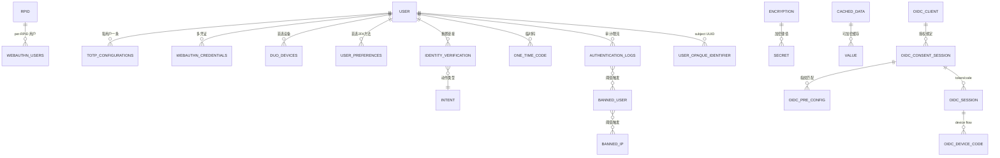

# 数据存储层：三后端同构 schema、flyway 迁移、列级 AES-GCM

> 源码根 `/Users/morehao/Documents/study/auth/authelia`。`internal/storage` 是 Authelia 关于**用户可持久化数据**的唯一事实源：活跃登录态（session）在 Redis，但身份元数据、2FA 因子配置、OIDC 授权与令牌、登录审计、限流封禁全部落在 SQL 数据库。handler 层不直接连库，经一个 `Provider` 接口统一读写 [internal/storage/provider.go:16-334]()。
<!-- anchor: type Provider interface { -->

## 角色与根因

没有这一层：用户 2FA 因子无法存续、OIDC token 会话丢失、登录审计与封禁无从计数、schema 升级只能手工改表——Authelia 退化为「无状态 demo」。它是「数据落库、会话入 Redis」哲学的「数据落库」落地处。

根因拆三个子问题：**持久化**（需要关系库承担可查询/可索引/可备份的关系数据）、**演进**（U2F→WebAuthn→passkey、OIDC 加 PAR/device/claims，库表频繁变化需可靠可逆三端一致的迁移）、**安全**（库里存的是凭据级敏感数据——TOTP secret、一次性码、WebAuthn 公钥+attestation、加密后的 OIDC session_data，必须列级加密）。

## 设计思路：三大核心模式

1. **三后端同一 schema**：SQLite/MySQL/PostgreSQL 各有 `migrations/{sqlite,mysql,postgres}/` 各 25 个同构迁移，表结构/列名完全一致，仅类型方言不同（`AUTOINCREMENT`/`TIMESTAMP` 等）。业务代码用一套 Go 查询模板（`sql_provider_queries.go`）加 `%s` 表名占位符，provider 初始化时 `fmt.Sprintf` 填充。
2. **flyway 式迁移**：文件命名 `V{digits}.{Name}.{up|down}.sql`（对文件名做正则匹配与四个字段解析 [internal/storage/const.go:114-114]()），`migrations` 表记录版本历史。
<!-- anchor: 	reMigration                  = regexp.MustCompile(`^V(?P<Version>\d{4})\.(?P<Name>[^.]+)\.(?P<Direction>(up|down))\.sql$`) -->
   启动时由 `SchemaMigrate(ctx, true, SchemaLatest)` 自动升级：读当前版本 → 开启迁移锁与事务 → 依 `reMigration` 依序执行 up SQL [internal/storage/sql_provider_schema.go:186-240]()。
<!-- anchor: func (p *SQLProvider) SchemaMigrate(ctx context.Context, up bool, version int) (err error) { -->
3. **storage encryption（列级 AES-GCM + AAD）**：`NewSQLProvider` 把配置 `storage.encryption_key` 经 `utils.DeriveCryptographicKey(…, "authelia:kdf:storage:encryption_key:v1", sha256.New)` 派生为主密钥 [internal/storage/sql_provider.go:39-54]()，对敏感列 `Encrypt/Decrypt` 时绑定「表+列」的 AAD；V0025 起引入 HKDF 派生 + GCM AAD。
<!-- anchor: func NewSQLProvider(config *schema.Configuration, name, driverName, dataSourceName string) (provider SQLProvider, err error) { -->

**放弃的替代**：不用 ORM（选 sqlx + 手写 SQL 模板便于控制三方言与迁移，避免 ORM 生成 schema 与迁移漂移）；不把凭据类数据放 Redis（易失）；不锁单一数据库（只 SQLite 放弃 HA、只 Postgres 单机过重）。

## 核心表（字段表）

### 基建表

**migrations**（V0001.Initial_Schema.up.sql:63）——迁移历史记录，`version_after` 即 schema 版本。

| 列 | 类型 | 说明 |
|---|---|---|
| id | INTEGER PK | 自增 |
| applied | TIMESTAMP | 应用时间 |
| version_before / version_after | INTEGER | 迁移前/后版本 |
| application_version | VARCHAR(128) | 执行迁移的 Authelia 版本 |

**encryption**（V0001:71）——「公开名 → 加密值」键值对，value 是 `utils.Encrypt` 后的 AES-GCM 密文。用途：内部 HMAC 密钥（`hmac_key_otc`/`hmac_key_otp`）、校验值 `check`（存随机 UUID 密文以自检加密 key 是否一致）。

| 列 | 类型 | 说明 |
|---|---|---|
| id | INTEGER PK | 自增 |
| name | VARCHAR(100) UNIQUE | 密钥/标识名 |
| value | BLOB | AES-GCM 加密后的值 |

**cached_data**（V0019:4）——通用 name→value 缓存，`encrypted` 标志决定是否走 AES-GCM。

**user_preferences**（V0001:57）——每用户首选 2FA 方法（`totp`/`webauthn`/`duo`）。

**authentication_logs**（V0001:1）——每次认证尝试的审计日志，是 regulation 限流的输入，每次认证尝试经 `AppendAuthenticationLog` 写一条记录 [internal/storage/sql_provider.go:1628-1637]()。索引 `(time, username, auth_type)` 与 `(time, remote_ip, auth_type)` 加速按用户/IP 统计失败次数。
<!-- anchor: func (p *SQLProvider) AppendAuthenticationLog(ctx context.Context, attempt model.AuthenticationAttempt) (err error) { -->

| 列 | 类型 | 说明 |
|---|---|---|
| id | INTEGER PK | 自增 |
| time | TIMESTAMP | 时间 |
| successful / banned | BOOLEAN | 是否成功 / 是否因封禁拒绝 |
| username | VARCHAR(100) | 用户名 |
| auth_type | VARCHAR(8) | 1FA / 2FA |
| remote_ip | VARCHAR(39) NULL | IPv4/IPv6 |
| request_uri / request_method | TEXT / VARCHAR(8) | 请求信息 |

### 2FA 因子表

**totp_configurations**（V0001:29）——每用户一条；`secret` 写时 AES-GCM 加密。读出时经 `LoadTOTPConfiguration` 用「表+列」AAD 解密 `secret` [internal/storage/sql_provider.go:630-646]()。
<!-- anchor: func (p *SQLProvider) LoadTOTPConfiguration(ctx context.Context, username string) (config *model.TOTPConfiguration, err error) { -->

| 列 | 类型 | 说明 |
|---|---|---|
| id | INTEGER PK | 自增 |
| username | VARCHAR(100) UNIQUE | 用户名 |
| issuer / algorithm / digits / period | — | 发行者 / SHA1 / 位数6 / 周期30 |
| secret | BLOB | **AES-GCM 加密的 TOTP 密钥** |

**totp_history**（V0015）——防重放窗口：记住已用 TOTP step，`(username, step)` 唯一；step 为 HMAC-SHA256 摘要避免明文存时间步长。

**webauthn_credentials**（V0002 建，V0019/V0024 演进）——WebAuthn/FIDO2 凭证；`public_key`、`attestation` 为 AES-GCM 密文，AAD 额外绑定 RPID。写经 `SaveWebAuthnCredential` 先加密再入库 [internal/storage/sql_provider.go:735-756]()。
<!-- anchor: func (p *SQLProvider) SaveWebAuthnCredential(ctx context.Context, credential model.WebAuthnCredential) (err error) { -->

| 列 | 类型 | 说明 |
|---|---|---|
| id | INTEGER PK | 自增 |
| rpid | VARCHAR(512) | 依赖方 ID |
| username | VARCHAR(100) | 用户名 |
| kid | VARCHAR(512) UNIQUE | 凭证 ID |
| aaguid | CHAR(36) | 认证器 AAGUID |
| attachment / transport | VARCHAR | cross-platform 等 / usb/nfc/bled |
| sign_count / clone_warning | INTEGER / BOOLEAN | 签名计数（防克隆） |
| legacy / discoverable / present / verified / backup_* | BOOLEAN | passkey 属性 |
| public_key / attestation | BLOB | **AES-GCM 加密** |

**webauthn_users**（V0012）——per-RPID 的 WebAuthn 用户绑定（多 RPID 下区分用户）。

**duo_devices**（V0001:49）——每用户首选 Duo 设备/方法。

### 身份验证与一次性码

**identity_verification**（V0001:16，V0014 演进）——密码重置等身份链接验证记录，`jti` 唯一防重放。含 iat/exp、issued_ip、action、consumed/revoked 状态。

**one_time_code**（V0013）——One-Time Code（邮箱/密码重置通道）。写入经 `SaveOneTimeCode` 先对明文码算 HMAC 指纹、再 AES-GCM 加密 `code` [internal/storage/sql_provider.go:1025-1039]()。`signature` = HMAC-SHA512(用户名+IP|intent+明文码)——**HMAC 指纹使服务端可不解密地索引记录，同时明文码不落库**。
<!-- anchor: func (p *SQLProvider) SaveOneTimeCode(ctx context.Context, code model.OneTimeCode) (signature string, err error) { -->

| 列 | 类型 | 说明 |
|---|---|---|
| id | INTEGER PK | 自增 |
| public_id | CHAR(36) | 公开 UUID（撤销定位） |
| signature | VARCHAR(128) | HMAC 签名 |
| issued / issued_ip / expires | — | 时间/IP/过期 |
| username / intent | VARCHAR | 用户 / 用途 |
| consumed / revoked | — | 状态 |
| code | BLOB | **AES-GCM 加密的一次性码** |

### Regulation 封禁表

**banned_user / banned_ip**（V0020）——超过失败阈值后对用户/IP 落库的封禁，三态 `expires`/`expired`/`revoked`，`source` 标识来源。

### OIDC 系列表

`oidc_*` 全族由 V0004（OpenIDConnect 初始）、V0008/11/16/17/18/22（consent 演进、claims、device code、consent binding）等迁移建立，覆盖 client（内存注册）、consent 会话、各授权码/refresh/access/PAR/device code/opaque 标识映射等（见 [`oidc.md`](oidc.md) 与 `internal/model/oidc.go`）。opaque 标识（subject 伪随机 UUID，防枚举）经 `LoadUserOpaqueIdentifier` 按值反查用户名 [internal/storage/sql_provider.go:541-554]()。
<!-- anchor: func (p *SQLProvider) LoadUserOpaqueIdentifier(ctx context.Context, identifier uuid.UUID) (subject *model.UserOpaqueIdentifier, err error) { -->

## ER 图

## 加密与安全

- **主密钥**：`storage.encryption_key` 经 HKDF 派生（新），旧库用 legacy SHA256 无 AAD；`check` 值在 `encryption` 表用于启动自检「加密 key 是否一致」。
- **AAD 绑定**：对敏感列加密时绑定「表+列」（WebAuthn 额外绑定 RPID），防止密文被移动到其他上下文。列级加解密的原语是 `utils.Encrypt`（256-bit AES-GCM，输出 `nonce|ciphertext|tag`，AAD 参与认证标签生成）[internal/utils/crypto.go:804-825]()。
<!-- anchor: func Encrypt(plaintext, aad []byte, key []byte) (ciphertext []byte, err error) { -->
- **`encryption`/`cached_data` 双通道**：常驻密钥走 `encryption` 表，通用缓存走 `cached_data`（`encrypted` 标志开关）。

## Schema 演进策略

- flyway 式迁移 + `migrations` 版本自省；`up/down` 可逆（down 需显式 `--destroy-data` 确认）。
- **三后端同步**：每个大特性（WebAuthn、OIDC、OneTimeCode、Regulation、TOTP history）都对应一个迁移，跨三后端各 25 个版本号一致。
- 运维通过 `authelia storage migrate up/down/list-up/list-down/history` 和 `authelia storage encryption check/change-key/rotate` 管理。

## 读写路径

| 数据域 | 主要读写方 |
|---|---|
| totp_configurations / webauthn_credentials / duo_devices | `authentication-factors` 的 factor handler 读写 |
| oidc_*（consent/token/session） | [`oidc.md`](oidc.md) 的 `Store` 适配层 |
| authentication_logs / banned_* | [`auth-flow.md`](auth-flow.md) 的 regulation |
| user_preferences | 2FA 方法选择 handler |
| identity_verification / one_time_code | 密码重置/邮箱验证流程 |

## 关键设计决策与权衡

1. **三后端同构而非「SQLite 优先、MySQL 特化」**：用一套 schema + 模板 + 方言差异封装，业务代码零后端分支；代价是「同构」钳制了利用各后端特性的余地（如 Postgres 的 JSONB），换来 HA 与单机无缝切换。
2. **敏感列联库加密而非「整个库一个 key 全部加密」**：只对确实敏感的列（TOTP secret、WebAuthn 公钥、one-time code、session_data）做 AES-GCM + AAD，其余明文中高速索引；代价是加密边界需随 schema 演进维护（每个敏感列新增要配套加密逻辑）。
3. **HMAC 指纹索引敏感数据（one_time_code.signature / totp_history.step）**：既能在不解密情况下定位/查询记录，又避免明文码/时间步落库；代价是增加了「指纹如何从入参安全导出」的一致性约束。
