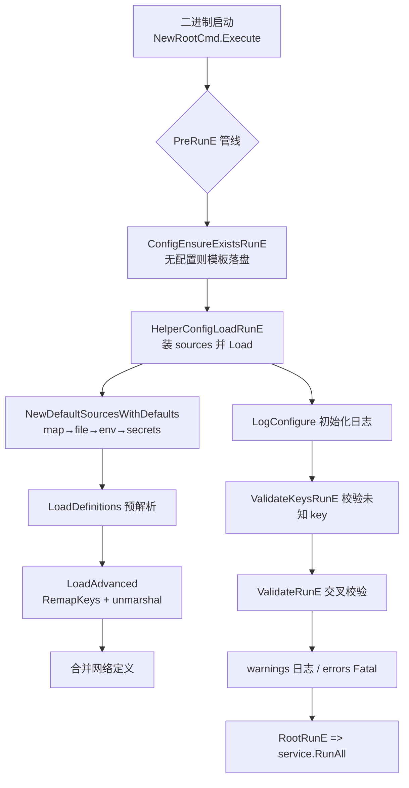
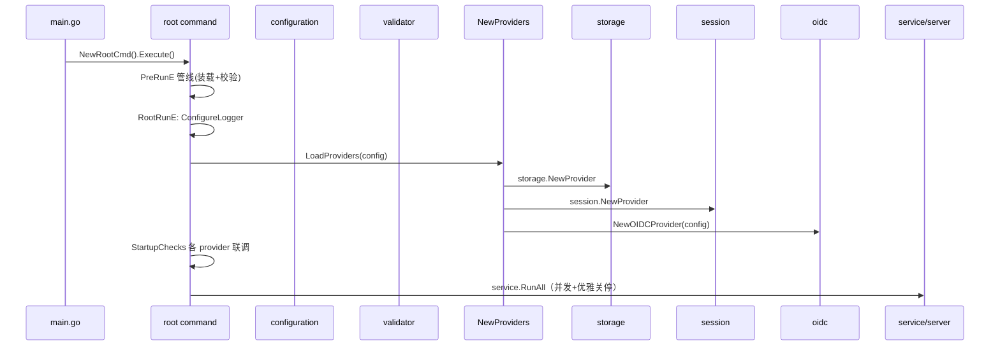
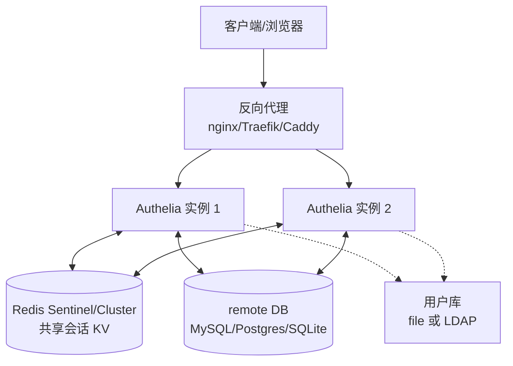

# 配置系统（koanf 五源装载 + 强 schema）与 HA 部署

> 源码根 `/Users/morehao/Documents/study/auth/authelia`。配置系统是「唯一事实来源」，几乎所有运行态模块（storage/session/oidc/server/notification/authentication/regulation）都由装载校验后的 `schema.Configuration` 驱动；部署配套让 Docker/systemd/Kubernetes/Helm 三种形态可运行。两者共同回答「这个东西怎么被用起来」。

## 根因

自托管认证授权服务器必须「零机房依赖、可审计、可迁移」，因此把全部行为参数化为配置，并用 schema 强校验把「错误配置导致的安全事故」提前在启动期拦截。对应的痛点与机制：

| 痛点 | 对应机制 |
|---|---|
| 配置项极多（200+ key）且有强耦合约束（storage 三选一、session 依赖 redis、OIDC 依赖 jwks） | schema 反射生成 `schema.Keys` + validator 分层校验 |
| 敏感配置不能明文进配置/仓库 | `<secret>` 文件引用 + `_FILE` 环境变量后缀 |
| 多环境部署需不同注入方式 | 多 Source 合并（map/file/env/secrets/cmdline） |
| 配置错误应启动前可检测 | `authelia validate` / `authelia config template` 命令 |
| HA 需要会话共享 | redis（含 Sentinel/Cluster）会话 provider |

## 配置装载管线（多 Source 注入而非单一 YAML）

`configuration.Load` 接收 `sources ...Source`，每个 Source 独立 `Load` 再 `Merge` 进一个 koanf 实例。Source 链 = `defaults(map) → file(koanf yaml) → environment(AUTHELIA_*) → secrets(_FILE) → cmdline`，后源覆盖前源。

**关键实现点**：

- `LoadAdvanced` [internal/configuration/provider.go:23-45]()：`koanf.NewWithConf` → `loadSources` → `koanfRemapKeys`（弃用 key 自动映射）→ `unmarshal`（带 `DecodeHooksComposeAll`）。
<!-- anchor: func LoadAdvanced(val *schema.StructValidator, path string, result any, definitions *schema.Definitions, sources ...Source) (keys []string, err error) { -->
- decode hooks [internal/configuration/decode_hooks.go:29-49]()：`DecodeHooksComposeAll` 能力极强，能把 YAML 字符串解码成 `time.Duration`、`net.IPNet`、`*x509.Certificate`、`crypto.PrivateKey`、`*regexp.Regexp`、`language.Tag`、UUID 等，配置表达能力远超简单 YAML。
<!-- anchor: func DecodeHooksComposeAll(definitions *schema.Definitions) mapstructure.DecodeHookFunc { -->
- **校验分两段**：`ValidateKeys` [internal/configuration/validator/keys.go:14-69]() 把装载出的 key 与 `schema.Keys` + 正则对比，未知 key：env 前缀给 warning、非 env 给 error——**拼写错误立即可查**；`ValidateConfiguration` [internal/configuration/validator/configuration.go:17-77]() 按序调各 validator（Default2FA/Theme/Log/Duo/TOTP/WebAuthn/AuthenticationBackend/AccessControl/Session/Regulation/Storage/Notifier/IdentityProviders/NTP/PasswordPolicy 等），每个 validator 只负责一个关注面并就地 `validator.Push`。
<!-- anchor: func ValidateKeys(keys, remapped []string, prefix string, validator *schema.StructValidator) { -->
<!-- anchor: func ValidateConfiguration(config *schema.Configuration, validator *schema.StructValidator, opts ...func(ctx *ValidateCtx)) { -->
- **启动期 fail-fast + 聚合错误**：`StructValidator` [internal/configuration/schema/validator.go:14-17]() 聚合所有 errors/warnings 而非第一错误就崩，`validate` 命令与启动日志统一。
<!-- anchor: type StructValidator struct { -->

## 环境变量与 `<secret>` 文件注入（双通道）

**普通环境变量 + 文件型 secret 两个独立 Source，互不混用**：

- `EnvironmentSource.Load` [internal/configuration/sources.go:282-286]() 用 `getEnvConfigMap` 把 `schema.Keys` 转成 `AUTHELIA_JWT_SECRET` 形式。**`IsSecretKey(key)` 的命令加到 `ignoredKeys`**——一旦某 key 属于 secret，就不允许用普通环境变量明文注入，只能用文件。
<!-- anchor: func (s *EnvironmentSource) Load(_ *schema.StructValidator) (err error) { -->
- `SecretsSource.Load` [internal/configuration/sources.go:316-320]() 找后缀 `_FILE` 的变量（如 `AUTHELIA_JWT_SECRET_FILE`），读文件内容并去尾换行。文件不存在/权限错则推对应错误。
<!-- anchor: func (s *SecretsSource) Load(val *schema.StructValidator) (err error) { -->
- `IsSecretKey` [internal/configuration/helpers.go:92-110]()：key 含 `[]` 或 `.*.` 或命中 `secretSuffix`（`key/secret/password/token/certificate_chain`）才认为是 secret，同时 `secretExclusionPrefix` 排除例外（如 `server.tls.key` 是 key 但不是 secret）。
<!-- anchor: func IsSecretKey(key string) (isSecretKey bool) { -->
- `SecretsSource.Merge` [internal/configuration/sources.go:303-313]()：合并前检查该 key 是否已被其他 source 定义，**防止 env 与 file 双通道同时设一个 secret**。
<!-- anchor: func (s *SecretsSource) Merge(ko *koanf.Koanf, val *schema.StructValidator) (err error) { -->

**结论**：`AUTHELIA_*_FILE` 让 Docker/K8s 把 secret 挂载成文件注入，价值是「文件权限可审计、不入环境变量/进程列表」。

## 启动流程

- `RootRunE` [internal/commands/root.go:63-104]() → `middlewares.StartupChecks` → `service.RunAll`。`NewProviders` [internal/middlewares/util.go:37-79]() 从 `schema.Configuration` 实例化 storage/notifier/webauthn-MDS/authorizer/ntp/regulator/session/totp/oidc——**配置驱动运行态的枢纽**。
<!-- anchor: func (ctx *CmdCtx) RootRunE(_ *cobra.Command, _ []string) (err error) { -->
<!-- anchor: func NewProviders(config *schema.Configuration, caCertPool *x509.CertPool) (providers Providers, warns, errs []error) { -->
- Storage `CheckSchema`/`CheckSchemaVersion` 启动前核对 DB schema 版本与 encryption key，防不兼容 DB。
- 服务并行：server、metrics、users-file-watcher、logging-signal 四类 proviser 经 errgroup 并发起、信号触发优雅关停。

## CLI 运维命令（复用同一配置管线）

- `authelia validate` / `authelia config template`：校验配置或输出组合后的模板，有 error 返回非零。
- `authelia storage migrate up/down/list-up/list-down/history`：flyway 式迁移；`authelia storage encryption check/change-key/rotate`：加密 key 生命周期。
- `authelia storage user totp/webauthn/identifiers`、`authelia storage bans`：数据导入导出。
- `authelia access-control check-policy`：不启动服务，离线求一条 subject/object 的命中规则（`authorization.NewAuthorizer`）。

这些命令都复用 `HelperConfigLoadRunE` [internal/commands/context.go:413-459]() 配置管线，因此「命令所见配置」与「服务运行配置」完全一致，不怕两套不一致。
<!-- anchor: func (ctx *CmdCtx) HelperConfigLoadRunE(cmd *cobra.Command, _ []string) (err error) { -->

## HA 部署拓扑

**为何 HA 必须 Redis 而非只有数据库**：会话是超高频、低延迟读写对象，放 DB 会拖垮共享 DB；DB 是事实源（用户凭证/令牌），放 Redis 抽象层互补。**为何数据库选远程而非本地 SQLite**：SQLite 单文件无法跨副本共享，HA 必须 MySQL/Postgres。

- **Docker**：`Dockerfile`（入口 entrypoint.sh、healthcheck /api/health，默认 `X_AUTHELIA_CONFIG=/config/configuration.yml`、EXPOSE 9091）；compose bundles 在 `examples/compose/{lite,local,production}`。
- **systemd**：`authelia.service`（hardened 参数、`--config /etc/authelia/configuration.yml`）+ `authelia@.service`。
- **Kubernetes**：Helm chart（beta）+ K8s 文档。

## 关键设计决策

1. **双通道环境变量（普通 env + `_FILE` secret）**：`_FILE` 让 Docker Swarm/K8s secret 直接挂载注入、文件权限可审计且不入进程环境；代价是装载逻辑变复杂（两个 Source 顺序 + 冲突防线），换来安全性与易用性兼得。
2. **强绑定「全部配置项可枚举」的 `schema.Keys` + `ValidateKeys`**：`schema.Keys` [internal/configuration/schema/keys.go:10]() 由 authelia-gen 反射 `schema.Configuration` 生成全部合法 key；未知 key 启动期即报错，实现「配置即代码、防呆」；代价是每个新配置项都要进 schema + 反射 keys（由 authelia-gen 生成），但换来文档/template/jsonschema 三份产物同源生成。**一处 schema 定义 → 同时产出运行时校验、文档、jsonschema、模板注释**。
<!-- anchor: var Keys = []string{ -->
3. **HA 靠「remote DB 事实源 + Redis 会话共享」，而非内建集群协议**：Authelia 不选主、不复制，让自己成为「无状态可多副本的前置鉴权」，一致性问题外包给成熟中间件；代价是需运维外部中间件，收益是自身复杂度极低、副本地越多越易横向扩。对比 Keycloak/ZITADEL 的内建集群/分布式缓存路线，是「小而专、专注反代旁路」哲学的延伸。

## 亮点与问题

**亮点**：schema 单一事实来源（struct tag 内嵌 koanf/yaml/jsonschema，配合 authelia-gen 生成三份产物）；启动期 fail-fast + 聚合错误；secret 文件注入优雅隔离 env 明文风险；decode hooks 让配置支持复杂类型。

**问题/可改进**：`deprecation.go` 约 512 行的旧 key 映射表需手工维护；config.template.yml 约 1666 行 + 200+ key 上手陡峭；URL 字段多、validator 里重复「must be absolute/secure」判断有抽象空间；主配置（DB/oidc/server）不支持热更，改动需重启——这是刻意的取舍（安全一致性优先）。
