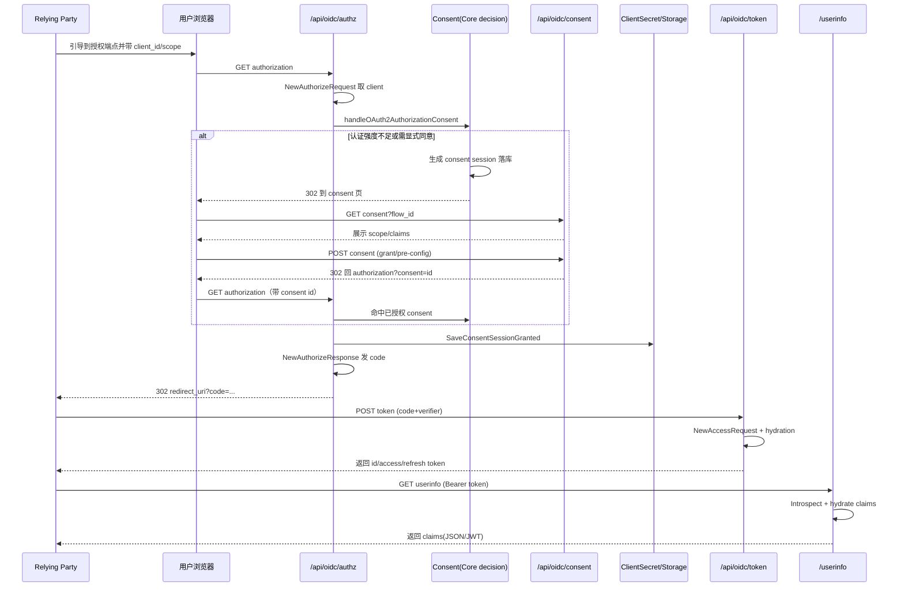

# OIDC / OAuth2 Provider：外包协议、自留策略

> 源码根 `/Users/morehao/Documents/study/auth/authelia`。OIDC 模块让第三方应用（RP）**无需接 Authelia 私有协议**，就能按标准 OpenID Connect 1.0 / OAuth 2.0 获得「已登录用户」身份证明与受控授权，且获得 OpenID Certified™（Basic/Implicit/Hybrid/FormPost/Config OP profiles）。

## 模块边界（关键澄清）

`internal/oidc/`（约 7400 行）是**单一扁平 Go 包**，协议编排本体不在本地，而在外部依赖 `authelia.com/provider/oauth2`（Authelia 自行维护的 fosite fork，见 `go.mod`）；另有一个 `internal/oidc/conformance/` 子包（约 350 行）专门构造 OpenID Conformance 测试计划。本地只写：

- **粘合层**：把 Authelia 的配置、存储、模板、用户属性解析适配/接线到 fosite 的 `Configurator`/`Storage`/`Client` 接口；
- **自有安全策略**：客户端授权策略、consent 模型、claims 水合、opaque subject、issuer 与 JWK 管理。

**这个划分本身就是一条关键设计结论**：协议化的部分外包给 fosite fork，本地只写粘合层与安全策略，既降低协议正确性负担，又把容易出错的自有逻辑（access control、consent、claims）留给自己掌控。代价是受限于 fork 的 API 形态、安全补丁要等 maintainer 同步上游。协议本体在此接线：`NewOpenIDConnectProvider` 直接以本地 `Store`/`Config` 调用 `oauthelia2.New(...)` 生成 fosite provider（[internal/oidc/provider.go:19-39]()）。
<!-- anchor: func NewOpenIDConnectProvider(config *schema.Configuration, store storage.Provid -->
随后 `LoadHandlers` 把授权码/隐式/client-credentials/refresh/device 等 grant handler 一件件装配进 fosite 的 `handlers` 槽（[internal/oidc/config.go:290-337]()）。
<!-- anchor: func (c *Config) LoadHandlers(store *Store) { -->

## 根因

自建/私有应用需要一个**统一、自托管、可审计、符合行业标准**的「让第三方应用信任用户身份」机制。直接凭反代头判断身份不可靠（可伪造、无法按租户隔离、不可审计）；需要标准协议签名（JWS）+ 不透明 token 查库的组合。还需要在线回收/吊销（token 会话落库）+ 细粒度授权（哪个 client、要什么 scope、用户认证强度/组是否达标、有没有用户授权 consent）。

README 宣传核验：

| README 声明 | 核验 | 依据 |
|---|---|---|
| OpenID Connect 1.0 / OAuth 2.0 | ✅ 属实 | 全模块实现 |
| OpenID Certified™（Basic/Implicit/Hybrid/FormPost/Config OP） | ✅ 具备对应实现；证书为外部申请结果 | 见 §授权码链路 |
| Authorization Code + PKCE | ✅ | `ProofKeyCodeExchangeConfig.Enforce` 全局强制 / `EnforcePublicClients` 公共客户端强制 |
| Implicit / Hybrid / Form Post | ✅ | response type / response mode |
| Device Authorization Grant（RFC8628） | ✅ | device flow + rfc8628 handler |
| Resource Indicators（RFC8707） | ✅ | resource 独立于 audience 记录与校验（schema V0029 起） |
| Client Credentials | ✅ | token hydrate client_credentials，专属 `authelia.bearer.authz` scope |

## 设计思路与核心模式

- **领域适配器模式**：fosite 定义接口，Authelia 用自己的存储/配置/会话去实现——「库做协议、我保证纪律」。
- **契约即数据结构**：discovery 元数据做成强类型 `*WellKnownConfiguration` 结构体，JSON 序列化即 discovery 文档，防拼写错误。
- **opaque + 可选 JWT 双轨 token**：默认 access token 是不透明的（`authelia_at_` 前缀 + HMAC），可按 client 开关走 RFC9068 `at+jwt`——「默认查库可控、需要时无状态」。
- **subject 用 opaque UUID**：`sub` 不是用户名，而是按 `(service="openid", sectorID, username)` 生成的随机 UUID，存 `user_opaque_identifier` 表，实现 pairwise/public subject 且不泄露用户名（可跨站防关联）。下发链路两处落地：解析端把 `sub` 字符串强制解析回 UUID（[internal/oidc/subject.go:76-82]()）；
<!-- anchor: func SubjectUUIDFromSubjectString(value string) (subject uuid.UUID, err error) { -->
生成端按 sectorID+username 主键命中或新建 opaque id（[internal/oidc/store.go:77-91]()）。
<!-- anchor: func (s *Store) GenerateOpaqueUserID(ctx context.Context, sectorID, username str -->
- **consent 落库绑定用户与 scope**：授权决策持久化为 `OAuth2ConsentSession`，可预配置（pre-configuration）复用，实现「记住我」式授权。

### OAuth 2.0 Resource Indicators（RFC8707）

audience 与 resource 在 OAuth2 里本是两个概念：audience 是 token 的预期接收方，resource 是客户端声明要访问的**资源服务器**。二者在 `authelia.com/provider/oauth2` v0.3.0 起被部分拆开，Authelia 侧随之把 resource 作为独立字段贯穿「授权请求 → consent → 会话 → token 校验」整条链：

- **记录**：consent 会话与会话实体都持 `RequestedResource`/`GrantedResource`，落库为同名两列；`OAuth2ConsentSession.GrantResource()` 把请求值整体授予（v0.3.0 之前二者混用，resource **既未被记录也未被授予**，是有 issue 佐证的回归修复，非新特性堆叠）。
- **校验**：凡是需要判断 token 是否面向某 audience 的入口，改为**先按 audience 匹配、失败再按 resource 匹配**的双策略回退，任一命中即视为匹配（`AudienceMatchesGrantedAudienceOrResource`）[internal/oidc/util.go:696-707]()。
<!-- anchor: func AudienceMatchesGrantedAudienceOrResource(strategyAudience oauthelia2.Audien … return false -->
- **预配置指纹**：consent 的「记住授权」指纹由 scope+audience 扩展为 scope+audience+resource 三者全等（`HasExactGrants` 新增 resource 入参），避免把一个 resource 的授权复用到另一个。

## 授权码完整链路（跨 handler 时序）

授权码流程把「协议请求」和「用户同意(consent)+认证」拆成两段，中间靠 `OAuth2ConsentSession`（`challenge_id`）衔接。四个端点 handler 串起整条链，先看路由接线（[internal/server/handlers.go:392-392]()；本版已把 `ctx context.Context` 从该注册函数签名中移除，与限流中间件的重构一同落地）：
<!-- anchor: func RegisterOpenIDConnectRoutes(r *router.Router, config *schema.Configuration, -->

四个端点的入口实现分别对应链路中段/末段：授权端点先构造 `AuthorizeRequester` 并执行认证强度与授权策略判定（[internal/handlers/handler_oauth2_authorization.go:26-221]()）；
<!-- anchor: func OAuth2AuthorizationGET(ctx *middlewares.AutheliaCtx, rw http.ResponseWriter -->
其中是否需要显式 consent 由 `handleOAuth2AuthorizationConsent` 负责——未达认证强度/请求 offline 或 `prompt=consent` 时生成 `OAuth2ConsentSession` 落库并重定向到 consent 页（[internal/handlers/handler_oauth2_authorization_consent_core.go:25-295]()）；
<!-- anchor: func handleOAuth2AuthorizationConsent(ctx *middlewares.AutheliaCtx, issuer *url. -->
token 端点拿 code+verifier 换 `id/access/refresh` token（[internal/handlers/handler_oauth2_token.go:20-189]()）；
<!-- anchor: func OAuth2TokenPOST(ctx *middlewares.AutheliaCtx, rw http.ResponseWriter, req * -->
userinfo 端点用 Bearer token introspect + 水合 claims（[internal/handlers/handler_oauth2_oidc_userinfo.go:31-213]()）。
<!-- anchor: func OpenIDConnectUserinfo(ctx *middlewares.AutheliaCtx, rw http.ResponseWriter, -->

## PKCE 与纯 back-channel 的区别

- **纯 code flow（无 PKCE）风险**：授权码在浏览器↔RP 间传输，被截获即可换 token。RFC7636 对公开客户端（无 secret 的 SPA）强制 PKCE：授权请求带 `code_challenge`、token 请求带 `code_verifier`，二者经哈希核对，即使 code 泄露也无法换 token。
- Authelia 实现：`EnforcePKCE` 全局强制、`EnforcePublicClients` 公共客户端强制、`AllowPlainChallengeMethod` 控制 plain；每 client 可单独 `RequirePKCE`；discovery 只通告 `S256`。
- **与纯 back-channel 的区别**：纯 back-channel（client_credentials、refresh）不经过浏览器、无 code 泄露面，无需 PKCE；PKCE 是**弥补授权码在浏览器信道泄露**的设计，二者互补而非互斥（即便 client 有 secret 也可能要求 PKCE）。

## token 结构 / JWT 签名与加密

- **ID Token**：`openid.DefaultStrategy` 基于 JWT 签发；claims 由 fosite + `CustomClaimsStrategy` 水合；每 client 可配 `IDTokenSignedResponseAlg/KeyID` 与加密 `EncryptionAlg/Enc`（默认 RS256）。`Session` 内嵌 `*openid.DefaultSession`，同时携带 access token 的 JWT/map claims 与 consent 关联（[internal/oidc/session.go:66-79]()）。
<!-- anchor: type Session struct { -->
- **Access Token**：默认不透明（HMAC 派生 signature）；`GetEnableJWTProfileOAuthAccessTokens()` 为真时走 RFC9068 `at+jwt`。
- **Refresh Token**：默认 30 天，仅当授权含 offline 类 scope 才发放（`ConsentGrant` 对 `ScopeOffline/ScopeOfflineAccess` 在非 explicit 时不授予）——**绝不静默发放 refresh token**。
- **refresh ↔ access 会话绑定**：refresh token 会话额外记录其配套 access token 的签名（`access_signature` 列，schema V0027/V0028）。这样刷新或吊销时能精确定位「这个 refresh token 当初对应哪个 access token」，而不是仅靠 `request_id` 粗略关联；该列按 RFC9068 `at+jwt` 形态的签名长度放宽到 `VARCHAR(768)`。
- **Issuer 一致性校验**：`Session.ValidIssuer` 校验 claims 的 issuer 与当前端点 effective issuer 一致，token/introspection/userinfo/authorization 端点在响应前都检查，防**跨宿主复用 token（issuer-confusion 攻击）**（[internal/oidc/session.go:116-122]()）。
<!-- anchor: func (s *Session) ValidIssuer(issuer *url.URL) bool { -->

## Consent 模型（OIDC consent binding）

- `OAuth2ConsentSession` 把「client × subject × 请求的 scope/audience/claims × 是否获准 + 是否已授予 + 何时响应」落库绑定（[internal/model/oidc.go:273-295]()）。
<!-- anchor: type OAuth2ConsentSession struct { -->
- 授权侧策略由 `ClientAuthorizationPolicy` 承载：默认 `authorization.Level` + 按 subject/network 的规则覆盖，与反代访问控制复用同一套 level 语言（[internal/oidc/client_policy.go:59-74]()）。
<!-- anchor: type ClientAuthorizationPolicy struct { -->
- 三种模式：`explicit`（每次显式同意）、`preconfigured`（可用先前保存的 `OAuth2ConsentPreConfig` 自动放行，`SignatureClaims` 指纹匹配）、`implicit`（假设同意，不弹）。
- 判定「是否需要显式 consent」：请求含 `prompt=consent/login`、或 authorize-code 流请求了 offline/`authelia.bearer.authz` scope、或带 refresh 诉求 → 强制 explicit。
- **预配置匹配要求 scope+audience+claims 指纹全等**（`HasExactGrants`+`HasClaimsSignature`），超出原先授权的内容必然重新征求 consent——「记住授权」做得安全且精确。

### Consent 会话与授权请求的强绑定

consent 会话一旦落库，新的攻击面是「拿同一个 consent id 去换一个**不同**的授权请求」——例如悄悄替换已同意的 scope，或换掉 `nonce`/`state` 做重放。`MatchesRequester` 在复用 consent 会话前逐项比对请求，不一致直接以 `invalid_request` 拒绝 [internal/model/oidc.go:429-468]()：
<!-- anchor: func (s *OAuth2ConsentSession) MatchesRequester(requester oauthelia2.Requester,  … return nil -->

- `client_id`、requested scope、requested audience 必须与 consent 记录完全一致；
- **PAR（Pushed Authorization Request）特例**：PAR 产生的 consent 只记录了 `request_uri` 与 `client_id`，因此仅当请求的 `request_uri` 命中 PAR 前缀时才**只**比对 `request_uri`，其余字段不比对（此时 `nonce`/`state` 本就不在 consent 中）；
- 常规场景再比对 `nonce` 与 `state` 两个表单参数。

这相当于把 consent 会话的「可比字段」显式建模成白名单：能比的全比，不能比的明确不比——而不是用一个宽泛的「session 匹配」糊过去。

## Device / Client Credentials 流程

- **Device（RFC8628）**：`POST /api/oidc/device-authorization` 生成 device_code + user_code；用户到验证页输入 user_code → consent 流程关联 device session → 客户端轮询 token 端点（`Status` new/approved/denied，默认轮询间隔 10s）。
- **Client Credentials**：client 用 secret 直接换 token。`handleOAuth2TokenHydration` 把 session 填为「以 client 为 subject」，校验 scope 组合（`authelia.bearer.authz` 只能单独或与 offline_access 相伴）——支持 machine-to-machine 反代授权。

## 其他模块协同

| 模块 | 协同点 |
|---|---|
| `internal/storage` | OIDC 全部 session/consent/token/par/device/user-opaque 落库；`Store` 包一层 fosite 接口把 `CreateAuthorizeCodeSession` 等映射到 `storage.OAuth2SessionType*` |
| `internal/session` | 用户 cookie 会话驱动 authorization 的身份与认证强度；token 会话落库而非 Redis |
| `internal/authorization` | client 授权策略复用 level 判定（one_factor/two_factor/denied） |
| `internal/authentication` | `GetDetailsExtended` 取属性填 claims、AMR → `amr` 输出 |
| `internal/expression` | `UserAttributeResolver` 做 claim 属性解析 |
| `internal/configuration` | 全部 client/policy/lifespan/JWK 配置在此定义与校验 |

### 一致性验证：仓内 OpenID Conformance 套件

该版仓库内置了对 OpenID Foundation 官方 Certification Suite 的对接层：`internal/oidc/conformance` 按 profile（Basic/Implicit/Hybrid/FormPost/Config OP 等）构造一份 conformance `Suite`——既含提交给官方套件的测试计划 `Plan`，也含该计划需要的 client 配置 `Clients` [internal/oidc/conformance/types.go:12-15]()；`internal/suites` 侧的 runner 再驱动官方套件跑完整轮。
<!-- anchor: type Suite struct { … Clients []schema.IdentityProvidersOpenIDConnectClient -->

意义不在「多了几个测试」，而在**把 OpenID Certified™ 这个对外宣称变成仓内可重复执行的证据**：证书本身仍需外部申请，但「是否具备通过各 profile 的能力」不再只能靠人读文档判断。这也解释了「client 全静态注册」为何能与认证套件共存——套件所需的 client 由 conformance 层按计划临时生成并注入配置。

## 关键设计决策

1. **外包协议、自留策略**：协议正确性由久经考验的库承担，Authelia 只写与自身强耦合的安全策略，代码量小、迭代快；代价是受 fork API 约束、安全补丁依赖维护方同步。
2. **subject 用 opaque UUID（隐私 + pairwise）**：不泄露用户名、支持 pairwise（不同 client/sector 不同 subject 防跨站关联）、用户改名不影响子身份稳定；代价是引入暗表查询。
3. **默认不透明 token + 可选无状态 JWT（双轨）**：默认可控可吊销（配合 revocation/introspection/consent 失效），可选高性能无状态部署；代价是双模式并存、`Session` 同时服务两种形态需小心保持 claim 集合一致。

## 亮点与问题

**亮点**：强类型 discovery 文档编译期防错位；授权策略复用（OIDC client 与反代访问控制共用 `authorization.Level` 一套策略语言）；consent 可预配置 + claims 指纹匹配让「记住授权」安全精确；端到端 issuer 校验防跨宿主复用；RFC6750 WWW-Authenticate 封装与清晰调试信息；client credentials 专属 `authelia.bearer.authz` scope 支持 M2M 反代授权。

**问题/代价**：client 全静态注册（无 `registration_endpoint`，写死在配置，规模化接入运维较重）；协议正确性系于 fosite fork 维护；不透明+JWT 双轨 `GetJWTClaims` 需对顶层 claims 白名单管理易引入不一致；consent 时效窗口并存（consent 10 分钟 / PAR 5 分钟 / code 15 分钟）参数分散需文档澄清；client 列表在进程内（`MemoryClientStore`），多副本需各自加载同一配置、无热更新。
