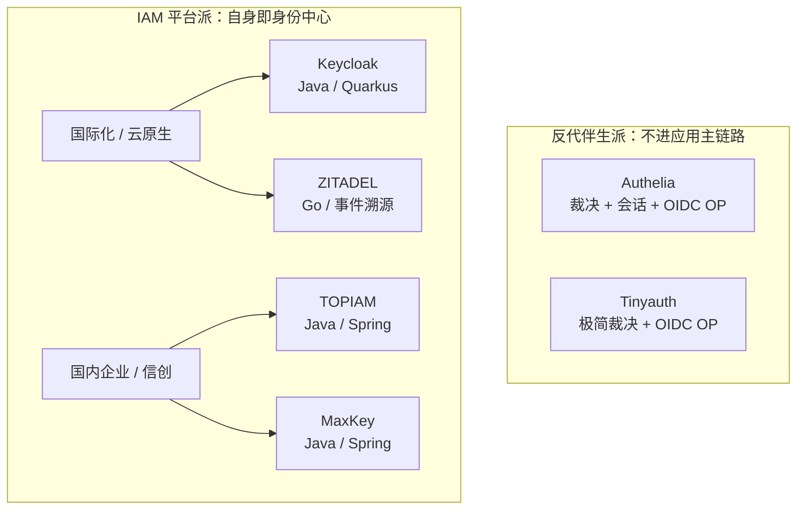

# 认证授权项目能力横评：Authelia / Tinyauth / Keycloak / ZITADEL / TOPIAM / MaxKey

> **本表的定位**：这是**综合层**，不是新的源码解读。格子证据优先指向各项目的解读子文档；kb 未覆盖的部分由本次源码检索补充，并在依据里写明**检索范围**。
>
> **⚠️ 证据强度并不齐平，请知情后再引用**：Authelia（76 条）与 ZITADEL（90 条）的引用带源码锚点、经 `verify-references` 双向校验；Tinyauth（81 条）路径与行号有效但无锚点；而 **Keycloak / TOPIAM / MaxKey 三家解读文档的源码级引用很薄（8 / 5 / 0 条）**。为不把这三家的结论建在薄证据上，**本表针对它们的关键断言均已由本次逐一复核源码**，复核过的都在依据里给了 `文件:行号`；未复核的一律标 ⓘ。补齐这三家的引用覆盖是首要待办（见「维护说明」）。
>
> **核实基线**：Authelia `v4.39.26`、Tinyauth `v5.1.3`、Keycloak `64ce6919(main)`、ZITADEL `632a51968(main)`、TOPIAM `ca2be26e(v1.1.0+)`、MaxKey `4.1.11`。
>
> **范围**：只纳入 kb 已解读的 6 家。oauth2-proxy / Dex / Authentik / Casdoor 等**刻意不列入**——kb 里没有它们的解读，格子只能靠外部资料，无法给出可点开验证的证据。宁可少列，不可失据。

## 怎么读这张表

### 一、先看定位分组：跨组比「缺失」没有意义

这 6 家不是一个物种，它们分属两派：



「Authelia 没有多租户」不是能力缺失，是**它不做身份中心**；同样，「Keycloak 不能给 nginx 做 ForwardAuth」也不是缺陷。所以本表把这类情况标成 **➖ 架构外**，并且**不算缺失**。

### 二、状态标记用 7 态，而不是 ✓/✗

| 标记 | 含义 | 计入「缺口」？ |
|---|---|---|
| ✅ | 原生内置、开箱可用 | — |
| 🟡 | 内置但**有边界/非完整**（备注必写清限制） | 否 |
| 🔌 | 需扩展点 / SPI 自建 | 部分 |
| 🧩 | 需**外部组件拼装**（如反代 + 本项目） | 否 |
| ➖ | **架构外**：该项目定位不覆盖此类能力 | 否 |
| ❌ | **能力缺口**：在其自身定位范围内、同类普遍具备而它没有 | **是** |
| ⓘ | 待核实 | — |

**为什么不能只用 ✓/✗**——本库就有一个现成的反面教材：`auth/tinyauth/README.md` 的局部对比表曾把 **Authelia 的 OIDC 提供者标为 ❌**，而 Authelia 是 OpenID Certified™ 的 OP。原因不是能力判断难，而是**竞品行由各项目作者顺手写、无人负责校验**。本表因此把结论集中到分类层统一维护，并要求每格给证据。

**➖/❌ 的实际执行口径**（避免用身份中心的标准去衡量反代网关）：对**反代伴生派**，只把「OIDC OP 扩展规格、MFA 因子、会话与令牌治理、管理面」视为其自称范围；SAML / CAS / SCIM / 对外 LDAP / RBAC 实体 / 流程编排 / 事件溯源 / 多租户 / 扫码 / 移动端 / 信创**一律记 ➖**。据此对个别原始判定做了降级——Authelia 第 9/10/11/14/29/47/49 项、Tinyauth 第 9/10/25/26/29/47 项由 ❌ 改 ➖。

### 三、证据的举证规则

- **正向断言（✅/🟡/🔌/🧩）**：必须给 kb 解读文档的相对路径 + 章节，或源码 `路径:行号`。
- **负向断言（❌）**：给不出行号，因此**必须附检索范围**（实际跑了什么检索）。拿不准的标 ⓘ，**不许用「没找到」当结论**。
- 关键词命中**不等于**能力具备：`grep -i saml tinyauth/` 命中的全是「无 SAML」这类**否定句**；TOPIAM 仓库里 `grep -i saml` 命中的全是 README **文案**。本表一律以源码实现为准。

## Table A：定位速查

先看这张，决定你该重点读哪几列。

| 维度 | Authelia | Tinyauth | Keycloak | ZITADEL | TOPIAM | MaxKey |
|---|---|---|---|---|---|---|
| **定位** | 反代伴生鉴权网关 | 反代伴生（极简） | IAM 平台（领域参考实现） | IAM 平台（云原生 / 事件溯源） | IAM/IDaaS（国内企业） | IAM/IDaaS（国内企业） |
| **语言 / 运行时** | Go 单二进制 | Go 单二进制（~20MB） | Java 17+ / Quarkus 3.x | Go 单体 + Next.js/Angular | Java 17 / Spring Security 6 | Java 17+ / Spring Boot 3 |
| **护应用的姿势** | 反代旁路（ForwardAuth 等四模式） | 反代旁路（ForwardAuth） | 应用直连 OIDC/SAML | 应用直连 OIDC/SAML | 应用直连 OIDC/JWT/表单代填 | 应用直连 OIDC/SAML/CAS/JWT |
| **认证源** | 本地 file / LDAP | 本地 / LDAP / OAuth2 / Tailscale | LDAP/AD + 社交 + 任意 OIDC/SAML IdP | LDAP + 11 类上游 IdP | 钉钉 / 飞书 + 8 种社交 | LDAP/AD + 社交 + 同步器 |
| **最小部署依赖** | 单机 SQLite；HA 需 Redis + 远程 DB | 单机 SQLite/内存；Postgres 可选 | 关系库 + Infinispan | PostgreSQL ≥ 14（单库） | MySQL 8.0+ + Redis | MySQL/PG/达梦/金仓 + Redis |
| **多租户模型** | ➖ 无 | ➖ 无 | Realm | Instance → Org → Project | 组织架构 | 机构（Inst） |
| **管理面形态** | portal + 配置即代码（无 Admin API） | 仅 CLI | 控制台 + Admin REST + CRD | Console + API-first | Console + OpenAPI | 管理端 + REST/SCIM |
| **许可** | Apache-2.0 | AGPL-3.0 | Apache-2.0 | AGPL-3.0 | AGPL-3.0 | Apache-2.0 |
| **信创 / 国密** | ➖ | ➖ | 🔌（仅 FIPS） | ❌（仅 FIPS） | 🟡 **仅 README 宣称** | 🟡 仅 SM3 口令哈希 |

## Table B：能力缺失矩阵

> 标记含义见上。**➖ 是架构外，不是缺陷**；只有 **❌** 才算真缺口。
> 一个前置结论：**6 家全 ✅ 的能力只有 1 项（OIDC 1.0 OP Core）**——这本身说明它们几乎没有可替换性，任何「谁更强」的笼统结论都不成立。

### L1 协议与互操作（对应用发身份）

| # | 能力 | Authelia | Tinyauth | Keycloak | ZITADEL | TOPIAM | MaxKey |
|---|---|---|---|---|---|---|---|
| 1 | OIDC 1.0 OP（授权码 + PKCE） | ✅ | ✅ | ✅ | ✅ | ✅ | ✅ |
| 2 | OIDC Device Authorization Grant | ✅ | ❌ | ✅ | ✅ | ✅ | ❌ |
| 3 | OIDC Token Exchange（RFC8693） | ❌ | ❌ | 🟡 | ✅ | ❌ | ❌ |
| 4 | OIDC PAR（RFC9126） | ✅ | ❌ | ✅ | ❌ | ❌ | ❌ |
| 5 | DPoP / mTLS 持有者绑定 | ❌ | ❌ | ✅ | ❌ | ❌ | ❌ |
| 6 | OIDC 动态客户端注册（DCR） | ❌ | ❌ | ✅ | 🟡 | ❌ | ❌ |
| 7 | OIDC Front / Back-Channel Logout | ❌ | ❌ | ✅ | 🟡 | ❌ | 🟡 |
| 8 | OpenID Foundation 官方 OP 认证 | ✅ | ✅ | ✅ | ✅ | ❌ | ❌ |
| 9 | SAML 2.0 IdP | ➖ | ➖ | ✅ | ✅ | ❌ | ✅ |
| 10 | SAML 2.0 SP（接入外部 IdP） | ➖ | ➖ | ✅ | ✅ | ❌ | ✅ |
| 11 | CAS（1.0/2.0/3.0） | ➖ | ➖ | ❌ | ❌ | ❌ | ✅ |
| 12 | 表单代填（免改造集成旧应用） | ➖ | ➖ | ❌ | ❌ | ✅ | ✅ |
| 13 | JWT / 自研 Token 型 SSO | 🟡 | 🟡 | ✅ | ✅ | ✅ | ✅ |
| 14 | SCIM 2.0 用户/组供给 | ➖ | ➖ | 🟡 | 🟡 | ❌ | 🟡 |
| 15 | 对外提供 LDAP 目录服务 | ➖ | ➖ | ➖ | ❌ | ❌ | ❌ |
| 16 | 反向代理旁路鉴权 | ✅ | ✅ | 🧩 | ❌ | ❌ | 🟡 |
| 17 | OAuth2 社交 / 上游 IdP 联合 | ❌ | ✅ | ✅ | ✅ | ✅ | ✅ |

**依据**

- **2 / 4 / 13** Authelia：`oidc.md` §Device 与 Client Credentials、§Token 结构；上游权威支持表 `docs/content/integration/openid-connect/introduction.md:574-634`（RFC8628 Complete、RFC9126 Complete、RFC9068 Complete）。Tinyauth：`oidc-provider.md` §能力面板（grant 仅 code/refresh）；`well_known_controller.go:78-94` 无 device/par 端点（检索 `grep -riE "device_code\|pushed_authorization"` → 0 命中）。ZITADEL：`api/oidc/server.go:61`。TOPIAM：`OAuth2AuthorizationServerConfigurer.java:191-193`。MaxKey：`OpenidConfigurationEndpoint.java:208-213`（grant 仅 4 种）。
- **3** ZITADEL：`token_exchange.go` + `app.proto:246`；Keycloak：`docs/guides/securing-apps/token-exchange.adoc`（V2 仅同 realm client→client）。Authelia / MaxKey / TOPIAM 检索 0 命中。⚠️ **Authelia 有 `RFC8693Config` 结构体但无 handler 注册**（`internal/oidc/config.go:159-163,290-470`）——属死代码，**不可记为已支持**。
- **5** Keycloak：`DPoPUtil.java:96`、`OIDCWellKnownProvider.java:341`（RFC9449 / RFC8705 均 Supported）。其余 5 家检索 0 命中；⚠️ Authelia 的 DPoP 配置字段**无任何赋值点**，fork 的接口桩恒 false。
- **6** Keycloak：`OIDCClientRegistrationProvider.java:68` + `RealmsResource.java:170`（DCR Certified 18.0.0）。ZITADEL：`api/oidc/server.go:47,185`（有端点但受 instance 配置约束，RFC7592 走管理 API）。Authelia：`internal/oidc/store.go:277-300` 直接返回 `errClientRegistrationNotSupported`。
- **7** Keycloak：`LogoutEndpoint.java:557`（Certified）。ZITADEL：**仅 Back-Channel**（`sessionlogout/events.go:11-13`、`app.proto:171`），全仓无 front-channel。MaxKey：仅 RP-Initiated（`OpenidConfigurationEndpoint.java:87`）。⚠️ Authelia 三项 Logout 策略在 `internal/oidc/config.go:1123-1127` **恒 nil**，属死代码。
- **8** Authelia：`oidc.md` §一致性验证（`internal/oidc/conformance/`）；Tinyauth：`README.md:31`（v5.1.0 **Basic OP**）；ZITADEL / Keycloak：官方 OIDF 实现列表。**TOPIAM / MaxKey 未出现在 OIDF 认证名单**——抓取官方页面全文比对，`keycloak` 命中 13 次、`maxkey`/`topiam`/`eiam` 均 0 次。
- **9 / 10** ⚠️ **kb 原有的 ZITADEL「SAML Service Provider 角色」表述有误，已修正**：`internal/api/saml/provider.go` 导入 `github.com/zitadel/saml/pkg/provider`（**IdP 侧**）并暴露 `/saml/v2/{metadata,certificate,SSO}` 对下游签发断言；`internal/idp/providers/saml/` 才是它作 **SP** 接入上游。**双角色并存**。TOPIAM 的 SAML 模块已于 `bd148325` 删除，全仓仅 README 文案。
- **11 / 12** MaxKey：`Cas{10,20,30}AuthorizeEndpoint` + `FormBasedAuthorizeEndpoint.java:62-93`；TOPIAM：`eiam-protocol-form`。Keycloak / ZITADEL 均无 CAS（Keycloak 需第三方插件），表单代填两家也都声明不做。
- **14** Keycloak `common/src/main/java/org/keycloak/common/Profile.java:199`（SCIM_API=PREVIEW，默认关，需 `--features=scim-api`）；ZITADEL `internal/api/scim/schemas/schemas.go:21-29`——资源类型只声明了 `IdUser`，**`schemas.go` 中 "group" 出现 0 次**，`internal/api/scim/resources/` 下仅有 `user*.go` 无 `group.go`，故**仅 User、无 Group**；MaxKey `ScimServiceProviderConfigController.java:46-53`（自述 patch/bulk/changePassword/etag 均 false）。TOPIAM 仅 `README.md:133` 文案，`eiam-openapi` 是自研 `/oapi/v1` 而非 SCIM schema。
- **16** Authelia：`auth-flow.md` §四种反向代理集成模式；Keycloak：`mod-auth-openidc.adoc` 原文声明「不提供官方支持」，需外部组件（🧩）；MaxKey：仅可信头注入（`HttpHeaderEntryPoint.java`），网关过滤器 `AuthAndLogFilter.java:33` 是**空实现**。
- **17** **Authelia 是唯一缺失上游联合的一家**：`schema/identity_providers.go` 只有 `OIDC` 一项且是它**自己当 OP** 的配置；认证后端仅 `file`/`ldap` 两个 koanf 键。⚠️ 据此本表同时修正了 `tinyauth/README.md` 对比表中「Authelia 认证源含 OIDC 身份源」的错误表述。

### L2 认证因子与认证编排

| # | 能力 | Authelia | Tinyauth | Keycloak | ZITADEL | TOPIAM | MaxKey |
|---|---|---|---|---|---|---|---|
| 18 | 密码认证（哈希算法可配） | ✅ | 🟡 | ✅ | ✅ | 🟡 | ✅ |
| 19 | WebAuthn / Passkey | ✅ | ❌ | ✅ | ✅ | ❌ | ✅ |
| 20 | TOTP | ✅ | ✅ | ✅ | ✅ | ❌ | ✅ |
| 21 | 推送认证（Duo / App 推送） | ✅ | ❌ | 🟡 | ❌ | ❌ | ❌ |
| 22 | 短信 OTP | ❌ | ❌ | 🔌 | ✅ | ✅ | ✅ |
| 23 | 邮箱 OTP | 🟡 | ❌ | 🔌 | ✅ | ✅ | ✅ |
| 24 | 恢复码 / 备用码 | ❌ | ❌ | ✅ | ✅ | ❌ | ❌ |
| 25 | 扫码登录 | ➖ | ➖ | 🟡 | ❌ | ✅ | ✅ |
| 26 | Kerberos / AD 域免密 | ❌ | ➖ | ✅ | ❌ | ❌ | 🧩 |
| 27 | 移动端 App 专属认证通道 | ➖ | ➖ | ➖ | ❌ | ❌ | 🟡 |
| 28 | 客户端证书 / mTLS 认证 | 🟡 | ❌ | ✅ | 🟡 | 🟡 | 🟡 |
| 29 | 认证流程可编排 | ➖ | ➖ | ✅ | ✅ | ❌ | ❌ |
| 30 | 条件认证 / 风险自适应 | 🟡 | 🟡 | 🟡 | ❌ | ❌ | ❌ |
| 31 | 无密码优先登录 | 🟡 | 🟡 | 🟡 | 🟡 | ❌ | 🟡 |
| 32 | Trusted Device / Remember Me | 🟡 | ❌ | 🟡 | ❌ | ✅ | 🟡 |
| 33 | 图形验证码 / 人机校验 | ❌ | ❌ | 🟡 | ❌ | ❌ | ✅ |

**依据**

- **18** Authelia `schema/authentication.go:72-128`（argon2id 默认 + 4 种）；ZITADEL `cmd/defaults.yaml:859-881`（6 种，默认 bcrypt）；MaxKey `ApplicationAutoConfiguration.java:75-95`（含 sm3）；Tinyauth `auth_service.go:200` **硬编码 bcrypt，无配置项**；TOPIAM 的 `PasswordEncoder` 由**外置父工程** `eiam-support-parent:1.1.1-CE` 提供，本仓库不可见。⚠️ **kb 原称 Keycloak 支持 BCrypt 有误，已修正**：内置 provider 仅 `Pbkdf2(×3)` + `Argon2`，全仓无 bcrypt 实现。
- **21** Authelia：`handler_sign_duo.go` + `duo/const.go:19-20`（**仅 Duo Push，依赖 Duo 云**）；Keycloak：CIBA + HTTP 认证通道 SPI（`AuthenticationChannelSpi.java:26`），**无 Duo / App 推送成品**；ZITADEL / TOPIAM / MaxKey 检索 0 命中。
- **22 / 23** ZITADEL：`user.proto:302,307` + `notification/senders/{sms,email}.go`；MaxKey：`SmsOtpAuthnAliyun/TencentCloud/Yunxin`、`MailOtpAuthn.java`；TOPIAM：`eiam-authentication-{sms,mail}`。Keycloak 无内置短信/邮件 OTP provider，只能靠 Authenticator SPI 自建（🔌）。Authelia 的邮箱码**仅用于会话提级（sudo）而非登录因子**。
- **24** Keycloak：`Profile.java:121` + `RecoveryAuthnCodesFormAuthenticator.java:34`（默认浏览器流程中为 Disabled）；ZITADEL：`user_service.proto:1150-1174`。其余 4 家检索 0 命中。
- **25** TOPIAM / MaxKey 的「扫码」本质是**微信、飞书等社交入口的呈现**，非自有 App 扫码确认；Keycloak 仅有实验性 OID4VP 钱包扫码（`Profile.java:148`，EXPERIMENTAL）。⚠️ **kb 原称 TOPIAM 有「图形验证码」，实为已被删除的极验模块**：当前 ref 唯一的 `*aptcha*` 文件是短信/邮件 OTP 的「验证码不存在」异常。
- **26** Keycloak：`SpnegoAuthenticator.java:49` + `federation/kerberos/`（DEFAULT）。MaxKey：官方文档自认「未提供基于 Kerberos 的认证」，源码只有消费外部 AES token 的 `HttpKerberosEntryPoint.java`（🧩）。Authelia 仅有接口声明与 mock，无调用点。
- **30** 三家 🟡 的差异值得记：Authelia 是**静态声明式策略**（网络/用户/组 → 1FA/2FA）；Keycloak 有 7 个**条件认证器**（角色/属性/凭据/LoA…）；Tinyauth 是 6 条固定属性规则。**6 家全部没有风险评分 / 设备指纹引擎**——这一整类是行业空白，而非个别缺失。
- **33** MaxKey：kaptcha（`maxkey-starter-captcha`）；Keycloak：**仅注册流程**且只支持 Google reCAPTCHA；其余 4 家无。

### L3 授权、会话与治理

| # | 能力 | Authelia | Tinyauth | Keycloak | ZITADEL | TOPIAM | MaxKey |
|---|---|---|---|---|---|---|---|
| 34 | 反代场景 ACL 规则引擎 | ✅ | ✅ | 🟡 | ❌ | ➖ | ❌ |
| 35 | RBAC 角色权限模型 | 🟡 | 🟡 | ✅ | ✅ | ❌ | ✅ |
| 36 | ABAC / 策略表达式语言 | ❌ | 🟡 | ✅ | 🟡 | ❌ | ❌ |
| 37 | 资源级细粒度授权（UMA / 权限 API） | 🟡 | ➖ | ✅ | 🟡 | ❌ | 🟡 |
| 38 | 会话集中管理 + 强制下线 | 🟡 | 🟡 | ✅ | 🟡 | ✅ | ✅ |
| 39 | 单点登出 SLO（跨应用） | 🟡 | ❌ | ✅ | ✅ | 🟡 | ✅ |
| 40 | Refresh Token 轮换 | ✅ | ✅ | ✅ | 🟡 | ✅ | ❌ |
| 41 | Token 内省 / 吊销 | ✅ | ❌ | ✅ | ✅ | ✅ | 🟡 |
| 42 | 审计日志 | ✅ | 🟡 | ✅ | ✅ | ✅ | ✅ |
| 43 | 防爆破 / 限流 / 账号锁定 | ✅ | ✅ | 🟡 | ✅ | ✅ | 🟡 |
| 44 | 用户自助服务 | 🟡 | ❌ | ✅ | ✅ | 🟡 | ✅ |
| 45 | HA 多副本部署 | ✅ | 🟡 | ✅ | ✅ | ✅ | ✅ |
| 46 | 用户目录源集成与同步 | 🟡 | 🟡 | ✅ | ✅ | 🟡 | ✅ |
| 47 | 事件溯源 / 完整历史重建 | ➖ | ➖ | ❌ | ✅ | ➖ | ❌ |
| 48 | 可编程扩展点（SPI / Actions / 脚本） | ❌ | 🟡 | ✅ | ✅ | 🟡 | 🟡 |
| 49 | 信创 / 国密适配 | ➖ | ➖ | 🔌 | ❌ | 🟡 | 🟡 |
| 50 | 管理面（UI / API / CLI / 配置即代码） | 🟡 | 🟡 | ✅ | ✅ | 🟡 | 🟡 |

**依据**

- **34** Authelia：`authorization-rules.md` 全篇（first-match-wins + 全维 AND）；Tinyauth：`policy-engine.md`（三值 Allow/Deny/Abstain，fail-closed）；Keycloak：`PolicyEnforcerConfig.java:38`——规则**在应用侧由 policy-enforcer 客户端库执行**，服务端不提供网关式 ACL（故 🟡）；ZITADEL / MaxKey 明确不做；TOPIAM 无 proxy 模块（➖）。
- **37** Keycloak：`resource-permission-design.md` §UMA + §FGAP（资源/scope/策略三层 + permission ticket）；ZITADEL：有 `perm:ctxID` 作用域权限与权限查询 API，但**非 UMA**；MaxKey：有资源-功能-角色模型但无 ticket/RPT。
- **38** Keycloak：`UserResource.java:438,679`（在线/离线会话视图 + 强制登出）；MaxKey：`SessionController.java:86-96`；TOPIAM：`SessionManageEndpoint.java:90,118`（并发上限默认 1）。Authelia / ZITADEL / Tinyauth 均只能自助登出，**无管理面强制下线他人会话**。
- **39** Keycloak 三通道 Certified；ZITADEL：RP-Initiated + Back-Channel（无 Front-Channel）；MaxKey：自研 `DefaultSingleLogout` / `SamlSingleLogout` 遍历 `session.visited`（非 OIDC 标准）；TOPIAM：仅 RP-Initiated，**不通知其它已登录应用**；Authelia：反代侧共享 cookie 登出即全失效，但无 OIDC 登出通告；Tinyauth：**明确无 SLO**（`auth-flow.md` 声明「既不向任何第三方 RP 发起通知」）。
- **40** ⚠️ **全表反差最大的一行之一**：Authelia `oidc/store.go:254-275`（按 `access_signature` 一并撤销配套 access token）；Tinyauth `oidc_service.go:651-720`；Keycloak `TokenManager.java:1284`（**默认关闭**，需显式开启）；TOPIAM `OidcStandardApplicationServiceImpl.java:127`（默认轮换）；ZITADEL：刷新复用原 session 且**不重验因子**（`auth-flow.md` 自记风险）；**MaxKey 的刷新令牌轮换分支是死代码**：`DefaultTokenServices.java:74` 的默认值即为 `private boolean reuseRefreshToken = true;`，而开启轮换的分支 `if (!reuseRefreshToken)`（`:205,212`）唯一开关 `setReuseRefreshToken`（`:436`）**全仓 0 处调用**——因此轮换永不启用（`login-logout-flow.md:689` 亦自认）。
- **41** Authelia：`handlers.go:508,525`（RFC7009/7662/9701 Complete）；Tinyauth：发现文档仅 5 端点，无 introspect/revoke；MaxKey：有 RFC7662 内省但**无 RFC7009 撤销端点**。
- **43** Authelia：regulation 封禁落存储 + 逐端点令牌桶；Keycloak：防爆破内置但**无通用 HTTP 限流**；MaxKey：错误计数 / 锁定 / 密码策略齐备但无请求级限流。**6 家没有一个内建通用 WAF 式限流**。
- **45** 差异在**会话存放位置**：Authelia / ZITADEL / TOPIAM / MaxKey 把会话外置（Redis / DB）；Keycloak 需 DB + Infinispan；**Tinyauth 的 OAuth 挂起会话与登录锁定在进程内存**，多副本会丢回调（其 README 自认「单实例或有会话亲和」）。
- **47** ZITADEL 是唯一事件溯源（`events2` + 投影可重建，`architecture.md`）；Keycloak 的事件**仅作审计日志**，无法重放重建；MaxKey 是 `mxk_history_*` 流水表；TOPIAM 是审计宽表快照（➖）。
- **48** Keycloak：176 个 SPI（`META-INF/services/...Spi` 去重计数）；ZITADEL：V1 goja JS + V3 Execution（条件 × 节点 → webhook/call/async）；Tinyauth / MaxKey / TOPIAM 均为**编译期 Go/Java 接口**，扩展需改代码重打包；**Authelia 无插件机制**，通知仅 SMTP/file 两种。
- **49** 只有国内两家的定位包含信创：MaxKey 有 SM3 口令哈希（**无 SM2/SM4**）；TOPIAM **仅 README 宣称**，全仓无国密实现、DDL 仅 MySQL。Keycloak / ZITADEL 有 FIPS 模式但无国密，可经 SPI / JCA 引入（🔌）。

### 全员具备（6 家全 ✅）

只有 **1 项**：**OIDC 1.0 OP（授权码 + PKCE）**。

这就是本表最重要的结构性结论——**6 个项目的交集只有 OIDC Core**，其余 49 项全部存在分歧。任何把它们的对比简化为「A 比 B 强」的说法都掩盖了这一点。

## Table C：差异深挖

对 **❌ / 🟡 / 🔌** 三类格子展开：为什么没有、替代路径、代价。

### C1. 缺口计数与「谁最全」的真相

| 项目 | ❌ 缺口 | 🟡 边界 | ➖ 架构外 | 一句话 |
|---|---|---|---|---|
| Keycloak | **3** | 13 | 3 | 协议面最全，缺口仅 CAS / 表单代填 / 事件溯源 |
| Authelia | 11 | 15 | 9 | 缺口集中在 **OIDC 扩展规格**与上游联合 / SCIM |
| MaxKey | 15 | 11 | 0 | 协议最杂，但 OIDC 扩展几乎为空、无 refresh 轮换 |
| ZITADEL | 15 | 10 | 1 | 强在事件溯源 / 多租户 / 扩展，弱在 PAR、DPoP、mTLS |
| Tinyauth | 17 | 10 | 13 | 极简定位，缺口基本等于它的取舍 |
| TOPIAM | **25** | 9 | 2 | **CE 实际能力远窄于宣称**（见 C2） |

> 读法提醒：**缺口数不等于产品优劣**。Authelia 的 11 项里 6 项是 OIDC 扩展；Tinyauth 的 17 项几乎全是「不做身份中心」的必然结果。

### C2. 最需要警惕的一类问题：**宣称 ≠ 实现**

本次横评最重要的发现不是能力差异，而是**多处「文档 / 宣传与源码不符」**：

1. **TOPIAM CE 移除了大量已宣称的模块**。`eiam-application` 仅剩 `core/all/oidc/jwt/form`，`eiam-identity-source` 仅剩 `dingtalk/feishu`——SAML2 / CAS 于 `bd148325(1.0.0)` 删除，LDAP / AD 于 `bef08892` 以「移除暂未开发的模块」删除，MFA(TOTP) 与极验验证码同批删除。而 **README 第 19、35 行仍宣称支持 SAML2 / CAS / LDAP / AD / 多因素 / 国密**。→ 已修正 kb 的 `topiam/README.md` 能力清单并补修正说明。
2. **Authelia 有三处「有结构体无实现」的死代码**：`RFC8693Config`（无 handler 注册）、DPoP 字段（无赋值点）、Back-Channel Logout 策略（恒 nil）。任何靠「grep 到关键字」生成的对比表都会把这三项误记为已支持。→ 本表一律按实际实现判定。
3. **kb 原有三处论断被源码证伪并已修正**：① ZITADEL 的 SAML **是 IdP 而非 SP**（同时另有 SP 角色接上游）；② **Keycloak 内置哈希 provider 无 BCrypt**（仅 PBKDF2 系列 + Argon2）；③ **TOPIAM 的图形验证码与多因素认证在当前 ref 不存在**。

### C3. 真正值得当作「选型红线」的缺口

| 缺口 | 涉及项目 | 影响 |
|---|---|---|
| **Refresh Token 无轮换** | MaxKey（硬编码 `reuseRefreshToken=true`） | 刷新令牌泄露后无法通过轮换检测复用，重放窗口贯穿令牌有效期 |
| **单点登出不通知 RP** | Tinyauth（完全无 SLO）、TOPIAM（仅终止 OP 侧会话） | 用户在 A 应用登出后 B 应用仍持有效会话——合规场景常不可接受 |
| **PAR / DPoP / mTLS 缺失** | Authelia、Tinyauth、ZITADEL、TOPIAM、MaxKey | 无法满足 FAPI 类高安全 profile；授权请求可被篡改、令牌可被窃取重放 |
| **无图形人机校验** | Authelia、Tinyauth、TOPIAM、ZITADEL | 只能靠锁定 / 封禁抗撞库，缺少低成本第一道闸 |
| **SCIM 仅用户无组** | ZITADEL | 企业 HR 驱动的组同步无法自动化 |
| **多副本会话不一致** | Tinyauth（挂起会话在内存） | 需会话亲和或单实例，横向扩展受限 |

### C4. 一条需要明确标注的设计观察（非已证实漏洞）

**MaxKey 的第二因子强制力不在 provider 层**。`AbstractAuthenticationProvider.java:151-165` 中，当用户配置了二次认证时先调用 `sessionManager.createTwoFactor(...)` 打标记，但紧接着**无条件**执行 `sessionManager.create(session.getId(), session)` 签发正式会话：

```java
if (authType == NORMAL && userInfo.getAuthnType() > ConstsTwoFactor.NONE) {
    principal.setTwoFactor(userInfo.getAuthnType());
    this.sessionManager.createTwoFactor(session.getId(), session);   // 仅打标记
}
this.sessionManager.create(session.getId(), session);                // 无条件签发正式会话
```

也就是说服务端 provider 本身**不以「2FA 已完成」为签发条件**，强制力依赖调用方 / 前端是否尊重 `twoFactor` 标记。这是**架构观察**，是否构成可利用绕过取决于上层调用链；本表**不将其判定为已证实的漏洞**，但建议使用者在启用 TOTP 时自行验证端到端强制。

### C5. 反代派 vs 平台派：不可互换

- **要给 nginx / Traefik / Caddy 后面的一堆自建应用加统一认证** → 只有 **Authelia / Tinyauth** 提供 ForwardAuth / ext_authz / auth_request 数据面；Keycloak 必须外挂 oauth2-proxy 等（🧩），ZITADEL 明确不做。
- **要给第三方应用发身份、做多租户与目录治理** → **Keycloak / ZITADEL**；TOPIAM / MaxKey 的国际协议面明显更窄（TOPIAM CE 尤甚）。

## 选型指引

| 你的场景 | 首选 | 关键理由 | 主要代价 |
|---|---|---|---|
| 自托管家庭 / 内网，反代后一堆应用 | Tinyauth | 单二进制 ~20MB、无 CGO、Docker/K8s 标签自动发现 ACL | 无 SAML / WebAuthn / SLO / 管理 API，多副本受限 |
| 反代旁路，但需要 OIDC 对外发身份 + 强 ACL | Authelia | 四模式反代 + OIDC Certified + 逐端点限流 + HA | 无 SAML / 上游联合 / SCIM，OIDC 扩展规格多缺 |
| 企业内标准化 IAM，协议与扩展性优先 | Keycloak | 协议面最全（Certified 18.0.0）+ 176 SPI + 可编排流程 | Java 栈重、需 Infinispan、配置复杂 |
| 云原生、多租户 SaaS，要完整审计与可编程 | ZITADEL | 事件溯源可重建 + Instance 级隔离 + Actions + API-first | 无 PAR / DPoP / mTLS / CAS，SCIM 仅用户 |
| 国内企业，需钉钉/飞书与社交登录、JWT SSO | MaxKey（其次 TOPIAM） | 协议与认证方式最杂、含 CAS 与表单代填、SM3 | OIDC 扩展几乎为空、无 refresh 轮换、无恢复码 |
| 信创合规，需国产库适配 | MaxKey（优于 TOPIAM） | 达梦 / 人大金仓等 DDL 与国产化路线 | MaxKey 国密仅 SM3；TOPIAM 需先核实模块是否已从 CE 移除 |

## 维护说明

- 本表是**分类级单一事实源**。各项目解读文档里的竞品行描述**不再作为结论来源**（那里最容易漂移）；跨项目结论以本表为准。
- **首要待办：补齐 Keycloak / TOPIAM / MaxKey 三家解读文档的源码引用覆盖**。现状是本表最薄弱的一环——三家文档的源码级引用分别只有 8 / 5 / 0 条（MaxKey 完全没有），Capabilities 断言因此缺少可点开的行号级证据。做法照 Authelia / ZITADEL：改用 `[路径:start-end]()` 并配 `<!-- anchor: 首行 … 末行 -->` 指纹，再用 `verify-references.mjs` 双向校验。
- 新增能力维度时，需同时补齐 6 列，否则该行标注 ⓘ 并记入「待核实」。
- 各项目解读子文档更新后，应回查本表对应列。
- 本次未纳入但值得后续扩展的规格（Authelia 上游支持表已明确标 None，可作起点）：**CIBA、SSF/CAEP、RAR(RFC9396)、Step-up(RFC9470)、Protected Resource Metadata(RFC9728)、SD-JWT、OID4VP**。
- 已随本表修正的 kb 文档：`tinyauth/README.md`（Authelia 列 3 处）、`zitadel/README.md` 与 `zitadel/oauth-saml-scim-api.md`（SAML 角色）、`keycloak/login-logout-flow.md`（BCrypt 2 处）、`topiam/README.md`（能力清单 5 行 + 修正说明）、`auth/README.md`（TOPIAM 索引行）。
- 顺带修复的既有引用漂移：`zitadel/actions-execution.md`（`userinfo.go` 2 处，其中 1 处因代码重构已抽为 `applyContextInfoResponse`）、`zitadel/architecture.md`（`setup.go` 行号 +1）；`topiam/README.md`、`keycloak/login-logout-flow.md` 的 `<br/>` 统一为 `<br>`。
