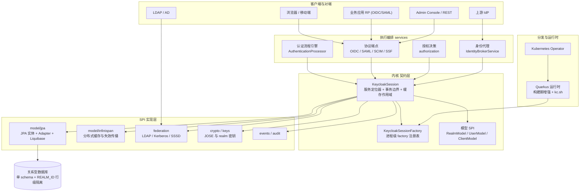
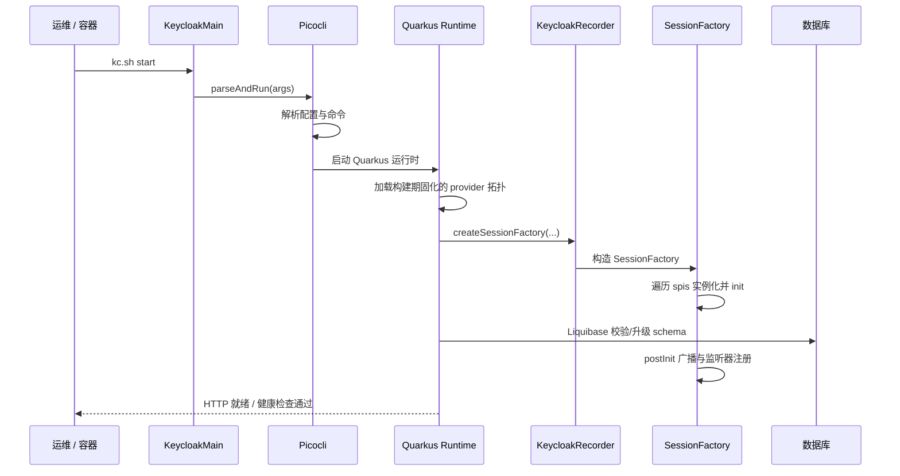
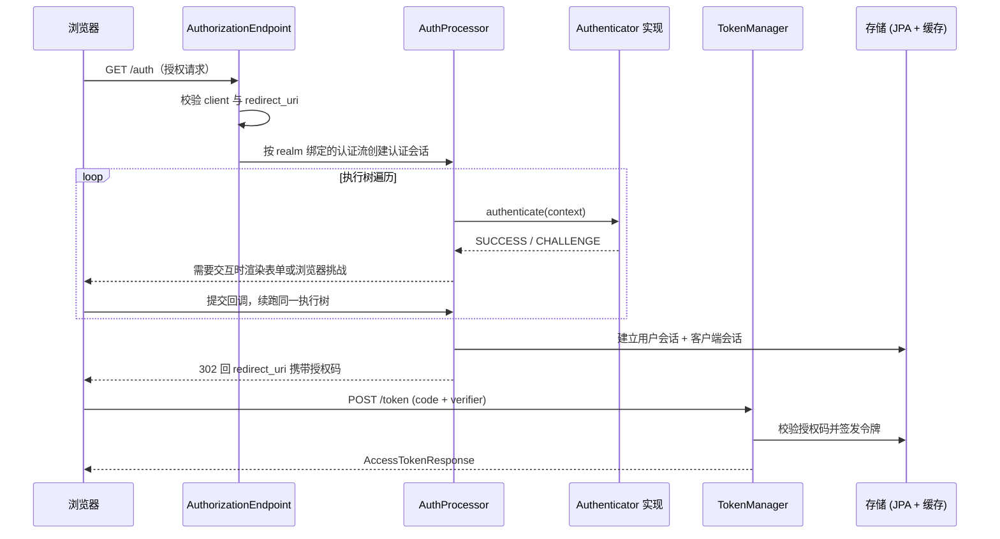

# Keycloak — 一切皆 Provider 的 IAM 标准参考实现

> 解读基线：Keycloak 26.7.3（`6d238b6558`）。下文所有源码引用均相对仓库根，并附程序化校验过的行号锚点。
>
> 本解读**回落通用默认规格**（Keycloak 未命中 `project-types/` 注册表中的任何规格化类型），并按「可部署服务 + 有数据存储 + 长业务流程 + JVM 语言惯用法」四条产品/语言类型触发项追加关注面。

## 一句根因

一个被成百上千个应用与企业目录共享的身份中心，真正的难点**不是「实现一套 OIDC」**——协议有规范可循。难点是：**如何在不改一行代码、不重新部署的前提下，同时满足无数互相冲突的组织约束**（目录在 LDAP 还是 AD、登录要 OTP 还是 WebAuthn、对端说 SAML 还是 OIDC、每个租户要独立密钥与策略、既要跨机房 HA 又要单机 dev 模式）。

Keycloak 的答案是：**内核只保留模型 SPI 与执行编排，其余一切可变部分下沉为可插拔 Provider，在运行时按 realm 配置装配**。这条「一切皆 Provider」的哲学是它的架构载体——`KeycloakSession` 的公开接口本身就是一组 Provider 取用方法（[server-spi/src/main/java/org/keycloak/models/KeycloakSession.java:35-35]()<!-- anchor: public interface KeycloakSession extends AutoCloseable { -->），而 `DefaultKeycloakSessionFactory` 持有的核心状态就是「能力类别集合」与「factory 注册表」两张表（[services/src/main/java/org/keycloak/services/DefaultKeycloakSessionFactory.java:62-64]()<!-- anchor:     protected Set<Spi> spis = new HashSet<>(); …     protected volatile Map<Class<? extends Provider>, Map<String, ProviderFactor -->）。理解了这一点，认证流程、协议端点、存储适配、身份代理、授权服务全都只是「某一个 SPI 的一个实现」。

## 项目定位

Keycloak 由 Red Hat 发起、现为 CNCF 孵化项目，是 IAM 领域的**标准参考实现**：几乎所有同类开源项目（ZITADEL、MaxKey、TOPIAM）在功能集、协议覆盖与认证流程上都以它为对标基准。

它要解决的问题可以拆成三层：

- **认证基础设施的重复建设**：每个应用各自实现登录、注册、改密、会话与登出，安全水位取决于最弱的那一个应用。Keycloak 把这些收敛为一个独立部署的身份中心。
- **协议与目录的异构并存**：历史系统说 SAML、新应用说 OIDC、移动端说 OAuth2；用户散在 LDAP、AD、社交账号与上游 IdP 里。Keycloak 用一个 realm 把它们统一成同一套用户与会话模型。
- **「约束不可枚举」这一现实**：企业身份需求的组合空间无法事先穷举，因此任何「配置项写死」的方案最终都会被要求改代码。Keycloak 用 SPI + Provider 把「改代码」推迟到「写扩展」，再把常见扩展内置成配置。

**适用场景**：企业内部应用集群的统一 SSO；SaaS 平台的用户认证基座（realm 隔离）；需要同时对接 OIDC/SAML2/OAuth2 的应用体系；需要 LDAP/AD 或上游 IdP 集成的组织；需要可编排认证流程（动态 MFA、步骤升级）与细粒度授权的场景；政府/金融等要求完整审计与密码策略合规的环境。

## 项目规模

| 指标 | 数值 | 说明 |
|------|------|------|
| 顶层 Maven 模块 | 26 | 根 `pom.xml` 的 `<module>` 条目 |
| Java 源码行数（`src/main`） | 682,851 | 不含 `testsuite/` 与 `src/test` |
| Java 文件（`src/main`） | 5,773 | 同上口径 |
| Java 文件（含测试） | 7,626 | 全仓 `*.java`（`src/test` 另有 1,853 个） |
| 全仓 Java 行数 | 1,180,558 | 含测试与 `testsuite/` |
| SPI 声明 | 160 | 11 个生产模块的 `META-INF/services/org.keycloak.provider.Spi`（去重后 159 个不同 SPI 类型；另有 2 个仅供测试的声明文件未计入） [server-spi-private/src/main/resources/META-INF/services/org.keycloak.provider.Spi:18-118]()<!-- anchor: org.keycloak.client.clienttype.ClientTypeManagerSpi … org.keycloak.models.RevokedTokenSpi --> |
| JPA 实体 | 48 | `model/jpa/src/main/java/org/keycloak/models/jpa/entities/*Entity.java` |
| Liquibase 变更集 | 78 | `model/jpa/src/main/resources/META-INF/jpa-changelog-*.xml` |
| 文档源文件 | 659 | `docs/**/*.adoc` |
| 前端 TS/TSX | 1,008 | `js/` 下的 Admin Console 与 Account Console |
| 仓库文件总数 | 12,923 | `git ls-files` |
| 许可 / 运行时 | Apache-2.0 / Java 17 | — |

模块按层次分为五组：**契约层**（`server-spi`、`server-spi-private`、`core`）、**存储层**（`model/jpa` 持久化、`model/infinispan` 缓存、`model/storage*` 用户存储联邦的公共实现与缓存抽象）、**服务层**（`services`，全项目最大的模块，约 21.4 万行）、**协议与集成模块**（`saml-core`/`saml-core-api`、`federation`、`authz`、`ssf`、`scim`、`authzen`）、**分发与运行时**（`quarkus/*`、`operator`、`distribution`、`themes`、`js`）以及**管理面**（`rest`）。

## 技术栈一览

| 层面 | 选型 |
|------|------|
| 语言 / 运行时 | Java 17（`maven.compiler.release`） |
| 应用框架 | Quarkus 3.33.3.1（构建期增强 + 运行期，替代历史上的 WildFly） |
| Web / REST | RESTEasy 6.2.16（JAX-RS classic）+ Quarkus HTTP |
| 持久化 | JPA / Hibernate ORM + Liquibase 78 个变更集 |
| 数据库 | PostgreSQL、MySQL、MariaDB、TiDB、Oracle、MSSQL、H2（dev 模式内嵌）（[quarkus/config-api/src/main/java/org/keycloak/config/database/Database.java:101-215]()<!-- anchor:         H2("h2", …         ORACLE("oracle", -->） |
| 缓存 / 集群 | Infinispan 16.0.14（嵌入式或远程），缓存失效经 `InvalidationHandler` 跨节点传播 |
| 前端 | React + TypeScript（Admin Console / Account Console），TypeScript 主题 |
| 密钥 / 加密 | 自研 JOSE 实现（`core/src/main/java/org/keycloak/jose/`）、BouncyCastle、FIPS 模式 |
| 口令哈希 | PBKDF2（SHA1/SHA256/SHA512）与 Argon2；**无内置 BCrypt** |
| 身份目录 | LDAP/AD（`federation/ldap`）、Kerberos/SPNEGO（`federation/kerberos`）、SSSD |
| 部署 | `kc.sh` CLI、容器镜像、Kubernetes Operator |
| 特性开关 | `common/src/main/java/org/keycloak/common/Profile.java`（DEFAULT / PREVIEW / EXPERIMENTAL / DEPRECATED） |

## 子文档索引

- [`provider-spi.md`](provider-spi.md) — 内核：Provider/SPI 三角色为什么必须是三角色、装载与排序初始化、`KeycloakSession` 的三重身份，以及这套间接层的代价。
- [`authentication-flow.md`](authentication-flow.md) — 可配置认证流程引擎：认证树、REQUIRED/ALTERNATIVE/CONDITIONAL 三态、挑战与续跑状态机、认证会话与用户会话的分离。
- [`oidc-protocol.md`](oidc-protocol.md) — OIDC/OAuth2 协议层：授权码全链路、`TokenManager` 的令牌生命周期、access/refresh 的非对称格式选择、SSO 会话与三通道登出。
- [`data-model.md`](data-model.md) — 数据模型与存储：JPA 实体与 Adapter 分层、realm 行级隔离的真实形态、Liquibase 演进与滚动升级约束、缓存介入的读写路径。
- [`authorization-services.md`](authorization-services.md) — 细粒度授权：Resource/Scope/Policy/Permission 四元模型、决策合并策略、UMA permission ticket、FGAP 与「决策在应用侧执行」的架构边界。
- [`identity-brokering.md`](identity-brokering.md) — 身份代理与用户联合：brokering 全链路与首次登录、账号链接的安全边界、LDAP 联合与 `UserStorageManager` 的读写委托链。
- [`protocols-and-management.md`](protocols-and-management.md) — 外围协议与管理面：SAML/SCIM/SSF/AuthZEN/OID4VC 的成熟度分档、Admin REST API 与 Console、realm 密钥轮换与事件审计体系。
- [`deployment.md`](deployment.md) — 部署与运行时：Quarkus 分发、构建期/运行期配置分层、配置优先级、Feature 开关的生产含义、HA 拓扑与 Operator。
- [`CHANGELOG.md`](CHANGELOG.md) — 解读自身的基线变更与对 kb 既有论断的修正记录。

## 核心模块导读表

| 关注面 | 核心模块 / 入口 | 关键结论 | 详见 |
|--------|----------------|----------|------|
| 扩展内核 | `Spi` / `ProviderFactory` / `Provider`、`DefaultKeycloakSessionFactory` | 能力声明（编译期）、进程级单例（配置与排序）、请求级实例（状态与清理）三段切分，是「运行时可变、编译期稳定」这一矛盾的唯一解 | [`provider-spi.md`](provider-spi.md) |
| 认证流程引擎 | `AuthenticationProcessor`、`DefaultAuthenticationFlow`、`Authenticator` SPI | 把「登录」从代码变成数据：执行树 + 三态 Requirement，挑战状态存认证会话，内核不含任何 if-else | [`authentication-flow.md`](authentication-flow.md) |
| 协议与令牌 | `AuthorizationEndpoint`、`TokenEndpoint`、`TokenManager`、`LogoutEndpoint` | 两种令牌**都是签名 JWT**；差别在 access token 可供外部资源服务本地校验，而 refresh token 携带会话索引 `sid`、其有效性只有存储能答，因此必须回源——**可撤销性来自服务端状态而非令牌格式** | [`oidc-protocol.md`](oidc-protocol.md) |
| 数据与存储 | `model/jpa` 实体与 Adapter、`model/infinispan`、Liquibase 变更集 | 单库共享 schema + `REALM_ID` 列做行级隔离（**不是** realm 独立 schema，`USER_ENTITY` 甚至没有任何外键）；在线会话默认只活在缓存里，只有离线会话落库 | [`data-model.md`](data-model.md) |
| 细粒度授权 | `authorization/` 四元模型、`PolicyEvaluator`、UMA permission ticket | Keycloak 是决策点而非数据面：强制执行靠客户端 policy-enforcer，这一边界决定了它的运维形态 | [`authorization-services.md`](authorization-services.md) |
| 身份接入 | `IdentityBrokerService`、`IdentityProviderFactory`、`LDAPStorageProvider`、`UserStorageManager` | 两条路（brokering 换身份 / federation 当用户库）解决不同问题；首次登录的账号链接是安全边界所在 | [`identity-brokering.md`](identity-brokering.md) |
| 外围协议与管理面 | `saml-core`、`scim`、`ssf`、`authzen`、`rest/`、`Profile.Feature` | 协议成熟度分档明确（SCIM 为 PREVIEW、OID4VC 为 EXPERIMENTAL），选型时必须按档位判断能否上生产 | [`protocols-and-management.md`](protocols-and-management.md) |
| 部署与运行时 | `KeycloakMain`、`KeycloakRecorder`、`PropertyMappers`、Operator | provider 拓扑在**构建期**固化，这既是 Quarkus 的性能来源，也是「加一个 provider 要重新 build」的约束来源 | [`deployment.md`](deployment.md) |

## 整体架构

Keycloak 的架构是**同心圆**：最内是模型 SPI 与 `KeycloakSession`（会话 = 事务边界 + provider 缓存），中间是 `services` 里的执行编排（认证流程引擎、协议端点、授权决策），最外是各 SPI 的实现（存储、缓存、协议、目录、社交）与分发形态。

**目录到职责的映射**（模块职责映射）：

| 目录 | 层 | 职责 |
|------|----|------|
| `server-spi/` | 契约 | 公开 SPI：模型接口（`RealmModel`/`UserModel`/`ClientModel`）、`Provider`/`Spi`/`ProviderFactory`、`KeycloakSession` |
| `server-spi-private/` | 契约 | 不保证兼容的内部 SPI 与默认实现（`DefaultProviderLoader`、口令哈希、`KeycloakModelUtils`） |
| `core/` | 契约 | 协议无关的 representation、`Token`/JOSE 工具、常量与枚举 |
| `services/` | 编排 | 认证流程引擎、协议端点（OIDC/SAML/OID4VC）、授权服务、broker、密钥、事件、导入导出、CLI 之外的一切业务逻辑 |
| `model/jpa/` | 存储 | JPA 实体 + Adapter + Liquibase 变更集（78 个）与滚动升级约束 |
| `model/infinispan/` | 存储 | realm/user/session 的多级缓存与跨节点失效 |
| `model/storage*/` | 存储 | 用户存储联邦的公共契约与实现（`org.keycloak.storage`）、缓存抽象（`org.keycloak.models.cache`）、导入导出；注意**不是**新 MAP 存储——MAP 存储在 26.7.3 已不存在，唯一在册的数据存储实现是 `legacy` |
| `federation/` | 集成 | LDAP/AD、Kerberos/SPNEGO、SSSD、ipatuura |
| `saml-core*/` | 协议 | 独立的 SAML 2.0 引擎（不依赖 `services`） |
| `scim/`、`ssf/`、`authzen/` | 协议 | SCIM 2.0 供应、Shared Signals Framework、AuthZEN 授权 API |
| `authz/` | 客户端 | `client`（授权决策的 HTTP 客户端库）与 `policy`（内置策略实现）；**policy-enforcer 本身已不在本仓库**，作为独立制品 `keycloak-policy-enforcer` 发布 |
| `rest/` | 管理面 | Admin API v2（`admin-v2`）与 Admin UI 扩展（`admin-ui-ext`）；**传统 Admin REST 资源类不在本模块**，而在 `services/src/main/java/org/keycloak/services/resources/admin/`（45 个资源类） |
| `quarkus/` | 运行时 | 构建期增强、运行期、`kc.sh` CLI、配置映射、分发制品 |
| `operator/` | 运维 | Kubernetes Operator（Keycloak CR / RealmImport CR） |
| `themes/`、`js/` | 前端 | 服务端主题模板与 React 版 Admin/Account Console |

## 启动链路

Keycloak 的启动分两段：Quarkus 的**构建期增强**（在镜像/安装包构建时固化 provider 拓扑、配置默认值与 Hibernate 元模型）与**运行期启动**（解析配置、校验 schema、装配 factory、开放端口）。运行期入口是 `KeycloakMain`：它把参数交给 Picocli 解析（[quarkus/runtime/src/main/java/org/keycloak/quarkus/runtime/KeycloakMain.java:110-117]()<!-- anchor:         List<String> cliArgs = List.of(args.length == 0 ? new String[] {"-h"} : …         picocli.parseAndRun(cliArgs); -->），由 `start`/`start-dev` 命令再交给 `Quarkus.run` 拉起应用。

其关键实现是：构建期产生的 `factories` 映射（`Spi → Provider 类型 → factory 类型`）在运行期被 `KeycloakRecorder.createSessionFactory` 接收（[quarkus/runtime/src/main/java/org/keycloak/quarkus/runtime/KeycloakRecorder.java:164-169]()<!-- anchor:     public RuntimeValue<QuarkusKeycloakSessionFactory> createSessionFactory( …         return new RuntimeValue<QuarkusKeycloakSessionFactory>(new QuarkusKeyclo -->），构造函数直接遍历 `spis` 实例化并 `init`，写入 `factoriesMap`（[quarkus/runtime/src/main/java/org/keycloak/quarkus/runtime/integration/QuarkusKeycloakSessionFactory.java:43-59]()<!-- anchor:         for (Spi spi : spis) { …                     factoriesMap.computeIfAbsent(spi.getProviderClass(), k -> ne -->）。**这就是「构建期固化」的物理形态**：新增一个自定义 provider 需要重新执行构建期增强（`kc.sh build`），而不是丢个 jar 重启。

## 核心请求链路

一条 OIDC 授权码登录要穿过协议层、流程引擎与存储层，是理解 Keycloak 分层的最佳切片（完整版见 [`oidc-protocol.md`](oidc-protocol.md) 与 [`authentication-flow.md`](authentication-flow.md)）：

## 核心能力清单

| 能力 | 说明 |
|------|------|
| 多协议身份提供者 | OIDC/OAuth2（含 PAR、DPoP、mTLS、CIBA、设备码、token exchange）、SAML 2.0 IdP、Docker registry v2 认证 |
| 可配置认证流程 | 认证树由 Admin Console 编排：子流程、条件认证器、REQUIRED/ALTERNATIVE/CONDITIONAL 三态，内核不含硬编码登录逻辑 |
| 认证因子 | 密码、OTP（TOTP/HOTP）、WebAuthn/Passkey、Recovery Codes、X.509、Kerberos/SPNEGO、WebAuthn 无密码；短信/邮件 OTP 需自建 Authenticator SPI |
| 身份代理与用户联合 | 上游 OIDC/SAML/OAuth2/社交/Kubernetes/SPIFFE 的 brokering；LDAP/AD/Kerberos/SSSD 联合与按需导入 |
| 细粒度授权 | Authorization Services：Resource/Scope/Policy/Permission 四元模型、UMA 2.0 permission ticket、策略评估器可插拔；FGAP 用于约束 Admin API |
| 会话与令牌治理 | 在线/离线会话、三通道登出（RP-Initiated / Back-Channel / Front-Channel）、令牌内省与吊销、刷新令牌轮换（默认关闭） |
| 多租户 | realm 为隔离单元：独立密钥、独立用户与客户端命名空间、独立认证流、独立主题与策略；**单库共享 schema 的行级隔离** |
| 目录供应 | SCIM 2.0（PREVIEW 档）；SSF（安全事件共享）；OID4VC（EXPERIMENTAL 档） |
| 高可用与运维 | 无状态节点 + 共享数据库 + Infinispan 集群缓存；`kc.sh` 配置与 build/run 分级、健康检查与指标、Kubernetes Operator |

## 设计亮点

- **把「可配置」做成内核原语而非补丁**。多数系统先写死登录逻辑、再逐步加配置开关；Keycloak 反其道而行——认证流程本身是一棵存储在数据库里的执行树，内置流程只是它的一个实例。代价是每次登录多一次执行树遍历与若干 provider 查找，换来的是「新增一种登录方式」不需要碰内核。
- **`Provider` 接口不声明任何业务方法**。它唯一的契约是 `close()`，因此它的角色是**生命周期标记**而非能力契约——这让「什么对象由会话负责清理」变成一个可精确界定的集合，而不是靠约定。这是很小的一处设计，但它消掉了插件系统里最常见的一类资源泄漏。
- **撤销能力建在服务端状态上，而不是建在令牌格式上**。Keycloak 的 access token 与 refresh token **都是签名 JWT**（`RefreshToken extends AccessToken`），所以「refresh token 是不透明串」是常见误解。真正的机制是：access token 够外部资源服务本地验签、不必回源；refresh token 虽然也带签名，但它的有效性取决于其 `sid` 指向的用户会话/客户端会话是否仍然活跃、是否早于会话起点签发——这些只有存储能回答，因此必须回源。代价是刷新路径无法像 access token 那样水平扩展，换来的是登出、会话强制下线、盗用检测都能立刻生效。
- **构建期固化换启动速度**。把 provider 拓扑、配置默认值、Hibernate 元模型在构建期算完，是 Keycloak 从 WildFly 迁到 Quarkus 后启动从数十秒降到秒级的根本原因；代价被明确写在 `kc.sh build` 的语义里，而不是藏起来。
- **realm 让「同一套代码服务多个互不信任的租户」成为默认形态**。密钥、会话、用户命名空间、认证流、主题全部按 realm 隔离，同一个进程里不同 realm 的配置互不可见——这是它能被 SaaS 平台直接当认证基座的原因。

## 值得警惕的问题

- **跨 realm 共享数据库带来的热点与容量上限**。所有 realm 的登录与令牌刷新都抢同一批连接与同一套表；Keycloak 用缓存把大部分读挡在数据库之外，但写路径（会话更新、事件写入）无法缓存。真正的隔离手段（独立连接池、独立资源配额）在软隔离下不成立。
- **配置面过大且分两级**。上百个配置项 + build/run 分级，意味着「改一个值要不要重建镜像」本身就是需要查文档的知识；`PropertyMappers` 的 wildcard 查找在一处 TODO 里承认将来需要换成前缀树。
- **刷新令牌轮换默认关闭**。`RealmEntity.revokeRefreshToken` 是无默认值的原生 `boolean`（默认 `false`）（[model/jpa/src/main/java/org/keycloak/models/jpa/entities/RealmEntity.java:107-108]()<!-- anchor:     @Column(name="REVOKE_REFRESH_TOKEN") …     private boolean revokeRefreshToken; -->），轮换逻辑由 `realm.isRevokeRefreshToken()` 把守（[services/src/main/java/org/keycloak/protocol/oidc/TokenManager.java:1212-1212]()<!-- anchor:             if (realm.isRevokeRefreshToken()) { -->）。默认关闭意味着刷新令牌泄露后重放窗口贯穿其整个有效期。
- **实验特性与生产特性的边界需要按档位判断**。`Profile.Feature` 把能力分为 DEFAULT / PREVIEW / EXPERIMENTAL / DEPRECATED 四档，例如 SCIM API 是 PREVIEW（[common/src/main/java/org/keycloak/common/Profile.java:197-197]()<!-- anchor:         SCIM_API("Exposes a SCIM API for managing realm resources on a per-realm -->），而 SSF（[common/src/main/java/org/keycloak/common/Profile.java:175-175]()<!-- anchor:         SSF("Shared Signals Framework", Type.EXPERIMENTAL), -->）、AuthZEN（[common/src/main/java/org/keycloak/common/Profile.java:62-62]()<!-- anchor:         AUTHZEN("OpenID AuthZen Authorization", Type.EXPERIMENTAL), -->）与 OID4VC 的三个特性都仍是 EXPERIMENTAL，连新一代 Client Admin API v2 也是 EXPERIMENTAL。这些能力在 API 表面上是「存在」的，直接当生产特性使用会在升级时付出代价。
- **数据库是明确的单点**。Keycloak 不做分片与多主，容量上限与 RTO 直接由数据库决定；schema 升级在启动时执行，滚动升级受 `rolling-upgrades-*.json` 白名单约束（见 [`data-model.md`](data-model.md)）。
- **内置口令哈希不含 BCrypt**。注册的 `PasswordHashProviderFactory` 只有 PBKDF2 系列（SHA1/SHA256/SHA512）与 Argon2（[services/src/main/resources/META-INF/services/org.keycloak.credential.hash.PasswordHashProviderFactory:1-3]()<!-- anchor: org.keycloak.credential.hash.Pbkdf2PasswordHashProviderFactory … org.keycloak.credential.hash.Pbkdf2Sha512PasswordHashProviderFactory -->)、[crypto/default/src/main/resources/META-INF/services/org.keycloak.credential.hash.PasswordHashProviderFactory:1-1]()<!-- anchor: org.keycloak.crypto.hash.Argon2PasswordHashProviderFactory -->）。从其他系统迁移口令哈希时需要额外的 SPI 实现。

## 同类对比

在开源 IAM 谱系里，Keycloak 的生态位是「**协议与扩展面最全的通用身份中心**」。`auth/` 分类下的同类解读与 50 项能力逐格对照见 [`../capability-matrix.md`](../capability-matrix.md)。

| | Keycloak | ZITADEL | Authelia | MaxKey |
|---|---|---|---|---|
| 语言 / 栈 | Java 17 + Quarkus | Go 单体 | Go | Java + Spring Boot |
| 扩展模型 | **SPI + Provider，160 条 SPI 声明，运行时按 realm 装配** | Actions/Execution（条件 × 节点 → webhook/函数） | 无插件机制 | 编译期接口，扩展需改代码重打包 |
| 多租户粒度 | realm 为单元，**单库共享 schema + `REALM_ID` 行级隔离** | Instance 级，`instance_id` 行级 + 独立配置 | 不定位为身份中心 | `instId` 行级隔离 |
| 认证流程可编排 | ✅ 执行树 + 条件认证器（数据驱动） | 因子逐步投递到 Session 状态机 | 静态声明式策略 | 部分 provider 组装 |
| 事件语义 | 审计日志（不可重放） | **事件溯源（可重建）** | 审计日志 | 流水表 |
| 数据面取代 | ➖ 需外挂 oauth2-proxy 等 | ➖ 不提供 | ✅ ForwardAuth / ext_authz | ➖ |
| 授权服务 | ✅ UMA + 策略评估（决策在应用侧执行） | 作用域权限，非 UMA | 反代 ACL 规则 | 资源-功能-角色，无 ticket |
| 生产成熟度 | 最完整，含 HA 与 Operator | 完整 | 完整（反代场景） | 部分能力有入口无实现 |

**选型含义**：需要「协议最全 + 可编排认证 + 可插拔存储/目录」的企业身份中心，Keycloak 是默认答案；需要「审计即业务、可重放重建」则 ZITADEL 的事件溯源模型更贴；只想给反向代理后面的一堆自建应用加统一认证，Authelia/Tinyauth 那类数据面方案更轻。

## 解读类型说明

本文档集按**架构解构视角**撰写，回落通用默认规格，并叠加以下类型触发项：**可部署服务**（→ [`deployment.md`](deployment.md)）、**有数据存储**（→ [`data-model.md`](data-model.md)）、**长业务流程**（→ 各篇的 `sequenceDiagram`）、**JVM 语言惯用法**（→ 接口组合与 Provider 装配、`AutoCloseable` 生命周期、并发与不可变约定，散见 [`provider-spi.md`](provider-spi.md) 与 [`data-model.md`](data-model.md)）。

每篇关注面文档都聚焦成因、权衡与代价，并为每条论断保留可点开验证的源码位置（经 `verify-references.mjs` 双锚点重定位）；涉及「这个能力能不能上生产」的结论一律回到 `Profile.Feature` 的档位或源码实现，不采信二手叙述。

## 阅读路线

先读 [`provider-spi.md`](provider-spi.md) 建立内核模型——不读它，后面每一篇都会退化成「某个功能的实现说明」。然后按关心的问题选读：做登录集成看 [`authentication-flow.md`](authentication-flow.md) 与 [`oidc-protocol.md`](oidc-protocol.md)，做数据与容量规划看 [`data-model.md`](data-model.md)，做权限模型看 [`authorization-services.md`](authorization-services.md)，做目录/上游集成看 [`identity-brokering.md`](identity-brokering.md)，做协议选型与运维看 [`protocols-and-management.md`](protocols-and-management.md) 与 [`deployment.md`](deployment.md)。
