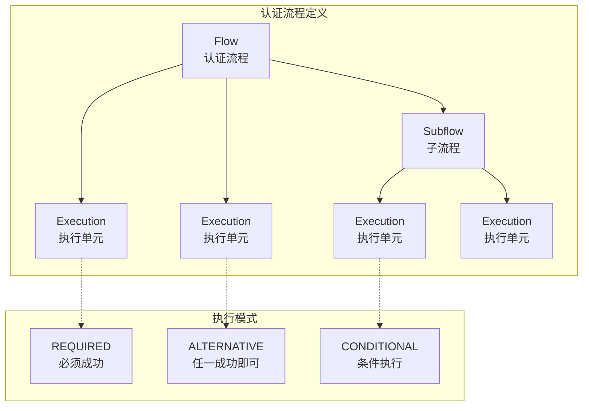

# Keycloak — 开源 IAM 标准参考实现解读

> **GitHub:** [github.com/keycloak/keycloak](https://github.com/keycloak/keycloak) | **网站:** [www.keycloak.org](https://www.keycloak.org) | **许可:** Apache-2.0 | **版本:** v26.1 (2025-06)

## 第一部分：快速概览

### 这是什么

Keycloak 是 Red Hat（现 CNCF 孵化项目）维护的开源身份与访问管理平台。它是 IAM 领域的**标准参考实现**——几乎所有其他 IAM 项目（ZITADEL、TOPIAM、MaxKey）都在功能集、协议支持、认证流程上与 Keycloak 对标。

项目定位不是最轻量的方案，而是**功能最完整**的开源 IAM——单点登录、身份代理、用户联合、细粒度授权、可配置认证流程、多协议支持，覆盖了企业身份管理的全部需求。

### 解决的痛点

- **认证基础设施重复建设**：每个应用各自实现登录/注册/密码重置/会话管理，Keycloak 提供统一认证层
- **多协议兼容**：历史系统用 SAML，新应用用 OIDC，移动端用 OAuth2——Keycloak 在同一平台统一管理
- **身份源整合**：用户分散在 LDAP/AD/社交账号/第三方 IdP 中，Keycloak 提供身份代理和用户联合桥接
- **安全合规**：密码策略、MFA、会话管理、审计日志——开箱即用，避免安全实现遗漏

### 适用场景

- 企业内部应用集群的统一 SSO 入口
- SaaS 平台的用户认证基座（支持多 Realm 隔离）
- 需要同时对接 OIDC/SAML2/OAuth2 协议的应用体系
- 需要 LDAP/AD 用户目录集成的大型组织
- 需要可配置认证流程（动态 MFA、步骤-up 认证）的场景
- 政府/金融等需要完整审计和密码策略合规的场景

### 核心能力清单

| 能力 | 说明 |
|------|------|
| 单点登录（SSO） | 一次登录访问所有客户端应用，支持 OIDC/SAML2 协议 |
| 单点登出（SLO） | RP-Initiated Logout、Backchannel Logout、Frontchannel Logout |
| 认证协议 | OpenID Connect 1.0、OAuth 2.0、SAML 2.0、Docker Auth |
| 身份代理 | 社交登录（Google/GitHub/Facebook/Twitter）+ 通用 OIDC/SAML IdP |
| 用户联合 | LDAP/AD 用户目录只读或读写同步 |
| 多因素认证 | TOTP、WebAuthn/Passkey、OTP SMS/Email |
| 条件认证 | 基于用户角色/网络/设备/风险等级的动态流程 |
| 可配置认证流程 | 可视化拖拽式认证流程设计器（Flow + Execution + Subflow） |
| 细粒度授权 | UMA 2.0 资源管理 + 基于策略的授权评估 |
| RBAC + ABAC | 角色/组/用户权限模型 + 基于 JS 脚本的策略 |
| 用户管理 | 自注册、忘记密码、邮件/短信验证、用户属性配置 |
| Token 管理 | JWT Access Token + Refresh Token + ID Token、Token 交换 |
| 审计日志 | 登录事件、管理操作事件、事件监听器 SPI |
| 管理 API | 完整 REST Admin API + Admin CLI |
| 主题定制 | FreeMarker 模板主题，可自定义登录/账户/邮箱页面 |
| 部署方式 | Docker、Kubernetes Operator、Quarkus 原生可执行文件 |

### 技术栈一览

| 层面 | 技术 |
|------|------|
| 语言 | Java 17+ |
| 框架 | Quarkus 3.x（构建时优化、AOT 编译） |
| 构建 | Maven（多模块 parent POM） |
| 数据库 | PostgreSQL / MySQL / MariaDB / MSSQL / Oracle / H2 / TiDB / CockroachDB |
| 缓存 | Infinispan（分布式缓存） |
| 前端 | React（管理控制台 + 账户管理页面） |
| UI 渲染 | FreeMarker 模板引擎（登录/密码重置等页面） |
| 认证核心 | 自研认证流程引擎（非 Spring Security） |
| OIDC | 自研 OIDC/OAuth2 实现 |
| SAML | OpenSAML |
| JWT | Nimbus JOSE + JWT |
| 授权策略 | UMA 2.0 + JavaScript 策略引擎 |
| 加密 | BCrypt、PBKDF2、Java 内置加密 |
| 容器 | Docker、Kubernetes Operator（Quarkus 原生） |
| 可观测 | OpenTelemetry、Prometheus 指标、Health 端点 |

---

## 第二部分：架构深读

### 架构总览

```
┌──────────────────────────────────────────────────────────────────────┐
│                          前端层 (JS/React)                            │
│  ┌────────────────────┐  ┌────────────────────┐                     │
│  │  Admin Console     │  │  Account Console   │                     │
│  │  (js/apps/admin-ui)│  │  (js/apps/account-  │                     │
│  │                    │  │   ui/)              │                     │
│  └────────┬───────────┘  └────────┬───────────┘                     │
└───────────┼───────────────────────┼─────────────────────────────────┘
            │                       │
            ▼                       ▼
┌──────────────────────────────────────────────────────────────────────┐
│                         REST API 层                                  │
│  ┌────────────────────┐  ┌──────────────────┐  ┌──────────────────┐ │
│  │  Admin API v1     │  │  Admin API v2    │  │  OIDC/SAML/      │ │
│  │  (services/admin/)│  │  (rest/admin-v2/)│  │  Account/Token   │ │
│  └────────┬──────────┘  └────────┬─────────┘  └────────┬─────────┘ │
└───────────┼──────────────────────┼────────────────────┼────────────┘
            │                      │                    │
            ▼                      ▼                    ▼
┌──────────────────────────────────────────────────────────────────────┐
│                        业务服务层 (services/)                         │
│  ┌──────────┐ ┌──────────┐ ┌──────────┐ ┌──────────┐ ┌──────────┐  │
│  │ 认证流程  │ │ 授权策略  │ │ 身份代理  │ │ 用户管理  │ │ 会话管理  │  │
│  │ Router    │ │ Engine   │ │ Broker   │ │ Profile  │ │ Manager  │  │
│  ├──────────┤ ├──────────┤ ├──────────┤ ├──────────┤ ├──────────┤  │
│  │ OIDC     │ │ SAML     │ │ SCIM     │ │ SSF      │ │ 事件日志  │  │
│  │ Protocol │ │ Protocol │ │ Service  │ │ Security │ │ Event    │  │
│  └──────────┘ └──────────┘ └──────────┘ └──────────┘ └──────────┘  │
└──────────────────────────────────────────────────────────────────────┘
                                    │
                                    ▼
┌──────────────────────────────────────────────────────────────────────┐
│                     SPI 接口层 (server-spi)                           │
│  ┌──────┐ ┌──────┐ ┌──────┐ ┌──────┐ ┌──────┐ ┌──────┐ ┌──────┐  │
│  │ User │ │Client│ │ Role │ │Group │ │Event │ │Cred  │ │ Key  │  │
│  │Store │ │Store │ │Store │ │Store │ │Listen│ │Mgr   │ │ Mgr  │  │
│  └──────┘ └──────┘ └──────┘ └──────┘ └──────┘ └──────┘ └──────┘  │
└──────────────────────────────────────────────────────────────────────┘
                                    │
                                    ▼
┌──────────────────────────────────────────────────────────────────────┐
│                        存储层 (model/)                                │
│  ┌──────────────────────┐  ┌──────────────────┐  ┌──────────────┐  │
│  │  JPA (Database)     │  │  Infinispan      │  │  User Storage│  │
│  │  ↑ Liquibase Migr.  │  │  (Cache Layer)   │  │  SPI (LDAP)  │  │
│  └──────────────────────┘  └──────────────────┘  └──────────────┘  │
└──────────────────────────────────────────────────────────────────────┘
                                    │
                                    ▼
┌──────────────────────────────────────────────────────────────────────┐
│                     Quarkus 运行时层                                  │
│  ├── CLI (kc.sh: start / build / export / import)                   │
│  ├── 配置: YAML + 环境变量 + CLI 标志                               │
│  ├── 日志: JBoss LogManager + OpenTelemetry                         │
│  └── 部署: Docker / K8s Operator                                    │
└──────────────────────────────────────────────────────────────────────┘
```

### 启动流程

Keycloak 基于 Quarkus 框架，启动分为构建阶段和运行阶段：

```
Quarkus 构建时 (kc.sh build)
  │
  ├─ Quarkus 注解处理器收集所有扩展
  │   └─ KeycloakProcessor.generateKeycloakConfig()
  │       → 解析 SPI 实现 → 注册 ProviderFactory
  │       → 构建配置元数据 (ConfigMetadata)
  │       → 生成数据库迁移计划 (Liquibase changelog)
  │
  └─ Quarkus 字节码增强 + AOT 编译
      → CURD 注册 → 静态初始化缓存
      → 生成优化后的 runner JAR

Quarkus 运行时 (kc.sh start)
  │
  ├─ KeycloakMain.main()
  │   └─ QuarkusBootstrap/bootstrapAndStart()
  │       → KeycloakLifeCycleManager.onStart()
  │
  ├─ 数据库初始化
  │   └─ LiquibaseMigrator.migrate()
  │       → 执行 changelog → 更新 schema_version 表
  │
  ├─ Master Realm 初始化
  │   └─ RealmManager.importRealm("master-realm.json")
  │       → 创建默认 role/admin 用户/客户端
  │
  ├─ Provider 注册
  │   └─ 扫描所有 Spi 实现 → 初始化 ProviderFactory
  │       → Authenticator / ClientStorage / EventListener / ...
  │
  └─ HTTP 服务器就绪 (端口 8080/8443)
```

### 核心请求链路：OIDC 授权码登录

```
浏览器 → GET /realms/{realm}/protocol/openid-connect/auth
  │
  ├─ AuthorizationEndpoint.process()
  │   ├─ 校验 client_id / redirect_uri / response_type / scope
  │   ├─ createAuthenticationSession() → 创建临时认证会话
  │   └─ handleBrowserAuthenticationRequest()
  │       → 重定向到 /realms/{realm}/login-actions/authenticate
  │
  ├─ LoginActionsService.processAuthentication()
  │   └─ AuthenticationProcessor.authenticate()
  │       ├─ DefaultAuthenticationFlow.processFlow()
  │       │   → 依次执行认证器（Cookie → 表单 → OTP → ...）
  │       └─ authenticationComplete()
  │           ├─ attachSession() → 创建 UserSession + ClientSession
  │           └─ finishAuthentication(OIDCLoginProtocol)
  │
  ├─ OIDCLoginProtocol.authenticated()
  │   ├─ 生成 authorization code (OAuth2CodeParser.persistCode())
  │   └─ 302 重定向: redirect_uri?code=xxx&state=xxx
  │
  └─ 浏览器 → redirect_uri (客户端服务器接收 code)

客户端 → POST /realms/{realm}/protocol/openid-connect/token
  │
  ├─ TokenEndpoint.processGrantRequest()
  │   └─ AuthorizationCodeGrantType.process()
  │       ├─ OAuth2CodeParser.parseCode() → 校验 + 删除 code
  │       ├─ PKCE 验证（code_verifier vs code_challenge）
  │       └─ TokenManager 签发令牌
  │           ├─ generateAccessToken() → JWT (sub, iss, aud, exp, realm_access)
  │           ├─ generateRefreshToken() → JWT (可轮换)
  │           └─ generateIDToken() → OIDC ID Token (sub, nonce, auth_time)
  │
  └─ 客户端 → {access_token, refresh_token, id_token, expires_in}
```

### 模块职责划分

| 模块路径 | 职责 |
|---------|------|
| `services/protocol/oidc/` | OIDC/OAuth2 协议实现（授权端点、Token 端点、UserInfo 端点、Logout 端点） |
| `services/protocol/saml/` | SAML 2.0 协议实现 |
| `services/authentication/` | 认证流程引擎（`AuthenticationProcessor` + `DefaultAuthenticationFlow`） |
| `services/authentication/authenticators/` | 各认证器实现（browser/form/directgrant/resetcred） |
| `services/authorization/` | UMA 2.0 细粒度授权服务 |
| `services/broker/` | 身份代理引擎（社交登录/外部 IdP 适配） |
| `services/events/` | 事件日志与审计 |
| `services/managers/` | `AuthenticationManager` + `UserSessionManager`（核心会话管理） |
| `federation/ldap/` | LDAP/AD 用户联合 |
| `model/jpa/` | JPA 数据持久化 + Liquibase 迁移 |
| `model/infinispan/` | Infinispan 分布式缓存（session 缓存、离线 token 等） |
| `quarkus/runtime/` | Quarkus 运行时（CLI/配置/日志/服务） |
| `server-spi/` | 公共 SPI 接口（UserModel/ClientModel/RealmModel/...） |

---

## 第三部分：可配置认证流程

Keycloak 最核心的设计之一是**可配置认证流程**系统，它让管理员无需编码就能自定义认证链路。

### 流程模型



`AuthenticationFlowModel` 定义流程结构，`AuthenticationExecutionModel` 定义每个执行单元及其行为模式（REQUIRED/ALTERNATIVE/CONDITIONAL）。

### 浏览器登录默认流程

```
浏览器登录流程 (Browser Flow)
  │
  ├─ Cookie 认证 (REQUIRED)
  │   └─ 检查 SSO Cookie → 若有效直接通过
  │
  ├─ 用户名密码表单 (ALTERNATIVE)
  │   └─ UsernamePasswordForm → HTML 表单 → 用户名密码校验
  │
  ├─ OTP 表单 (CONDITIONAL)
  │   └─ 仅在用户配置了 OTP 时执行 / 由条件认证器控制
  │
  ├─ WebAuthn 认证 (CONDITIONAL)
  │   └─ 仅在用户配置了 Passkey 时执行
  │
  └─ 身份代理重定向 (ALTERNATIVE)
      └─ 仅在选择了社交登录 IdP 时触发
```

执行模式的关键：`ALTERNATIVE` 组中只要有一个执行成功即通过，`CONDITIONAL` 由条件认证器决定是否执行，`REQUIRED` 必须全部成功。这种组合实现了"密码或社交登录均可"的灵活逻辑。

### 条件认证器

`ConditionalRoleAuthenticator`（`services/src/main/java/org/keycloak/authentication/authenticators/conditional/ConditionalRoleAuthenticator.java`）是一个示例：它检查用户是否具有特定角色，只有匹配时才触发子流程。这可以用于——管理员登录需要 MFA，普通用户不需要。

### 认证器 SPI

```java
// 每个认证器实现 AuthenticationExecutionModel.Execution
public interface Authenticator {
    void authenticate(AuthenticationFlowContext context);
    void action(AuthenticationFlowContext context);
    boolean requiresUser();
    boolean configuredFor(KeycloakSession session, RealmModel realm, UserModel user);
    void setRequiredActions(KeycloakSession session, RealmModel realm, UserModel user);
}
```

`authenticate()` 负责展示挑战或验证凭据，`action()` 处理用户提交的交互数据。流程引擎在 `authenticate()` 返回 Challenge 后，等待用户提交 → 调用 `action()` → 继续流程。

---

## 第四部分：身份代理（Identity Brokering）

身份代理让用户通过外部身份提供者（社交登录、企业 IdP）登录。

### 代理认证流程

```
用户选择"用 Google 登录"
  │
  ├─ 浏览器 → GET /realms/{realm}/broker/google/login
  │
  ├─ IdentityBrokerService.performLogin()
  │   └─ 构造 OIDC 授权请求 → 302 到 Google 授权页面
  │
  ├─ 用户在 Google 授权 → Google 302 回 callback
  │   └─ GET /realms/{realm}/broker/google/endpoint?code=xxx
  │
  ├─ IdentityBrokerService.callback()
  │   └─ IdentityProvider.authenticate()
  │       → 用 code 换 token → 获取用户信息
  │
  ├─ 查找或创建本地用户
  │   ├─ 已有关联 → 更新 token/身份信息
  │   └─ 首次登录 → 询问是否关联现有账号或创建新账号
  │
  └─ UserSessionManager.createUserSession() → 登录成功
```

`IdentityProviderMapper` SPI 允许将外部 IdP 返回的属性映射到本地用户属性或角色。

---

## 第五部分：部署方式

### 容器部署

```yaml
docker run -p 8080:8080 \
  -e KC_BOOTSTRAP_ADMIN_USERNAME=admin \
  -e KC_BOOTSTRAP_ADMIN_PASSWORD=admin \
  -e KC_DB=postgres \
  -e KC_DB_URL=jdbc:postgresql://host/keycloak \
  -e KC_DB_USERNAME=keycloak \
  -e KC_DB_PASSWORD=password \
  quay.io/keycloak/keycloak:26.1.0 start
```

### 配置层次

Keycloak Quarkus 的配置优先级（从低到高）：

```
默认值 → quarkus.properties → YAML 配置 → 环境变量 → CLI 参数
```

关键配置项通过 `KC_` 前缀环境变量注入，如 `KC_HOSTNAME`, `KC_PROXY`, `KC_HTTP_PORT`, `KC_DB_URL`。

### Kubernetes Operator

Keycloak Operator 提供了 `Keycloak` CRD，通过 Kustomize 管理部署清单：

| 资源 | 说明 |
|------|------|
| `operator/src/main/kubernetes/kubernetes.yml` | K8s 部署清单 |
| `operator/src/main/kubernetes/kustomization.yml` | Kustomize 配置 |
| `operator/overlays/` | 环境覆盖配置 |

---

## 第六部分：同类对比

| 维度 | Keycloak | ZITADEL | MaxKey | TOPIAM |
|------|---------|---------|--------|--------|
| 语言 | Java | Go | Java | Java |
| 架构 | 传统多层 + SPI 插件 | CQRS + Event Sourcing | Spring Boot 多层 | Spring Security 多层 |
| 认证流程 | 拖拽式可配置 | 代码定义 Flow | 内置 Provider 列表 | SecurityFilterChain |
| MFA | TOTP / WebAuthn / OTP | Passkey / TOTP / OTP | TOTP / OTP / Passkey | OTP / 短信 / 邮件 |
| 社交 IdP | 通用 OIDC/SAML + 内置各平台 | 通用 OIDC/SAML | 微信/QQ/钉钉等 15+ | 钉钉/飞书/企微等 10+ |
| 用户联合 | LDAP/AD SPI | 内置 LDAP | LDAP/AD | LDAP |
| 授权 | UMA 2.0 + JS 策略 | RBAC + Manager Role | RBAC | RBAC |
| 租户隔离 | Realm | Instance → Org | Inst（机构） | 企业/组织 |
| 部署 | Docker / Operator / 原生 | Docker / Helm | Docker / Compose | Docker |
| 协议 | OIDC/OAuth2/SAML/SCIM/SSF | OIDC/SAML/SCIM | OAuth2/OIDC/SAML/JWT/CAS | OIDC/SAML/JWT/CAS/表单 |
| 社区 | 最大（CNCF 孵化） | 中等 | 中等（Dromara） | 较小 |
| 学习成本 | 较高（概念多） | 中等（Event Sourcing） | 中等 | 中等 |

Keycloak 最大的优势是**生态完整性和可扩展性**——SPI 体系覆盖了存储、认证、事件、协议等所有层面。代价是 Java 栈较重，配置管理较复杂。

---

> **仓库：** [github.com/keycloak/keycloak](https://github.com/keycloak/keycloak)
>
> *本项目解读目录下可扩展：部署最佳实践、Operator 配置详解、性能调优指南*
