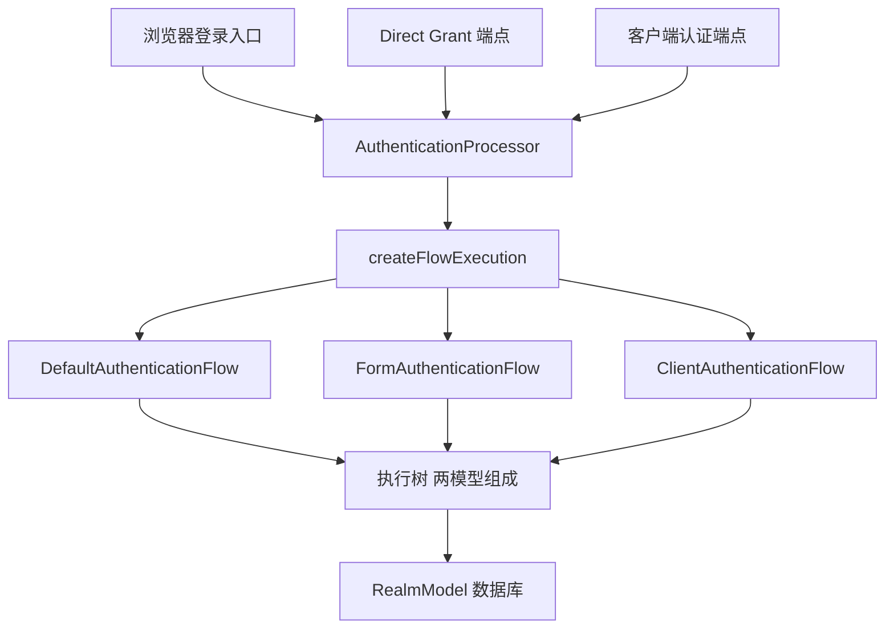
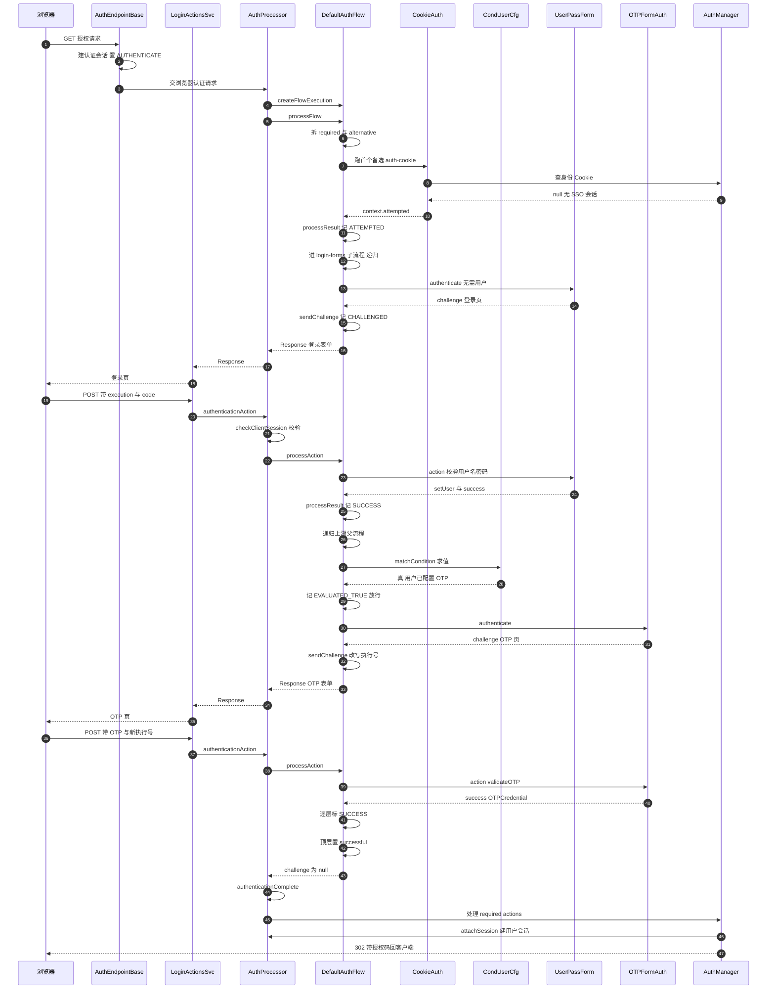
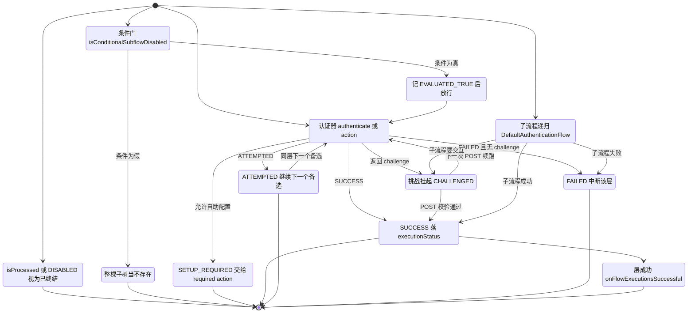
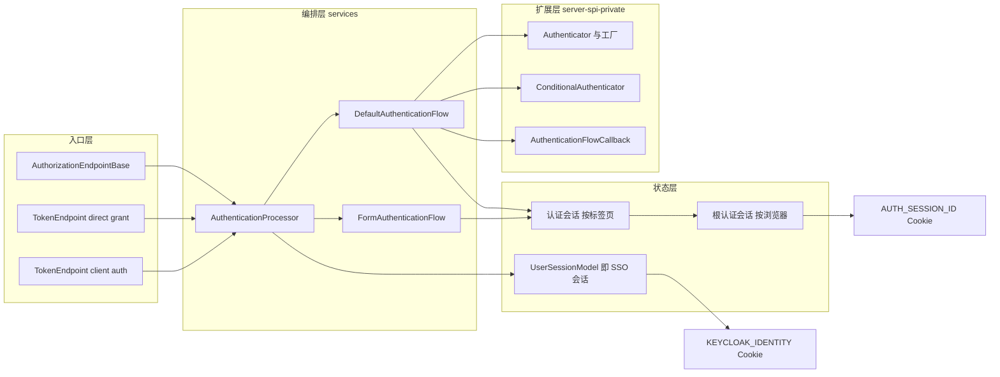

# Keycloak 认证流程引擎：执行树、四态语义与挑战-续跑状态机

> 解读基线：Keycloak 26.7.3（`6d238b6558`）。下文所有源码引用均相对仓库根，并附程序化校验过的行号锚点。

## 根因：登录决策拓扑的变化频率远高于执行单元

一个被成百上千个应用与企业目录共享的身份中心，如何在不改代码、不重新部署的前提下满足互相冲突的约束？在认证这一面，冲突面是具体的：

- 有的租户只要求用户名密码；有的要求密码 + TOTP；有的要求 WebAuthn 免密；有的要求 Kerberos 且失败时回退到表单。
- 「要不要 OTP」常常不是全局开关，而是按用户属性、按角色、按来源 IP 段决定。
- 同一个 realm 里，不同客户端（比如内网管理台 vs 公网应用）可能要求不同强度的认证——甚至是同一次登录内的**阶梯升级**（step-up）。
- 企业会买第三方认证器（指纹、短信、硬件令牌），这些实现在 Keycloak 发版节奏之外。

如果把这些写成代码，唯一的结果是 `if (realm.isOtpRequired() && !isTrustedNetwork() && user.hasRole(...))` 这类条件在 `LoginActionsService` 里无限增殖，且每加一种认证方式都要改内核 + 重新部署。**所以根因的具体形态是：登录的「决策拓扑」变化频率远高于「执行单元」的变化频率。** 引擎的设计就是把两者彻底分开——执行单元编译成 Provider，决策拓扑变成数据行。

证据在内核如何被「喂」上初始数据：内置流程不是硬编码在引擎里，而是在 realm 创建时用**普通数据操作**写进去的。

[server-spi-private/src/main/java/org/keycloak/models/utils/DefaultAuthenticationFlows.java:296-304]() realm 初始化时用 new AuthenticationFlowModel 构造 basic-flow 并 setTopLevel/setBuiltIn 后入库——内置流程与管理员新建的流程是同一种数据
<!-- anchor:     public static void browserFlow(RealmModel realm, boolean migrate) { …         realm.setBrowserFlow(browser); -->

[server-spi-private/src/main/java/org/keycloak/models/utils/DefaultAuthenticationFlows.java:352-368]() 「Browser - Conditional 2FA」是一个 CONDITIONAL 需求的子流程执行节点，即条件分支本身也只是树上的一个节点
<!-- anchor:         AuthenticationFlowModel conditionalOTP = new AuthenticationFlowModel(); …         realm.addAuthenticatorExecution(execution); -->

[server-spi-private/src/main/java/org/keycloak/models/utils/DefaultAuthenticationFlows.java:370-376]() 子流程内第一层是 conditional-user-configured（REQUIRED）——条件的「门」本身也是一个认证器执行节点
<!-- anchor:         execution = new AuthenticationExecutionModel(); …         realm.addAuthenticatorExecution(execution); -->

[server-spi-private/src/main/java/org/keycloak/models/utils/DefaultAuthenticationFlows.java:395-404]() auth-otp-form 出厂默认是 ALTERNATIVE，与同层的 webauthn/recovery-codes（DISABLED）构成「多选一」候选集
<!-- anchor:         execution = new AuthenticationExecutionModel(); …         realm.addAuthenticatorExecution(execution); -->

## 模块在系统中的位置

认证流程引擎位于 `services` 模块（全项目最大的模块）的 `org.keycloak.authentication` 包，其扩展契约放在 `server-spi-private`（注意：**不是** `server-spi`——`Authenticator` / `AuthenticationFlowContext` / `AuthenticationFlow` 都在 private 侧，所以自定义认证器属于「内部扩展点」而非公开 SPI）。

这个引擎被三个**交互模型完全不同**的入口复用（浏览器多轮表单、direct grant 单轮无挑战、客户端认证无用户），这是它最大的价值所在：

`createFlowExecution` 是唯一的分发点，它按 `AuthenticationFlowModel.providerId` 挑一个 `AuthenticationFlow` 实现；未知 providerId 直接抛 `INTERNAL_ERROR`——**没有 if-else 兜底，只有类型注册**。

[services/src/main/java/org/keycloak/authentication/AuthenticationProcessor.java:942-955]() 三个 providerId 分别映射到 DefaultAuthenticationFlow、FormAuthenticationFlow、ClientAuthenticationFlow，其余一律 INTERNAL_ERROR
<!-- anchor:     public AuthenticationFlow createFlowExecution(String flowId, AuthenticationE …         throw new AuthenticationFlowException("Unknown flow provider type", Auth -->

[server-spi-private/src/main/java/org/keycloak/authentication/AuthenticationFlow.java:29-36]() 流程实现的接口只有三个方法：跑动作、跑流程、报告是否成功——流程控制权完全不在 SPI 手里
<!-- anchor: public interface AuthenticationFlow { …     boolean isSuccessful(); -->

**为什么把 `form-flow` 单独做成一种流程类型？** 因为「一张表单里同时收集多个字段、且要么全成功要么全失败」这件事，用通用执行树表达会非常别扭：用户名和密码必须原子地一起校验（不能在用户名正确、密码错误时把用户写进会话）。`FormAuthenticationFlow` 把子执行当成「同一个表单的字段校验器」批量跑，校验全通过后才把执行状态写回认证会话，并支持 `validationError` + `excludeOtherErrors` 控制错误消息合并。

[services/src/main/java/org/keycloak/authentication/FormAuthenticationFlow.java:179-269]() 先跑完所有 FormAction 收集 successes/errors，只有全部成功才把 executionStatus 批量写回会话；任一失败则渲染错误并完全不落状态
<!-- anchor:     public Response processAction(String actionExecution) { …         return null; -->

[services/src/main/java/org/keycloak/authentication/FormAuthenticationFlow.java:302-321]() renderForm 把执行 ID 写进 authNote 作为续跑锚点，再让每个 FormAction buildPage、最后交给 FormAuthenticator 渲染
<!-- anchor:     public Response renderForm(MultivaluedMap<String, String> formData, List<For …         return formAuthenticator.render(context, form); -->

**一个必须先说清的限定**：三种流程实现共享的是 `AuthenticationFlow` **接口**与执行树**数据结构**，而不是遍历算法。真正复杂的递归/条件/备选逻辑只有 `DefaultAuthenticationFlow` 一份；`ClientAuthenticationFlow` 是另写的一套极简遍历——不支持子流程递归、不支持条件认证器、不支持候选列表。

[services/src/main/java/org/keycloak/authentication/ClientAuthenticationFlow.java:117-140]() findExecutionsToRun 只做「第一个 REQUIRED 或全部 ALTERNATIVE」这一种极其简化的分流，没有子流程展开也没有条件求值
<!-- anchor:     protected List<AuthenticationExecutionModel> findExecutionsToRun() { …         return executionsToRun; -->

[services/src/main/java/org/keycloak/authentication/ClientAuthenticationFlow.java:57-58]() processAction 直接抛 IllegalStateException——客户端认证根本没有「用户交互后回调」这一步，所以它连 action 通道都不实现
<!-- anchor:     public Response processAction(String actionExecution) { …         throw new IllegalStateException("Not supposed to be invoked"); -->

[services/src/main/java/org/keycloak/authentication/ClientAuthenticationFlow.java:143-149]() processResult 是另一份独立实现，以 status == SUCCESS 提早返回开始
<!-- anchor: protected Response processResult(AuthenticationProcessor.Result result) { … if (status == FlowStatus.SUCCESS) { -->

[services/src/main/java/org/keycloak/authentication/ClientAuthenticationFlow.java:170-172]() FlowStatus 分支只有寥寥几个，且把 ATTEMPTED 直接升级成 GENERIC_AUTHENTICATION_ERROR，不再尝试其余备选
<!-- anchor: } else if (status == FlowStatus.ATTEMPTED) { … throw new AuthenticationFlowException(AuthenticationFlowError.GENERIC_AUTHENTICA -->

这处重复是设计上的**已知不彻底**：`AuthenticationFlow` 把「流程控制」做成了可替换接口（这是它能容纳三种流程的原因），但代价是遍历语义无法在三种实现间复用，只能靠各自维护。文末「问题与风险」一节会回到这一点。

## 执行树与四态语义

### 为什么必须是树，而不是列表/链

链（list）只能表达「A 然后 B 然后 C」。内置 browser flow 需要同时表达三件链做不到的事，缺一件就得回到 if-else：

**其一，备选分支（ALTERNATIVE）**：`auth-cookie` / `auth-spnego` / `identity-provider-redirector` / `login-forms` 四个执行互为备选，任一成功即可。链没有「任一成功」的语义。

**其二，条件跳过（CONDITIONAL 子流程）**：「Browser - Conditional 2FA」整棵子树是否求值，取决于子树内部的条件认证器。链没有「这段整体可能不存在」的语义。

**其三，递归嵌套**：一个流程可以作为另一个流程的一个执行节点。它带来两个链绝对做不到的能力——**复用**（同一段「Handle Existing Account」子流程被多个流程引用）和**作用域**（`getTopParentFlow` 需要向上递归才能找到顶层流程）。

**代价也必须说清**，而且它在代码里留下了可见的痕迹：

1. **求值顺序与「已处理」判定变得复杂**。`isProcessed` 要把 SUCCESS / SKIPPED / ATTEMPTED / SETUP_REQUIRED 四种状态都视为「不必再跑」，多一个状态就多一组 bug 面。
2. **状态必须被持久化**，因为树的遍历跨 HTTP 请求。链式流程可以一路在线程栈上走完；树的遍历必须在每个 challenge 处中断、序列化、下次恢复——这个代价直接催生了 `AuthenticationSessionModel.executionStatus` 这个 map。
3. **同层混用 REQUIRED 与 ALTERNATIVE 是歧义的**。引擎的处理不是报错而是**静默丢弃备选项**，这本身是设计不彻底的证据（见「亮点与问题」）。

[services/src/main/java/org/keycloak/authentication/DefaultAuthenticationFlow.java:72-78]() isProcessed 把四种执行状态都当作已终结，DISABLED 直接视为处理过
<!-- anchor:     protected static boolean isProcessed(AuthenticationProcessor processor, Auth …                 || status == AuthenticationSessionModel.ExecutionStatus.SETUP_RE -->

[services/src/main/java/org/keycloak/authentication/DefaultAuthenticationFlow.java:343-360]() 同层同时出现 REQUIRED 与 ALTERNATIVE 时，只打一条 warnf 然后 alternativeList.clear()——备选项被静默吞掉
<!-- anchor:     void fillListsOfExecutions(Stream<AuthenticationExecutionModel> executionsTo …             alternativeList.clear(); -->

### 四态语义如何驱动执行

`Requirement` 的四个值不是「程度」，而是**四种不同的求值算子**。

[server-spi/src/main/java/org/keycloak/models/AuthenticationExecutionModel.java:125-129]() 枚举字面量与稳定序号：REQUIRED CONDITIONAL ALTERNATIVE DISABLED
<!-- anchor:     public enum Requirement implements EnumWithStableIndex { …         DISABLED(3); -->

| Requirement | 求值算子 | 对同层其他节点的影响 |
|---|---|---|
| REQUIRED | 全部必须成功 | 抑制 ALTERNATIVE（见上） |
| CONDITIONAL | 先跑条件，为假则整棵子树当不存在 | 只对「子流程」节点有意义 |
| ALTERNATIVE | 任一成功即整层成功 | 无 REQUIRED 时才生效 |
| DISABLED | 不参与，等同不存在 | 无 |

主循环的骨架就这两段：先把执行分成 requiredList / alternativeList，然后**先跑 required，并且只有当 requiredList 为空时才评估 alternative**。

[services/src/main/java/org/keycloak/authentication/DefaultAuthenticationFlow.java:263-336]() processFlow 是遍历求值入口；内部先处理认证选择器屏刷新，再分流 required 与 alternative
<!-- anchor:     public Response processFlow() { …         return null; -->

[services/src/main/java/org/keycloak/authentication/DefaultAuthenticationFlow.java:285-304]() REQUIRED 全跑；任一个不成功且没返回 challenge 就 break，因为整层注定失败
<!-- anchor:         //handle required elements : all required elements need to be executed …                 break; -->

[services/src/main/java/org/keycloak/authentication/DefaultAuthenticationFlow.java:309-328]() ALTERNATIVE 只在前一段为空时求值；第一个成功的立即 onFlowExecutionsSuccessful，抛异常则记入 afeList 并标 ATTEMPTED 继续尝试下一个
<!-- anchor:         if (requiredList.isEmpty()) { …                     setExecutionStatus(alternative, AuthenticationSessionModel.E -->

注意备选分支入口处的第一个判断：进入 alternative 循环前先检查「是否已有备选成功」，这是为了让「用户在备选里选了 B、提交后流程重入」时不会又从头跑 A。**这是纯数据驱动的幂等，不靠任何请求级缓存。**

### ALTERNATIVE 的「多选一」究竟谁在选

这是本文最值得记录的一处设计取舍。

直觉上「多选一」应该由内核挑：内核按优先级选一个执行，跑它。但 Keycloak 实际做的是——**内核先把「这一层所有可选项」算成一个列表交给前端渲染，用户点哪个（或凭据类型匹配哪个）再回流成执行 ID，内核再跑那一个**。也就是说，决策权被外推到前端（认证器列表页）。

证据分两段：`processSingleFlowExecutionModel` 在 `calledFromFlow=true` 时会**改写传入的 model**，把它替换成列表里第一个未处理的执行。

[services/src/main/java/org/keycloak/authentication/DefaultAuthenticationFlow.java:451-463]() calledFromFlow 时若选择列表非空，就用列表首个未处理执行覆盖当前 model 并从工厂重新取出认证器
<!-- anchor:         List<AuthenticationSelectionOption> selectionOptions = createAuthenticat …             authenticator = createAuthenticator(factory); -->

而 `POST` 回流的执行 ID 会被显式校验：它必须在这次算出的候选列表里，否则抛 INTERNAL_ERROR。**这是一处防篡改检查**——客户端不能凭 execution id 跳到树上的任意节点。

[services/src/main/java/org/keycloak/authentication/DefaultAuthenticationFlow.java:126-145]() 表单提交的 authExecId 必须出现在 selectionOptions 中，否则拒绝；通过后才切换 model 并跑它
<!-- anchor:             if (authExecId != null && !authExecId.isEmpty()) { …                     return response; -->

候选列表的构造规则本身也很有意思：它**不是**简单枚举同层节点，而是向上找到一个「有用的最高流程」再向下展开，并把用户已注册的凭据类型排在最前。

[services/src/main/java/org/keycloak/authentication/AuthenticationSelectionResolver.java:45-62]() 类注释给出典型场景：WebAuthn ALTERNATIVE 与「Password-and-OTP 子流程」ALTERNATIVE 并列时，用户应能在 WebAuthn 与 Password 之间直接选，即使它们分处不同子流程
<!-- anchor:      * This method creates the list of authenticators that is presented to the u …      * @return an ordered list of the authentication selection options to presen -->

[services/src/main/java/org/keycloak/authentication/AuthenticationSelectionResolver.java:64-115]() 先按用户已存凭据类型按序映射到 typeAuthExecMap，再把非凭据类认证器追加；无用户时把「不要求用户」的凭据认证器降级排到最后
<!-- anchor:     static List<AuthenticationSelectionOption> createAuthenticationSelectionList …         return authenticationSelectionList; -->

[services/src/main/java/org/keycloak/authentication/AuthenticationSelectionResolver.java:207-234]() 子流程里有 REQUIRED 时只取第一个（条件不成立则顺延），否则把该子流程所有 ALTERNATIVE 展开——递归实现「跨子流程备选」
<!-- anchor:         // If requiredList is not empty, we're going to collect just very first  …                 return true; -->

**收益**：把选择权外推换来四项具体能力——「换一种方式登录」（try another way）页零成本获得，它只是把候选列表渲染出来；候选列表能按**用户实际拥有的凭据类型**排序，比固定优先级更聪明；新增认证器不需要改内核，只要它的工厂能被识别成凭据校验器就会被自动归入有序列；同一层能容纳「跨子流程并列候选」，因为列表构造会向上找最高的有用流程再向下展开。

[services/src/main/java/org/keycloak/authentication/AuthenticationSelectionResolver.java:177-182]() 候选列表构造时按 instanceof CredentialValidator 分流：是凭据校验器的按凭据类型进有序映射，其余进「非凭据执行」列表追加在后
<!-- anchor: Authenticator localAuthenticator = processor.getSession().getProvider(Authentica … typeAuthExecMap.put(cv.getType(processor.getSession()), execution); -->

**代价有三条**。其一，**内核不再是权威**：候选列表的顺序实际上就是执行优先级，但没有任何接口或文档声明这一点，是一处隐含契约；`processSingleFlowExecutionModel` 里那个「用列表首个未处理项覆盖 model」的动作，看起来像内核在决策，实际是对前端选择的确认。其二，execution id 变成一个可越权的输入，因此必须额外做防篡改校验——回流的执行必须属于本次候选列表。其三，用户点选会改变 `executionStatus` 的写入顺序，因此 `checkAndValidateParentFlow` 必须额外处理「用户绕过某个备选直接成功」的情况：同层 required 全部为空是它判定备选层成功的前置条件。子流程处理完一轮后显式调用它，正是为了把父流程的成功状态手动补上。

[services/src/main/java/org/keycloak/authentication/DefaultAuthenticationFlow.java:150-154]() 子流程的 processAction 返回 null 后，显式调用 checkAndValidateParentFlow 补写父流程成功状态，再重新 processFlow
<!-- anchor: if (model.isAuthenticatorFlow()) { … if (flowChallenge == null) { -->

## 关键数据结构

**`AuthenticationFlowModel`——树的节点/子树头。** 字段只有 id/alias/description/providerId/topLevel/builtIn。注意 `topLevel` 被引擎用来决定是否触发顶层成功回调。

[server-spi/src/main/java/org/keycloak/models/AuthenticationFlowModel.java:27-34]() 流程模型的全部字段；builtIn 只影响管理员能否直接删除/修改，不影响引擎执行
<!-- anchor: public class AuthenticationFlowModel implements Serializable { …     private boolean builtIn; -->

**`AuthenticationExecutionModel`——树的一条边（要么指向认证器，要么指向子流程）。** 关键设计是用**同一个类型**表达「执行认证器」和「执行子流程」，靠 `authenticatorFlow` 布尔位区分，`flowId` 只在为真时有意义。递归结构因此不需要额外类型。

[server-spi/src/main/java/org/keycloak/models/AuthenticationExecutionModel.java:31-49]() authenticator/flowId/authenticatorFlow/requirement/priority/parentFlow 六个字段构成整棵树
<!-- anchor: public class AuthenticationExecutionModel implements Serializable { …     private String parentFlow; -->

优先级排序用一个独立的 `ExecutionComparator`（按 priority 升序）而不是 Comparable——因为排序语义属于**某个父流程内的相对顺序**，不是执行节点的内在属性。

[server-spi/src/main/java/org/keycloak/models/AuthenticationExecutionModel.java:33-38]() ExecutionComparator 只比 priority，管理员拖拽改的就是这个数字
<!-- anchor: public static class ExecutionComparator implements Comparator<AuthenticationExec … return o1.priority - o2.priority; -->

**`AuthenticatorConfigModel`——认证器参数的「数据化」边界。** 光有执行树只能表达「用哪个认证器」，表达不了「怎么用」。所以每个执行节点可以指向一个配置对象，而配置本身就是一个无类型的 `Map<String, String>`。这是「把登录变成数据」的最后一块拼图，同时也是它的**能力上限**：参数一旦超出字符串键值对（比如需要结构化嵌套配置），就只能靠约定把 JSON 塞进某个键里。

[server-spi/src/main/java/org/keycloak/models/AuthenticatorConfigModel.java:29-33]() 配置模型只有 id、alias 和一个 Map<String, String>——认证器的全部可配置参数都被压平成字符串键值对
<!-- anchor: public class AuthenticatorConfigModel implements Serializable { …     private Map<String, String> config = new HashMap<>(); -->

条件认证器正是靠这个 map 工作的：`ConditionalOtpFormAuthenticator` 从 map 里读用户属性名、跳过/强制两个角色、跳过/强制两个请求头正则、以及兜底策略，共 6 个配置项，全部是字符串；判定顺序也写死在类注释里——用户属性 → 角色 → 请求头 → 配置默认值，首个命中的条件决定结果，全不命中则回落到「要求 OTP」。**「流程是数据」这句话的成立范围就此划清：拓扑是数据，节点参数也是数据，但参数的类型安全是零。**

[services/src/main/java/org/keycloak/authentication/authenticators/browser/ConditionalOtpFormAuthenticatorFactory.java:116-158]() 工厂声明并返回 6 个配置项：用户属性、两个角色、两个请求头正则、兜底策略
<!-- anchor: public List<ProviderConfigProperty> getConfigProperties() { … defaultOutcome.setOptions(asList(SKIP, FORCE)); -->

[services/src/main/java/org/keycloak/authentication/authenticators/browser/ConditionalOtpFormAuthenticator.java:44-51]() 类注释规定四种条件的求值顺序与「全不命中则要求 OTP」的兜底
<!-- anchor: * The decision for whether or not to require OTP authentication can be made base … * <li>Configured Default</li> -->

**`AuthenticationSessionModel`——跨请求的遍历状态。** 它承载三样东西：`executionStatus` map（遍历记忆）、`authNotes`（认证器间通信）、`requiredActions`（后续动作队列）。注意它是一个**接口**，由 `AuthenticationSessionProvider` SPI 提供实现。

[server-spi/src/main/java/org/keycloak/sessions/AuthenticationSessionModel.java:47-57]() 执行状态以 executionId 为键存在认证会话里，这是整个树的遍历内存
<!-- anchor:      * Returns execution status of the authentication session. …     void setExecutionStatus(String authenticator, ExecutionStatus status); -->

[server-spi/src/main/java/org/keycloak/sessions/AuthenticationSessionModel.java:80-104]() requiredActions 以集合形式挂在认证会话上，支持按别名或按 UserModel.RequiredAction 增删
<!-- anchor: Set<String> getRequiredActions(); … void removeRequiredAction(UserModel.RequiredAction action); -->

[server-spi/src/main/java/org/keycloak/sessions/AuthenticationSessionModel.java:134-158]() authNotes 是一组无类型的 String 键值，认证器之间的通信全靠它
<!-- anchor: String getAuthNote(String name); … void clearAuthNotes(); -->

**这个 SPI 在仓库里有两套实现，且互斥**：默认的 Infinispan 实现要求「未开启 stateless feature 且运行在嵌入式 Infinispan 上」；JPA 实现则只在 `stateless` feature 打开时才被启用。所以「认证会话存在哪」取决于部署形态，而不是 realm 配置。

[model/infinispan/src/main/java/org/keycloak/models/sessions/infinispan/InfinispanAuthenticationSessionProviderFactory.java:201-203]() Infinispan 实现仅在未启用 STATELESS feature 且为嵌入式 Infinispan 时可用
<!-- anchor: public boolean isSupported(Config.Scope config) { … return !Profile.isFeatureEnabled(Profile.Feature.STATELESS) && InfinispanUtils.i -->

[model/jpa/src/main/java/org/keycloak/authentication/jpa/JpaAuthenticationSessionProviderFactory.java:110-111]() JPA 实现的可用性完全由 STATELESS feature 决定
<!-- anchor: public boolean isSupported(Config.Scope config) { … return Profile.isFeatureEnabled(Profile.Feature.STATELESS); -->

[server-spi/src/main/java/org/keycloak/sessions/CommonClientSessionModel.java:60-68]() 八种执行状态：FAILED SUCCESS SETUP_REQUIRED ATTEMPTED SKIPPED CHALLENGED EVALUATED_TRUE EVALUATED_FALSE
<!-- anchor:     enum ExecutionStatus implements EnumWithStableIndex { …         EVALUATED_FALSE(7); -->

**认证器的「返回状态」是另一套枚举 `FlowStatus`。** 这个双层设计（认证器说 FlowStatus、树记录 ExecutionStatus）是必要的：一个认证器可能返回 `CHALLENGE`（要用户交互），但树上这条边既没成功也没失败，需要记成 `CHALLENGED` 才能在续跑时被 `isProcessed` 正确判为「未完成」。

[server-spi-private/src/main/java/org/keycloak/authentication/FlowStatus.java:33-37]() CHALLENGE 的语义注释点明了备选机制：可选执行会忽略这个 challenge，备选执行可能根据同层其他执行的状态决定是否忽略
<!-- anchor:      * Execution offered a challenge.  Optional executions will ignore this chal …     CHALLENGE, -->

[server-spi-private/src/main/java/org/keycloak/authentication/FlowStatus.java:58-62]() ATTEMPTED 是「非错误但没处理」（典型例子：Kerberos 认证器没看到 negotiate 头），让树能继续往下走而不是失败
<!-- anchor:      * This is not an error condition.  Execution was attempted, but the authent …     ATTEMPTED, -->

**`AuthenticationProcessor.Result`——单次执行的上下文实现。** 它同时实现 `AuthenticationFlowContext` 与 `ClientAuthenticationFlowContext`，把「认证器能看到的全部能力」+「本次执行产生的挑战/错误/选择列表」打包在一个对象里。

[services/src/main/java/org/keycloak/authentication/AuthenticationProcessor.java:335-349]() Result 同时实现浏览器与客户端两个上下文接口，并把 challenge/error/selections/state 全部内联为字段——上下文对象是**每次执行新建**的，不是长期存活的服务
<!-- anchor:     public class Result implements AuthenticationFlowContext, ClientAuthenticati …         Map<Class<?>, Object> state; -->

## 核心流程

### 全链路时序图：带条件 OTP 的表单登录

这是全篇最关键的一条链路。它从协议端点（OIDC 授权端点）一路穿到会话管理器（AuthenticationManager），中间经过四层：HTTP 资源（LoginActionsService）→ 编排器（AuthenticationProcessor）→ 遍历器（DefaultAuthenticationFlow）→ 认证器（CookieAuthenticator / UsernamePasswordForm / ConditionalUserConfigured / OTPFormAuthenticator）。**两次 HTTP 请求之间没有任何一方持有遍历内存——全部状态落在 `AuthenticationSessionModel` 上。**

几个**读图要点**：

- 步骤 12 的递归是树的兑现：`login-forms` 本身是 `browser` 流程的一个 ALTERNATIVE 执行节点，`processSingleFlowExecutionModel` 发现 `authenticatorFlow=true` 就新建一个 `DefaultAuthenticationFlow` 去跑它。
- 步骤 21 的 `checkClientSession` 是防重放/防过期：它检查 `session_code` 的动作类型与活跃性，并刷新认证会话时间戳。
- 步骤 26 与 41 的「上溯父流程」是必要的：用户从 OTP 页直接 POST 成功时，内核不能从头重跑整棵树（那会再次弹出密码页），只能把已成功的链路逐层标记然后从第一个未完成的父流程继续。

### 挑战-续跑：状态到底放在哪里

这是理解整个引擎的钥匙。认证器返回 challenge 时，引擎做三件事，全部写进 `AuthenticationSessionModel`（因此天然跨请求、天然按标签页隔离）：

1. 把当前 execution id 写进固定 authNote `current.authentication.execution`；
2. 在 `executionStatus` 里把该 execution 记为 `CHALLENGED`（于是 `isProcessed` 下次判它「未完成」，会重跑）；
3. 把 challenge `Response` 直接返回，HTTP 请求结束，进程内的遍历栈被丢弃。

[services/src/main/java/org/keycloak/authentication/AuthenticationProcessor.java:92-96]() 五个 authNote 键就是整个引擎的「持久化寄存器」：当前执行、上次执行、当前流程路径、fork 来源、已用凭据
<!-- anchor:     public static final String CURRENT_AUTHENTICATION_EXECUTION = "current.authe …     public static final String AUTHN_CREDENTIALS = "authn.credentials"; -->

[services/src/main/java/org/keycloak/authentication/DefaultAuthenticationFlow.java:573-575]() sendChallenge 只做一件事：把 execution id 写成 authNote，然后把 Response 原样抛出——挑战状态因此完全落在会话里
<!-- anchor:     public Response sendChallenge(AuthenticationProcessor.Result result, Authent …         return result.getChallenge(); -->

[services/src/main/java/org/keycloak/authentication/DefaultAuthenticationFlow.java:552-553]() CHALLENGE 与 FORCE_CHALLENGE 都先记 CHALLENGED 再 sendChallenge，保证续跑时该节点仍被视为未完成
<!-- anchor:         setExecutionStatus(execution, AuthenticationSessionModel.ExecutionStatus …         return sendChallenge(result, execution); -->

**回调如何找到正确的节点？** 靠 URL 里的 execution id，而不是靠「回到上次的位置」。认证器生成表单时，action URL 由上下文拼出，其中必然带 `execution` 与 `session_code`。

[server-spi-private/src/main/java/org/keycloak/authentication/Authenticator.java:39-57]() SPI 契约注释直接规定了 action URL 必须是 login-actions/authenticate 加 code 与 execution 两个查询参数——**这是 SPI 与 HTTP 层之间唯一的耦合点，且被写进注释**
<!-- anchor:      * Initial call for the authenticator.  This method should check the current …     void authenticate(AuthenticationFlowContext context); -->

[services/src/main/java/org/keycloak/authentication/AuthenticationProcessor.java:635-640]() getActionUrl 拼出 flowPath 加 session_code 加 execution 加 client_id 加 tab_id 加 client_data
<!-- anchor:         public URI getActionUrl(String code) { …                     .queryParam(Constants.EXECUTION, getExecution().getId()) -->

[services/src/main/java/org/keycloak/authentication/AuthenticationProcessor.java:1059-1062]() 回流的 execution 必须等于 last.processed.execution，否则判为页面刷新/过期并展示 page expired——用「执行号单调推进」代替了任何客户端状态
<!-- anchor:         String current = authenticationSession.getAuthNote(CURRENT_AUTHENTICATIO …             return new AuthenticationFlowURLHelper(session, realm, uriInfo).show -->

[services/src/main/java/org/keycloak/authentication/AuthenticationProcessor.java:1093-1106]() checkClientSession 校验 code 的动作与活跃性，并把 root auth session 的时间戳前推，等于滑动续期
<!-- anchor:     private void checkClientSession(boolean checkAction) { …         authenticationSession.getParentSession().setTimestamp(Time.currentTime() -->

[services/src/main/java/org/keycloak/authentication/AuthenticationProcessor.java:271-274]() generateCode 通过 ClientSessionCode 生成/复用 code，同时刷新 root session 时间戳
<!-- anchor:     public String generateCode() { …         return accessCode.getOrGenerateCode(); -->

**续跑时的「上溯」算法** 值得单独点出，因为它是树结构最反直觉的一段：成功后不是「流程从头重跑」，而是沿 `parentFlow` 向上走，只要某一层的兄弟节点都满足了就把该层标 SUCCESS，直到遇到第一个未完成的祖先，然后从那里继续。

[services/src/main/java/org/keycloak/authentication/DefaultAuthenticationFlow.java:191-206]() continueAuthenticationAfterSuccessfulAction 先清 authNote，再找第一个未完成的祖先；找不到就直接 processFlow 顶层流程，否则只跑那个祖先节点并递归
<!-- anchor:     private Response continueAuthenticationAfterSuccessfulAction(AuthenticationE …                 return response; -->

[services/src/main/java/org/keycloak/authentication/DefaultAuthenticationFlow.java:221-243]() checkAndValidateParentFlow 的判定分两支：REQUIRED/CONDITIONAL 节点要求同层 required 全部成功；ALTERNATIVE 节点要求同层有任一备选成功且同层没有 required
<!-- anchor:     private String checkAndValidateParentFlow(AuthenticationExecutionModel model …                 return model.getParentFlow(); -->

**状态序列化的位置**有两处，一处是遍历状态（authNote + executionStatus），另一处是**给用户看的消息**。后者也被显式序列化进会话，因为下一个请求里 `Result` 对象已经不存在了。

[services/src/main/java/org/keycloak/authentication/AuthenticationProcessor.java:1273-1301]() ForwardedFormMessageStore 把 FormMessage 用 JsonSerialization 写进/读出 authNote，键是 fwMessageSuccess / fwMessageError / fwMessageInfo
<!-- anchor:     private class ForwardedFormMessageStore { …             getAuthenticationSession().removeAuthNote(messageKey); -->

**流程重置（fork / reset）也走同一套寄存器**：`FORK` 会克隆当前认证会话（同 root session、新 tabId）、重定向回浏览器登录，`FLOW_RESET` 则清空 executionStatus/notes 后重新 `authenticate()`。

[services/src/main/java/org/keycloak/authentication/AuthenticationProcessor.java:861-884]() FORK_FLOW 分支克隆 authSession、新建 AuthenticationProcessor 并从零跑浏览器流程
<!-- anchor:             } else if (e.getError() == AuthenticationFlowError.FORK_FLOW) { …                 return processor.authenticate(); -->

[services/src/main/java/org/keycloak/authentication/AuthenticationProcessor.java:998-1013]() resetFlow 清认证用户、清执行状态、清 user/auth notes、摘掉全部 required actions，并把 action 复位为 AUTHENTICATE
<!-- anchor:     public static void resetFlow(AuthenticationSessionModel authSession, String  …         authSession.setAuthNote(CURRENT_FLOW_PATH, flowPath); -->

### 执行树遍历状态机

下图把上文的四态语义与 `processFlow` / `processSingleFlowExecutionModel` 的控制流合并成一台状态机，描述**单个执行节点**在一次遍历中的可能命运。

求值顺序的三条硬规则（都藏在 `processFlow` 里，管理员在 UI 上看不到）：

1. **条件先于执行**：`required` 列表里遇到未处理的 CONDITIONAL 节点，先调 `isConditionalSubflowDisabled`；为假就把该节点从列表里**物理移除**，之后这一层完全看不见它。一旦处理过就不再移除，以免丢失执行状态。
2. **REQUIRED 优先于 ALTERNATIVE**：只要 `requiredList` 非空，`alternativeList` 整段跳过。
3. **备选短路**：`alternativeList` 里第一个成功（或 SETUP_REQUIRED）就立即 `onFlowExecutionsSuccessful` 返回，不再尝试其余备选。

[services/src/main/java/org/keycloak/authentication/DefaultAuthenticationFlow.java:370-383]() isConditionalSubflowDisabled 要求子流程内至少有一个启用的条件认证器，且全部条件都匹配——条件列表为空则整棵子树被禁用
<!-- anchor:     boolean isConditionalSubflowDisabled(AuthenticationExecutionModel model) { …         return conditionalSubflowDisabled; -->

[services/src/main/java/org/keycloak/authentication/DefaultAuthenticationFlow.java:399-410]() conditionalNotMatched 每次求值都落盘 EVALUATED_TRUE/FALSE，注释明确说明条件在流程中被重复求值是预期行为（acr 级别或用户上下文可能中途变化）
<!-- anchor:     private boolean conditionalNotMatched(AuthenticationExecutionModel model, Li …         return !matchCondition; -->

[services/src/main/java/org/keycloak/authentication/DefaultAuthenticationFlow.java:418-493]() processSingleFlowExecutionModel 是单节点求值主体：已处理即跳过、流程节点递归、普通节点先做 requiresUser/configuredFor 前置校验再调 authenticate
<!-- anchor:     private Response processSingleFlowExecutionModel(AuthenticationExecutionMode …         authenticator.authenticate(context); -->

[services/src/main/java/org/keycloak/authentication/DefaultAuthenticationFlow.java:468-480]() requiresUser 为真但用户未识别直接抛 UNKNOWN_USER；configuredFor 为假且允许自助配置则记 SETUP_REQUIRED 并挂 required action，否则抛 CREDENTIAL_SETUP_REQUIRED
<!-- anchor: if (authenticator.requiresUser()) { … throw new AuthenticationFlowException("authenticator: " + factory.getId(), Authe -->

[services/src/main/java/org/keycloak/authentication/DefaultAuthenticationFlow.java:617-624]() onFlowExecutionsSuccessful 只在顶层流程触发 executeTopFlowSuccessCallbacks，然后置 successful=true
<!-- anchor:     private Response onFlowExecutionsSuccessful() { …         return null; -->

[services/src/main/java/org/keycloak/authentication/DefaultAuthenticationFlow.java:588-595]() setExecutionStatus 在子流程被标 SUCCESS 时顺带触发该子流程内的 AuthenticationFlowCallback.onParentFlowSuccess
<!-- anchor:     private void setExecutionStatus(AuthenticationExecutionModel authExecutionMo …             processor.getRealm().getAuthenticationExecutionsStream(authExecution -->

[services/src/main/java/org/keycloak/authentication/DefaultAuthenticationFlow.java:529-569]() processResult 是把 FlowStatus 翻译成 ExecutionStatus 的唯一位置，SUCCESS/FAILED/FORK/CHALLENGE/FORCE_CHALLENGE/FAILURE_CHALLENGE/ATTEMPTED/FLOW_RESET 八个分支一一落状态
<!-- anchor:     public Response processResult(AuthenticationProcessor.Result result, boolean …                 throw new AuthenticationFlowException(AuthenticationFlowError.IN -->

## 与其他模块协同

### 认证会话与用户会话为什么必须分开

这是本模块最容易被低估的一处设计。两个模型在代码里长得像（都叫 session、都能存 note），但**它们的语义完全不同，而且共用了同一个主键**：

- `RootAuthenticationSessionModel`（+ 子 `AuthenticationSessionModel`）＝「**登录进行中**」的临时态，按浏览器/标签页/客户端三元组定位；
- `UserSessionModel` ＝「**已经登录**」这一能力的载体，是 SSO Cookie（`KEYCLOAK_IDENTITY`）引用的对象。

关键机制在这里：用户会话的 ID **就是** root 认证会话的 ID。`attachSession` 用 `authSession.getParentSession().getId()` 去查/建 user session。这个设计让「认证完成 → 建立 SSO 会话」变成一次零成本的 ID 复用，但也带来一个必须显式防御的坑——cookie 不能被无条件信任，因为两种会话共享 ID。

[server-spi/src/main/java/org/keycloak/sessions/AuthenticationSessionModel.java:26-32]() 类注释明确：每个浏览器标签页有自己的认证会话状态，整个浏览器由 RootAuthenticationSessionModel 代表
<!-- anchor:  * Represents the state of the authentication. If the login is requested from di … public interface AuthenticationSessionModel extends CommonClientSessionModel { -->

[server-spi/src/main/java/org/keycloak/sessions/RootAuthenticationSessionModel.java:26-31]() root 认证会话代表「一个浏览器会话 + 多个标签页」，每个标签页由不同 client 的 AuthenticationSessionModel 代表
<!-- anchor:  * Represents usually one browser session with potentially many browser tabs. Ev … public interface RootAuthenticationSessionModel { -->

[server-spi/src/main/java/org/keycloak/sessions/AuthenticationSessionCompoundId.java:35-37]() 定位一个认证会话需要三元组 rootAuthSessionId 加 tabId 加 clientUUID——三个维度缺一不可
<!-- anchor:     public static AuthenticationSessionCompoundId decoded(String rootAuthSession …         return new AuthenticationSessionCompoundId(rootAuthSessionId, tabId, cli -->

[services/src/main/java/org/keycloak/services/managers/AuthenticationSessionManager.java:205-208]() 代码注释直说：不能盲信 cookie，必须确认 root 认证会话真实存在，「否则存在从非法 root 认证会话解析出用户会话的风险，因为它们共享同一个 id」
<!-- anchor:         // we can't blindly trust the cookie and assume it is valid and referenc …         RootAuthenticationSessionModel rootAuthenticationSession = session.authe -->

[services/src/main/java/org/keycloak/authentication/AuthenticationProcessor.java:1161-1166]() 建立用户会话时直接用 root 认证会话的 id 作为 key；不存在才 createUserSession——用户会话的 id 与 root 认证会话 id 恒等
<!-- anchor:             userSession = session.sessions().getUserSession(realm, authSession.g …                         , remember, brokerSessionId, brokerUserId, persistenceSt -->

**这个分离到底防住了什么？** 四个具体场景：

**其一，半认证状态不能被当成已认证。** 用户交对了密码但 OTP 还没提交时，树上的 `auth-username-password-form` 是 SUCCESS、`auth-otp-form` 还没跑。如果此时就已经有 UserSession，那么 OIDC Cookie 直接签发——攻击者只要在第一因子通过后换一个客户端发起授权请求，就绕过了第二因子。分离让「能力」严格晚于「整棵树跑到顶」。这也解释了 `authenticationComplete` 里那行被注释掉的 `attachSession()`。

[services/src/main/java/org/keycloak/authentication/AuthenticationProcessor.java:1238-1247]() 认证树跑完顶层的 authenticationComplete 里，attachSession 被显式注释掉并注明「会话将在 required actions 与 consent 完成后再挂」
<!-- anchor:     protected Response authenticationComplete() { …             return response; -->

**其二，多标签页并行登录互不污染。** 每个标签页是独立的 `AuthenticationSessionModel`，`executionStatus` 互不可见。标签页 A 跑到 OTP 页时，标签页 B 还在用户名密码页——如果共用一个执行状态 map，两个标签页会互相把对方的执行标记覆盖掉。

**其三，刷新页面不丢进度。** 所有遍历状态在会话里、URL 里只有 execution id，浏览器刷新（GET 同 URL）会重新走到同一个执行并重新渲染 challenge，而不是从头再来。

**其四，登录完成后其他标签页能被「自动完成」。** 一个标签页成功后，其子认证会话被摘掉，但 root 会话若还有其他标签页就保留极短时间，等 `authChecker.js` 让其他标签页重发请求——此时它们会命中已有 SSO 会话（`CookieAuthenticator` 短路），无需重新输入密码。

[services/src/main/java/org/keycloak/services/managers/AuthenticationSessionManager.java:240-248]() removeTabIdInAuthenticationSession 只摘掉当前标签页的子会话；没有剩余标签页才整体删除
<!-- anchor:     public boolean removeTabIdInAuthenticationSession(RealmModel realm, Authenti …             return false; -->

[services/src/main/java/org/keycloak/services/managers/AuthenticationSessionManager.java:253-277]() 成功后把 root 会话的时间戳往前拨，使它在 access code lifespan（默认约 1 分钟）内过期，留给其他标签页刷新窗口
<!-- anchor:      * This happens when one browser tab successfully finished authentication (i …         log.tracef("Removed authentication session of root session '%s' with tab -->

[server-spi-private/src/main/java/org/keycloak/models/utils/SessionExpiration.java:27-35]() 认证会话寿命取 accessCodeLifespanLogin、accessCodeLifespanUserAction、accessCodeLifespan 三者的最大值
<!-- anchor:     public static int getAuthSessionLifespan(RealmModel realm) { …         return lifespan; -->

[docs/documentation/server_admin/topics/authentication/authentication-sessions.adoc:5-10]() 官方文档确认：认证会话默认 30 分钟过期，由 Sessions 标签页的 Login timeout 控制
<!-- anchor: When a login page is opened for the first time in a web browser, {project_name}  … The authentication session usually expires after 30 minutes by default. The exac -->

顺带说明 SSO 短路的落点：内置 browser flow 的第一个执行是 `auth-cookie`（ALTERNATIVE）。它读 `KEYCLOAK_IDENTITY` cookie，成功则**直接 attach 已有用户会话**并 `context.success()`，整棵树后续节点全部被 `isProcessed` 跳过。这就是「已登录用户再访问另一个客户端时不需要重新认证」的实现方式——不是特例分支，只是树上第一条备选节点命中了。

[services/src/main/java/org/keycloak/authentication/authenticators/browser/CookieAuthenticator.java:49-52]() 查不到 identity cookie 时走 attempted，让流程继续到下一个备选（表单登录）
<!-- anchor:         AuthenticationManager.AuthResult authResult = AuthenticationManager.auth …             context.attempted(); -->

[services/src/main/java/org/keycloak/authentication/authenticators/browser/CookieAuthenticator.java:85-94]() cookie 认证成功时标 SSO_AUTH、attachUserSession 并 success；组织上下文场景下改为 attempted 以便先解析组织
<!-- anchor:                     // Cookie only authentication …                     context.success(); -->

[services/src/main/java/org/keycloak/authentication/authenticators/browser/CookieAuthenticator.java:87-88]() context.attachUserSession 是认证器向编排器「交出」用户会话的公开钩子
<!-- anchor:                     authSession.setAuthNote(AuthenticationManager.SSO_AUTH, "tru …                     context.attachUserSession(authResult.session()); -->

### 认证器如何与「用户会话建立」衔接

用户会话的建立是一处**责任分散**的设计。全项目有且仅有一个地方真正创建用户会话：`AuthenticationProcessor.attachSession` 的静态版本。但它的**调用时机**有三个不同的触发点：

| 触发点 | 场景 | 证据 |
|---|---|---|
| 认证器主动调用 `context.attachUserSession(...)` | SSO cookie 短路，复用已存在的用户会话 | 见下文 `Result.attachUserSession` 引用 |
| `finishedRequiredActions` | 正常路径：认证树 + required actions + consent 全部完成 | 见下文 `AuthenticationManager.finishedRequiredActions` 引用 |
| `finishAuthentication(protocol)` | 被动登录（`prompt=none`），树必须一次跑完 | 见下文 `finishAuthentication` 引用 |

[services/src/main/java/org/keycloak/authentication/AuthenticationProcessor.java:1221-1223]() 协议层被动登录时 finishAuthentication 直接 attachSession，不等 required actions
<!-- anchor: public Response finishAuthentication(LoginProtocol protocol) { … ClientSessionContext clientSessionCtx = attachSession(); -->

[services/src/main/java/org/keycloak/protocol/AuthorizationEndpointBase.java:135-142]() 唯一调用点在被动登录分支：没有 required action 要补就直接 finishAuthentication
<!-- anchor: if (processor.nextRequiredAction() != null) { … return processor.finishAuthentication(protocol); -->

[services/src/main/java/org/keycloak/authentication/AuthenticationProcessor.java:1139-1146]() 实例版 attachSession 委托静态版，并把结果缓存在 processor.userSession 上
<!-- anchor:     public ClientSessionContext attachSession() { …         return clientSessionCtx; -->

[services/src/main/java/org/keycloak/authentication/AuthenticationProcessor.java:1159-1186]() 没有已挂用户会话时才创建；若已存在但用户不同则抛 DIFFERENT_USER_AUTHENTICATED；最后置 LOGGED_IN 并写进 session context
<!-- anchor:         if (userSession == null) { // if no authenticator attached a usersession …             session.getContext().setUserSession(userSession); -->

[services/src/main/java/org/keycloak/authentication/AuthenticationProcessor.java:571-574]() Result.attachUserSession 只是把 userSession 挂到 processor 上；对 lightweight user 才额外回写认证会话的 authenticatedUser
<!-- anchor: public void attachUserSession(UserSessionModel userSession) { … AuthenticationProcessor.this.authenticationSession.setAuthenticatedUser(userSess -->

[services/src/main/java/org/keycloak/services/managers/AuthenticationManager.java:1080-1135]() finishedRequiredActions 在 required actions 与 consent 全清后调用 attachSession，再交给协议层 redirectAfterSuccessfulFlow 签发 cookie
<!-- anchor:     public static Response finishedRequiredActions(KeycloakSession session, Auth …         return response; -->

**required actions 是树的「第二段」**，用完全不同的机制（`RequiredActionProvider` SPI，不在执行树上）。衔接点在 `authenticationComplete`：树跑完顶层后，如果 `nextRequiredAction()` 非空就 302 到 `login-actions/required-action`，走完再回头找下一个，直到清空才建立用户会话。两者复用同一个 authNote 寄存器（`current.authentication.execution`），所以「上次处理到哪个动作」也是跨请求的。

[services/src/main/java/org/keycloak/services/managers/AuthenticationManager.java:1029-1041]() nextActionAfterAuthentication 先处理 required actions，处理完才 finishedRequiredActions
<!-- anchor:     public static Response nextActionAfterAuthentication(KeycloakSession session …         return finishedRequiredActions(session, authSession, null, clientConnect -->

[services/src/main/java/org/keycloak/services/managers/AuthenticationManager.java:1046-1070]() redirectToRequiredActions 把 CURRENT_FLOW_PATH 与 CURRENT_AUTHENTICATION_EXECUTION 两个 authNote 改写成 REQUIRED_ACTION 与动作别名——同一套寄存器被复用
<!-- anchor:     public static Response redirectToRequiredActions(KeycloakSession session, Re …         return Response.status(302).location(redirect).build(); -->

[services/src/main/java/org/keycloak/services/managers/AuthenticationManager.java:1382-1383]() required action 进入 challenge 时同样写 CURRENT_AUTHENTICATION_EXECUTION，键名与认证器用的完全一致
<!-- anchor:             authSession.setAuthNote(AuthenticationProcessor.CURRENT_AUTHENTICATI …             return context.getChallenge(); -->

[services/src/main/java/org/keycloak/authentication/AuthenticationProcessor.java:1217-1218]() evaluateRequiredActionTriggers 是树与 required action 之间的另一个挂钩：让 RequiredActionProvider 有机会在认证后强制追加动作
<!-- anchor:     public void evaluateRequiredActionTriggers() { …         AuthenticationManager.evaluateRequiredActionTriggers(session, authentica -->

[services/src/main/java/org/keycloak/services/resources/LoginActionsService.java:1174-1258]() required-action 端点的分发：PROCESS 时按状态分四支（CANCELLED / SUCCESS / CHALLENGE / FAILURE），SUCCESS 与 CANCELLED 都回头调 nextActionAfterAuthentication 形成循环
<!-- anchor:     private Response processRequireAction(final String authSessionId, final Stri …         return BrowserHistoryHelper.getInstance().saveResponseAndRedirect(sessio -->

### 条件认证器如何参与决策

条件认证器参与决策的方式分两层。

**第一层：它们就是认证器。** `conditional` 包下注册了 7 个条件认证器实现，全部实现同一个 `ConditionalAuthenticator` 接口——该接口只是给 `Authenticator` 加了一个 `matchCondition` 方法，并把 `authenticate` 置为空默认实现。

[services/src/main/resources/META-INF/services/org.keycloak.authentication.AuthenticatorFactory:25-31]() 连续 7 行注册条件认证器工厂：SubFlowExecuted、ClientScope、Role、UserConfigured、Loa、UserAttributeValue、Credential
<!-- anchor: org.keycloak.authentication.authenticators.conditional.ConditionalSubFlowExecute … org.keycloak.authentication.authenticators.conditional.ConditionalCredentialAuth -->

[services/src/main/java/org/keycloak/authentication/authenticators/conditional/ConditionalAuthenticator.java:26-30]() 接口只在 Authenticator 之上加一个 matchCondition，并把 authenticate 置为空默认实现并注明「不会为条件认证器调用」——注意它落在 services 而非 SPI 模块，条件认证器是**内核自带的实现约定**而非公开 SPI
<!-- anchor: public interface ConditionalAuthenticator extends Authenticator { …         // authenticate is not called for ConditionalAuthenticators -->

**第二层：只有「条件子流程」用它们。** 引擎不会把裸的条件认证器当普通执行跑。`fillListsOfExecutions` 先把所有条件认证器从 required/alternative 两个列表里滤掉；它们进决策的唯一入口是 `isConditionalSubflowDisabled`——即**只有当条件认证器位于一个 CONDITIONAL 需求的子流程内部时，它才有意义**。

[services/src/main/java/org/keycloak/authentication/DefaultAuthenticationFlow.java:386-388]() isConditionalAuthenticator 判定方式是「实例化工厂产物并做 instanceof」——纯粹为了类型判断而创建 provider 实例
<!-- anchor:     private boolean isConditionalAuthenticator(AuthenticationExecutionModel mode …                 && createAuthenticator(getAuthenticatorFactory(model)) instanceo -->

**为什么把条件做成认证器，而不是流程引擎的内置判断？** 三点理由，且都不是「解耦得更漂亮」这种空话：

1. **条件需要和认证器一样的信息面**。「用户有没有配 OTP」要读 credentialManager，「acr 级别够不够」要读 `AcrStore`，「用户在不在某角色」要读角色模型——这些能力恰好就是 `AuthenticationFlowContext` 已经提供的。内置判断反而要重新造一份上下文。
2. **条件可以嵌套、可以互相引用**。`ConditionalSubflowExecutedAuthenticator` 检查的是「某个子流程是否执行过」，而「子流程」本身就是树上的概念——如果条件是引擎内置枚举，这条会变成特例。`ConditionalUserConfiguredAuthenticator` 更是直接**遍历兄弟执行节点**、对每个节点递归求解 `configuredFor`。
3. **新增条件不需要改引擎、不需要发版**。这与全篇「一切皆 Provider」完全同构：条件是一种认证器，所以走同一套 SPI 注册、同一套 Admin Console 配置界面。

[services/src/main/java/org/keycloak/authentication/authenticators/conditional/ConditionalUserConfiguredAuthenticator.java:15-42]() 条件实现会反向扫描同层执行：有 REQUIRED 就要求全部 configuredFor，只有 ALTERNATIVE 就要求任一满足，都没有则返回 true
<!-- anchor: public class ConditionalUserConfiguredAuthenticator implements ConditionalAuthen …         return true; -->

**一个必须点出的「假朋友」**：`ConditionalOtpFormAuthenticator` 名字里有 Conditional，但它**没有**实现 `ConditionalAuthenticator`——它继承 `OTPFormAuthenticator`，在 `authenticate()` 内部自己判断「要不要显示 OTP 表单」，据此调 `super.authenticate(context)` 或 `context.success()` 直接放行。引擎完全不知道它是「条件」，只会把它当作一个普通 REQUIRED/ALTERNATIVE 执行节点。

[services/src/main/java/org/keycloak/authentication/authenticators/browser/ConditionalOtpFormAuthenticator.java:87-130]() 四种判定依次尝试（用户属性、角色、请求头正则、配置默认值），命中即 SKIP_OTP 或 SHOW_OTP，全不命中则显示 OTP 表单
<!-- anchor: public class ConditionalOtpFormAuthenticator extends OTPFormAuthenticator { …         showOtpForm(context); -->

[services/src/main/java/org/keycloak/authentication/authenticators/browser/ConditionalOtpFormAuthenticator.java:306-309]() 它靠覆盖 setRequiredActions 来补挂 CONFIGURE_TOTP——这是普通认证器的能力，不是条件认证器的
<!-- anchor:     public void setRequiredActions(KeycloakSession session, RealmModel realm, Us …                 authenticationSession.addRequiredAction(UserModel.RequiredAction -->

**这带来一个真实的运维陷阱**：管理员把它配成 CONDITIONAL 需求时，引擎的 `isConditionalSubflowDisabled` 不会调用它（因为 `instanceof ConditionalAuthenticator` 为假），于是它退化成一个「总是执行、内部自行决定是否显示表单」的节点。行为看似正确，但与「条件子流程」的语义完全不同——尤其在与其他条件组合时。这是命名与实现不一致造成的认知负担。

## 关键设计决策

### SPI 只暴露「执行一个认证步骤」，不暴露流程控制

这是整个引擎最重要的边界。`Authenticator` 的接口极小：两个执行方法、三个查询方法。

[server-spi-private/src/main/java/org/keycloak/authentication/Authenticator.java:39-57]() authenticate 与 action 两个执行入口；注释还规定了 challenge 表单的 action URL 格式
<!-- anchor:      * Initial call for the authenticator.  This method should check the current …     void authenticate(AuthenticationFlowContext context); -->

[server-spi-private/src/main/java/org/keycloak/authentication/Authenticator.java:68-82]() requiresUser 与 configuredFor 构成「前置条件声明」，把「这个认证器适不适用于当前用户」从命令式判断变成声明式契约
<!-- anchor:      * Does this authenticator require that the user has already been identified …     boolean configuredFor(KeycloakSession session, RealmModel realm, UserModel u -->

[server-spi-private/src/main/java/org/keycloak/authentication/AuthenticatorFactory.java:32-32]() 工厂契约只是 ProviderFactory 加重配置能力，注册方式就是 META-INF/services 文件
<!-- anchor: public interface AuthenticatorFactory extends ProviderFactory<Authenticator>, Co -->

上下文暴露的**全部**能力如下（`AuthenticationFlowContext`），可以看到其中**没有**任何「跳转到某个执行」「循环」「动态插节点」的方法：

[server-spi-private/src/main/java/org/keycloak/authentication/AuthenticationFlowContext.java:37-62]() 上下文提供 用户读写清理、候选认证器列表、attachUserSession、认证会话、flowPath、form 构建器
<!-- anchor: public interface AuthenticationFlowContext extends AbstractAuthenticationFlowCon …     void attachUserSession(UserSessionModel userSession); -->

[server-spi-private/src/main/java/org/keycloak/authentication/AuthenticationFlowContext.java:116-132]() 唯一的两个「控制流」手段是 cancelLogin 和 resetFlow——而 resetFlow 是「回到本流程开头」，不是「跳到任意节点」
<!-- anchor:      * End the flow and redirect browser based on protocol specific response.  T …     void resetFlow(Runnable afterResetListener); -->

[server-spi-private/src/main/java/org/keycloak/authentication/AuthenticationFlowContext.java:135-143]() fork 是第二个逃生口：克隆认证会话、丢弃当前进度、重定向到 realm 的 browser flow——同样是「回到起点」而非「跳到某处」
<!-- anchor:      * Fork the current flow.  The authentication session will be cloned and set …     void fork(); -->

**权衡**：接口小意味着认证器无法表达「我需要先跑一个子流程再继续」这类需求（只能靠管理员在树上手工编排），也意味着认证器之间的数据传递只能靠 session note（无类型、无契约、靠约定）。**但换来的东西不可替代**：树是唯一事实来源，Admin Console 里看到的执行顺序**就是**运行时的执行顺序。如果认证器能任意跳转，管理员配置的树会退化成一张「协议示意图」，实际行为由代码决定——那正是本模块要消灭的东西。

代价的可见证据：`AbstractDirectGrantAuthenticator` 为了让同一个类同时充当 Authenticator 与 Factory，把 `action()` 实现为空——因为 direct grant 场景没有第二次 HTTP 请求，`action` 永远不会被调用。**接口的形状被浏览器场景决定了，非交互场景必须写一个空方法来适配。**

[services/src/main/java/org/keycloak/authentication/authenticators/directgrant/AbstractDirectGrantAuthenticator.java:35-42]() 一个类同时实现 Authenticator 与 AuthenticatorFactory，action 是空实现
<!-- anchor: public abstract class AbstractDirectGrantAuthenticator implements Authenticator, …     public void action(AuthenticationFlowContext context) { -->

### 枚举用稳定序号持久化

`Requirement` 与 `ExecutionStatus` 都实现了 `EnumWithStableIndex`，显式声明 `REQUIRED(0) CONDITIONAL(1) ALTERNATIVE(2) DISABLED(3)`。这解决一个具体问题：这些枚举会被写进数据库（执行表的需求列）与 Infinispan 的 protostream 序列化；若直接依赖 Java `ordinal()`，将来在枚举中间插入一个值会让**所有历史数据被静默错读**。

[core/src/main/java/org/keycloak/util/EnumWithStableIndex.java:25-30]() 注释明确：序号被用于持久化，因此某个条目的序号不可更改，且已删除条目的序号不可复用
<!-- anchor:  * Classes implementing this interface guarantee that for each instance of this  …  * This is mostly usable for @{code enum}s. -->

[server-spi/src/main/java/org/keycloak/sessions/CommonClientSessionModel.java:58-68]() ExecutionStatus 还带了 @ProtoTypeId(65537) 与他人共享的 protostream 类型号——枚举的序列化身份是**双重的**：DB 用 stableIndex，缓存用 ProtoTypeId
<!-- anchor:     @ProtoTypeId(65537) // see org.keycloak.Marshalling …         EVALUATED_FALSE(7); -->

**权衡**：多写一个构造参数和一个 `valueOfInteger` 反查 map，且每加一个枚举值都必须手工挑一个没用过的序号。换来的是**跨版本升级时旧数据仍然可读**——对 Keycloak 这种「升级不能要求用户重建 realm」的产品，这不是优化而是硬需求。

## 亮点与问题

### 亮点

**1. 用同一个契约服务三种交互模型，内核无分支。** 浏览器（多次 HTTP 往返 + 表单）、direct grant（单次往返、无挑战）、客户端认证（无用户、属性即凭据）都通过同一个 `createFlowExecution` 装配、共用同一张执行表、共用 `requireUser`/`configuredFor` 这套声明式前置校验，内核里没有 `if (browserFlow)` 这类分支——`browserFlow` 这个标志只记录「本次是浏览器流程」：浏览器入口把它置为 true，fork 出新 processor 时原样拷贝，除此之外不参与遍历决策。**需要限定的部分**：三种实现共享的是接口与数据，遍历算法各写一份（`ClientAuthenticationFlow` 只有极简分流，见前文「模块在系统中的位置」）。所以准确的表述是「数据模型与扩展契约统一，遍历实现未统一」。

[services/src/main/java/org/keycloak/authentication/AuthenticationProcessor.java:146-152]() browserFlow 只是一个布尔字段的读写访问器，供流程实现查询/设置，本身不含任何分支逻辑
<!-- anchor: public boolean isBrowserFlow() { … return this; -->

[services/src/main/java/org/keycloak/services/resources/LoginActionsService.java:359-359]() 浏览器登录动作入口在构造 processor 时把 browserFlow 置为 true
<!-- anchor: .setBrowserFlow(true) -->

[services/src/main/java/org/keycloak/protocol/AuthorizationEndpointBase.java:85-85]() 授权端点入口同样置为 true；fork 场景下该标志被原样拷给新 processor
<!-- anchor: .setBrowserFlow(true) -->

**2. 挑战状态与遍历状态全部落在会话模型里，引擎无状态。** `AuthenticationProcessor` / `DefaultAuthenticationFlow` 都是请求级的一次性对象，没有任何跨请求字段。支持集群部署的配套机制是会话路由：`AUTH_SESSION_ID` cookie 里编码了节点路由段，`getAuthSessionCookies` 解码后重新计算本节点路由，不一致就标记 `routeChanged` 让调用方刷新 cookie。也就是说「哪个节点接手下一个请求」由 sticky session 与共享会话存储共同决定，引擎本身不持有任何位置信息。

[services/src/main/java/org/keycloak/services/managers/AuthenticationSessionManager.java:196-217]() 用 StickySessionEncoderProvider 解码 cookie 中的 route，重算本节点 route 并在变化时标记 routeChanged 以便刷新 cookie
<!-- anchor: StickySessionEncoderProvider routeEncoder = session.getProvider(StickySessionEnc … return new AuthSessionCookie(rootAuthenticationSession, routeChanged); -->

**3. `builtIn` 标记 + copy 端点构成一条清晰的升级路径。** 内置流程不允许直接改（加子流程/加执行都抛 BadRequest），必须 copy 一份再改。这样新版本可以安全地演进内置流程定义（例如新增 passkeys 条件节点），而已有 realm 的自定义流程不被覆盖。

[services/src/main/java/org/keycloak/services/resources/admin/AuthenticationManagementResource.java:524-525]() 向内置流程添加子流程直接抛 BadRequest——用「不可变 + 复制」代替「可改 + 迁移脚本」
<!-- anchor:         if (parentFlow.isBuiltIn()) { …             throw new BadRequestException("It is illegal to add sub-flow to a bu -->

[services/src/main/java/org/keycloak/services/resources/admin/AuthenticationManagementResource.java:380-385]() 删除时若为内置流程则拒绝，但仍允许删除「引用缺失」的流程
<!-- anchor:         KeycloakModelUtils.deepDeleteAuthenticationFlow(session, realm, flow, …                 flow.isBuiltIn() -->

**4. `AuthenticationFlowCallback` 给流程加了「生命周期钩子」而不破坏 SPI 的最小性。** 认证器可以选择实现 `AuthenticationFlowCallback`，从而在父流程成功、顶层流程成功这两个时点被回调；钩子本身也是个认证器，因此它出现在树上、管理员可见、可禁用。内置实现里真正用到这两个钩子的是 `ConditionalLoaAuthenticator`：父流程成功时把本次达到的 LoA 级别写进 `AcrStore`，顶层流程成功时校验「请求的 acr 级别是否达成」——不达成直接抛 `ACR_NOT_FULFILLED`——并把 LoA 映射转存为用户会话 note，供后续认证复用。

[server-spi-private/src/main/java/org/keycloak/authentication/AuthenticationFlowCallback.java:39-48]() 两个钩子：onParentFlowSuccess 与默认空的 onTopFlowSuccess
<!-- anchor:     void onParentFlowSuccess(AuthenticationFlowContext context); …     default void onTopFlowSuccess(AuthenticationFlowModel topFlow) { -->

[services/src/main/java/org/keycloak/authentication/authenticators/conditional/ConditionalLoaAuthenticator.java:86-118]() 两个钩子的真实用法：写 AcrStore、在顶层校验强制 acr 级别（不达成抛 ACR_NOT_FULFILLED）、转存 LOA_MAP
<!-- anchor: public void onParentFlowSuccess(AuthenticationFlowContext context) { … authSession.setUserSessionNote(Constants.LOA_MAP, authSession.getAuthNote(Consta -->

**5. 用「执行号单调推进」取代客户端状态。** `current.authentication.execution` 的比对让「回退/重复提交」自然失效，不需要 CSRF token 之外的额外机制，也不需要在前端维护步骤号。

[services/src/main/java/org/keycloak/authentication/AuthenticationProcessor.java:1059-1062]() 回流的 execution 必须等于 last.processed.execution，否则判为页面刷新/过期并展示 page expired
<!-- anchor: String current = authenticationSession.getAuthNote(CURRENT_AUTHENTICATION_EXECUT … return new AuthenticationFlowURLHelper(session, realm, uriInfo).showPageExpired( -->

### 问题与风险

**1. 递归遍历无环检测，且管理面也不拦截。** 树的向上/向下遍历有四处是 `while(true)` 或递归，都假定树无环：`checkAndValidateParentFlow`、`AuthenticationSelectionResolver.getFlowIdOfTheHighestUsefulFlow`、`AuthenticatorUtil.getTopParentFlow`、`AuthenticatorUtil.getExecutionsByType`。**引擎自身没有任何防御**——一旦数据被写坏，症状是请求线程死循环或 StackOverflowError，且没有明确的错误信息。而 Admin REST 也没有做环检测：`POST /authentication/executions` 直接接受请求体里的 `flowId` 与 `parentFlow`，模型层只校验「父流程存在」，不校验新节点与父流程是否构成自引用或祖先环。也就是说，客户端可以提交一个 `flowId` 指向其父流程的执行节点（甚至指向自身），把它做成一个环。

[services/src/main/java/org/keycloak/authentication/AuthenticationSelectionResolver.java:136-164]() getFlowIdOfTheHighestUsefulFlow 是 while(true) 向上走，仅在 flow.isTopLevel 时返回，无深度上限
<!-- anchor:     private static String getFlowIdOfTheHighestUsefulFlow(AuthenticationProcesso …             execution = realm.getAuthenticationExecutionByFlowId(flowId); -->

[services/src/main/java/org/keycloak/authentication/AuthenticatorUtil.java:157-167]() getTopParentFlow 是纯递归实现，无深度保护
<!-- anchor:     public static AuthenticationFlowModel getTopParentFlow(RealmModel realm, Aut …             throw new IllegalStateException("Execution '" + executionModel.getId -->

[core/src/main/java/org/keycloak/representations/idm/AuthenticationExecutionRepresentation.java:25-27]() 新增执行节点的请求体里带 id、flowId、parentFlow 三个可写字段
<!-- anchor: private String id; … private String parentFlow; -->

[services/src/main/java/org/keycloak/services/resources/admin/AuthenticationManagementResource.java:892-902]() addExecution 把请求体转成模型后只做「父流程是否内置」检查，未做任何环/祖先校验即落库
<!-- anchor: public Response addExecution(@Parameter(description = "JSON model describing aut … model = realm.addAuthenticatorExecution(model); -->

[model/jpa/src/main/java/org/keycloak/models/jpa/RealmAdapter.java:1717-1736]() 模型层只校验 parentFlow 对应的流程存在；flowId 原样写入，不校验是否指向自身或祖先
<!-- anchor: public AuthenticationExecutionModel addAuthenticatorExecution(AuthenticationExec … return model; -->

**2. 认证器之间的隐式耦合：靠执行顺序 + session note 传递契约。** 最典型的是「谁负责建立用户身份」。后续认证器声明 `requiresUser()=true`，如果前面没有执行节点调过 `setUser`，运行时抛 UNKNOWN_USER——**这个约束只在运行时、只在管理员重排节点后暴露**。更麻烦的是身份传递靠一个字符串 authNote（`ATTEMPTED_USERNAME`），跨请求保存，无类型。

[services/src/main/java/org/keycloak/authentication/authenticators/browser/AbstractUsernameFormAuthenticator.java:50-57]() ATTEMPTED_USERNAME 是个公开字符串常量，注释的用途说明正是「让后续请求仍保持原始意图」
<!-- anchor: public static final String ATTEMPTED_USERNAME = "ATTEMPTED_USERNAME"; … * is kept when this authenticator is executed on subsequent requests. -->

[services/src/main/java/org/keycloak/authentication/DefaultAuthenticationFlow.java:468-472]() requiresUser 为真但用户为空时抛 UNKNOWN_USER——把「节点顺序错了」这个配置错误变成了运行时异常
<!-- anchor: if (authenticator.requiresUser()) { … if (!authenticator.configuredFor(processor.getSession(), processor.getRealm(), a -->

[services/src/main/java/org/keycloak/authentication/authenticators/browser/AbstractUsernameFormAuthenticator.java:140-143]() 校验顺序被写死为 查用户 → 验密码 → 落用户，三个副作用强耦合在一个布尔表达式里
<!-- anchor:     public boolean validateUserAndPassword(AuthenticationFlowContext context, Mu …         return user != null && validatePassword(context, user, inputData, should -->

[services/src/main/java/org/keycloak/authentication/authenticators/browser/AbstractUsernameFormAuthenticator.java:198-207]() setUser 是真正把身份写进认证会话的位置；此处还顺带处理 rememberMe，职责混杂
<!-- anchor:     private boolean validateUser(AuthenticationFlowContext context, UserModel us …         context.setUser(user); -->

[services/src/main/java/org/keycloak/authentication/AuthenticationProcessor.java:294-299]() setAutheticatedUser 用 USER_CONFLICT 防止同一会话内被改成另一个用户——这是对上述隐式耦合的一道兜底，但它只防「换人」，不防「没人」
<!-- anchor:     public void setAutheticatedUser(UserModel user) { …         getAuthenticationSession().setAuthenticatedUser(user); -->

**3. 「已用凭据」形成一条跨认证器的隐式协议。** 认证器成功时通过 `context.success(credentialType)` 把凭据类型记进 `authn.credentials` authNote；后续认证器读这个列表来决定「用户是否已经用 passkey 认证过，可以跳过密码」。这是又一条无类型、靠约定的跨节点协议，且 `UsernamePasswordForm` 与 `WebAuthnConditionalUIAuthenticator` 必须成对理解才能读懂。

[services/src/main/java/org/keycloak/authentication/AuthenticatorUtil.java:245-269]() getAuthnCredentials / addAuthCredential 把凭据类型列表序列化成 JSON 存在 authNote authn.credentials
<!-- anchor:     public static List<String> getAuthnCredentials(AuthenticationSessionModel au …             throw new RuntimeException(e); -->

[services/src/main/java/org/keycloak/authentication/authenticators/browser/UsernamePasswordForm.java:81-84]() 密码表单会检查 authn.credentials 里是否已有免密凭据，若有则直接成功——两段逻辑靠一个字符串列表耦合
<!-- anchor:     protected boolean alreadyAuthenticatedUsingPasswordlessCredential(Authentica …                 && AuthenticatorUtil.getAuthnCredentials(authSession).contains(w -->

**4. 备选失败被静默吞掉，诊断能力差。** ALTERNATIVE 循环里捕获 `AuthenticationFlowException` 后只记进 `afeList` 并标 ATTEMPTED，代码注释自己承认「吞掉错误对管理员视角不友好」。实际后果：用户看到「凭据无效」时，无法从服务端日志判断是哪个备选分支失败了。

[services/src/main/java/org/keycloak/authentication/DefaultAuthenticationFlow.java:325-328]() 注释原文承认「consuming the error is not good here from an administrative point of view」，但为了用户体验仍吞掉
<!-- anchor:                 } catch (AuthenticationFlowException afe) { …                     setExecutionStatus(alternative, AuthenticationSessionModel.E -->

**5. `Result.state` 是请求级 HashMap，跨请求会静默丢失。** 上下文提供了一个按类型缓存的 `state` map，注释与用法都暗示它可用于缓存昂贵对象——但它是普通 `HashMap` 字段，`Result` 对象在请求结束时被丢弃。认证器如果把跨请求需要的东西放进去，下一个请求会得到 null，且**不会有任何错误提示**。这个 API 目前只被客户端认证路径使用（`getState` 在 `ClientAuthenticationFlowContext` 上），但字段在 `Result` 上对浏览器路径同样可见，是一个容易踩的坑。

[services/src/main/java/org/keycloak/authentication/AuthenticationProcessor.java:343-349]() state 声明为 Map<Class<?>, Object>，与 challenge/error/selections 并列存放——生命周期与 Result 绑定
<!-- anchor:         List<AuthenticationExecutionModel> currentExecutions; …         Map<Class<?>, Object> state; -->

[services/src/main/java/org/keycloak/authentication/AuthenticationProcessor.java:525-537]() getState 惰性填充这个 map，没有任何持久化或跨请求语义
<!-- anchor:         public <T> T getState(Class<T> type, ClientAuthenticationFlowContextSupp …             return value; -->

**6. `FormAuthenticationFlow.isSuccessful()` 硬编码返回 false。** 表单流程永远不「成功」，只能靠 `processAction` 里把整体执行标 SUCCESS 来表达结果。这意味着 `createFlowExecution` 返回的三种实现里，只有两种遵守 `isSuccessful` 的契约，第三种语义特殊——接口的一致性有瑕疵。

[services/src/main/java/org/keycloak/authentication/FormAuthenticationFlow.java:325-326]() isSuccessful 恒为 false
<!-- anchor:     public boolean isSuccessful() { …         return false; -->

**7. 枚举命名与实现不一致（前文已述的 `ConditionalOtpFormAuthenticator`）**，以及**同层混用 REQUIRED 与 ALTERNATIVE 只打 warning 并静默丢弃备选**。这两点都属于「配置错误不回显给配置者」的同类问题：Admin Console 允许保存一个语义可疑的树，引擎在运行时按自己的理解执行。

[services/src/main/java/org/keycloak/authentication/DefaultAuthenticationFlow.java:354-360]() 同层同时存在 required 与 alternative 时只打一条 warnf，随后直接 alternativeList.clear()
<!-- anchor: if (!requiredList.isEmpty() && !alternativeList.isEmpty()) { … alternativeList.clear(); -->

**8. 流程复杂度没有护栏。** 没有深度上限、没有节点数上限、没有「条件子流程嵌套层数」限制。每增加一层，`checkAndValidateParentFlow` 的向上遍历与 `AuthenticationSelectionResolver` 的向下展开都会变慢（后者每次 `createAuthenticationSelectionList` 都会新建一个 `DefaultAuthenticationFlow` 并递归遍历子树）。

[services/src/main/java/org/keycloak/authentication/AuthenticationSelectionResolver.java:193-234]() addAllExecutionsFromSubflow 每次调用都构造一个新的 DefaultAuthenticationFlow 并递归下行；而 createAuthenticationSelectionList 在每个执行节点的求值中都会被调用一次，因此这一开销随树的深度与宽度叠加
<!-- anchor:     private static boolean addAllExecutionsFromSubflow(AuthenticationProcessor p …                 return true; -->

**9. 遍历算法在三份实现间重复，抽象层级选错了位置。** `AuthenticationFlow` 这个接口把「流程控制」整体替换掉了，于是公共遍历语义（REQUIRED/ALTERNATIVE 求值、执行状态写入、挑战落盘、父流程上溯）无法被复用，只能在 `DefaultAuthenticationFlow` 里实现一份、在 `ClientAuthenticationFlow` 里手写一份简化版。更合适的切法大概是「遍历器 + 节点求值策略」两层，让三种流程只替换节点求值而不重写遍历——但这需要 `AuthenticationFlow` 接口先稳定下来，而它已经是对外（虽然 private）的扩展点了，改动成本很高。**这是一处被兼容性锁死的结构性债务**，不是可以随手重构的问题。

**关于 README 自述的核对**：README 把 "strong authentication" 列为核心能力。就本模块而言，这个自述**准确但表述过窄**——引擎提供的不只是「强认证因子」（OTP/WebAuthn/恢复码都是普通认证器实现），而是**认证决策本身的可配置化**：条件、备选、子流程复用、阶梯升级（`acr`/LoA 通过 `conditional-loa` 与 `AcrStore` 参与）、组织上下文切换（`switchOrganization` 会 `resetFlow`）。真正的能力边界是「可配置的认证编排引擎」，不只是「支持多因子」。

[README.md:16-16]() README 自述原文把 strong authentication 与 user federation、fine-grained authorization 并列为能力项
<!-- anchor: Keycloak provides user federation, strong authentication, user management, fine- -->
