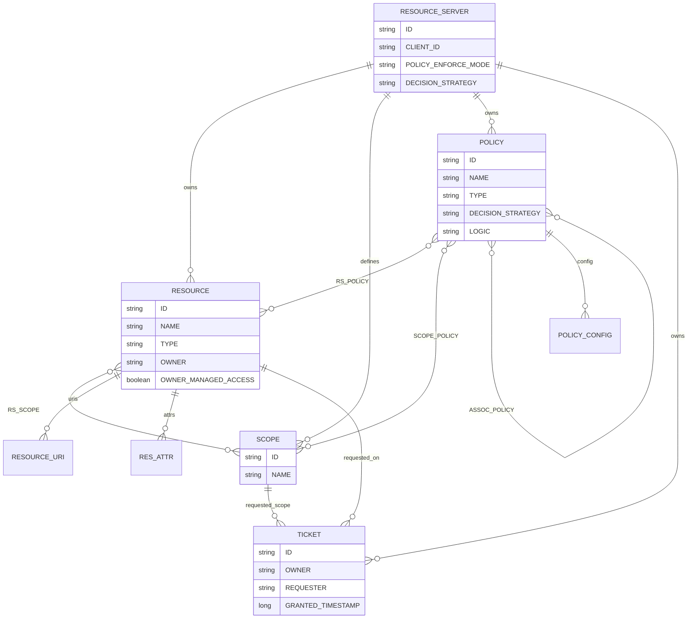
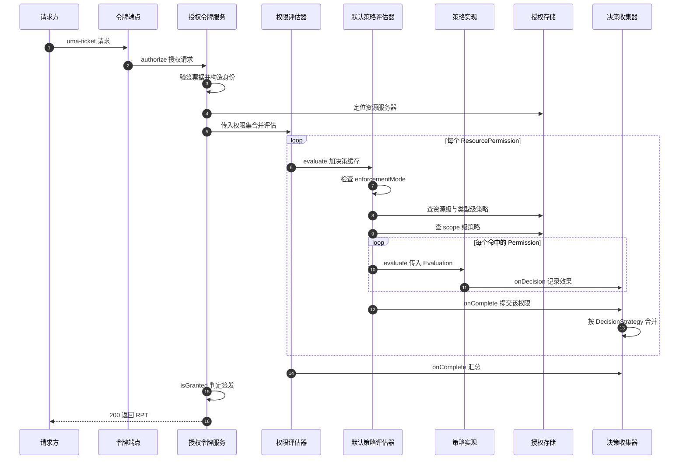
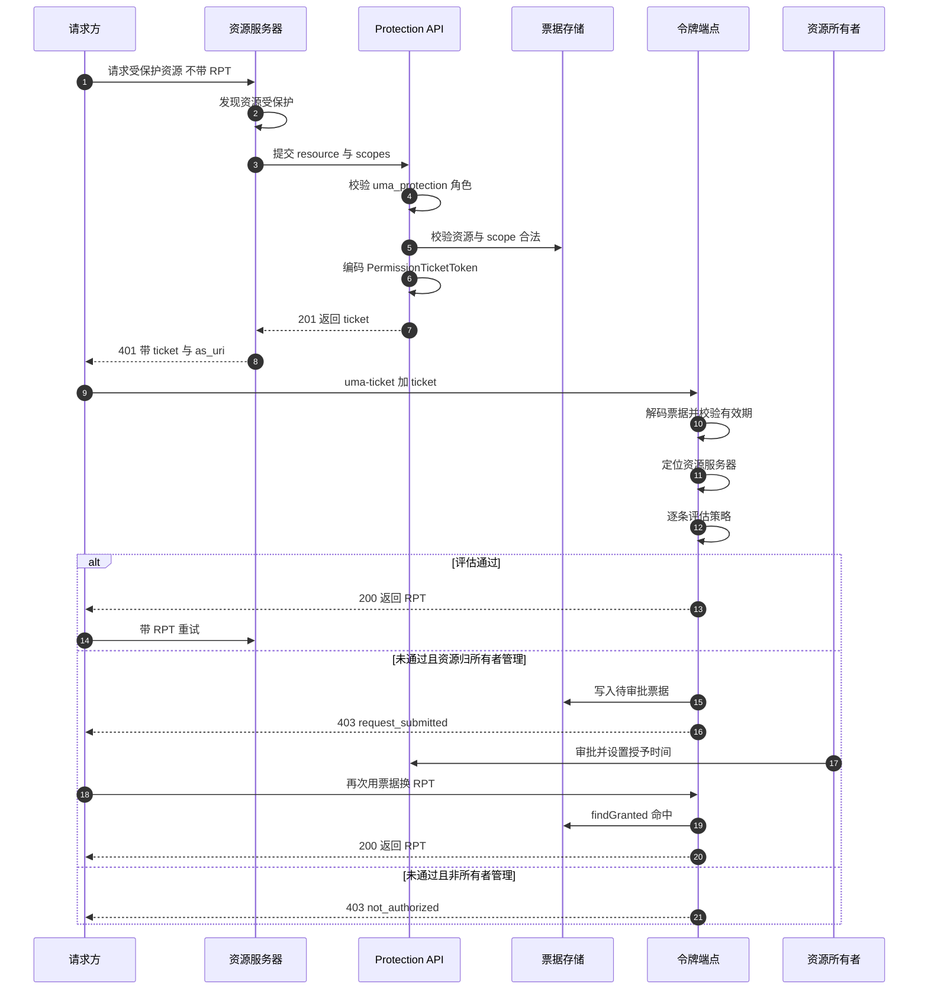

# 细粒度授权（Authorization Services / UMA / 策略评估）

> 解读基线：Keycloak 26.7.3（`6d238b6558`）。下文所有源码引用均相对仓库根，并附程序化校验过的行号锚点。

上一篇 [`oidc-protocol.md`](oidc-protocol.md) 把「你是谁」这条链路走通了：认证流程引擎产出认证结果，令牌端点把它封成 ID Token / Access Token，SSO 会话与登出都挂在同一套会话模型上。但那套机制只回答了身份问题——Access Token 里装的是**角色**，而角色是 realm 级或 client 级的粗粒度标签，它无法表达「Alice 能对*她自己那张*银行账户执行 *withdraw*，但不能执行 *close*」。

这就是本篇的缺口：**认证回答「你是谁」，授权回答「你能对哪个资源做哪个操作」**。Keycloak 要在这条链路上再向前走一步——把决策本身做成一项由策略驱动、可运行时配置、且**不侵入业务应用**的服务。

## 模块角色：授权决策从「每个应用自己写」变成「身份中心统一裁决」

在 Keycloak 的自述里，这一块叫 fine-grained authorization，在源码里它由四个物理位置共同构成：

| 位置 | 角色 | 关键入口 |
|---|---|---|
| `server-spi-private/.../authorization/` | 契约层：领域模型接口、SPI、评估器与决策收集器 | `AuthorizationProvider`、`PolicyProvider`、`PolicyEvaluator` |
| `services/.../authorization/` | 服务层：UMA 令牌端点、Protection API、Admin 端资源 | `AuthorizationTokenService`、`ProtectionService` |
| `authz/policy/common/` | 内置策略实现层：role/time/user/group/client/js/aggregate/… | 12 个 `PolicyProviderFactory` |
| `authz/client/` + `core/.../PolicyEnforcerConfig` | 客户端侧：UMA 客户端库与**仅作为配置模型**的 enforcer 配置 | `AuthzClient`、`PolicyEnforcerConfig` |

它对外暴露三类端点：UMA 授权端点、Protection API（资源/权限/票据管理）、以及管理控制台背后的 Admin REST 资源。三者由 realm 下的一个统一路径挂载，且整块能力被一个 Feature 开关兜住：

[core/src/main/java/org/keycloak/OAuth2Constants.java:149-149]() UMA 授权端点使用的 grant type 常量
<!-- anchor: String UMA_GRANT_TYPE = "urn:ietf:params:oauth:grant-type:uma-ticket"; -->

[services/src/main/java/org/keycloak/services/resources/RealmsResource.java:261-267]() 授权服务挂在 `{realm}/authz` 下，进入前先做 Feature 检查
<!-- anchor: @Path("{realm}/authz") … return new AuthorizationService(authorization); -->

[common/src/main/java/org/keycloak/common/Profile.java:60-60]() AUTHORIZATION 是 Type.DEFAULT，即默认开启——细粒度授权在 26.7.3 属于开箱能力，不是实验特性
<!-- anchor: AUTHORIZATION("Authorization Service", Type.DEFAULT), -->

一个容易踩的命名陷阱：`PolicyEndpoint` / `ResourceEndpoint` / `PermissionEndpoint` 这三个类名在 26.7.3 里**并不存在**。Protection API 的四个子资源分别由 `ProtectionService` 的 `resource_set` / `permission` / `permission/ticket` / `uma-policy` 四个 JAX-RS 子资源定位器返回具体服务对象；管理端的策略与权限 CRUD 则落在 `services/.../authorization/admin/` 下的 `PolicyService` / `PolicyResourceService` / `PermissionService` / `PolicyEvaluationService`。读这套代码时以源码类名为准。

[services/src/main/java/org/keycloak/authorization/protection/ProtectionService.java:57-88]() Protection API 的四个子资源定位器——没有 `PolicyEndpoint` 这类类名，只有四个 `@Path` 定位器
<!-- anchor: @Path("/resource_set") … @Path("/uma-policy") -->

## 根因：授权决策是每个应用的私事，还是身份中心的一项公共服务

把授权留在业务应用里，代价随应用数量线性放大：

1. **策略无法统一演进**。「Premium 用户可导出报表」这条规则如果写在 12 个服务里，改一次要发 12 次版。
2. **决策所需的信息不在应用手里**。判断「这个用户是否有 role X」在 Keycloak 里是一次本地缓存查询，在业务应用里则要解析 token 或回调 Introspection。
3. **资源所有者授权（UMA 场景）根本没有落脚点**。当 Alice 想把自己的文档分享给 Bob，应用实现者得自己发明一套「授权请求—审批—发放」的状态机与存储。
4. **审计与合规要求决策可解释**。「为什么这次请求被拒」需要一个能回答的决策点。

Keycloak 的回答是：**把决策（PDP）与策略管理（PAP）搬进身份中心，但把强制执行（PEP）留在应用侧**。这条边界贯穿本模块全部设计，也是本篇最终要下的架构判断。

## 为什么是四类实体，而不是「用户-角色-资源」三元组

直觉上授权就是三元组 `(subject, action, object)`。Keycloak 却拆成了四类持久化实体——Resource、Scope、Policy、Permission——再把 subject 交给 Identity/EvaluationContext 在运行时解析。拆分的收益集中在三点：

- **Resource 与 Scope 分离，让「对象」可复用、让「操作」可枚举**。`Resource` 描述被保护对象并可携带 `uris`（URI 是 enforcer 匹配路径的依据）、`type`（实例与类型模板的挂钩点）、`owner` 与 `ownerManagedAccess`（UMA 的开关）；`Scope` 单独建表并独立于资源，因此「withdraw」这个动作可以同时挂在多个资源上，权限也能跨资源授予。

[server-spi-private/src/main/java/org/keycloak/authorization/model/Resource.java:95-110]() Resource 自带 uris 与 type，这两个字段是后续「路径匹配」和「类型继承」的锚点
<!-- anchor: Set<String> getUris(); … String getType(); -->

- **Policy 与 Permission 分离，让「条件」可以复用、让「关联」承载合并语义**。`Policy` 是**不绑定保护对象**的条件片段（角色/时间/客户端/JS/……），`Permission` 是 `Policy` 的一个特例——它同样存在 `RESOURCE_SERVER_POLICY` 表里，只是 `type` 为 `scope` 或 `resource`，并且通过两张关联表把 Resource/Scope 挂上去。「Permission 是 Policy 的子类型」这个设计让策略复用和权限定义共用同一套存储、CRUD、导入导出与评估管线，代价是两种概念在同一张表里靠 `type` 字符串区分（`DecisionPermissionCollector` 里到处是 `"scope".equals(policy.getType())` 这类判断，见后文）。

[server-spi-private/src/main/java/org/keycloak/authorization/model/Policy.java:162-185]() 一个 Policy 同时持有 associatedPolicies、resources、scopes 三组关联——这正是「策略可组合、权限可关联资源」的物理基础
<!-- anchor: Set<Policy> getAssociatedPolicies(); … Set<Scope> getScopes(); -->

- **RBAC 只覆盖「谁」，这套模型把「对什么、做什么、在什么条件下、冲突如何裁决」全部纳入**。相比纯 RBAC，它至少多解决四件事：资源实例级授权（同类型资源的某一条实例）、操作级粒度（scope）、运行时条件（时间/客户端/IP/用户属性等 ABAC 因子）、以及所有者自主授权（UMA，把授权能力下放给资源所有者而不是管理员）。

## 决策合并：把冲突解决规则交给配置而不是内核

多策略必然冲突：一条说 permit、一条说 deny。内核若定死「deny 优先」，就无法表达「只要有一个策略通过就放行」的业务语义；若定死「permit 优先」，则无法表达强约束。Keycloak 的做法是把合并规则变成**两级可配置项**，并在两个不同层级落地：

- **策略级**：每个 `Policy` 有自己的 `DecisionStrategy`，用于合并它自身 `associatedPolicies` 的判定结果——这主要用于 Aggregate Policy（聚合策略）与 Permission 组合策略。
- **资源服务器级**：`ResourceServer` 也有一个 `DecisionStrategy`，用于合并「多个 Permission 作用在同一资源/scope 上」的结果。

值得注意的是，资源服务器级的策略**不允许是 CONSENSUS**：`ResourceServerEntity.setDecisionStrategy` 遇到 CONSENSUS 直接抛 `IllegalArgumentException`。这暗示 CONSENSUS 的语义只对「一组平级策略」成立，而资源服务器级的合并集合里混杂了 scope permission 与 resource permission，计数式多数决会产生反直觉结果。

[model/jpa/src/main/java/org/keycloak/authorization/jpa/entities/ResourceServerEntity.java:73-75]() 资源服务器级策略拒绝 CONSENSUS——不是「不推荐」，而是直接抛异常
<!-- anchor: public void setDecisionStrategy(DecisionStrategy decisionStrategy) { … throw new IllegalArgumentException("Strategy " + decisionStrategy + " not suppor -->

## 策略评估器：把「基于什么判定」做成 Provider

`PolicyProviderFactory` 是「策略类型」的注册入口，它同时承担四件事：类型标识（`getId`）、展示分组（`getGroup`，即控制台里的 Identity Based / Rule Based 分类）、表示模型映射（`toRepresentation` / `onCreate` / `onUpdate` / `onImport` / `onExport`），以及最重要的——`create(AuthorizationProvider)` 出评估器。

[server-spi-private/src/main/java/org/keycloak/authorization/policy/provider/PolicyProviderFactory.java:31-53]() 一个策略类型要提供的全部能力：命名、分组、表示模型双向映射、导入导出回调、以及评估器工厂
<!-- anchor: public interface PolicyProviderFactory<R extends AbstractPolicyRepresentation> e … Class<R> getRepresentationType(); -->

`authz/policy/common` 通过一张 SPI 注册清单提供 12 个内置实现，覆盖 aggregate / js / resource / role / scope / time / user / client / group / uma / clientscope / regex——「基于角色/时间/客户端/JS/聚合」共存不是靠 if-else，而是靠这张 SPI 文件。新增一种策略类型 = 加一个类 + 注册一行，内核零改动。

[authz/policy/common/src/main/resources/META-INF/services/org.keycloak.authorization.policy.provider.PolicyProviderFactory:37-48]() 12 个内置策略工厂的注册清单——这是「策略类型可插拔」的物理载体
<!-- anchor: org.keycloak.authorization.policy.provider.aggregated.AggregatePolicyProviderFac … org.keycloak.authorization.policy.provider.regex.RegexPolicyProviderFactory -->

## 关键数据结构

### 授权领域模型

图中「逻辑实体名 → 物理表名」对应与源码出处

为避免 Mermaid 标签过宽，图中使用了缩短的逻辑名。对应关系如下（同一张表被逻辑上分为四类实体，正是「Resource 与 Scope 分离、Policy 与 Permission 共表」的直接体现）：

| 图中逻辑名 | 物理表名 | 说明 |
|---|---|---|
| `RESOURCE_SERVER` | `RESOURCE_SERVER` | 资源服务器，一个 client 开一个 |
| `RESOURCE` | `RESOURCE_SERVER_RESOURCE` | 被保护对象；`TYPE`/`OWNER`/`OWNER_MANAGED_ACCESS` |
| `SCOPE` | `RESOURCE_SERVER_SCOPE` | 可执行操作 |
| `POLICY` | `RESOURCE_SERVER_POLICY` | 策略**与**权限共用此表，靠 `TYPE` 区分 |
| `TICKET` | `RESOURCE_SERVER_PERM_TICKET` | 用户自主授权记录（非 JWT 票据本体） |
| `RESOURCE_URI` | `RESOURCE_URIS` | Resource 的 URI 元素集合 |
| `RES_ATTR` | `RESOURCE_ATTRIBUTE` | Resource 属性 |
| `RS_SCOPE` | `RESOURCE_SCOPE` | Resource↔Scope 关联表 |
| `RS_POLICY` | `RESOURCE_POLICY` | Policy↔Resource 关联表 |
| `SCOPE_POLICY` | `SCOPE_POLICY` | Policy↔Scope 关联表 |
| `ASSOC_POLICY` | `ASSOCIATED_POLICY` | Policy↔Policy 自关联（策略组合） |
| `POLICY_CONFIG` | `POLICY_CONFIG` | Policy 的 key/value 配置映射 |

四条表名声明本身：

[model/jpa/src/main/java/org/keycloak/authorization/jpa/entities/ResourceServerEntity.java:33-33]() 资源服务器表名
<!-- anchor: @Table(name = "RESOURCE_SERVER") -->

[model/jpa/src/main/java/org/keycloak/authorization/jpa/entities/ResourceEntity.java:52-52]() 资源表名及其唯一约束
<!-- anchor: @Table(name = "RESOURCE_SERVER_RESOURCE", uniqueConstraints = { -->

[model/jpa/src/main/java/org/keycloak/authorization/jpa/entities/PolicyEntity.java:56-56]() 策略表名及其唯一约束
<!-- anchor: @Table(name = "RESOURCE_SERVER_POLICY", uniqueConstraints = { -->

[model/jpa/src/main/java/org/keycloak/authorization/jpa/entities/PermissionTicketEntity.java:37-37]() 用户自主授权记录表名及其唯一约束
<!-- anchor: @Table(name = "RESOURCE_SERVER_PERM_TICKET", uniqueConstraints = { -->

[model/jpa/src/main/java/org/keycloak/authorization/jpa/entities/ResourceEntity.java:84-108]() uris 是元素集合，scopes 是多对多关联表，且用 BatchSize(20) 做批量抓取缓解 N+1
<!-- anchor: @ElementCollection(fetch = FetchType.LAZY) … private List<ScopeEntity> scopes; -->

[model/jpa/src/main/java/org/keycloak/authorization/jpa/entities/PolicyEntity.java:94-122]() 同一个 Policy 实体同时承载 config 映射、associatedPolicies 集合、resources 集合与 scopes 集合——「策略」「权限」共表的直接证据
<!-- anchor: @Column(name = "DECISION_STRATEGY") … private Set<ScopeEntity> scopes; -->

### 三个决定性字段

| 字段 | 位置 | 语义 | 约束 |
|---|---|---|---|
| `DECISION_STRATEGY` | `PolicyEntity`（默认 `UNANIMOUS`）与 `ResourceServerEntity` | 合并规则 | 资源服务器级禁止 `CONSENSUS` |
| `LOGIC` | `PolicyEntity`（默认 `POSITIVE`） | 单个策略判定取反 | `NEGATIVE` 时 `grant()` 实际产生 DENY |
| `POLICY_ENFORCE_MODE` | `ResourceServerEntity` | `ENFORCING` 无策略即拒 / `PERMISSIVE` 无策略即放 / `DISABLED` 全放 | 见 `DefaultPolicyEvaluator` |

[server-spi-private/src/main/java/org/keycloak/authorization/policy/evaluation/DefaultEvaluation.java:91-104]() `grant()` 在 `Logic.NEGATIVE` 时写入 `Effect.DENY`——「命中即放行」与「命中即拒绝」共用同一条评估代码路径
<!-- anchor: public void grant() { … setEffect(Effect.DENY); -->

## 核心流程

### 一次决策请求在服务端走过什么

UMA 授权端点的入口是一个静态单例的 `authorize(request)`。它在真正评估之前要先完成三件事：解出 permission ticket（或客户端显式给出的 permission 列表）、构造 `EvaluationContext`（含 Identity 与 claims）、定位目标 resource server。然后按请求形态分三条路：

1. `request.getTicket() != null` → 走 UMA 标准路径，用票据换权限，并用 `PermissionTicketAwareDecisionResultCollector` 收集结果；
2. 无票据、无权限列表、且没有携带 RPT → 走「entitlement 全集查询」，把该用户在该 resource server 下**所有**可达资源与 scope 全量评估一遍；
3. 其余情况 → 按请求的 permission 列表精确评估。

[services/src/main/java/org/keycloak/authorization/authorization/AuthorizationTokenService.java:234-239]() 三条评估路径的分派点：有 ticket 走用户授权路径，空权限且无 RPT 走全量 entitlement 查询，否则按请求精确评估
<!-- anchor: if (request.getTicket() != null) { … permissions = evaluatePermissions(request, ticket, resourceServer, evaluationContext, identity); -->

#### 策略评估与决策合并的内部时序

链路上的四个关键落点：

**其一，策略是「先查后评」而不是「全表扫描」**。`DefaultPolicyEvaluator` 依次查资源级、资源类型级、scope 级三类策略，每次查询都把命中的策略喂给一个 `Consumer<Policy>`，由后者按 `policy.getType()` 去 `KeycloakSession` 里取出对应的 `PolicyProvider` 执行。

[server-spi-private/src/main/java/org/keycloak/authorization/policy/evaluation/DefaultPolicyEvaluator.java:46-81]() 评估主循环：DISABLED 直接放行、已标记 granted 的直接放行、否则查三类策略、无命中时按 PERMISSIVE 兜底
<!-- anchor: public void evaluate(ResourcePermission permission, AuthorizationProvider au … grantAndComplete(permission, authorizationProvider, executionContext -->

[server-spi-private/src/main/java/org/keycloak/authorization/policy/evaluation/DefaultPolicyEvaluator.java:93-107]() 资源类型级策略的处理：先按 type 查类型模板策略，若该资源不是 resource server 自己拥有，还要遍历该 type 下所有资源再逐个查一次策略
<!-- anchor: protected void evaluateResourceTypePolicies(ResourcePermission permission, A … policyStore.findByResource(resourceServer, typedResource, po -->

后面这一条是**本模块最明显的性能隐患**：它是一次「按类型资源数线性增长」的循环内查询。类型模板（例如银行账户 A 的策略要应用到所有 A 类账户）语义上必须支持，但实现上没有一条 SQL 能覆盖，只能对每个同类资源重复查询。资源类型实例数量大时，单次决策的 SQL 数会随之放大（详见「亮点与问题」）。

**其二，判定结果是「事件」而不是「返回值」**。`PolicyProvider.evaluate(Evaluation)` 不返回布尔值，而是调用 `evaluation.grant()` / `deny()` 把效果写入 `DefaultEvaluation.effect`，再由 `DefaultEvaluation` 把消息投递给 `Decision` 接口。这个设计让「父策略（Permission）—子策略（Policy）」的嵌套评估可以复用同一条投递路径：`Decision.onDecision` 通过 `evaluation.getParentPolicy()` 是否为空来区分「这是某个关联策略的判定」还是「这是整个 Permission 的最终判定」。

[server-spi-private/src/main/java/org/keycloak/authorization/policy/evaluation/AbstractDecisionCollector.java:38-75]() 用 parentPolicy 是否为空区分两类事件，并保证父策略的 PolicyResult 与权限一一对应——重复出现的父策略会被合并进同一个 Result
<!-- anchor: public void onDecision(Evaluation evaluation) { … results.computeIfAbsent(permission, p -> new Result(p, evaluation)).setStatus(evaluation.getEffect()); -->

**其三，合并规则的实现是两个 switch，而不是一张决策表**。`AbstractDecisionCollector.isGranted` 负责策略级合并：AFFIRMATIVE 只要有一个 PERMIT 就通过；CONSENSUS 统计 permit 与 deny 票数，permit 必须严格多于 deny；默认分支（UNANIMOUS）只要发现一个 DENY 就失败。`DecisionPermissionCollector.onComplete` 负责资源服务器级合并：它先把按 scope permission 授予的 scope 与按 resource permission 授予的「全部请求 scope」分别收集，再收集被拒的 scope，最后做集合差。

[server-spi-private/src/main/java/org/keycloak/authorization/policy/evaluation/AbstractDecisionCollector.java:99-130]() AFFIRMATIVE / CONSENSUS / 默认 UNANIMOUS 三种合并语义的全部实现
<!-- anchor: protected boolean isGranted(Result.PolicyResult policyResult) { … return true; -->

[server-spi-private/src/main/java/org/keycloak/authorization/policy/evaluation/DecisionPermissionCollector.java:130-135]() 资源服务器级只对 AFFIRMATIVE 做特殊处理——把已被授予的 scope 从拒绝集合里摘掉，其余情况一律「拒绝优先」
<!-- anchor: if (DecisionStrategy.AFFIRMATIVE.equals(resourceServer.getDecisionSt … grantedScopes.removeAll(deniedScopes); -->

**其四，跨 permission 的结果复用靠一个请求级 `decisionCache`**。评估器为整批 permission 建一个 `Map<Policy, Map<Object, Effect>>`，`AggregatePolicyProvider` 用它避免同一个关联策略在不同 permission 上被重复执行。这是典型的「同一次请求内多资源决策」的摊销优化，缓存生命周期与请求同界，不需要失效策略。

[authz/policy/common/src/main/java/org/keycloak/authorization/policy/provider/aggregated/AggregatePolicyProvider.java:54-90]() 聚合策略：遍历 associatedPolicies，先查 decisionCache，未命中才真正执行子策略并回填
<!-- anchor: @Override … decision.onComplete(permission); -->

[server-spi-private/src/main/java/org/keycloak/authorization/permission/evaluator/IterablePermissionEvaluator.java:60-82]() 批量评估期间把 StoreFactory 置为 read-only，结束时复位——评估期禁止任何写操作
<!-- anchor: @Override … return decision; -->

顺带一提，`setReadOnly(true)` 的作用不是「跳过缓存」，而是让 `AbstractAuthorizationModel.throwExceptionIfReadonly()` 在评估期间拒绝任何模型写操作。这是一道防御性断言：评估逻辑本不该改数据，越界就抛 `IllegalStateException`。

[server-spi-private/src/main/java/org/keycloak/authorization/model/AbstractAuthorizationModel.java:32-34]() 只读守卫的实现——越界写入在模型层被直接拒绝
<!-- anchor: protected void throwExceptionIfReadonly() { … throw new IllegalStateException("Instance marked as read-only"); -->

### UMA 两段式：先拿 permission ticket，再用 ticket 换 RPT

如果只需回答「Alice 能不能读 resource-42」，一次决策调用就够了，为什么 UMA 非要拆成两段？源码给出的理由比规范文档更具体：

- **客户端拿不到「资源标识」这个前提**。请求方可能只有一个 URL 或一个不透明的资源句柄，无权访问 Protection API 去查询资源列表。ticket 由**资源服务器**代为向 Keycloak 申请，请求方只需要拿着票据去换 RPT。
- **资源注册与 scope 校验需要资源服务器身份**。创建 ticket 时要校验 scope 是否真的挂在资源上、资源是否开启 `ownerManagedAccess`，并强制 `uma_protection` client role。
- **为「所有者审批」留出异步窗口**。当策略判定不通过、但资源是 owner-managed 时，请求会被**登记为一条待审批的 PermissionTicket 记录**，而不是简单 403——所有者之后批准，请求方再换一次票据即可。

对应的源码证据：

[services/src/main/java/org/keycloak/authorization/protection/permission/AbstractPermissionService.java:148-167]() 票据就是一个用 realm 密钥编码的 `PermissionTicketToken`，audience 为 realm issuer，subject 是请求者的 AccessToken——票据本身即凭证，服务端无状态校验
<!-- anchor: private String createPermissionTicket(List<PermissionRequest> request) { … return this.authorization.getKeycloakSession().tokens().encode(token); -->

[services/src/main/java/org/keycloak/authorization/protection/permission/PermissionTicketService.java:89-92]() 只有资源所有者或资源服务器自身能为该资源创建用户授权记录，且资源必须开启 owner-managed access
<!-- anchor: if (!identity.isResourceServer() && !resource.getOwner().equals(this.ide … throw new ErrorResponseException("invalid_permission", "permission c -->

[services/src/main/java/org/keycloak/authorization/protection/ProtectionService.java:102-113]() Protection API 的准入：除资源服务器自身外，调用者必须持有该 client 的 uma_protection client role
<!-- anchor: if (checkProtectionScope) { … return identity; -->

[services/src/main/java/org/keycloak/authorization/authorization/AuthorizationTokenService.java:423-438]() 有 ticket 就验签，没有 ticket 就用客户端直接声明的 permission 列表并强制要求 issuedFor——「无票据换 RPT」是 Keycloak 对 UMA 的扩展，不是规范行为
<!-- anchor: private PermissionTicketToken getPermissionTicket(KeycloakAuthorizationRe … return ticket; -->

[services/src/main/java/org/keycloak/authorization/authorization/AuthorizationTokenService.java:755-771]() 票据校验只有两步：签名解码成功 + `isActive()`。票据的有效性完全依赖 JWT 签名与 exp，服务端不留票据状态
<!-- anchor: private PermissionTicketToken verifyPermissionTicket(KeycloakAuthorizationRe … return ticket; -->

[server-spi-private/src/main/java/org/keycloak/authorization/policy/evaluation/PermissionTicketAwareDecisionResultCollector.java:86-105]() 判定不通过且资源为 owner-managed 时，为尚未满足的 scope 落一条待审批记录——这就是「异步审批」在源码里的样子
<!-- anchor: public void onComplete() { … continue; -->

两段式还带来一个容易忽略的收益：**RPT 可以增量累加**。`createPermissions` 在评估完 ticket 里的 permission 后，还会调用 `resolvePreviousGrantedPermissions` 把客户端随请求带来的旧 RPT 里已授予的权限一起纳入评估输入，从而支持「在一次新请求里保留既有权限、只增量申请新 scope」的用法。

[services/src/main/java/org/keycloak/authorization/authorization/AuthorizationTokenService.java:525-530]() 增量累加的落点：旧 RPT 中已授予的权限被并入本次评估输入
<!-- anchor: resolvePreviousGrantedPermissions(request, resourceServer, permissionsToEvaluate … private void resolvePreviousGrantedPermissions(KeycloakAuthorizationRequest requ -->

「无票据换 RPT」这个 Keycloak 扩展也带出一条安全约束：**公共客户端不允许携带 claims**。因为公共客户端的请求报文可被篡改，若允许它自带 claim token 就等于让它自行声明身份。

[services/src/main/java/org/keycloak/authorization/authorization/AuthorizationTokenService.java:207-215]() 公共客户端且带 claim token 且无票据时直接 403——扩展路径必须堵住「自证身份」的漏洞
<!-- anchor: public Response authorize(KeycloakAuthorizationRequest request) { … throw forbiddenClientException; -->

### 决策发生在哪一端：Keycloak 是 PDP，PEP 在应用侧

这是本模块最需要讲清、也最容易误解的一点。

官方架构文档把自己定位为 PAP（控制台与 Protection API 管理策略）、PDP（分发式决策点）、PIP（评估期提供身份与环境属性），以及宣称「提供若干内置 PEP 实现」的 Policy Enforcer：

[docs/documentation/authorization_services/topics/auth-services-architecture.adoc:20-23]() 官方文档对 PEP 的定义与「提供内置 Policy Enforcer」的表述
<!-- anchor: * **Policy Enforcement Point (PEP)** … {project_name} provides some built-in <<_enforcer_overview, Policy Enforcers>>. -->

但**在 26.7.3 的主仓库里，PEP 的实现代码不在**：`adapters/` 模块只剩 `spi` 与 `saml` 两个子模块；官方迁移说明写明，Policy Enforcer 已随适配器弃用「从 adapters 代码基座中剥离为一个独立依赖」（`org.keycloak:keycloak-policy-enforcer`）。主仓库保留的只是**配置模型**、**HTTP 客户端库**与安装信息生成。

[adapters/pom.xml:34-35]() 主仓库 `adapters/` 只剩两个子模块——OIDC/Java 适配器与 Policy Enforcer 实现已不在本仓库
<!-- anchor: <module>spi</module> … <module>saml</module> -->

[docs/documentation/release_notes/topics/21_1_0.adoc:27-28]() 官方迁移说明：Policy Enforcer 已从 adapters 代码基座剥离为独立依赖，不再随适配器一起发布
<!-- anchor: As part of the removal of the https://www.keycloak.org/2023/03/adapter-deprecati … into a separate dependency: -->

- 保留的配置模型：`PolicyEnforcerConfig`（`core/src/main/java/org/keycloak/representations/adapters/config/PolicyEnforcerConfig.java`）
- 保留的客户端库：`authz/client/` 下的 `AuthzClient`、`ProtectionResource`、`PermissionResource`、`PolicyResource`
- 保留的安装信息生成：`KeycloakOIDCClientInstallation` 在生成 adapter 安装文件时会写入 policy-enforcer 配置段

[core/src/main/java/org/keycloak/representations/adapters/config/PolicyEnforcerConfig.java:38-78]() 这个类只有字段、getter/setter 与 Jackson 注解，没有任何评估逻辑——它是**配置契约**，不是决策器。它描述 realm、auth-server-url、resource、paths、claim-information-point 等由应用侧消费的参数
<!-- anchor: public class PolicyEnforcerConfig { … private String resource; -->

[core/src/main/java/org/keycloak/representations/adapters/config/PolicyEnforcerConfig.java:397-406]() 三种 enforcement mode 由**应用侧**解释：PERMISSIVE 放过无策略路径、ENFORCING 拒绝无策略路径、DISABLED 全放
<!-- anchor: public enum EnforcementMode { … DISABLED -->

[authz/client/src/main/java/org/keycloak/authorization/client/ClientAuthorizationContext.java:28-34]() `authz/client` 侧的上下文只是把 AccessToken 与当前 PathConfig 包一层，真正的判定仍要回调服务端
<!-- anchor: public class ClientAuthorizationContext extends AuthorizationContext { … this.client = client; -->

[services/src/main/java/org/keycloak/protocol/oidc/installation/KeycloakOIDCClientInstallation.java:180-180]() 安装信息生成侧仍会构造 policy-enforcer 配置段——配置从这个出口流向应用
<!-- anchor: PolicyEnforcerConfig enforcerConfig = new PolicyEnforcerConfig(); -->

这个边界带来三条运维含义，值得在部署方案里显式讨论：

1. **配置下发是「拉」不是「推」**。`PolicyEnforcerConfig` 通过 adapter 安装文件或应用配置进入应用；服务端的资源/路径变更不会自动到达应用，`lazyLoadPaths` 与 `PathCacheConfig`（默认 `max-entries=1000`、`lifespan=30000` 毫秒）就是为这个「最终一致」窗口准备的缓冲。策略变更后，应用侧可能在一个 cache lifespan 内仍按旧路径决策。
2. **本地缓存只在应用侧**。服务端不缓存「某个应用的路径表」，只有授权模型的缓存（见后文 Infinispan 部分）。因此「路径多、实例多」时，缓存压力分散在应用侧，运维需要在两侧分别观测。
3. **批量决策是应用侧的责任**。服务端提供了 entitlement 全集查询与 `response_permissions_limit` 参数，但「一次请求问 50 个资源」这种批量化只能由 PEP 自行聚合；服务端的 `decisionCache` 只在**同一次 HTTP 请求内**复用，不同请求之间不复用。

[core/src/main/java/org/keycloak/representations/adapters/config/PolicyEnforcerConfig.java:373-378]() 路径缓存的默认值在本仓库可核实——30 秒 lifespan 与 1000 条上限，说明「配置项」在这里，消费方不在
<!-- anchor: public static class PathCacheConfig { … long lifespan = 30000; -->

[services/src/main/java/org/keycloak/protocol/oidc/grants/PermissionGrantType.java:157-158]() `response_permissions_limit` 由服务端解析并用于限制返回的权限条数
<!-- anchor: String responsePermissionsLimit = formParams.getFirst("response_permissions_limi … Integer maxResults = responsePermissionsLimit != null ? Integer.parseInt(respons -->

需要说明的是：`PathCacheConfig` 的默认值可在本仓库源码中核实，但「enforcer 如何消费这些配置项」的代码不在本仓库，属于跨仓库推断。

反过来看，这也解释了为什么服务端不需要做网关式 ACL：Keycloak 无法知道业务应用的 URL 语义与资源生命周期，硬塞一个网关只会把「资源定义」这件事重复两遍。**把资源语义留给应用、把决策与策略管理收敛到身份中心**，是这个模块真正的架构边界。

## 与其他模块协同

授权服务不是孤立子系统：它依赖的三条 SPI、令牌格式、缓存与 FGAP 都建在同一套内核上。

- **Provider/SPI 内核**：授权能力本身、策略评估器、存储工厂各有一条 SPI 声明，都由 `KeycloakSession.getProvider` 装配，并在 `isEnabled()` 里受 AUTHORIZATION Feature 门控——「关掉授权」是一行 Feature 配置，而不是删代码。

[server-spi-private/src/main/java/org/keycloak/authorization/AuthorizationSpi.java:29-52]() 授权本身是 SPI，且受 AUTHORIZATION Feature 门控
<!-- anchor: public class AuthorizationSpi implements Spi { … return Profile.isFeatureEnabled(Profile.Feature.AUTHORIZATION); -->

[server-spi-private/src/main/java/org/keycloak/authorization/policy/provider/PolicySpi.java:29-52]() 策略评估器是 SPI——「换一种策略类型」= 换一个 Provider 实现，不需要碰内核
<!-- anchor: public class PolicySpi implements Spi { … return Profile.isFeatureEnabled(Profile.Feature.AUTHORIZATION); -->

[server-spi-private/src/main/java/org/keycloak/authorization/store/StoreFactorySpi.java:29-55]() 存储工厂同样是 SPI，受同一个 Feature 门控——存储实现本身也可替换
<!-- anchor: public class StoreFactorySpi implements Spi { … return Profile.isFeatureEnabled(Profile.Feature.AUTHORIZATION); -->

- **Feature Flag 体系**：`AUTHORIZATION` 与 `ADMIN_FINE_GRAINED_AUTHZ_V2` 是 `Type.DEFAULT`，FGAP v1 已被标记 `Type.DEPRECATED`（`SCRIPTS` 的 `PREVIEW` 档位见「决策三」）——「哪些能力开箱可用、哪些要显式开启」全部收敛在 `Profile.Feature` 一个枚举里。

[common/src/main/java/org/keycloak/common/Profile.java:60-70]() 授权相关能力的档位声明：AUTHORIZATION 与 FGAP v2 默认开启，FGAP v1 已标记弃用
<!-- anchor: AUTHORIZATION("Authorization Service", Type.DEFAULT), … ADMIN_FINE_GRAINED_AUTHZ_V2("Fine-Grained Admin Permissions version 2", Type.DEF -->

- **令牌体系（oidc-protocol）**：RPT 就是 AccessToken，通过 `AccessToken.Authorization` 承载 permissions；内省走 UMA Bearer Token Profile，由专用的 `RPTIntrospectionProvider` 实现。

[services/src/main/java/org/keycloak/authorization/protection/introspect/RPTIntrospectionProvider.java:47-76]() RPT 内省复用 AccessToken 内省基类，并单独读取 `AccessToken.Authorization` 中的 permissions
<!-- anchor: public class RPTIntrospectionProvider extends AccessTokenIntrospectionProvider<A … Authorization authorization = accessToken.getAuthorization(); -->

- **客户端认证**：UMA 端点复用 `OAuth2GrantType` 的客户端凭据流程。当请求方既没有 bearer token 也没有 subject token 时，服务端会**自己**调用 `client_credentials` 授予类型铸造一个临时 access token，用它代表客户端自身去评估：

[services/src/main/java/org/keycloak/protocol/oidc/grants/PermissionGrantType.java:112-119]() 无 bearer token 时的兜底：强制客户端认证，并以客户端凭据授予换一个临时 access token 作为「客户端自代表」的身份
<!-- anchor: // Clients need to authenticate in order to obtain a RPT from the server. … accessTokenString = AccessTokenResponse.class.cast(clientCredentialsGrant.process(context).getEntity()).getToken(); -->

- **数据模型与缓存**：JPA 实体 + Adapter 之上叠了一层 Infinispan 缓存，授权模型用 `AUTHORIZATION_CACHE` 与 `AUTHORIZATION_REVISIONS_CACHE` 两个独立缓存做「数据 + 版本号」的失效传播。

[model/infinispan/src/main/java/org/keycloak/models/cache/infinispan/authorization/InfinispanCacheStoreFactoryProviderFactory.java:61-62]() 授权缓存由「数据缓存 + 版本号缓存」两颗 Infinispan cache 组成
<!-- anchor: Cache<String, Revisioned> cache = ispnProvider.getCache(AUTHORIZATION_CACHE_NAME … Cache<String, Long> revisions = ispnProvider.getCache(AUTHORIZATION_REVISIONS_CA -->

- **管理面（rest/admin）**：管理端的策略/权限 CRUD 与模拟评估落在 `services/.../authorization/admin/` 下；下文的「决策一」会用到它的模拟评估端点。

[services/src/main/java/org/keycloak/authorization/admin/PolicyEvaluationService.java:119-121]() 管理端提供「模拟评估」入口
<!-- anchor: public Response evaluate(PolicyEvaluationRequest evaluationRequest) { … CloseableKeycloakIdentity identity = createIdentity(evaluationRequest); -->

- **FGAP**：v2 直接复用 Authorization Services 的模型与评估器，只是把受保护对象换成 Keycloak 自己的 Admin 资源（见「决策四」）。

`AuthorizationProvider` 在取 store 时同时支持「带缓存」与「无缓存」两条路径，说明存储实现本身也可替换：

[server-spi-private/src/main/java/org/keycloak/authorization/AuthorizationProvider.java:109-125]() `getStoreFactory()` 优先取 `CachedStoreFactoryProvider`，缺失则回落到本地实现，再在最外层套一层 wrapper；`getLocalStoreFactory()` 是明确的「不走缓存」旁路
<!-- anchor: public StoreFactory getStoreFactory() { … return storeFactoryDelegate; -->

最外层那层 wrapper 并非装饰器而是**不变量守卫**：`createPolicyWrapper().create(...)` 在写库前强制走 `AdminPermissionsSchema` 的资源类型/scope 解析，`delete(...)` 负责级联清理 UMA 策略与「不再被任何策略引用的 dependent policy」。把不变量放在 Provider 代理层，是「新增一个 Store 实现也不会绕过校验」的结构性保证。

## 关键设计决策

### 决策一：把决策合并规则做成两级配置项

**选择**：内核不预设 permit/deny 的优先级，改为两个可配置点——`Policy.DECISION_STRATEGY` 与 `ResourceServer.DECISION_STRATEGY`，语义分别由 `AbstractDecisionCollector.isGranted` 与 `DecisionPermissionCollector.onComplete` 实现。

**为什么**：授权的冲突语义天然依赖业务。合规场景需要 UNANIMOUS（所有约束都满足），风控场景需要 AFFIRMATIVE（任一放行通道即可），投票式场景需要 CONSENSUS。内核定死任一种，都等于把某类业务的语义强加给其他业务。

**放弃了什么**：

- **合并语义不再可组合**。策略级与资源服务器级用的是两套不同的算法（一个按票数/存在性判断，一个按 scope 集合做差），二者无法嵌套表达「先对子策略多数决、再对资源做集合交」这类复合语义。
- **CONSENSUS 在资源服务器级被禁用**，说明这套「配置化」并不彻底——层级越往上，语义越难用计数表达。
- **可解释性成本**。一次拒绝可能来自「某个 permission 的 UNANIMOUS 判定失败」也可能来自「AFFIRMATIVE 下 scope 差集后为空」，排查必须读懂这两段代码。管理端的策略评估工具正是为缓解这一点而存在：

[services/src/main/java/org/keycloak/authorization/admin/PolicyEvaluationService.java:119-121]() Admin API 提供一个「模拟评估」端点，管理员可以指定用户、资源、scope、上下文属性，拿到逐策略的判定明细——这是为「合并规则不可直观推导」付出的补偿成本
<!-- anchor: public Response evaluate(PolicyEvaluationRequest evaluationRequest) { … CloseableKeycloakIdentity identity = createIdentity(evaluationRequest); -->

### 决策二：PDP 与 PEP 显式分离，服务端不做网关式 ACL

**选择**：Keycloak 只提供决策与策略管理，`PolicyEnforcerConfig` 仅作为配置契约由应用侧消费；主仓库不含任何 enforcer 实现，`authz/client` 只提供到 Protection/UMA 端点的 HTTP 调用能力。

**为什么**：资源语义（哪些 URL 是资源、URI 与资源实例如何映射、资源何时创建与销毁）只存在于业务应用；把 URL 匹配规则搬进 Keycloak 会让「资源定义」在两处重复且必然漂移。反过来，把决策搬进应用又会让策略无法统一演进。切分点落在「语义归应用、裁决归中心」是最小耦合位置。

**放弃了什么**：

- **失去了集中式强一致**。策略变更到生效之间存在应用侧缓存窗口（`PathCacheConfig.lifespan` 默认 30 秒，`max-entries` 默认 1000），紧急封禁需要额外的应用侧刷新手段。
- **服务端无法给出「这个 token 能访问哪些 URL」的完整答案**。RPT 里只有 resource/scope 的权限集合，URL 映射在应用侧；跨应用的可视化审计必须把两边的数据拼起来。
- **默认走网络**。除非应用侧自己实现本地策略快照，每次未命中缓存的请求都要一次决策往返；`lazyLoadPaths` 与 entitlement 全集查询都是为降低往返次数的产物。
- 代价的另一面是**主仓库的交付变薄**：官方文档仍宣称「提供内置 Policy Enforcer」，而主仓库里只有配置类、客户端库与安装信息生成，enforcer 实现已剥离为独立依赖 `org.keycloak:keycloak-policy-enforcer`。

[docs/documentation/authorization_services/topics/auth-services-architecture.adoc:81-81]() 官方文档仍声称内置 Policy Enforcer 实现，与主仓库现状不一致
<!-- anchor: {project_name} provides some built-in <<_enforcer_overview, Policy Enforcers>> i -->

[docs/documentation/release_notes/topics/21_1_0.adoc:27-28]() 而同期的迁移说明已把 enforcer 移出本仓库——文档与交付形态的错位在此处可比对
<!-- anchor: As part of the removal of the https://www.keycloak.org/2023/03/adapter-deprecati … into a separate dependency: -->

### 决策三：JS 策略——允许运行用户脚本，但默认两道闸门关闭

**选择**：`JSPolicyProviderFactory` 同时实现了 `EnvironmentDependentProviderFactory`，其 `isSupported` 只在 `Profile.Feature.SCRIPTS` 开启时返回 true；而上传路径 `throwCanNotUpdatePolicy` 还要求会话属性 `ALLOW_CREATE_POLICY` 为 true，或该 provider 本身是部署型（`DeployedScriptPolicyFactory.isDeployed()`）。

[authz/policy/common/src/main/java/org/keycloak/authorization/policy/provider/js/JSPolicyProviderFactory.java:131-139]() 两道闸门：会话属性 `ALLOW_CREATE_POLICY`（运行时上传）与 `Feature.SCRIPTS`（provider 是否存在）
<!-- anchor: private void throwCanNotUpdatePolicy(AuthorizationProvider authorization) { … return Profile.isFeatureEnabled(Feature.SCRIPTS); -->

[common/src/main/java/org/keycloak/common/Profile.java:88-88]() SCRIPTS 是 Type.PREVIEW——必须显式 `--features=scripts` 才可用；AUTHORIZATION 却是 DEFAULT，这个对比本身就是安全表态
<!-- anchor: SCRIPTS("Write custom authenticators using JavaScript", Type.PREVIEW), -->

**安全含义**（以源码为准）：

1. **脚本在服务端 JVM 内以服务进程权限执行**。`JSPolicyProvider.evaluate` 把 `$evaluation` 塞进 `SimpleScriptContext` 后直接 `adapter.eval(context)`，没有沙箱层、没有 CPU/内存/超时限制。一个写坏的 JS 策略足以影响整个 Keycloak 进程——这是它被降级为 PREVIEW 的根本原因。

[authz/policy/common/src/main/java/org/keycloak/authorization/policy/provider/js/JSPolicyProvider.java:52-56]() 脚本评估的完整执行路径：构造 ScriptContext → 注入 `$evaluation` → 直接 eval，中间没有沙箱与资源限额
<!-- anchor: SimpleScriptContext context = new SimpleScriptContext(); … adapter.eval(context); -->

2. **脚本内容不是只读的**。`JSPolicyProviderFactory.getScriptModel` 每次从 policy config 的 `code` 字段重建 `ScriptModel`，源码里还留着一条 TODO 承认这个开销：`TODO lookup script by scriptId instead of creating it every time`。这意味着策略的 config 就是脚本本体，任何能改该策略的人等价于能在服务端执行代码。

[authz/policy/common/src/main/java/org/keycloak/authorization/policy/provider/js/JSPolicyProviderFactory.java:123-123]() 每次评估都从 policy config 重建脚本对象，作者自己标注了这条待优化路径
<!-- anchor: //TODO lookup script by scriptId instead of creating it every time -->

3. **上传闸门是会话属性，不是持久化设置**。`ALLOW_CREATE_POLICY` 只在 `KeycloakSession` 属性上查询，且全仓只有这一处读取点、没有任何写入点；真正可用的路径是「把脚本打进 JAR 部署」——`DeployedScriptPolicyFactory.isDeployed()` 返回 true 从而绕过上传闸门，且它的 `getScriptModel` 始终以 JAR metadata 里的 code 构造脚本，评估用的代码不来自策略实例。

[authz/policy/common/src/main/java/org/keycloak/authorization/policy/provider/js/DeployedScriptPolicyFactory.java:90-92]() 部署型策略的脚本来源是 JAR metadata，而不是策略自身携带的 config
<!-- anchor: protected ScriptModel getScriptModel(Policy policy, RealmModel realm, ScriptingProvider scripting) { … metadata.getDescription()); -->

4. **官方文档与此一致**：明确写「By default, JavaScript Policies can not be uploaded to the server」，并推荐以 JAR 部署方式提供脚本。

[docs/documentation/authorization_services/topics/policy-js-policy.adoc:12-13]() 官方文档对 JS 策略上传的默认立场——「默认不可上传，建议直接部署到服务端」
<!-- anchor: NOTE: By default, JavaScript Policies can not be uploaded to the server. You should prefer deploying your JS Policies directly to … the server as described in link:{developerguide_jsproviders_link}[{developerguide_jsproviders_name}]. -->

**放弃了什么**：失去了「运维在控制台里热改一段规则」的便利。代价换来的是「密钥材料、数据库连接、其他租户数据都不会因为一段策略脚本而泄露」。同一份文档在开头还挂了 ABAC 威胁模型警告——JS 策略若基于用户可编辑属性判定，属性本身就成了提权入口。

### 决策四：FGAP 用同一套授权模型约束 Keycloak 自己的 Admin API

**问题域**：前面所有讨论都假设被保护对象是「业务资源」。但 Keycloak 自己的 Admin API 也需要细粒度授权——「这个用户只能管理 market 组的成员」这类需求，用 realm 级角色（`manage-users`）表达不了。FGAP（Fine-Grained Admin Permissions）就是把 Authorization Services 的模型**自举**到 Keycloak 自身管理面上。

**实现要点**：

1. **受保护对象是资源类型 + 类型实例**。`AdminPermissionsSchema` 注册 `Clients` / `Groups` / `Roles` / `Users` / `Organizations` 五个资源类型及其 scope 集合（`view`、`manage`、`map-roles`、`impersonate`、`reset-password`、`manage-membership`、……），并在需要时把「某个具体用户」即时登记为 resource。

[server-spi-private/src/main/java/org/keycloak/authorization/fgap/AdminPermissionsSchema.java:80-122]() 五个资源类型的常量声明、scope 白名单与 schema 注册——这就是 FGAP 的「权限词汇表」
<!-- anchor: public static final String REALMS_RESOURCE_TYPE = "Realms"; … public static final AdminPermissionsSchema SCHEMA = new AdminPermissionsSchema() -->

2. **策略与权限存在一个专用的 `admin-permissions` client 下**。Schema 只对「realm 已开启 admin permissions **且** 当前 resource server 就是那个 `admin-permissions` client」生效：

[server-spi-private/src/main/java/org/keycloak/authorization/fgap/AdminPermissionsSchema.java:222-234]() schema 的适用边界：必须同时满足 realm 级开关与 admin-permissions client 两个条件；并且禁止通过该 client 的授权端点操作它自己
<!-- anchor: private boolean supportsAuthorizationSchema(KeycloakSession session, Resourc … throw new ModelValidationException("Not supported for this client."); -->

3. **FGAP v1 与 v2 并存，但走的是「同一接口、不同实现」的双轨**。所有管理端资源都通过 `AdminPermissions.evaluator(...)` 拿评估器，它按 Feature 返回 V2 或 V1 实现：

[services/src/main/java/org/keycloak/services/resources/admin/fgap/AdminPermissions.java:37-47]() 工厂式分派：`ADMIN_FINE_GRAINED_AUTHZ_V2` 开启则用 `MgmtPermissionsV2`，否则回落到老的 `MgmtPermissions`
<!-- anchor: public static AdminPermissionEvaluator evaluator(KeycloakSession session, Re … return new MgmtPermissions(session, realm, adminsRealm, admin); -->

而 V1 的 per-resource 端点是通过 Feature 门控硬关掉的：`GroupResource.getManagementPermissions()` 第一行就要求 V1 Feature，由于 V1 Feature 在 26.7.3 是 DEPRECATED 而 V2 是 DEFAULT，老端点在默认配置下不可用。

[services/src/main/java/org/keycloak/services/resources/admin/GroupResource.java:364-365]() V1 的 `management/permissions` 端点第一行即门控 `ADMIN_FINE_GRAINED_AUTHZ`——默认配置下（V2 才 DEFAULT）该端点直接不可用
<!-- anchor: public ManagementPermissionReference getManagementPermissions() { … ProfileHelper.requireFeature(Profile.Feature.ADMIN_FINE_GRAINED_AUTHZ); -->

[common/src/main/java/org/keycloak/common/Profile.java:68-70]() V1 已标记 DEPRECATED、V2 是 DEFAULT 且依赖 AUTHORIZATION 特性——「替代而非简单并存」的判据在 Profile 里
<!-- anchor: ADMIN_FINE_GRAINED_AUTHZ("Fine-Grained Admin Permissions", Type.DEPRECAT … ADMIN_FINE_GRAINED_AUTHZ_V2("Fine-Grained Admin Permissions version 2",  -->

**结论**：FGAP v2 在**语义上替代** v1（模型不兼容、无自动迁移、老端点默认关闭），但在**代码结构上是并存**的——`AdminPermissions` 里的双分支、`services/.../admin/fgap/` 下 V1 与 V2 两套 `*Permissions` / `*PermissionsV2` 类都在编译产物里。V1 的移除只差把 DEPRECATED 的 Feature 删掉。

**放弃了什么**：把「管理面授权」和「业务面授权」合并到同一套模型，意味着 FGAP 的功能上限被 Authorization Services 的能力上限锁死；同时 `admin-permissions` 这个特殊 client 成为一条必须持续维护的隐式契约（它不能被删除、不能被用户当普通 client 使用，schema 里专门写了 `throwExceptionIfAdminPermissionClient` 来防误操作）。

## 亮点与问题

### 亮点

- **「Permission 就是带资源关联的 Policy」这个同表设计**。它让权限定义、策略复用、CRUD、导入导出、评估管线复用同一套基础设施，是本模块代码量能压下来的关键。代价是多态靠 `type` 字符串，可读性有损。
- **票据无状态化**。Protection API 签发的 permission ticket 是一个纯 JWT：`AbstractPermissionService.createPermissionTicket` 只做 `tokens().encode(token)`，不落库；校验端只验签名与 `isActive()`。这把「票据发放」变成无状态操作，免去了跨节点同步与清理任务。代价同样落在这一处：校验路径不查任何服务端记录，因此这张凭证在有效期内没有逐张吊销的服务端路径。
- **异步授权有真实落点**。`PermissionTicketAwareDecisionResultCollector` 在判定不通过但资源为 owner-managed 时，为未满足的 scope 逐条写入待审批记录；所有者批准后同一票据即可换取 RPT。这是「403 就结束」做不到的能力，也是 UMA 两段式最实际的价值。
- **评估期的只读守卫**。`IterablePermissionEvaluator` / `UnboundedPermissionEvaluator` 把 StoreFactory 置为 read-only，越界写入抛 `IllegalStateException`，把「评估不应改数据」从约定升级为断言。
- **决策结果可按权限维度复用**。请求级 `decisionCache` 让同一批 permission 里重复出现的关联策略只评估一次，是「一次查询多个资源」这个高频场景的直接优化。
- **FGAP 的自举**。把 Authorization Services 用在 Keycloak 自己身上，既是能力复用，也是对自家模型表达力的一次实测——能表达「market 组的成员管理权」这类需求，反向证明了模型的设计可用性。

### 问题

- **资源类型级策略的 N+1 查询**。`DefaultPolicyEvaluator.evaluateResourceTypePolicies` 对类型下的每个资源单独执行一次 `findByResource`。类型实例数量增长时，单次决策的 SQL 数随之线性增长。缓存能缓解（`AUTHORIZATION_CACHE` 命中时不落库），但冷启动或缓存失效窗口内仍会放大。仓库里没有看到这条路径的批量查询优化。
- **`Permissions.all` 的缓存能力存疑**。该方法的注释直接写着 `TODO: review once we support caches`，说明「用户 entitlement 全集查询」这条路径并未针对缓存做过设计。

[server-spi-private/src/main/java/org/keycloak/authorization/permission/Permissions.java:56-56]() entitlement 全集查询路径上的缓存 TODO——作者自己标注了这块尚未针对缓存设计
<!-- anchor: * TODO: review once we support caches -->

- **魔法字符串遍布评估层**。`DecisionPermissionCollector` 用 `"resource".equals(policy.getType())` / `"scope".equals(policy.getType())` / `"uma".equals(policy.getType())` 判断语义，而 schema 侧的常量定义在别处（`ResourcePolicyProviderFactory.ID` 等）。新增一种 permission 类型时，这些硬编码判断不会编译报错。

[server-spi-private/src/main/java/org/keycloak/authorization/policy/evaluation/DecisionPermissionCollector.java:236-240]() resource / scope 两类 permission 靠字符串比较区分
<!-- anchor: return "resource".equals(policy.getType()); … return "scope".equals(policy.getType()); -->

[server-spi-private/src/main/java/org/keycloak/authorization/policy/evaluation/DecisionPermissionCollector.java:95-95]() 同一条判断链上的第三处硬编码字符串
<!-- anchor: } else if (resource != null && resource.isOwnerManagedAccess() && "uma".equals(policy.getType())) { -->

- **二级合并规则的不对称**。`DecisionPermissionCollector` 只在资源服务器级策略为 AFFIRMATIVE 时做特殊处理，其余（含 CONSENSUS）都走「拒绝优先」。而资源服务器级又不允许配置 CONSENSUS——一个枚举值在一级被用于合并、在另一级被禁止，语义边界靠调用方记住。
- **JS 策略的能力与防护不匹配**。脚本在无沙箱、无资源限额的同一 JVM 内执行（见决策三），而它唯一的守卫是 PREVIEW 特性开关加一个源码中无人写入的会话属性。对已开启 SCRIPTS 的部署，建议把「谁能改策略」等同于「谁能执行代码」来治理。
- **文档与代码不一致（需上游修正）**。26.2.0 的迁移说明称 FGAP v1「remains in preview」，但 26.7.3 的 `Profile.Feature.ADMIN_FINE_GRAINED_AUTHZ` 已把它标为 `Type.DEPRECATED`；此外官方架构文档仍宣称 Keycloak「提供内置 Policy Enforcer 实现」，而主仓库已不含 enforcer 代码。

[docs/documentation/upgrading/topics/changes/changes-26_2_0.adoc:134-134]() 26.2.0 迁移文档仍称 FGAP v1「remains in preview」，与 26.7.3 的 DEPRECATED 标记不符
<!-- anchor-base64:KiBGR0FQOlYxIGZlYXR1cmUgcmVtYWlucyBpbiBwcmV2aWV3IGFuZCBjYW4gYmUgZW5hYmxlZCB1c2luZyBgLS1mZWF0dXJlcz1hZG1pbi1maW5lLWdyYWluZWQtYXV0aHo6djFgLiBIb3dldmVyLCBWMSBtYXkgYmUgZGVwcmVjYXRlZCBhbmQgcmVtb3ZlZCBpbiBhIGZ1dHVyZSByZWxlYXNlcy4K -->
