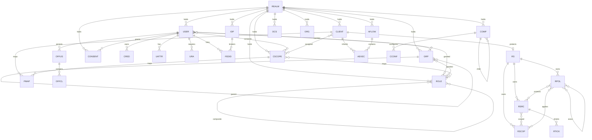
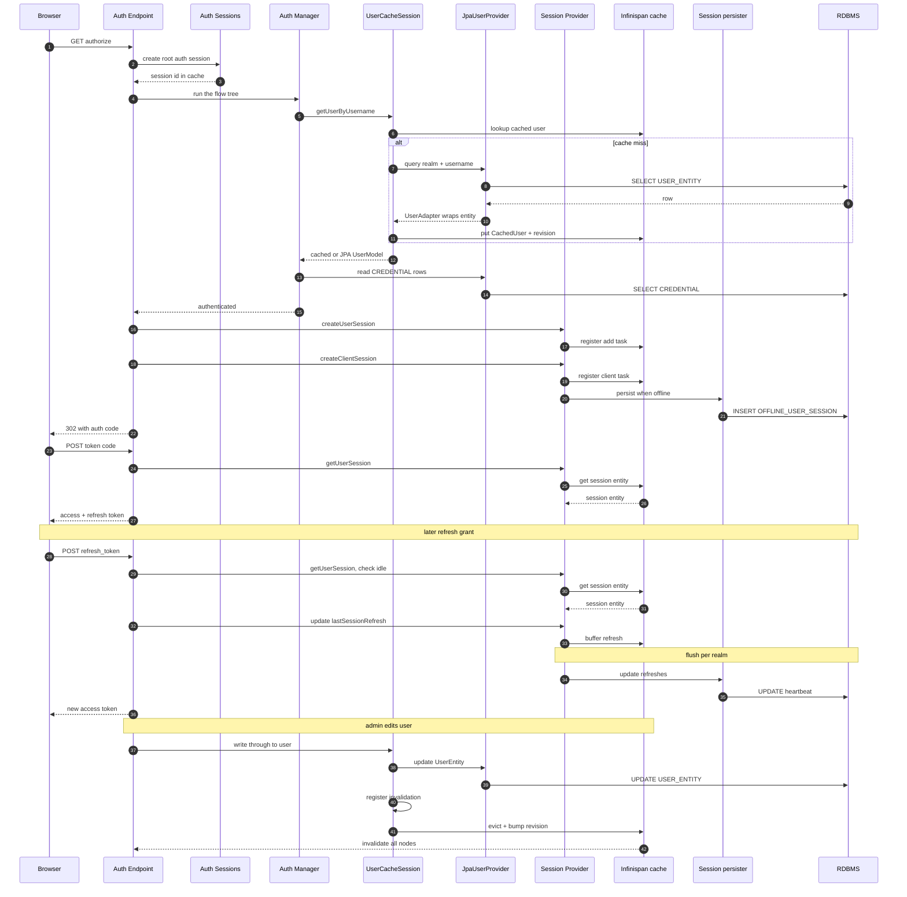

# 数据模型与存储层

> 解读基线：Keycloak 26.7.3（`6d238b6558`）。下文所有源码引用均相对仓库根，并附程序化校验过的行号锚点。

`oidc-protocol.md` 把「登录」一路铺到了令牌签发与 SSO 会话，却刻意停在 `UserSessionProvider` 的接口边界上没有下探。它留下的缺口是本篇要补的：**会话究竟写到了哪里**、用户与角色在磁盘上是什么形状、升级 Keycloak 时数据库凭什么能被安全改写、以及缓存与数据库之间谁说了算。

需要先立一个基调：Keycloak 的数据模型不是「先设计表、再往上写业务」，而是**先有模型 SPI（`RealmModel`/`UserModel`/`ClientModel`/…），再由存储层去实现它**。所有表结构都是这份接口契约的一种落地选择，而不是反过来。理解这一点，后面很多「看起来奇怪」的设计才有解释。

## 根因：数据底座要同时承受互相冲突的约束

一个被成百上千应用共享的身份中心，对数据层提出的要求本身就是矛盾的：

- **强一致**：用户改了密码、撤了角色，必须立刻对所有节点生效——这是安全系统，不能最终一致。
- **可演进**：客户的生产库里有几年的数据，升级必须能自动、安全、可回滚地改 schema，而不能让 DBA 手写 DDL。
- **可插拔**：用户目录可能在 LDAP/AD/社交账号里，本地表只存「本地部分」。
- **多租户**：一个部署要承载成百上千个 realm，每个 realm 有独立的密码策略、会话超时、密钥、主题。
- **高吞吐低延迟**：登录/令牌刷新是热路径，每次都要读 realm 配置、用户、角色、client——不能每请求全打 DB。

这五条约束就是全部设计取舍的来源。下面的存储选型、Adapter 层、软隔离、缓存分层，都是在这五条之间找平衡的结果。

## 存储选型：关系型加 JPA 的收益与代价

### 为什么是关系型而不是文档型

决定性因素是**第一条约束**。Keycloak 的事务边界是 `KeycloakSession`——一次登录请求里「写用户 → 写角色映射 → 写凭据 → 写会话 → 发事件」必须在同一个事务里原子提交。这一点在代码里有直接体现：`JpaKeycloakTransaction` 就是对 JPA `EntityManager` 事务的薄封装，`commit()` 时把 `PersistenceException` 转成 Keycloak 自己的异常类型。

[model/jpa/src/main/java/org/keycloak/connections/jpa/JpaKeycloakTransaction.java:47-52]()
<!-- anchor: public void commit() { … throw PersistenceExceptionConverter.convert(e); -->

同时，会话这些高频对象上还挂了**乐观锁版本号**——`PersistentUserSessionEntity` 用 `@Version` 标注 `VERSION` 列，这是关系型才有的、语言无关的并发控制原语：

[model/jpa/src/main/java/org/keycloak/models/jpa/session/PersistentUserSessionEntity.java:151-153]()
<!-- anchor: @Version … private int version; -->

而删除用户这种危险操作直接上**悲观写锁**，`removeUser` 先 `PESSIMISTIC_WRITE` 锁住行，再用一批 HQL 批量删关联表，最后 `em.remove` + `flush`：

[model/jpa/src/main/java/org/keycloak/models/jpa/JpaUserProvider.java:166-180]()
<!-- anchor: UserEntity userEntity = em.find(UserEntity.class, user.getId(), LockModeType.PES … em.remove(user); -->

文档型数据库（或纯 KV）能提供单文档原子性，但「跨用户/凭据/角色/会话四个聚合的原子提交」通常要退化为「最终一致 + 补偿」，对 IAM 而言这是不可接受的降级。选关系型换来的是：**跨表 ACID、成熟的行锁/乐观锁语义、以及企业已有的备份/主从/审计/DBA 运维能力**。

### 代价一：schema 迁移成为一等公民

关系型把「改数据结构」变成了一次真实的、必须在生产库上执行的 DDL 操作。Keycloak 因此必须自带一套 schema 版本管理机制（Liquibase），并且必须解决「多个节点同时启动不能同时改库」的问题——`update()` 会先抢一个数据库级锁 `DBLockProvider.Namespace.DATABASE`，拿到锁才跑 changelog。

[model/jpa/src/main/java/org/keycloak/connections/jpa/DefaultJpaConnectionProviderFactory.java:335-345]()
<!-- anchor: protected void update(Connection connection, String schema, KeycloakSession sess … dbLock2.releaseLock(); -->

这是文档型方案几乎不存在的成本项。而且这个成本会随版本累积：26.7.3 的 master changelog 已经 `include` 了 **74 个**版本文件，从 1.0.0.Final 一路排到 26.7.0，其中还夹着 authz 的独立 master 与早期的 DB2 平行版本。

[model/jpa/src/main/resources/META-INF/jpa-changelog-master.xml:20-94]()
<!-- anchor: <include file="META-INF/jpa-changelog-1.0.0.Final.xml"/> … <include file="META-INF/jpa-changelog-26.7.0.xml"/> -->

### 代价二：实体膨胀与 Adapter 补丁

JPA 实体必须是无参构造、字段可被 Hibernate 反射填充、不能持有 `EntityManager` 和 `KeycloakSession`。但 `UserModel` 的很多操作天然需要这两样东西——一个 `user.setAttribute()` 要不要顺手发缓存失效？一个 `realm.getClientsCount()` 要不要走缓存？这类问题在实体上无处安放。

于是 Keycloak 被迫在实体之上再加一层 Adapter，把「持久化数据」与「模型行为」掰开（下一节详述）。**如果一个项目从一开始就为「实体即模型」设计，这层就不会存在。** 这是选 JPA 的直接衍生成本。

### 代价三：两次存储层重构留下的过渡层

Keycloak 历史上确实做过 MongoDB 支持，并且**在源码升级文档里留下了明确的删除记录**。文档说明 1.5.0.Final 起 Infinispan 成为唯一会话 provider，且「We've also removed the JPA and Mongo user session providers」：

[docs/documentation/upgrading/topics/changes/changes.adoc:1145-1148]()
<!-- anchor: Infinispan is now the default and only user session provider. … If you have userSession set in keycloak-server.json to mem, jpa or mongo please  -->

随后 Keycloak 19 又启动过一次「新存储」重构，引入了 Map Storage API，把原来的 JPA 存储称为 _legacy store_：

[docs/documentation/upgrading/topics/changes/changes-19_0_0.adoc:83-90]()
<!-- anchor: The changes in this version are mostly attached to storage refactoring and a pre … It will be supported for several more versions, but will be eventually replaced  -->

但到了 26.7.3，`model/pom.xml` 只声明了 5 个模块，**没有 `map`**：

[model/pom.xml:34-38]()
<!-- anchor: <module>storage</module> … <module>infinispan</module> -->

而唯一在册的 Datastore 实现的 provider id 是 `legacy`——也就是说「新存储」路线事实上被放弃，legacy store 成了唯一的生产路径：

[model/storage-private/src/main/java/org/keycloak/storage/datastore/DefaultDatastoreProviderFactory.java:51-51]()
<!-- anchor: private static final String PROVIDER_ID = "legacy"; -->

> **代价的准确表述**：不是「Keycloak 支持 Mongo 所以有兼容包袱」，而是**两次存储层重构（Mongo 退出、Map Storage 从提出到消失）在代码里留下了过渡层**。26.7.3 可核对的事实只有两条：`model/pom.xml` 的模块列表里已无 `map`，在册 Datastore 实现的 provider id 仍是 `legacy`。今天的 `DatastoreProvider`/`StoreManagers` 这层间接、以及 `DefaultDatastoreProvider` 里那些 `// TODO: Extract ClientProvider from CacheRealmProvider` 注释，都是过渡期的化石。

### 被否决的替代方案

| 方案 | 为什么没被选为主存储 |
|---|---|
| 纯文档型（MongoDB） | 跨聚合原子性靠不了；Keycloak 自己试过并退出（见上） |
| 纯 KV/内存 | 会话可以（Infinispan 就是这么做的），但用户/角色/客户端配置不行——它们需要按属性搜索、唯一约束、join |
| 让 LDAP 当唯一真源 | 只覆盖「用户」一种实体；realm 配置、client、角色、授权策略无处安放。LDAP 被降级为 `UserStorageProvider` 的一种实现 |
| 自研 schema 版本管理 | 74 个版本的 DDL 编排、跨 7 种数据库方言的差异、checksum 校验——重造 Liquibase 不划算 |

## 实体关系总览

先看全貌。下图是核心实体（实体包 `entities/*.java` 共 48 个文件）的关系，重点标注哪几处是**多对多经中间表**——这些中间表正是「关系型带来的建模自由度」的直接体现，也是 realm 删除时需要级联清理的重灾区。为控制图宽，实体名用了短别名，对应关系见随后的对照表。

图中别名与真实表名的对照：

| 别名 | 真实表名 | 别名 | 真实表名 |
|---|---|---|---|
| `REALM` | `REALM` | `CSCOPE` | `CLIENT_SCOPE` |
| `USER` | `USER_ENTITY` | `DCS` | `DEFAULT_CLIENT_SCOPE` |
| `ROLE` | `KEYCLOAK_ROLE` | `PMAP` | `PROTOCOL_MAPPER` |
| `GRP` | `KEYCLOAK_GROUP` | `AFLOW` / `AEXEC` | `AUTHENTICATION_FLOW` / `AUTHENTICATION_EXECUTION` |
| `COMP` / `CCONF` | `COMPONENT` / `COMPONENT_CONFIG` | `OFFUS` / `OFFCL` | `OFFLINE_USER_SESSION` / `OFFLINE_CLIENT_SESSION` |
| `CRED` | `CREDENTIAL` | `IDP` / `FEDID` | `IDENTITY_PROVIDER` / `FEDERATED_IDENTITY` |
| `UATTR` | `USER_ATTRIBUTE` | `RS` | `RESOURCE_SERVER` |
| `URA` | `USER_REQUIRED_ACTION` | `RSRC` / `RPOL` / `RSCOP` / `RTICK` | `RESOURCE_SERVER_RESOURCE` / `_POLICY` / `_SCOPE` / `_PERM_TICKET` |
| `ORG` | `ORG` | | |

读图要点有三个：

1. **只有 `REALM` 是全局根**。除 `COMPONENT` 的自引用父子链，几乎所有实体的归属都能沿一条路径回到某个 realm。
2. **中间表承载了全部「多对多」**：`USER_ROLE_MAPPING`、`USER_GROUP_MEMBERSHIP`、`GROUP_ROLE_MAPPING`、`COMPOSITE_ROLE`、`CLIENT_SCOPE_CLIENT`、`CLIENT_SCOPE_ROLE_MAPPING`。它们在代码里都不是实体类，而是 `@CollectionTable` 或 `@IdClass` 复合主键，因此不出现在上图。
3. **`OFFLINE_USER_SESSION` 是一条独立的支线**。在线会话不在图里——因为**在线会话默认根本不落库**，它只活在 Infinispan 里，这点在「读写路径」一节展开。

## Adapter 层：实体之上为什么还要一层

### 实体扮演什么角色

JPA 实体是**纯数据载体**。`RealmEntity` 上没有任何业务方法，只有一个 `@Table(name="REALM")` 和一堆字段。它甚至为了省一次 SQL 而在主键上用了「属性访问」——注释写得很直白：关系导航时常常只需要 id 而不需要整行，用 `@Access(AccessType.PROPERTY)` 让 Hibernate 走 getter 就能命中已加载的 id。

[model/jpa/src/main/java/org/keycloak/models/jpa/entities/RealmEntity.java:61-63]()
<!-- anchor: @Column(name="ID", length = 36) … protected String id; -->

`UserEntity` 同理，它的设计全部服务于「怎么把行读出来、怎么写回去」：唯一约束定义在表上，级联删除的语义写在 `@OneToMany` 上，连「不清理孤儿」都配了注释解释为什么（手动走 HQL 批量删，避免 Hibernate 发重复 delete）。

[model/jpa/src/main/java/org/keycloak/models/jpa/entities/UserEntity.java:98-104]()
<!-- anchor: // Explicitly not using OrphanRemoval as we're handling the removal manually thr … protected Collection<UserAttributeEntity> attributes = new LinkedList<>(); -->

### Adapter 携带什么

`UserAdapter` 实现 `UserModel`，同时实现 `JpaModel<UserEntity>`——后者只有一个 `getEntity()` 方法，用来在需要时把适配器「拆回」实体：

[model/jpa/src/main/java/org/keycloak/models/jpa/JpaModel.java:7-8]()
<!-- anchor: public interface JpaModel<T> { … T getEntity(); -->

关键在于 Adapter 的构造函数**同时持有会话、realm 和 EntityManager**：

[model/jpa/src/main/java/org/keycloak/models/jpa/UserAdapter.java:73-76]()
<!-- anchor: protected UserEntity user; … private final KeycloakSession session; -->

这四样东西（实体 + `EntityManager` + `RealmModel` + `KeycloakSession`）正是实体**不可能**持有的：Hibernate 要求实体可被代理、可被 detach、可由反射重建，一旦实体持有 `EntityManager`，序列化、二级缓存、脏检查全部失效。

而 Adapter 拿到这些之后，才有能力做实体做不到的事：

- 需要 realm 上下文才能解释的语义（例如「继承父组的角色」要知道当前用户属于哪个 realm）；
- `em.flush()` 这类需要立刻把改动静默落盘的时机控制；
- 会话级缓存，例如 `UserAdapter` 把「用户所属组 id 列表」缓存在自身字段里，因为「登录链路里读用户所在组」极高频，而组关系变更不频繁。

### 缓存为什么必须做在 Adapter 之上

这一层真正的必要性在于**缓存**。Keycloak 的缓存不是「把实体丢进 Infinispan」，而是**缓存另一套 Adapter**：`model/infinispan` 里有自己的 `RealmAdapter` / `UserAdapter` / `ClientAdapter`，分别实现 `CachedRealmModel` / `CachedUserModel` / `CachedObject`。

[model/infinispan/src/main/java/org/keycloak/models/cache/infinispan/RealmAdapter.java:75-75]()
<!-- anchor: public class RealmAdapter implements CachedRealmModel { -->

`CachedUserModel` 的定义说明了缓存模型与 JPA 模型的分工——它额外提供 `getDelegateForUpdate()`（**失效时把缓存对象换回真实 JPA 适配器**）和 `invalidate()`：

[model/storage/src/main/java/org/keycloak/models/cache/CachedUserModel.java:36-44]()
<!-- anchor: UserModel getDelegateForUpdate(); … void invalidate(); -->

于是「同一个 `RealmModel` 接口，背后可能是 JPA 适配器、缓存适配器、或未来的其他存储适配器」这件事成立。**如果让 `RealmEntity` 直接 `implements RealmModel`，这个替换点就不存在了**——实体只能有一种实现。

缓存适配器的失效语义写得很清楚：`RealmCacheSession` 的类注释长达 50 行，核心原话是「In a transaction, objects are registered to be invalidated. If an object is marked for invalidation within a transaction a cached object should never be returned. An DB adapter should always be returned.」

[model/infinispan/src/main/java/org/keycloak/models/cache/infinispan/RealmCacheSession.java:106-111]()
<!-- anchor: * - In a transaction, objects are registered to be invalidated.  If an object is … * and need to also be evicted/removed.  We use the Infinispan Stream SPI for thi -->

### 与「一切皆 Provider」的呼应

Adapter 层不是孤立的补丁，它是 `provider-spi.md` 里那条「一切皆 Provider」主线在存储层的落点：

- `UserModel` 是**契约**（`server-spi`），不是实现；
- 契约的实现由 `UserProvider` 提供，而 `UserProvider` 本身是可插拔的 provider：本地 JPA 版本是 `JpaUserProvider`，联邦版本是 `UserStorageManager`，缓存版本是 `UserCacheSession`；
- `DefaultDatastoreProvider` 在运行时决定把 `session.users()` 路由给谁，规则是「**有缓存就用缓存，否则用存储管理器**」：

[model/storage-private/src/main/java/org/keycloak/storage/datastore/DefaultDatastoreProvider.java:176-181]()
<!-- anchor: private UserProvider getUserProvider() { … return userStorageManager(); -->

同一文件的 `getRealmProvider()`（157 行）判断 `CacheRealmProvider` 是否存在，`getClientProvider()` / `getGroupProvider()` / `getRoleProvider()` 也各自带着 `// TODO: Extract XProvider from CacheRealmProvider` 的注释——**缓存当前是「按实体类别挂载」而非统一抽象**，这是过渡状态的直接证据，也是这一层最明显的技术债。

`UserStorageManager` 再往下把「本地存储」与「联邦存储」拼起来：它 `implements UserProvider`，而本地那半是显式通过 `DefaultDatastoreProvider.userLocalStorage()` 拿到的。

[model/storage-private/src/main/java/org/keycloak/storage/UserStorageManager.java:106-107]()
<!-- anchor: protected UserProvider localStorage() { … return ((DefaultDatastoreProvider) session.getProvider(DatastoreProvider.class)) -->

**所以完整的解析链是**：`session.users()`（`DatastoreProvider`）→ `UserCacheSession`（命中则直接返回缓存适配器）→ `UserStorageManager`（本地 + 联邦扇出）→ `JpaUserProvider` → `UserAdapter` → `UserEntity`。任何一环都可以被 SPI 替换，而 `UserModel` 的调用方对此无感。

## 核心表设计

下面每张表先给一句职责，再给字段表。字段表按**设计要点**排序列，不照抄建表语句顺序；类型取自 Liquibase changelog 与实体注解，读者可点开引用复核。

### REALM：唯一的全局根

一个 realm 就是一份完整的配置快照——密码策略、OTP 策略、各类令牌寿命、主题、事件开关、默认角色、六个认证流程的引用。它的宽度（26.7.3 下 `RealmEntity` 有 57 处 `@Column` 映射；对应的 `RealmRepresentation` 字段更多达 156 个）是「realm 配置可运行时改、存 DB」这一决策的代价：**为了不改代码就能配置一切，配置项必须一一映射成列**。

[model/jpa/src/main/java/org/keycloak/models/jpa/entities/RealmEntity.java:51-66]()
<!-- anchor: @Table(name="REALM") … protected String name; -->

| 字段 | 类型 | 约束 | 说明 |
|---|---|---|---|
| `ID` | VARCHAR(36) | 主键 | UUID 主键。**同时是所有子表的 realm 分区键**，见下文「realm 作为分区键」 |
| `NAME` | VARCHAR(255) | 唯一 | realm 的 URL 段，全局唯一，因此 realm 名可当业务主键用 |
| `DISPLAY_NAME` | NVARCHAR(255) | 可空 | 26.7.0 新增的独立列，迁移自 `REALM_ATTRIBUTE` 里的 `displayName` 属性（见演进一节） |
| `ENABLED` | BOOLEAN | 非空 | 整个 realm 的总开关，禁用后所有端点拒绝服务 |
| `SSL_REQUIRED` | VARCHAR(255) | 可空 | 存枚举名字符串而非序号——**避免枚举增删导致历史数据语义漂移** |
| `PASSWORD_POLICY` | VARCHAR(255) | 可空 | 密码策略以字符串 DSL 存储，把「策略扩展」变成纯数据变更，不需要 DDL |
| `OTP_POLICY_TYPE` / `OTP_POLICY_ALG` / `OTP_POLICY_DIGITS` / `OTP_POLICY_PERIOD` / `OTP_POLICY_COUNTER` / `OTP_POLICY_WINDOW` | VARCHAR/INT | 可空 | OTP 策略被**拆成 6 列**而非序列化成一列，代价是加一种 OTP 策略就要加列 |
| `SSO_IDLE_TIMEOUT` / `SSO_MAX_LIFESPAN` / `SSO_IDLE_TIMEOUT_REMEMBER_ME` / `SSO_MAX_LIFESPAN_REMEMBER_ME` / `OFFLINE_SESSION_IDLE_TIMEOUT` | INT | 可空 | 会话超时配置直接进 realm 行——它是登录热路径最先被读到的数据 |
| `ACCESS_TOKEN_LIFESPAN` / `ACCESS_CODE_LIFESPAN` / `USER_ACTION_LIFESPAN` / `LOGIN_LIFESPAN` / `ACCESS_TOKEN_LIFE_IMPLICIT` | INT | 可空 | 令牌寿命。注意字段名（`ACCESS_CODE_LIFESPAN`）保留了 OAuth2 早期术语，与现在的「授权码」语义已有偏差 |
| `NOT_BEFORE` | INT | 可空 | realm 级「令牌签发时间下界」。全员强制登出就靠把它推到当前时间——**一个 int 列实现了全局撤销** |
| `REVOKE_REFRESH_TOKEN` / `REFRESH_TOKEN_MAX_REUSE` | BOOLEAN/INT | 可空 | 刷新令牌轮换策略 |
| `BROWSER_FLOW` / `REGISTRATION_FLOW` / `DIRECT_GRANT_FLOW` / `RESET_CREDENTIALS_FLOW` / `CLIENT_AUTH_FLOW` / `DOCKER_AUTH_FLOW` | VARCHAR | 可空 | **指向 `AUTHENTICATION_FLOW` 的字符串引用，但没有外键约束**——认证流程可以被替换/删除，靠应用层校验一致性 |
| `MASTER_ADMIN_CLIENT` | VARCHAR | 可空 | master realm 的 admin-cli 客户端 id |
| `DEFAULT_ROLE` | VARCHAR | 可空 | 指向 `KEYCLOAK_ROLE.ID` 的字符串引用，同样无外键 |
| `LOGIN_THEME` / `ACCOUNT_THEME` / `ADMIN_THEME` / `EMAIL_THEME` | VARCHAR | 可空 | 主题名，指向文件系统里的主题目录——**跨了存储边界，因此只能是字符串** |
| `EVENTS_ENABLED` / `EVENTS_EXPIRATION` / `ADMIN_EVENTS_ENABLED` / `ADMIN_EVENTS_DETAILS_ENABLED` | BOOLEAN/BIGINT | 可空 | 事件系统开关 |
| `ALLOW_USER_MANAGED_ACCESS` | BOOLEAN | 可空 | UMA 总开关 |
| `INTERNATIONALIZATION_ENABLED` / `DEFAULT_LOCALE` | BOOLEAN/VARCHAR | 可空 | 本地化开关；真正的翻译文本在 `REALM_LOCALIZATION_TEXTS` |

**这张表最值得注意的不是列多，而是「引用不带外键」**：`BROWSER_FLOW`、`DEFAULT_ROLE`、`MASTER_ADMIN_CLIENT` 都是字符串指针。原因是这些引用在业务上允许短暂悬空（配置可以先建引用后建实体、删除实体时需要先解引用），用外键会把手写迁移和导入导出卡死。

### USER_ENTITY：唯一约束必须带上 realm

`USER_ENTITY` 是唯一一张**完全没有任何外键**的核心表——不是疏忽，而是刻意的（见「realm 隔离」）。它的唯一约束是复合的：`(REALM_ID, USERNAME)` 与 `(REALM_ID, EMAIL_CONSTRAINT)`。

[model/jpa/src/main/java/org/keycloak/models/jpa/entities/UserEntity.java:61-63]()
<!-- anchor: @Table(name="USER_ENTITY", uniqueConstraints = { … @UniqueConstraint(columnNames = { "REALM_ID", "EMAIL_CONSTRAINT" }) -->

| 字段 | 类型 | 约束 | 说明 |
|---|---|---|---|
| `ID` | VARCHAR(36) | 主键 | UUID |
| `REALM_ID` | VARCHAR(255) | 索引（`IDX_USER_CREATED_TIMESTAMP` 前缀列） | **分区键，无外键**。删除 realm 时靠 `deleteUsersByRealm` 这条 HQL 批量删，而不是数据库级联 |
| `USERNAME` | VARCHAR(255) | 唯一 `(REALM_ID, USERNAME)`，`@Nationalized` | 用户名在各 realm 内唯一，跨 realm 可重名 |
| `EMAIL` | VARCHAR(255) | 无唯一约束 | **邮箱的唯一性不靠 `EMAIL` 列**，见下一行 |
| `EMAIL_CONSTRAINT` | VARCHAR(255) | 唯一 `(REALM_ID, EMAIL_CONSTRAINT)` | 真正的邮箱唯一性实现。默认值是 `generateId()`，即一个 UUID——**每个新用户的邮箱约束默认都是「随机且唯一」** |
| `EMAIL_VERIFIED` | BOOLEAN | 可空 | |
| `FIRST_NAME` / `LAST_NAME` | VARCHAR(255) | `@Nationalized` | 用国家字符集存储，为国际化姓名做准备 |
| `ENABLED` | BOOLEAN | 可空 | |
| `CREATED_TIMESTAMP` / `LAST_MODIFIED_TIMESTAMP` | BIGINT | 可空 | Unix 毫秒。26.6.0 才补上 `LAST_MODIFIED_TIMESTAMP`，26.6.0 同时为 `(REALM_ID, CREATED_TIMESTAMP)` 建了索引以支持「按创建时间排序的管理台列表」 |
| `FEDERATION_LINK` | VARCHAR(255) | 可空 | 指向 `COMPONENT.ID`（用户联邦 provider）。**同样无外键** |
| `SERVICE_ACCOUNT_CLIENT_LINK` | VARCHAR(255) | 可空 | 服务账号用户反向指向 `CLIENT.ID` |
| `NOT_BEFORE` | INT | 可空 | 用户级令牌撤销下界 |

`EMAIL_CONSTRAINT` 这个设计值得单独说：它把「邮箱是否唯一」变成了**一个可以逐用户切换的开关**。realm 设置 `duplicateEmailsAllowed=true` 时，写入逻辑就给每个用户填不同的随机值（约束不冲突）；设为 false 时，写入逻辑把 `EMAIL_CONSTRAINT` 设成邮箱本身（约束生效）。这里有一个刻意的初始化：

[model/jpa/src/main/java/org/keycloak/models/jpa/entities/UserEntity.java:91-93]()
<!-- anchor: // This is necessary to be able to dynamically switch unique email constraints o … protected String emailConstraint = KeycloakModelUtils.generateId(); -->

代价是：**同一个业务事实（邮箱）被存了两遍**（`EMAIL` 与 `EMAIL_CONSTRAINT`），且两者可能不一致——这是为了在不改 DDL 的前提下支持运行时切换唯一约束所付的税。数据库层的唯一索引无法被「配置」动态开关，所以只能在数据层模拟。

### CREDENTIAL：动态结构塞进 CLOB

`CREDENTIAL` 存的是「一切可以证明你是谁的东西」：密码、OTP 密钥、WebAuthn 公钥、恢复码……它们的结构彼此完全不同，且 Keycloak 允许第三方扩展新的凭据类型。

| 字段 | 类型 | 约束 | 说明 |
|---|---|---|---|
| `ID` | VARCHAR(36) | 主键 | UUID |
| `USER_ID` | VARCHAR(36) | 外键 → `USER_ENTITY.ID`，索引 `IDX_USER_CREDENTIAL` | 少数**确实带外键**的用户子表之一 |
| `TYPE` | VARCHAR(255) | 可空 | 凭据类型的 provider id（`password`、`otp`、`webauthn`…）。**用字符串而非枚举**，第三方提供者才能注册新类型 |
| `USER_LABEL` | VARCHAR(255) | 可空 | 用户可见的标签（「我的 YubiKey」） |
| `CREATED_DATE` | BIGINT | 可空 | 1.2.0 加入 |
| `SECRET_DATA` | CLOB | 可空 | 敏感部分（如盐、OTP 密钥）的 JSON |
| `CREDENTIAL_DATA` | CLOB | 可空 | 非敏感部分的 JSON（如 WebAuthn 的 credentialId、签名计数器） |
| `PRIORITY` | INT | 可空 | 多凭据时的尝试顺序 |
| `SALT` | BLOB | 可空 | 历史列：1.0 时代的密码盐 |
| `VALUE` | VARCHAR(4000) | 可空 | 历史列：1.0 时代的哈希值。2.2.0 从 VARCHAR(255) 扩到 4000 |
| `VERSION` | INT | 默认 0 | 26.2.0 加入的**结构版本号**，用于未来的凭据数据格式迁移 |

演进的关键一步是 8.0.0：changelog 的注释写着「modifies the credentials to the new format, while copying the data as json in the new fields」，把原来散落在 `VALUE`/`SALT`/`HASH_ITERATIONS` 里的强类型列**收敛成 `SECRET_DATA`/`CREDENTIAL_DATA` 两个 JSON 列**：

[model/jpa/src/main/resources/META-INF/jpa-changelog-8.0.0.xml:20-34]()
<!-- anchor-base64:PCEtLW1vZGlmaWVzIHRoZSBjcmVkZW50aWFscyB0byB0aGUgbmV3IGZvcm1hdCwgd2hpbGUgY29weWluZyB0aGUgZGF0YSBhcyBqc29uIGkg4oCmIDxjb2x1bW4gbmFtZT0iUFJJT1JJVFkiIHR5cGU9IklOVCI+ -->

这是「实体膨胀」的一剂解药，也是一个明确的取舍：**牺牲字段级可查询性，换取凭据类型可无限扩展**。旧列被保留而不是立即 drop，因为早期版本的代码还在读它们。

### CLIENT

`CLIENT` 的 `(REALM_ID, CLIENT_ID)` 唯一约束是「OAuth2 client_id 在 issuer 内唯一」这条协议约束的落地；`ID` 是内部 UUID，`CLIENT_ID` 是暴露给协议的字符串——**内外双主键**，这样 client_id 可以被管理员改名而不影响已签发的令牌（令牌里只带 UUID）。

[model/jpa/src/main/java/org/keycloak/models/jpa/entities/ClientEntity.java:54-59]()
<!-- anchor: @Table(name="CLIENT", uniqueConstraints = {@UniqueConstraint(columnNames = {"REA … @NamedQuery(name="findClientByClientId", query="select client from ClientEntity  -->

| 字段 | 类型 | 约束 | 说明 |
|---|---|---|---|
| `ID` | VARCHAR(36) | 主键 | 内部 UUID，令牌里携带的标识 |
| `REALM_ID` | VARCHAR(36) | 外键 → `REALM.ID`，索引 | 少数带真实外键的核心表 |
| `CLIENT_ID` | VARCHAR(255) | 唯一 `(REALM_ID, CLIENT_ID)` | 协议层可见的 client_id |
| `NAME` / `DESCRIPTION` | VARCHAR(255) | 可空 | 管理台展示用 |
| `ENABLED` | BOOLEAN | 非空默认 false | |
| `SECRET` | VARCHAR(255) | 可空 | 机密客户端的密钥。**注意：这是明文列**，因为客户端密钥不是用户密码，需要能原样取回用于校验 |
| `REGISTRATION_TOKEN` | VARCHAR(255) | 可空 | 动态客户端注册的临时凭据，因此设了有效期语义 |
| `CLIENT_AUTHENTICATOR_TYPE` | VARCHAR(255) | 可空 | 客户端认证方式（`client-secret`、`private_key_jwt`…），**字符串引用 provider id** |
| `PUBLIC_CLIENT` | BOOLEAN | 非空 | 决定是否强制 secret |
| `PROTOCOL` | VARCHAR(255) | 可空 | `openid-connect` / `saml`。**同一张表承载多协议 client** |
| `FRONTCHANNEL_LOGOUT` | BOOLEAN | 非空 | |
| `FULL_SCOPE_ALLOWED` | BOOLEAN | 非空 | 绕过 client scope 限定的逃生舱 |
| `ALWAYS_DISPLAY_IN_CONSOLE` | BOOLEAN | 非空 | |
| `NOT_BEFORE` | INT | 可空 | client 级令牌撤销下界 |
| `CREATED_TIMESTAMP` / `LAST_MODIFIED_TIMESTAMP` | BIGINT | 可空 | 26.7.0 才补上（见演进一节）。**一个 2016 年就存在的核心表，到 26.7.0 才第一次有「创建时间」**，因为检索需求（按创建时间排序列出客户端）到这时才出现 |
| `webOrigins` | 集合 | `@ElementCollection` → `WEB_ORIGINS` | 一对多集合用独立表 + `@ElementCollection` 表达 |

### KEYCLOAK_ROLE 与 USER_ROLE_MAPPING：一对多与多对多

角色表把「realm 角色」和「client 角色」塞进了同一张表，用 `CLIENT_ROLE` 布尔列 + `CLIENT` 列区分。这带来一个真实的数据库难题：为了让「realm 角色名在 realm 内唯一」和「client 角色名在 client 内唯一」同时成立，唯一约束需要是「name + 一个在两种情况下都非空且唯一的列」。而 MS-SQL 不允许唯一约束里有多个 NULL，所以引入了一列 `CLIENT_REALM_CONSTRAINT`：

[model/jpa/src/main/java/org/keycloak/models/jpa/entities/RoleEntity.java:90-92]()
<!-- anchor: // Hack to ensure that either name+client or name+realm are unique. Needed due t … private String clientRealmConstraint; -->

| 字段（KEYCLOAK_ROLE） | 类型 | 约束 | 说明 |
|---|---|---|---|
| `ID` | VARCHAR(36) | 主键 | UUID |
| `NAME` | VARCHAR(255) | 唯一 `(NAME, CLIENT_REALM_CONSTRAINT)` | 角色名 |
| `DESCRIPTION` | VARCHAR(255) | 可空 | |
| `REALM_ID` | VARCHAR(255) | 无外键 | 分区键 |
| `CLIENT_ROLE` | BOOLEAN | 非空 | **单表继承的判别列**：区分 realm 角色与 client 角色 |
| `CLIENT` | VARCHAR(36) | 可空 | client 角色的宿主；realm 角色时为空 |
| `CLIENT_REALM_CONSTRAINT` | VARCHAR(36) | 非空，进唯一约束 | **纯为绕开 MS-SQL 唯一约束 NULL 限制而存在的冗余列**，值是 realm id 或 client id |
| `REALM` | VARCHAR(36) | 外键 → `REALM.ID` | 1.0 遗留的旧列名（当时叫 `REALM`，后来加了 `REALM_ID`），同一事实的两列并存 |

`USER_ROLE_MAPPING` 是角色授予的中间表，**没有自己的主键，用复合主键**：

[model/jpa/src/main/java/org/keycloak/models/jpa/entities/UserRoleMappingEntity.java:48-60]()
<!-- anchor: @Table(name="USER_ROLE_MAPPING") … protected String roleId; -->

| 字段 | 类型 | 约束 | 说明 |
|---|---|---|---|
| `USER_ID` | VARCHAR(36) | 复合主键之一，`@JoinColumn` → `USER_ENTITY` | |
| `ROLE_ID` | VARCHAR(255) | 复合主键之一 | **只存 id 不存外键关联**（`roleId` 是 String 而非 `RoleEntity`），因此没有数据库级引用完整性 |

这张表还有一条很特别的 HQL——「给全 realm 用户授予某角色」被实现成了一条 `insert ... select`：

[model/jpa/src/main/java/org/keycloak/models/jpa/entities/UserRoleMappingEntity.java:45-45]()
<!-- anchor: @NamedQuery(name="grantRoleToAllUsers", query="insert into UserRoleMappingEntity -->

它**绕过了实体生命周期**，因此也绕过了 Hibernate 的 `@BatchSize` 与脏检查——换来了在大 realm 上「一次 SQL 授予全员角色」的可行性。代价是缓存失效必须由调用方显式触发，不能依赖实体回调。

### KEYCLOAK_GROUP 与 USER_GROUP_MEMBERSHIP

组是一棵树，用自引用外键表示：`PARENT_GROUP` 指向同表的 `ID`，唯一约束带上父节点 `(REALM_ID, PARENT_GROUP, NAME)`——同一父节点下组名唯一，不同分支下可以重名。

[model/jpa/src/main/java/org/keycloak/models/jpa/entities/GroupEntity.java:49-79]()
<!-- anchor: @Table(name="KEYCLOAK_GROUP", … private int type; -->

| 字段 | 类型 | 约束 | 说明 |
|---|---|---|---|
| `ID` | VARCHAR(36) | 主键 | UUID |
| `NAME` / `DESCRIPTION` | VARCHAR(255) | 可空 | 唯一性取决于父节点 |
| `PARENT_GROUP` | VARCHAR(36) | 唯一约束成员，**无外键** | 指向 `KEYCLOAK_GROUP.ID`。**树形结构没有数据库级引用完整性**——删父组要靠应用层递归 |
| `REALM_ID` | VARCHAR(36) | 唯一约束成员 | 分区键 |
| `TYPE` | INT | 非空 | 26.0.0 引入的组类型判别列（普通组 / 组织组），是「组织」特性复用组表的接缝 |
| `ORG_ID` | VARCHAR(255) | 外键 → `ORG.ID`，索引 `IDX_GROUP_ORG_ID` | 26.6.0 加入：组织本身就是一个特殊类型的组 |
| `CREATED_TIMESTAMP` / `LAST_MODIFIED_TIMESTAMP` | BIGINT | 可空 | 26.6.0 加入 |

| 字段（USER_GROUP_MEMBERSHIP） | 类型 | 约束 | 说明 |
|---|---|---|---|
| `USER_ID` | VARCHAR(36) | 复合主键之一，`@JoinColumn` → `USER_ENTITY` | |
| `GROUP_ID` | VARCHAR(36) | 复合主键之一 | 只存 id |
| `MEMBERSHIP_TYPE` | VARCHAR(255) | 可空 | 组织场景下区分「直接成员 / 通过组织继承」 |

### COMPONENT 与 COMPONENT_CONFIG：SPI 配置的通用容器

这两个表是「一切皆 Provider」在存储上的**元实现**：任何 SPI 实现的 realm 级配置，都存成 `COMPONENT` 的一行，键值对放 `COMPONENT_CONFIG`。它让「新增一种可配置的 SPI」不再需要新增表。两表于 2.1.0 引入（见下文演进一节）。

| 字段（COMPONENT） | 类型 | 约束 | 说明 |
|---|---|---|---|
| `ID` | VARCHAR(36) | 主键 | UUID |
| `REALM_ID` | VARCHAR(36) | 外键 → `REALM.ID` | 分区键，带真实外键 |
| `NAME` | VARCHAR(255) | 可空 | 实例的展示名 |
| `PROVIDER_TYPE` | VARCHAR(255) | 可空 | SPI 类型（如 `org.keycloak.storage.UserStorageProvider`）。**存 Java 全限定类名** |
| `PROVIDER_ID` | VARCHAR(36) | 可空 | ProviderFactory 的 id（如 `ldap`） |
| `PARENT_ID` | VARCHAR(36) | 可空，**无外键** | 自引用，用于「一个联邦 provider 下的多个 mapper」这类父子配置 |
| `SUB_TYPE` | VARCHAR(255) | 可空 | provider 的二级类型区分 |

| 字段（COMPONENT_CONFIG） | 类型 | 约束 | 说明 |
|---|---|---|---|
| `ID` | VARCHAR(36) | 主键 | 独立 UUID 主键，而非 `(COMPONENT_ID, NAME)` 复合主键 |
| `COMPONENT_ID` | VARCHAR(36) | 非空 | 指向 `COMPONENT.ID` |
| `NAME` | VARCHAR(255) | 非空 | 配置项名 |
| `VALUE` | VARCHAR(4000) | 可空 | 配置值。**4000 的上限是明显的痛点**：超长配置（如 SAML 证书链、SAML metadata）只能靠再拆一张表或截断 |

注意 `COMPONENT_CONFIG` 用了独立代理主键而不是 `(COMPONENT_ID, NAME)` 复合主键——这允许同一个 provider 出现**同名多值配置**，代价是「同一个 key 只有一条」这个不变量失去了数据库级保障。

### FEDERATED_IDENTITY：外部身份到本地用户的映射

这张表是身份代理（identity brokering）的落地：一个本地用户可以在多个外部 IdP 上各有一个身份。

[model/jpa/src/main/java/org/keycloak/models/jpa/entities/FederatedIdentityEntity.java:46-68]()
<!-- anchor: @Table(name="FEDERATED_IDENTITY") … protected String token; -->

| 字段 | 类型 | 约束 | 说明 |
|---|---|---|---|
| `USER_ID` | VARCHAR(36) | 复合主键之一，`@JoinColumn` → `USER_ENTITY` | 本地用户 |
| `IDENTITY_PROVIDER` | VARCHAR(255) | 复合主键之一 | IdP 的别名（`PROVIDER_ALIAS`），**字符串引用而非外键** |
| `REALM_ID` | VARCHAR(36) | 无外键 | 分区键 |
| `FEDERATED_USER_ID` | VARCHAR(255) | 可空 | 外部系统里的用户标识（`sub`）。查找路径是 `(REALM_ID, IDENTITY_PROVIDER, FEDERATED_USER_ID)` |
| `FEDERATED_USERNAME` | VARCHAR(255) | 可空 | 外部用户名，仅展示 |
| `TOKEN` | TEXT | 可空 | 外部 IdP 的 access/refresh token（开启「存储令牌」时）。**明文存储**，因为要在后续调用外部 API 时原样使用 |

主键是 `(USER_ID, IDENTITY_PROVIDER)`——一个本地用户对一个 IdP 只能有一个链接。26.6.0 专门为这张表补了两个索引 `IDX_BROKER_LINK_USER_ID` 与 `IDX_BROKER_LINK_IDENTITY_PROVIDER`（后者前缀是 `(REALM_ID, IDENTITY_PROVIDER, BROKER_USER_ID)`），说明按外部用户找本地用户（broker 登录的第一步）此前是全表扫。

### OFFLINE_USER_SESSION 与 OFFLINE_CLIENT_SESSION

会话的持久化只有**一条线**：离线会话。在线会话默认不落库。这两张表的表名里带 OFFLINE 但职责是「所有需要持久化的会话」——实体名用 `Persistent*` 而非 `Offline*` 正是这个意思。

[model/jpa/src/main/java/org/keycloak/models/jpa/session/PersistentUserSessionEntity.java:119-163]()
<!-- anchor: @Table(name="OFFLINE_USER_SESSION") … protected Boolean rememberMe; -->

| 字段（OFFLINE_USER_SESSION） | 类型 | 约束 | 说明 |
|---|---|---|---|
| `USER_SESSION_ID` | VARCHAR(36) | 复合主键之一 | UUID |
| `OFFLINE_FLAG` | VARCHAR(4) | 复合主键之一 | **判别列**，值 `1` 表示离线会话。历史上是 BOOLEAN（见演进一节） |
| `REALM_ID` | VARCHAR(36) | 无外键 | 分区键。**26.6.0 才加到 client session 表上**，见下文 |
| `USER_ID` | VARCHAR(255) | 无外键 | 指向 `USER_ENTITY`，映射方在 `setUserId` 里调 `KeyUtils.assertValidKey` 做长度/字符校验 |
| `CREATED_ON` | INT | 可空 | 会话创建时刻（秒） |
| `LAST_SESSION_REFRESH` | INT | 索引（多处以它为过期判据） | **会话活着的心跳**。清理任务的全部依据就是它 |
| `BROKER_SESSION_ID` | VARCHAR(255) | 可空 | 上游 IdP 的会话 id，用于反向登出 |
| `REMEMBER_ME` | BOOLEAN | 可空 | 26.4.0 前后加入，此前该标志藏在 `DATA` JSON 里、无法索引 |
| `DATA` | TEXT/NCLOB | 可空 | **会话笔记（notes）的 JSON blob**。会话上的任意键值（如 `auth_method`、`identity_provider`）都塞在这里 |
| `VERSION` | INT | `@Version` | 乐观锁版本号 |

| 字段（OFFLINE_CLIENT_SESSION） | 类型 | 约束 | 说明 |
|---|---|---|---|
| `USER_SESSION_ID` | VARCHAR(36) | 复合主键之一 | |
| `CLIENT_ID` | VARCHAR(36) | 复合主键之一 | 本地 client 时为真 UUID；**client 在外部存储时填字面量 `external`** |
| `CLIENT_STORAGE_PROVIDER` | VARCHAR(36) | 复合主键之一 | client 存储 provider id；本地为 `internal` |
| `EXTERNAL_CLIENT_ID` | VARCHAR(255) | 复合主键之一 | 外部 client 的真实 id |
| `OFFLINE_FLAG` | VARCHAR(4) | 复合主键之一 | |
| `REALM_ID` | VARCHAR(36) | 索引前缀 | 26.6.0 加入的**冗余分区键**，见下文 |
| `TIMESTAMP` | INT | 可空 | |
| `DATA` | NCLOB | 可空 | client 会话笔记（含 `redirect_uri`、`action`、`protocol`）的 JSON |
| `VERSION` | INT | `@Version` | 乐观锁 |

**这两张表最值得学的是主键的演进**。`OFFLINE_CLIENT_SESSION` 的主键在 1.6.0 → 1.6.1 → 3.2.0 → 4.0.0 → 9.0.0 之间被改了**五次**，每一次都意味着「老数据要重排、老代码要兼容」。这是关系型方案最真实的一课，细节放到「Schema 演进策略」一节。

另外注意 `REALM_ID` 是 2025 年（26.6.0）才加到 client session 表上的**反范式**列。加它的原因很直接：原来的会话清理语句必须 `join OFFLINE_USER_SESSION` 才能按 realm 过滤，而 **JPQL 不支持带 join 的 DELETE**，所以 Keycloak 只能为 MySQL/MariaDB 单独写一份原生 SQL：

[model/jpa/src/main/resources/META-INF/queries-mysql.properties:7-9]()
<!-- anchor: deleteExpiredClientSessions[native]=delete c from OFFLINE_CLIENT_SESSION c join  … and u.LAST_SESSION_REFRESH < :lastSessionRefresh -->

只有 MySQL/MariaDB 有这份文件（`queries-mysql.properties` / `queries-mariadb.properties`），也就是说**这两个数据库的清理路径与其他数据库跑的是不同 SQL**。26.6.0 把 `REALM_ID` 冗余进 client session 表之后，索引 `IDX_OFFLINE_CSS_BY_CLIENT_AND_REALM` 让 realm 维度的清理可以只用一个索引，不再依赖那条 dialect 特化的 join 删除。**这是一次用空间和写放大换「跨数据库统一查询路径」的典型交易**。

### USER_ATTRIBUTE：EAV 表存在的原因与代价

用户属性是「每个部署都不一样」的典型：有的要存工号，有的要存成本中心，有的要存 AD 的 objectGUID。为它建固定列是不可能的，所以 Keycloak 用了 EAV（Entity-Attribute-Value）。

[model/jpa/src/main/java/org/keycloak/models/jpa/entities/UserAttributeEntity.java:46-71]()
<!-- anchor: @Table(name="USER_ATTRIBUTE") … private String longValue; -->

| 字段 | 类型 | 约束 | 说明 |
|---|---|---|---|
| `ID` | VARCHAR(36) | 主键 | UUID。1.0.0 时主键是 `(NAME, USER_ID)`，1.4.0 改成独立 `ID`——因为一个属性可以多值 |
| `USER_ID` | VARCHAR(36) | 外键 → `USER_ENTITY.ID`，索引 `IDX_USER_ATTRIBUTE` | |
| `NAME` | VARCHAR(255) | 索引 `IDX_USER_ATTRIBUTE_NAME (NAME, VALUE)` | |
| `VALUE` | NVARCHAR(255) | 索引成员 | **短值**限制在 255 字符内，以便进索引做等值搜索 |
| `LONG_VALUE` | NCLOB | 无索引 | 长值（超 255）落到这里 |
| `LONG_VALUE_HASH` | BINARY(64) | 索引 `USER_ATTR_LONG_VALUES (LONG_VALUE_HASH, NAME)` | **长值的 SHA-512 摘要**，让长值也能被索引搜索 |
| `LONG_VALUE_HASH_LOWER_CASE` | BINARY(64) | 索引 `USER_ATTR_LONG_VALUES_LOWER_CASE (LONG_VALUE_HASH_LOWER_CASE, NAME)` | 小写变体的摘要，用于近似大小写不敏感搜索 |

最后四列是 24.0.0 整体加进来的。它解决的问题很具体：`VALUE` 只有 255 字符，超长属性值只能进 `LONG_VALUE`，而 `LONG_VALUE` 是 NCLOB，无法建索引、无法等值搜索——于是「按超长属性值查用户」变成全表扫。解法是**存一份摘要并给摘要建索引**：

[model/jpa/src/main/java/org/keycloak/storage/jpa/JpaHashUtils.java:32-36]()
<!-- anchor: * Create hashes for long values stored in the database. Offers different variant … * and would be expensive to fix as all hashes would need to be re-calculated. -->

（同一文件注释说明：小写变体固定用 `Locale.ENGLISH`，因为「避免因 locale 变化导致哈希变化，那将非常昂贵，因为所有哈希都要重算」；并且**摘要碰撞必须靠回表比对真实值兜住**，`predicateForFilteringUsersByAttributes` 就是干这个的。）

**EAV 的代价必须说清**：

1. **查询要 join 自己**：按属性查用户的 named query 是 `select u from UserEntity u join u.attributes attr where ...`。

   [model/jpa/src/main/java/org/keycloak/models/jpa/entities/UserEntity.java:47-52]()
   <!-- anchor: @NamedQuery(name="getRealmUserByUsername", query="select u from UserEntity u whe … @NamedQuery(name="getRealmUsersByAttributeNameAndValue", query="select u from Us -->

2. **无法约束**：没有「某个属性必须存在」「某个属性值必须匹配正则」这种数据库级保障，全靠 User Profile 在应用层校验。
3. **类型全丢**：所有值都是字符串，数字/日期/布尔在业务层重新解释。
4. **表膨胀**：`USER_ATTRIBUTE` 的行数与「用户数 × 平均属性数」成正比，在大 realm 里是增长最快的表之一。它同时存在 `USER_ATTRIBUTE` 与 `FED_USER_ATTRIBUTE` 两份几乎一样的表（后者服务联邦存储用户），24.0.0 的那批列和索引必须**在两个表上各做一遍**。

### 授权表组：RESOURCE_SERVER_*

Keycloak Authorization Services 的表全部以 `RESOURCE_SERVER_` 前缀自成一组，位于 `org.keycloak.authorization.jpa.entities` 包（与核心实体分开），并挂在独立的 authz changelog master 下。这个「表的物理分组跟随模块边界」的做法，是为了让不启用授权服务的部署也照常迁移。

| 字段（RESOURCE_SERVER_RESOURCE） | 类型 | 约束 | 说明 |
|---|---|---|---|
| `ID` | VARCHAR(36) | 主键 | UUID |
| `RESOURCE_SERVER_ID` | VARCHAR(36) | 唯一约束成员 | 归属的资源服务器（即某个 client） |
| `OWNER` | VARCHAR(255) | 唯一约束成员 | UMA 场景下的资源所有者 |
| `NAME` | VARCHAR(255) | 唯一 `(NAME, RESOURCE_SERVER_ID, OWNER)` | |
| `TYPE` | VARCHAR(255) | 可空 | 资源类型，用于分组匹配 |
| `OWNER_MANAGED_ACCESS` | BOOLEAN | 非空 | **UMA 的开关就落在这个字段上**——它决定资源所有者能否自行管理共享 |
| `uris` | 集合 | `@ElementCollection` → `RESOURCE_URIS` | 资源匹配的 URI 模式 |

| 字段（RESOURCE_SERVER_POLICY） | 类型 | 约束 | 说明 |
|---|---|---|---|
| `ID` | VARCHAR(36) | 主键 | UUID |
| `NAME` | VARCHAR(255) | 唯一 `(NAME, RESOURCE_SERVER_ID)` | |
| `TYPE` | VARCHAR(255) | 可空 | 策略类型（role / client / time / aggregate / js…）。**字符串引用 provider id**，第三方可注册新策略类型 |
| `DECISION_STRATEGY` | VARCHAR | 非空默认 UNANIMOUS | 多个关联策略的合成方式 |
| `LOGIC` | VARCHAR | 非空默认 POSITIVE | 策略结果是否取反 |
| `VALUE` | TEXT | 可空 | `@ElementCollection` 的键值配置——**策略的全部参数塞在一个 TEXT 里**，因此「按策略配置搜索」不可行 |

策略与资源/范围/其他策略的关联（`RESOURCE_SERVER_POLICY_RESOURCE`、`..._SCOPE`、`..._ASSOCIATED`）都是多对多中间表，也就是说**一次策略评估要 join 三张关联表**。这是授权决策的性能敏感点，也是授权模块单独成篇（`authorization-services.md`）的原因。

其余三张表同理：`RESOURCE_SERVER_SCOPE`（范围，唯一 `(NAME, RESOURCE_SERVER_ID)`）、`RESOURCE_SERVER_PERM_TICKET`（UMA 权限票据，唯一 `(OWNER, REQUESTER, RESOURCE_SERVER_ID, RESOURCE_ID, SCOPE_ID)`——**五列唯一约束，把「同一请求者不能对同一资源重复申请同一范围」写进了数据库**）、`RESOURCE_SERVER`（承载 `PolicyEnforcementMode` 与 `DecisionStrategy`）。

### 主键策略：为什么是 36 字符 UUID 而不是自增

所有核心表的主键都是 `VARCHAR(36)` 的 UUID 字符串。id 生成入口是 `KeycloakModelUtils.generateId()`，就是一句 `UUID.randomUUID().toString()`：

[server-spi-private/src/main/java/org/keycloak/models/utils/KeycloakModelUtils.java:134-135]()
<!-- anchor: public static String generateId() { … return UUID.randomUUID().toString(); -->

选择 UUID 而非自增的理由（都可以从代码行为反推）：

1. **id 必须在写库前就存在**。`UserEntity` 创建时先 `setId(id)` 再 `persist`，因为同一个请求内要把 id 写进会话（`SERVICE_ACCOUNT_CLIENT_LINK`、`FEDERATED_USER_ID` 之类），也要发事件、写审计。自增主键必须 `flush` 后才知道 id，会把「先构造对象图、最后统一落盘」的模式打散。
2. **跨实例生成不能冲突**。集群里任意节点都可能在处理注册/令牌请求；如果靠数据库序列，每个新用户都要多一次往返，且序列成为单点。
3. **导入导出必须保 id**。realm 的 JSON 导出里带着 id，重新导入要还原——自增主键做不到。
4. **令牌里带的是 UUID**，这样内部 id 与协议层 id（`CLIENT_ID`、realm `NAME`）解耦，二者可以独立改名。

代价同样明确：

- **索引更大**。`VARCHAR(36)` 比 `BIGINT` 宽 4.5 倍，且随机的 UUID 让 B+ 树插入**完全随机分布**，页分裂频繁、缓存命中率低。这在大表（`USER_ATTRIBUTE`、`OFFLINE_CLIENT_SESSION`）上是真实的写放大。
- **无法按 id 推断创建顺序**。所以 26.6.0 不得不新加 `CREATED_TIMESTAMP` 并建索引来支持「按创建时间排序」。
- **外键列也是 VARCHAR**，join 成本被放大。这也解释了为什么 Keycloak 在很多热表上**干脆放弃外键**。

`generateShortId()`（22 字符 base64url）在代码里存在，但核心表没用它——它服务于那种「不需要与外部交换、只要短」的场景。

### realm 作为分区键

`REALM_ID` 出现在几乎所有核心表上，且**大量表上的它不是外键**。这是多租户的实现方式，也是本模块最需要权衡的一处设计。

`REALM_ID` 的实际形态分三类：

- **有真实外键**：`CLIENT`、`KEYCLOAK_ROLE`（`REALM` 列）、`COMPONENT`、`REALM_ATTRIBUTE` 等配置类表（全库共 50 处 `referencedTableName="REALM"`）。
- **无外键的字符串分区键**：`USER_ENTITY`、`KEYCLOAK_GROUP`、`IDENTITY_PROVIDER`、`USER_CONSENT`……`USER_ENTITY` 更是**一个外键都没有**（全库 200 处外键中，以 `USER_ENTITY` 为基表的为 0）。
- **26.6.0 才补上的反范式冗余**：`OFFLINE_CLIENT_SESSION.REALM_ID`，纯粹为了让 realm 维度的清理不必 join。

## realm 隔离：软隔离的收益与代价

**结论：这是软隔离——同一套表加 `REALM_ID` 过滤，不是每租户一份 schema 或一个库。** 证据有三条：所有 named query 都带 realm 参数（`getRealmUserByUsername`、`findClientByClientId`、`getRealmRoles`……），高流量表上没有 realm 外键，唯一约束一律是 `(REALM_ID, 业务键)` 复合形式。

[model/jpa/src/main/java/org/keycloak/models/jpa/entities/UserEntity.java:47-52]()
<!-- anchor: @NamedQuery(name="getRealmUserByUsername", query="select u from UserEntity u whe … @NamedQuery(name="getRealmUsersByAttributeNameAndValue", query="select u from Us -->

### 收益

- **一份 schema 服务所有租户**。升级时改一次表结构，所有 realm 同时完成——这正是「schema 迁移是一等公民」能承受的前提。若是每 realm 一份 schema，74 个 changelog 要乘以 realm 数量。
- **跨 realm 的运维操作变成单库操作**：备份、主从、监控都是标准的单库问题。
- **realm 的创建/删除变成「插一行/删一批行」**，不需要 DDL 权限。Keycloak 的 realm 创建是纯 DML（`em.persist(realm)` + `flush`）。如果租户即 schema，创建 realm 就要 DDL，而 DDL 在多数生产环境需要单独审批。

### 代价

- **硬隔离带来的保护一样都没有**。一条漏写 `realmId` 条件的查询就能跨租户泄漏数据；一个忘记按 realm 过滤的清理任务就能误删别家数据。Keycloak 的防线完全在应用层（named query 里手写 `realmId` + 代码评审），数据库不兜底。这也是为什么 `UserEntity` 的 named query 全部把 realm 写进查询名和参数里——**用一种「命名即契约」的方式降低漏写的概率**。
- **单库容量上限即全平台容量上限**。所有 realm 的用户、属性、离线会话挤在一个库、共用一套连接池。一个 realm 的大批量导入会直接影响其他 realm 的登录延迟。
- **跨 realm 的长事务不可避免**。删除一个 realm 要清理它名下所有表的数据，而 realm 可以非常大——changelog 里为此专门写过 `RemoveDuplicateOfflineSessions` 这类批量清理工具：

[model/jpa/src/main/java/org/keycloak/connections/jpa/updater/liquibase/custom/RemoveDuplicateOfflineSessions.java:35-37]()
<!-- anchor: public class RemoveDuplicateOfflineSessions extends CustomKeycloakTask { … private static class Key { -->

（它按 `(userSessionId, clientId, offlineFlag)` 去重后批量删——**在一次 schema 迁移里顺手做一次数据清理**，说明「脏数据 + 软隔离」的组合会持续产生这类补丁。）

- **热点集中**。所有 realm 的登录请求抢同一批连接。Keycloak 用缓存把大部分读挡在 DB 之外（下一节），但写路径（会话刷新、事件写入）无法缓存。
- **无法按租户定价/限流**。真正的多租户隔离手段（独立连接池、独立资源配额）在软隔离下无法实现，只能靠 realm 级别的配置和全局限流。

**一句话总结这一节**：软隔离把「升级成本」从 O(租户数) 降到 O(1)，代价是把「租户隔离」从数据库保证降级为应用层纪律。

## Schema 演进策略：Liquibase 与滚动升级门禁

### changelog 的组织方式

迁移入口是一个常量：`LiquibaseJpaUpdaterProvider.CHANGELOG` 固定指向 `META-INF/jpa-changelog-master.xml`，master 里是一长串按版本排序的 `<include>`。

[model/jpa/src/main/java/org/keycloak/connections/jpa/updater/liquibase/LiquibaseJpaUpdaterProvider.java:70-70]()
<!-- anchor: public static final String CHANGELOG = "META-INF/jpa-changelog-master.xml"; -->

执行逻辑非常薄：算出「未运行的 changeSet」，为每条打印一行日志后交给 Liquibase，**顺序由 master 文件里的 `<include>` 顺序决定**：

[model/jpa/src/main/java/org/keycloak/connections/jpa/updater/liquibase/LiquibaseJpaUpdaterProvider.java:169-178]()
<!-- anchor: List<ChangeSet> changeSets = getLiquibaseUnrunChangeSets(liquibase); … logger.infov("Updating database. Using changelog {0}", changelog); -->

组织原则有三条，都能在目录里直接看到：

1. **一个发行版一个文件**，命名 `jpa-changelog-<version>.xml`。26.x 的 patch 也有独立文件（`26.2.6`）——**patch 版本带 schema 变更是允许的**，因为 Keycloak 支持从任意 patch 升级。
2. **授权服务单独一棵树**：`jpa-changelog-authz-master.xml` 被 master 在第 42 行 include 进去，它自己再 include 各 authz 版本文件。**表的物理分组跟随模块边界**。

[model/jpa/src/main/resources/META-INF/jpa-changelog-master.xml:42-42]()
<!-- anchor: <include file="META-INF/jpa-changelog-authz-master.xml"/> -->

3. **DB2 有独立文件**（`jpa-changelog-1.0.0.Final-db2.xml` 等）。这不是历史遗留的洁癖：早期 DB2 不支持某些 DDL 形式，Keycloak 为它准备了一整套平行 changelog。今天仍有 `-db2` 文件残留在 include 列表里。

官方开发文档把流程写死了：新建文件、单一 changeSet、`id` 取下一个版本号、`author` 固定为 `keycloak`、然后在 master 里加 include。

[docs/updating-database-schema.md:23-28]()
<!-- anchor: To manually create a change-set add a new file in the above location with the na … The file should have a single change-set and the id of the change-set should be  -->

`author` 固定为 `keycloak` 不只是风格问题：**Liquibase 用 `(id, author, filename)` 三元组作为 changeSet 的身份**，并据此校验 checksum。一旦发布后改动内容，所有已升级实例的 checksum 校验都会失败——所以你会看到老 changelog 里成片的 `<validCheckSum>` 标签，那是历史上修 bug 时留下的「赦免」。

### 一个真实案例：OFFLINE_CLIENT_SESSION 主键的五次重写

这是全库最能说明「关系型迁移代价」的一处。看它怎么一步步被改：

**第 0 步（1.6.0）**：主键是 `(CLIENT_SESSION_ID, OFFLINE)`，`OFFLINE` 是 BOOLEAN。

[model/jpa/src/main/resources/META-INF/jpa-changelog-1.6.0.xml:74-75]()
<!-- anchor: <addPrimaryKey columnNames="USER_SESSION_ID, OFFLINE" constraintName="CONSTRAINT … <addPrimaryKey columnNames="CLIENT_SESSION_ID, OFFLINE" constraintName="CONSTRAI -->

**第 1 步（1.6.1）**：把 `OFFLINE` BOOLEAN 换成 `OFFLINE_FLAG VARCHAR(4)`，并**重建主键**。为什么要动？因为不是所有数据库都能在索引/主键里用布尔类型——这是一次纯粹的**方言驱动**的 schema 变更，业务语义毫无变化。变更步骤被完整写出来：drop 主键 → 加新列 → `update` 回填 → drop 旧列 → 重建主键。

[model/jpa/src/main/resources/META-INF/jpa-changelog-1.6.1.xml:124-135]()
<!-- anchor: <addColumn tableName="OFFLINE_CLIENT_SESSION"> … <addPrimaryKey columnNames="CLIENT_SESSION_ID, OFFLINE_FLAG" constraintName="CON -->

**第 2 步（3.2.0）**：发现 `CLIENT_SESSION_ID` 是多余的（会话 id + client 就已唯一），于是**删列并重建主键**成 `(USER_SESSION_ID, CLIENT_ID, OFFLINE_FLAG)`。

[model/jpa/src/main/resources/META-INF/jpa-changelog-3.2.0.xml:81-83]()
<!-- anchor: <dropPrimaryKey constraintName="CONSTRAINT_OFFL_CL_SES_PK2" tableName="OFFLINE_C … <addPrimaryKey columnNames="USER_SESSION_ID,CLIENT_ID, OFFLINE_FLAG" constraintN -->

**第 3 步（4.0.0）**：引入「外部 client 存储」（client 可以来自另一个 Keycloak 或 LDAP），约束要容纳「本地/外部」两种 client 身份，于是**加两列 + 回填 + 第三次重建主键**，主键扩到 5 列。

[model/jpa/src/main/resources/META-INF/jpa-changelog-4.0.0.xml:72-87]()
<!-- anchor: <addColumn tableName="OFFLINE_CLIENT_SESSION"> … <addPrimaryKey columnNames="USER_SESSION_ID,CLIENT_ID, CLIENT_STORAGE_PROVIDER,  -->

**第 4 步（9.0.0）**：因为上面把 `CLIENT_ID` 从 VARCHAR(36) 扩到 VARCHAR(255)，在 MS-SQL 上必须先 drop 主键、改类型、再加回 `NOT NULL`，然后**第四次重建主键**——而且这段代码被 `dbms=mssql` 的 precondition 包着，**只有 MS-SQL 会走这条路**。

[model/jpa/src/main/resources/META-INF/jpa-changelog-9.0.0.xml:38-68]()
<!-- anchor: <dropPrimaryKey tableName="OFFLINE_CLIENT_SESSION" constraintName="CONSTRAINT_OF … <addPrimaryKey columnNames="USER_SESSION_ID, CLIENT_ID, CLIENT_STORAGE_PROVIDER, -->

**第 5 步（26.6.0）**：为了让 realm 维度的清理不必 join（见前文 `queries-mysql.properties` 那一段），**加了一个纯冗余的 `REALM_ID` 列**，并写了一个自定义 Java 迁移类 `JpaUpdate26_6_0_OfflineClientSessionRealm` 回填历史数据：

[model/jpa/src/main/resources/META-INF/jpa-changelog-26.6.0.xml:70-82]()
<!-- anchor: <changeSet author="keycloak" id="26.6.0-44424-create-realm-in-client-session"> … <customChange class="org.keycloak.connections.jpa.updater.liquibase.custom.JpaUp -->

**这个案例的教学价值**：

- 主键不是一个「设计时定好就不再动」的东西，它会随业务模型演进被反复重写，而每次重写在大表上都是一次昂贵的全表重建。
- **方言差异是永久成本**：一个布尔列的选择，7 年后还在 `dbms="mssql"` 的分支里留痕。
- **自定义 Java 迁移类**（`customChange`）是 Liquibase XML 表达不了逻辑时的逃生舱。26.x 的 `custom/` 目录里有十几个这样的类，包括 `JpaUpdate26_7_0_RealmDisplayName`（把 `REALM_ATTRIBUTE` 里的 `displayName` 提升成 `REALM.DISPLAY_NAME` 列）：

[model/jpa/src/main/resources/META-INF/jpa-changelog-26.7.0.xml:27-44]()
<!-- anchor: <changeSet author="keycloak" id="26.7.0-45292-realm-display-name-add-column"> … <where>NAME = 'displayName'</where> -->

这次「属性提升为列」很有代表性：`displayName` 原本作为 realm 属性存在 EAV 表 `REALM_ATTRIBUTE` 里，但管理台需要按它搜索/排序，EAV 做不了索引友好的排序——于是 26.7.0 把它提升为实列，`REALM_ATTRIBUTE` 里的旧行被 `delete` 掉。**这是「EAV 是权宜之计，热字段最终会被提升为列」这条规律的一次实证**，与 `USER_ATTRIBUTE.LONG_VALUE_HASH`、`OFFLINE_USER_SESSION.REMEMBER_ME` 的加入是同一个模式。

顺带一个反面案例：26.7.0 给 `CLIENT` 补 `CREATED_TIMESTAMP` / `LAST_MODIFIED_TIMESTAMP`：

[model/jpa/src/main/resources/META-INF/jpa-changelog-26.7.0.xml:479-497]()
<!-- anchor: <changeSet author="keycloak" id="26.7.0-add-timestamps-client"> … <column name="LAST_MODIFIED_TIMESTAMP" type="BIGINT"/> -->

一个 2016 年就存在的核心表，9 年后才第一次拥有「创建时间」。列加上了，但**历史行为 NULL**——迁移无法凭空造出正确的时间戳。这类「加列即留下永久 NULL 区段」的代价，是关系型 schema 演进的常见税。

同一份 26.7.0 changelog 还一口气引入了几张「把运行时状态搬进数据库」的新表，是这条演进主线的延伸：

- 认证会话落库：`ROOT_AUTH_SESSION` 与 `AUTH_SESSION` 两张表，服务于可选的持久化认证会话 provider。

[model/jpa/src/main/resources/META-INF/jpa-changelog-26.7.0.xml:373-404]()
<!-- anchor: <createTable tableName="ROOT_AUTH_SESSION"> … <column name="ROOT_AUTH_SESSION_ID" type="VARCHAR(36)"> -->

- 单节点状态收编：`OUTBOX_ENTRY`（事务性发件箱）、`SINGLE_USE_OBJECT`、`LOGIN_FAILURE`、`CLUSTER_EVENT` 四张表，分别对应「发件箱、一次性对象、登录失败计数、集群事件」这四类此前散在内存或单节点里的状态。

[model/jpa/src/main/resources/META-INF/jpa-changelog-26.7.0.xml:436-506]()
<!-- anchor: <createTable tableName="SINGLE_USE_OBJECT"> … <column name="TARGET_CLUSTER" type="VARCHAR(200)"> -->

### 滚动升级门禁：rolling-upgrades-*.json

到这里引出一个新问题：Keycloak 26.6 开始支持**零停机 patch 升级**（同一 `major.minor` 内滚动更新），这意味着**新旧两个版本的 Keycloak 会同时连同一个数据库**。原来的「升级时锁库、跑完 DDL 再启动」模型直接失效。

于是引入了一份显式的兼容性清单：每个 changeSet 必须被**人工判定**为「滚动升级安全」或「不安全」，分别登记到两个 JSON 文件里。

[model/jpa/src/main/resources/META-INF/rolling-upgrades-supported-changes.json:2-3]()
<!-- anchor: "changeSets" : [ { … "id" : "8.0.0-resource-tag-support", -->

26.7.3 的实测数据：**supported 里有 211 条 changeSet（migrations 为 0），unsupported 是空数组**。

[model/jpa/src/main/resources/META-INF/rolling-upgrades-unsupported-changes.json:2-3]()
<!-- anchor: "changeSets" : [ ], … "migrations" : [ ] -->

「标记」这件事本身是一门工具，由 `misc/db-compatibility-verifier` 这个 Maven 插件强制执行，四个 goal 分工明确：`snapshot` 生成初始快照、`verify` 校验无遗漏、`supported`/`unsupported` 把选定的 changeSet 写进对应文件。

[misc/db-compatibility-verifier/README.md:5-15]()
<!-- anchor: This Maven plugin is used to verify the database compatibility of Keycloak. It e … *   `db-compatibility-verifier:unsupported` -->

判定标准被直接写在插件的错误提示里——**这句是整份机制里最关键的一句**：

[misc/db-compatibility-verifier/src/main/java/org/keycloak/db/compatibility/verifier/VerifyMojo.java:114-120]()
<!-- anchor: getLog().error("You must determine whether the %s is compatible with rolling upg … getLog().error("%s can be added to the supported or unsupported files using the  -->

即两条否决线：**（a）需要加锁阻止其他集群成员访问数据库；（b）schema 变更会破坏旧版本的功能**。任何一条命中，就必须登记为 unsupported。

而 `verify` goal 是一个**构建期门禁**：它把当前仓库里所有 changeSet 与两个 JSON 里的记录做集合比对，有遗漏就 `MojoExecutionException` 失败，同时检查同一 changeSet 是否**同时出现在两个文件里**：

[misc/db-compatibility-verifier/src/main/java/org/keycloak/db/compatibility/verifier/VerifyMojo.java:95-100]()
<!-- anchor: void verifyIntersection(String description, Collection<?> sChanges, Collection<? … intersection.forEach(change -> getLog().error("\t\t" + change.toString())); -->

### unsupported 记录最终如何阻止升级

登记的「不支持变更」不是给人看的文档，而是**参与运行时哈希的一部分**。`DatabaseCompatibilityMetadataProvider` 启动时读取 `rolling-upgrades-unsupported-changes.json`，把内容**排序后重新序列化**（注释说明是为了避免空白差异影响哈希），再算一个 SHA-256 放进服务元数据：

[quarkus/runtime/src/main/java/org/keycloak/quarkus/runtime/configuration/compatibility/DatabaseCompatibilityMetadataProvider.java:74-108]()
<!-- anchor: public static void addUnsupportedDatabaseChanges(Map<String, String> metadata) { … log.error("Unable to close InputStream when creating database unsupported change -->

新旧版本各自的元数据（DB 类型、schema、以及这个 hash）会被比对，结果落到 `CompatibilityResult.ExitCode`：`0` 表示可以滚动升级，`3` 表示必须重建（recreate）。两个版本如果 unsupported 集合不同，hash 就不同，滚动升级被判定为不可行。

**一个具体的「不支持变更」例子**：把 `OFFLINE_CLIENT_SESSION` 的主键从 `(USER_SESSION_ID, CLIENT_ID, CLIENT_STORAGE_PROVIDER, EXTERNAL_CLIENT_ID, OFFLINE_FLAG)` 改成别的（就像 3.2.0/4.0.0/9.0.0 干过的那样）。这条 DDL 同时命中两条否决线：改主键需要独占表（`dropPrimaryKey` + `addPrimaryKey` 在多数数据库上会锁表），且**旧版本的代码按旧主键插入行会直接违反新约束**——旧节点会开始报错。所以它必须进 unsupported，滚动升级被自动拦下，运维被迫走「停机升级」。

**不这么做会怎样**：如果一个需要锁表 30 分钟的 DDL 被当成 supported，滚动升级流程会先把新版本节点拉起来。新节点启动时执行 DDL 长时间持锁，旧节点此刻正在处理登录请求，**全部卡在数据库连接池上直到超时**——升级过程的「零停机」承诺直接变成一次全面宕机，而且因为锁竞争，新旧节点都可能启动失败。这就是这份 JSON 存在的全部理由。

**这一节与全局哲学的呼应**：「一切皆 Provider」让 Keycloak 能在运行时换实现；而 Liquibase + 滚动升级门禁让 Keycloak 能在运行时换**数据形状**。两者是同一个目标的两种手段——**让升级不是一个需要停机的大事件**。

## 读写路径：一次登录加刷新的存储足迹

前面所有表到这里汇合成一条时间线。注意这张图里**只有两个环节真正写了数据库**（离线会话持久化、以及心跳的批量回填），其余全部落在 Infinispan——这正是 Keycloak 能在软隔离下单库承载大量 realm 的原因。

图中每个关键节点都有源码依据，逐条对上。

**认证会话本身也是可插拔的，且默认不落库。** `session.authenticationSessions()` 的实现就是一次 `session.getProvider(AuthenticationSessionProvider.class)`，具体用哪个 provider 由 SPI 的 order/isSupported 决定：

[model/storage-private/src/main/java/org/keycloak/storage/datastore/DefaultDatastoreProvider.java:186-190]()
<!-- anchor: public AuthenticationSessionProvider authSessions() { … return authenticationSessionProvider; -->

默认落在 `InfinispanAuthenticationSessionProviderFactory`（provider id 由 `InfinispanUtils.EMBEDDED_PROVIDER_ID` 给出，即 `infinispan`），它的 `create()` 直接 new 一个基于缓存事务的 provider：

[model/infinispan/src/main/java/org/keycloak/infinispan/util/InfinispanUtils.java:44-44]()
<!-- anchor: public static final String EMBEDDED_PROVIDER_ID = "infinispan"; -->

[model/infinispan/src/main/java/org/keycloak/models/sessions/infinispan/InfinispanAuthenticationSessionProviderFactory.java:135-136]()
<!-- anchor: public InfinispanAuthenticationSessionProvider create(KeycloakSession session) { … return new InfinispanAuthenticationSessionProvider(session, createTransaction(se -->

它被启用的条件是「未开启 `stateless` 特性，且使用嵌入式 Infinispan」：

[model/infinispan/src/main/java/org/keycloak/models/sessions/infinispan/InfinispanAuthenticationSessionProviderFactory.java:195-202]()
<!-- anchor: @Override … return !Profile.isFeatureEnabled(Profile.Feature.STATELESS) && InfinispanUtils.i -->

另一个选项是 26.7.0 新增的 `ROOT_AUTH_SESSION` / `AUTH_SESSION` 两张表所服务的 `JpaAuthenticationSessionProvider`（provider id = `jpa`），而它**只有在 `stateless` 特性开启时才被启用**：

[model/jpa/src/main/java/org/keycloak/authentication/jpa/JpaAuthenticationSessionProviderFactory.java:110-111]()
<!-- anchor: public boolean isSupported(Config.Scope config) { … return Profile.isFeatureEnabled(Profile.Feature.STATELESS); -->

而 `stateless` 在 26.7.3 的特性表里是 `PREVIEW`（生产未支持、默认不启用）——所以「认证会话默认不落库」这句话的准确依据不是配置默认值，而是**默认启用的 Infinispan provider 与 preview 特性下的 JPA provider 互斥**：

[common/src/main/java/org/keycloak/common/Profile.java:135-135]()
<!-- anchor: STATELESS("Stateless (stores authentication sessions, action tokens and login fa -->

**会话 provider 的选型是一个二选一分支。** 工厂在 `create()` 里判断是否启用了持久化会话（`PERSISTENT_USER_SESSIONS` 特性，或「多站点且非 clusterless」），走完全不同的实现：

[model/infinispan/src/main/java/org/keycloak/models/sessions/infinispan/InfinispanUserSessionProviderFactory.java:109-118]()
<!-- anchor: public UserSessionProvider create(KeycloakSession session) { … var tx = createVolatileTransaction(session); -->

这个判定条件就是 `MultiSiteUtils.isPersistentSessionsEnabled()` 的实现：

[common/src/main/java/org/keycloak/common/util/MultiSiteUtils.java:31-32]()
<!-- anchor: public static boolean isPersistentSessionsEnabled() { … return Profile.isFeatureEnabled(Profile.Feature.PERSISTENT_USER_SESSIONS) || (is -->

其中 `PERSISTENT_USER_SESSIONS` 在 26.7.3 的特性表里是 `Type.DEFAULT`，即**默认开启**：

[common/src/main/java/org/keycloak/common/Profile.java:143-143]()
<!-- anchor: PERSISTENT_USER_SESSIONS("Persistent online user sessions across restarts and up -->

升级文档也确认了这一点——「`persistent-user-sessions` … which is enabled by default」：

[docs/documentation/upgrading/topics/changes/changes-26_0_0.adoc:142-142]()
<!-- anchor: If you have been using an external {jdgserver_name} to keep users logged in betw -->

**不写库的那条路，写操作被登记成「任务」而不是立即 SQL。** `createUserSession` 构造一个 `UserSessionEntity`（注意：这是 Infinispan 的实体，不是 JPA 实体），然后调 `sessionTx.addTask(...)` 把它挂进一个 changelog 式事务：

[model/infinispan/src/main/java/org/keycloak/models/sessions/infinispan/PersistentUserSessionProvider.java:190-204]()
<!-- anchor: public UserSessionModel createUserSession(String id, RealmModel realm, UserModel … : wrap(realm, entity, false); -->

**真正落库的动作被推迟到一个 `JpaChangesPerformer` 里。** 它维护一份待写列表，事务提交时统一 `write(session)` 逐项执行——**把 N 次随机写合成一批**，这是会话路径能吃住高并发的关键：

[model/infinispan/src/main/java/org/keycloak/models/sessions/infinispan/changes/JpaChangesPerformer.java:66-81]()
<!-- anchor: * It queues a database write to be applied at a future invocation. … changes.forEach(persistentUpdate -> persistentUpdate.perform(session)); -->

**离线会话的 INSERT 是明确的两次写。** `createUserSession` 写主表（`setData(model.getData())` 把整个会话模型序列化成 JSON 塞进 `DATA` 列），`createClientSession` 写 client 会话表，并且要先把 client id 拆成「本地/外部」三元组才能构造 5 列复合主键：

[model/jpa/src/main/java/org/keycloak/models/jpa/session/JpaUserSessionPersisterProvider.java:86-102]()
<!-- anchor: public void createUserSession(UserSessionModel userSession, boolean offline) { … userSessionNotInDatabaseCache.remove(new PersistentUserSessionEntity.Key(userSes -->

**在线会话丢了就丢了，离线会话丢了必须能救回来。** 这条不对称性写在 `getUserSession` 里：缓存没命中且 `offline == false` 时**直接返回 null**（用户重新登录即可）；只有离线会话才回退到 persister 读数据库，并且读回来之后**重新导入缓存**：

[model/infinispan/src/main/java/org/keycloak/models/sessions/infinispan/InfinispanUserSessionProvider.java:237-246]()
<!-- anchor: if (!offline) { … return wrap(realm, userSessionEntityFromPersistenceProvider, true); -->

**刷新令牌的心跳是被攒着批量写的。** 每次刷新都改 `LAST_SESSION_REFRESH`，但绝不是每次都发 UPDATE：刷新被攒进 `SessionRefreshStore`，达到阈值或超时后按 realm 分组，**每个 realm 一个独立事务**发一条 bulk UPDATE，注释直接说明了原因「Separate transaction for each bulk update request to avoid deadlocks」，同时把写入值压到当前时间往前的若干个周期，以保证 `revokeRefreshToken` 的判定不会因批量延迟而误判：

[model/infinispan/src/main/java/org/keycloak/models/sessions/infinispan/changes/sessions/PersisterLastSessionRefreshStore.java:52-75]()
<!-- anchor: protected void sendMessage(KeycloakSession kcSession, Map<String, SessionData> r … persister.updateLastSessionRefreshes(realm, lastSessionRefresh, userSessionIds,  -->

对应的 SQL 就一条带 `IN` 的批量更新：

[model/jpa/src/main/java/org/keycloak/models/jpa/session/JpaUserSessionPersisterProvider.java:248-258]()
<!-- anchor: public void updateLastSessionRefreshes(RealmModel realm, int lastSessionRefresh, … logger.debugf("Updated lastSessionRefresh of %d user sessions in realm '%s'", us -->

### 缓存失效如何传播

**注册时机**：`UserCacheSession` 在事务里把「要失效的 id」攒进集合，并 `enlist` 一个自定义事务——**只在 `commit()` 和 `rollback()` 两个时机触发失效**，而不是每次写操作立即失效：

[model/infinispan/src/main/java/org/keycloak/models/cache/infinispan/UserCacheSession.java:160-181]()
<!-- anchor: protected void runInvalidations() { … transactionActive = false; -->

`runInvalidations()` 分两步：先按 realm 做批量失效（`invalidateRealmUsers`），再逐个失效个体，最后 `sendInvalidationEvents` 把事件广播到集群：

[model/infinispan/src/main/java/org/keycloak/models/cache/infinispan/UserCacheSession.java:160-168]()
<!-- anchor: protected void runInvalidations() { … cache.sendInvalidationEvents(session, invalidationEvents, InfinispanUserCachePro -->

**为什么必须等 commit**：`RealmCacheSession` 类注释里给的理由是——事务内被标记为失效的对象绝不能再从缓存返回，必须回落到 DB 适配器；否则事务读到的是自己还没提交前的旧快照。

`RealmCacheSession` 用的是同一个骨架，但多一步 `cache.endRevisionBatch()`，并且除了个体失效还会做列表失效（realm 的 client 列表、角色列表等），且**监听的是 `enlistAfterCompletion`**——即数据库提交完成之后：

[model/infinispan/src/main/java/org/keycloak/models/cache/infinispan/RealmCacheSession.java:405-418]()
<!-- anchor: private KeycloakTransaction getAfterTransaction() { … cache.endRevisionBatch(); -->

**接收端就是 `InvalidationHandler`。** 它定义在 `server-spi`，是所有「缓存型 provider」要实现的标准接口，`ObjectType` 枚举穷举了可失效的对象类别：

[server-spi/src/main/java/org/keycloak/provider/InvalidationHandler.java:39-49]()
<!-- anchor: public enum ObjectType implements InvalidableObjectType { … void invalidate(KeycloakSession session, InvalidableObjectType type, Object... p -->

接口注释里有一条重要的协议约束：**实现者只负责「响应失效」，不得自行发起同类对象的失效**，否则会形成广播风暴（infinite loop）。这条约束解释了为什么 `UserCacheSession` 的失效注册永远绑在事务边界上，而不会在 setter 里外溢。

`RealmCacheSession` 的类注释还交代了两个细节，值得单独记住：

- **revision 计数器与缓存对象双存**：每个 key 除了缓存对象本身，还在一个**本地**缓存里存一个 revision 号，读到对象时比对 revision 判断是否陈旧。revision 条目「实际上永不删除」，因为存在「线程 A 加载 → DB 被改 → A 才写入缓存」的窗口，删掉版本号就再也发现不了这个陈旧对象。
- **MySQL 的 Repeatable Read 专门打了补丁**：事务开始时记下本地版本计数，写缓存时如果计数已经变过就**干脆不缓存**。如果不做这一步，MySQL 默认隔离级别下同一事务内的重复查询永远返回同一结果，会稳定地把陈旧对象写进缓存。

[model/infinispan/src/main/java/org/keycloak/models/cache/infinispan/RealmCacheSession.java:132-136]()
<!-- anchor: * DBs with Repeatable Read: … * is greater, then don't cache. -->

## 热点、膨胀与清理

### 三类热点

**第一类：EAV 表的 join 放大。** `USER_ATTRIBUTE` 的搜索路径是 `join u.attributes`，用户属性越多，join 之后的行数越多。而且**做同样的事要写两遍**——`USER_ATTRIBUTE` 和 `FED_USER_ATTRIBUTE` 两套表、两套索引、两套 26.x 迁移。任何针对属性搜索的优化都要双份实现。

**第二类：大 realm 的表膨胀。** 由于是软隔离，一个 realm 的 `USER_ATTRIBUTE` / `OFFLINE_USER_SESSION` / 事件表的增长速度会直接吃掉整库的容量。Keycloak 的缓解手段是**在 realm 维度上提供配额**：`RealmEntity` 里有 `EVENTS_EXPIRATION`（事件保留期），认证会话 provider 有 `authSessionsLimit`（默认 300，见 `JpaAuthenticationSessionProviderFactory` 的配置项），以及会话超时。这些配额全部是 **realm 级配置**，没有全局的每 realm 资源隔离——这正是软隔离的代价在运维层面的体现。

**第三类：会话表的写放大。** 每次刷新令牌最少要更新一次 `LAST_SESSION_REFRESH`，而它是索引列（多处过期查询以它为判据）。批量 UPDATE + 按 realm 分组是唯一可行的缓解，代价是「心跳延迟」——`lastSessionRefresh` 会落后真实时间若干个周期，所以代码里必须把写入值往前推几个周期以保证撤销逻辑正确。

### 离线会话的清理

清理任务统一挂在一个定时器上，`DefaultDatastoreProviderFactory` 在 `postInit` 时把一组 `ScheduledTask` 注册进去，其中 `ClearExpiredUserSessions` 是会话相关的那个：

[model/storage-private/src/main/java/org/keycloak/storage/datastore/DefaultDatastoreProviderFactory.java:148-149]()
<!-- anchor: protected static List<ScheduledTask> getScheduledTasks() { … return Arrays.asList(new ClearExpiredEvents(), new ClearExpiredAdminEvents(), ne -->

它的 `run` 只有三行实质逻辑——先清认证会话，再清用户会话，全部委托给 provider：

[model/storage-private/src/main/java/org/keycloak/services/scheduled/ClearExpiredUserSessions.java:38-45]()
<!-- anchor: public void run(KeycloakSession session) { … logger.debugf("%s finished in %d ms", getTaskName(), took); -->

真正干活的是 `JpaUserSessionPersisterProvider.removeExpired`，它按 realm 配置算出过期阈值，再走 `UserSessionExpirationLogic` 分批删除。分批判据就是前面反复出现的 `LAST_SESSION_REFRESH`，以及为它专门建立的索引——这正是为什么这个「心跳列」值得进索引：**它同时服务于读路径的活跃性判断和清理路径的删除条件**。

[model/jpa/src/main/java/org/keycloak/models/jpa/session/JpaUserSessionPersisterProvider.java:262-270]()
<!-- anchor: public void removeExpired(RealmModel realm) { … return; -->

一个容易被忽略的设计：清理是**按 realm 分批**而非全库一次做完。这是软隔离下唯一可行的做法——一次全库删除会长时间持有大量行锁，直接影响其他 realm 的登录。

### 这一层的技术债清单

明确标注，避免把本节读成「设计完美」：

| 位置 | 症状 | 性质 |
|---|---|---|
| `DefaultDatastoreProvider` 的 `getClientProvider` / `getGroupProvider` / `getRoleProvider` | 带 `// TODO: Extract ClientProvider from CacheRealmProvider and use that instead`，缓存按实体类别硬编码分支 | 过渡期遗留 |
| `DefaultDatastoreProviderFactory.PROVIDER_ID = "legacy"` | 唯一的生产 Datastore 实现仍叫 legacy | 两次存储重构的化石 |
| `queries-mysql.properties` / `queries-mariadb.properties` | 只有这两个数据库有 dialect 特化 SQL，且是带 join 的 DELETE | JPQL 能力缺口 |
| `KEYCLOAK_ROLE` 同时有 `REALM` 与 `REALM_ID` 两列 | 同一事实两列并存 | 历史遗留，无法删除（滚动升级） |
| `CREDENTIAL` 同时有 `VALUE`/`SALT`（旧）与 `SECRET_DATA`/`CREDENTIAL_DATA`（新） | 旧列保留不删 | 滚动升级约束——旧版本节点还在读 |
| `USER_ATTRIBUTE` / `FED_USER_ATTRIBUTE` | 完整重复的两套表与索引 | 联邦存储与本地存储的历史分家 |

最后一行的规律值得记住：**在支持滚动升级的系统里，列可以加，但几乎永远不能删。** 所有历史列都会永久留在 schema 里，成为「为兼容付出、永不回收」的固定成本。

## 交回整体设计哲学

数据模型层是「一切皆 Provider」最不显眼、也最彻底的一次应用：`UserModel`/`RealmModel` 是契约，JPA 实体是数据形状，Adapter 是两者之间的胶水，缓存是另一套 Adapter，而 `DatastoreProvider` 是运行时选择器。正因如此，Keycloak 才能同时支持「本地 JPA 存储 + LDAP 联邦 + 外部 client 存储」这三种来源完全不同的数据，而调用方始终只看到同一个 `session.users()`。

而 Liquibase + `rolling-upgrades-*.json` 这一对组合，则回答了一个更尖锐的问题：**一个 60 万行的身份中心，如何让运维「不改一行配置、不停一秒服务」地完成升级**。答案不是把变更做小，而是把「哪些变更可以边跑边做、哪些必须停机」这件事**变成机器可读的元数据并纳入构建门禁**。这是本模块最值得被其他项目借鉴的一条工程实践——它的价值不依赖于 Keycloak 的领域，而依赖于「你也有生产库、也要升级」这个普遍事实。
