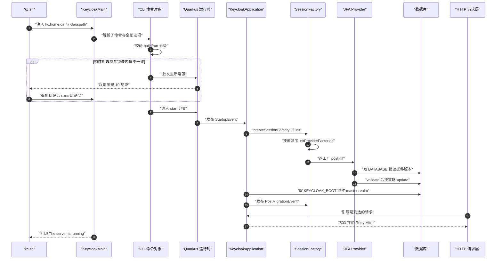
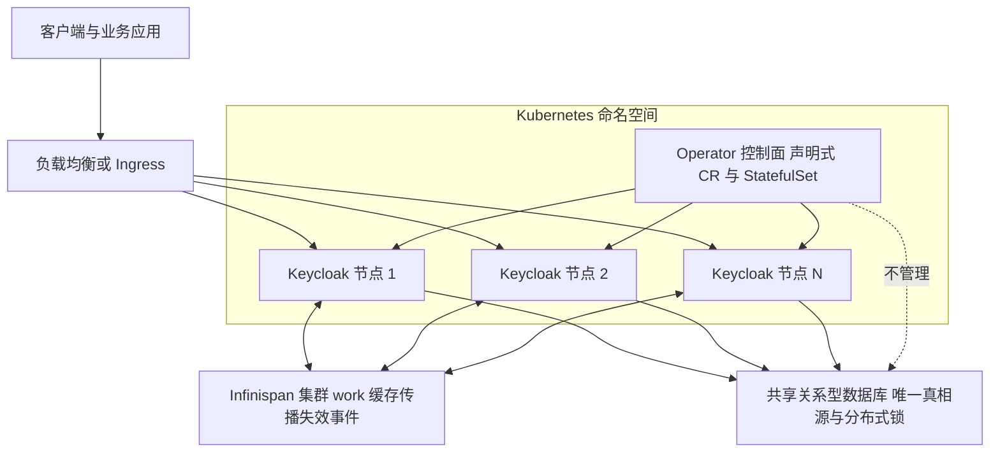
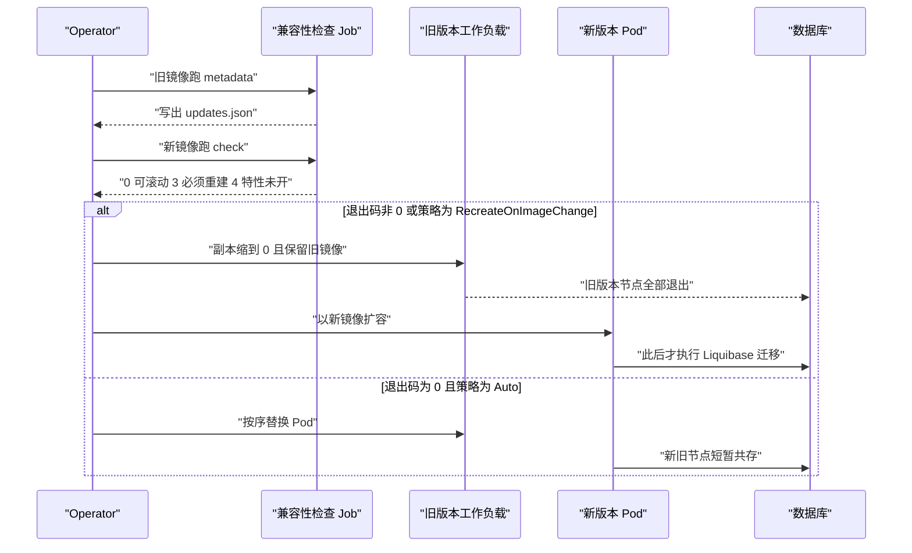

# Keycloak 部署与运行时：构建期分界、配置优先级与高可用拓扑

> 解读基线：Keycloak 26.7.3（`6d238b6558`）。下文所有源码引用均相对仓库根，并附程序化校验过的行号锚点。

> 模块角色：Keycloak 的**分发/运行时层**。前几篇讲的是能力内核——Provider 怎么被装配、realm 怎么容纳外部身份、会话与协议怎么运转；但「这些 Provider、这些 realm、这些会话，最终跑在什么进程里、由谁启动、用什么配置启动、坏了怎么退、扩了怎么一致」一直没有交代。本篇把那些能力交付成制品（`quarkus/dist`）、交付给运维（`kc.sh` + `keycloak.conf`）、交付到 K8s（Operator），并回答「中心身份服务是单点」这件事在源码层面被怎么处理。

## 根因：一个身份中心的单点属性，先于它的任何功能

身份中心要同时满足的约束，落到交付形态上比落到功能上更尖锐：

- **约束 A**：身份服务是所有应用的登录入口，它的停机半径 = 全公司所有应用的登录。
- **约束 B**：它必须能在客户机房里、客户的 K8s 里、客户的容器平台里以完全不同的方式被安装。
- **约束 C**：它必须能在不要求客户改配置的前提下升级（schema 要变、Provider 要换、配置键会废弃）。
- **约束 D**：它必须让「改一个 realm 的登录流程」不需要动服务端配置。

冲突在于：**要让启动尽可能快、内存尽可能低（约束 A 的容量侧），就得把大量工作前移到构建期；但构建期固化又直接对抗约束 B、C——客户的构建环境与运行环境不同，而升级要改的恰恰就是构建期产物**。

Keycloak 的答案不是「全部运行期解析」（WildFly 时代的路，启动慢、内存高），也不是「全部构建期固化」（运维上不可能落地），而是**沿一条明确的分界线切开配置**，再把这条分界线本身变成运维可见的概念：`kc.sh build` / `--optimized` / `start-dev`。这条分界线是本篇的主轴，也是理解其后所有部署话题（容器、HA、升级）的前提。

## 模块在整体架构中的位置

本模块属于**分发/运行时层**，是「内核 + Provider」这栋楼的地基与门面：

| 子模块 | 承担的问题 | 主要位置 |
|---|---|---|
| 构建期增强（augmentation） | 把 Provider 拓扑、JPA 实体名单、REST 资源、健康检查 Bean 在**构建时**固化进一个不可变镜像 | `quarkus/deployment/` |
| 运行时引导（bootstrap） | 解析配置 → 装配 Provider → 校验/迁移 DB schema → 建 master realm → 开 HTTP | `quarkus/runtime/`、`services/.../KeycloakApplication` |
| CLI 与配置 | 把「数百个配置键」收敛为可校验、可分级（build/run）、可兼容旧拼写的单一入口 | `quarkus/runtime/.../cli/`、`configuration/`、`quarkus/config-api/` |
| 集群与 HA | 让 N 个节点的会话/缓存彼此可见，并在节点或 DB 掉线时可控退化 | `model/infinispan/`、`docs/guides/high-availability/` |
| 控制面 | 把「声明式管理 Keycloak 实例」交给 K8s | `operator/` |

只读源码即可确认的一件事：**Keycloak 的「配置」有两种截然不同的生命周期**——一种在 `kc.sh build` 时被写进镜像、永不回头；另一种在每次 `kc.sh start` 时重新解析。这条分界线贯穿下文所有部署话题。

## 分发与启动：CLI 才是运行时入口

### 命令树只有九个顶层子命令

顶层子命令在 `Main` 的注解里一次列清：`build`、`start`、`start-dev`、`export`、`import`、`show-config`、`tools`、`bootstrap-admin`、`update-compatibility`。

[quarkus/runtime/src/main/java/org/keycloak/quarkus/runtime/cli/command/Main.java:62-71]()
<!-- anchor: subcommands = { … UpdateCompatibility.class --> —— 九个顶层子命令，没有第十个

`start` 与 `start-dev` 的区别不是「参数不同」而是**启动模式**：`start` 承诺基于既有构建产物快速启动，并默认先跑一次 `build`；`start-dev` 走开发模式（只可能是 dev profile）。

[quarkus/runtime/src/main/java/org/keycloak/quarkus/runtime/cli/command/Start.java:29-39]()
<!-- anchor: @Command(name = Start.NAME, … public static final String NAME = "start"; -->
[quarkus/runtime/src/main/java/org/keycloak/quarkus/runtime/cli/command/StartDev.java:25-34]()
<!-- anchor: @Command(name = StartDev.NAME, … public static final String NAME = "start-dev"; -->

**为什么 CLI 是运行时入口而不是一层薄包装**：`kc.sh` 只负责推导 `kc.home.dir` / `jboss.server.config.dir`、拼 classpath、注入 JVM 选项，随后把**除 `-D*` 之外的全部参数原样**交给 Quarkus 的入口类。

[quarkus/dist/src/main/content/bin/kc.sh:37-42]()
<!-- anchor: SERVER_OPTS="-Dkc.home.dir='$(abs_path '..')'" … CLASSPATH_OPTS="'$(abs_path "../lib/quarkus-run.jar")'" -->

脚本里**没有** `--optimized` 与 `build` 的任何分支——参数循环只有 `--debug` / `--` / `-D*` / 其它四种情况，它们只是透传给 picocli。

[quarkus/dist/src/main/content/bin/kc.sh:52-70]()
<!-- anchor: while [ "$#" -gt 0 ] … *) CONFIG_ARGS="$CONFIG_ARGS ${OPT}" -->

**权衡**：把 CLI 语义放在 Java 侧，换来的是「配置校验、废弃告警、build/run 分级、help 生成」全部能复用同一份 `Option` 声明；代价是启动一个 JVM 才能知道参数合不合法，且 `kc.sh` 从「启动器」变成了「隐式增强协议的协作者」。

### 退出码 10：一次可观测的自举协议

「构建期增强」被做成了一个一等公民的 CLI 命令，而不是隐藏在打包脚本里。`build` 命令的自述就是：基于传入的配置选项生成一个新的、优化的服务器镜像，配置被持久化并在启动时读回。

[quarkus/runtime/src/main/java/org/keycloak/quarkus/runtime/cli/command/Build.java:35-54]()
<!-- anchor-base64:QENvbW1hbmQobmFtZSA9IEJ1aWxkLk5BTUUsIOKApiArICIgICAgICAkICR7UEFSRU5ULUNPTU1BTkQtRlVMTC1OQU1FOi0kUEFSRU5UQ09NTUFORH0gJHtDT01NQU5ELU5BTUV9IC0taHR0cC1yZQ== -->

它的执行体做了三件在 WildFly 时代不存在的事：先临时**关闭已持久化配置源**再校验配置、把 Quarkus 的 removed-artifacts 属性写成默认忽略列表、然后才真正触发重新增强。

[quarkus/runtime/src/main/java/org/keycloak/quarkus/runtime/cli/command/Build.java:67-78]()
<!-- anchor: @Override … picocli.println("Updating the configuration and installing your custom providers -->

**换来了什么**：启动路径上的类查找、Jandex 索引、实体扫描、Provider 拓扑解析被移出关键路径。构建期就会加载内置 Provider 工厂，源码给的理由是「不必在运行期再查找它们」以及「可以基于默认 Provider 做更动态的配置」；而用户自定义 Provider 仍然留到启动时加载。

[quarkus/deployment/src/main/java/org/keycloak/quarkus/deployment/KeycloakProcessor.java:659-670]()
<!-- anchor: * 
Load the built-in provider factories during build time so we don't spend ti … @Produce(KeycloakSessionFactoryPreInitBuildItem.class) -->

这套机制对运维是**半自动**的：隐式重新增强会让进程以退出码 `10` 结束，脚本据此追加 `-Dkc.config.built=true` 后 `exec` 重启。

[quarkus/dist/src/main/content/bin/kc.sh:169-179]()
<!-- anchor: # obtain the pid, and await the exit status … exit $status -->

退出码不是随手写的魔法数，而是硬编码进契约的常量：`FEATURE_DISABLED_EXIT_CODE = 4` 与 `REBUILT_EXIT_CODE = 10`。

[quarkus/runtime/src/main/java/org/keycloak/quarkus/runtime/cli/command/AbstractAutoBuildCommand.java:38-39]()
<!-- anchor: public static final int FEATURE_DISABLED_EXIT_CODE = 4; … public static final int REBUILT_EXIT_CODE = 10; -->

`callCommand` 先做 rebuild check，必要时重新增强并返回 `REBUILT_EXIT_CODE`；真正决定「要不要重新增强」的判据是：持久化的构建期选项集合为空（视为从未 build），或它与当前解析出的集合逐项不相等。

[quarkus/runtime/src/main/java/org/keycloak/quarkus/runtime/cli/command/AbstractAutoBuildCommand.java:47-63]()
<!-- anchor: @Override … return Optional.empty(); -->
[quarkus/runtime/src/main/java/org/keycloak/quarkus/runtime/cli/command/AbstractAutoBuildCommand.java:66-76]()
<!-- anchor: static boolean requiresReAugmentation() { … return !rawPersistedProperties.equals(current); -->

**放弃了什么**：WildFly 时代的运行时部署灵活性——「丢一个 realm json 或一个 module jar 进去重启即可」变成了「必须先 build」。代价还有一个更隐蔽的形态：Provider jar 的时间戳被纳入构建期状态，容器里时间戳被截断到秒只告警，非容器环境则直接报错。

[quarkus/runtime/src/main/java/org/keycloak/quarkus/runtime/cli/Picocli.java:350-363]()
<!-- anchor: if (key.startsWith(KC_PROVIDER_FILE_PREFIX)) { … throw new PropertyException(PROVIDER_TIMESTAMP_ERROR); -->

其余真正改动已固化值的构建期选项，一律抛 `PropertyException`，明确告知「新值在重新 build 之前不会被使用」。

[quarkus/runtime/src/main/java/org/keycloak/quarkus/runtime/cli/Picocli.java:365-375]()
<!-- anchor: } else if (newValue != null && !isIgnoredPersistedOption(key) … String.join(", ", ignoredBuildTime))); -->

### 分发制品：哪些目录免构建

源码树里 `quarkus/dist/src/main/content/` 只有 `bin/`、`conf/`、`providers/`、`themes/` 四个目录；`lib/`（Quarkus mutable-jar）、`conf/truststores/`、`data/` 由打包描述在打包期注入。

[quarkus/dist/assembly.xml:69-97]()
<!-- anchor: <fileSet> … </fileSet> -->

`providers/` 是唯一「放进去必须 build」的目录，README 只有一句「把自定义 Provider JAR 放进来，然后运行 `kc.sh build`」。

[quarkus/dist/src/main/content/providers/README.md:4-9]()
<!-- anchor: Add your custom provider JAR files in this directory. … ${kc.home.dir}/bin/kc.sh build -->

`themes/` 则明确分成两半：目录式主题免 build，JAR 主题必须放 `providers/` 并 build。

[quarkus/dist/src/main/content/themes/README.md:6-10]()
<!-- anchor: Custom themes packaged in a JAR file should be deployed to the `${kc.home.dir}/p … the `build` command to be installed. -->

`conf/` 目录额外指出 `conf/truststores/` 的存在，用于提供额外的受信证书。

[quarkus/dist/src/main/content/conf/README.md:4-6]()
<!-- anchor: Files in this directory are used to configure the server. Please consult the [co … Use the truststores subdirectory to provide additional trusted certificates.  Pl -->

`providers/` 能被 Quarkus 认出来，靠的是一条构建属性：产物为 `mutable-jar`、输出到 `lib`、并把用户 Provider 目录指到 `../providers`。

[quarkus/server/src/main/resources/application.properties:3-6]()
<!-- anchor: quarkus.package.output-name=keycloak … quarkus.package.jar.user-providers-directory=../providers -->

**为什么「可变 JAR + 外部 providers 目录」而不是重新打包**：这使客户能在不重编译 Keycloak 的前提下塞入自定义 Provider；代价是把「哪些 JAR 参与了构建」变成镜像的一部分状态——build 时记下每个 JAR 的 `last-modified`，`--optimized` 启动时逐一比对。

### 容器镜像：非 root、ubi9-micro、不做 build

运行段基于 `ubi9-micro`，设置 `KC_RUN_IN_CONTAINER=true`，拷贝 rootfs 与 `/opt/keycloak`（`--chown=1000:0`），并以 `USER 1000` 运行。

[quarkus/container/Dockerfile:22-34]()
<!-- anchor: FROM registry.access.redhat.com/ubi9-micro … USER 1000 -->

它暴露 8080/8443/9000，入口固定为 `kc.sh`。

[quarkus/container/Dockerfile:36-40]()
<!-- anchor: EXPOSE 8080 … ENTRYPOINT [ "/opt/keycloak/bin/kc.sh" ] -->

**上游镜像不是 optimized 镜像**：该 Dockerfile 里没有 `RUN kc.sh build`。官方文档要求用户派生镜像时自己跑 build，并明确量化了不这么做的代价——启动时间显著增加，且得到一个可变镜像。

[docs/guides/server/containers.adoc:257-279]()
<!-- anchor: == Running a standard {project_name} container … This approach significantly increases startup time and creates an image that is  -->

这条决定值得玩味：Keycloak 完全可以像很多产品那样发布一个已经 build 好的镜像，但它把 build 显式留给用户——因为**构建期选项是部署方的选择**（数据库、feature、健康端点），出厂时无法预知。代价是每个客户的镜像构建流程里都必须有一步 `kc.sh build`，且必须发生在放入自定义 Provider 之后。

内存策略在容器内外二分：容器内用 `MaxRAMPercentage=70 / MinRAMPercentage=70 / InitialRAMPercentage=50`，非容器用固定 `-Xms64m -Xmx512m`，且 `JAVA_OPTS_KC_HEAP` 可整体覆盖并在覆盖时打印提示。

[quarkus/dist/src/main/content/bin/kc.sh:96-108]()
<!-- anchor: if [ -z "$JAVA_OPTS_KC_HEAP" ]; then … JAVA_OPTS="$JAVA_OPTS $JAVA_OPTS_KC_HEAP" -->

**风险**：`MaxRAMPercentage` 只在容器有内存 limit 时才等于「安全」；未设 limit 时 JVM 看到的是宿主机内存，70% 会直接吃光宿主机。这是把「内存策略」从配置项变成部署平台契约的典型案例。

## 双层配置：build 固化什么

### 分界线是一个布尔字段

分界线在代码里是一个布尔字段，而非散落的约定：`Option` 携带 `buildTime` 标志，并由 `PropertyMapper.isBuildTime()` 直接转发。

[quarkus/config-api/src/main/java/org/keycloak/config/Option.java:51-54]()
<!-- anchor: public boolean isHidden() { return hidden; } … return buildTime; -->

沿这条标志统计 `quarkus/config-api/src/main/java/org/keycloak/config/` 下的声明式选项：显式标记 `.buildTime(true)` 的只有 **30** 处，集中在八类。

| 类别 | 代表键 | 声明位置 |
|---|---|---|
| 数据库 | `db`、`db-dialect`、`db-driver`、`db-kind-<datasource>`、`db-mtls-key-store-type`、`db-health-exclude-<datasource>` | `DatabaseOptions` |
| 特性开关 | `features`、`features-disabled`、`feature-<name>` | `FeatureOptions` |
| HTTP 静态形状 | `http-relative-path`、`https-client-auth` | `HttpOptions` |
| 管理接口 | `http-management-enabled`、`http-management-relative-path`、`legacy-observability-interface`、`https-management-client-auth` 等 | `ManagementOptions` |
| 可观测 | `health-enabled`、`metrics-enabled` | `HealthOptions`、`MetricsOptions` |
| 可观测扩展 | `tracing-enabled`、`tracing-jdbc-enabled`、`tracing-sampler-type`、`telemetry-logs-enabled`、`telemetry-metrics-enabled`、`openapi-enabled`、`event-metrics-user-enabled` | `TracingOptions`、`TelemetryOptions`、`OpenApiOptions`、`EventOptions` |
| 加密/安全 | `fips-mode`、`vault` | `SecurityOptions`、`VaultOptions` |
| 事务与日志 | `transaction-xa-enabled(-<datasource>)`、`log-mdc-enabled` | `TransactionOptions`、`LoggingOptions` |

[quarkus/config-api/src/main/java/org/keycloak/config/DatabaseOptions.java:32-39]()
<!-- anchor: public static final Option<String> DB = new OptionBuilder<>("db", String.class) … .build(); --> —— `db` 的构建期声明
[quarkus/config-api/src/main/java/org/keycloak/config/FeatureOptions.java:13-19]()
<!-- anchor: public static final Option<List<String>> FEATURES = OptionBuilder.listOptionBuil … .build(); -->
[quarkus/config-api/src/main/java/org/keycloak/config/HttpOptions.java:24-29]()
<!-- anchor: public static final Option<String> HTTP_RELATIVE_PATH = new OptionBuilder<>("htt … .build(); -->
[quarkus/config-api/src/main/java/org/keycloak/config/ManagementOptions.java:29-48]()
<!-- anchor: public static final Option<Boolean> HTTP_MANAGEMENT_ENABLED = new OptionBuilder< … .buildTime(true) -->
[quarkus/config-api/src/main/java/org/keycloak/config/HealthOptions.java:5-10]()
<!-- anchor: public static final Option<Boolean> HEALTH_ENABLED = new OptionBuilder<>("health … .build(); -->
[quarkus/config-api/src/main/java/org/keycloak/config/MetricsOptions.java:5-10]()
<!-- anchor: public static final Option<Boolean> METRICS_ENABLED = new OptionBuilder<>("metri … .build(); -->
[quarkus/config-api/src/main/java/org/keycloak/config/TracingOptions.java:27-31]()
<!-- anchor: public static final Option<Boolean> TRACING_ENABLED = new OptionBuilder<>("traci … .buildTime(true) -->
[quarkus/config-api/src/main/java/org/keycloak/config/TelemetryOptions.java:37-41]()
<!-- anchor: public static final Option<Boolean> TELEMETRY_LOGS_ENABLED = new OptionBuilder<> … .buildTime(true) -->
[quarkus/config-api/src/main/java/org/keycloak/config/OpenApiOptions.java:5-8]()
<!-- anchor: public static final Option<Boolean> OPENAPI_ENABLED = new OptionBuilder<>("opena … .buildTime(true) -->
[quarkus/config-api/src/main/java/org/keycloak/config/EventOptions.java:7-10]()
<!-- anchor: public static final Option<Boolean> USER_EVENT_METRICS_ENABLED = new OptionBuild … .buildTime(true) -->
[quarkus/config-api/src/main/java/org/keycloak/config/SecurityOptions.java:11-15]()
<!-- anchor: public static final Option<FipsMode> FIPS_MODE = new OptionBuilder<>("fips-mode" … .description("Sets the FIPS mode. If '" + FipsMode.NON_STRICT + "' is set, FIPS  -->
[quarkus/config-api/src/main/java/org/keycloak/config/VaultOptions.java:23-27]()
<!-- anchor: public static final Option<VaultOptions.VaultType> VAULT = new OptionBuilder<>(" … .build(); -->
[quarkus/config-api/src/main/java/org/keycloak/config/TransactionOptions.java:9-22]()
<!-- anchor: public static final Option<Boolean> TRANSACTION_XA_ENABLED_DATASOURCE = new Opti … .build(); -->
[quarkus/config-api/src/main/java/org/keycloak/config/LoggingOptions.java:365-368]()
<!-- anchor: public static final Option<Boolean> LOG_MDC_ENABLED = new OptionBuilder<>("log-m … .buildTime(true) -->

`db` 是这条分界线最典型的样本——它决定了 Hibernate 方言、JDBC 驱动、Liquibase 变更集三件在构建期就定死的东西。反过来，**缓存配置全是运行期**：`cache`、`cache-stack`、`cache-embedded-*`、`cache-remote-*` 均未标 `buildTime(true)`。

[quarkus/config-api/src/main/java/org/keycloak/config/CachingOptions.java:46-51]()
<!-- anchor: public static final Option<Mechanism> CACHE = new OptionBuilder<>("cache", Mecha … .build(); -->
[quarkus/config-api/src/main/java/org/keycloak/config/CachingOptions.java:69-75]()
<!-- anchor: public static final Option<Stack> CACHE_STACK = new OptionBuilder<>("cache-stack … .build(); -->

`cache` 的默认值甚至是由运行期 transformer 决定的：非 server 模式强制 `local`，否则 `ispn`。

[quarkus/runtime/src/main/java/org/keycloak/quarkus/runtime/configuration/mappers/CachingPropertyMappers.java:39-45]()
<!-- anchor: fromOption(CachingOptions.CACHE) … .build(), -->

**为什么 Quarkus 的构建期优化迫使配置分成两层**：Quarkus 构建期会做「持久化单元发现」「实体字节码增强」「反射注册」「配置默认值烘焙」。这些工作一旦完成，运行期就无法再改主意——如果 `db` 可在运行期改，Keycloak 就得把**所有**数据库厂商的方言、驱动、变更集都打进镜像并保持反射注册，镜像体积与内存启动成本立刻回到 WildFly 水平。因此 `db`、`health-enabled`、`http-relative-path` 这类「会改变已增强产物形状」的选项必须构建期固化；而 `cache`、`db-url`、`db-username`、`http-port` 只影响运行期行为，留作运行期可改。

这条分界线的运维后果是显式失败而非静默生效：把 `--db=postgres` 写进 `keycloak.conf` 却忘了重新 build，启动时会撞上 `validateBuildtime()` 的报错；反之用 `--optimized` 却从未 build 过，会在 `validateConfig()` 里被立刻拦下——判据是持久化选项集是否为空。

[quarkus/runtime/src/main/java/org/keycloak/quarkus/runtime/cli/Picocli.java:231-234]()
<!-- anchor: public void validateConfig() { … throw new PropertyException(Messages.optimizedUsedForFirstStartup()); -->

### 配置来源与优先级链

官方文档把配置来源收敛成四个（命令行、环境变量、配置文件、Java KeyStore），并明确「靠前者胜」。

[docs/guides/server/configuration.adoc:12-19]()
<!-- anchor: {project_name} loads the configuration from four sources, which are listed here  … When an option is set in more than one source, the one that comes first in the l -->

代码里的注册顺序在 `KeycloakConfigSourceProvider.initializeSources()`：CLI → ENV → `quarkus.properties` → Persisted → `keycloak.conf`。

[quarkus/runtime/src/main/java/org/keycloak/quarkus/runtime/configuration/KeycloakConfigSourceProvider.java:43-61]()
<!-- anchor: private static void initializeSources() { … addConfigSources(path.getFileName().toString(), inFileSystem.getConfigSources(Th -->

但**真正决定胜负的是 SmallRye 的 ordinal**，而 ordinal 并不完全是文档列出的那个顺序：

| 配置源 | 类 | ordinal | 证据 |
|---|---|---|---|
| CLI `--key=value` | `ConfigArgsConfigSource` | **600** | 构造器直接传入 600 |
| 环境变量 `KC_*` / `KCRAW_*` | `KcEnvConfigSource` | **500** | 构造器直接传入 500 |
| JVM system property | SmallRye 内置 `SysPropConfigSource` | 框架默认（本仓库未覆写） | `ShowConfig` 会专门识别该来源名 |
| `conf/keycloak.conf` / `--config-file` | `KeycloakPropertiesConfigSource` | `EnvConfigSource.ORDINAL - 1` = **299** | 常量声明 |
| Keycloak 默认值 | `PropertyMapper` 合成的 `ConfigValue` | **251** | `DEFAULT_VALUE_ORDINAL` |
| 构建期持久化 | `PersistedConfigSource` | **200** | 构造器直接传入 200 |

[quarkus/runtime/src/main/java/org/keycloak/quarkus/runtime/configuration/ConfigArgsConfigSource.java:56-57]()
<!-- anchor: protected ConfigArgsConfigSource() { … super(parseArguments(), NAME, 600); -->
[quarkus/runtime/src/main/java/org/keycloak/quarkus/runtime/configuration/KcEnvConfigSource.java:48-49]()
<!-- anchor: public KcEnvConfigSource(Map<String, String> env) { … super(buildProperties(env), NAME, 500); -->
[quarkus/runtime/src/main/java/org/keycloak/quarkus/runtime/configuration/KeycloakPropertiesConfigSource.java:47-47]()
<!-- anchor: public static final int PROPERTIES_FILE_ORDINAL = EnvConfigSource.ORDINAL - 1; -->
[quarkus/runtime/src/main/java/org/keycloak/quarkus/runtime/configuration/mappers/PropertyMapper.java:63-63]()
<!-- anchor: public static final int DEFAULT_VALUE_ORDINAL = 251; // keycloak defaults are lo --> —— 源码注释直说「Keycloak 默认值在逻辑上高于 classpath 条目」
[quarkus/runtime/src/main/java/org/keycloak/quarkus/runtime/configuration/PersistedConfigSource.java:63-64]()
<!-- anchor: private PersistedConfigSource() { … super(readProperties(), NAME, 200); -->
[quarkus/runtime/src/main/java/org/keycloak/quarkus/runtime/cli/command/ShowConfig.java:84-84]()
<!-- anchor: if (mapper == null && configValue.getSourceName().equals("SysPropConfigSource")  --> —— 解析链里确实存在 `SysPropConfigSource` 这一来源

还有两条与文档不一致的地方必须点明：

1. 文档说四个来源，实际参与解析的至少有六个：CLI、`KC_*` 环境变量、JVM system property、`keycloak.conf`、`quarkus.properties`（与 `keycloak.conf` 同为 ordinal 299），以及持久化的构建期选项；另有 Java KeyStore 配置源通过 SmallRye 的 `smallrye.config.source.keystore.kc-default.*` 注入。
[quarkus/runtime/src/main/java/org/keycloak/quarkus/runtime/configuration/mappers/ConfigKeystorePropertyMappers.java:15-34]()
<!-- anchor: private static final String SMALLRYE_KEYSTORE_PATH = "smallrye.config.source.key … .to("smallrye.config.source.keystore.kc-default.type") -->
[quarkus/runtime/src/main/java/org/keycloak/quarkus/runtime/configuration/QuarkusPropertiesConfigSource.java:64-64]()
<!-- anchor: KeycloakPropertiesConfigSource.PROPERTIES_FILE_ORDINAL, classLoader))); --> —— `quarkus.properties` 复用 `PROPERTIES_FILE_ORDINAL`，与 `keycloak.conf` 同档
2. `PersistedConfigSource` 的 ordinal（200）**低于** `keycloak.conf`（299）与 Keycloak 默认值（251）。一种解释是：持久化的构建期值在增强期就被写进生成的资源，运行期读到的往往是那份烘焙结果——重新增强时，`Picocli.getNonPersistedBuildTimeOptions()` 的输出会被写成 `META-INF/keycloak-persisted.properties`。
[quarkus/deployment/src/main/java/org/keycloak/quarkus/deployment/KeycloakProcessor.java:764-775]()
<!-- anchor: * 
Make the build time configuration available at runtime so that the server c … throw new RuntimeException("Failed to persist configuration", cause); -->
[quarkus/runtime/src/main/java/org/keycloak/quarkus/runtime/cli/Picocli.java:536-551]()
<!-- anchor: public static Properties getNonPersistedBuildTimeOptions() { … // TODO: this is not correct - we are including runtime properties here, but at  -->

而 `PersistedConfigSource` 本身主要服务于「变更检测」与「显式关闭后读取未持久化值」这两个用途：`getNonPersistedConfigValue` 会临时屏蔽 Persisted 源，读取用户此刻真正配置的值，`Picocli.validateBuildtime()` 与 `AbstractAutoBuildCommand.requiresReAugmentation()` 都依赖它来判断「配置是否相对镜像变了」。

[quarkus/runtime/src/main/java/org/keycloak/quarkus/runtime/configuration/Configuration.java:234-235]()
<!-- anchor: public static ConfigValue getNonPersistedConfigValue(String name) { … return PersistedConfigSource.getInstance().runWithDisabled(() -> getConfigValue( -->

**为什么没有旧版配置兼容层**：可以假设存在 `keycloak-server.json` / `standalone.xml` 兼容层，但源码事实相反——全仓库对这两个文件的引用只剩历史升级文档，例如升级说明里仍要求运维手动更新 `standalone/configuration/keycloak-server.json`。

[docs/documentation/upgrading/topics/changes/changes.adoc:1334-1334]()
<!-- anchor: * standalone/configuration/keycloak-server.json -->

`compatibility/` 目录下**只有一个类**，它解决的不是旧格式兼容，而是**滚动升级兼容**：把 `db`、`db-schema`、`db-url-*` 与「不支持的变更集哈希」一起导出为元数据，供 `kc.sh update-compatibility` 判断「新版本能否与旧版本并存」。

[quarkus/runtime/src/main/java/org/keycloak/quarkus/runtime/configuration/compatibility/DatabaseCompatibilityMetadataProvider.java:39-52]()
<!-- anchor: public Map<String, String> metadata() { … return metadata; -->

也就是说，**Keycloak 在 26.x 没有为 WildFly 时代的 XML/JSON 配置提供读取兼容层**——迁移成本被推给运维（升级文档的变更说明），代码只保留了「选项键重命名」层面的兼容与告警机制：用了第二类选项名会被逐条打印成警告。

[quarkus/runtime/src/main/java/org/keycloak/quarkus/runtime/cli/Picocli.java:333-337]()
<!-- anchor: secondClassOptions.forEach((key, firstClass) -> { … warn("Please use the first-class option `%s` instead of `%s`".formatted(firstCla -->

### PropertyMapper：一个选项活在三套命名空间

`PropertyMapper.getConfigValue` 的类注释把整条解析链写成四步：先找 `from`（显式），再找 `mapFrom`（派生），再取默认值（兜底）；若找不到且请求的是 `to`，则用用户设置的 `to`；最后统一走表达式展开与 ordinal 归位。

[quarkus/runtime/src/main/java/org/keycloak/quarkus/runtime/configuration/mappers/PropertyMapper.java:113-142]()
<!-- anchor: * This is the heart of the property mapping logic. In the first step, we need to … * If no value is found or mapped, return the `to` value. -->

这个类存在的理由是**同一个逻辑选项要同时活在三套命名空间里**：面向用户的 `kc.db-url`（也写作 CLI `--db-url`、env `KC_DB_URL`）、面向 Quarkus 的 `quarkus.datasource.jdbc.url`、面向 SPI 的 `kc.spi-<spi>--<provider>--<key>`。

[quarkus/runtime/src/main/java/org/keycloak/quarkus/runtime/configuration/mappers/DatabasePropertyMappers.java:85-87]()
<!-- anchor: fromOption(DatabaseOptions.DB_URL) … .mapFrom(DB, DatabasePropertyMappers::getDatabaseUrl) -->
[docs/guides/server/configuration.adoc:29-33]()
<!-- anchor: |Command line parameters … |`KC_DB_URL=envVarValue` --> —— 文档把同一个选项的 CLI 写法与 `KC_DB_URL` 环境变量写法并列给出

`MicroProfileConfigProvider` 负责 SPI 侧：scope 名按 `--` 拼接成前缀，camelCase 经 `toDashCase` 转 kebab；读取时「新式名」与「单横线旧式名」都会查一遍，并取 ordinal 更高者。

[quarkus/runtime/src/main/java/org/keycloak/quarkus/runtime/configuration/MicroProfileConfigProvider.java:74-80]()
<!-- anchor: public MicroProfileScope(String prefix, String... scopes) { … this.prefix = separatorPrefix.replace(OPTION_PART_SEPARATOR + OPTION_PART_SEPARA -->
[quarkus/runtime/src/main/java/org/keycloak/quarkus/runtime/configuration/MicroProfileConfigProvider.java:101-114]()
<!-- anchor: protected <T> T getValue(String key, Function<String, T> conversion, Class<T> cl … return Optional.ofNullable(config.convert(value.getValue(), clazz)).orElse(defau -->

一个容易误读的细节：`--cache-stack` 映射到的 SPI 属性名是 `kc.spi-cache--embedded--default-stack`，`--` 的位置与其它缓存键不同。

[quarkus/runtime/src/main/java/org/keycloak/quarkus/runtime/configuration/mappers/CachingPropertyMappers.java:46-50]()
<!-- anchor: fromOption(CachingOptions.CACHE_STACK) … .build(), -->

`cacheEmbedded` SPI 的 scope 解析出的新式名字却是 `kc.spi-cache-embedded--default--stack`。二者对不上，但**功能并未失效**——`PropertyMappers.handleMapper` 会为每个 `kc.spi-*` 目标额外注册一个「双横线换成单横线」的别名。

[quarkus/runtime/src/main/java/org/keycloak/quarkus/runtime/configuration/mappers/PropertyMappers.java:385-395]()
<!-- anchor: private static void handleMapper(PropertyMapper<?> mapper, BiConsumer<String, Pr … operation.accept(legacyTo, mapper); -->

于是 `cache-stack` 恰好命中旧式别名。集成测试从外部证实了这条链真的生效：`--cache-stack=jdbc-ping-udp` 会让启动日志出现对应的 JGroups 栈名。

[quarkus/tests/integration/src/test/java/org/keycloak/it/cli/dist/ClusterConfigDistTest.java:115-118]()
<!-- anchor-base64:QExhdW5jaCh7ICJzdGFydCIsICItLWNhY2hlLXN0YWNrPWpkYmMtcGluZy11ZHAifSkg4oCmIHJlc3VsdC5hc3NlcnRNZXNzYWdlKCJJU1BOMDAwMDc4OiBTdGFydGluZyBKR3JvdXBzIGNoYW5uZWwgYElTUE5gIHdpdGggc3RhY2sgYGpk -->

这套间接层换来的是 `--help-all`、`show-config`、废弃告警、build/run 分级校验全部能从同一份声明生成；代价是每次 `getConfigValue` 都要过一次 interceptor 链，`PropertyMappers` 的 wildcard 查找还带着「未来要换成前缀树」的 TODO。

[quarkus/runtime/src/main/java/org/keycloak/quarkus/runtime/configuration/mappers/PropertyMappers.java:299-301]()
<!-- anchor: // TODO: we may want to introduce a prefix tree here as we add more wildcardMapp … // keycloak key -->

还有两条硬约束值得记录：运行期选项**不允许**映射到 SPI 的构建期属性，否则构造 mapper 时直接断言失败。

[quarkus/runtime/src/main/java/org/keycloak/quarkus/runtime/configuration/mappers/PropertyMapper.java:602-603]()
<!-- anchor: if (!option.isBuildTime() && to != null && PropertyMappers.isSpiBuildTimePropert … throw new AssertionError("A runtime option should not map to a build time spi op -->

而 `OptionBuilder` 的默认值是 `build = false`，即**新增配置项默认是运行期可改的**——「构建期固化」必须由开发者显式声明。

[quarkus/config-api/src/main/java/org/keycloak/config/OptionBuilder.java:55-58]()
<!-- anchor: category = OptionCategory.GENERAL; … description = null; -->

**代价**：SPI 键同时存在多种拼写（`--` 新式、`-` 旧式、以及 `cache-stack` 这种历史错位），运维很难判断自己写的那一种是否真的生效。这是「配置项爆炸 + 历史命名」叠加出的认知负担，本节把它作为**问题项**记录。

## 引导链路：从 kc.sh 到 ready

### 启动全链路

链路里每一步都有独立证据：

`KeycloakMain.run()` 负责等待退出并打印就绪语句，且会在引导未完成时挂上 `getBootstrapFuture()` 的回调，确保「The server is running」只在该出现的时候出现。

[quarkus/runtime/src/main/java/org/keycloak/quarkus/runtime/KeycloakMain.java:167-191]()
<!-- anchor: @Override … return ApplicationLifecycleManager.getExitCode(); -->

引导主体在 `KeycloakApplication.startup()`，它把「临时目录初始化 → 记录未支持特性 → 加密集成初始化 → 建 SessionFactory → runBootstrap」串起来。

[services/src/main/java/org/keycloak/services/resources/KeycloakApplication.java:76-82]()
<!-- anchor: protected synchronized void startup() { … runBootstrap(KeycloakApplication.sessionFactory); -->

`runBootstrap()` 先 `sessionFactory.init()`；随后在 `kc.launch.mode=exit_before_bootstrap` 时以退出码 0 提前返回（工具类子命令与服务器共用同一份引导代码，靠这个开关分流）；否则取 `KEYCLOAK_BOOT` 锁执行 `bootstrap(session)`，最后发布 `PostMigrationEvent` 并置 bootstrapCompleted。

[services/src/main/java/org/keycloak/services/resources/KeycloakApplication.java:85-115]()
<!-- anchor: private void runBootstrap(DefaultKeycloakSessionFactory keycloakSessionFactory)  … keycloakSessionFactory.setBootstrapCompleted(); -->

### 数据库与 schema 演进：DB 锁 + 单向 Liquibase

schema 迁移发生在 **Provider 装配阶段**，不在 CLI 里：`postInit` 先读 `MIGRATION_MODEL` 表拿到当前版本，再调 `createOrUpdateSchema(...)`。

[quarkus/runtime/src/main/java/org/keycloak/quarkus/runtime/storage/database/jpa/QuarkusJpaConnectionProviderFactory.java:123-138]()
<!-- anchor: try (Connection connection = getConnection(); KeycloakSession session = factory. … schemaChanged = createOrUpdateSchema(schema, version, connection, session); -->

迁移被一把**数据库级全局锁**保护，命名空间枚举里 `DATABASE` 与 `KEYCLOAK_BOOT` 并存。

[model/storage-private/src/main/java/org/keycloak/models/dblock/DBLockProvider.java:43-46]()
<!-- anchor: enum Namespace { … KEYCLOAK_BOOT(1000) -->

`migrateModel()` 与真正的 `update()` 都先取 `DATABASE` 锁，再执行 Liquibase。

[quarkus/runtime/src/main/java/org/keycloak/quarkus/runtime/storage/database/jpa/QuarkusJpaConnectionProviderFactory.java:229-237]()
<!-- anchor: private void migrateModel(KeycloakSession session) { … dbLock.releaseLock(); -->
[quarkus/runtime/src/main/java/org/keycloak/quarkus/runtime/storage/database/jpa/QuarkusJpaConnectionProviderFactory.java:310-317]()
<!-- anchor: private void update(Connection connection, String schema, KeycloakSession sessio … dbLock2.releaseLock(); -->

策略来自 provider 配置 `migrationStrategy`，取值 `update` / `manual` / `validate`，默认 `update`。

[quarkus/runtime/src/main/java/org/keycloak/quarkus/runtime/storage/database/jpa/QuarkusJpaConnectionProviderFactory.java:210-220]()
<!-- anchor: private MigrationStrategy getMigrationStrategy() { … return MigrationStrategy.UPDATE; -->

其中 `manual` 会把所需变更导出成 SQL 文件后抛错而不执行，`validate` 则直接在落后时抛 `ServerStartupError`。

[quarkus/runtime/src/main/java/org/keycloak/quarkus/runtime/storage/database/jpa/QuarkusJpaConnectionProviderFactory.java:283-303]()
<!-- anchor: switch (strategy) { … throw new ServerStartupError("Database not up-to-date, please enable database mi -->

`JpaUpdaterProvider` 只跑 Keycloak 自己的 master changelog 一次，随后为每个自定义 `JpaEntityProvider` 单独跑各自的 changelog；前者由会话属性 `VERIFY_AND_RUN_MASTER_CHANGELOG` 控制。

[quarkus/runtime/src/main/java/org/keycloak/quarkus/runtime/storage/database/liquibase/QuarkusJpaUpdaterProvider.java:103-117]()
<!-- anchor: if (needVerifyMasterChangelog()) { … updateChangeSet(liquibase, exportWriter); -->
[quarkus/runtime/src/main/java/org/keycloak/quarkus/runtime/storage/database/liquibase/QuarkusJpaUpdaterProvider.java:134-135]()
<!-- anchor: private Boolean needVerifyMasterChangelog() { … return session.getAttributeOrDefault(VERIFY_AND_RUN_MASTER_CHANGELOG, Boolean.TR -->

**为什么必须是全局锁**：N 个节点同时启动时，Liquibase 变更集是**单向且不可并发执行**的——两个节点同时 `addColumn` 会互相破坏 changelog 表。用 DB 锁把「谁来迁移」串行化，是「共享数据库 + 无主节点」架构下唯一可行的做法。代价是启动时间被最长迁移时间拖住，且锁等待超时会让后来的节点启动失败。

### 健康与就绪：三种探针外加一道 503 闸门

| 探针 | 类 | 回答的问题 |
|---|---|---|
| readiness（引导） | `BootstrapReadyHealthCheck` | 引导（含 schema 迁移、master realm 创建）是否完成 |
| readiness（DB） | `KeycloakReadyHealthCheck` | 数据库连接是否可用 |
| readiness（集群） | `KeycloakClusterReadyHealthCheck` | Infinispan 集群是否达到健康状态（仅 embedded 支持） |

`KeycloakReadyHealthCheck` 把 Quarkus 的同步 `DataSourceHealthCheck` 包成**异步**检查，并限制并发（`maxAsync = 1, maxQueued = 20`），目的是控制负载削减。

[quarkus/runtime/src/main/java/org/keycloak/quarkus/runtime/services/health/KeycloakReadyHealthCheck.java:61-70]()
<!-- anchor: @Inject … return uni.runSubscriptionOn(executor); -->

`BootstrapReadyHealthCheck` 在引导未完成时直接返回 DOWN。

[quarkus/runtime/src/main/java/org/keycloak/quarkus/runtime/services/health/BootstrapReadyHealthCheck.java:44-54]()
<!-- anchor: @Override … return Uni.createFrom().item(builder().down().build()); -->

集群探针是**延迟创建**的：producer 在请求时才判断 `isClusterHealthSupported()`，只有嵌入式 Infinispan 才有这个探针；探针本身会主动触发一次集群健康检查。

[quarkus/runtime/src/main/java/org/keycloak/quarkus/runtime/services/health/KeycloakClusterReadyHealthCheckProducer.java:42-58]()
<!-- anchor: public AsyncHealthCheck createHealthCheck() { … ready = true; -->
[model/infinispan/src/main/java/org/keycloak/connections/infinispan/DefaultInfinispanConnectionProviderFactory.java:402-409]()
<!-- anchor: public boolean isClusterHealthy() { … return clusterHealth.isSupported(); -->

**除了探针，还有一道 503 闸门**：`BootstrapFilter` 是 pre-matching 请求过滤器，引导未完成时让所有请求返回 503。

[quarkus/runtime/src/main/java/org/keycloak/quarkus/runtime/services/BootstrapFilter.java:33-42]()
<!-- anchor: @ServerRequestFilter(priority = 1, preMatching = true) … return null; -->

退避策略是「等待时长等于本次启动已耗时长，最多 60 秒」，并同时带上 `Retry-After` 与 `Refresh` 响应头。

[quarkus/runtime/src/main/java/org/keycloak/quarkus/runtime/services/BootstrapFilter.java:54-63]()
<!-- anchor: // Implement a back-off to wait as long as the current start-up took, but then r … .build(); -->

**为什么需要这道闸门而不只靠探针**：`server-async-bootstrap` 为真时，端点会在引导完成前就开放。

[quarkus/config-api/src/main/java/org/keycloak/config/ServerOptions.java:26-30]()
<!-- anchor: public static final Option<Boolean> SERVER_ASYNC_BOOTSTRAP = new OptionBuilder<> … .build(); -->

探针只对 K8s Service/Ingress 生效，直连 Pod IP 或非 K8s 负载均衡器不会看探针。503 闸门是**不依赖编排平台**的第二道保险——这是「同一个不变量在两处冗余实现」的典型取舍：多一份代码，换来「任何接入方式都不会在初始化期间拿到半成品服务」。

## 高可用拓扑：单点在哪里、冗余在哪里

这张图的重点是**两条独立的一致性通道**：会话数据走 Infinispan 的复制/失效通道，而 realm、用户、授权、离线会话最终只有数据库这一个真相源。缓存名单在源码里被显式分成两半。

[model/infinispan/src/main/java/org/keycloak/connections/infinispan/InfinispanConnectionProvider.java:87-118]()
<!-- anchor: String[] LOCAL_CACHE_NAMES = { … String[] ALL_CACHES_NAME = Stream.concat(Arrays.stream(LOCAL_CACHE_NAMES), Array -->

### 谁共享、谁复制、谁只在本地

`CLUSTERED_CACHE_NAMES` 收录 `sessions` / `clientSessions` / `offlineSessions` / `offlineClientSessions` / `loginFailures` / `authenticationSessions` / `work` 这类需要跨节点可见的缓存；`LOCAL_CACHE_NAMES` 则是 `realms` / `users` / `authorization` / `keys` / `crl`，靠失效消息保持一致。

可配置 max-count 的名单被硬编码成两个数组：本地 5 个、集群 4 个。

[model/infinispan/src/main/java/org/keycloak/connections/infinispan/InfinispanConnectionProvider.java:120-132]()
<!-- anchor: String[] LOCAL_MAX_COUNT_CACHES = new String[]{ … USER_SESSION_CACHE_NAME -->

**embedded vs remote 的开关不是配置项，而是特性开关**：只要 multi-site 特性开启，或 clusterless 特性开启，就判定为 remote。

[model/infinispan/src/main/java/org/keycloak/infinispan/util/InfinispanUtils.java:50-56]()
<!-- anchor: public static boolean isRemoteInfinispan() { … return !isRemoteInfinispan(); -->

这解释了为什么 `--cache-remote-*` 系列只在 multi-site/clusterless 下才有意义，也解释了这些特性被标为 `SHUTDOWN` 更新策略——改它们必须整站停机。

[common/src/main/java/org/keycloak/common/Profile.java:133-137]()
<!-- anchor: MULTI_SITE("Multi-site support", Type.DISABLED_BY_DEFAULT, FeatureUpdatePolicy.S … CLUSTERLESS("Store all session data, work cache and login failure data in an ext -->
[common/src/main/java/org/keycloak/common/Profile.java:625-631]()
<!-- anchor: public enum FeatureUpdatePolicy { … SHUTDOWN; -->

集群健康由 `clusterHealth` 汇报：`isClusterHealthy()` 会主动触发一次健康检查，而 `isClusterHealthSupported()` 才不会。

### 粘性会话与失效广播

失效事件由 `CacheManager.sendInvalidationEvents` 发出、由 `invalidationEventReceived` 落地。

[model/infinispan/src/main/java/org/keycloak/models/cache/infinispan/CacheManager.java:218-224]()
<!-- anchor: public void sendInvalidationEvents(KeycloakSession session, Collection<Invalidat … public void invalidationEventReceived(InvalidationEvent event) { -->

`InvalidationHandler` 的契约把「失效什么」抽象成 `InvalidableObjectType`，并明确**禁止在处理失效时回填缓存**，否则会形成事件回环。

[server-spi/src/main/java/org/keycloak/provider/InvalidationHandler.java:25-49]()
<!-- anchor: * Note that implementors are expected to react to invalidation requests: … void invalidate(KeycloakSession session, InvalidableObjectType type, Object... p -->

节点间的失效广播承载在 `work` 缓存上：事件被包成 `WrapperClusterEvent`、用随机键写入，TTL 固定 120 秒。

[model/infinispan/src/main/java/org/keycloak/cluster/infinispan/InfinispanClusterProvider.java:188-201]()
<!-- anchor: public void notify(String taskKey, Collection<? extends ClusterEvent> events, bo … .put(eventKey, wrappedEvent, 120, TimeUnit.SECONDS); -->

**粘性会话不是可选项而是性能前提**：`sessionIdRoute` 只在集群模式且 `shouldAttachRoute` 为真时才返回路由后缀，而 `ownerOf` 是通过 Infinispan 分布拓扑算出该会话的 primary owner，再翻译成节点逻辑名。

[model/infinispan/src/main/java/org/keycloak/models/sessions/infinispan/InfinispanStickySessionEncoderProviderFactory.java:135-149]()
<!-- anchor: public String sessionIdRoute(String sessionId) { … return primaryOwner == null ? null : NameCache.get(Address.toExtendedUUID(primar -->

**单点在哪**：数据库。HA 指南把这条责任明确推给部署方——多可用区部署的前提是数据库自己也能扛住可用区故障。

[docs/guides/high-availability/single-cluster/concepts.adoc:65-66]()
<!-- anchor: In order to configure high-availability with multiple availability-zones, it is  … withstand zone failures as {project_name} depends on the underlying database to  -->

而数据库指南通篇只讲「怎么连」（驱动、URL 参数、超时、XA），不讲「怎么让 DB 高可用」——它给出的只是一张受支持数据库版本矩阵。

[docs/guides/server/db.adoc:12-16]()
<!-- anchor: == Supported databases … <@databases.supportedDatabases detailed=true/> -->
[docs/guides/server/templates/databases.adoc:9-17]()
<!-- anchor: |MariaDB Server <#if detailed>| `mariadb` | ${properties["mariadb.version"]}</#i … |Azure SQL Managed Instance <#if detailed>| `mssql` | latest</#if> | latest -->

也就是说，**「数据库是唯一单点」这个最重要的架构事实，在部署文档里没有一句话直说，只能从 HA 指南的 IMPORTANT 块反推**。这是本模块最大的文档缺口。

## Operator：控制面只做编排，不做领域管理

### CRD 与受管资源

Operator 的 CRD 主版本是 `k8s.keycloak.org` / `keycloaks`。

[operator/src/main/java/org/keycloak/operator/Constants.java:30-35]()
<!-- anchor: public static final String CRDS_GROUP = "k8s.keycloak.org"; … public static final String PLURAL_NAME = "keycloaks"; -->

`Keycloak` CR 的自述就是「Represents a Keycloak Instance」，其 spec 承载的是**服务器配置**而非 realm 内容。

[operator/src/main/java/org/keycloak/operator/crds/v2beta1/deployment/Keycloak.java:31-40]()
<!-- anchor: @CSVMetadata(description = "Represents a Keycloak Instance", displayName = "Keyc … public class Keycloak extends CustomResource<KeycloakSpec, KeycloakStatus> imple -->

`KeycloakRealmImport` 则是另一回事：`keycloakCRName`（指向实例）+ `realm`（完整 `RealmRepresentation`）+ placeholders，本质是「把一份 realm 快照投递进某个实例」。

[operator/src/main/java/org/keycloak/operator/crds/v2beta1/realmimport/KeycloakRealmImportSpec.java:35-47]()
<!-- anchor: @Required … private Map<String, Placeholder> placeholders; -->

控制器声明的受管资源里**没有 Deployment、没有 PDB、没有数据库**：受管项只有 Deployment 依赖资源、admin secret、Ingress、Service、Discovery Service、NetworkPolicy、ServiceMonitor。

[operator/src/main/java/org/keycloak/operator/controllers/KeycloakController.java:67-82]()
<!-- anchor: @Workflow( … @ControllerConfiguration(generationAwareEventProcessing = false) -->

工作负载资源是 **StatefulSet**（类名里的 "Deployment" 是历史残留），用 `StatefulSetBuilder` 构建，replicas 直接取自 `spec.instances`。

[operator/src/main/java/org/keycloak/operator/controllers/KeycloakDeploymentDependentResource.java:81-84]()
<!-- anchor: @KubernetesDependent( … public class KeycloakDeploymentDependentResource extends VersionTolerantCRUDKube -->
[operator/src/main/java/org/keycloak/operator/controllers/KeycloakDeploymentDependentResource.java:299-315]()
<!-- anchor: StatefulSetBuilder baseDeploymentBuilder = new StatefulSetBuilder() … .endSpec(); -->

Operator 还会强行注入两条默认配置（`health-enabled=true`、`cache=ispn`），因为它的探针与滚动判定依赖它们。

[operator/src/main/java/org/keycloak/operator/Constants.java:58-60]()
<!-- anchor: public static final List<ValueOrSecret> DEFAULT_DIST_CONFIG_LIST = List.of( … new ValueOrSecret("cache", "ispn") -->

**它不跑 `build`**：容器参数固定是 `--verbose start`，满足条件才追加 `--optimized`，并在最前面插入 `-Djgroups.bind.address=$(POD_IP)`。

[operator/src/main/java/org/keycloak/operator/controllers/KeycloakDeploymentDependentResource.java:348-357]()
<!-- anchor: if (Optional.ofNullable(containerBuilder.getArgs()).orElse(List.of()).isEmpty()) … containerBuilder.addToArgs(0, "-Djgroups.bind.address=$(%s)".formatted(POD_IP)); -->

**它不管数据库**——这一点在文档里是明说的：Operator 不管理数据库，用户需要自行准备。

[docs/guides/operator/basic-deployment.adoc:24-30]()
<!-- anchor: * TLS Certificate and associated keys … The {project_name} Operator does not manage the database and you need to provisi -->

同一个「不管理 realm 内容」的边界还体现在 realm 导入 Job 上：导入命令固定带 `--override=false`，也就是说**重复导入只增不改**，不会覆盖既有 realm。

[operator/src/main/java/org/keycloak/operator/controllers/KeycloakRealmImportJobDependentResource.java:156-158]()
<!-- anchor-base64:dmFyIGNvbW1hbmQgPSBMaXN0Lm9mKCIvb3B0L2tleWNsb2FrL2Jpbi9rYy5zaCIpOyDigKYgdmFyIGNvbW1hbmRBcmdzID0gTGlzdC5vZigiLS12ZXJib3NlIiwgImltcG9ydCIsICItLWZpbGU9IiArIGltcG9ydE1udFBhdGggKyBrZXk= -->

### 滚动升级：三种策略背后的停机假设

Job 的两个容器是**跨版本组合**：`update-compatibility metadata` 与 `update-compatibility check` 分属两个 `List.of(...)` 参数常量，而 init 容器是「clone 当前 StatefulSet 的第一个容器」，主容器则是「clone desired 的第一个容器」——于是 init 继承旧镜像、主容器继承新镜像，二者共享 `emptyDir` 传递 `updates.json`。

[operator/src/main/java/org/keycloak/operator/controllers/KeycloakUpdateJobDependentResource.java:72-73]()
<!-- anchor: private static final List<String> INIT_CONTAINER_ARGS = List.of("update-compatib … private static final List<String> CONTAINER_ARGS = List.of("update-compatibility -->
[operator/src/main/java/org/keycloak/operator/controllers/KeycloakUpdateJobDependentResource.java:180-190]()
<!-- anchor: private static void addInitContainer(PodSpecBuilder builder, StatefulSet current … configureContainer(containerBuilder, CONTAINER_NAME, CONTAINER_ARGS); -->

退出码 3 的处理逻辑直接对应「滚动升级不可行」这一业务判定；退出码 4 则是「rolling-update 特性未开」。

[operator/src/main/java/org/keycloak/operator/update/impl/AutoUpdateLogic.java:133-141]()
<!-- anchor: case 3: { … return; -->

三种策略构成「保守 / 自动 / 手动」三档，默认是 `RecreateOnImageChange`。

[operator/src/main/java/org/keycloak/operator/update/UpdateStrategy.java:22-31]()
<!-- anchor: public enum UpdateStrategy { … EXPLICIT -->

文档把三档的停机语义写得很直白：`RecreateOnImageChange` 在镜像名或 tag 变化时停机重建；`Auto` 由 Operator 判断能否滚动，且只支持同一 `major.minor` 流内的补丁升级；`Explicit` 把决定权交给用户的 `revision` 字段。

[docs/guides/operator/rolling-updates.adoc:73-90]()
<!-- anchor: |Value |Downtime? |Description … If it matches the previous deployment, it performs a rolling update. -->

`handleRecreateUpdate` 的实现细节是：把现有 StatefulSet 的副本数改为 0，**同时保持镜像不变**（还带上旧 revision 与旧 update hash，并标记为 migrating）。

[operator/src/main/java/org/keycloak/operator/controllers/KeycloakDeploymentDependentResource.java:624-642]()
<!-- anchor: private static StatefulSet handleRecreateUpdate(StatefulSet actual, StatefulSet  … return desired; -->

这带来一个重要的推论：**新版本的 schema 迁移必然发生在所有旧节点退出之后**，因此「滚动升级期间数据库被两个版本同时读写」这个最危险的状态在默认策略下不会出现。

反之，选择 `Auto` 并拿到退出码 0 时，新旧节点会短暂共存，此时正确性依赖 Liquibase 变更集的向后兼容性——`rolling-upgrades-supported-changes.json` 就是这份兼容性清单的机器可读版本，每条记录只包含 changeset 的 `id`、`author` 与所属 `filename`。

[model/jpa/src/main/resources/META-INF/rolling-upgrades-supported-changes.json:2-5]()
<!-- anchor: "changeSets" : [ { … "filename" : "META-INF/jpa-changelog-8.0.0.xml" -->

## 特性开关：把能不能上生产变成构建期事实

`Profile.Feature` 的 `Type` 枚举是本模块最容易被低估的设计：它把「成熟度」写进了类型系统，而不是散落在文档里——六个取值中五个各带一句语义注释，且注释顺序就是优先级顺序。

[common/src/main/java/org/keycloak/common/Profile.java:305-346]()
<!-- anchor: public enum Type { … return label; -->

其中 `EXPERIMENTAL` 的枚举值只带一个标签，**没有任何生产支持级别的文字描述**。

[common/src/main/java/org/keycloak/common/Profile.java:337-337]()
<!-- anchor: EXPERIMENTAL("Experimental"); --> —— 与 DEFAULT / DISABLED_BY_DEFAULT / DEPRECATED / PREVIEW / PREVIEW_DISABLED_BY_DEFAULT 都带注释形成对照

最能说明「文档与源码脱节」的是第六个取值 `PREVIEW_DISABLED_BY_DEFAULT`：它自己的注释就写着「This is no longer used and not explained in the current docs」，并标注 `@deprecated forRemoval, since 26.5`——**一个仍在类型系统里的取值，源码承认文档已经不讲它了**。

[common/src/main/java/org/keycloak/common/Profile.java:330-335]()
<!-- anchor: * Preview features, which are not automatically enabled even with enabled previe … PREVIEW_DISABLED_BY_DEFAULT("Preview disabled by default"), --> —— 注释自陈「已不再使用，且当前文档未解释」

「不可关闭」的白名单只有两项，它们已被其它机制隐式依赖。

[common/src/main/java/org/keycloak/common/Profile.java:351-352]()
<!-- anchor: private static final Set<String> ESSENTIAL_FEATURES = Collections.unmodifiableSe … new HashSet<>(Arrays.asList(Feature.HOSTNAME_V2.getUnversionedKey(), Feature.ROL -->

默认值策略则把 profile 与类型绑在一起：只有 `DEFAULT` 默认开，`PREVIEW` 仅在 preview profile 下默认开，其余一律默认关。

[common/src/main/java/org/keycloak/common/Profile.java:436-443]()
<!-- anchor: private static boolean isEnabledByDefault(ProfileName profile, Feature f) { … return false; -->

启动时的告警级别也按类型分级：preview 记 INFO，experimental 与 deprecated 记 WARN。

[common/src/main/java/org/keycloak/common/Profile.java:600-602]()
<!-- anchor: public void logUnsupportedFeatures() { … logUnsupportedFeatures(Feature.Type.EXPERIMENTAL, getExperimentalFeatures(), Log -->

**从特性开关到 Provider 装配的链路**只有一跳：`DefaultKeycloakSessionFactory.isEnabled` 在 scope 未显式禁用时，对实现了 `EnvironmentDependentProviderFactory` 的工厂调用其 `isSupported(scope)`.

[services/src/main/java/org/keycloak/services/DefaultKeycloakSessionFactory.java:336-343]()
<!-- anchor: protected boolean isEnabled(ProviderFactory factory, Config.Scope scope) { … return true; -->

而这个 SPI 本身极其克制——只有一个方法，且**完全不 import `Profile`**，因为「环境」不只包含特性开关（例如集群与缓存模式也是环境）。

[server-spi-private/src/main/java/org/keycloak/provider/EnvironmentDependentProviderFactory.java:28-36]()
<!-- anchor: public interface EnvironmentDependentProviderFactory { … boolean isSupported(Config.Scope config); -->

Profile 型实现的正例与反例都很典型：Docker 协议与设备码 grant 直接以特性是否启用作答。

[services/src/main/java/org/keycloak/protocol/docker/DockerAuthV2ProtocolFactory.java:73-75]()
<!-- anchor: @Override … return Profile.isFeatureEnabled(Profile.Feature.DOCKER); -->
[services/src/main/java/org/keycloak/protocol/oidc/grants/device/DeviceGrantTypeFactory.java:54-56]()
<!-- anchor: @Override … return Profile.isFeatureEnabled(Profile.Feature.DEVICE_FLOW); -->

而 Argon2 则是**反向**用法：FIPS 模式下主动把自己禁用。

[crypto/default/src/main/java/org/keycloak/crypto/hash/Argon2PasswordHashProviderFactory.java:128-130]()
<!-- anchor: @Override … return !Profile.isFeatureEnabled(Profile.Feature.FIPS); -->

FIPS 更特别——它不只影响 Provider，还影响**构建产物**：`KeycloakProcessor` 的 build step 会在「开了 fips-mode 却没开 FIPS 特性」时直接让构建失败。

[quarkus/deployment/src/main/java/org/keycloak/quarkus/deployment/KeycloakProcessor.java:913-921]()
<!-- anchor: void setCryptoProvider(KeycloakRecorder recorder) { … throw new RuntimeException("FIPS mode cannot be enabled without enabling the FIP -->

**权衡与问题**：特性开关的语义在源码层是自洽的，但**文档层不自洽**。`features.adoc` 只有 supported / preview / deprecated 三节，没有 experimental 一节。

[docs/guides/server/features.adoc:79-102]()
<!-- anchor: == Supported features … The following list contains deprecated features that will be removed in a future -->

experimental 的正式警告文案被放在另一个模板文件里，而不是从特性文档可达的位置。

[docs/guides/templates/experimental-feature.adoc:1-1]()
<!-- anchor: WARNING: This feature is *experimental* and may introduce breaking changes in fu -->

也就是说：**读文档学不到 21 个 experimental 特性为什么不能上生产**——这些特性在 `Profile.Feature` 里逐条声明，得去读源码枚举或模板块。这是「源码里有机质、文档里没出口」的典型缺口。

[common/src/main/java/org/keycloak/common/Profile.java:62-199]()
<!-- anchor: AUTHZEN("OpenID AuthZen Authorization", Type.EXPERIMENTAL), … RESOURCE_INDICATORS("Resource Indicators for OAuth 2.0", Type.EXPERIMENTAL), -->

## 与其他模块协同

| 协同对象 | 接口/契约 | 本模块承担的部分 |
|---|---|---|
| Provider / SPI 模块 | `Spi`、`ProviderFactory`、`EnvironmentDependentProviderFactory` | 决定「哪些 Provider 在本次运行中被装配」，以及构建期固化哪些 |
| 数据模型与存储模块 | `MIGRATION_MODEL`、`JpaEntityProvider`、`DBLockProvider` | 决定 schema 何时、由谁、以何种策略迁移 |
| 会话与认证模块 | `AUTH_SESSION_ID` 路由编码、`authenticationSessions` 缓存 | 决定会话在 N 个节点间的可见性与粘性要求 |
| 协议与端点模块 | `BootstrapFilter` 的 503、`SERVER_ASYNC_BOOTSTRAP` | 决定端点何时可以安全接收流量 |
| 可观测性模块 | `/health`、`/metrics`、management 端口 | 决定探针语义与就绪判据 |
| 身份代理与联邦模块 | `Profile.Feature` 门控、Provider 可用性 | 决定哪些集成在生产构建中根本不存在 |

其中最容易出错的是**第二条**与**第四条**：它们都是「时序契约」而非「接口契约」——接口对得上，但如果迁移没完成就放流量，数据会被写坏。这也是为什么本模块同时用 DB 锁、503 闸门和 readiness 探针三重手段保护同一件事。

## 关键设计决策

### 决策一：把构建期/运行期边界交给开发者逐项声明，而不是全局一刀切

**做法**：`OptionBuilder` 的默认 `build = false`，需要固化的选项显式 `.buildTime(true)`；运行时再校验「运行期选项不得映射到 SPI 构建期属性」。

**换来了什么**：绝大多数新功能可以不改镜像就上线；只有真正影响字节码/装配的选项才需要重建。

**代价**：边界是**逐项**的，因此没人能从架构图上一眼看出「哪些配置要重建」。运维必须依赖 `show-config` 或 `--help-all` 的输出。全部选项里只有 30 处是构建期的——比例不高，但每一个都构成一次「不改镜像就起不来」的失败模式。

### 决策二：用数据库分布式锁串行化 schema 迁移，而不是选举主节点

**做法**：`DBLockProvider.Namespace.DATABASE` 保护 Liquibase，`KEYCLOAK_BOOT` 保护引导。

**换来了什么**：集群完全无主，任何节点重启都能自己完成迁移；不需要额外的协调服务（ZooKeeper/etcd）。

**代价**：迁移期间后到节点的启动被阻塞，锁等待超时后启动失败；同时这把锁也意味着**多个集群不能共用一个数据库**。

### 决策三：Operator 只声明式管理「实例」，realm 内容保持命令式导入

**做法**：`Keycloak` CR 管服务器配置与生命周期；realm 由 `KeycloakRealmImport` 一次性投递，不参与调谐。

**换来了什么**：避免了「声明式 realm」必须解决的删除语义、冲突合并、密钥回写等难题；Operator 的调谐循环保持简单、幂等。

**代价**：客户拿到的是「半个 GitOps」——实例可声明，realm 变更仍需另想办法；而且 realm 导入是**只增不改**的语义，重复导入不会更新既有 realm。

## 亮点与问题

### 亮点

1. **`REBUILT_EXIT_CODE = 10` 的自举协议**。用进程退出码 + shell `exec` 表达「我重建了自己，请重启我」，把一次隐式的构建-重启循环做成可观测、可复用退出码的契约。运维看到 10 就知道发生了什么，而不是猜。
2. **`PropertyMapper` 单一映射表**。`--help-all`、环境变量映射、废弃告警、build/run 分级、SPI 键别名全部从一处生成；甚至连「双横线改单横线」的兼容别名也是自动注册的。
3. **`BootstrapFilter` + 异步引导**。把「何时可以服务流量」从编排平台的能力里解耦出来，任何接入方式都受同一闸门保护。
4. **`Profile.Feature` 把成熟度写进类型**。`ESSENTIAL_FEATURES` 白名单、版本化键、更新策略三件套，让「降级/升级一个特性」成为有明确语义的操作，而不是改配置字符串。
5. **健康检查的负载削减意识**。`KeycloakReadyHealthCheck` 主动把 DB 探针串行化并限队列，避免探针本身成为数据库的放大器。

### 问题

1. **配置键三套命名 + 历史错位**。`--cache-stack` 的目标名与 SPI scope 推导名不一致，靠旧式别名兜底才生效；SPI 键在文档里几乎不可见，但又是唯一能调 owner 数、lifespan 等参数的入口。这是「配置项爆炸」最具体的表现形式。
2. **文档与代码在配置来源上不一致**。文档统一说四个来源（CLI、环境变量、配置文件、Java KeyStore），而代码里至少还有 JVM 系统属性与持久化的构建期配置两层，且各自的 ordinal 决定真实优先级。
3. **experimental 特性在生产支持级别上缺少文档出口**。源码里 21 个 experimental 特性，`features.adoc` 里却没有 experimental 章节；连枚举里已弃用的 `PREVIEW_DISABLED_BY_DEFAULT` 都在注释里自陈「当前文档未解释」。
4. **上游镜像刻意不做 build**，把构建期配置的决策成本转移给部署方；这带来镜像构建流程与 Docker 时间戳比对等一串衍生问题。
5. **数据库是唯一单点，且文档不承担其高可用责任**。HA 指南要求部署方提供同步复制的数据库，但数据库指南只讲连接参数。对「自建非 K8s 环境」的读者，这条链是断的。
6. **默认采用重建式升级**。顺序是安全的，但换来的是确定的停机窗口；`Auto` 策略又把风险转成了「新旧版本共存 + Liquibase 兼容性」，两者都需要读者自行判断。
