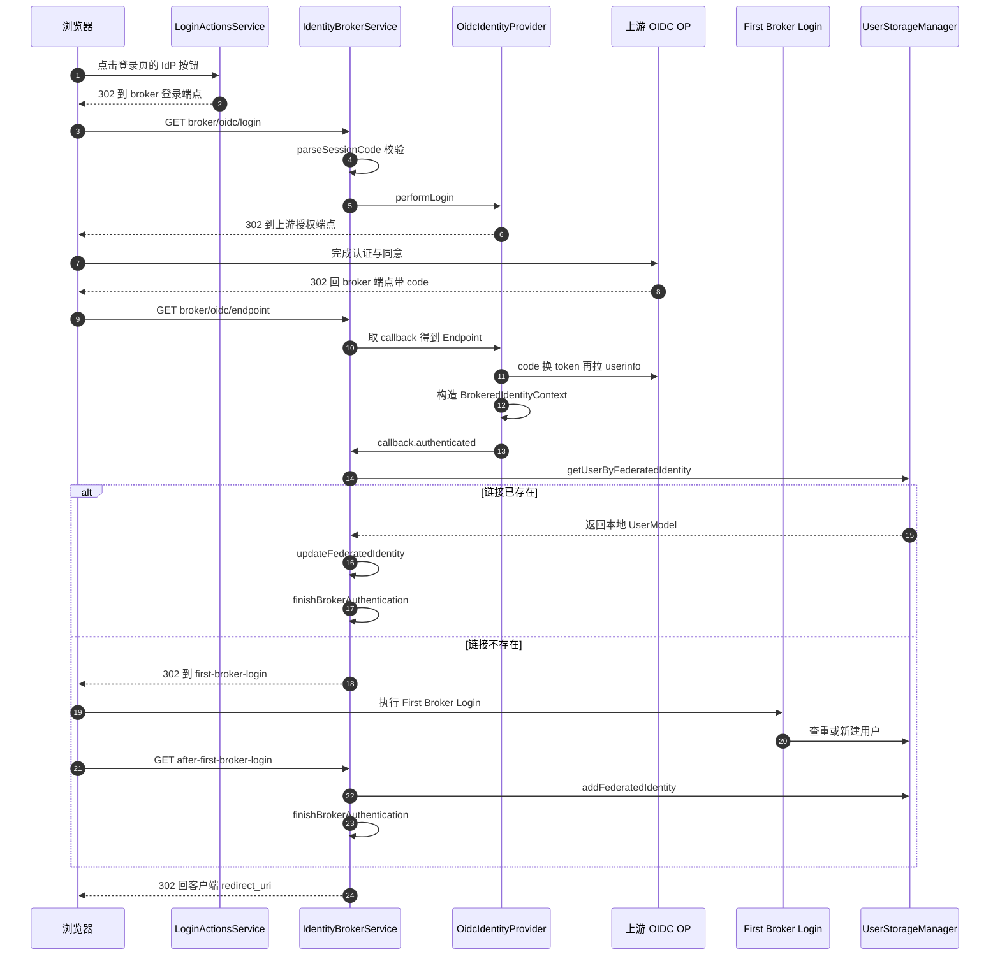
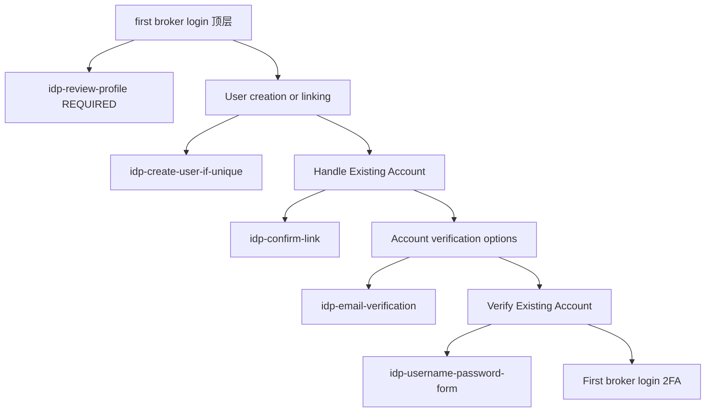
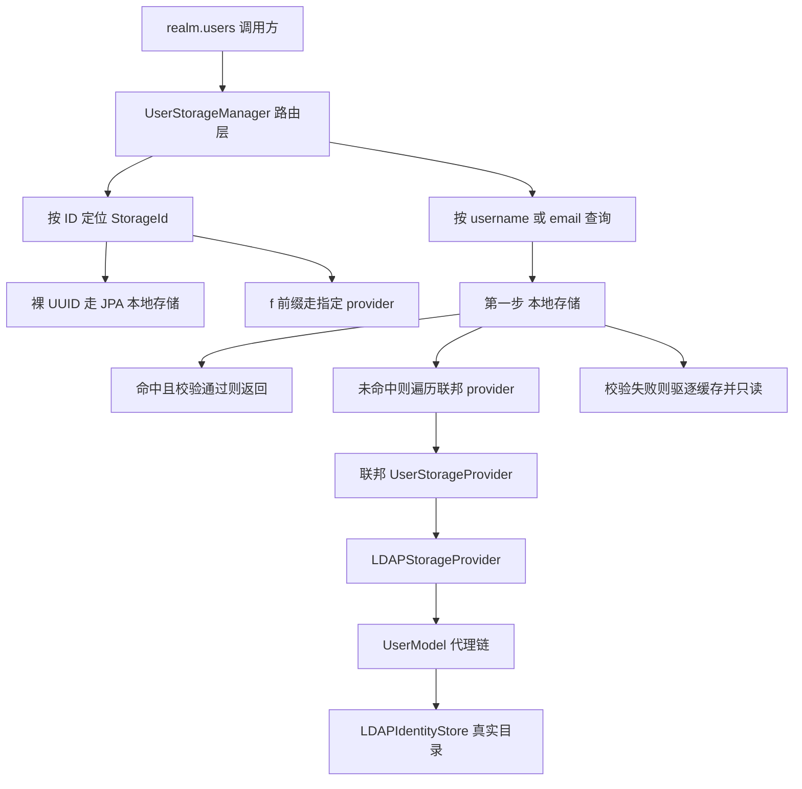

# 身份代理与用户联合

> 解读基线：Keycloak 26.7.3（`6d238b6558`）。下文所有源码引用均相对仓库根，并附程序化校验过的行号锚点。

## 根因：身份数据不集中，而 Keycloak 拒绝搬迁

企业的身份数据从不集中：并购留下的 AD 林、HR 系统背后的 LDAP、SaaS 供应商的上游 IdP、员工自己的 GitHub/Google 账号。表面需求是「支持多种登录方式」，真正的根因是三个互相冲突的约束同时成立：

1. **不能搬迁数据**。LDAP 目录往往是 HR/AD 团队的权威数据源，企业不会允许身份中心把自己变成第二份主数据；上游 IdP 更不可能把密码交出来。
2. **不能要求上游改造**。上游可能是第三方 SaaS，也可能是另一个 Keycloak，只会说标准协议；身份中心必须能当客户端。
3. **下游应用必须看不到差异**。应用只说一个 realm 的 OIDC/SAML，不该关心这个用户到底来自 AD 还是 GitHub。

这三点叠加，逼出 Keycloak 的答案：**本地只保留「最小可行用户」与「到上游的指针」，其余全部下沉为可插拔的 provider**。于是有两样东西成为不可绕过的设计载体：

- `FederatedIdentityModel`——brokering 侧的指针：`identityProvider`（alias）+ `userId`（上游 subject）+ `userName` + 可选 `token`，四元组即「谁是谁」的全部事实。
[server-spi/src/main/java/org/keycloak/models/FederatedIdentityModel.java:25-47]()
<!-- anchor: public class FederatedIdentityModel { … token = originalIdentity.getToken(); -->
- `UserStorageProvider`——federation 侧的契约：它本身只有极薄的 `preRemove` 与 `EditMode` 枚举，真正的能力靠**能力接口组合**（`UserLookupProvider` / `UserQueryMethodsProvider` / `UserRegistrationProvider` / `CredentialInputValidator` / `ImportedUserValidation`…）逐个实现。
[model/storage/src/main/java/org/keycloak/storage/UserStorageProvider.java:30-42]()
<!-- anchor: *     <li>{@link org.keycloak.storage.user.UserLookupProvider UserLookupProvider … public interface UserStorageProvider extends Provider { -->

这两处合起来说明了根因级的取舍：**Keycloak 没有「用户表」，只有「用户存储的聚合视图」**。`realm.users()` 返回的 `UserStorageManager` 是一个路由层，不是一个仓库。

## 两条外部身份路：代理负责认证，联合负责存用户

同一个需求被拆成两条性质完全不同的路，这是本模块最核心的结构事实：

| | Identity Brokering（身份代理） | User Federation（用户联合） |
|---|---|---|
| 上游角色 | IdP，负责**认证** | 用户库，负责**存取用户** |
| Keycloak 角色 | RP，把上游断言换成自己的会话与令牌 | 存储适配器，把远端目录伪装成本地 `UserProvider` |
| 触发时机 | 用户主动走去上游登录 | 任何一次用户查询/认证都可能打到远端 |
| 数据流向 | 上游 → Keycloak（一次性导入 + 可选回写） | 双向；可只读、可写、可只写本地 |
| 典型协议 | OIDC / SAML2 / OAuth2 / SPIFFE | LDAP / Kerberos / SSSD / 自定义 |
| 代码入口 | `IdentityBrokerService` + `IdentityProviderFactory` | `UserStorageManager` + `UserStorageProviderFactory` |

两条路的共同点是**都必须把「外部身份」变成一个本地 `UserModel`**——只是 brokering 走的是「认证完成后按需创建」，federation 走的是「查询时透明代理」。理解这个分岔，后面所有设计细节都能归位。

### 为什么不能合并成一条路

直觉上「都是接外部身份」，可以统一成「一个能认证又能查用户的 provider」。Keycloak 明确没这么做，因为两者的**代价结构完全不同**：

- Brokering 的一次登录是**有界的**：一次 302 + 一次 token 交换 + 一次 userinfo，然后全在本地完成。它可以把「上游用户」当作一次性事件处理，因此可以设计出 `BrokeredIdentityContext` 这样一个**不落库的中间态**，并让管理员在中间插入一个人工流程（First Broker Login）。
- Federation 的每次用户查询都是**无界的**：用户在 admin console 翻页、`getUserByEmail` 撞库、group 成员列举，都可能打到远端目录。它无法用「一次性事件」建模，只能用一个**代理对象链**长期挂着，并配套超时、优雅降级、缓存与外部存储（federated storage）。

换句话说：brokering 的复杂度集中在**第一次登录的那一次会话流程**；federation 的复杂度集中在**每一次读写的路由与一致性**。合并会同时继承两种复杂度，且无法分别给出合理的失败语义。

### 替代方案与它们的代价

- **替代一：全量同步（把 LDAP 用户全导进本地库）**。查询最快、所有 Keycloak 特性都可用。代价是目录规模可能到百万级，全量导入的写入放大与同步窗口不可接受；密码永远无法同步（文档明确 "Keycloak never imports passwords"），仍要回源验证；目录侧的删除/禁用与本地副本之间必然出现不一致窗口。Keycloak 的选择是**按需导入**（第一次被用到才落库）+ **可选周期同步**，把成本摊到实际访问过的用户上。
[docs/documentation/server_admin/topics/user-federation/ldap.adoc:26-34]()
<!-- anchor: {project_name} imports users from LDAP into the local {project_name} user databa … The *Import Users* switch on the LDAP configuration page controls this storage m -->
- **替代二：完全透传（不落库，纯内存 adapter）**。零副本、零一致性问题。代价是 Keycloak 自身的 per-user 能力（角色、组、required actions、consent、会话相关的用户 note）没有地方存。Keycloak 的选择是引入 `UserFederatedStorageProvider` 作为「联邦用户的旁路存储」，把 Keycloak 自有数据放在本地，把目录属性留在目录里。
[model/storage/src/main/java/org/keycloak/storage/federated/UserFederatedStorageProvider.java:36-45]()
<!-- anchor: public interface UserFederatedStorageProvider extends Provider, … UserVerifiableCredentialFederatedStorage { -->
- **替代三：信任上游 email 自动合并账号**。体验最好，零摩擦。代价是**账号接管**：上游只要能自证一个未验证的 email，就能接管本地同名账号。Keycloak 明确不默认这么做，而是把决定权交给可配置的 First Broker Login 流程（见下文「账号接管的安全边界」）。

## 关键数据结构

| 结构 | 定位 |
|---|---|
| `BrokeredIdentityContext` | 上游身份的一次性内存载体；只在认证会话内存在，可序列化进 auth session 供后续流程使用 |
| `FederatedIdentityModel` | 本地 user ↔ 上游身份的唯一持久化链接 |
| `IdentityProviderModel` | 一个 IdP 配置（alias / providerId / linkOnly / trustEmail / storeToken / syncMode / firstBrokerLoginFlowId），存在 config map 里 |
| `UserStorageProviderModel` | 一个 federation provider 的配置（importEnabled / editMode / fullSyncPeriod / changedSyncPeriod / lastSync） |
| `UserStorageProvider` | federation 契约：基础接口 + `EditMode{READ_ONLY, WRITABLE, UNSYNCED}` + 一组能力接口 |
| `ImportSynchronization` | 可选同步能力：`sync`（全量）/ `syncSince`（增量） |

上表逐条对应的源码位置：

- `BrokeredIdentityContext` 的字段全集即为「上游身份」的完整投影，注意 `modelUsername` 与 `authenticationSession` 都在其中。
[server-spi-private/src/main/java/org/keycloak/broker/provider/BrokeredIdentityContext.java:39-54]()
<!-- anchor: public class BrokeredIdentityContext { … private AuthenticationSessionModel authenticationSession; -->
- `FederatedIdentityModel` 有三个构造器，其中一个专用于「只换 userId」（即上游 ID 迁移），说明 ID 变更是一等场景。
[server-spi/src/main/java/org/keycloak/models/FederatedIdentityModel.java:25-47]()
<!-- anchor: public class FederatedIdentityModel { … token = originalIdentity.getToken(); -->
- `IdentityProviderModel.getSyncMode` 从 config map 里读枚举并 `valueOf`，因此非法字符串会直接抛异常——这是「配置错误要尽早炸」的取向。
[server-spi/src/main/java/org/keycloak/models/IdentityProviderModel.java:275-281]()
<!-- anchor: public IdentityProviderSyncMode getSyncMode() { … getConfig().put(SYNC_MODE, syncMode != null ? syncMode.toString() : null); -->
- `UserStorageProviderModel` 的两个同步周期直接暴露为 model 方法，是调度器与 Admin REST 的共同契约。
[model/storage/src/main/java/org/keycloak/storage/UserStorageProviderModel.java:69-86]()
<!-- anchor: public int getFullSyncPeriod() { … public int getChangedSyncPeriod() { -->
- `EditMode` 只有三个值，且注释写明 "updates to user are stored locally and not synced with user storage"——UNSYNCED 的语义就是「放弃自动一致性」。
[model/storage/src/main/java/org/keycloak/storage/UserStorageProvider.java:81-93]()
<!-- anchor: enum EditMode { … UNSYNCED -->
- `ImportSynchronization` 只有两个方法：全量与增量。是否实现它，就是「是否出现在 Admin console 的同步按钮/定时任务里」的唯一判据。
[model/storage/src/main/java/org/keycloak/storage/user/ImportSynchronization.java:33-36]()
<!-- anchor: public interface ImportSynchronization { … SynchronizationResult syncSince(Date lastSync, KeycloakSessionFactory sessionFac -->

`BrokeredIdentityContext` 的字段构成很能说明问题：`id`/`legacyId`（上游 subject，含迁移用的旧 ID）、`username` 与 `modelUsername` **分开两个字段**、`email`/`firstName`/`lastName`、`brokerSessionId`/`brokerUserId`（上游会话，用于上游登出）、`token`、`idpConfig`+`idp`、`contextData`（mappers 与 session notes 的公共抽屉）、`authenticationSession`。它同时也是 mapper 的唯一通信媒介：

- 上游 `username` 与本地 `modelUsername` 分离，是为了让「上游叫什么」和「本地存成什么」可以不一致——mappers 可以在 `preprocessFederatedIdentity` 阶段改写后者（例如 `UsernameTemplateMapper`），而不污染上游事实。
[server-spi-private/src/main/java/org/keycloak/broker/provider/BrokeredIdentityContext.java:104-109]()
<!-- anchor: public String getUsername() { … return username == null ? null : username.toLowerCase(); -->
- `setSessionNote` 有一条重要分支：如果此刻已绑定 `authenticationSession`，note 直接写到 user session；否则暂存在 `contextData` 里，等 `addSessionNotesToUserSession` 一次性灌进去。这让 mapper 不必关心自己运行在流程的哪个阶段。
[server-spi-private/src/main/java/org/keycloak/broker/provider/BrokeredIdentityContext.java:190-200]()
<!-- anchor: public void setSessionNote(String key, String value) { … getSessionNotes().forEach((k, v) -> userSession.setNote(k, v)); -->
- 另外它自带了**幂等记账**（`addMapperGrantedRole` / `addMapperAssignedGroup`）。原因是同一个角色可能被多个 mapper（例如「按 claim 映射」和「硬编码映射」）同时命中，重复 `grantRole` 会产生无意义的写放大与事件噪音。
[server-spi-private/src/main/java/org/keycloak/broker/provider/BrokeredIdentityContext.java:277-295]()
<!-- anchor: Set<String> roles = (Set<String>) this.contextData.get(Constants.MAPPER_GRANTED_ … this.contextData.put(Constants.MAPPER_GRANTED_GROUPS, groups); -->

## 认证链路：OIDC 上游首次登录

图中每个节点对应的源码坐标（图内不放 `文件:行号`，避免标签过长）：

| 图内节点 | 源码坐标 |
|---|---|
| `performLogin`（broker 发起端） | `services/src/main/java/org/keycloak/services/resources/IdentityBrokerService.java:408-450` |
| `state` 打包（`IdentityBrokerState`） | `services/src/main/java/org/keycloak/services/resources/IdentityBrokerService.java:1445-1456` |
| OIDC provider 的 `performLogin` | `services/src/main/java/org/keycloak/broker/oidc/AbstractOAuth2IdentityProvider.java:160-164` |
| `Endpoint.authResponse`（回调） | `services/src/main/java/org/keycloak/broker/oidc/AbstractOAuth2IdentityProvider.java:739-786` |
| `getFederatedIdentity` | `services/src/main/java/org/keycloak/broker/oidc/OIDCIdentityProvider.java:483-486` |
| `authenticated`（反查本地用户） | `services/src/main/java/org/keycloak/services/resources/IdentityBrokerService.java:745-754` |
| `firstBrokerLoginFlow`（流程树） | `server-spi-private/src/main/java/org/keycloak/models/utils/DefaultAuthenticationFlows.java:533-557` |
| `afterFirstBrokerLogin`（写入链接） | `services/src/main/java/org/keycloak/services/resources/IdentityBrokerService.java:918-928` |
| `finishBrokerAuthentication`（收尾） | `services/src/main/java/org/keycloak/services/resources/IdentityBrokerService.java:1076-1105` |

### 发起端：把本地会话编进 `state`

Broker 的入口不是独立 servlet，而是 realm 资源下的一个 JAX-RS 子资源，路径前缀 `{realm}/broker`，并且在创建时就完成 `init()`（构造 `EventBuilder`）。这意味着每个 realm 天然拿到一套隔离的 broker 端点，且所有 broker 事件都自动带上 realm 维度——不需要额外的手工 realm 解析。
[services/src/main/java/org/keycloak/services/resources/RealmsResource.java:211-218]()
<!-- anchor: public IdentityBrokerService getBrokerService(final @PathParam("realm") String n … return brokerService; -->

发起端的三件事值得单独说：`performLogin` 先 `parseSessionCode` 校验会话码与 tab，再做 `isLinkOnly` 拦截，最后才调 `identityProvider.performLogin(...)` 并把 provider 返回的 `Response` 直接透传出去。`performLogin` 抛 `IdentityBrokerException` 映射为 **502 Bad Gateway**，其他异常映射为 500。语义区分很清楚：前者是**上游/配置问题**，后者是**自己的 bug**。
[services/src/main/java/org/keycloak/services/resources/IdentityBrokerService.java:408-450]()
<!-- anchor: public Response performLogin(@PathParam("provider_alias") String providerAlias, … return redirectToErrorPage(Response.Status.INTERNAL_SERVER_ERROR, Messages.UNEXP -->

`AuthenticationRequest` 里的 `state` 不是随机串，而是把 **auth session 的 clientSessionCode + clientId + tabId + clientData** 打包编码而成（`IdentityBrokerState`）。这是为了让上游回调时能无状态地找回本地会话——broker 不需要在本地为每个在途登录开一张表。
[services/src/main/java/org/keycloak/services/resources/IdentityBrokerService.java:1445-1456]()
<!-- anchor: private AuthenticationRequest createAuthenticationRequest(UserAuthenticationIden … return new AuthenticationRequest(this.session, this.realmModel, authSession, thi -->

OIDC provider 侧：`performLogin` 只做一件事——拼 authorization URL 然后 `Response.seeOther`。真正的用户交互全部交给上游，Keycloak 不代理任何凭据。
[services/src/main/java/org/keycloak/broker/oidc/AbstractOAuth2IdentityProvider.java:160-164]()
<!-- anchor: public Response performLogin(AuthenticationRequest request) { … return Response.seeOther(authorizationUrl).build(); -->

### 回调端：换 token、构造身份、防混淆

`Endpoint.authResponse` 是全链路信息密度最高的地方：先 `getAndVerifyAuthenticationSession(state)` 恢复会话，再按 `error` 参数分流（`access_denied` → `callback.cancelled`，`login_required`/`interaction_required` → `callback.error`，`temporarily_unavailable` + 特定描述 → `callback.retryLogin`），然后 POST 到 token endpoint 换 token、`getFederatedIdentity` 构造上下文，最后把 `idp` 与 `authenticationSession` 塞进 context 再交给 `callback.authenticated`。注意 `retryLogin` 这条支路是「上游临时不可用」的自动重试协议，而不是把错误直接抛给用户。
[services/src/main/java/org/keycloak/broker/oidc/AbstractOAuth2IdentityProvider.java:739-786]()
<!-- anchor: AuthenticationSessionModel authSession = this.callback.getAndVerifyAuthenticatio … return callback.authenticated(federatedIdentity); -->

`OIDCIdentityProvider.getFederatedIdentity` 有一处容易被忽略的安全校验：从 userinfo 端点解析出的 `identity.getId()` 必须等于 id_token 的 `sub`，否则直接抛异常。这是防「拿 A 的 id_token 配 B 的 userinfo 响应」这类混淆攻击。
[services/src/main/java/org/keycloak/broker/oidc/OIDCIdentityProvider.java:483-486]()
<!-- anchor: BrokeredIdentityContext identity = extractIdentity(tokenResponse, accessToken, i … throw new IdentityBrokerException("Mismatch between the subject in the id_token -->

上游身份的各个字段来源固定：`sub` 作为 `id`，`given_name`/`family_name` 拆成 first/last name，`preferred_username` 缺失时退化为 `email`、再退化为 `sub`；同时 `brokerUserId` 被拼成 `alias.sub` 供上游登出使用。
[services/src/main/java/org/keycloak/broker/oidc/OIDCIdentityProvider.java:614-649]()
<!-- anchor: if (givenName == null && familyName == null) { … return identity; -->

## 为什么第一次登录必须落一条 `FEDERATED_IDENTITY`

`authenticated()` 的第一步就是用 `(providerAlias, context.getId())` 构造 `FederatedIdentityModel` 并反查本地用户：
[services/src/main/java/org/keycloak/services/resources/IdentityBrokerService.java:745-754]()
<!-- anchor: FederatedIdentityModel federatedIdentityModel = new FederatedIdentityModel(provi … UserModel federatedUser = this.session.users().getUserByFederatedIdentity(this.r -->

- 查到 → 走 `validateUser`（禁用/暴力破解检查）→ `updateFederatedIdentity` 同步 → `finishBrokerAuthentication` 建立本地会话。
- 查不到 → **不创建用户，而是把 `BrokeredIdentityContext` 序列化进 auth session，然后 302 到 `first-broker-login`**。
[services/src/main/java/org/keycloak/services/resources/IdentityBrokerService.java:773-826]()
<!-- anchor: if (federatedUser == null) { … return Response.status(302).location(redirect).build(); -->

第二条路是关键。如果这里直接建号，那么每一次登录都会得到一个新的本地用户——因为上游的 `sub` 只在**本次**响应里出现，本地没有任何持久记录能把「这次的上游身份」和「上次建的那个用户」关联起来。所以链接记录不是优化，而是**正确性的前提**：`FEDERATED_IDENTITY` 表的 `(IDENTITY_PROVIDER, USER_ID)` 复合主键就是「上游身份 → 本地用户」的函数依赖。
[server-spi/src/main/java/org/keycloak/models/FederatedIdentityModel.java:25-47]()
<!-- anchor: public class FederatedIdentityModel { … token = originalIdentity.getToken(); -->

写入发生在 first-broker-login 流程成功之后的 `afterFirstBrokerLogin` 回调里，而不是在 `authenticated()` 里——因为此时「这个本地用户是谁」才第一次确定。`addFederatedIdentity` 用 `IDENTITY_PROVIDER + USER_ID` 做键，重复会抛 `ModelDuplicateException` 并被显式转成 409 + `IDENTITY_PROVIDER_ALREADY_LINKED_TO_CURRENT_USER`，避免并发链接时静默覆盖。
[services/src/main/java/org/keycloak/services/resources/IdentityBrokerService.java:918-928]()
<!-- anchor: // Add federated identity link here … return redirectToErrorPage(authSession, Status.CONFLICT, Messages.IDENTITY_PROVI -->

还有一个细节：`LightweightUserAdapter`（transient user，不落库）被显式排除在链接写入之外。这是 transient brokering 的语义——用户根本不该在本地有记录。
[services/src/main/java/org/keycloak/services/resources/IdentityBrokerService.java:918-928]()
<!-- anchor: // Add federated identity link here … return redirectToErrorPage(authSession, Status.CONFLICT, Messages.IDENTITY_PROVI -->

### 另一条链接路径：用户在浏览器里主动「关联账号」

它不经过 first-broker-login：用户此时已有本地 cookie 会话，`getAndVerifyAuthenticationSession` 之外还有一条 `LINKING_IDENTITY_PROVIDER` note 机制，把 `parentSessionId + clientId + providerAlias` 作为握手串写进 auth session，回调时校验一致才允许链接——这防止了别人用你的浏览器完成一个链接动作。
[services/src/main/java/org/keycloak/services/resources/IdentityBrokerService.java:1144-1163]()
<!-- anchor: private boolean isDoingAccountLinking(AuthenticationSessionModel authSession, bo … throw new ErrorPageException(session, Response.Status.BAD_REQUEST, Messages.BROK -->

## 会话收尾：完全复用浏览器登录的下半段

`finishBrokerAuthentication` 把 broker 会话信息写进 auth session note（`BROKER_SESSION_ID`/`BROKER_USER_ID`），并调用 `idp.authenticationFinished(...)` 给 provider 一个收尾钩子，然后完全**复用浏览器登录的下半段**：`nextRequiredAction` → 有 required action 就跳转，没有就 `finishedRequiredActions`。brokering 因此不需要自己的「发令牌」逻辑——它只是替认证流程产出了一个 `authenticatedUser`。
[services/src/main/java/org/keycloak/services/resources/IdentityBrokerService.java:1076-1105]()
<!-- anchor: private Response finishBrokerAuthentication(BrokeredIdentityContext context, Use … return AuthenticationManager.finishedRequiredActions(session, authSession, null, -->

在它之前还有一次分流：`afterPostBrokerLoginFlowSuccess` 会判断本次是不是「首次」（`wasFirstBrokerLogin`），以及「是否正处于另一个 first-broker-login 中途」（嵌套 broker 链接），后者会把 providerId 记进 `FIRST_BROKER_LOGIN_SUCCESS` 再回到 `afterFirstBrokerLogin`。这解决的是「用 broker A 登录、同时要链接 broker B」这种嵌套场景。
[services/src/main/java/org/keycloak/services/resources/IdentityBrokerService.java:1053-1058]()
<!-- anchor: private Response afterPostBrokerLoginFlowSuccess(AuthenticationSessionModel auth … return finishBrokerAuthentication(context, federatedUser, authSession, providerA -->

`validateUser` 在链接/登录前统一做两道闸：用户被禁用 → `ACCOUNT_DISABLED`；realm 开了暴力破解保护且用户被临时锁定 → 同样拒绝。这条检查同时作用于「已链接用户登录」和「重认证后」两条路。
[services/src/main/java/org/keycloak/services/resources/IdentityBrokerService.java:846-857]()
<!-- anchor: public Response validateUser(AuthenticationSessionModel authSession, UserModel u … return null; -->

## 默认 First Broker Login 流程树

流程本身不是硬编码，而是 realm 初始化时构建的一棵普通认证流程树（`basic-flow`）。这解释了为什么管理员可以随意增删改它：对内核而言它就是任何一棵认证流程。
[server-spi-private/src/main/java/org/keycloak/models/utils/DefaultAuthenticationFlows.java:533-557]()
<!-- anchor: public static void firstBrokerLoginFlow(RealmModel realm, boolean migrate) { … realm.addAuthenticatorExecution(execution); -->

| 流程节点 | Requirement | 作用 |
|---|---|---|
| `idp-review-profile` | REQUIRED | 展示并允许补充上游未提供的用户属性 |
| `User creation or linking` | REQUIRED（子流程） | 分派「建新号」与「处理已存在账号」 |
| `idp-create-user-if-unique` | ALTERNATIVE | 查重通过则建号，成功即短路整个子流程 |
| `Handle Existing Account` | ALTERNATIVE | 撞重时的处理分支 |
| `idp-confirm-link` | REQUIRED | 页面告知同 email 本地账号，用户选择链接或改资料 |
| `Account verification options` | REQUIRED（子流程） | 承载「邮箱确认」与「密码重认证」两条证明路径 |
| `idp-email-verification` | ALTERNATIVE | 给本地已有账号的邮箱发确认信 |
| `Verify Existing Account` | ALTERNATIVE（子流程） | 重认证路径：用户名密码 + 条件 2FA |

树的骨架由 `realm.setFirstBrokerLoginFlow(...)` 挂到 realm 上，`idp-create-user-if-unique` 被放在 ALTERNATIVE，而 `Handle Existing Account` 也是 ALTERNATIVE——这意味着 `idp-create-user-if-unique` 一旦成功就会短路整个子流程。这正是文档里说的「把 Create User If Unique 标成 REQUIRED，就变成禁止重复账号」的机制来源。
[server-spi-private/src/main/java/org/keycloak/models/utils/DefaultAuthenticationFlows.java:574-588]()
<!-- anchor: AuthenticatorConfigModel createUserIfUniqueConfig = new AuthenticatorConfigModel … realm.addAuthenticatorExecution(execution); -->

「Verify Existing Account」这一层是安全边界的承载点：`idp-email-verification`（发确认邮件）与「重认证」（`idp-username-password-form` + 可选 2FA）是 **ALTERNATIVE**，谁先成功算谁。因此「没有配 SMTP 的 realm 就只能靠密码重认证」这件事，不是代码分支，而是流程配置的必然结果。
[server-spi-private/src/main/java/org/keycloak/models/utils/DefaultAuthenticationFlows.java:629-659]()
<!-- anchor: execution = new AuthenticationExecutionModel(); … realm.addAuthenticatorExecution(execution); -->

## 账号接管的安全边界

这是本模块最值得单独拎出来的一段。问题陈述：上游返回 `email = alice@corp.com`，本地已经有一个 `alice@corp.com`（当初是用密码注册的）。**凭什么认为上游那个 alice 就是本地这个 alice？**

Keycloak 的回答分三层。

**第一层：不自动合并，只「标记冲突」。** 查重逻辑只看两个键——email 与 username，且 email 只在 realm 未开启 `duplicateEmailsAllowed` 时才参与比较。命中即返回一个 `ExistingUserInfo`（含已有 userId、冲突属性名、冲突值），并写进 auth session note `EXISTING_USER_INFO`，供后续 authenticator 消费。
[services/src/main/java/org/keycloak/authentication/authenticators/broker/IdpCreateUserIfUniqueAuthenticator.java:149-160]()
<!-- anchor: protected ExistingUserInfo checkExistingUser(AuthenticationFlowContext context, … return new ExistingUserInfo(existingUser.getId(), UserModel.USERNAME, existingUs -->

如果 `idp-create-user-if-unique` 是 REQUIRED 且撞了重，它不会建号也不会链接，而是直接返回 **409 + `FEDERATED_IDENTITY_EXISTS` 错误页**，并把事件标成 `Errors.FEDERATED_IDENTITY_EXISTS`。也就是说「防止自动合并」这个安全姿态可以通过把它标成 REQUIRED 来强制。否则它只是 `attempted()`，把决定权交给后面的 sub-flow。
[services/src/main/java/org/keycloak/authentication/authenticators/broker/IdpCreateUserIfUniqueAuthenticator.java:113-144]()
<!-- anchor: } else if (duplication != null) { … context.attempted(); -->

**第二层：把「是否有资格合并」交给本地证明。** `IdpEmailVerificationAuthenticator` 在出现重复用户时，不链接，而是给**本地已有用户**的邮箱发一封带 action token 的确认信；token 里携带的是 `existingUser.getId()`、`existingUser.getEmail()`、broker 的上游 username/brokerUserId/alias。注意发送对象是**已有的本地用户**，不是上游声称的那个人——这正是安全边界的落点。
[services/src/main/java/org/keycloak/authentication/authenticators/broker/IdpEmailVerificationAuthenticator.java:143-152]()
<!-- anchor: IdpVerifyAccountLinkActionToken token = new IdpVerifyAccountLinkActionToken( … long expirationInMinutes = TimeUnit.SECONDS.toMinutes(validityInSecs); -->

用户点开链接后才真正解锁链接动作。`runIfUserVerified` 是一个**一次性凭证**检查：它从 `SingleUseObjectProvider` 里 `remove` 一个形如 `kc.brokering.user.verified.{userId}.{idpAlias}.{externalId}` 的 key，`remove` 语义保证只能成功一次且带 TTL。
[services/src/main/java/org/keycloak/authentication/actiontoken/idpverifyemail/IdpVerifyAccountLinkActionTokenHandler.java:154-167]()
<!-- anchor: public static boolean runIfUserVerified(KeycloakSession session, UserModel user, … return isUserVerified; -->

而 `IdpCreateUserIfUniqueAuthenticator` 在撞重分支里**先**调用 `runIfUserVerified`：只有本地邮箱验证已经完成，才把已存在用户直接设为认证结果并 `success()`，完全跳过 `idp-confirm-link` 的交互。这是「用户已经用邮箱证明过自己是本人」之后的快路径。
[services/src/main/java/org/keycloak/authentication/authenticators/broker/IdpCreateUserIfUniqueAuthenticator.java:113-144]()
<!-- anchor: } else if (duplication != null) { … context.attempted(); -->

**第三层：把选择权显式暴露给管理员和人。** 如果既没走邮箱验证路径，走到了 `idp-confirm-link`，页面会告诉用户「发现一个同 email 的本地账号」，提供两个动作：`linkAccount`（确认链接）或 `updateProfile`（回到 Review Profile 改名/改邮箱后重跑整个流程）。后者是给「我确实是新用户，但邮箱和别人的撞了」这种情况的出口。
[services/src/main/java/org/keycloak/authentication/authenticators/broker/IdpConfirmLinkAuthenticator.java:62-69]()
<!-- anchor: ExistingUserInfo duplicationInfo = ExistingUserInfo.deserialize(existingUserInfo … context.challenge(challenge); -->
[services/src/main/java/org/keycloak/authentication/authenticators/broker/IdpConfirmLinkAuthenticator.java:76-88]()
<!-- anchor: String action = formData.getFirst("submitAction"); … AuthenticationFlowError.INTERNAL_ERROR); -->

**边界总结**：Keycloak 从不因为「上游说 email 是 X」就认定「本地 X 是同一个人」。它只承认两种证明：**本地邮箱可达性证明**（点了确认邮件）或**本地凭据证明**（重认证），以及管理员显式配置的 `IdpAutoLinkAuthenticator`。后者跳过全部验证，因此文档明确把它标为危险："The AutoLink authenticator is dangerous in a generic environment where users can register themselves using arbitrary usernames or email addresses."
[services/src/main/java/org/keycloak/authentication/authenticators/broker/IdpAutoLinkAuthenticator.java:40-51]()
<!-- anchor: protected void authenticateImpl(AuthenticationFlowContext context, SerializedBro … context.success(); -->
[docs/documentation/server_admin/topics/identity-broker/first-login-flow.adoc:59-59]()
<!-- anchor: The AutoLink authenticator is dangerous in a generic environment where users can -->

`IdpDetectExistingBrokerUserAuthenticator` 是这套机制的「反向」版本：它继承 `IdpCreateUserIfUniqueAuthenticator` 但**只在已存在用户时成功**，否则返回 401 `FEDERATED_IDENTITY_UNAVAILABLE`。用于「只允许已注册用户通过上游登录」的策略。
[services/src/main/java/org/keycloak/authentication/authenticators/broker/IdpDetectExistingBrokerUserAuthenticator.java:58-79]()
<!-- anchor: ExistingUserInfo duplication = checkExistingUser(context, username, serializedCt … context.success(); -->

### 状态载体：用 auth session note 而不是内存对象

整个 first-broker-login 过程中，`BrokeredIdentityContext` 被序列化后存为 auth session note `BROKERED_CONTEXT`。**该 note 存在与否本身就是一个状态位**——`AbstractIdpAuthenticator.authenticate/action` 每次执行都从它读回并反序列化，读不到就抛 `IDENTITY_PROVIDER_ERROR`。此外还有 `EXISTING_USER_INFO`、`ENFORCE_UPDATE_PROFILE`、`FIRST_BROKER_LOGIN_SUCCESS`、`NESTED_FIRST_BROKER_CONTEXT` 四个协作 note。用 note 而不是内存对象，是因为认证流程可能在多标签、多次 HTTP 往返之间被重建——broker 流程必须能在任意一步被中断并恢复。
[services/src/main/java/org/keycloak/authentication/authenticators/broker/AbstractIdpAuthenticator.java:41-54]()
<!-- anchor: // The clientSession note encapsulating all the BrokeredIdentityContext info. Wh … public static final String NESTED_FIRST_BROKER_CONTEXT = "NESTED_FIRST_BROKER_CO -->

## 身份链接的维护：syncMode 决定「每次登录要不要回写」

上游数据会变（改名、换邮箱、改部门）。`updateFederatedIdentity` 的处理是根据 `IdentityProviderSyncMode` + 每个 mapper 的 sync mode 组合后决定的：

- `FORCE`：用上游值覆盖 first/last name，并且如果上游 username 变了，**重建一条 `FederatedIdentityModel`** 而不是原地改（因为 `(provider, userId)` 是主键的一部分，改 username 需要走删除+重建语义）。
[services/src/main/java/org/keycloak/services/resources/IdentityBrokerService.java:1296-1307]()
<!-- anchor: private void updateFederatedIdentity(BrokeredIdentityContext context, UserModel … this.session.users().updateFederatedIdentity(this.realmModel, federatedUser, fed -->
- `LEGACY`（默认）：走各 mapper 的 `updateBrokeredUserLegacy`，即「保持历史行为」，不做全量同步——这是兼容性优先，而非正确性优先。
- `IMPORT`：只在首次导入时生效。

合并算法在 `IdentityProviderMapperSyncModeDelegate`：mapper 的 sync mode 为 `INHERIT` 时继承 IdP 的 mode，否则以 mapper 自己的为准。这让管理员可以做「整体不同步，但某个角色 mapper 每次登录都同步」这种细粒度配置。同一个类在 mapper 未显式声明支持某个 sync mode 时会打 warn，说明「SPI 实现者经常没有声明自己支持哪些 sync mode」是内核已知的常态。
[server-spi-private/src/main/java/org/keycloak/broker/provider/IdentityProviderMapperSyncModeDelegate.java:16-35]()
<!-- anchor: public static void delegateUpdateBrokeredUser(KeycloakSession session, RealmMode … return IdentityProviderMapperSyncMode.INHERIT.equals(mapperSyncMode) ? syncMode -->
[server-spi-private/src/main/java/org/keycloak/broker/provider/IdentityProviderMapperSyncModeDelegate.java:23-24]()
<!-- anchor: if (!mapper.supportsSyncMode(effectiveSyncMode)) { … logger.warnf("The mapper %s does not explicitly support sync mode %s. Please ens -->

token 的回写有一处防退化逻辑：对实现了 `ExchangeTokenToIdentityProviderToken` 的 provider（例如 Google），如果新响应没有 refresh token 而 DB 里有，则**保留旧的 refresh token**。注释直接写了原因——"as for google IDP it will be lost forever"。
[services/src/main/java/org/keycloak/services/resources/IdentityBrokerService.java:1344-1369]()
<!-- anchor: private void updateToken(BrokeredIdentityContext context, UserModel federatedUse … logger.debugf("Identity [%s] update with response from identity provider [%s].", -->

## 用户联合：把 LDAP 目录伪装成 `UserProvider`

### 读路径：按 ID 分派，按属性本地优先

`realm.users()` 返回的是 `UserStorageManager`，它本身**不存任何东西**，只做三件事：按 ID 形状分派、按顺序短路查询、在联邦 provider 之间做分页拼接。先看最简单的按 ID 分派：
[model/storage-private/src/main/java/org/keycloak/storage/UserStorageManager.java:543-567]()
<!-- anchor: public UserModel getUserById(RealmModel realm, String id) { … u -> email.equalsIgnoreCase(u.getEmail())); -->

关键在 `StorageId`：`user.getId()` 被约定为 `f:<providerId>:<externalId>`（联邦用户）或裸 UUID（本地用户）。`StorageId.getProviderId()` 为 null 就是本地，非 null 就直接路由到对应的 `UserLookupProvider`，**不做任何遍历**。这是整个委托链的性能基石：已知 ID 的访问永远是 O(1) 的 provider 定位，而不是 O(providers) 的枚举。
[server-spi/src/main/java/org/keycloak/storage/StorageId.java:35-59]()
<!-- anchor: public StorageId(String id) { … return providerId == null ? externalId : ("f:" + providerId + ":" + externalId); -->

按用户名/邮箱查询则是两段式的：**先本地，再联邦**。
[model/storage-private/src/main/java/org/keycloak/storage/UserStorageManager.java:1263-1281]()
<!-- anchor: private UserModel getUserByAttribute(RealmModel realm, Function<UserLookupProvid … return tryResolveFederatedUser(realm, loader); -->

本地命中后还要过两道校验：`validateUser`（联邦用户校验 + 只读组织成员降级）和属性复核 `attributeValidator`。校验失败会**主动驱逐缓存**并把用户降级为只读，而不是直接返回——「本地有记录」不等于「这个用户还有效」。
[model/storage-private/src/main/java/org/keycloak/storage/UserStorageManager.java:117-133]()
<!-- anchor: protected UserModel validateUser(RealmModel realm, UserModel user) { … return user; -->

联邦阶段的遍历是按需短路的 `findFirst`：providers 已经按 `StorageProviderModel.comparator` 排好序（即 admin 配置的优先级顺序），命中第一个即停。
[model/storage-private/src/main/java/org/keycloak/storage/UserStorageManager.java:1284-1296]()
<!-- anchor: private UserModel tryResolveFederatedUser(RealmModel realm, Function<UserLookupP … .orElse(null); -->

排序与遍历都收敛在 `AbstractStorageManager.getEnabledStorageProviders`：过滤 `isEnabled`、按优先级排序、再映射为实现了目标能力接口的实例、过滤 null。注意「能力接口」这一步——一个 provider 没实现 `UserRegistrationProvider` 就会被这一步自然排除，不需要任何 if-else。
[model/storage/src/main/java/org/keycloak/storage/AbstractStorageManager.java:94-100]()
<!-- anchor: protected <T> Stream<T> getEnabledStorageProviders(RealmModel realm, Class<T> ca … .filter(Objects::nonNull); -->

`mapEnabledStorageProvidersWithTimeout` 会给每个 provider 套一层**超时围栏**（默认 3000ms，可用 `spi-user-storage-provider-storageProviderTimeout` 配置）。设计意图很直白：一个挂死的 LDAP 不能把整个 realm 的登录拖死。代价是长查询会被截断成「该 provider 无结果」——**故障被降级成「查不到」而不是「报错」**。
[model/storage/src/main/java/org/keycloak/storage/AbstractStorageManager.java:69-73]()
<!-- anchor: protected Long getStorageProviderTimeout() { … return storageProviderTimeout; -->

### 写路径：谁有权创建、谁来删除

`addUser` 的语义是「**问所有愿意代管的 provider，第一个接手的赢；都不接手才落本地**」。注意 `orElseGet` 里对 username 做了 `toLowerCase()`——本地存储的大小写归一化，与联邦 provider 各自的归一化策略（LDAP 有 `caseSensitiveOriginalUsername`）是两回事。
[model/storage-private/src/main/java/org/keycloak/storage/UserStorageManager.java:499-509]()
<!-- anchor: public UserModel addUser(RealmModel realm, String username) { … .orElseGet(() -> localStorage().addUser(realm, username.toLowerCase())); -->

`removeUser` 则相反：先看 `StorageId`。本地用户要**同时**删本地记录和调用联邦 provider 的 `removeUser`（如果它实现了 `UserRegistrationProvider`），两者都成功才算成功——这是双写场景下唯一安全的选择，否则会在目录里留下孤儿。
[model/storage-private/src/main/java/org/keycloak/storage/UserStorageManager.java:513-536]()
<!-- anchor: public boolean removeUser(RealmModel realm, UserModel user) { … return registry.removeUser(realm, user); -->

这里的实现顺序值得细看：远端删除（`linkRemoved`）在 return 之前先求值，随后 `localStorage().removeUser(realm, user) && linkRemoved` 无条件先执行本地删除、再与 `linkRemoved` 做短路与。因此**远端删除失败时，本地记录已经被删掉**，调用方只拿到一个 `false`，代码没有任何补偿或回滚远端调用的能力——结果就是目录里留下一条没有本地对应物的条目。上游确实有一层编排：`UserManager.removeUser` 会把 provider 的删除结果作为条件，只有为真才发布 `UserRemovedEvent`，但它同样不做跨存储回滚。
[model/storage-private/src/main/java/org/keycloak/storage/UserStorageManager.java:513-536]()
<!-- anchor: public boolean removeUser(RealmModel realm, UserModel user) { … return registry.removeUser(realm, user); -->
[server-spi/src/main/java/org/keycloak/models/UserManager.java:35-57]()
<!-- anchor: public boolean removeUser(RealmModel realm, UserModel user, UserProvider userPro … return false; -->

brokering 用的链接查询走的是不同路径：`getUserByFederatedIdentity` 先查本地 `FEDERATED_IDENTITY` 表，再回退到 federated storage（联邦用户的旁路存储）。这解释了为什么「链接」能同时覆盖 local user 和 federated user 两种宿主。
[model/storage-private/src/main/java/org/keycloak/storage/UserStorageManager.java:1044-1052]()
<!-- anchor: public UserModel getUserByFederatedIdentity(RealmModel realm, FederatedIdentityM … return null; -->

### 分页查询的代价：用 count 换 skip

`getUserByUsername` 这类**等值查询**是短路遍历，平均成本很小。真正昂贵的是**列表/搜索/计数**，`UserStorageManager.query` 的重载把分页语义当成了分布式分页问题：

- `firstResult <= 0`：从头开始，`localStorage()` 与所有外部 provider + federated storage 拼成一条流顺序消费，不做任何计数。
- `firstResult > 0` 且存在外部 provider：**先对本地做一次 count**。若本地数量 `> firstResult`，说明需要的窗口完全落在本地，根本不用碰外部；若恰好 `== firstResult`，直接从第一个外部 provider 从 0 开始取；否则依次对每个实现了 `UserCountMethodsProvider` 的 provider 做 count 来「跳过」整段 provider。遇到未实现 count 的 provider，就退化成「取回来再 skip」。
[model/storage-private/src/main/java/org/keycloak/storage/UserStorageManager.java:317-352]()
<!-- anchor: protected Stream<UserModel> query(PaginatedQuery pagedQuery, CountQuery countQue … return queryProviders(providers, pagedQuery, 0, maxResults, false); -->

这是一处典型的**用 count 换 skip** 的优化：翻到第 N 页时不对前 N-1 页的每一行都发起查询，只对 provider 做「整块跳过」。代价是要求 provider 实现 `UserCountMethodsProvider`，否则退化成流式 skip（仍然正确，只是慢）。

配套的容错也很显眼：`queryWithGracefulDegradation` / `countQueryWithGracefulDegradation` 把任何 provider 抛出的异常吞掉，记一条 warn 后返回空流/0。注释直接点名场景——"e.g., LDAP server down"。**这是把可用性排在完整性之前的明确表态**：宁可 admin console 少显示一个 provider 的用户，也不让目录故障导致整个用户列表 500。
[model/storage-private/src/main/java/org/keycloak/storage/UserStorageManager.java:438-448]()
<!-- anchor: private static Stream<UserModel> queryWithGracefulDegradation(Object provider, P … return Stream.empty(); -->

### LDAP：一个 provider 实现七种能力

`LDAPStorageProvider` 的声明就是它能力的全部清单——一个类同时扮演凭据校验器、注册器、查询器、导入校验器与 user profile 装饰器。**「LDAP 支持」不是内核特判，而是这些接口的联合**。
[federation/ldap/src/main/java/org/keycloak/storage/ldap/LDAPStorageProvider.java:115-123]()
<!-- anchor: public class LDAPStorageProvider implements UserStorageProvider, … UserProfileDecorator { -->

按用户名查找的路径极短：查 LDAP → 立即 `importUserFromLDAP`。也就是说，**只要有人按用户名找这个用户，「按需导入」就发生了**——不需要等这个用户登录。
[federation/ldap/src/main/java/org/keycloak/storage/ldap/LDAPStorageProvider.java:664-670]()
<!-- anchor: public UserModel getUserByUsername(RealmModel realm, String username) { … return importUserFromLDAP(session, realm, ldapUser); -->

`importUserFromLDAP` 里藏着三种语义（`ImportType`：强制导入 / 不强制则返回 null / 不强制则返回已存在用户），并且有一个关键的「用户名漂移」处理：它不用 username 去找已有本地用户，而是用 **LDAP_ID（entryUUID）** 去找。原因是 LDAP 侧 `uid` 可能被改过，而 entryUUID 不可变——用可变属性做主键匹配会造成用户重复。
[federation/ldap/src/main/java/org/keycloak/storage/ldap/LDAPStorageProvider.java:673-744]()
<!-- anchor: protected UserModel importUserFromLDAP(KeycloakSession session, RealmModel realm … doImportUser(realm, imported, ldapUser); -->

### 三种 EditMode 决定写发生在哪一侧

`EditMode` 只有三个值，但它决定了**写发生在哪一侧**：
[model/storage/src/main/java/org/keycloak/storage/UserStorageProvider.java:81-93]()
<!-- anchor: enum EditMode { … UNSYNCED -->

| Mode | 读 | 写 | 代价 |
|---|---|---|---|
| `READ_ONLY` | 目录（可配 always-read） | 拒绝，抛 `ReadOnlyException` | 最安全；Keycloak 侧无法补充任何属性 |
| `WRITABLE` | 目录 | 同时写目录与本地 | 需要目录写权限与 schema 支持；失败会让事务回滚 |
| `UNSYNCED` | 本地（导入后） | 只写本地 | 允许「只读目录」场景；但管理员必须自己把本地差异同步回目录，否则两边永久分叉 |

`LDAPConfig.getEditMode()` 的**默认值是 `READ_ONLY`**——安全默认，不写坏目录优先于功能完整。
[federation/ldap/src/main/java/org/keycloak/storage/ldap/LDAPConfig.java:252-257]()
<!-- anchor: public UserStorageProvider.EditMode getEditMode() { … return UserStorageProvider.EditMode.valueOf(editModeString); -->

同时有一个组合被明确判为**非法配置**：`UNSYNCED` + 「Import Users 关闭」。因为 UNSYNCED 的写目标是本地库，而 Import 关闭意味着用户只以内存 adapter 存在（`InMemoryUserAdapter`），写下去也无处可存。
[federation/ldap/src/main/java/org/keycloak/storage/ldap/LDAPStorageProviderFactory.java:308-321]()
<!-- anchor: // editMode is mandatory … throw new ComponentValidationException("ldapErrorCantEnableUnsyncedAndImportOff" -->

这也直接回答了「为什么不能简单全量导入」：**Import 开关与 EditMode 是正交的两个轴**——前者决定「要不要在本地留副本」，后者决定「写往哪走」。全量导入是「Import=ON 且立刻同步全部」，Keycloak 把它做成了**可选的后台任务**而不是默认行为，因为目录规模与一致性窗口由运维决定，不由内核预设。

### 本地与远程字段冲突时谁赢

答案是：**由 mapper 配置逐字段决定，而不是全局决定**。`UserAttributeLDAPStorageMapper.proxy` 在构造代理链时按两条规则分支：

- `WRITABLE` 且 mapper 非 read-only → 包一层 `TxAwareLDAPUserModelDelegate`，写操作先落到 LDAP（`setLDAPAttribute`），再写本地；同时 `getUsername`/`getEmail` 被改造为**优先读 LDAP 值**。也就是说在 WRITABLE 下，LDAP 是权威。
[federation/ldap/src/main/java/org/keycloak/storage/ldap/mappers/UserAttributeLDAPStorageMapper.java:215-225]()
<!-- anchor: public UserModel proxy(final LDAPObject ldapUser, UserModel delegate, RealmModel … if (ldapProvider.getEditMode() == UserStorageProvider.EditMode.WRITABLE && !isRe -->
- 否则 → 只读/UNSYNCED，`getUsername`/`getEmail` 走 mapper 特定的读路径或直接委托本地，写操作交给外层只读委托处理。
[federation/ldap/src/main/java/org/keycloak/storage/ldap/mappers/UserAttributeLDAPStorageMapper.java:303-319]()
<!-- anchor: public String getUsername() { … return super.getEmail(); -->

另外 `READ_ONLY` 与 `ALWAYS_READ_VALUE_FROM_LDAP` 是两个独立开关：前者禁止写，后者强制「每次读都回源」。文档给的建议是「如果你在 mapper 上总是从 LDAP 读，同步就没必要了」——因为此时本地副本已经不参与读路径。
[federation/ldap/src/main/java/org/keycloak/storage/ldap/mappers/UserAttributeLDAPStorageMapper.java:69-69]()
<!-- anchor: public static final String ALWAYS_READ_VALUE_FROM_LDAP = "always.read.value.from -->

写路径还有一个不显眼但必要的保护层：`LDAPWritesOnlyUserModelDelegate` 记录「本事务内哪些属性已经写进 LDAP」，对这些属性**跳过**对本地 delegate 的调用。它必须和只读委托配合使用，效果是「映射到 LDAP 的属性可写、未映射的属性抛只读异常」——避免同一属性在两侧各写一遍造成认知不一致。
[federation/ldap/src/main/java/org/keycloak/storage/ldap/LDAPWritesOnlyUserModelDelegate.java:37-49]()
<!-- anchor: public class LDAPWritesOnlyUserModelDelegate extends UserModelDelegate { … super.setUsername(username); -->

LDAP 的 mapper 接口与 brokering 的 `IdentityProviderMapper` 形状相似但方向相反：它同时提供 `syncDataFromFederationProviderToKeycloak` 与 `syncDataFromKeycloakToFederationProvider` 两个方向，外加 `onImportUserFromLDAP`（导入时）/`onRegisterUserToLDAP`（注册时）两个生命周期钩子，以及 `proxy(...)` 这个**直接改代理链**的入口。后者是关键差异——LDAP mapper 不只是「搬数据」，它参与构造返回给上层的 `UserModel` 本身。
[federation/ldap/src/main/java/org/keycloak/storage/ldap/mappers/LDAPStorageMapper.java:37-52]()
<!-- anchor: public interface LDAPStorageMapper extends Provider { … SynchronizationResult syncDataFromKeycloakToFederationProvider(RealmModel realm) -->

### 导入校验：本地副本的「存活证明」

被导入的用户在本地有 `federationLink`。任何一次读到它，`UserStorageManager.validateFederatedUser` 都会问一句：provider 还在吗？还启用吗？如果 provider 实现了 `ImportedUserValidation`，就调 `validate(realm, user)` 回源确认；返回 null 表示远端已删除，于是按 `removeInvalidUsersEnabled` 决定「物理删除」还是「降级为只读且禁用」。provider 抛异常时走第三条路：`StorageUnavailableUserModelDelegate`，让用户可见但**任何写操作都抛只读异常**并附带「provider 当前不可用」的说明。三种结果的语义边界很清晰：不存在 / 存在但只读 / 暂时不可知。
[model/storage-private/src/main/java/org/keycloak/storage/UserStorageManager.java:136-175]()
<!-- anchor: private UserModel validateFederatedUser(RealmModel realm, UserModel user) { … return new StorageUnavailableUserModelDelegate(user, ignore -> new ReadOnlyExcep -->

LDAP 侧的 `validate` 很薄：用本地 attribute `LDAP_ID` 回查目录，取不到就 null；取到了还要比对 UUID 一致，不一致则记 warn 并返回 null（防御「同一 DN 下对象被重建」的脏数据）。
[federation/ldap/src/main/java/org/keycloak/storage/ldap/LDAPStorageProvider.java:197-203]()
<!-- anchor: public UserModel validate(RealmModel realm, UserModel local) { … return proxy(realm, local, ldapObject, false); -->

### 两层缓存与失效负担

联邦数据有两层缓存需要区分：

- **user cache（`UserCache`）**：只有 `evict(realm,user)` / `evict(realm)` / `clear()` 三个操作，语义是集群级失效。Keycloak 不在联邦路径上做「写缓存」，只在**数据来源变了**的时候驱逐：LDAP 导入覆盖已有本地用户时驱逐、UUID 变更时驱逐、sync 更新用户后驱逐、校验失败时驱逐。也就是说缓存不是性能优化层，而是**必须显式维护的一致性负担**。
[model/storage/src/main/java/org/keycloak/models/cache/UserCache.java:30-49]()
<!-- anchor: public interface UserCache extends UserProvider { … void clear(); -->
- **事务内对象缓存**：`LDAPStorageProvider.userManager` 持有 `managedLDAPObject` / `managedProxiedUser`，保证「一个事务内同一个用户只打一次 LDAP」。字段声明处还留着一行注释掉的 `noImportSessionCache` 映射，能看出这个「每事务一次」的约束是有意为之的。
[federation/ldap/src/main/java/org/keycloak/storage/ldap/LDAPStorageProvider.java:139-140]()
<!-- anchor: // these exist to make sure that we only hit ldap once per transaction … //protected Map<String, UserModel> noImportSessionCache = new HashMap<>(); -->

用户会话层面还有第三个位置：`IdentityProviderModel.storeTokenInSession` 会把上游 token 放进 user session 而不是数据库。这是「token 是敏感数据，能在会话里就别落库」的取舍。
[server-spi/src/main/java/org/keycloak/models/IdentityProviderModel.java:172-180]()
<!-- anchor: public boolean isStoreTokenInSession() { … setBooleanConfig(STORE_TOKEN_IN_SESSION, storeToken); -->

### 定时同步：可选接口 + 两级互斥

同步能力是**可选接口**：provider factory 实现 `ImportSynchronization`（`sync` / `syncSince` 两个方法）才会被调度。
[model/storage/src/main/java/org/keycloak/storage/user/ImportSynchronization.java:33-36]()
<!-- anchor: public interface ImportSynchronization { … SynchronizationResult syncSince(Date lastSync, KeycloakSessionFactory sessionFac -->

LDAP 的实现把「全量」和「增量」区分得很清楚：全量是 `sync`，增量是 `syncSince(lastSync)` 且用 `createTimestamp`/`modifyTimestamp >= lastSync` 作为过滤条件——也就是说**增量同步依赖目录自身的审计时间戳**，而不是 Keycloak 记账。这是一个隐含前提：目录必须维护这两个 operational attribute。
[federation/ldap/src/main/java/org/keycloak/storage/ldap/LDAPStorageProviderFactory.java:554-585]()
<!-- anchor: public SynchronizationResult sync(KeycloakSessionFactory sessionFactory, String … logger.infof("Sync changed users finished: %s", result.getStatus()); -->

调度侧是标准的 ScheduledTask：构造时根据 `SyncMode` 取 `fullSyncPeriod` 或 `changedSyncPeriod` 作为周期；
[model/storage-private/src/main/java/org/keycloak/storage/UserStorageSyncTask.java:32-36]()
<!-- anchor: UserStorageSyncTask(UserStorageProviderModel provider, SyncMode syncMode) { … this.period = SyncMode.FULL.equals(syncMode) ? provider.getFullSyncPeriod() : pr -->

`schedulable` 的条件是 `importEnabled && enabled && period > 0`——三个条件缺一不可，不满足时不仅不调度，还会**主动取消已有任务**（防止改配置后留下悬挂任务）。
[model/storage-private/src/main/java/org/keycloak/storage/UserStorageSyncTask.java:80-99]()
<!-- anchor: boolean schedule(KeycloakSession session) { … return false; -->

执行时有两层互斥：先 `ClusterProvider.isPrimaryCluster()` 确保在多集群部署下只有主集群跑同步；再用 `clusterProvider.executeIfNotExecuted(providerId + "::sync", timeout, ...)` 做跨节点互斥，只有抢到执行权的节点才真正跑。第二层还负责更新 `lastSync`，并且是在**独立事务**里提交的——同步本身可能跨大量事务甚至失败，但「上次同步时间」必须准确落库，否则增量窗口会错乱。
[model/storage-private/src/main/java/org/keycloak/storage/UserStorageSyncTask.java:150-187]()
<!-- anchor: private SynchronizationResult runSync(KeycloakSession session, TriFunction<Keycl … return result; -->

`UserStorageSyncTask.isSyncPeriod` 还做了一次「距上次同步是否已过 period-1 秒」的复核，用来对抗定时器的漂移与重复触发。
[model/storage-private/src/main/java/org/keycloak/storage/UserStorageSyncTask.java:214-224]()
<!-- anchor: private boolean isSyncPeriod(UserStorageProviderModel provider) { … return timeSinceLastSync >= (period - 1); -->

### 配置传播：没有中心调度器，靠集群广播

配置变更的传播走 `ProviderEvent`：监听器收到 component 增删改后，重新计算该 provider 的两个调度任务，并**通过 `ClusterProvider.notify(USER_STORAGE_TASK_KEY, event, true)` 广播到集群**，让其他节点各自重排；同时也要根据配置变化失效 user cache。这是「配置即数据、数据即事件」在联邦层的体现——每个节点靠广播保持一致。
[model/storage-private/src/main/java/org/keycloak/storage/UserStorageEventListener.java:99-137]()
<!-- anchor: private void reScheduleTasks(KeycloakSession session, UserStorageProviderModel p … cp.notify(USER_STORAGE_TASK_KEY, event, true); -->

## 与其他模块协同

| 交互对象 | 交互方式 |
|---|---|
| 认证流程引擎（[`authentication-flow.md`](authentication-flow.md)） | First/Post Broker Login 就是普通认证流程；`finishBrokerAuthentication` 完全复用浏览器流程的下半段 |
| OIDC 协议层（[`oidc-protocol.md`](oidc-protocol.md)） | broker 只产出 `BrokeredIdentityContext`；发令牌、建会话、required actions 全部交给 OIDC/SAML 协议层 |
| 会话层 | broker 会话信息写进 auth session note 与 user session note，供上游登出使用 |
| 数据模型（[`data-model.md`](data-model.md)） | `FEDERATED_IDENTITY` 表 `(IDENTITY_PROVIDER, USER_ID)` 复合主键；`IDENTITY_PROVIDER` 配置以 component 形式存储 |
| Provider/SPI 内核（[`provider-spi.md`](provider-spi.md)） | IdP 通过 `IdentityProviderFactory` 注册；storage 通过 `UserStorageProviderFactory` 注册；mapper 通过 `IdentityProviderMapperFactory` 注册 |
| 事件系统 | broker 登录/链接/注册都会发独立事件（`IDENTITY_PROVIDER_LOGIN`、`FEDERATED_IDENTITY_LINK`、`REGISTER` + `REGISTER_METHOD=broker`） |
| Admin REST | IdP 与 mapper 的 CRUD、同步触发均通过 `IdentityProviderStorageProvider` / component API |

上表逐条对应的源码位置：

- 复用浏览器流程下半段：`AuthenticationManager.setClientScopesInSession` → `nextRequiredAction` → `finishedRequiredActions`，broker 自己不发令牌。
[services/src/main/java/org/keycloak/services/resources/IdentityBrokerService.java:1094-1105]()
<!-- anchor: AuthenticationManager.setClientScopesInSession(session, authSession); … return AuthenticationManager.finishedRequiredActions(session, authSession, null, -->
- 会话 note 承载上游身份，供上游登出（backchannel / browser logout）时定位到正确的上游会话。
[services/src/main/java/org/keycloak/services/resources/IdentityBrokerService.java:1077-1084]()
<!-- anchor: authSession.setAuthNote(AuthenticationProcessor.BROKER_SESSION_ID, context.getBr … authSession.setUserSessionNote(Details.IDENTITY_PROVIDER_USERNAME, context.getUs -->
- 首次 brokering 建号会额外补发一条 `REGISTER` 事件并带 `REGISTER_METHOD=broker`，让审计侧能把「经 broker 注册」与普通自助注册区分开。
[services/src/main/java/org/keycloak/services/resources/IdentityBrokerService.java:946-952]()
<!-- anchor: idp.updateBrokeredUser(session, realmModel, federatedUser, context); … .success(); -->
- IdP 配置与 mapper 都是 realm component，因此读 IdP 也走 provider 路由；`session.identityProviders()` 即 brokering 侧的存储抽象。
[server-spi/src/main/java/org/keycloak/models/IdentityProviderStorageProvider.java:83-91]()
<!-- anchor: IdentityProviderModel getByAlias(String alias); … default IdentityProviderModel getByIdOrAlias(String key) { -->
- 链接记录的持久化形状：`FederatedIdentityModel` 的 `identityProvider + userId` 即复合主键，`userName` 只作展示、可随上游改名更新。
[server-spi/src/main/java/org/keycloak/models/FederatedIdentityModel.java:25-47]()
<!-- anchor: public class FederatedIdentityModel { … token = originalIdentity.getToken(); -->
- 一个 IdP 实例的获取路径：按 `model.getProviderId()` 在 `IdentityProvider` 与 `SocialIdentityProvider` 两组 factory 中查找并 `create(session, model)`——这是 `IdentityProviderFactory` SPI 的唯一使用点。
[server-spi-private/src/main/java/org/keycloak/broker/provider/IdentityProviderFactory.java:32-49]()
<!-- anchor: public interface IdentityProviderFactory<T extends IdentityProvider> extends Pro … T create(KeycloakSession session, IdentityProviderModel model); -->
- `getIdentityProvider(session, alias)` 的实现即上面那条链路的入口：解析 alias 到 model、按类型取 factory、`create`，取不到就抛 `IdentityBrokerException`。
[services/src/main/java/org/keycloak/services/resources/IdentityBrokerService.java:1532-1538]()
<!-- anchor: public static UserAuthenticationIdentityProvider<?> getIdentityProvider(Keycloak … return identityProvider; -->

## 关键设计决策

### 决策一：用 `BrokeredIdentityContext` 而不是直接写 `UserModel`

**为什么**：上游断言不是用户，它只是「某个上游系统声称的某些字段」。在 First Broker Login 完成之前，本地根本没有「这个用户是谁」的答案——可能有冲突，可能需要用户改名，可能整个流程被取消。如果上游回调直接就写 `UserModel`，就必须回答「写哪个用户的哪些字段」这个此刻无法回答的问题。

**它买到了什么**：

- **可序列化**：`BrokeredIdentityContext` 能被序列化进 auth session（`BROKERED_CONTEXT` note），使 broker 流程可以任意中断/恢复/多标签；
- **可改写**：`modelUsername` 与上游 `username` 分离，让 mapper 能在「落库之前」改成本地友好的值，而下游流程仍能看到原始上游身份；
- **可插入**：`preprocessFederatedIdentity` 这个钩子恰好卡在「上游事实已确定、本地还没落库」的窗口上，这是 mappers 唯一能同时看到两边的时刻。

**代价**：多一个中间对象需要维护字段与序列化契约（`SerializedBrokeredIdentityContext` 与 `IdentityProviderDataMarshaller`），并且 `contextData` 这个无类型 map 成了事实上的扩展点——灵活但缺乏编译期约束（见「问题与风险」）。

### 决策二：入站映射与出站映射刻意不共用抽象

`IdentityProviderMapper` 的生命周期钩子有四个，且全部绑定在「外部身份进入本地」这件事上：`preprocessFederatedIdentity`（落库前，改写 context）、`importNewUser`（首次建号后）、`updateBrokeredUser` / `updateBrokeredUserLegacy`（已存在用户时）。
[server-spi-private/src/main/java/org/keycloak/broker/provider/IdentityProviderMapper.java:60-94]()
<!-- anchor: void preprocessFederatedIdentity(KeycloakSession session, RealmModel realm, Iden … void updateBrokeredUser(KeycloakSession session, RealmModel realm, UserModel use -->

对比 OIDC 的 Protocol Mapper：它只有「令牌生成时把 claim 塞进去」这一件事，方向相反、时机相反、幂等性要求相反（出站是无副作用读取，入站是写模型）。共用抽象会得到一个「两边都不好用」的接口。

**代价**：两套 mapper 概念对使用者是认知负担（「为什么我要配两次映射」），且 `IdentityProviderMapper` 的实现者必须自己处理 `updateBrokeredUserLegacy` 与 `updateBrokeredUser` 的分裂语义——这是历史演进留下的兼容包袱，接口里「当 mapper 更新到正确支持所有 sync mode 时，把旧行为挪进这个方法」的注释就是证据。

### 决策三：读写路由「本地优先 + 首个命中即停」

`getUserByUsername` 先本地、`addUser` 先问联邦 provider、`getUserById` 只按 ID 定位——三种顺序看起来不一致，但背后是同一条原则：**用最便宜的信息做最强的剪枝**。

- ID 里已经编码了 provider（`StorageId`），就不该遍历；
- username/email 是弱标识，可能本地和远端都有，本地优先能避免「每次查本地用户都要碰一次目录」；
- 建号是稀缺操作，谁愿意管就谁管，避免出现「同一批用户分裂在本地与目录两处」的不一致。

**代价**：本地与远端同名不同人时，**本地胜出**。这是一个刻意的信息损失——`getUserByUsername` 返回一个用户就停了，不告诉你远端还有同名的。要做到准确就必须全遍历 + 冲突合并，那会把每次查询的成本乘上 provider 数量。Keycloak 选择让配置（provider 优先级 `comparator`）来承担这个责任。

### 决策四：`EditMode` 是配置而不是内核分支

`READ_ONLY` / `WRITABLE` / `UNSYNCED` 不是三个 if 分支，而是渗透到 `LDAPStorageProvider`（构造时读一次并缓存为字段）与**每个 mapper 的 `proxy(...)`** 里的配置值。这意味着：
[federation/ldap/src/main/java/org/keycloak/storage/ldap/LDAPStorageProvider.java:132-151]()
<!-- anchor: protected EditMode editMode; … this.editMode = ldapIdentityStore.getConfig().getEditMode(); -->

- 新增一种编辑模式只需扩展枚举与 mapper 分支，不需要改内核；
- 管理员可以在同一个 LDAP 上做出「org 结构只读、但某个属性可写」的细粒度组合。

**代价**：模式一旦选定就**不该改**——文档明确说明 mapper 的配置不会随 EditMode 变化而自动迁移（"Decide the Edit Mode when creating the LDAP provider"）。因为 UNSYNCED 期间产生的本地数据无法与目录状态区分，自动迁移会丢数据。这是一个把复杂度交给管理员的决策。
[docs/documentation/server_admin/topics/user-federation/ldap.adoc:65-65]()
<!-- anchor: When {project_name} creates the LDAP provider, {project_name} also creates a set -->

## 亮点与问题

### 亮点

- **`FederatedIdentityModel` 的四元组极简但如果正确使用就足够**：`(provider, userId) → (localUser, userName)`，`userName` 只是展示用、可随上游改名而更新，主键不参与。这让「上游改名」退化成一次 update 而不是重新链接。
- **账号接管防御做成了可组合的认证流程，而不是硬编码策略**。同一套机制可以表达「发邮件确认」（有 SMTP）、「密码重认证」（无 SMTP）、「强制拒绝重复」（标成 REQUIRED）、「危险自动链接」（`IdpAutoLinkAuthenticator`）四种截然不同的安全姿态。这是「一切皆 Provider」在安全策略上的直接红利。
- **一次性凭证用 `SingleUseObjectProvider.remove` 做原子消费**（`runIfUserVerified`），配合 TTL，不需要额外的「已使用」标记表。这种「用 remove 语义表达一次性」的手法在分布式环境下比先读后写更安全。
- **优雅降级有一致的哲学**：provider 抛异常 → 空流/0/只读委托，而不是让整个 realm 失败。对身份中心而言，「少显示一些用户」远好于「所有用户都登不进来」。
- **同步任务的两级互斥**（主集群 + `executeIfNotExecuted`）直面多集群部署的真实约束，而不是假设单节点。

### 问题与风险

- **`BrokeredIdentityContext.contextData` 是无类型 `Map<String, Object>`**，mappers 通过 `Constants.USER_ATTRIBUTES_PREFIX` 之类的前缀约定共用同一个 map。扩展点灵活，但拼写错误、类型不匹配、前缀冲突都只能运行时发现，且 `SerializedBrokeredIdentityContext` 的序列化契约隐式依赖这个 map 的内容。
[server-spi-private/src/main/java/org/keycloak/broker/provider/BrokeredIdentityContext.java:39-54]()
<!-- anchor: public class BrokeredIdentityContext { … private AuthenticationSessionModel authenticationSession; -->
- **`updateBrokeredUser` 与 `updateBrokeredUserLegacy` 的并行存在是明确的技术债**。接口注释承认「当 mapper 更新到正确支持所有 sync mode 时，把旧行为挪进这个方法」，但两套语义都还活着，且默认 sync mode 是 `LEGACY`——**默认行为是「保持历史（可能不正确的）行为」而不是「正确行为」**，这对一个安全边界模块来说是个值得质疑的默认值；内核在 mapper 未声明支持某 sync mode 时也只打一条 warn，不阻断。
[server-spi-private/src/main/java/org/keycloak/broker/provider/IdentityProviderMapperSyncModeDelegate.java:23-24]()
<!-- anchor: if (!mapper.supportsSyncMode(effectiveSyncMode)) { … logger.warnf("The mapper %s does not explicitly support sync mode %s. Please ens -->
- **`getUserByUsername` 的「本地优先」在联邦用户与本地用户同名时会静默丢信息**。管理员很难察觉远端还有一个同名账号；只有通过 admin console 的分页列表（走 `query` 路径）才能看到两个。这是「性能优先于可解释性」的一处具体代价。
[model/storage-private/src/main/java/org/keycloak/storage/UserStorageManager.java:1263-1281]()
<!-- anchor: private UserModel getUserByAttribute(RealmModel realm, Function<UserLookupProvid … return tryResolveFederatedUser(realm, loader); -->
- **LDAP 增量同步依赖目录自身的 `createTimestamp`/`modifyTimestamp`**。这两个是 operational attribute，可能因目录实现、schema 或权限而不可读；不可读时 `syncSince` 会失败或退化为空，而失败只是记日志、`increaseFailed`，不会报警。对运维来说这是隐蔽的一致性风险。
[federation/ldap/src/main/java/org/keycloak/storage/ldap/LDAPStorageProviderFactory.java:554-585]()
<!-- anchor: public SynchronizationResult sync(KeycloakSessionFactory sessionFactory, String … logger.infof("Sync changed users finished: %s", result.getStatus()); -->
- **`INTERNAL_ATTRIBUTES` 之类硬编码的边界**说明「哪些属性归 Keycloak、哪些归目录」并非完全由配置决定，仍有硬编码的内部属性清单（26.7.3 里它只包含 `UserModel.LOCALE` 一项，说明这类边界虽然存在但范围很窄）。
[federation/ldap/src/main/java/org/keycloak/storage/ldap/LDAPStorageProvider.java:126-126]()
<!-- anchor: public static final List<String> INTERNAL_ATTRIBUTES = List.of(UserModel.LOCALE) -->
- **`removeUser` 的双写没有补偿事务**。实现是 `localStorage().removeUser(...) && linkRemoved` 的短路与运算，远端删除失败时本地记录已经落删除，只返回 `false`；`UserManager` 侧也只是按结果决定是否发 `UserRemovedEvent`，没有跨存储回滚能力。这是真实的一致性缺口：目录里会留下没有本地对应物的条目。
[model/storage-private/src/main/java/org/keycloak/storage/UserStorageManager.java:513-536]()
<!-- anchor: public boolean removeUser(RealmModel realm, UserModel user) { … return registry.removeUser(realm, user); -->
- **文档与源码的一处措辞差异**：`ldap.adoc` 说 Import 关闭时 "the LDAP server backs up the common user model that the Keycloak runtime uses"，读起来像「完全没有本地写入」；但源码里这类用户以 `InMemoryUserAdapter` 表示，而 Keycloak 自有的 per-user 数据（角色映射、组、consent 等）落在 federated storage 旁路存储里——`UserFederatedStorageProvider` 直接继承了 `UserConsentFederatedStorage`、`UserGroupMembershipFederatedStorage`、`UserRoleMappingsFederatedStorage` 等能力接口，`UserStorageManager` 也按用户是否为联邦用户把 consent 等操作分派到 `getFederatedStorage()`。同一份文档的 NOTE 也说得很清楚：Import 关闭时仍可保存「映射到 LDAP 的用户 profile 元数据」以及 role/group mappings 等元数据。所以准确说法是「Keycloak 自有数据另存一处」，而非「完全不落库」。
[model/storage/src/main/java/org/keycloak/storage/federated/UserFederatedStorageProvider.java:36-45]()
<!-- anchor: public interface UserFederatedStorageProvider extends Provider, … UserVerifiableCredentialFederatedStorage { -->
[model/storage-private/src/main/java/org/keycloak/storage/UserStorageManager.java:890-894]()
<!-- anchor: public void addConsent(RealmModel realm, String userId, UserConsentModel consent … getFederatedStorage().addConsent(realm, userId, consent); -->
[docs/documentation/server_admin/topics/user-federation/ldap.adoc:38-38]()
<!-- anchor: If you disable *Import Users*, you cannot save user profile attributes into the -->
- **联邦用户的密码始终由目录侧校验**。文档明确 "{project_name} never imports passwords. Password validation always occurs on the LDAP server."，与源码中导入路径不搬运凭据一致。
[docs/documentation/server_admin/topics/user-federation/ldap.adoc:26-34]()
<!-- anchor: {project_name} imports users from LDAP into the local {project_name} user databa … The *Import Users* switch on the LDAP configuration page controls this storage m -->
