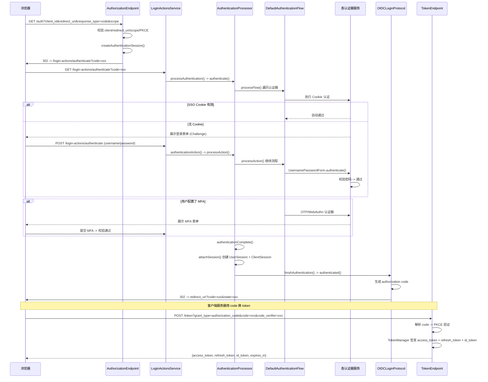
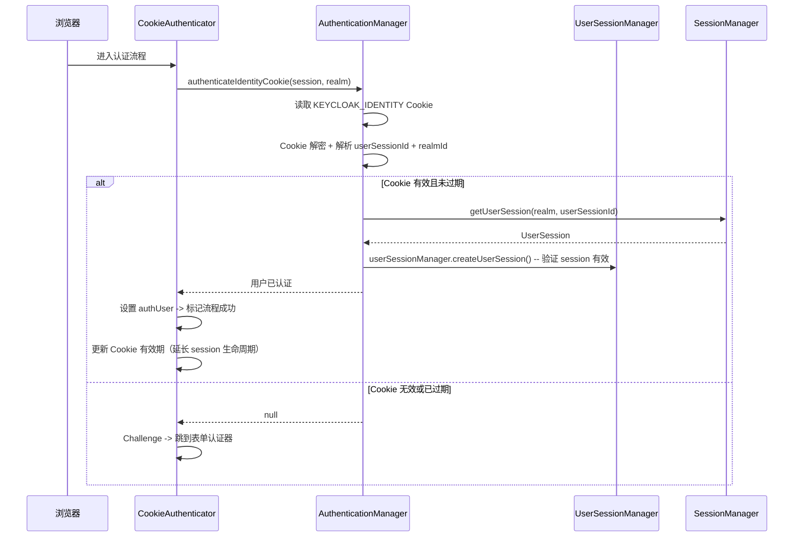
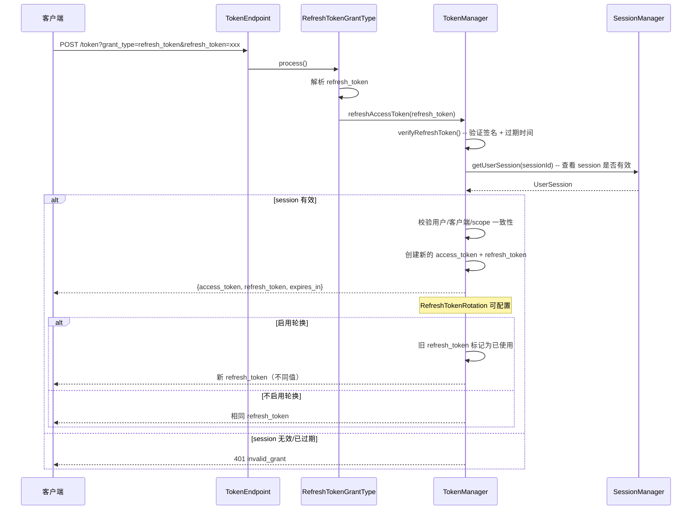
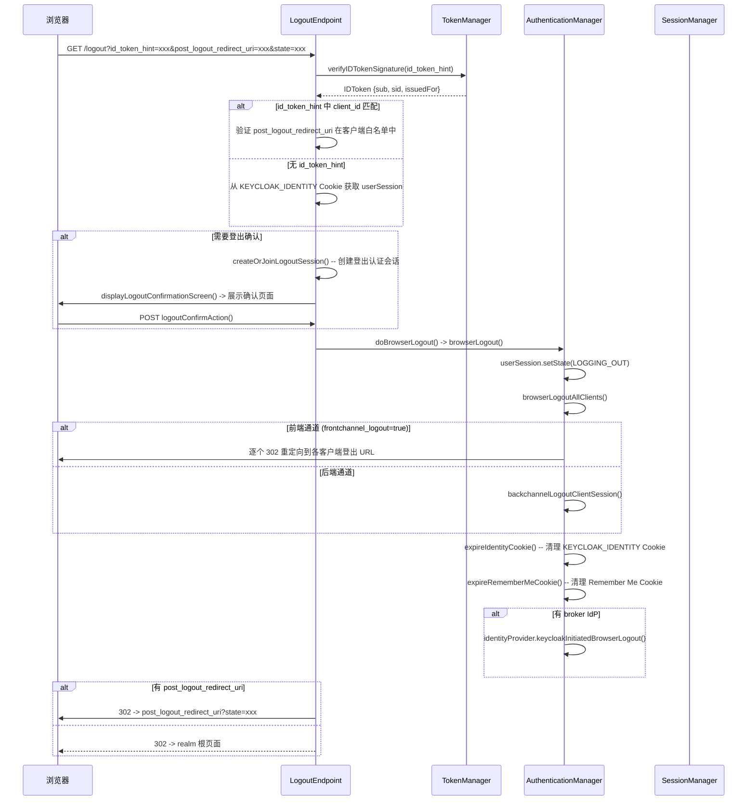
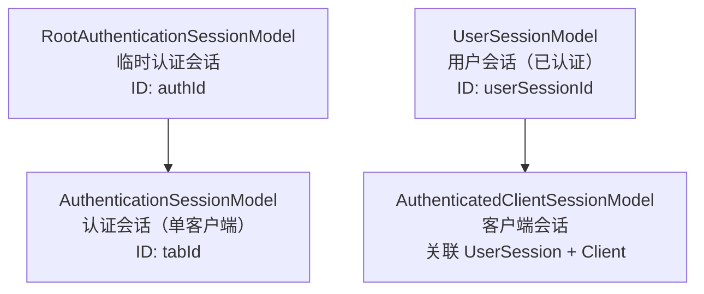

# Keycloak 登录/登出流程详细分析

> 本文档深度分析 Keycloak 的登录、登出、Token 颁发、会话管理全链路流程，覆盖 Authorization Code Flow 完整生命周期。配套架构概览请先阅读 [Keycloak 项目解读](README.md)。

## 第一部分：路由体系总览

Keycloak 的 HTTP 路由通过三层分发实现：

```
RealmsResource (根路由 /realms/{realm})
  |
  |- /protocol/openid-connect/*     -> OIDCLoginProtocolService
  |- /protocol/saml/*               -> SAML 协议
  |- /login-actions/*               -> LoginActionsService
  |- /account/*                     -> 账户管理

OIDCLoginProtocolService (/protocol/openid-connect/)
  |
  |- auth                           -> AuthorizationEndpoint
  |- token                          -> TokenEndpoint
  |- logout                         -> LogoutEndpoint
  |- userinfo                       -> UserInfoEndpoint
  |- revoke                         -> TokenRevocationEndpoint
  |- token/introspect               -> TokenIntrospectionEndpoint
  |- auth/device                    -> DeviceEndpoint

LoginActionsService (/login-actions/)
  |
  |- authenticate                   -> 认证流程入口
  |- authenticater                  -> 会话 code 校验
  |- restart-broker                 -> 重新启动 IdP 认证
  |- required-action/{action}       -> 必要动作执行
```

**`RealmsResource`**（`services/src/main/java/org/keycloak/services/resources/RealmsResource.java`）是根路由入口。`getProtocol()` 方法根据 `protocol` 参数创建对应的 `LoginProtocolFactory`，再由工厂创建 `OIDCLoginProtocolService` 实例。

**`OIDCLoginProtocolService`**（`services/src/main/java/org/keycloak/protocol/oidc/OIDCLoginProtocolService.java`）使用 JAX-RS `@Path` 注解完成子路由分发——`auth()` 返回 `AuthorizationEndpoint`，`token()` 返回 `TokenEndpoint`，`logout()` 返回 `LogoutEndpoint`。

---

## 第二部分：Authorization Code Flow 完整流程

这是 Keycloak 最核心的认证路径，覆盖 OIDC 协议的标准授权码流程。

### 全局时序



### 阶段一：授权请求处理

`AuthorizationEndpoint.process()`（`services/src/main/java/org/keycloak/protocol/oidc/endpoints/AuthorizationEndpoint.java:134`）：

```
1. checkSsl() / checkRealm() -- SSL 和 realm 状态检查
2. 解析 client_id -> 查找并验证 ClientModel 有效性
3. PreAuthorizationRequestContext -- 触发 client policy
4. AuthorizationEndpointRequestParserProcessor.parseRequest() -- 解析所有请求参数
5. AuthorizationEndpointChecker 校验：
   - redirect_uri -> 必须在客户端白名单中
   - response_type -> 必须是 allowed response types
   - PKCE -> code_challenge 格式验证（S256/plain）
   - scope -> scope 的有效性和 openid 的必要性
   - 其他：max_age, prompt, login_hint, acr, claims
6. createAuthenticationSession() -- 创建临时认证会话
7. AuthorizationRequestContext -- 再次触发 client policy
8. updateAuthenticationSession() -- 设置协议/redirect_uri/client notes
9. 根据 action 分发：
   - CODE -> buildAuthorizationCodeAuthorizationResponse()
   - REGISTER -> buildRegister()（自注册流程）
   - FORGOT_CREDENTIALS -> buildForgotCredential()（忘记密码）
```

`buildAuthorizationCodeAuthorizationResponse()` 设置 `AUTH_TYPE = "code"`，然后调用父类 `AuthorizationEndpointBase.handleBrowserAuthenticationRequest()`，将认证会话重定向到 `LoginActionsService.authenticate()` 启动浏览器认证流。

**临时认证会话（`RootAuthenticationSessionModel`）** 是 Keycloak 认证流程的关键设计。它在用户第一次访问认证端点时创建，包含一个或多个 `AuthenticationSessionModel`（每个客户端一个），在认证期间保存状态，认证完成后被消费。

### 阶段二：认证流程引擎

`LoginActionsService.processAuthentication()`（`services/src/main/java/org/keycloak/services/resources/LoginActionsService.java:350`）创建 `AuthenticationProcessor` 并调用 `processFlow()`。

`AuthenticationProcessor`（`services/src/main/java/org/keycloak/authentication/AuthenticationProcessor.java`）是整个认证流程的控制器：

```
authenticate() [line 954]:
  |- authenticateOnly() [line 1105]
  |   |- checkClientSession(false) -- 校验认证会话 code 的有效性和时效性
  |   |- 设置事件详情（client_id, redirect_uri, auth_method）
  |   |- validateUser() -- 检查已有认证用户的有效性
  |   |- AuthenticationFlow.processFlow() -- 开始执行认证流程
  |       -> 逐步执行每个认证器
  |       -> 返回 challenge（需用户交互）或 null（全部完成）
  |
  |- 若 challenge != null -> 返回 challenge（浏览器渲染登录页面）
  |
  |- authenticationComplete() [line 1234]:
      |- 检查 nextRequiredAction -- 如有必要动作（更新密码/配置OTP等）-> 重定向
      |- finishAuthentication() [line 1217]:
          |- attachSession() -- 创建 UserSession + ClientSession
          |- AuthenticationManager.redirectAfterSuccessfulFlow()
              -> protocol.authenticated() -- OIDC 协议回调
```

#### 三种流程类型

`AuthenticationProcessor.createFlowExecution()`（`line 940`）根据流程类型创建不同的流程执行器：

| 流程类型 | 类 | 用途 |
|---------|---|------|
| `BASIC_FLOW` | `DefaultAuthenticationFlow` | 浏览器登录流程（Cookie/表单/OTP/IdP） |
| `FORM_FLOW` | `FormAuthenticationFlow` | 单表单交互（如注册、忘记密码） |
| `CLIENT_FLOW` | `ClientAuthenticationFlow` | 客户端认证流程（如 client_secret_basic） |

### 阶段三：认证器执行

`DefaultAuthenticationFlow.processFlow()` 遍历当前流程下所有 `AuthenticationExecutionModel`，按顺序和执行模式执行认证器。

**核心认证器一览（`services/src/main/java/org/keycloak/authentication/authenticators/`）：**

| 认证器 | 文件路径 | 职责 |
|--------|---------|------|
| `CookieAuthenticator` | `browser/CookieAuthenticator.java` | 检查 SSO Cookie，若有效自动认证 |
| `UsernamePasswordForm` | `browser/UsernamePasswordForm.java` | 展示登录表单，校验用户名密码 |
| `WebAuthnPasswordlessForm` | `browser/WebAuthnPasswordlessForm.java` | WebAuthn 无密码认证 |
| `OTPFormAuthenticator` | `browser/OTPFormAuthenticator.java` | TOTP 一次性密码校验 |
| `IdentityProviderAuthenticator` | `broker/IdentityProviderAuthenticator.java` | 身份代理（社交登录/IdP 联邦） |
| `ConditionalRoleAuthenticator` | `conditional/ConditionalRoleAuthenticator.java` | 按角色条件执行子流程 |
| `ConditionalUserAttribute` | `conditional/ConditionalUserAttribute.java` | 按用户属性条件执行 |
| `ConditionalLevelOfAuthentication` | `conditional/ConditionalLevelOfAuthentication.java` | 按 ACR 条件执行 |

#### 认证器执行模式

| 模式 | 行为 |
|------|------|
| `REQUIRED` | 必须成功执行，失败则流程整体失败 |
| `ALTERNATIVE` | 同一组中任一成功即可，组内全部失败则流程失败 |
| `CONDITIONAL` | 由条件认证器决定是否执行，条件不满足则标记为 SKIPPED |
| `REQUIRED` + 子流程 | 子流程整体执行，子流程内可配置 ALTERNATIVE 组 |

浏览器默认流程中，`Cookie` 认证器是 `REQUIRED`（但 Cookie 认证器本身在无 Cookie 时返回 NOT_SKIPPED 的 challenge 而非失败），`UsernamePasswordForm` 和 `IdentityProviderAuthenticator` 为 `ALTERNATIVE`，`OTPFormAuthenticator` 为 `CONDITIONAL`。这种组合实现了"SSO/Cookie 有效则自动通过，否则表单登录或社交登录二选一，有 OTP 则追加验证"的逻辑。

### 阶段四：会话创建与协议回调

`authenticationComplete()` 调用 `attachSession()`（`line 1135`）：

```
attachSession():
  if userSession == null:
    UserSessionManager.createUserSession()
      -> session.sessions().createUserSession(realm, user, ...)
      -> DeviceActivityManager.attachDevice() 记录设备信息
  TokenManager.attachAuthenticationSession()
    -> 创建或获取 AuthenticatedClientSessionModel
    -> 设置 client scopes / acr / protocol 等
  userSession.setState(LOGGED_IN)
```

然后 `finishAuthentication()` 调用 `AuthenticationManager.redirectAfterSuccessfulFlow()`，最终进入 `OIDCLoginProtocol.authenticated()`（`services/src/main/java/org/keycloak/protocol/oidc/OIDCLoginProtocol.java:222`）。

**`OIDCLoginProtocol.authenticated()` 逻辑：**

```
1. 获取 response_type、response_mode
2. 构建 redirect_uri（含 state、session_state、issuer 参数）
3. 根据 response_type 处理：
   - code: OAuth2CodeParser.persistCode() -> 持久化一次性 authorization code
   - id_token: TokenManager.responseBuilder() -> 直接签发 id_token
   - id_token token: 签发 id_token + access_token
   - code id_token: 签发 code + id_token（hybrid）
   - code token: 签发 code + access_token（hybrid）
   - code id_token token: 签发全部（hybrid）
4. 302 重定向到客户端的 redirect_uri
```

**`OAuth2CodeParser.persistCode()`** 生成的 authorization code 包含加密后的认证会话 ID、客户端 ID、过期时间、PKCE 信息等。code 为一次性使用，解析后从存储中删除。

### 阶段五：Token 颁发

`TokenEndpoint.processGrantRequest()`（`services/src/main/java/org/keycloak/protocol/oidc/endpoints/TokenEndpoint.java:118`）根据 `grant_type` 参数路由到对应的 Grant Type 处理器。

**支持的 Grant 类型：**

| Grant Type | 类 | 用途 |
|-----------|-----|------|
| `authorization_code` | `AuthorizationCodeGrantType` | 授权码换令牌（标准 OIDC） |
| `refresh_token` | `RefreshTokenGrantType` | 刷新 Access Token |
| `password` | `ResourceOwnerPasswordCredentialsGrantType` | 直接密码模式 |
| `client_credentials` | `ClientCredentialsGrantType` | 客户端凭证模式 |
| `urn:ietf:params:oauth:grant-type:token-exchange` | `TokenExchangeGrantType` | Token 交换 |
| `urn:ietf:params:oauth:grant-type:device_code` | `DeviceGrantType` | 设备授权码 |

**`AuthorizationCodeGrantType.process()`（`services/src/main/java/org/keycloak/protocol/oidc/grants/AuthorizationCodeGrantType.java:68`）：**

```
1. OAuth2CodeParser.parseCode() -- 解密并验证 code
   -> 检查过期时间、issuer 一致性、session 有效性
   -> 从存储中删除 code（一次性消费）
2. PKCE 验证 -- code_verifier vs code_challenge
   -> 支持 S256 和 plain 两种模式
3. 校验 session 和 user 是否存在且活跃
4. 校验 scope 和 consent（需用户同意的 scope）
5. createTokenResponse() -> TokenManager 签发令牌
```

**`TokenManager`（`services/src/main/java/org/keycloak/protocol/oidc/TokenManager.java`）签发三种令牌：**

| Token 类型 | 生成方法 | 内容 |
|-----------|---------|------|
| `access_token` | `generateAccessToken()` | JWT: sub/iss/aud/exp/realm_access/resource_access/allowed-origins |
| `refresh_token` | `generateRefreshToken()` | JWT: sub/sid/exp/typ=Refresh |
| `id_token` | `generateIDToken()` | JWT: sub/nonce/auth_time/acr/name/email/... |

`generateAccessToken()` 调用 `initToken()`（`line 587`）初始化 token 基础信息，然后调用 `transformAccessToken()` 应用 Client Policy 的自定义转换逻辑。
---

## 第三部分：SSO Cookie 认证

Keycloak 的 SSO Cookie 是由 `CookieAuthenticator`（`services/src/main/java/org/keycloak/authentication/authenticators/browser/CookieAuthenticator.java`）检测的，它是浏览器流程的第一个认证器。



SSO Cookie 的默认名称为 `KEYCLOAK_IDENTITY`，内容为加密的 `userSessionId + realmId + timestamp`。同 realm 下的所有客户端共享此 Cookie——用户在同一 realm 中首次登录后，访问其他客户端时 Cookie 认证器直接通过，无需重复输入密码。

Cookie 认证器返回 **NOT_SKIPPED challenge** 而非失败——流程引擎会继续执行 ALTERNATIVE 组中的表单认证器。但 Cookie 认证器认证通过后会设置 `authUser`，后续认证器看到已有 `authUser` 时可以跳过。

---

## 第四部分：用户名密码登录

### 表单认证器

`UsernamePasswordForm`（`services/src/main/java/org/keycloak/authentication/authenticators/browser/UsernamePasswordForm.java`）继承自 `AbstractUsernameFormAuthenticator`。

**`authenticate()` -- 首次渲染登录表单：**

```
1. 检查 authUser 是否已设置（已有 SSO Cookie 用户）
   -> 若已设置 -> authenticated() 跳过表单
2. 检查是否来自 IdP brokering -> 跳转到社交登录
3. 构建 LoginFormsProvider -> 渲染 login.ftl 模板
4. 返回表单 Challenge
```

**`action()` -- 处理用户提交的用户名密码：**

```
1. 提取 username + password
2. username 处理：去除空白、统一小写（可选配置）
3. checkUsername() -- 查找用户
   -> UserModel 查找 -> 不存在则返回错误
4. checkPassword() -- 密码校验
   -> credentialManager.authenticate(password)
   -> 支持 Argon2 / PBKDF2 等哈希算法（内置 provider 无 BCrypt）
5. checkDisabledUser() -- 检查账户状态（禁用/锁定/临时锁定）
6. checkTimer() -- 临时锁定时间检查
7. checkBruteForce() -- 暴力破解检测
8. 成功 -> 设置 authUser -> 返回成功（流程引擎继续下一个认证器）
```

### 密码验证机制

`credentialManager.authenticate()` 委托给 `PasswordCredentialProvider`：

```
PasswordCredentialProvider.isValid():
  1. 从 UserModel 获取存储的密码凭据
  2. 根据 credentialData.algorithm 选择密码编码器
     -> argon2 / pbkdf2 / pbkdf2-sha256 / pbkdf2-sha512（内置 provider 无 BCrypt）
  3. 编码器验证：encode(password, salt) == stored_hash
  4. 若密码过期策略启用 -> 验证是否需更新密码
  5. 更新密码哈希迭代（若算法迭代次数已变更，自动重新哈希）
```

### Remember Me

如果用户在登录表单勾选"Remember Me"，Keycloak 会额外设置一个持久 Cookie（`KEYCLOAK_REMEMBER_ME`），默认为 30 天有效期。此 Cookie 在用户关闭浏览器后不失效。当 SSO Cookie（默认浏览器会话级别）过期后，Remember Me Cookie 可以重新建立用户会话。

---

## 第五部分：多因素认证

### 条件 OTP 执行

`OTPFormAuthenticator`（`services/src/main/java/org/keycloak/authentication/authenticators/browser/OTPFormAuthenticator.java`）是 CONDITIONAL 模式执行的 OTP 认证器。

**`configuredFor()`：**

```
if (useOTPForUser(realm, user)):
  return user.credentialManager().isConfiguredFor(OTP_CREDENTIAL_TYPE)
```

只有用户已配置了 OTP 凭据时，此认证器才会被拉入实际执行。

**`authenticate()` -- 展示 OTP 输入页面：**

```
1. 检查 userSession 是否已有 OTP 认证标记
2. 设置 authNote("otp_auth_note") -- 标记当前为 OTP 阶段
3. 构建 OTP 表单 -> 渲染 login-otp.ftl 模板
4. 返回 Challenge
```

**`action()` -- 处理 OTP 提交：**

```
1. credentialManager.updateStoredCredential()
2. OTP 校验 -> 调用 TOTP/HOTP 验证
3. 成功 -> 设置 OTP 认证完成标记 -> 返回成功
```

### WebAuthn / Passkey 认证

`WebAuthnPasswordlessForm` 支持基于 WebAuthn 标准的无密码认证：

```
1. 获取 realm 的 WebAuthn 策略配置（rpId, rpName, attestationConveyance, ...）
2. 生成 challenge（32 字节随机数）
3. 构建 PublicKeyCredentialRequestOptions -> 传入浏览器
4. 浏览器调用 navigator.credentials.get() -> 用户生物识别/安全密钥
5. 返回 authenticatorData + signature + clientDataJSON 等
6. 校验签名 -> 验证 challenge -> 检查 counter（防克隆）

支持两种模式：
- WebAuthn 密码模式：替代密码（同级别认证因子）
- WebAuthn 无密码模式：无需用户名即可认证（第二因子级别）
```

---

## 第六部分：Token 刷新



**`RefreshTokenGrantType.process()`（`services/src/main/java/org/keycloak/protocol/oidc/grants/RefreshTokenGrantType.java:54`）：**

```
1. 解析 refresh_token -> 触发 TokenRefreshContext client policy
2. TokenManager.refreshAccessToken(refresh_token):
   a. verifyRefreshToken() -- 签名验证（使用 realm 的 refresh key）
   b. 解析 UserSession 信息 -> 检查 session 状态
   c. 校验用户/客户端/scope 未变更
   d. 生成新 access_token + refresh_token（可选轮换）
   e. 更新 session 最后访问时间
```

**Token 轮换策略**：默认关闭，可通过 `refreshTokenRotation` 配置启用。启用后每次刷新会签发新的 refresh_token，同时旧 token 被标记为已使用，防止 refresh token 泄露导致的未授权访问。

---

## 第七部分：Token 吊销

`TokenRevocationEndpoint` 实现 OAuth 2.0 Token Revocation（RFC 7009）：

```
POST /realms/{realm}/protocol/openid-connect/revoke
  Body: token=xxx&token_type_hint=access_token|refresh_token

1. 客户端认证（Bearer token 或 client credentials 等方式）
2. 查找对应的 token：
   - access_token: 解析 -> 查找 UserSession -> 关联的 ClientSession 标记为 LOGGED_OUT
   - refresh_token: 解析 -> 查找 UserSession -> 标记 offline/online session 为失效
3. 返回 200 OK（无论 token 是否有效，防枚举）
```

---

## 第八部分：登出流程

Keycloak 支持三种登出方式：**RP-Initiated Logout**（浏览器登出）、**Backchannel Logout**（后端直接登出）、**Backchannel Logout Request**（OIDC 规范的后端通知）。

### RP-Initiated Logout（浏览器登出）

`LogoutEndpoint.logout()`（`services/src/main/java/org/keycloak/protocol/oidc/endpoints/LogoutEndpoint.java:154`）遵循 OpenID Connect RP-Initiated Logout 规范。



**`doBrowserLogout()` 详细步骤（`LogoutEndpoint.java:407`）：**

```
1. AuthenticationManager.authenticateIdentityCookie() -- 从 Cookie 恢复 UserSession
2. initiateBrowserLogout(session, realm, userSession):
   -> 设置 userSession.state = LOGGING_OUT
   -> createOrJoinLogoutSession() -- 创建登出认证会话
3. 若来自 broker IdP -> 调用 broker 的 keycloakInitiatedBrowserLogout()
4. finishBrowserLogout():
   a. browserLogoutAllClients():
      - 遍历所有已认证的客户端 session
      - frontchannel_logout=true 的客户端 -> 逐个返回前端登出重定向
      - 其他客户端 -> backchannelLogoutClientSession() 后端登出
   b. expireIdentityCookie() / expireRememberMeCookie()
   c. 检查 userSession 的所有客户端是否均已登出
   d. 删除登出认证会话
5. 构建最终重定向：
   - 若有 post_logout_redirect_uri + 有效 -> 重定向到该 URI（携带 state）
   - 若无 -> 重定向到 realm 根页面
```

#### 前端通道登出（Front Channel Logout）

`frontchannelLogoutClientSession()` 对每个启用了前端登出的客户端，返回一个 302 重定向到客户端的登出 URL。客户端登出页面需要：

1. 执行本地的登出逻辑（销毁本地 session）
2. 通过 `` 或重定向回 Keycloak 登出确认 URI

由于是以 302 链式重定向逐一执行，跳转链中任何一个客户端登出失败或超时，后续登出不会自动停止，但用户可能需要手动返回。

#### 后端通道登出（Back Channel Logout）

`backchannelLogoutClientSession()` 对每个启用了后端登出的客户端直接发 HTTP POST 请求：

```
POST {client.logoutUrl} HTTP/1.1
Content-Type: application/x-www-form-urlencoded

client_session_state={sessionId}&client_session_host={host}&logout_token={JWT}
```

`logout_token` 是一个包含 `events: { "http://schemas.openid.net/event/backchannel-logout": {} }` 声明的 JWT，由 Keycloak 的 refresh key 签名。

### Backchannel Logout（后端直接登出）

`LogoutEndpoint.logoutToken()`（`line 483`）用于非浏览器场景（如通过 refresh token 登出）：

```
1. 客户端认证（client_secret / client_assertion 等）
2. 验证 refresh token（如果提供）
3. 查找对应的 userSession（online 或 offline）
4. AuthenticationManager.backchannelLogout():
   a. userSession.setState(LOGGING_OUT)
   b. expireUserSessionCookie()
   c. createOrJoinLogoutSession()
   d. backchannelLogoutAll() -- 对所有客户端执行后端登出
   e. userSession.setState(LOGGED_OUT)
   f. 若为 offline session -> 吊销 offline session
   g. session.sessions().removeUserSession(realm, userSession) -- 销毁会话
```

### Backchannel Logout Request（OIDC 规范的后端通知）

`LogoutEndpoint.backchannelLogout()`（`line 558`）实现 OpenID Connect Back-Channel Logout 1.0 规范：

```
POST /realms/{realm}/protocol/openid-connect/backchannel-logout
  Content-Type: application/x-www-form-urlencoded

  logout_token={JWT}

1. TokenManager.verifyLogoutToken() -- 验证 logout_token:
   - 签名验证（使用 realm 的 refresh key）
   - events 声明检查
   - sub 或 sid 声明检查（至少一个）
2. 按 session_id 查找 UserSession
3. 对该 UserSession 执行 backchannelLogout()

此端点的使用者是支持 OIDC Back-Channel Logout 的第三方身份提供者。
```

### 登出协议对比

| 方式 | 触发条件 | 客户端通知 | Cookie 清理 | Session 销毁 |
|------|---------|-----------|------------|-------------|
| RP-Initiated Logout | 浏览器 GET /logout | 前端通道 + 后端通道 | 清理 | 标记 LOGGED_OUT |
| Backchannel Logout | refresh token 登出 | 后端通道 | N/A | 销毁 + 从存储移除 |
| Backchannel Logout Request | 外部 IdP 的 logout_token | 后端通道 | N/A | 销毁 + 从存储移除 |
| Session 超时 | `ssoSessionMaxLifetime` | 无 | N/A | Infinispan 过期自动删除 |

---

## 第九部分：会话管理

### 会话模型

Keycloak 的会话系统分为三层：



**`RootAuthenticationSessionModel`** 是认证过程中的临时状态容器，在用户完成登录前的所有步骤间保持状态。

**`UserSessionModel`**（`server-spi/src/main/java/org/keycloak/models/UserSessionModel.java`）是认证成功后的用户会话——包含用户基本信息、IP 地址、创建时间、最后访问时间、会话状态。

**`AuthenticatedClientSessionModel`** 关联 UserSession 和 Client。一个 UserSession 下可以有多个 AuthenticatedClientSession——同一用户登录了多个应用。

### 会话状态机

```
                     +----------------+
                     | CREATE (创建)    |
                     +-------+--------+
                             |
                             v
                     +----------------+
         +-----------+ LOGGED_IN      |<--------+
         |           +-------+--------+          |
         |                   |                    |
         |                   v                    |
         |           +----------------+           |
         |           | LOGGING_OUT    |           |
         |           +-------+--------+           |
         |                   |                    |
         |                   v                    |
         |           +----------------+           |
         |           | LOGGED_OUT     |-----------+
         |           +-------+--------+  (不可恢复)
         |                   |
         |                   v
         |           +-------------------------+
         |           | LOGGED_OUT_UNCONFIRMED  |---+
         |           +-------------------------+   |  (重认证可恢复)
         |
         +-- 超时自动销毁 (Infinispan 过期条目)
```

`LOGGED_OUT_UNCONFIRMED` 状态用于未完全确认的登出场景（如前端通道登出中某些客户端未返回确认）。

### 会话超时策略

| 配置项 | 默认值 | 说明 |
|--------|-------|------|
| `ssoSessionMaxLifetime` | 1 天 | 用户会话绝对过期时间 |
| `ssoSessionIdleTimeout` | 30 分钟 | 用户会话空闲过期时间 |
| `offlineSessionMaxLifetime` | 30 天 | 离线会话绝对过期时间 |
| `offlineSessionIdleTimeout` | 1 天 | 离线会话空闲过期时间 |
| `clientSessionIdleTimeout` | 10 分钟 | 认证会话空闲过期时间 |
| `clientSessionMaxLifetime` | 1 天 | 认证会话绝对过期时间 |

### 会话存储

会话存储通过 Infinispan 分布式缓存实现（`model/infinispan/`）：

| 缓存名称 | 存储内容 | 持久化 |
|---------|---------|--------|
| `sessions` | 在线 UserSession | 是（RocksDB/JDBC 持久化） |
| `clientSessions` | 在线 AuthenticatedClientSession | 是 |
| `offlineSessions` | 离线 UserSession | 是 |
| `offlineClientSessions` | 离线 AuthenticatedClientSession | 是 |
| `authenticationSessions` | 临时认证会话 | 否（仅内存） |
| `loginFailures` | 登录失败计数（暴破检测） | 是 |

---

## 第十部分：认证流程安全机制

### PKCE（Proof Key for Code Exchange）

PKCE 用于防止授权码拦截攻击。Keycloak 在 `AuthorizationEndpoint.process()` 中验证 `code_challenge` 的格式，在 `AuthorizationCodeGrantType.process()` 中使用 `code_verifier` 重新计算 challenge 并比对。

| mode | code_challenge 计算方式 | 推荐 |
|------|-----------------------|------|
| `S256` | `BASE64URL-ENCODE(SHA256(code_verifier))` | 推荐 |
| `plain` | `code_verifier` 直接作为 challenge | 仅兼容 |

### 暴力破解检测

Keycloak 的暴力破解检测由 `AuthenticationManager.checkBruteForce()` 触发，数据存储在 `loginFailures` 缓存中：

```
1. 每次登录失败 -> 记录失败次数 + IP + 时间戳到 loginFailures 缓存
2. 失败次数超过 maxLoginFailures（默认 30 次）-> 临时锁定
3. 锁定持续 waitIncrementSeconds（默认从 30 秒递增）
4. permanentLockout 开启 -> 超过指定次数后永久锁定
5. 快照基线 -> 基于用户历史行为检测异常登录模式
```

### Client Policy

Client Policy 机制允许在认证前/认证后/Token 签发等关键时刻触发的策略链。通过 `session.clientPolicy().triggerOnEvent()` 在多个节点注入策略检查：

- `PreAuthorizationRequestContext` — 授权请求前（可拒绝请求）
- `AuthorizationRequestContext` — 授权请求创建后
- `TokenRefreshContext` — Token 刷新前
- `ClientRegistrationContext` — 客户端注册时

---

## 第十一部分：设计模式分析

Keycloak 认证体系的 SPI 模式是其可扩展性的核心：

### 认证器 SPI（`Authenticator`）

```java
public interface Authenticator {
    void authenticate(AuthenticationFlowContext context);
    void action(AuthenticationFlowContext context);
    boolean requiresUser();
    boolean configuredFor(KeycloakSession session, RealmModel realm, UserModel user);
    void setRequiredActions(KeycloakSession session, RealmModel realm, UserModel user);
}
```

新增认证方式只需要实现 `Authenticator` 接口并在 `SPI` 中注册。`AuthenticationFlowContext` 提供完整的流程控制——中断流程（Challenge）、继续流程、设置错误信息。

### Provider 工厂模式

所有 SPI 实现（认证器、事件监听器、用户存储、协议等）均遵循 `ProviderFactory + Provider` 模式。`ProviderManager` 在启动时扫描所有 `META-INF/services/org.keycloak.provider.Spi` 文件加载实现类。

### 策略模式在执行模式中的体现

`REQUIRED / ALTERNATIVE / CONDITIONAL` 三种执行模式本质上是策略模式的变体——每个 `AuthenticationExecutionModel` 封装了"要执行什么 + 怎么处理结果"的逻辑，由 `DefaultAuthenticationFlow` 在运行时根据执行模式决策流程走向。

---

## 第十二部分：总结

Keycloak 的认证体系是一个 **分层 + SPI 驱动 + 可配置流程** 的实现：

1. **路由三层分发**：`RealmsResource` -> `OIDCLoginProtocolService` -> `AuthorizationEndpoint/LoginActionsService`，职责单一，分层清晰
2. **认证流程引擎**：`AuthenticationProcessor` + `DefaultAuthenticationFlow` 组合实现了可拖拽配置的认证链，支持 REQUIRED/ALTERNATIVE/CONDITIONAL 三种执行模式
3. **认证器 SPI**：每种认证方式独立实现 `Authenticator` 接口，新增认证方式无需修改引擎
4. **Session 体系**：认证会话（`RootAuthenticationSessionModel`）与登录会话（`UserSessionModel`）分离，认证过程的状态与认证成功后的会话各司其职
5. **多模式登出**：RP-Initiated、Backchannel、Backchannel Logout Request 覆盖所有登出场景
6. **Cookie 和 Token 双认证**：Cookie 实现 SSO 免密，Token 实现 API 级别访问控制
7. **存储分层**：Infinispan 提供高性能分布式缓存，JPA 提供持久化保障

> **仓库：** [github.com/keycloak/keycloak](https://github.com/keycloak/keycloak) | **相关文档：** [Keycloak 项目解读](README.md)
