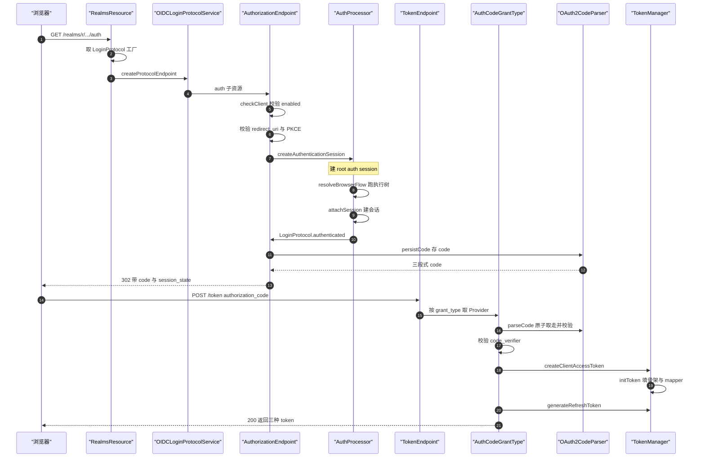
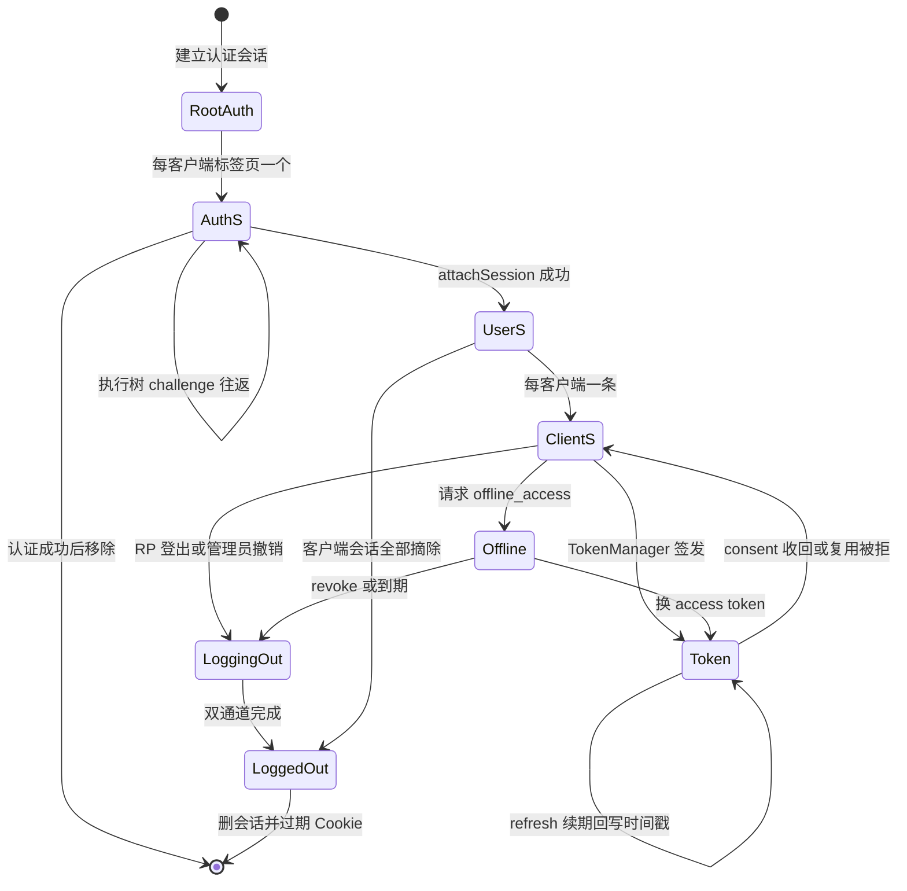
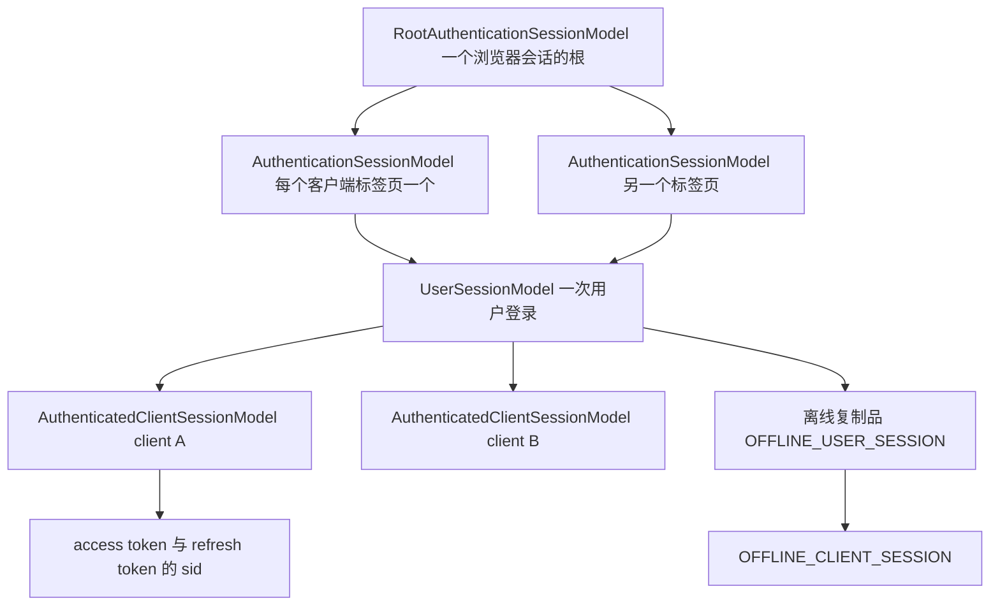
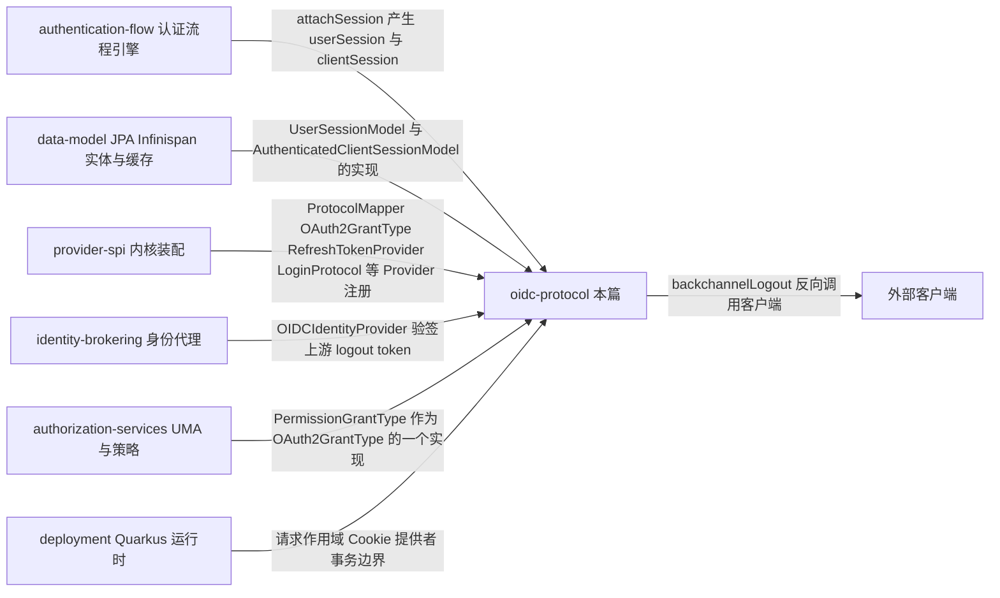

# Keycloak OIDC 协议层：授权码链路、令牌颁发与会话登出

> 解读基线：Keycloak 26.7.3（`6d238b6558`）。下文所有源码引用均相对仓库根，并附程序化校验过的行号锚点。

> 模块角色：Keycloak 的**对外数据面**。[`authentication-flow.md`](authentication-flow.md) 解决的是「如何把登录过程变成一棵可配置的执行树」，但执行树本身不产出任何 HTTP 边界：它不知道用户是从 `/auth` 端点来的还是从 account console 来的，也不知道认证成功后该返回 code、token 还是 SAML assertion。本篇补上这个缺口——把流程引擎接上 JAX-RS 端点、接上会话模型、接上 JWT 签发与撤销，从而说明「一次 OIDC 登录在 Keycloak 内部究竟发生了什么」。文末再把结论交回 [`provider-spi.md`](provider-spi.md) 的「一切皆 Provider」。

---

## 根因映射：协议层是「配置驱动」的最后一公里

总览篇给出的根因是「一个身份中心要同时满足无数互相冲突的约束」。到了 OIDC/OAuth2 层，这些冲突变成一组非常具体的协议参数：有的客户端要 `response_type=code`，有的要 hybrid；有的要 `aud` 里带十个资源服务，有的坚决不要；有的租户要求 refresh token 一次性轮换，有的运营团队怕前端重试导致用户被登出而必须关掉它；有的客户端在 LDAP 目录下有一万个用户、token 里绝不能塞角色，有的客户端全部鉴权逻辑都靠 token 里的 `resource_access` 完成。

Keycloak 在这一层的答案是：**端点负责协议合法性，Provider 负责协议可变部分，模型负责协议状态**。三者的分工在源码里界线极清晰——`TokenEndpoint` 里没有一行「什么 claim 该进 token」的逻辑，`AuthorizationCodeGrantType` 里没有一行「怎么登录」的逻辑，`TokenManager` 里没有一行 HTTP 逻辑。这种切分本身就是可插拔性的前提：只有把「协议解析」与「协议语义」分开，才可能在同一个 `/token` 端点上同时支持 authorization_code、refresh_token、client_credentials、CIBA、device、token-exchange、JWT bearer 等十几种 grant。

---

## 设计思路与替代方案

### 分层：四个环，每环只做一件事

| 环 | 代表类 | 只负责 | 不负责 |
|---|---|---|---|
| 路由与协议分发 | `RealmsResource` → `LoginProtocolFactory` | 由 URL 里的 `{protocol}` 段决定用哪个 `LoginProtocol` Provider | 具体端点语义 |
| 端点（协议合法性） | `AuthorizationEndpoint`、`TokenEndpoint`、`LogoutEndpoint` | 参数校验、CORS、错误页/错误重定向、把请求交给 grant | claim 内容、会话状态 |
| Grant / 流程编排 | `AuthorizationCodeGrantType`、`AuthenticationProcessor` | 一次协议交换的步骤顺序 | 令牌内部构造、存储 |
| 令牌与会话内核 | `TokenManager`、`UserSessionModel` | 令牌构造、过期计算、mapper 应用、会话读写 | HTTP、协议参数名 |

### 替代方案及其代价

**替代方案 A：为每种 flow 写一个 servlet/端点。** 这是最直观的做法（老式 IdP 常见）。代价是共享逻辑（client 认证、scope 校验、CORS、PKCE、DPoP、consent 复查）会在 N 个端点里复制 N 遍；而 Keycloak 的约束恰恰是这些横向关注点会被 client policy、custom authenticator、扩展 grant 反复触及。Keycloak 选择用 `OAuth2GrantType` Provider + 一个统一 `TokenEndpoint` 收口，把差异压进 Provider，把共性留在端点。

**替代方案 B：令牌完全无状态（纯 JWT，不落任何会话）。** 这是「可扩展性优先」路线，能省掉全部会话存储与分布式缓存。代价是无法回答「这个用户的所有会话给我列出来」「这个客户端被我停用了，立刻生效」「用户改了密码，旧 token 现在作废」——而企业 IAM 的采购清单上这几条几乎从不缺席。Keycloak 选择了**混合路线**：access token 是无状态签名的 bearer JWT（外部资源服务零回源即可验签授权），而 refresh token 与会话是有状态的（必须回源）。这个非对称是整篇文档的主线，后面逐条展开。

**替代方案 C：把 claim 逻辑硬编码进 `TokenManager`。** 代价是任何「加一个自定义 claim」的需求都要求改内核并重新发版——而 Keycloak 的用户恰恰是「不改一行代码」为前提的集成方。所以 claim 被做成了 `ProtocolMapper` Provider。

---

## 关键数据结构

理解本模块只需要抓住四个对象和它们之间的引用方向。

### AuthenticatedClientSessionModel：协议状态的容器

它是 OIDC 层真正的「会话」，因为**只有它带协议属性**：redirect URI、protocol、以及一个完全自由的 `Map<String,String>` notes 桶。所有跨步骤需要记住的协议数据（nonce、scope、code_challenge、adapter session state、offline 标记）都以 note 形式存在这里，而不是新增字段。

定义了 note key 的命名约定与四个 refresh-token 相关的 note 前缀：

[server-spi/src/main/java/org/keycloak/models/AuthenticatedClientSessionModel.java:29-36]()
<!-- anchor: public interface AuthenticatedClientSessionModel extends CommonClientSessionMode … final String REFRESH_TOKEN_LAST_REFRESH_PREFIX = "refreshTokenLastRefreshPrefix" -->

其中 refresh token 的「一次性」状态完全靠 note 三元组实现（token id、使用计数、最后刷新时间），键名再拼上 `reuseId`：

三个 note 前缀 + reuseId 组成 refresh token 复用检测的存储键：

[server-spi/src/main/java/org/keycloak/models/AuthenticatedClientSessionModel.java:111-129]()
<!-- anchor: default String getRefreshToken(String reuseId) { … setNote(REFRESH_TOKEN_LAST_REFRESH_PREFIX + reuseId, String.valueOf(refreshToken -->

这个设计把「4 张表」压缩成了「1 张表的 note 列」——代价是 note 桶没有 schema，键空间靠字符串前缀避免冲突，可读性与可查询性都差（这笔账在「问题与风险」一节结）。

### UserSessionModel：用户级会话，带两个持久化级别

它描述「一个用户在某个 realm 里的一次登录」，与客户端无关；其持久化状态机 `SessionPersistenceState` 只有两个取值：

[server-spi/src/main/java/org/keycloak/models/UserSessionModel.java:146-164]()
<!-- anchor: * Flag used when creating user session … return (sessionPersistenceString == null) ? PERSISTENT : Enum.valueOf(SessionPer -->

isOffline 与 client session 映射构成双层结构的接口面。TRANSIENT 这一档是后面 CIBA、client_credentials、token exchange 能压住会话开销的关键：

[server-spi/src/main/java/org/keycloak/models/UserSessionModel.java:76-98]()
<!-- anchor: boolean isOffline(); … void removeAuthenticatedClientSessions(Collection<String> removedClientUUIDS); -->

`UserSessionModel` 的 `SessionPersistenceState.TRANSIENT` 注释里写得很直白：这种会话「只为单个请求有效，存储里不存在真实会话，用于只需要一个 dummy userSession 来跑 protocolMapper SPI 的协议，例如 DockerProtocol 或 client_credentials grant」。

### TokenManager：无状态工具类，但承担最多状态判断

它被显式声明为「Stateless object」，每次请求 `new TokenManager()`。但请注意：**无状态的是它自己，不是它处理的数据**。它的每个方法几乎都接受 `UserSessionModel` / `ClientSessionContext`，状态全在模型层。

createClientAccessToken 只有两步：initToken 填骨架，transformAccessToken 让 mapper 填肉：

[services/src/main/java/org/keycloak/protocol/oidc/TokenManager.java:426-430]()
<!-- anchor: public AccessToken createClientAccessToken(KeycloakSession session, RealmModel r … return token; -->

### ClientSessionContext：一次令牌签发的「决议」

`server-spi/src/main/java/org/keycloak/models/ClientSessionContext.java` 是一个请求级对象，它把三样东西捆在一起：client session、由 scope 参数解析出来的 client scope 集合、由这些 scope 推导出的 role 集合与 protocol mapper 集合。这是「scope 如何变成 claim」的唯一入口。

mapper 集合具体如何从这里被推导出来，见后文「mapper 从哪来：scope 是 mapper 的分发机制」。

[server-spi/src/main/java/org/keycloak/models/ClientSessionContext.java:30-57]()
<!-- anchor: public interface ClientSessionContext { … Stream<ProtocolMapperModel> getProtocolMappersStream(); -->

---

## 核心流程：授权码 + PKCE 全链路

### 参与者与文件坐标

| 图中节点 | 仓库路径 |
|---|---|
| RealmsResource | `services/src/main/java/org/keycloak/services/resources/RealmsResource.java` |
| OIDCLoginProtocolService | `services/src/main/java/org/keycloak/protocol/oidc/OIDCLoginProtocolService.java` |
| AuthorizationEndpoint | `services/src/main/java/org/keycloak/protocol/oidc/endpoints/AuthorizationEndpoint.java` |
| AuthorizationEndpointBase | `services/src/main/java/org/keycloak/protocol/AuthorizationEndpointBase.java` |
| AuthenticationProcessor | `services/src/main/java/org/keycloak/authentication/AuthenticationProcessor.java` |
| OIDCLoginProtocol | `services/src/main/java/org/keycloak/protocol/oidc/OIDCLoginProtocol.java` |
| TokenEndpoint | `services/src/main/java/org/keycloak/protocol/oidc/endpoints/TokenEndpoint.java` |
| AuthorizationCodeGrantType | `services/src/main/java/org/keycloak/protocol/oidc/grants/AuthorizationCodeGrantType.java` |
| OAuth2CodeParser | `services/src/main/java/org/keycloak/protocol/oidc/utils/OAuth2CodeParser.java` |
| TokenManager | `services/src/main/java/org/keycloak/protocol/oidc/TokenManager.java` |

### 第一环：URL 到协议端点

路由是**纯数据驱动**的：`{protocol}` 段直接作为 Provider id 去查 `LoginProtocol` 工厂。这意味着换成 SAML 不需要改任何路由代码，只是 `{protocol}` 变成了 `saml`。

URL 中的 protocol 段被当作 Provider id 使用：

[services/src/main/java/org/keycloak/services/resources/RealmsResource.java:108-121]()
<!-- anchor: @Path("{realm}/protocol/{protocol}") … return factory.createProtocolEndpoint(session, event); -->

把 auth 映射到 AuthorizationEndpoint：

[services/src/main/java/org/keycloak/protocol/oidc/OIDCLoginProtocolService.java:151-153]()
<!-- anchor: @Path("auth") … return new AuthorizationEndpoint(session, event); -->

把 token 映射到 TokenEndpoint；注意 tokenManager 是在 service 构造时就 new 出来的：

[services/src/main/java/org/keycloak/protocol/oidc/OIDCLoginProtocolService.java:177-179]()
<!-- anchor: @Path("token") … return new TokenEndpoint(session, tokenManager, event); -->

### 第二环：AuthorizationEndpoint 的参数校验顺序

`process()` 的调用顺序本身就是设计文档。注意几个刻意的次序：

client policy 在 client 校验之前触发，redirect_uri 在 response_type 之前校验：

[services/src/main/java/org/keycloak/protocol/oidc/endpoints/AuthorizationEndpoint.java:135-152]()
<!-- anchor: private Response process(final MultivaluedMap<String, String> params) { … request = AuthorizationEndpointRequestParserProcessor.parseRequest(event, sessio -->

- **为什么 `checkRedirectUri()` 必须先于 `checkResponseType()`**：response_type 出错时要「把错误重定向回客户端」，而重定向目标就是 redirect_uri。若先验 response_type 后验 redirect_uri，一个注册了恶意 redirect_uri 的请求就能让 Keycloak 把错误信息送到攻击者地址。所以源码里 redirect_uri 校验失败走 `ErrorPageException`（**不重定向**），response_type 失败才走 `redirectErrorToClient`。
- **为什么 `checkClient()` 前先触发 `PreAuthorizationRequestContext` 的 client policy**：client policy 是「在执行任何可观察副作用之前拒绝请求」的最后机会，它连 client 是否存在都能改判。
- `checkPKCEParams()` 放在最后一批，且分两条路径：

认证码分支最终落到 handleBrowserAuthenticationRequest：

[services/src/main/java/org/keycloak/protocol/oidc/endpoints/AuthorizationEndpoint.java:404-419]()
<!-- anchor: private Response buildAuthorizationCodeAuthorizationResponse(String requestUri)  … return response; -->

### 第三环：AuthenticationSession 的建立（跨模块接缝）

这里是 OIDC 模块与认证流程引擎的唯一接触面，也是最容易被误解的一环。`createAuthenticationSession` 展示了 Keycloak 的一处重要优化：

若无 root auth session，则尝试从身份 Cookie 恢复 userSession，并以 userSession id 重建 root auth session：

[services/src/main/java/org/keycloak/protocol/AuthorizationEndpointBase.java:174-216]()
<!-- anchor: protected AuthenticationSessionModel createAuthenticationSession(ClientModel cli … return authSession; -->

关键在注释里的那句：`we are here doing the user session lookup twice, however the second lookup is going to make sure the session exists in remote caches`。**root auth session 与 user session 共享同一个 ID**——这不是巧合，是刻意的：它让「已登录用户在新标签页打开第二个客户端」这条路径只需要一次缓存查找就能把两者串起来，并且在集群里天然获得一致性——源码在这里留了一条明确的防御性注释：

「不能盲目信任 Cookie 并假定它指向一个有效的 root auth session」，必须先确认 root session 真实存在：

[services/src/main/java/org/keycloak/services/managers/AuthenticationSessionManager.java:205-210]()
<!-- anchor: // we can't blindly trust the cookie and assume it is valid and referencing a va … return null; -->

### 第四环：认证成功后 code 的产生与存储

流程引擎执行完毕后回调 `LoginProtocol.authenticated`，OIDC 的实现负责生成 code：

OAuth2Code 携带 nonce、scope、redirect_uri、code_challenge、code_challenge_method、dpop_jkt 与 userSessionId，然后 persistCode：

[services/src/main/java/org/keycloak/protocol/oidc/OIDCLoginProtocol.java:267-282]()
<!-- anchor: String code = null; … redirectUri.addParam(OAuth2Constants.CODE, code); -->

code 的存储是**单次使用对象**，不是数据库表：

code 的值由「随机 UUID + userSessionId + clientId」三段拼成，OAuth2Code 本体另存：

[services/src/main/java/org/keycloak/protocol/oidc/utils/OAuth2CodeParser.java:49-59]()
<!-- anchor: public static String persistCode(KeycloakSession session, AuthenticatedClientSes … return key + "." + clientSession.getUserSession().getId() + "." + clientSession. -->

校验用 remove 而不是 get——这是 code 一次性语义的实现方式：

[services/src/main/java/org/keycloak/protocol/oidc/utils/OAuth2CodeParser.java:97-103]()
<!-- anchor: SingleUseObjectProvider codeStore = session.singleUseObjects(); … return result.illegalCode(); -->

**为什么把不可猜测的 UUID 放在 code 明文中，而不是只用 UUID？** 因为 `Remove` 是原子语义：`remove` 返回 null 即代表「已被用过或不存在」，无需 CAS，也无需先查后写。同时 code 明文里带 userSessionId/clientId 让「用第二次」的场景能被识别出来并触发**整个 client session 的撤销**（见下节），这是 OAuth2 推荐的 code replay 防护。

### 第五环：/token 换码

端点本身极薄，把「按 grant_type 选 Provider」这一条做到了极致：

grant 是 `session.getProvider(OAuth2GrantType.class, grantType)`，grant_type 字符串直接就是 Provider id：

[services/src/main/java/org/keycloak/protocol/oidc/endpoints/TokenEndpoint.java:222-233]()
<!-- anchor: private void checkGrantType() { … event.detail(Details.GRANT_TYPE, grantType); -->

grant 的实现里，换码的核心顺序是「解析 → 二次校验 → 换令牌」：

非法 code 会导致已有 client session 被 detach：

[services/src/main/java/org/keycloak/protocol/oidc/grants/AuthorizationCodeGrantType.java:87-98]()
<!-- anchor: OAuth2CodeParser.ParseResult parseResult = OAuth2CodeParser.parseCode(session, c … throw new CorsErrorResponseException(cors, OAuthErrorException.INVALID_GRANT, "C -->

PKCE 校验分「强制客户端」与「非强制客户端」两条路径，之后才校验 DPoP jkt：

[services/src/main/java/org/keycloak/protocol/oidc/grants/AuthorizationCodeGrantType.java:174-195]()
<!-- anchor: // https://tools.ietf.org/html/rfc7636#section-4.6 … DPoPUtil.validateDPoPJkt(codeData.getDpopJkt(), session, event, cors); -->

注意 grant 里对 `authorization_details` 做了**三重来源回退**：先看 token 请求带的参数，再看 PAR 阶段存进 client session note 的，最后让 provider 自行生成缺失的。这是 RAR（Rich Authorization Requests）与 PAR 组合后的必然产物——参数可能在两个不同的请求里出现，代码必须容忍任一侧缺失。

三类令牌的组装顺序：accessToken → refreshToken → 若 scope 含 openid 则 IDToken + at_hash：

[services/src/main/java/org/keycloak/protocol/oidc/grants/OAuth2GrantTypeBase.java:114-148]()
<!-- anchor: protected TokenManager.AccessTokenResponseBuilder createTokenResponseBuilder(Use … responseBuilder.generateIDToken().generateAccessTokenHash(); -->

---

## 令牌子系统：TokenManager 深读

### 三个令牌，三种寿命来源

**ID Token 是 access token 的影子。** 它不是独立构造的，而是从 access token 继承 issuer、sessionId、exp，只额外补 `aud`（= clientId）、`nonce`（从 client session 的 note 取）与 `at_hash`。

IDToken 的 exp 直接等于 access token 的 exp，acr 在 step-up 特性开启时交由 mapper 决定：

[services/src/main/java/org/keycloak/protocol/oidc/TokenManager.java:1310-1334]()
<!-- anchor: public AccessTokenResponseBuilder generateIDToken(boolean isIdTokenAsDetachedSig … return this; -->

**Access Token 的过期计算是整段逻辑里条件最多的部分**，因为它要同时满足 realm 默认、client 覆盖、implicit flow 专用值、以及「不得超过 session 最大寿命」四个约束：

tokenLifespan 为 -1 表示「跟 SSO session 同寿」，最后还要与 client session 最大寿命取 min：

[services/src/main/java/org/keycloak/protocol/oidc/TokenManager.java:1064-1104]()
<!-- anchor: private Long getTokenExpiration(RealmModel realm, ClientModel client, UserSessio … return TimeUnit.MILLISECONDS.toSeconds(expiration); -->

**Refresh Token 的过期由 RefreshTokenProvider 决定**，而不是 TokenManager：

每次生成 refresh token 都会回写 client session 与 user session 的 lastSessionRefresh：

[services/src/main/java/org/keycloak/protocol/oidc/refresh/DefaultRefreshTokenProvider.java:42-60]()
<!-- anchor: public RefreshToken generateRefreshToken(InitialRefreshTokenContext initialRefre … refreshToken.exp(getExpiration(clientSessionCtx, userSession, false)); -->

这三行 `clientSession.setTimestamp(...)` / `userSession.setLastSessionRefresh(...)` 揭示了一个容易被忽略的设计：**refresh token 不只是「续期能力的凭证」，它同时是「活跃度心跳」**。SSO Session Idle Timeout 判定的就是这两个时间戳，所以「用户还在用应用」这件事只能通过 refresh 来证明。这也解释了为什么 `setLastSessionRefresh` 的接口文档特别注明「若时间戳小于等于当前值则忽略操作」——并发刷新不能把时间戳往回拨。

### refresh token 为什么必须落库，以及一次性轮换的真相

先纠正一个常见误解：**Keycloak 的 refresh token 本身就是签名 JWT**，不是不透明串。

RefreshToken 继承 AccessToken，额外带 `prov`（生成它的 provider id）与原始 audience：

[core/src/main/java/org/keycloak/representations/RefreshToken.java:34-47]()
<!-- anchor: public class RefreshToken extends AccessToken { … private String provider; -->

构造时深拷贝 issuer/subject/issuedFor/sid，并且 `aud` 被强制设为 issuer 自己：

[core/src/main/java/org/keycloak/representations/RefreshToken.java:60-72]()
<!-- anchor: public RefreshToken(AccessToken token, Confirmation confirmation, String provide … this.provider = provider; -->

它的 category 是 `INTERNAL`，`aud` 被刻意改成「自己」——即 refresh token 的设计目标是**只给 Keycloak 自己看**，不允许被当成给资源服务的凭证使用。

那为什么它「必须回源」？因为它携带的 `sid` 是一个**索引**，而索引指向的状态（user session / client session）是否还活着，只有存储能回答：

校验 refresh token 的第一步就是按 sid 查会话，离线走 offline 表，在线走普通会话；会话不活跃则直接触发 backchannel logout：

[services/src/main/java/org/keycloak/protocol/oidc/TokenManager.java:173-198]()
<!-- anchor: public TokenValidation validateToken(KeycloakSession session, UriInfo uriInfo, C … throw new OAuthErrorException(OAuthErrorException.INVALID_GRANT, "Session not ac -->

再看它后续的一连串检查，可以读出「回源」到底换来了什么：

五个只能靠回源才能做的判定：token 早于 session 建立、client session 不活跃、issuedFor 与当前 client 不符、offline 授权被收回、client 已从 session 中摘除：

[services/src/main/java/org/keycloak/protocol/oidc/TokenManager.java:211-247]()
<!-- anchor: if (oldToken.isIssuedBeforeSessionStart(userSession.getStarted())) { … oldTokenScope = OAuth2Constants.OFFLINE_ACCESS; -->

这就是非对称设计的收益清单：

| 能力 | 靠无状态 JWT | 靠回源查会话 |
|---|---|---|
| 签名/过期校验 | ✅ 零 IO | ✅ |
| 用户被禁用后立即失效 | ❌ 需等 exp | ✅ 下一次 refresh 即拒 |
| 管理员撤销「该用户的全部会话」 | ❌ | ✅ 删 session 即可 |
| 客户端被删除/禁用 | ❌ 需等 exp | ✅ `getClientId()` 比对失败 |
| 用户取消 consent / 收回 offline_access | ❌ | ✅ `verifyConsentStillAvailable` |
| 换密码后旧 refresh 失效 | ❌ | ✅ notBefore + session 检查 |
| 单点登出（backchannel） | ❌ | ✅ 依赖 session 映射反查客户端 |
| 水平扩展成本 | 低 | 需要分布式缓存/HA 存储 |

换句话说：**refresh token 的「有状态」不是为了存 token，而是为了存『谁在什么客户端上、还允不允许』这个事实**。

### refresh token 一次性轮换：默认关闭，开启后是全局串行

轮换的实现分散在三处，逻辑值得完整还原：

**第一处：计数器与最近 token id 存在 client session 的 note 里。**

reuseId 由 realm 开关决定是否写入；同一 reuseId 下 token id 变了且 iat 更老 → 判定为 stale；超过 maxReuse 次数 → 拒绝：

[services/src/main/java/org/keycloak/protocol/oidc/TokenManager.java:299-321]()
<!-- anchor: public void validateTokenReuse(KeycloakSession session, RealmModel realm, Access … "Maximum allowed refresh token reuse exceeded"); -->

**第二处：每次生成新 refresh token 时把 reuseId 原样继承下去。** 这是「同一条轮换链」的身份标识——同一个 reuseId 下只有「最新那个 token id」有效。

生成时继承旧 token 的 reuseId 并记录 lastRefresh 时间；refresh token 的 scope 被强制沿用旧 token 的 scope（不能通过 refresh 提权）：

[services/src/main/java/org/keycloak/protocol/oidc/TokenManager.java:1218-1238]()
<!-- anchor: public AccessTokenResponseBuilder generateRefreshToken(RefreshToken oldRefreshTo … return this; -->

**第三处（也是最容易被忽略的）：轮换开启后，整个刷新操作被加锁串行化。**

用一个 singleUseObject 当分布式互斥锁，锁 id = refreshLock + sessionId + reuseId，并在事务提交/回滚后释放：

[services/src/main/java/org/keycloak/protocol/oidc/refresh/AbstractRefreshTokenProvider.java:227-250]()
<!-- anchor: private void createTemporaryExclusiveLockForTokenRefreshOperation(KeycloakSessio … }, Duration.of(10, ChronoUnit.SECONDS), 10); -->

注释直说了原因：`If refresh tokens are revoked, we need to serialize all requests to avoid wrong conclusions. This needs to be called before we load the user session from the database or the cache`。假如不加锁，两个并发的刷新请求可能都读到「当前 token id = X」然后都通过校验、各自签发一个新 token，于是产生**两条并行的轮换链**，其中一条必然变成永久 stale，客户端会莫名其妙被登出。这是典型的「读-判-写」竞态，而 note 桶没有 CAS，只能靠外部锁。

**权衡**：`isRevokeRefreshToken()` 默认是 `false`。开启轮换的代价是 (a) 每次刷新多一次分布式锁往返，(b) 该会话的刷新被串行化，前端在弱网下并发刷新时尾延迟上升，(c) 一旦客户端实现有 bug（重放旧 token），用户会被立刻登出。收益是 refresh token 泄露后的重放窗口从「直到过期」缩短到「直到下一次刷新」。Keycloak 把选择权交给 realm 配置，并且在失败路径上做了明确的处置：

复用被拒时直接 detach client session——即「宁可登出这个客户端，也不留一条可能被攻击者持有的链」：

[services/src/main/java/org/keycloak/protocol/oidc/refresh/AbstractRefreshTokenProvider.java:263-278]()
<!-- anchor: private void validateTokenReuseForRefresh(KeycloakSession session, RealmModel re … throw oee; -->

### 离线令牌：把会话从「内存 + 短 TTL」搬到「JPA 长表」

offline session 是同一套模型接口的第二个持久化实例，代价结构完全不同：

createOrUpdateOfflineSession 会另建一份 offline user session 与 offline client session，并把 FIRST_OFFLINE_ACCESS 标记清掉：

[services/src/main/java/org/keycloak/services/managers/UserSessionManager.java:56-72]()
<!-- anchor: public void createOrUpdateOfflineSession(AuthenticatedClientSessionModel clientS … offlineClientSession.removeNote(AuthenticationProcessor.FIRST_OFFLINE_ACCESS); -->

| 维度 | regular session | offline session |
|---|---|---|
| 存储 | 分布式缓存（Infinispan），TTL 由 SSO idle/max 驱动 | 持久化（`OFFLINE_USER_SESSION` / `OFFLINE_CLIENT_SESSION` 表），长期驻留 |
| 是否随浏览器关闭/登出消失 | 是 | 否，只有显式 revoke 或 offline max lifespan 到期 |
| 权限门槛 | 无 | 用户必须持有 `offline_access` realm role，且 client scope 里显式请求 `offline_access` |
| 表数量代价 | 全在缓存 | 每个 offline session 两行 + note 行，随用户数×客户端数线性增长 |
| 升级/重启 | 26.x 起默认 `PERSISTENT_USER_SESSIONS`，常规会话也可持久化 | 一直是持久化 |

`PERSISTENT_USER_SESSIONS` 在 26.7 里是 `Type.DEFAULT` 特性，接口层的默认返回值也是 `PERSISTENT`：

[common/src/main/java/org/keycloak/common/Profile.java:143-143]()
<!-- anchor: PERSISTENT_USER_SESSIONS("Persistent online user sessions across restarts and up -->

[server-spi/src/main/java/org/keycloak/models/UserSessionModel.java:141-142]()
<!-- anchor: default SessionPersistenceState getPersistenceState() { … return SessionPersistenceState.PERSISTENT; -->

第一处代码里有个细节值得注意：offline session 与 online session 是**两个独立对象但有对应关系**。`UserSessionModel.CORRESPONDING_SESSION_ID` 这个 note 就是这条链，`backchannelLogout` 里 revoke offline session 时还会顺带把对应的 online session 一起删掉。

另一个细节是 access/refresh token 的 sid 复用：offline 与 online 会话的 id 是同一个（offline 分支直接用 `oldToken.getSessionState()` 查 offline 表），所以同一串 `sid` 在不同类型下解析到不同会话——**类型信息必须从 token 的 `type` 字段读，不能从 sid 推断**。`validateToken` 进入方法后的第一件事就是按 `type` 判定是否 offline：

[services/src/main/java/org/keycloak/protocol/oidc/TokenManager.java:175-176]()
<!-- anchor: UserSessionModel userSession = null; … boolean offline = TokenUtil.TOKEN_TYPE_OFFLINE.equals(oldToken.getType()); -->

### 会话与令牌的完整生命周期

### 令牌 ID 里藏的类型信息

一个 26.x 的新设计值得单独说明，因为它直接服务于「会话查找成本」这个核心矛盾。access token 的 `jti` 并不是纯随机串，而是把上下文编进了 ID：

jti 形如「6 字符上下文 + 冒号 + 原始随机 id」，前 2 字符 sessionType、中 2 字符 tokenType、后 2 字符 grantType：

[services/src/main/java/org/keycloak/protocol/oidc/encode/DefaultTokenContextEncoderProvider.java:71-101]()
<!-- anchor: public AccessTokenContext getTokenContextFromTokenId(String encodedTokenId) { … return new AccessTokenContext(st, tt, gt, rawId); -->

SessionType 六种取值编码了「该不该查库、查在线还是离线、可否造临时会话」：

[services/src/main/java/org/keycloak/protocol/oidc/encode/AccessTokenContext.java:39-56]()
<!-- anchor: public enum SessionType { … UNKNOWN("un", true, true, true, false); -->

**为什么值得这么做？** 因为验证一个 access token 时，Keycloak 必须先决定「这个 token 到底有没有对应会话」。26.2 之前只能靠 `sid` 是否为空来猜，导致两种情况混淆：client_credentials 这类合法的无会话 token，与实际应该报错但恰好 sid 缺失的 token。把类型编进 jti 后，`UserSessionUtil.findValidSession` 可以做出精确分支：

sid 为空时只有 SessionType 允许 transient 才现场造一个临时会话，否则报 USER_SESSION_NOT_FOUND：

[services/src/main/java/org/keycloak/services/util/UserSessionUtil.java:82-105]()
<!-- anchor: private static UserSessionValidationResult findValidSession(KeycloakSession sess … if (!checkTokenIssuedAt(token, clientSession)) { -->

**注意这里的一个反直觉之处：Keycloak 自己的端点（userinfo、introspect、account、revoke）验证 access token 时是「有状态」的。** 它同样要查会话：

userinfo 在签名与 scope 校验之后，仍然要用 sid 找回 user session：

[services/src/main/java/org/keycloak/protocol/oidc/endpoints/UserInfoEndpoint.java:247-251]()
<!-- anchor: event.session(token.getSessionId()); … throw error.invalidToken(userSessionValidation.getError()); -->

内省端点把 token 类型作为 Provider id 去查 `TokenIntrospectionProvider`：

[services/src/main/java/org/keycloak/protocol/oidc/endpoints/TokenIntrospectionEndpoint.java:102-107]()
<!-- anchor: TokenIntrospectionProvider provider = this.session.getProvider(TokenIntrospectio … throw throwErrorResponseException(Errors.INVALID_REQUEST, "Unsupported token typ -->

所以准确的说法是：**access token 的「无状态」是给外部资源服务的，不是给 Keycloak 自己的**。外部资源服务只验签 + 读 claim，因此 Keycloak 的可扩展性瓶颈不在授权路径上；而 Keycloak 自己的端点为了能撤销、能记审计、能支持不透明 access token，选择了回源。这个双轨制是本模块最核心的取舍。

### 撤销：两条完全不同的路径

refresh token 走「摘除 client session」，access token 走「写入 revokedTokens 黑名单，TTL = 剩余寿命 + 1 秒」：

[services/src/main/java/org/keycloak/protocol/oidc/endpoints/TokenRevocationEndpoint.java:270-274]()
<!-- anchor: private void revokeAccessToken() { … revokeTokenExchangeSession(); -->

revokeClientSession 同时处理 offline 与 online 会话，并顺带撤销由 token exchange 派生的会话：

[services/src/main/java/org/keycloak/protocol/oidc/endpoints/TokenRevocationEndpoint.java:246-264]()
<!-- anchor: private void revokeClientSession() { … session.sessions().removeUserSession(realm, userSession); -->

access token 的黑名单校验是一个 TokenVerifier 谓词，只查 revokedTokens：

[services/src/main/java/org/keycloak/protocol/oidc/TokenManager.java:1524-1534]()
<!-- anchor: public static class TokenRevocationCheck implements TokenVerifier.Predicate<Json … return !session.revokedTokens().contains(token.getId()); -->

**为什么 access token 需要黑名单而 refresh token 不需要？** 因为 refresh token 的正本就在会话里，删掉会话等于删掉凭证；而 access token 已经飞出去了，Keycloak 手里没有它，只能记住 `jti` 直到它自然过期。黑名单的 TTL 精确取「剩余寿命 + 1」秒是一个有意的成本控制：过期后的 jti 再无意义，自动淘汰，避免黑名单无限增长。

### 令牌响应组装：PostProcessor 作为最后一道扩展缝

build 的第一步就是跑 TokenPostProcessor，且它是在 response 缓存判断之前：

[services/src/main/java/org/keycloak/protocol/oidc/TokenManager.java:1367-1385]()
<!-- anchor: public AccessTokenResponse build() { … AccessTokenResponse res = new AccessTokenResponse(); -->

`TokenPostProcessor` 与 `TokenInterceptorSpi` 是本模块提供的、比 Protocol Mapper 更「粗暴」的扩展点：mapper 只能改 claim，post-processor 可以直接改 `AccessTokenResponse`（甚至替换整个 token 串）。它存在的理由是：有些集成需求（自定义 token 交换、把 access token 换成不透明引用）在 claim 层面根本无法表达。

---

## 会话模型：为什么必须是两层

### 双层结构不是设计品味，是 SSO 的必要条件

单层模型（一个会话对象里挂一个客户端集合）在三种场景下会立刻崩掉：

1. **同一用户、多客户端**：每个客户端的过期策略、consent、scope、adapter session state 都不同，塞进一个对象会产生字段爆炸（`client1_refresh_token`、`client2_refresh_token`……）。
2. **单点登出**：backchannel logout 必须能回答「这个用户当前在哪些客户端有活跃会话」，即需要 `userSession → [clientSession]` 的反向索引。
3. **按客户端撤销**：RPT 或 refresh token 撤销只应影响一个客户端，不能把用户在其他应用的登录一起干掉。

所以 `UserSessionModel` 的接口面里，客户端会话是以 `Map<String clientUUID, AuthenticatedClientSessionModel>` 形式暴露的，并且文档明确禁止直接改这个 Map：

客户端会话映射的读写规则——新增走 `UserSessionProvider.createClientSession`，删除走 `detachFromUserSession`：

[server-spi/src/main/java/org/keycloak/models/UserSessionModel.java:79-91]()
<!-- anchor: * Returns map where key is ID of the client (its UUID) and value is ID respectiv … return getAuthenticatedClientSessions().get(clientUUID); -->

这条注释是理解整个会话层的关键：**`Map` 是视图不是容器**。在 Infinispan 实现里，user session 与 client session 是同一份实体内的嵌入式结构，直接改视图无法触发变更日志（changelog），必须经由已知的写路径。这解释了为什么所有会话修改都走方法而非集合操作。

### 三个层次的对应关系

注意两处容易误解的地方：

- **RootAuthenticationSessionModel 与 UserSessionModel 共享 ID**（前文「第三环」的 `AuthorizationEndpointBase.createAuthenticationSession`），但它们是两个不同的存储对象：前者在认证过程中存在，后者在认证成功后存在。前者可以没有后者（未登录用户访问 `/auth`），后者也可以没有前者（用户已登录，直接访问客户端）。
- **offline session 不是 regular session 的子集**，而是它的**平级复制品**。两者通过 `CORRESPONDING_SESSION_ID` note 关联，但生命周期独立管理。

### TRANSIENT：为「不需要会话的协议」准备的第三条路

这是 26.x 里最重要的会话模型演进。之前 client_credentials、token exchange 这类「有用户身份但不该留下登录态」的流程，要么被迫创建真实会话（污染会话列表、让管理员看到一堆假会话），要么绕过 protocol mapper（导致自定义 claim 失效）。`SessionPersistenceState.TRANSIENT` 给出了第三种答案：

TRANSIENT 的定位是「仅为单请求有效的 dummy userSession，用于需要跑 protocolMapper SPI 的协议」：

[server-spi/src/main/java/org/keycloak/models/UserSessionModel.java:148-161]()
<!-- anchor: enum SessionPersistenceState { … TRANSIENT; -->

配套的是 token 侧的一个特殊处理——**transient 会话签发的 access token 不带 sid**：

若 grant 不生成 refresh token 且 token 上下文是 TRANSIENT，则把 access token 的 sessionId 清空：

[services/src/main/java/org/keycloak/protocol/oidc/grants/OAuth2GrantTypeBase.java:136-141]()
<!-- anchor: } else { … event.session((String) null); -->

于是「access token 是否可撤销」这件事被显式分成了两类：带 sid 的可以（回源查会话、可进 backchannel logout 范围），不带 sid 的不可以（因为本来就没有会话可撤销，凭证寿命即权限寿命）。这个区分在 26.2 之前是靠「sid 是否为 null」隐式表达的，现在靠 jti 里编码的 SessionType 显式表达。

### offline session 的代价清单

| 代价项 | 具体表现 |
|---|---|
| 存储增长 | 每个 user 与 client 组合两行主记录 + note 行；万级 DAU 乘十几个客户端时是百万级行 |
| 索引压力 | 26.5.0 的 changelog 为 `OFFLINE_CLIENT_SESSION` 补了两个按 client 查询的索引，为 `OFFLINE_USER_SESSION` 补了 expiration 相关索引——说明这张表在实际部署里确实出现过查询瓶颈 |
| 缓存失效复杂度 | offline session 变化需要跨 DC 同步（`UserSessionCrossDCManager` 专门处理），因为一个节点撤销 offline token 后，其他节点必须立刻停止接受它 |
| 安全面扩大 | refresh token 长期有效，一旦泄露影响窗口远长于 online session |

索引补充的原始依据是 26.5.0 的 Liquibase changelog——两张 offline 会话表确实被追加过查询索引：

[model/jpa/src/main/resources/META-INF/jpa-changelog-26.5.0.xml:24-33]()
<!-- anchor: <changeSet author="keycloak" id="26.5.0-index-offline-css-by-client"> … </createIndex> -->

[model/jpa/src/main/resources/META-INF/jpa-changelog-26.5.0.xml:131-159]()
<!-- anchor: <changeSet id="26.5.0-add-sess-refresh-idx" author="keycloak"> … </createIndex> -->

撤销 offline 会话与 offline token 授权检查是两条独立路径：

[services/src/main/java/org/keycloak/services/managers/UserSessionManager.java:127-142]()
<!-- anchor: public void revokeOfflineUserSession(UserSessionModel userSession) { … return clientSessionCtx.getRolesStream().collect(Collectors.toSet()).contains(of -->

---

## SSO Cookie 的边界：它是会话发现，不是认证

### 三种 Cookie 各司其职

| Cookie | 内容 | HttpOnly | 作用 |
|---|---|---|---|
| `IDENTITY`（KEYCLOAK_IDENTITY） | 签名的 JWT，type 为 `KEYCLOAK_ID`，带 sub 加 sid 加 state_checker | 是 | 跨客户端的**会话发现**凭证 |
| `SESSION`（KEYCLOAK_SESSION） | sessionId 的 SHA-384 哈希 | **否**（源码显式注明必须可被 JS 读取） | 供 OIDC iframe session 检测与 JS adapter 判断「当前浏览器是否已登录」 |
| `AUTH_SESSION_ID`（AUTH_SESSION_ID） | 签名的 root auth session id | 是（FEDERATION） | 认证过程绑定，防 CSRF 与会话固定 |
| `AUTH_SESSION_ID_HASH`（KC_AUTH_SESSION_HASH） | auth session id 的 SHA-384 哈希，max-age 60 秒 | 否（FEDERATION_JS，供 JS 读取） | 供 JS adapter 比对认证会话 |

`SESSION` Cookie 在 `createLoginCookie` 里带显式注释说明它不应是 HttpOnly，因为 OIDC 的 iframe session 检测要靠 JS 读它；`IDENTITY` 的载荷则由 `createIdentityToken` 组装，只放 subject、sessionId 与 `state_checker`：

[services/src/main/java/org/keycloak/services/managers/AuthenticationManager.java:875-878]()
<!-- anchor: // THIS SHOULD NOT BE A HTTPONLY COOKIE!  It is used for OpenID Connect Iframe S … keycloakSession.getProvider(CookieProvider.class).set(CookieType.SESSION, sessio -->

[services/src/main/java/org/keycloak/services/managers/AuthenticationManager.java:834-859]()
<!-- anchor: public static IdentityCookieToken createIdentityToken(KeycloakSession keycloakSe … return token; -->

Cookie 的名字与安全属性同样是声明式数据——`CookieType` 声明名字与作用域，`CookieScope` 决定 `SameSite` 与 `HttpOnly`：

[server-spi-private/src/main/java/org/keycloak/cookie/CookieType.java:22-48]()
<!-- anchor: public static final CookieType AUTH_SESSION_ID_HASH = CookieType.create("KC_AUTH … .build(); -->

[server-spi-private/src/main/java/org/keycloak/cookie/CookieScope.java:12-17]()
<!-- anchor: // Federation cookies are available after redirect from applications, and are al … FEDERATION_JS(NewCookie.SameSite.NONE, false), -->

### 为什么 Cookie 不承载权限

IDENTITY token 的内容只有四样：`sub`（用户 id）、`sid`（会话 id）、`iss`（realm issuer）、`state_checker`。它**没有 roles、没有 groups、没有 scope**。原因有三层，每一层都是硬约束：

**第一层：时效性。** Cookie 的寿命等于 SSO session 最大寿命（`DEFAULT_SESSION_MAX_LIFESPAN` 默认 10 小时）。把角色写进去意味着用户被撤权后仍然拿着旧权限到处走——而 Keycloak 承诺的正是「管理员一改，立刻生效」。

[server-spi-private/src/main/java/org/keycloak/models/Constants.java:71-72]()
<!-- anchor: public static final int DEFAULT_SESSION_IDLE_TIMEOUT = 1800; // 30 minutes … public static final int DEFAULT_SESSION_MAX_LIFESPAN = 36000; // 10 hours -->

**第二层：受众。** IDENTITY cookie 是 realm 级共享的，会被发送给 realm 下**所有**客户端路径。把权限放进去等于给每个客户端都发了一份全量权限快照——这正好是 OAuth2 的 `aud` 概念要防的事。

**第三层（最关键）：它的用途只是「找到会话」。** 真正决定用户能看到什么的是 access token 里的 claim，而 access token 是一次性的、短寿的、per-client 的。Cookie 的唯一职责是回答「这个浏览器对应哪个 user session」，之后一切判断都从会话与数据库重新计算。

所以准确的说法是：**IDENTITY Cookie 是「会话句柄」，不是「身份断言」**。它甚至不是认证本身——`authenticateIdentityCookie` 拿到它之后做的事是查 session 并交给 `UserSessionUtil.findValidSessionForIdentityCookie`：

Cookie 验证失败会立刻过期 Cookie，成功则刷新 lastSessionRefresh：

[services/src/main/java/org/keycloak/services/managers/AuthenticationManager.java:921-935]()
<!-- anchor: public static AuthResult authenticateIdentityCookie(KeycloakSession session, Rea … return authResult; -->

从 auth session cookie 取不到 user session 时回退到 identity cookie，并顺手补回 auth session cookie：

[services/src/main/java/org/keycloak/services/managers/AuthenticationSessionManager.java:297-314]()
<!-- anchor: public UserSessionModel getUserSessionFromAuthenticationCookie(RealmModel realm) … return userSession; -->

这段 fallback 揭示了两个 Cookie 的真实关系：**auth session cookie 是快速路径，identity cookie 是权威来源**。用户完成一次登录后，如果 root auth session 因为超时被清理，下一次访问 `/auth` 时只靠 auth session cookie 会找不到会话；此时 identity cookie 顶上，并把 auth session cookie 重新写回。注释解释了为什么愿意多查一次：第二次查询能确认会话在远端缓存里也存在——在集群里本地缓存命中不等于远端缓存命中，多查一次是防「幽灵会话」的代价。

另外，`createIdentityToken` 里的 `state_checker` 是一个容易被忽略的安全细节：它在一次会话内保持不变，通过 client session note 传递，用于防止跨会话混用 Cookie。这也是为什么 `verifyIdentityToken` 里会把它从 token 里取出来放回 session attribute。

---

## 登出：三条通道，三个完全不同的信任模型

### 三通道在代码里的落点

| 通道 | 入口 | 触发者 | 信任模型 |
|---|---|---|---|
| RP-Initiated Logout | `LogoutEndpoint.logout`（`/logout`，GET 与 POST） | **用户浏览器** | 靠 browser cookie 加 id_token_hint 双重确认 |
| Back-Channel Logout（Keycloak 作为发起方） | `OIDCLoginProtocol.backchannelLogout` 到 `ResourceAdminManager.sendBackChannelLogoutRequestToClientUri` | **Keycloak 服务端** | Keycloak 签名 logout token，客户端验签 |
| Back-Channel Logout（Keycloak 作为接收方） | `LogoutEndpoint.backchannelLogout`（`/backchannel-logout`） | **上游 IdP** | 上游 IdP 签名 logout token，Keycloak 用 IdP 公钥验签 |
| Front-Channel Logout | `OIDCLoginProtocol.frontchannelLogout` 到 `FrontChannelLogoutHandler` | 用户浏览器（承载 iframe） | 靠浏览器携带的 Cookie，本质是「让每个客户端自己判断」 |

### RP-Initiated：为什么必须区分「有没有 id_token_hint」

RP-Initiated Logout 的入口参数：id_token_hint、client_id、post_logout_redirect_uri、state、ui_locales、initiating_idp：

[services/src/main/java/org/keycloak/protocol/oidc/endpoints/LogoutEndpoint.java:155-161]()
<!-- anchor: @NoCache … @QueryParam(AuthenticationManager.INITIATING_IDP_PARAM) String initiatingIdp) { -->

post_logout_redirect_uri 必须搭配 id_token_hint 或 client_id，否则报错：

[services/src/main/java/org/keycloak/protocol/oidc/endpoints/LogoutEndpoint.java:163-170]()
<!-- anchor: if (postLogoutRedirectUri != null && encodedIdToken == null && clientId == null) … OIDCLoginProtocol.ID_TOKEN_HINT); -->

若浏览器里的会话与 id_token_hint 指向的会话不一致，强制显示确认页：

[services/src/main/java/org/keycloak/protocol/oidc/endpoints/LogoutEndpoint.java:243-261]()
<!-- anchor: UserSessionModel userSession = null; … userSession = session.sessions().getUserSession(realm, idToken.getSessionState() -->

这三段代码合起来回答了一个安全问题：**如果不校验 id_token_hint，任何人只要把用户引到 `/logout?post_logout_redirect_uri=https://evil.example` 就能做一次「登出 CSRF 加开放重定向」组合拳**（把用户登出后重定向到攻击者站点）。Keycloak 的三重防护是：

1. `post_logout_redirect_uri` 必须与 `id_token_hint` 或 `client_id` 同时出现，避免无主体重定向；
2. 有 id_token_hint 时必须验签且 client 匹配；
3. 若 id_token_hint 指向的 session 与浏览器 cookie 的 session **不是同一个**，`forcedConfirmation = true`——因为「拿别人的 id_token 登出别人」这件事不能静默通过。

还有一个容易被误解的分支：Cookie 不存在而 id_token_hint 合法时，`confirmationNeeded = false` 意味着**静默成功**。这是刻意的：此时根本不存在需要登出的会话，直接重定向回去即可，不必打扰用户。

#### POST /logout 的两副面孔

同一个 `/logout` 路径在 POST 时是**两个完全不同的协议操作**，靠表单里有没有 `refresh_token` 分流：

有 refresh_token 走 legacy logoutToken 路径，否则复用 GET 的 RP-Initiated 参数：

[services/src/main/java/org/keycloak/protocol/oidc/endpoints/LogoutEndpoint.java:330-341]()
<!-- anchor: public Response logout() { … form.getFirst(AuthenticationManager.INITIATING_IDP_PARAM) -->

legacy 路径要求**客户端认证**（authorizeClient），用 refresh token 反查会话后登出，返回 204：

[services/src/main/java/org/keycloak/protocol/oidc/endpoints/LogoutEndpoint.java:500-559]()
<!-- anchor: private Response logoutToken() { … return cors.add(Response.noContent()); -->

这两条路径的信任模型截然不同：RP-Initiated 靠**用户的浏览器 Cookie**，legacy 路径靠**客户端的凭证**。后者是 Keycloak 早期（OIDC RP-Initiated Logout 规范发布之前）的做法：应用后端拿着用户的 refresh token 主动帮用户登出。它至今保留，因为大量老适配器仍在用它。**代价是它必须由持有 client secret 的后端调用**——公共客户端（SPA）无法使用这条路径，只能依赖 GET 的 RP-Initiated 流程。

另外 `POST /logout` 的 legacy 路径有个容易忽略的正确性检查：

若 refresh token 的 iat 早于 user session 的 started，拒绝登出：

[services/src/main/java/org/keycloak/protocol/oidc/endpoints/LogoutEndpoint.java:748-750]()
<!-- anchor: private void checkTokenIssuedAt(long idTokenIssuedAt, UserSessionModel userSessi … throw new OAuthErrorException(OAuthErrorException.INVALID_GRANT, "Toked issued b -->

这防的是「用上一个会话周期遗留的 refresh token 来登出当前会话」——虽然结果都是登出，但会让审计日志里的会话归因错误。

### 为什么 back-channel 要签名 logout token

Back-Channel Logout 的本质是**服务端到服务端的登出通知**：Keycloak 通过 HTTP POST 把一个 logout token 发给客户端的 `backchannel_logout_uri`。这个请求有两个特殊之处：

1. 它**不携带用户的浏览器 Cookie**（不是浏览器发的，没有会话上下文）；
2. 它**要触发客户端的会话销毁**（一个有破坏性的操作）。

所以客户端必须能独立确认「这个请求真的来自我信任的 Keycloak」。签名 logout token 就是唯一的凭据：

logout token 的构造：issuer 取 client session 的 note、events 必须含 backchannel-logout、aud 是客户端 id、可选 sid 与 revoke-offline-tokens 事件：

[services/src/main/java/org/keycloak/jose/jws/DefaultTokenManager.java:352-383]()
<!-- anchor: public LogoutToken initLogoutToken(ClientModel client, UserModel user, … return token; -->

exp 被刻意设为仅 2 分钟，注释直接引用了规范的建议：

[services/src/main/java/org/keycloak/jose/jws/DefaultTokenManager.java:355-359]()
<!-- anchor: token.id(SecretGenerator.getInstance().generateSecureID()); … token.exp(Time.currentTime() + Duration.ofMinutes(2).getSeconds()); -->

**为什么是 2 分钟而不是更长？** 因为 logout token 是一次性动作指令，不是可复用凭证。窗口越短，被截获后重放的价值越低；而它又必须足够长以容忍重试。这个「短过期加签名加 aud 限定」的三件套，正是「无状态但不可滥用」的标准做法。

反向的校验同样严格，而且校验清单比大多数实现都长：

接收方校验：能找到对应 issuer 的 OIDC IdP、用该 IdP 验签通过、sub 与 sid 至少有一个、events 里含 backchannel-logout、不能含 nonce、必须有 jti 与 iat：

[services/src/main/java/org/keycloak/protocol/oidc/TokenManager.java:1538-1576]()
<!-- anchor: public LogoutTokenValidationContext verifyLogoutToken(KeycloakSession session, S … return new LogoutTokenValidationContext(LogoutTokenValidationCode.VALIDATION_SUC -->

逐条解释这些检查防的是什么：

| 检查 | 防住什么 |
|---|---|
| 必须能按 `iss` 找到已配置的 OIDC IdP | 防「用一个 Keycloak 认得的公钥签名但 issuer 未配置」的伪造 |
| 用该 IdP 的验签器验签 | 防伪造签名 |
| `sid` 或 `sub` 至少一个 | 防「无法定位要登出哪个会话」的无效指令 |
| `events` 必须含 backchannel-logout | 防把一个普通 id_token 当 logout token 重放 |
| **不能含 nonce** | 这条最巧妙：id_token 有 nonce，logout token 没有。若允许 nonce，攻击者可以把一个合法的 id_token 原样当作 logout token 提交，实现伪造登出 |
| 必须有 `jti` 与 `iat` | 防重放（jti 用于去重）加防陈旧指令 |

**注意 `nonce` 那条检查**：它不是协议规范强制的，而是 Keycloak 主动加固的输入验证——用「token 类型指纹」来区分 id_token 与 logout token。这是一个值得学习的模式：当两类 token 用同一种签名、同一组 claim 的时候，用「某字段必须存在或必须不存在」做类型判别，比新增一个 type 字段更兼容。

### Front-Channel：为什么它是三条通道里最弱的

frontchannelLogout 不立即发请求，只是把 client 注册进 FrontChannelLogoutHandler，并把 client session 标记为 LOGGED_OUT：

[services/src/main/java/org/keycloak/protocol/oidc/OIDCLoginProtocol.java:487-497]()
<!-- anchor: @Override … return null; -->

frontchannel 分支的守卫条件与 backchannel 完全对称：只处理 isFrontchannelLogout 为真的客户端，且跳过已 LOGGED_OUT 的：

[services/src/main/java/org/keycloak/services/managers/AuthenticationManager.java:589-643]()
<!-- anchor: private static Response frontchannelLogoutClientSession(KeycloakSession session, … return null; -->

对比两条通道的实现，可以看到两个刻意的差异：

1. **frontchannel 返回的 Response 会被当成「给浏览器的响应」返回**（源码注释写着 returning frontchannel logout request to client），也就是说它渲染的是一个包含多个 iframe 的 HTML 页面，每个 iframe 指向一个客户端的 `frontchannel_logout_uri`。而 backchannel 走的是服务端 HTTP 客户端，返回值只用来判断成败。
2. **frontchannel 不签名任何东西**。因为请求是浏览器发的，客户端拿到的是普通页面请求，只能靠浏览器附带的 Cookie 认出用户。这带来三个天然缺陷：依赖第三方 Cookie（现代浏览器默认拦截）、可能被广告拦截器拦掉、无法确认客户端是否真的执行了登出。源码注释也承认这一点：它设置成 LOGGED_OUT 只是因为无法确认协议实现方是否真的完成了登出。

这就是为什么 Keycloak 的 well-known 元数据只声明 backchannel 能力，而不声明 frontchannel：

well-known 里硬编码 backchannel_logout_supported 与 backchannel_logout_session_supported 为 true：

[services/src/main/java/org/keycloak/protocol/oidc/OIDCWellKnownProvider.java:215-223]()
<!-- anchor: config.setBackchannelLogoutSupported(true); … config.setRequirePushedAuthorizationRequests(Boolean.FALSE); -->

### 登出的状态机：复用 AuthenticationSessionModel 的 Action

一个巧妙的设计是：登出过程**复用了认证会话模型**，只是把 action 换成 `LOGGING_OUT`：

createOrJoinLogoutSession 的三种 ID 选取策略：浏览器 cookie 优先、其次复用 user session id、最后新建：

[services/src/main/java/org/keycloak/services/managers/AuthenticationManager.java:375-406]()
<!-- anchor: public static AuthenticationSessionModel createOrJoinLogoutSession(KeycloakSessi … authSessionId = KeycloakModelUtils.generateId(); -->

每个客户端的登出状态（LOGGING_OUT 与 LOGGED_OUT）通过 `logoutAuthSession.setAuthNote("logout.state." + clientUuid, action)` 记录。为什么要记状态？因为 backchannel 与 frontchannel 都可能被重试或多路径触发，**没有状态记录就会重复向客户端发登出请求**，而重复登出对某些客户端实现是破坏性的（比如把用户的全部会话清空）。

---

## Protocol Mapper：「一切皆 Provider」在协议层的实证

### 为什么 claim 必须是可插拔的

「一切皆 Provider」的哲学在这里有一个非常干净的验证。设想把 claim 逻辑硬编码进 `TokenManager`，那么下面每一个需求都要改内核并发版：

- 某客户端的 access token 要包含用户的部门属性（来自 LDAP 的自定义 attribute）
- 另一个客户端要包含 `resource_access` 但绝不要 `realm_access`（token 体积敏感）
- CIBA 流程需要在 ID token 里加一个自定义的 `binding_message`
- 某银行的集成要求 `acr` 声明必须来自特定 authenticator 的结果，且要注入 `amr` 数组
- 合规要求 access token 里带 `auth_time` 与 `sid`，而 userinfo 里绝不能带
- 一个 ISV 想用 JavaScript 写一个 `sub` 的变形（pairwise 之外的哈希规则）

这些需求之间没有共性，唯一的共性就是「我要往 token 的某个位置放一个值」。Keycloak 的答案是把「位置」也做成数据：

ProtocolMapper 是 Provider 加 ProviderFactory 加 ConfiguredProvider，并且自带一个 priority 概念：

[server-spi-private/src/main/java/org/keycloak/protocol/ProtocolMapper.java:32-42]()
<!-- anchor: public interface ProtocolMapper extends Provider, ProviderFactory<ProtocolMapper … return 0; -->

**注意 `getPriority()` 在接口上而不是实现上**——这个细节很说明问题：mapper 的执行顺序是协议语义的一部分，不是实现细节。低优先级先跑。

### 三类实体的分离：配置、实现、目标

| 层 | 类型 | 存在形式 | 谁定义 |
|---|---|---|---|
| 配置实例 | `ProtocolMapperModel` | 数据库行（挂在 client 或 client scope 上） | 管理员在 Admin Console 配 |
| 实现 | `ProtocolMapper` Provider | 代码，通过 `ProviderFactory` 注册 | 内核内置或扩展 jar |
| 目标 | `OIDCAccessTokenMapper` / `OIDCIDTokenMapper` / `UserInfoTokenMapper` / `TokenIntrospectionTokenMapper` / `OIDCAccessTokenResponseMapper` / `LogoutTokenMapper` | 标记接口 | 同一份实现可以同时实现多个 |

这个三分法的威力在于**同一份 mapper 代码可以为四种不同输出生成不同的 claim**。最典型的是 `UserAttributeMapper`：一个 `ProtocolMapperModel` 里有四个布尔开关（`access.token.claim`、`id.token.claim`、`userinfo.token.claim`、`introspection.token.claim`），`TokenManager` 在四个不同的方法里用四个不同的标记接口去筛选 mapper，于是同一行配置在四个输出里各按各的开关生效。

transformAccessToken 用 OIDCAccessTokenMapper 作过滤器，并额外处理 requested audience 的裁剪：

[services/src/main/java/org/keycloak/protocol/oidc/TokenManager.java:824-839]()
<!-- anchor: public AccessToken transformAccessToken(KeycloakSession session, AccessToken tok … return accessToken; -->

transformIDToken 用 OIDCIDTokenMapper 作过滤器，其余逻辑完全对称：

[services/src/main/java/org/keycloak/protocol/oidc/TokenManager.java:1011-1016]()
<!-- anchor: public IDToken transformIDToken(KeycloakSession session, IDToken token, … return ((OIDCIDTokenMapper) mapper.getValue()).transformIDToken(token, mapper.ge -->

**为什么四个方法长得几乎一样却不抽取公共方法？** 因为泛型与 token 类型不同（`AccessToken`、`IDToken`、`Map<String,Object>`），而 `TokenCollector` 这个内部 Collector 已经承担了「顺序遍历并链式替换 token 对象」的抽象。这是一个典型的「用一个小抽象换掉四个样板」的取舍：`TokenCollector` 只有 35 行，但它把「mapper 是有序的、每个 mapper 可能返回新 token 对象」这个语义固化了下来。

### mapper 从哪来：scope 是 mapper 的分发机制

这是整套设计最精妙的一点：**管理员不是把 mapper 直接挂在客户端上，而是挂在 client scope 上，客户端通过「默认 scope」与「请求的 scope」间接获得 mapper**。

mapper 集合等于「该客户端允许的全部 client scope 各自的 mapper，按 protocol 过滤后的并集」：

[services/src/main/java/org/keycloak/services/util/DefaultClientSessionContext.java:311-326]()
<!-- anchor: private Set<ProtocolMapperModel> loadProtocolMappers() { … .collect(Collectors.toSet()); -->

scope 参数的解析规则：默认 scope 全部加入，可选 scope 按请求逐个匹配，client 自身也作为一个 scope 参与：

[services/src/main/java/org/keycloak/protocol/oidc/TokenManager.java:540-586]()
<!-- anchor: public static Stream<ClientScopeModel> getRequestedClientScopes(KeycloakSession  … clientScopes).distinct(); -->

这个设计带来一个非常强的能力：**scope 就是权限与 claim 的统一接口**。`profile`、`email`、`address`、`phone` 这些 OIDC 标准 scope 在 Keycloak 里不是硬编码的，而是 realm 创建时生成的普通 `ClientScopeModel` 行，每行挂着一组普通 mapper 行：

realm 初始化时把内置 mapper 组装成 profile、email、address 等标准 scope：

[services/src/main/java/org/keycloak/protocol/oidc/OIDCLoginProtocolFactory.java:325-346]()
<!-- anchor: protected void createDefaultClientScopesImpl(RealmModel newRealm) { … profileScope.addProtocolMapper(builtins.get(UPDATED_AT)); -->

getBuiltinMappers 返回的是一个 name 到 ProtocolMapperModel 的 Map，供 realm 初始化时装配：

[services/src/main/java/org/keycloak/protocol/oidc/OIDCLoginProtocolFactory.java:209-215]()
<!-- anchor: public Map<String, ProtocolMapperModel> getBuiltinMappers() { … void initBuiltIns() { -->

这意味着：如果管理员删掉 `email` scope 里的 `email_verified` mapper，`email_verified` claim 就真的消失了；如果管理员把 `profile` scope 设为 `include.in.token.scope=false`，`profile` 就不会出现在 access token 的 `scope` claim 里。**没有任何一个是硬编码的。** 这正是 [`provider-spi.md`](provider-spi.md) 所述「内核只保留模型与编排，其余下沉为 SPI 实现」在协议层的最强证据——连 OIDC 规范里定义的标准 scope 都只是数据。

### grant type 也是 Provider

同样的结构也在 grant 层重复了一遍。`OAuth2GrantType` 是一个 SPI，`grant_type` 参数的值就是 Provider id：

well-known 里 supported grant types 是直接遍历 OAuth2GrantType provider 工厂得到的，implicit 是唯一硬编码的特例：

[services/src/main/java/org/keycloak/protocol/oidc/OIDCWellKnownProvider.java:298-310]()
<!-- anchor: private List<String> getGrantTypesSupported() { … return supportedGrantTypes; -->

**注意注释里那句「Implicit not available as OAuth2GrantType implementation, but should be included. It is served from OIDC authentication endpoint directly」。** 这是一个诚实的技术债标注：implicit flow 因为历史原因留在 authorization endpoint 里（`OIDCLoginProtocol.authenticated` 的 implicit 分支），没有统一的 grant Provider 抽象。所以「一切皆 Provider」在这层有一个例外，而这个例外被注释明确记录。

同样地，token 内省也是 Provider：

tip（token type hint）参数直接作为 TokenIntrospectionProvider 的 id：

[services/src/main/java/org/keycloak/protocol/oidc/endpoints/TokenIntrospectionEndpoint.java:102-107]()
<!-- anchor: TokenIntrospectionProvider provider = this.session.getProvider(TokenIntrospectio … throw throwErrorResponseException(Errors.INVALID_REQUEST, "Unsupported token typ -->

### 顺序与覆盖冲突：priority 的真实作用

mapper 的排序完全由 priority 决定，而内置 mapper 的 priority 被刻意分配成一组「阶段」：

getSortedProtocolMappers 在排序前还会追加两个瞬态 mapper：DPoP 与 mTLS HoK：

[services/src/main/java/org/keycloak/protocol/ProtocolMapperUtils.java:149-177]()
<!-- anchor: public static Stream<Entry<ProtocolMapperModel, ProtocolMapper>> getSortedProtoc … return protocolMapperStream.sorted(Comparator.comparing(ProtocolMapperUtils::com -->

五个 priority 常量与它们的注释，直接写着「谁必须先跑、谁依赖谁」：

[services/src/main/java/org/keycloak/protocol/ProtocolMapperUtils.java:76-92]()
<!-- anchor: // Priority of SubMapper. It should be first to allow other mappers override the … public static final int PRIORITY_SCRIPT_MAPPER = 50; -->

读这段注释就能看出顺序设计意图：

- `SUB_MAPPER = -10`：`sub` 必须最先设，**注释明确说这是为了允许其他 mapper 覆盖 `sub`**——即 pairwise sub mapper 或自定义 mapper 可以改写它。
- `PRIORITY_ROLE_NAMES_MAPPER = 10`：先把角色改名，再加硬编码角色，再解析 audience，最后才把角色写进 token——因为 `resource_access` 的 audience 计算依赖角色集合已经稳定。
- `PRIORITY_SCRIPT_MAPPER = 50`：脚本 mapper 最后跑，这样它能读到完整 token（包括角色），实现「基于已有 claim 计算新 claim」。

SubMapper 的 priority 返回 SUB_MAPPER 常量：

[services/src/main/java/org/keycloak/protocol/oidc/mappers/SubMapper.java:84-86]()
<!-- anchor: @Override … return ProtocolMapperUtils.SUB_MAPPER; -->

**这就是「mapper 顺序与覆盖冲突」这个已知问题的根源**：priority 决定顺序，但 priority 是 mapper 实现自己声明的常量，不是配置。管理员无法调整两个 priority 相同的 mapper 的相对顺序（`Comparator.comparing` 对相等值不保证稳定），也无法让一个 priority 为 0 的自定义 mapper 跑在内置 mapper 之前——除非自定义 mapper 的作者自己写一个负数 priority。当两个 mapper 写同一个 claim（例如两个 `UserAttributeMapper` 都映射到 `email`），后者静默覆盖前者，且没有任何警告。

---

## 关键设计决策

### 决策一：access token 无状态、refresh token 有状态

**决策内容**：access token 是自包含签名 JWT，任何持有 realm 公钥的服务都能离线验签并直接使用其中的 claim；refresh token 虽也是 JWT，但必须回源校验 `sid` 指向的会话存在且活跃。

**为什么这样切**：这两类令牌的使用模式根本不同。access token 的使用者是**资源服务**，它们的数量远大于 Keycloak 实例数，且对延迟极敏感——如果每次 API 调用都要问 Keycloak「这个 token 还有效吗」，Keycloak 会成为整个系统的吞吐瓶颈与单点。refresh token 的使用者是**Keycloak 自己**（`/token` 端点），调用频率低一个数量级，且刷新动作本身就带有「延长会话」的副作用，天然需要状态。

**放弃什么**：access token 在其寿命内（默认 5 分钟）**无法被撤回**。管理员禁用用户、撤销客户端、撤销角色后，已签发的 access token 仍然有效直到过期。Keycloak 的缓解手段有三个，都有代价：

1. **短寿命**：默认 5 分钟，把窗口压到运维可接受范围。代价是刷新频率上升。
2. **notBefore 策略**：realm、client、user 三级都有一个 notBefore 时间戳，签发时间早于它的 token 一律拒绝。
3. **黑名单**：`/revoke` 对 access token 就是写 `revokedTokens`，TTL 为剩余寿命加 1 秒。

[server-spi-private/src/main/java/org/keycloak/models/Constants.java:58-59]()
<!-- anchor: // 5 minutes … public static final int DEFAULT_ACCESS_TOKEN_LIFESPAN = 300; -->

NotBeforeCheck 是分级取最大值的：user、client、realm 三级取 max：

[services/src/main/java/org/keycloak/protocol/oidc/TokenManager.java:1480-1517]()
<!-- anchor: public static class NotBeforeCheck implements TokenVerifier.Predicate<JsonWebTok … : new NotBeforeCheck(session.users().getNotBeforeOfUser(realmModel, userModel)); -->

**顺带一个容易踩的坑**：`NotBeforeCheck.forModel(session, realm, user)` 对 lightweight user（`LightweightUserAdapter`，用于跨 realm 的 transient 用户）用的是用户的**创建时间**而不是 user notBefore——因为 transient 用户没有真实用户行，没有 notBefore 可查。这个分支说明即使是「无状态校验」也有它依赖状态的地方。

### 决策二：会话双层模型 + offline 作为平级复制

**决策内容**：一个 `UserSessionModel` 对应 N 个 `AuthenticatedClientSessionModel`；offline 访问不是「给 online session 打标记」，而是复制出独立的 `OFFLINE_USER_SESSION` 与 `OFFLINE_CLIENT_SESSION` 行。

**为什么这样切**：(a) per-client 的 scope、consent、redirect URI、adapter session state 需要独立存储位；(b) 单点登出需要反向索引；(c) online 与 offline 的过期策略完全正交（前者的 idle timeout 按分钟计，后者按天计），共用一条记录会引入大量条件分支与状态耦合。

**放弃什么**：

1. **写放大会放大**。一次登录要写 1 个 user session 加 N 个 client session；若请求 offline access 还要再写一份。Infinispan 的 changelog 事务机制（`UserSessionInfinispanChangelogBasedTransaction`）就是为了让这些写在一个事务里批量提交。
2. **note 桶成为万能逃生舱**。所有「临时需要记住的东西」都塞进 `Map<String,String>`，导致会话表里存在大量无 schema 的键（`startedAt`、`userSessionStartedAt`、`refreshTokenPrefix*`、`logout.state.*`、`client_request_param_*`、`AUTHORIZATION_REQUEST_URI`……）。可维护性代价是真实的：要理解一个会话的完整状态，必须同时读代码与数据库。
3. **`grantSession` 的语义被拉伸**。CIBA 在**完全没有浏览器**的情况下复用了 `AuthenticationSessionModel`：

CIBA 直接创建 root auth session 与 auth session，把 backchannel 请求的参数写进 client note：

[services/src/main/java/org/keycloak/protocol/oidc/grants/ciba/CibaGrantType.java:210-216]()
<!-- anchor: private UserSessionModel createUserSession(CIBAAuthenticationRequest request, Ma … authSession.setAction(AuthenticatedClientSessionModel.Action.AUTHENTICATE.name() -->

这是后文「问题与风险」里展开的「新流程给会话模型带来的压力」的第一个实例：`AuthenticationSessionModel` 原本的语义是「一个浏览器标签页的认证进行态」，CIBA 把它借用来表达「一个没有浏览器的认证进行态」。语义被拉伸后，任何假设「auth session 必然来自浏览器」的代码都会遇到反例。

### 决策三：把「往 token 里放什么」变成数据而不是代码

**决策内容**：claim 的生成完全由 `ProtocolMapperModel`（数据行）驱动，`ProtocolMapper`（代码）只负责「如何取值与写入」，两者在签发时按 priority 顺序组合。

**为什么这样切**：前文「替代方案及其代价」已展开。核心是「不改一行代码、不重新部署」这个前提——用户是集成方，不是内核开发者。

**放弃什么**：

1. **顺序是隐式的**。priority 是 mapper 实现里的常量，管理员不可见、不可调。
2. **覆盖是静默的**。后跑的 mapper 覆盖同名字段不会报警。
3. **多了一层运行时间接**。每次签发要遍历 client scope 取 mapper 行、用 `getProviderFactory(ProtocolMapper.class, mapperModel.getProtocolMapper())` 解析实现、按 priority 排序。`getSortedProtocolMappers` 里的 `isEnabled` 检查（factory 为 null 就跳过）说明「配置行存在但实现 jar 缺失」是真实会发生的运维场景。
4. **调试成本转移到写 mapper 的人身上**。一个 claim 没出现在 token 里，可能的原因是：scope 没被请求、scope 没被客户端绑定、mapper 没勾对应的 token 开关、`protocol` 字段不匹配、`include.in.token.scope` 为 false、role scope mapping 导致 scope 对用户不可用。这些原因分散在五处配置里。

---

## 与其他模块协同

**与认证流程引擎的接缝只有两个方法**：`AuthenticationProcessor.attachSession`（产出会话）与 `LoginProtocol.authenticated`（产出协议响应）。

attachSession 的职责是「若已有同 id userSession 则复用，否则新建」：

[services/src/main/java/org/keycloak/authentication/AuthenticationProcessor.java:1150-1170]()
<!-- anchor: public static ClientSessionContext attachSession(AuthenticationSessionModel auth … lua.setOwningUserSessionId(userSession.getId()); -->

finishAuthentication 把控制权交回 LoginProtocol：

[services/src/main/java/org/keycloak/authentication/AuthenticationProcessor.java:1221-1225]()
<!-- anchor: public Response finishAuthentication(LoginProtocol protocol) { … return AuthenticationManager.redirectAfterSuccessfulFlow(session, realm, userSes -->

若 scope 含 offline_access 且这是该用户的第一个 client session，则在 client session 上打 FIRST_OFFLINE_ACCESS 标记：

[services/src/main/java/org/keycloak/authentication/AuthenticationProcessor.java:1193-1214]()
<!-- anchor: ClientSessionContext clientSessionCtx; … return clientSessionCtx; -->

最后这段的 `FIRST_OFFLINE_ACCESS` 标记是一个跨模块的隐式契约：它由认证引擎打上，由 OIDC 的 grant 层消费（在生成 offline refresh token 时据此删除原本的 online session 并清理 root auth session，避免 AUTH_SESSION_ID Cookie 被另一个用户复用）。**这个契约没有写在任何接口上**，只存在于两处注释与一处常量定义里——属于典型的隐式耦合，见「问题与风险」一节。

**与 identity-brokering 的双向关系**：Keycloak 既是 IdP 也是 RP。作为 RP 时，`TokenManager.verifyLogoutToken` 要按 `iss` 找到对应的 `OIDCIdentityProvider`，再调 `oidcIdp.validateToken(...)` 用上游的 JWKS 验签。这条路径说明 logout token 的验签者不是 Keycloak 自己，而是**扮演 RP 的 broker 实现**——一个 realm 可以同时是多个上游 IdP 的下游，每个上游各有自己的 logout token 签名密钥。

[services/src/main/java/org/keycloak/protocol/oidc/TokenManager.java:1589-1609]()
<!-- anchor: public Stream<OIDCIdentityProvider> validateLogoutTokenAgainstIdpProvider(Stream … var idp = IdentityBrokerService.getIdentityProvider(session, model.getAlias()); -->

**与 authorization-services 的关系**：UMA 的 `grant_type=urn:ietf:params:oauth:grant-type:uma-ticket` 就是 `OAuth2GrantType` 的一个实现（`PermissionGrantType`）。这意味着权限票据的颁发复用了本模块的令牌组装、mapper 应用、响应构建全流程——authorization-services 只需要提供 scope 到权限的解析逻辑。

---

## 亮点

**亮点一：code 的存储用「单次使用对象」而非数据库表。** `OAuth2CodeParser.persistCode` 把 code 放进 `SingleUseObjectProvider`，用 `remove` 的原子性实现一次性语义，并且把 userSessionId、clientId 编进 code 明文，使得「用第二次」能被明确识别为攻击而非普通错误，从而触发整个 client session 的撤销。一次协议交换不需要任何持久化表。

**亮点二：把会话类型编进 jti。** `AccessTokenContext` 用两个字符编码 SessionType、两个字符编码 TokenType、两个字符编码 GrantType，让「这个 access token 该不该有会话」这个判断变成纯字符串解析，零 IO。这是把「元数据放进凭证本身」的教科书用法：既避免了额外的存储查询，又提供了向后兼容的 `UNKNOWN` 分支（老版本签发的 token 走宽松路径）。

**亮点三：refresh token 轮换的分布式锁设计得很诚实。** 只有开启轮换时才加锁，锁的 id 精确到 session 加 reuseId（不是全局锁），锁的释放挂在事务的 commit 与 rollback 双回调上，并且用 `Retry.executeWithBackoff` 容忍短暂争抢。注释明确写了「这假设操作最多 60 秒」。它没有假装无锁并发是安全的。

**亮点四：logout token 的 nonce 禁令。** 用「某字段必须不存在」来区分 token 类型，防住了 id_token 被当作 logout token 重放。这是一个规范没要求、但安全上必要的主动加固。

**亮点五：well-known 的 grant types 是运行时枚举出来的。** 扩展了一个自定义 grant 后，`.well-known/openid-configuration` 会自动声明它，无需改配置。这是「Provider 注册表即能力清单」这个模式带来的免费一致性。

**亮点六：OIDC 标准 scope 也是数据。** `profile`、`email`、`address`、`phone` 在 realm 初始化时被创建为普通 `ClientScopeModel` 行，管理员可以删、可以改、可以只保留其中几个 mapper。规范里写死的 scope，在实现里是可配置的。

---

## 问题与风险

**问题一：令牌体量膨胀没有一个统一的上限。** 一个用户属于 50 个组、有 200 个角色，且 client 开启了 full scope allowed 时，access token 会包含全部角色。`TokenManager.getAccess` 对 full scope 客户端的处理是**直接返回全部 role mappings，不做任何裁剪**。缓解机制只有两个，且都需要管理员主动开启：lightweight access token（把角色从 token 里移到 userinfo 端点）、以及 `resource` 参数限制 audience。**没有任何配置能对 token 总字节数设上限**——这也解释了为什么反向代理的 header 大小限制在实践中经常成为 OIDC 集成的故障点。

[services/src/main/java/org/keycloak/protocol/oidc/TokenManager.java:502-509]()
<!-- anchor: public static Set<RoleModel> getAccess(UserModel user, ClientModel client, Strea … return roleMappings; -->

**问题二：mapper 顺序与覆盖冲突无法从配置层解决。** 如决策三所述，priority 是 mapper 实现的常量。更进一步的问题在 `ProtocolMapperUtils.getSortedProtocolMappers`：它返回的是 `Stream`，排序用 `Comparator.comparing(ProtocolMapperUtils::compare)`。由于 `Collectors.toSet()`（在 `DefaultClientSessionContext.loadProtocolMappers` 里）不保证顺序，**两个 priority 相同的 mapper 的执行顺序在不同 JVM 运行中可能不同**。对于写同一个 claim 的两个 mapper，这意味着结果不确定。这是一个真实的、可复现的非确定性来源。

**问题三：refresh token 轮换默认关闭。** `OIDCAdvancedConfigWrapper.isUseRefreshToken` 默认返回 `"true"`（即生成 refresh token），但 realm 级的 `isRevokeRefreshToken` 默认为 false，意味着**默认不做一次性轮换**。所以默认配置下，一个泄露的 refresh token 在它的整个寿命内都可以被重放，且不会被检测到——只有开启轮换才会在下次刷新时发现。这是一个「安全默认值 vs 兼容性默认值」的取舍，Keycloak 选了兼容性。

[services/src/main/java/org/keycloak/protocol/oidc/OIDCAdvancedConfigWrapper.java:206-208]()
<!-- anchor: public boolean isUseRefreshToken() { … return Boolean.parseBoolean(useRefreshToken); -->

[model/jpa/src/main/java/org/keycloak/models/jpa/entities/RealmEntity.java:108-108]()
<!-- anchor: private boolean revokeRefreshToken; -->

**问题四：CIBA 与设备码把无浏览器流程压进了浏览器会话模型。** CIBA 用 `AuthenticationSessionModel` 表达非浏览器认证（决策二已述）。设备码流程走另一条路——它有自己的 `DeviceEndpoint` 与 `DeviceGrantType`，并把设备码状态存放在会话相关的存储中，`CibaGrantType` 里甚至需要显式调用 `DeviceGrantType.removeDeviceByDeviceCode` 来清理。这些流程迫使 `AuthenticationSessionModel`、`TokenContextEncoderProvider` 的 SessionType 枚举（从 4 个取值扩到 6 个）、以及 `UserSessionUtil.findValidSession` 的分支逻辑不断膨胀。抽象的边界正在被新流程持续拉伸。

[services/src/main/java/org/keycloak/protocol/oidc/grants/ciba/CibaGrantType.java:186-186]()
<!-- anchor: DeviceGrantType.removeDeviceByDeviceCode(session, request. getId()); -->

**问题五：隐式跨模块契约（`FIRST_OFFLINE_ACCESS`）。** 如「与其他模块协同」一节所述，这个标记由认证引擎写入、由 grant 层消费，语义（「这是该用户第一个 offline client session，可以删掉 online 会话与 root auth session」）没有接口文档。任何重构其中一侧都容易破坏另一侧，而且破坏方式是「Cookie 复用导致用户串号」这类难以复现的安全问题。

**问题六：`AuthenticationSessionManager.getUserSessionFromAuthenticationCookie` 里的双重查找。** 源码注释自己承认「理想情况下我们不应该依赖 auth session id 来查 user session」，并解释了为什么还是这么做了（要在远端缓存里确认会话存在）。这是一处有意识的性能与正确性的妥协。代价是每个请求多一次缓存查找——对于主打登录态校验的 `/auth` 端点，这是热路径上的固定开销。

**问题七（运维可见性）：access token 是否可撤销取决于 sid 的有无，而这对调用方不可见。** 一个资源服务无法从 token 本身判断「Keycloak 是否还能撤销它」，只能靠 `sid` 是否存在来间接推测。26.2 起这个信息被编进了 jti，但 jti 的格式是**内部实现细节**，没有在 well-known 或任何文档里声明。跨版本升级时依赖它的外部工具会静默失效。

---

