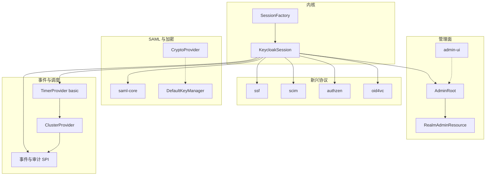
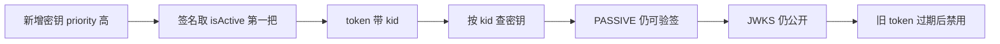
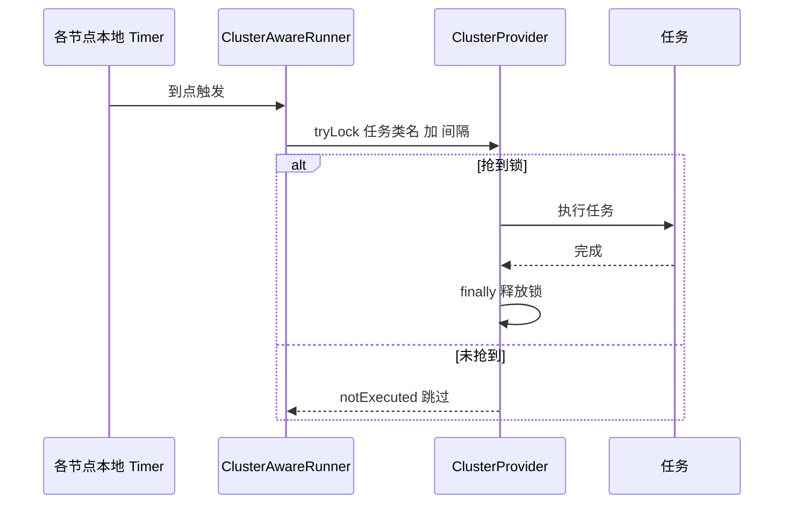

# Keycloak 26.7.3 外围模块群：管理面、新兴协议、SAML 与加密、事件调度

> 解读基线：Keycloak 26.7.3（`6d238b6558`）。下文所有源码引用均相对仓库根，并附程序化校验过的行号锚点。

## 这一章要回答什么

前面几篇把内核讲清了：`provider-spi.md` 说明「一切皆 Provider」如何装配，`authentication-flow.md` 说明执行编排如何把登录变成数据驱动的执行树，`oidc-protocol.md` 把流程接到 HTTP 与令牌，`data-model.md` 说明这些最终落在哪。它们留下的缺口是：**围绕这个内核长出来的「外围」，到底有多少是内核的延伸、多少是独立引擎、多少只是工具**——这正是判断「Keycloak 的 Provider 哲学是否真的贯穿全项目」的关键证据。

本章按四个模块群展开：管理面（Admin REST API 与 Console）、新兴协议（SSF / SCIM / AuthZEN / OID4VC）、SAML 引擎与加密基础设施、事件审计与集群任务调度。每个模块群给出「是什么 / 关键落点 / 与内核关系 / 判断」，并把「能不能上生产」当成一等事实来标注。

读图约定：从 `KeycloakSession` 出发的实线表示运行时通过 `getProvider(类型)` 或 SPI 声明与内核相连；群内实线表示代码级依赖；虚线表示**非运行时**关系（Console 构建产物落到主题目录、`CryptoProvider` 走 ServiceLoader 静态选型）。为满足图表约束，边不再加文字标签，语义由下文承担。

## 管理面：Admin REST API 与 Console

### 三部分构成，共用一套会话

管理面由三部分组成：**Admin REST API**（`/admin/realms/...` 的 JAX-RS 资源树，资源类集中在 `services/src/main/java/org/keycloak/services/resources/admin/` 及其 `ext/`、`fgap/` 子包）、**Admin Console**（React 单页应用，以 `keycloak.v2` 主题形式交付）、**主题系统**（FreeMarker 模板 + `theme.properties` 的 CSS 类变量映射）。三者共用同一套 `KeycloakSession`，因此 Admin API 不是旁路管理通道，而是内核模型的另一组 HTTP 门面。

`AdminRoot` 是 `/admin` 的根资源，同时声明了 `KeycloakSession` 注入点——这一行就足以判定管理面与用户面共用同一套会话/事务/缓存作用域，而不是另起一套数据库连接：

[services/src/main/java/org/keycloak/services/resources/admin/AdminRoot.java:67-75]()
<!-- anchor: @Provider … protected KeycloakSession session; -->

`authenticateRealmAdminRequest(...)` 把「一个 Bearer token」变成 `AdminAuth` 的过程分四步：取 Authorization header → 用 `JWSInput` 只解出未验证的 JSON 以读取 `iss` → 从 issuer 末段反推 realm 名并 `setRealm` → 交给 `BearerTokenAuthenticator` 做真正的签名/时效校验。先解 issuer 再验签是**有意为之**：Keycloak 必须先知道用哪个 realm 的密钥来验签，这是一个自举顺序问题：

[services/src/main/java/org/keycloak/services/resources/admin/AdminRoot.java:182-213]()
<!-- anchor: public static AdminAuth authenticateRealmAdminRequest(KeycloakSession session) { … session.getContext().setBearerToken(authResult.token()); -->

`/admin/realms` 在进入 `RealmsAdminResource` 之前已经完成鉴权与 CORS 处理，子资源因此只关心「能不能看/改」而不关心「你是谁」：

[services/src/main/java/org/keycloak/services/resources/admin/AdminRoot.java:232-253]()
<!-- anchor: @Path("realms") … return new RealmsAdminResource(session, auth, tokenManager); -->

管理面自身也是 feature-gated 的：`ADMIN_API` 控制 REST API 是否 404，`ADMIN_V2` 控制 Console 是否 404。这意味着「关掉管理面」是一个部署期动作，而不是靠网络隔离：

[services/src/main/java/org/keycloak/services/resources/admin/AdminRoot.java:339-344]()
<!-- anchor: private static boolean isAdminApiEnabled() { … return Profile.isFeatureEnabled(Profile.Feature.ADMIN_V2); -->

`RealmsAdminResource` 的 `@Path("{realm}")` 做了三件事：按名解析 realm、拒绝非 master 管理员跨 realm 访问、用 `AdminPermissions.evaluator(...)` 构造 realm 级权限求值器。注意 `adminEvent` 是在这里随 realm 一起构造的——**审计上下文与权限上下文同源**：

[services/src/main/java/org/keycloak/services/resources/admin/RealmsAdminResource.java:219-236]()
<!-- anchor: @Path("{realm}") … return new RealmAdminResource(session, realmAuth, adminEvent); -->

具体操作只在方法体内显式声明所需权限，例如新建用户在 try 块里第一件事就是 `requireManage`（失败后还有「组管理员可为组创建成员」的例外分支）：

[services/src/main/java/org/keycloak/services/resources/admin/UsersResource.java:143-146]()
<!-- anchor: public Response createUser(final UserRepresentation rep) { … auth.users().requireManage(); -->

求值器本身按 feature 分派：`ADMIN_FINE_GRAINED_AUTHZ_V2` 打开时用 `MgmtPermissionsV2`，否则回落 `MgmtPermissions`。这是典型的「新旧权限模型共存、用配置切换」，而不是一次性替换：

[services/src/main/java/org/keycloak/services/resources/admin/fgap/AdminPermissions.java:39-41]()
<!-- anchor: return new MgmtPermissionsV2(session, realm, auth); … return new MgmtPermissions(session, realm, auth); -->

### 管理面 token 就是普通 OIDC access token

结论是：**没有独立的 token 类型**，管理面复用的就是普通 OIDC access token；差异全在「授权依据」和「校验强度」两处。

授权依据是 realm-management 客户端角色。`AdminAuth.hasRealmRole` 同时要求「用户拥有该角色」且「token 的签发客户端把该角色包含在 scope 内」——后者是防止 scope 缩减后的 token 越权：

[services/src/main/java/org/keycloak/services/resources/admin/AdminAuth.java:61-65]()
<!-- anchor: public boolean hasRealmRole(String role) { … return user.hasRole(roleModel) && client.hasScope(roleModel); -->

角色的挂载位置在 master realm 与各 realm 之间是分开的：master realm 上 `admin` 是一个 **realm 角色**，并被复合到每个 realm 的 masterAdminClient 的全部 `ALL_REALM_ROLES` 上；而普通 realm 的 `realm-management` 客户端上则是 `realm-admin` 复合**客户端角色**，且该客户端被设为 `bearerOnly` 与 `fullScopeAllowed=false`：

[services/src/main/java/org/keycloak/services/managers/RealmManager.java:380-402]()
<!-- anchor: if (realm.getName().equals(Config.getAdminRealm())) { … adminRole.addCompositeRole(role); -->

[services/src/main/java/org/keycloak/services/managers/RealmManager.java:422-440]()
<!-- anchor: private void setupRealmAdminManagement(RealmModel realm) { … addQueryCompositeRoles(realmAdminClient); -->

管理面 Bearer 校验的 audience 是 `null`——即**不把 token 绑定到某个受众**。校验链只包含默认校验、realm issuer、`checkActive`、`checkTokenType`（以及后续的 `TokenRevocationCheck`）：

[services/src/main/java/org/keycloak/services/managers/AppAuthManager.java:199-199]()
<!-- anchor: return verifyIdentityToken(session, realm, uriInfo, connection, true, true, audi -->

[services/src/main/java/org/keycloak/services/managers/AuthenticationManager.java:1548-1551]()
<!-- anchor: .withDefaultChecks() … .checkTokenType(checkTokenType); -->

[services/src/main/java/org/keycloak/services/managers/AuthenticationManager.java:1555-1556]()
<!-- anchor: if (checkAudience != null) { … verifier.audience(checkAudience); -->

与之对照，**Admin Console 自己的 `whoami` 接口额外要求 `azp` 必须是 admin console 客户端**（或带 `security.admin.console` 属性的客户端）。也就是说：Admin REST API 接受任意客户端的 token（只要用户有 realm-management 角色），而 Console 启动路径把 token 钉在 Console 客户端上。这是二者最实质的区别：

[services/src/main/java/org/keycloak/services/resources/admin/AdminConsole.java:218-219]()
<!-- anchor: final String issuedFor = authResult.token().getIssuedFor(); … if (!Constants.ADMIN_CONSOLE_CLIENT_ID.equals(issuedFor)) { -->

[services/src/main/java/org/keycloak/services/resources/admin/AdminConsole.java:225-226]()
<!-- anchor: if (client == null || !Boolean.parseBoolean(client.getAttribute(Constants.SECURI … throw new ForbiddenException("Token issued for an application that is not the ad -->

Console 与 `kcadm.sh` 用的是两个不同的**公共客户端**：`security-admin-console` 走授权码 + PKCE S256 + 轻量 access token；`admin-cli` 关掉标准流、打开直接授权（password grant），这正是 CLI 能拿用户名口令换 token 的原因：

[services/src/main/java/org/keycloak/services/managers/RealmManager.java:192-208]()
<!-- anchor: protected void setupAdminConsole(RealmModel realm) { … adminConsole.setPublicClient(true); -->

[services/src/main/java/org/keycloak/services/managers/RealmManager.java:211-212]()
<!-- anchor: adminConsole.setAttribute(OIDCConfigAttributes.PKCE_CODE_CHALLENGE_METHOD, "S256 … adminConsole.setAttribute(Constants.USE_LIGHTWEIGHT_ACCESS_TOKEN_ENABLED, "true" -->

[services/src/main/java/org/keycloak/services/managers/RealmManager.java:227-238]()
<!-- anchor: public void setupAdminCli(RealmModel realm) { … adminCli.setAttribute(Constants.USE_LIGHTWEIGHT_ACCESS_TOKEN_ENABLED, "true"); -->

### Console 以主题资源的形式交付

Admin Console 是 React 18 + PatternFly 5 + react-router-dom 7 + i18next 的 Vite 工程，用 wireit 编排构建、vitest 跑单测；构建产物目录被写死为 `target/classes/theme/keycloak.v2/admin/resources`，也就是**Console 最终是以主题资源的形式被服务端托管的**，而不是独立部署的前端：

[js/apps/admin-ui/package.json:50-57]()
<!-- anchor: "files": [ … "target/classes/theme/keycloak.v2/admin/resources" -->

[js/apps/admin-ui/package.json:92-96]()
<!-- anchor: "@patternfly/patternfly": "^5.4.2", … "@patternfly/react-table": "^5.4.16", -->

[js/apps/admin-ui/package.json:106-110]()
<!-- anchor: "react": "^18.3.1", … "react-router-dom": "^7.18.2", -->

[js/apps/admin-ui/vite.config.ts:59-59]()
<!-- anchor: outDir: "target/classes/theme/keycloak.v2/admin/resources", -->

一个容易踩坑的事实：`themes/src/main/resources/theme/` 下**没有** `keycloak.v2/admin` 目录，Admin Console 的主题源码在 `js/apps/admin-ui/maven-resources/theme/keycloak.v2/admin/`（`theme.properties` 只有 5 行）——即 Console 的样式与消息包由前端工程掌管，`themes/` 只管登录/邮件/账户这些服务端渲染主题。对二次开发者很重要：改 Console 文案要改 JS 工程，改登录页文案要改 `themes/`：

[js/apps/admin-ui/maven-resources/theme/keycloak.v2/admin/theme.properties:1-5]()
<!-- anchor: parent=base … contentHashPattern=assets/.* -->

三个主题目录 `base` / `keycloak` / `keycloak.v2` 通过 `theme.properties` 的 `parent` 与 `import` 形成继承链：`keycloak.v2` 继承 `base` 并 `import=common/keycloak`，然后**用 `kc*Class` 变量把 FreeMarker 模板里的抽象类名映射到 PatternFly 5 的 CSS 类**。同一套 `.ftl` 可以通过换 properties 换掉整个视觉体系，而不用动模板逻辑；`keycloak`（v1）仍保留 PatternFly 3/4 的映射，证明新旧主题是并存交付的：

[themes/src/main/resources/theme/keycloak.v2/login/theme.properties:1-7]()
<!-- anchor: parent=base … darkMode=true -->

### 与内核关系：门面，以及两个层次的扩展点

管理面是**内核之上的 HTTP 门面**，不是内核的替代：`AdminRoot` 直接注入 `KeycloakSession`，全部读写都通过 `session.realms()/users()/clients()` 等模型 SPI 完成；权限判定最终落到 Authorization Services——`MgmtPermissions` 在 FGAP 打开时从会话工厂取 `AuthorizationProvider`，`MgmtPermissionsV2` 把同一个 `authz` 交给各 V2 子权限对象，判定由 `authz.evaluators()` 给出：

[services/src/main/java/org/keycloak/services/resources/admin/fgap/MgmtPermissions.java:80-83]()
<!-- anchor: KeycloakSessionFactory keycloakSessionFactory = session.getKeycloakSessionFactor … this.authz = factory.create(session, realm); -->

[services/src/main/java/org/keycloak/services/resources/admin/fgap/MgmtPermissionsV2.java:70-73]()
<!-- anchor: public GroupPermissions groups() { … return groupPermissions; -->

[services/src/main/java/org/keycloak/services/resources/admin/fgap/MgmtPermissions.java:389-393]()
<!-- anchor: public DecisionPermissionCollector evaluatePermission(List<ResourcePermission> p … return authz.evaluators().from(permissions, resourceServer, context).getDecision -->

**Admin API 自己也是一个 SPI 扩展点。** 资源树是「上下文沿树下传」的：`RealmAdminResource.users()` 构造 `UsersResource` 时传的是 `(session, auth, adminEvent)`——同一个会话、同一个已鉴权结果、同一个审计构造器，所以子资源不需要重新鉴权、也不会丢审计：

[services/src/main/java/org/keycloak/services/resources/admin/RealmAdminResource.java:593-595]()
<!-- anchor: @Path("users") … return new UsersResource(session, auth, adminEvent); -->

而 `RealmAdminResource` 末端的 `@Path("{extension}")` 是一个**通用挂载点**：任何实现 `AdminRealmResourceProvider` 的 provider 都能把自己的 JAX-RS 子资源挂到 `/admin/realms/{realm}/<extension>` 下，并且**继承已经完成的鉴权结果与审计上下文**：

[services/src/main/java/org/keycloak/services/resources/admin/RealmAdminResource.java:663-673]()
<!-- anchor: @Path("{extension}") … throw new NotFoundException(); -->

这个扩展点由一条独立的 SPI 声明支撑，名字是 `admin-realm-restapi-extension`，provider 类型是 `AdminRealmResourceProvider`，并且 `isInternal() = true`：

[services/src/main/java/org/keycloak/services/resources/admin/ext/AdminRealmResourceSpi.java:26-31]()
<!-- anchor: * 
A {@link Spi} to plug additional sub-resources to Realms' RESTful Admin API … public class AdminRealmResourceSpi implements Spi { -->

[services/src/main/java/org/keycloak/services/resources/admin/ext/AdminRealmResourceSpi.java:45-50]()
<!-- anchor: return AdminRealmResourceProvider.class; … return AdminRealmResourceProviderFactory.class; -->

[services/src/main/resources/META-INF/services/org.keycloak.provider.Spi:32-32]()
<!-- anchor: org.keycloak.services.resources.admin.ext.AdminRealmResourceSpi -->

已知的实现者不止 Keycloak 自己：SSF 的管理侧配置（`ssf/services/.../admin/SsfAdminRealmResourceProvider`）、LDAP 的连通性测试与能力查询（`federation/ldap`）、以及 `model/storage-services` 下的多个「清缓存」端点（realm cache / user cache / keys cache / CRL cache）都挂在这里。这说明**「清缓存」「测连接」这类运维端点在 Keycloak 里不是硬编码，而是 provider**。

**还有第二个、更公开的 REST 扩展点**：`RealmResourceSPI`（SPI 名 `realm-restapi-extension`）把子资源挂到**公开的** `{realm}/<extension>` 路径下，provider 类型是 `RealmResourceProvider`：

[server-spi-private/src/main/java/org/keycloak/services/resource/RealmResourceSPI.java:29-33]()
<!-- anchor: * creating JAX-RS sub-resources for paths not known by the server. … public class RealmResourceSPI implements Spi { -->

[server-spi-private/src/main/java/org/keycloak/services/resource/RealmResourceSPI.java:46-52]()
<!-- anchor: public Class<? extends Provider> getProviderClass() { … return RealmResourceProviderFactory.class; -->

[server-spi-private/src/main/resources/META-INF/services/org.keycloak.provider.Spi:42-43]()
<!-- anchor: org.keycloak.services.resource.AccountResourceSpi … org.keycloak.services.resource.RealmResourceSPI -->

因此「管理面是内核的又一门面」这个判断需要补一句：它不仅消费内核，还**向第三方开放了两个层次的挂载点**（公开 realm API 与管理 API），第三方扩展想加自己的管理端点，走的就是这里——这比改 `AdminRoot` 源码是更正确的姿势。命名上有一处小瑕疵：两个 Spi 类一个叫 `RealmResourceSPI`（全大写 SPI），另一个叫 `AdminRealmResourceSpi`（驼峰 Spi），且分别位于 `server-spi-private` 与 `services`；这类不一致通常意味着两者是不同时期加入的，也说明 SPI 体系允许渐进式增补。

### 评价

**值得学**。(1) 先解 issuer 再验签的自举顺序、以及把「管理面」做成内核的又一门面而非独立服务，显著降低了模型/缓存/事务逻辑的重复；(2) 把 Console 编译进主题目录，使得一个 JAR 就能交付「API + UI + 登录页」，这是自托管 IAM 部署体验的关键；(3) 主题继承 + `kc*Class` 变量映射把「换皮肤」从改模板降级为改配置。

**一般 / 需要警惕**。(4) 资源类平铺在同一包层级里、权限声明散落在每个方法体的 try 块里，可读性和可测性都不理想；(5) 管理面 Bearer 校验不做 audience 绑定（依赖用户角色而非 token 受众），这在多客户端共用 realm 的场景下把安全边界完全交给了角色配置——是权衡，但代价需要使用者自己承担。

## 新兴协议模块：SSF / SCIM / AuthZEN / OID4VC

### 四个模块各自解决什么

这四个 2024–2026 年间新增的协议模块，代表 Keycloak 从「OIDC + SAML 双协议」向「安全事件共享 + 用户供应 + 外部授权 + 可验证凭据」扩张的方向：**SSF**（Shared Signals Framework，用 SET token 把安全事件推给对端）、**SCIM 2.0**（按 realm 暴露用户/组供应 API）、**AuthZEN**（OpenID AuthZEN 授权 API 的 PDP 门面）、**OID4VC/OID4VCI**（可验证凭据签发，配合 SD-JWT 实现）。

### Feature 档位是「能不能上生产」的硬事实

Keycloak 用 `Profile.Feature` 枚举为每个特性标注档位，而档位语义在源码里写得很明确：`PREVIEW` 的注释就是「Not supported for production yet」（尚未支持生产），`EXPERIMENTAL` 则连文档/API 都可能变：

[common/src/main/java/org/keycloak/common/Profile.java:324-327]()
<!-- anchor: * Not supported for production yet and not enabled by default. … PREVIEW("Preview"), -->

[common/src/main/java/org/keycloak/common/Profile.java:305-337]()
<!-- anchor: public enum Type { … EXPERIMENTAL("Experimental"); -->

| 模块 | Feature 条目 | 默认档位 | 生产可用性判定 |
|---|---|---|---|
| AuthZEN | `AUTHZEN` | EXPERIMENTAL | ❌ 不可上生产 |
| SSF | `SSF` | EXPERIMENTAL | ❌ 不可上生产 |
| OID4VC | `OID4VC_VCI` / `_PREAUTH_CODE` / `_REST_CREDENTIAL_OFFER` | EXPERIMENTAL | ❌ 不可上生产 |
| SCIM | `SCIM_API` | PREVIEW | ⚠️ 官方明示「尚未支持生产」，且需逐 realm 打开 |
| Admin API v2 | `CLIENT_ADMIN_API_V2` | EXPERIMENTAL | ❌ 不可上生产（依赖 `ADMIN_API`） |
| Admin Console v2 | `ADMIN_V2` | DEFAULT | ✅ 默认开启（依赖 `ADMIN_API`） |

表中每一行的出处如下（表内只写特性名与档位，避免出现无锚点的展示引用）：

[common/src/main/java/org/keycloak/common/Profile.java:62-62]()
<!-- anchor: AUTHZEN("OpenID AuthZen Authorization", Type.EXPERIMENTAL), -->

[common/src/main/java/org/keycloak/common/Profile.java:175-175]()
<!-- anchor: SSF("Shared Signals Framework", Type.EXPERIMENTAL), -->

[common/src/main/java/org/keycloak/common/Profile.java:197-197]()
<!-- anchor: SCIM_API("Exposes a SCIM API for managing realm resources on a per-realm basis", -->

[common/src/main/java/org/keycloak/common/Profile.java:145-147]()
<!-- anchor: OID4VC_VCI("Support for the OID4VCI protocol as part of OID4VC.", Type.EXPERIMEN … OID4VC_VCI_REST_CREDENTIAL_OFFER("Support for the REST endpoint to create creden -->

[common/src/main/java/org/keycloak/common/Profile.java:74-76]()
<!-- anchor: CLIENT_ADMIN_API_V2("Client Admin API v2", Type.EXPERIMENTAL, 2, Feature.ADMIN_A … ADMIN_V2("New Admin Console", Type.DEFAULT, 2, Feature.ADMIN_API), -->

与「档位」同样重要的是一条事实：Feature 支持**版本化 key**（枚举构造参数里的 `2`、`3`），而 `ESSENTIAL_FEATURES` 目前只包含 `HOSTNAME_V2` 与 `ROLLING_UPDATES_V2` 两项——即「不能被用户关掉的核心特性」是一个显式的白名单，而不是「默认档位就是不可关」：

[common/src/main/java/org/keycloak/common/Profile.java:351-352]()
<!-- anchor: private static final Set<String> ESSENTIAL_FEATURES = Collections.unmodifiableSe … new HashSet<>(Arrays.asList(Feature.HOSTNAME_V2.getUnversionedKey(), Feature.ROL -->

### 四个模块是否都遵循「一个 SPI + 一组 provider factory」

结论：**都遵循，但遵守程度不同**——SSF 和 SCIM 是教科书式的 SPI 落点（各有自有领域 SPI），AuthZEN 是「协议端点 + 复用授权 SPI」的门面（零自有 SPI），OID4VC 则是「一批共享同一个 feature 开关的 provider factory」。另外三者在 HTTP 挂载层都统一复用内核的 `RealmResourceProvider`。

**SSF**：`ssf/core` 声明一个 SPI，`ssf/transmitter` 再声明一个 SPI，两者的 `META-INF/services/org.keycloak.provider.Spi` 各只有一行——这是最小侵入的扩展点设计：

[ssf/core/src/main/resources/META-INF/services/org.keycloak.provider.Spi:1-1]()
<!-- anchor: org.keycloak.ssf.event.SsfEventSpi -->

[ssf/transmitter/src/main/resources/META-INF/services/org.keycloak.provider.Spi:1-1]()
<!-- anchor: org.keycloak.ssf.transmitter.SsfTransmitterSpi -->

`SsfEventProviderFactory` 的契约很值得看：每个 factory 贡献「事件类型 URI → 事件工厂」的映射，启动时全部合并进一个 `SsfEventRegistry`，运行时不需要反射就能 mint 新事件实例；接口甚至区分了「能解析的事件」与「能对外发送的事件」（后者才进 `events_supported` 广告集）——这是一个**为可扩展性而设计的注册表模式**，而不是简单的 `Map<String, Class>`：

[ssf/core/src/main/java/org/keycloak/ssf/event/SsfEventProviderFactory.java:26-44]()
<!-- anchor: public interface SsfEventProviderFactory extends ProviderFactory<SsfEventProvide … return Map.of(); -->

SET token 本身是 `core` 的 `Token` 契约实现，字段就是 RFC 8417 的 `jti/iss/iat/aud/events`：

[ssf/core/src/main/java/org/keycloak/ssf/event/token/SecurityEventToken.java:7-17]()
<!-- anchor: public interface SecurityEventToken extends Token { … Map<String, Object> getEvents(); -->

一个精心设计的细节：`AbstractSecurityEventToken.getCategory()` 返回 `TokenCategory.INTERNAL`，注释明确说明 SET 的签名算法不由 `TokenCategory` 决定，而是由 `SsfSignatureAlgorithms#resolveForStream` 按「流覆盖 → transmitter SPI 默认 → RS256」三级解析。这是一处**刻意切断与 OIDC 令牌体系耦合**的设计，避免 SET 意外继承接收方客户端的 access token 算法：

[ssf/core/src/main/java/org/keycloak/ssf/event/token/AbstractSecurityEventToken.java:36-50]()
<!-- anchor: @Override … return TokenCategory.INTERNAL; -->

SSF 与内核的接线方式尤其值得注意：transmitter **挂到 Keycloak 自己的事件监听器 SPI 上**（`EventListenerProviderFactory` → `SsfTransmitterEventListenerFactory`），`isGlobal=true`，并由 `Feature.SSF` 决定是否注册。也就是说「SSF 出站事件」= 「Keycloak 事件 SPI 的一个消费者」，而不是另起一套事件通道：

[ssf/transmitter/src/main/resources/META-INF/services/org.keycloak.events.EventListenerProviderFactory:1-1]()
<!-- anchor: org.keycloak.ssf.transmitter.event.SsfTransmitterEventListenerFactory -->

[ssf/transmitter/src/main/java/org/keycloak/ssf/transmitter/event/SsfTransmitterEventListenerFactory.java:46-48]()
<!-- anchor: @Override … return Profile.isFeatureEnabled(Profile.Feature.SSF); -->

开启粒度是**按 realm 的 attribute**，由 `SsfRealmResourceProviderFactory` 在请求期判定、并在 realm 创建/属性变更时通过 `postInit` 注册的 `KeycloakSessionFactory` 事件回调引导（`SsfBootstrap.addSsfSupport`）。这是「协议能力挂在 realm 配置上」的又一实例：

[ssf/services/src/main/java/org/keycloak/ssf/services/SsfRealmResourceProviderFactory.java:24-30]()
<!-- anchor: public RealmResourceProvider create(KeycloakSession session) { … return new SsfRealmResourceProvider(session); -->

[ssf/services/src/main/java/org/keycloak/ssf/services/SsfRealmResourceProviderFactory.java:26-26]()
<!-- anchor: if (!Ssf.isTransmitterEnabled(session.getContext().getRealm())) { -->

**SCIM**：同理，`scim/core` 声明唯一的 SPI（`internal=true`，说明它不打算成为公开扩展点）：

[scim/core/src/main/java/org/keycloak/scim/resource/spi/ScimResourceTypeSpi.java:7-26]()
<!-- anchor: public class ScimResourceTypeSpi implements Spi { … return ScimResourceTypeProviderFactory.class; -->

`scim/model` 用 5 个 factory 分别实现 Users / Groups / ServiceProviderConfig / ResourceType / Schema 五种资源类型（由 `META-INF/services` 注册），每个 factory 的 `getId()` 就是资源类型名：

[scim/model/src/main/java/org/keycloak/scim/model/user/UserResourceTypeProviderFactory.java:11-32]()
<!-- anchor: public UserResourceTypeProvider create(KeycloakSession session) { … return "Users"; -->

SCIM 的 HTTP 端点也挂在 `RealmResourceProvider` 上（`/v2/{resourceType}`），并且在鉴权上比 Admin API 更严：**必须逐 realm 开启**、**拒绝 public client**、**要求 access token 的 audience 等于该 realm 的 SCIM 端点 URL**。这三条正好是「管理面无 audience 绑定」的反例：

[scim/services/src/main/java/org/keycloak/scim/services/ScimRealmResourceFactory.java:38-38]()
<!-- anchor: if (realm.isScimApiEnabled()) { -->

[scim/services/src/main/java/org/keycloak/scim/services/ScimRealmResourceFactory.java:65-65]()
<!-- anchor: if (client.isPublicClient()) { -->

[scim/services/src/main/java/org/keycloak/scim/services/ScimRealmResourceFactory.java:80-80]()
<!-- anchor: if (!accessToken.hasAudience(scimAudience)) { -->

[scim/services/src/main/java/org/keycloak/scim/services/ScimRealmResource.java:30-30]()
<!-- anchor: @Path("/v2/{resourceType}") -->

**AuthZEN**：它没有自己的领域 SPI，只有 17 个 Java 文件的薄门面——通过内核的 `RealmResourceProvider`（SPI 名 `realm-restapi-extension`）暴露 `/evaluation` 与 `/evaluations` 两个 POST 端点，内部把 AuthZEN 的 subject/resource/action 三元组翻译成 Keycloak 的 `ResourceServer`/`Resource`/`Scope`，最后调用 **Authorization Services 已有的求值器**。也就是说 AuthZEN 是「一个新的协议壳，套在既有的授权内核上」：

[authzen/services/src/main/java/org/keycloak/authorization/authzen/AuthZenResource.java:142-142]()
<!-- anchor: AuthorizationProvider authorization = session.getProvider(AuthorizationProvider. -->

[authzen/services/src/main/java/org/keycloak/authorization/authzen/AuthZenResource.java:201-203]()
<!-- anchor: Collection<Permission> granted = authorization.evaluators() … .evaluate(resourceServer, null); -->

顺带一个工程质量上的细节：`evaluateSingle` 对每一处「查不到」都返回 `DECISION_FALSE` 而非抛异常（subject/resource/action 缺失、客户端不存在或不启用、资源服务器不存在、资源名对不上、类型对不上、scope 不存在），是一种**默认拒绝**的写法；而 subject 为 `CLIENT` 类型时还要求 subject id 与 token 的 `azp` 一致，防止代他人决策。

**OID4VC**：`services/src/main/java/org/keycloak/protocol/oid4vc/` 下 159 个 Java 文件，但特性开关是集中的——所有相关 provider factory 统一实现 `OID4VCEnvironmentProviderFactory`，其 `isSupported` 只判定 `Feature.OID4VC_VCI`。这是「一个 feature flag 管一整个协议族」的做法，好处是运维只需记一个开关名，代价是三个子能力（pre-authorized code、REST credential offer、VCI 本体）无法独立灰度：

[services/src/main/java/org/keycloak/protocol/oid4vc/OID4VCEnvironmentProviderFactory.java:29-31]()
<!-- anchor: @Override … return Profile.isFeatureEnabled(Profile.Feature.OID4VC_VCI); -->

### 与内核关系：HTTP 挂载复用，领域能力自建

答案不是简单的「是」或「否」，而是**分两层**。

**第一层：HTTP 挂载点全部复用内核的 `RealmResourceProvider` 机制。** SSF、SCIM、AuthZEN 三者的 factory 都实现 `RealmResourceProviderFactory`（而非各自的 SPI），并用 `META-INF/services/org.keycloak.services.resource.RealmResourceProviderFactory` 注册；对应的 SPI 是 `RealmResourceSPI`（`realm-restapi-extension`，`isInternal()=true`，见上一节）。也就是说：**它们没有发明新的挂载机制，而是把「新协议」表达成「realm 下的一个新子资源」**。第三方想加自己的协议端点，走的是同一条路。

**第二层：领域能力各自声明自有 SPI。** `SsfEventSpi`（`ssf/core`）、`SsfTransmitterSpi`（`ssf/transmitter`）、`ScimResourceTypeSpi`（`scim/core`）是三个货真价实的 `Spi` 声明；AuthZEN 则**一个自有 SPI 都没有**（17 个文件的薄层直接复用 Authorization Services）。SSF 还额外用了管理 API 的扩展点（`AdminRealmResourceSpi`），说明它同时暴露「公开端点」与「管理端点」。汇总如下：

- SSF：两个自有 SPI，HTTP 走 `RealmResourceProvider`（公开）＋ `AdminRealmResourceProvider`（管理），同时消费内核的事件监听器 SPI，事件出站经 outbox + 集群定时任务（见下一节）。
- SCIM：一个自有 SPI + 5 个资源类型 factory，HTTP 走 `RealmResourceProvider`。
- AuthZEN：零自有 SPI，HTTP 走 `RealmResourceProvider`，求值完全寄生在 Authorization Services 的求值器 SPI 之上。
- OID4VC：一批实现 `EnvironmentDependentProviderFactory` 的 factory，与 OIDC 登录协议共用 `LoginProtocol` 家族的注册机制。

**一个必须澄清的机制细节**：`Spi` 声明**不是**成为 Keycloak Provider 的必要条件，但**是**被加载的必要条件。`DefaultProviderLoader` 的加载方式是「先 `ServiceLoader.load(Spi.class)` 拿到全部 Spi，再对每个 Spi `ServiceLoader.load(spi.getProviderFactoryClass())`」——**只遍历已声明的 Spi，不会扫描未声明 Spi 的 factory 接口**：

[services/src/main/java/org/keycloak/provider/DefaultProviderLoader.java:47-60]()
<!-- anchor: for (Spi spi : ServiceLoader.load(Spi.class, classLoader)) { … for (ProviderFactory f : ServiceLoader.load(spi.getProviderFactoryClass(), class -->

因此「某个 `ProviderFactory` 只有 `META-INF/services/<factory接口全名>` 而没有 `Spi` 声明」时，它在经典 provider loader 下不会被加载——**`RealmResourceProvider` 之所以能用，正是因为 `RealmResourceSPI` 被声明了**。已交叉验证 Quarkus 侧（实际发行态的加载路径）用的是同一套 Spi 驱动遍历，所以这条规则在两条路径上都成立：

[quarkus/deployment/src/main/java/org/keycloak/quarkus/deployment/KeycloakProcessor.java:947-953]()
<!-- anchor: for (Spi spi : pm.loadSpis()) { … loadedFactories.addAll(pm.load(spi)); -->

### 评价

**值得学**。SSF 的事件注册表 + 「可解析 vs 可发送」双集合的接口契约，是一个把「插件能贡献什么」和「系统能对外承诺什么」分开建模的好例子；AuthZEN 的「协议壳 + 复用授权内核」是低成本采纳新协议的标准姿势——新增协议不需要新策略引擎；SCIM 的 audience 绑定 + 拒绝 public client 展示了同一套内核上如何按协议风险等级收紧校验；OID4VC 的 `OID4VCEnvironmentProviderFactory` 用一个接口把「同族 factory 共享开关」变成编译期约束（漏实现就不编译）。

**需要警惕**。(1) 除 SCIM（PREVIEW）外全部是 EXPERIMENTAL，配合 `Type.PREVIEW` 的注释「Not supported for production yet」——**这四个模块在 26.7.3 都不应上生产**，任何方案涉及它们都必须写明降级路径；(2) `AUTHZEN`、`OID4VC_VCI` 这类 EXPERIMENTAL 特性连 OpenAPI 文档都可能变（`OPENAPI` 特性本身也是 EXPERIMENTAL），集成方需要把「协议版本升级会破坏兼容」计入成本；(3) SCIM 的开关是 per-realm attribute（`realm.isScimApiEnabled()`）而不是 realm 的角色/客户端配置，意味着它的权限模型与 Admin API 的 realm-management 角色不是一套——同一份「谁能改用户」的策略需要配置两次，这是潜在的一致性缺口。

## SAML 引擎与加密基础设施

### 是什么

这一组是「协议引擎」与「密码学底座」的合体：`saml-core` / `saml-core-api` 是 SAML 2.0（含 1.1 兼容）的独立引擎，`crypto/*` 是算法提供者的实现模块，`services/.../keys/` 是 realm 密钥的生命周期管理，`core/.../jose/` 是 JWK/JWS/JWE 的自研实现。它们的共同特征是**不依赖 KeycloakSession 也能工作**（尤其 SAML 解析与 CryptoProvider），因此成为全项目最容易被单独复用的部分。

### SAML 引擎：手写 StAX 解析器 + DOM 值对象

真实的解析入口是 `SAMLParser`：以 `QName → ParserFactory` 的静态映射表按根元素分派到各自的手写 StAX 拉式解析器（`SAMLAuthNRequestParser`、`SAMLResponseParser`、`SAMLSloRequestParser`、`SAMLAssertionParser`、各类 metadata 解析器），并且同时注册了 SAML 1.1 与 2.0 两套命名空间的条目：

[saml-core/src/main/java/org/keycloak/saml/processing/core/parsers/saml/SAMLParser.java:54-77]()
<!-- anchor: public class SAMLParser extends AbstractParser { … PARSERS.put(SAMLProtocolQNames.RESPONSE.getQName(),           new ParserFactory( -->

[saml-core/src/main/java/org/keycloak/saml/processing/core/parsers/saml/SAMLParser.java:68-77]()
<!-- anchor: private static final Map<QName, ParserFactory> PARSERS = new HashMap<>(); … PARSERS.put(SAMLProtocolQNames.RESPONSE.getQName(),           new ParserFactory( -->

**为什么不用 JAXB**：SAML 报文里存在大量「同一元素在不同上下文语义不同」和「必须保留原始字节用于验签」的场景（XML-DSig 的规范化要求签名校验必须针对原始 DOM，而不是反序列化再序列化的结果）。手写 StAX 解析 + 独立的 DOM 值对象（`saml-core-api` 的 `org.keycloak.dom.saml.v2.*`）能保住这条边界；代价是 273 个值对象类需要人工维护，以及新增 SAML 扩展元素必须改代码。这是**为签名正确性牺牲开发效率**的典型权衡。`SAML2Object` 这个「根接口」本身只是一个 marker interface（`@since Sep 17, 2009`），说明这套 DOM 层级从头就是为「类型安全地区分 SAML 元素种类」而存在的：

[saml-core-api/src/main/java/org/keycloak/dom/saml/v2/SAML2Object.java:17-20]()
<!-- anchor: package org.keycloak.dom.saml.v2; … * Marker Interface -->

**一处应当被注意到的问题**：`SAML2Response` 把断言有效期与时钟偏移写成**实例常量**（5000ms / 2000ms），而不是 realm 或客户端配置。也就是说 SAML 断言的默认可接受时间窗由编译期常量决定，多租户场景下无法按 realm 调整：

[saml-core/src/main/java/org/keycloak/saml/processing/api/saml/v2/response/SAML2Response.java:89-91]()
<!-- anchor: private final long ASSERTION_VALIDITY = 5000; // 5secs in milis … private final long CLOCK_SKEW = 2000; // 2secs -->

签名部分保留了清晰的 PicketLink 血统（`PicketLinkLogger`、2009 年的 `@since`），类字段的默认算法仍是 RSA_SHA1 + SHA1：

[saml-core/src/main/java/org/keycloak/saml/processing/api/saml/v2/sig/SAML2Signature.java:49-55]()
<!-- anchor: public class SAML2Signature { … private String digestMethod = DigestMethod.SHA1; -->

但实际签名算法由调用方显式设置——`BaseSAML2BindingBuilder` 从 `SignatureAlgorithm` 取 XML 签名方法并注入，而 `SignatureAlgorithm` 又来自 realm/client 属性 `saml.signature.algorithm`：

[saml-core/src/main/java/org/keycloak/saml/BaseSAML2BindingBuilder.java:333-338]()
<!-- anchor: String signatureMethod = signatureAlgorithm.getXmlSignatureMethod(); … samlSignature.setSignatureMethod(signatureMethod); -->

**一个容易误解的命名**：`saml-core/src/main/java/org/keycloak/rotation/` 里的 `KeyLocator` 讲的是 **XML-DSig 验签时按 `kid` 定位密钥**，与 realm 密钥轮换无关——它只提供 `getKey(String kid)` 与「key 是否在本 locator 内」的判定，实现有 `HardcodedKeyLocator`（固定密钥集）与 `CompositeKeyLocator`（多来源组合）：

[saml-core/src/main/java/org/keycloak/rotation/KeyLocator.java:43-51]()
<!-- anchor: public interface KeyLocator extends Iterable<Key> { … Key getKey(String kid) throws KeyManagementException; -->

SAML 与内核的接线点很清楚：`SamlProtocol` 是 `LoginProtocol` 的实现，与 OIDC 走同一个 SPI。也就是说「SAML 客户端」和「OIDC 客户端」在内核眼中是同一种东西——一个 realm 内的 `ClientModel` 加一个协议实现：

[services/src/main/java/org/keycloak/protocol/saml/SamlProtocol.java:124-124]()
<!-- anchor: public class SamlProtocol implements LoginProtocol { -->

[server-spi-private/src/main/resources/META-INF/services/org.keycloak.provider.Spi:49-49]()
<!-- anchor: org.keycloak.protocol.LoginProtocolSpi -->

### 加密基础设施：上层走 SPI、底层走 ServiceLoader

这是全项目最值得单独讲的一处架构细节：**密码学提供者是两层选型**。

- **底层**是 `org.keycloak.common.crypto.CryptoProvider`（BouncyCastle / Elytron / FIPS 三实现），通过 **`java.util.ServiceLoader`** 加载，而不是 Keycloak 自己的 SPI 机制。原因是它必须先于 `KeycloakSessionFactory` 存在——`CryptoIntegration.getProvider()` 会被 `Attributes.KEY_SIZE_PROPERTY` 这类**静态字段初始化**调用，此时根本还没有会话：

[common/src/main/java/org/keycloak/common/crypto/CryptoIntegration.java:60-60]()
<!-- anchor: List<CryptoProvider> foundProviders = StreamSupport.stream(ServiceLoader.load(Cr -->

[crypto/default/src/main/resources/META-INF/services/org.keycloak.common.crypto.CryptoProvider:18-18]()
<!-- anchor: org.keycloak.crypto.def.DefaultCryptoProvider -->

[crypto/fips1402/src/main/resources/META-INF/services/org.keycloak.common.crypto.CryptoProvider:18-18]()
<!-- anchor: org.keycloak.crypto.fips.FIPS1402Provider -->

- **上层**是 Keycloak 自己的算法级 SPI：`SignatureSpi`、`ClientSignatureVerifierSpi`、`HashSpi`、`CekManagementSpi`、`ContentEncryptionSpi` 五条声明集中在 `server-spi-private` 的 SPI 文件里，实现则分布在 `services/.../crypto/`（RS256/384/512、ES256/384/512、HS256/384/512、PS256/384/512 与 EdDSA，共 13 个 `SignatureProviderFactory`）与 `core/.../jose/`：

[server-spi-private/src/main/resources/META-INF/services/org.keycloak.provider.Spi:88-93]()
<!-- anchor: org.keycloak.crypto.SignatureSpi … org.keycloak.crypto.ContentEncryptionSpi -->

[server-spi-private/src/main/java/org/keycloak/crypto/SignatureSpi.java:23-42]()
<!-- anchor: public class SignatureSpi implements Spi { … return SignatureProviderFactory.class; -->

这个两层结构的意义是：**换密码学库是一次整包替换（构建期/类路径级），换算法是运行时按算法名查 provider**。两者不能混为一谈，因为前者的约束（FIPS 合规）必须在类加载前就确定。

默认实现的构造过程本身也反映了「JCA provider 注册是全局副作用」这一事实：BouncyCastle 会在构造时**只实例化一次**，如果 JVM 已通过 `java.security` 配置注册过 BC 就复用它（避免重复注册），并且 `order()` 返回 200 参与多 provider 的优先选择：

[crypto/default/src/main/java/org/keycloak/crypto/def/DefaultCryptoProvider.java:53-56]()
<!-- anchor: public DefaultCryptoProvider() { … this.bcProvider = existingBc == null ? new BouncyCastleProvider() : existingBc; -->

[crypto/default/src/main/java/org/keycloak/crypto/def/DefaultCryptoProvider.java:81-83]()
<!-- anchor: @Override … return 200; -->

FIPS 模式的约束在源码里有直接体现：Argon2 密码哈希 provider 的 `isSupported` 就是 `!Feature.FIPS`，即开 FIPS 后 Argon2 自动退出 provider 集：

[crypto/default/src/main/java/org/keycloak/crypto/hash/Argon2PasswordHashProviderFactory.java:130-130]()
<!-- anchor: return !Profile.isFeatureEnabled(Profile.Feature.FIPS); -->

### 密钥轮换：priority 排序 + active/passive 状态机

这一节回答「多个活动密钥并存如何支持平滑滚动」。完整机制由三块拼成。

**第一块：密钥是 realm 的 component，带三个属性。** `priority`（优先级）、`enabled`（是否参与验签/是否出现在 JWKS）、`active`（是否可用于签名）——`active` 的属性描述就是「Set if the keys can be used for signing」。这三个属性不是某个 provider 的特例：RSA 密钥的配置构造器把它们作为**标准配置项**统一下发：

[services/src/main/java/org/keycloak/keys/AbstractGeneratedRsaKeyProviderFactory.java:47-51]()
<!-- anchor: public final static ProviderConfigurationBuilder rsaKeyConfigurationBuilder() { … .property(Attributes.ACTIVE_PROPERTY); -->

[services/src/main/java/org/keycloak/keys/Attributes.java:38-45]()
<!-- anchor: String PRIORITY_KEY = "priority"; … ProviderConfigProperty ACTIVE_PROPERTY = new ProviderConfigProperty(ACTIVE_KEY, -->

[services/src/main/java/org/keycloak/keys/AbstractRsaKeyProvider.java:54-54]()
<!-- anchor: this.status = KeyStatus.from(model.get(Attributes.ACTIVE_KEY, true), model.get(A -->

[services/src/main/java/org/keycloak/keys/AbstractRsaKeyProvider.java:99-99]()
<!-- anchor: key.setProviderPriority(model.get("priority", 0l)); -->

**第二块：状态机是 `KeyStatus` 的三值**——`ACTIVE` / `PASSIVE` / `DISABLED`，其中 `isActive()` 只认 ACTIVE，`isEnabled()` 认 ACTIVE 或 PASSIVE。这个「签名严、验签宽」的不对称是整个平滑滚动的核心：

[core/src/main/java/org/keycloak/crypto/KeyStatus.java:19-21]()
<!-- anchor: public enum KeyStatus { … ACTIVE, PASSIVE, DISABLED; -->

[core/src/main/java/org/keycloak/crypto/KeyStatus.java:31-36]()
<!-- anchor: public boolean isActive() { … return this.equals(ACTIVE) || this.equals(PASSIVE); -->

**第三块：`DefaultKeyManager` 用三类过滤口径分别服务三个场景，外加一条兜底路径**：

- 取「用于签名」的密钥：先按 provider 的 `priority` 降序（`ProviderComparator`，同优先级用 component id 兜底），再取第一个 `status.isActive()` 的密钥 → **把新密钥的 priority 设高、active=true，它就自动接管签名**。
- 按 `kid` 取密钥：用 `isEnabled()` 过滤 → **旧密钥设成 active=false（PASSIVE）后仍能验签**。
- 导出 JWKS：用 `isEnabled()` 过滤 → **PASSIVE 密钥仍然公开**，这样旧 token 的 kid 仍可被外部方验签。
- 兜底：如果一个 ACTIVE 密钥都找不到，会遍历 `KeyProviderFactory.createFallbackKeys(...)` 找一个能兜底的 factory，**现场生成密钥**并清空该 realm 的 provider 缓存——保证新建 realm 或误删密钥不会 500。

[services/src/main/java/org/keycloak/keys/DefaultKeyManager.java:250-268]()
<!-- anchor: private List<KeyProvider> getProviders(RealmModel realm) { … .collect(Collectors.toList()); -->

[services/src/main/java/org/keycloak/keys/DefaultKeyManager.java:275-280]()
<!-- anchor: private static class ProviderComparator implements Comparator<ComponentModel> { … return i != 0 ? i : o1.getId().compareTo(o2.getId()); -->

[services/src/main/java/org/keycloak/keys/DefaultKeyManager.java:96-102]()
<!-- anchor: for (KeyProvider p : providers) { … return keyWrapper.get(); -->

[services/src/main/java/org/keycloak/keys/DefaultKeyManager.java:122-129]()
<!-- anchor: for (KeyProvider p : getProviders(realm)) { … return keyWrapper.get(); -->

[services/src/main/java/org/keycloak/keys/DefaultKeyManager.java:141-144]()
<!-- anchor: public Stream<KeyWrapper> getKeysStream(RealmModel realm, KeyUse use, String alg … .filter(key -> key.getStatus().isEnabled() && matches(key, use, algorithm))); -->

[services/src/main/java/org/keycloak/keys/DefaultKeyManager.java:68-80]()
<!-- anchor: Optional<KeyProviderFactory> keyProviderFactory = session.getKeycloakSessionFact … return activeKey; -->

而 `createFallbackKeys` 的默认实现把兜底密钥的 priority 设为 **-100**，命名规则是 `fallback-<算法>`——即**兜底密钥永远不会抢掉显式配置的密钥**，它只在「一把 ACTIVE 密钥都没有」的极端情况下短暂接管：

[services/src/main/java/org/keycloak/keys/AbstractGeneratedRsaKeyProviderFactory.java:66-79]()
<!-- anchor: public boolean createFallbackKeys(KeycloakSession session, KeyUse keyUse, String … generated.setConfig(config); -->

顺带一个「优先级实际如何被用」的例子：`GeneratedAesKeyProviderFactory` 给自己设了 `-100` 的优先级，意味着它生成的内置 AES 密钥在优先级排序中故意靠后，不会抢掉用户后加的加密密钥：

[services/src/main/java/org/keycloak/keys/GeneratedAesKeyProviderFactory.java:76-76]()
<!-- anchor: config.putSingle(Attributes.PRIORITY_KEY, "-100"); -->

**关于「多把 ACTIVE 密钥是否做算法族一致性校验」**：读了 `DefaultKeyManager` 全文后可以确认——它**不做**这种跨密钥校验，也无需做。取密钥的唯一判据是 `matches(key, use, algorithm)`，即 `use` 与 `algorithm` 的**精确字符串相等**；`getActiveKey` 只在该判据下取排序后的第一把，从不检查「同 realm 是否还存在其它 ACTIVE 密钥、它们的算法是否同族」。因此「多把 ACTIVE 密钥并存」在实现里等价于「按 (use, algorithm) 分组后各取一把」，误配风险落在配置层而不是校验层：

[services/src/main/java/org/keycloak/keys/DefaultKeyManager.java:246-247]()
<!-- anchor: private boolean matches(KeyWrapper key, KeyUse use, String algorithm) { … return use.equals(key.getUse()) && key.getAlgorithmOrDefault().equals(algorithm) -->

**轮换操作序列（从上述源码可推出的最小步骤）**：新增一个 key provider component（priority 高于当前值、active=true、enabled=true）→ 新密钥成为签名密钥，旧密钥仍是 ACTIVE 但优先级更低（也可手动置 active=false 变 PASSIVE）→ 旧密钥在 JWKS 中继续公开、继续可验签 → 等到所有由旧密钥签发的 token 过期，再将旧密钥 enabled=false（DISABLED）或删除。这套「加新 / 降级 / 保留 / 移除」四步在没有停机、没有密钥切换窗口的情况下完成滚动，代价是**必须在配置层手工维护 priority 与 active**，没有自动的「按时间淘汰」策略。下图把这条不对称链路画出来：

### JOSE：自研的 JWK/JWS/JWE 实现

`core/src/main/java/org/keycloak/jose/` 下是完整的本地实现（`JOSE`/`JOSEParser` 分发、`jws/` 的 `JWSBuilder`/`JWSInput`/`Algorithm`、`jwk/` 的 `JWK`/`JWKBuilder`/`JWKParser`/`JSONWebKeySet` 以及 OKP/AKP/EdEC 工具、`jwe/` 的 alg 与 enc provider 接口）。`services/src/main/java/org/keycloak/jose/` 只有一个类 `DefaultTokenManager`，职责是把 JOSE 构造接到 `KeycloakSession` 上：从 session 取 `SignatureProvider`，拿到 `SignatureSignerContext`，再交给 `JWSBuilder` 签：

[services/src/main/java/org/keycloak/jose/jws/DefaultTokenManager.java:83-87]()
<!-- anchor: SignatureProvider signatureProvider = session.getProvider(SignatureProvider.clas … String encodedToken = new JWSBuilder().type(type).jsonContent(token).sign(signer -->

[core/src/main/java/org/keycloak/jose/jws/JWSBuilder.java:174-186]()
<!-- anchor: public String sign(SignatureSignerContext signer) { … return encodeAll(buffer, signature); -->

JWE 侧同理，`encodeJwe` 把 CEK 编码（`JWEAlgorithmProvider`）与内容加密（`JWEEncryptionProvider`）分成两步，二者也是可替换的 provider：

[core/src/main/java/org/keycloak/jose/jwe/JWE.java:127-152]()
<!-- anchor: public String encodeJwe(JWEAlgorithmProvider algorithmProvider, JWEEncryptionPro … encryptionProvider.encodeJwe(this); -->

**一处类型重复的证据**：`core` 的 `JWK` 类里还留着一个 `@Deprecated` 的 `Use` 枚举，注释直接写着「This duplicates `org.keycloak.crypto.KeyUse`, which should be used instead when possible」，而这个旧枚举里还多出一个 SPIFFE 场景专用的 `jwt-svid`。这印证了 core（JOSE 层）与 server-spi/crypto（密钥语义层）曾经各有一套 KeyUse，迁移尚未完成：

[core/src/main/java/org/keycloak/jose/jwk/JWK.java:51-57]()
<!-- anchor: * This duplicates {@link org.keycloak.crypto.KeyUse}, which should be used inste … JWT_SVID("jwt-svid"); -->

**为什么自研而不用 Nimbus/JJWT**：(1) 需要精细控制 header（`kid`、`x5t`、`jwk`、`x5c`）以配合 Keycloak 自己的密钥管理；(2) 需要能被 FIPS 实现整包替换（如果底层用第三方库，FIPS 审批范围会被第三方库拖累）；(3) `core` 模块要能在没有 session、没有 CDI 的环境里独立构造 JWT。**代价**是：新标准（SD-JWT、OID4VC 所需的各类 JWT 变体）都要自己实现。

### 与内核关系

- **SAML 是内核的一等公民**：`SamlProtocol implements LoginProtocol`，与 `OIDCLoginProtocol` 共用 `LoginProtocolSpi`；SAML 客户端就是 realm 里的 `ClientModel`，因此 SSO 会话、协议映射器、客户端 scope 等内核概念对 SAML 完全适用。
- **saml-core 是「内核之外」的独立引擎**：它不依赖 `KeycloakSession`（只依赖 `saml-core-api` 的 DOM 与通用工具），因此可以被单独用于解析/构造 SAML 报文——这是它能被抽成独立 Maven 模块的原因。
- **加密基础设施横跨内外**：`CryptoProvider` 在 Keycloak SPI 体系之外（ServiceLoader，类路径级）；`SignatureSpi`/`HashSpi`/`CekManagementSpi`/`ContentEncryptionSpi` 在内核之内（按算法名 `getProvider`）；`KeySpi` 也是内核 SPI：

[server-spi-private/src/main/resources/META-INF/services/org.keycloak.provider.Spi:85-85]()
<!-- anchor: org.keycloak.keys.KeySpi -->

- **keys 是内核与 JOSE 的接缝**：`KeyProvider -> KeyWrapper` 提供密钥，`SignatureProvider` 用密钥签名，`DefaultTokenManager` 把两者接到 token 构造上。三者都在同一会话内，共享 `session.keys()` 的 realm 级 provider 缓存。

### 评价

**值得学**。(1) 「底层库用 ServiceLoader、上层算法用 SPI」的两层设计，把「换密码学实现」与「换算法」两类变更解耦，FIPS 只需整包切换；(2) 密钥轮换的三属性 + 三状态设计极简且自洽——**用 `isActive` 与 `isEnabled` 的不对称一次性解决「新密钥接管签名、旧密钥继续验签、旧密钥继续公开」三个需求**，没有任何额外的轮换状态机；(3) `saml-core` 的手写 StAX 解析 + 独立 DOM 值对象虽然笨重，但保住了「验签必须针对原始字节」这条安全底线，是安全敏感场景下正确的取舍。

**一般 / 需要警惕**。(4) 密钥轮换完全靠人工维护 priority/active/enabled，没有「自动下线过期密钥」的能力，运维负担与误配风险都落在配置层；(5) SAML 签名类仍以 RSA_SHA1/SHA1 为字段默认值，虽然实际会被属性覆盖，但对二次开发者是一个危险默认；(6) 自研 JOSE 使 Keycloak 必须自己承担 JWS/JWE 的合规与边界情况维护成本，新标准（SD-JWT）只能自己实现——这个成本在 OID4VC 方向上会持续放大。

## 事件、审计与集群任务调度

### 是什么

`EventListenerProvider` / `EventStoreProvider` 是事件与审计的 SPI；`TimerProvider` 是定时器 SPI；`ClusterProvider` 是集群互斥与跨节点广播 SPI。三者组合出「多节点部署下，同一件事只有一个节点做」的能力——这是自托管 IAM 的刚需（清理过期会话、清理过期事件、drain outbox）。

### 事件 SPI：两种事件 + 事务内回调

SPI 契约本身把「两类事件」写死在接口注释里——用户事件（登录、注册等）与管理员事件（客户端创建/更新等），并规定 `onEvent`/`onAdminEvent` 运行在调用方的事务内：用 JPA 存事件可以整体提交或回滚；不能回滚的动作（写日志）必须挂 `enlistAfterCompletion` 在提交后执行：

[server-spi-private/src/main/java/org/keycloak/events/EventListenerProvider.java:36-40]()
<!-- anchor: * Implementors can leverage the fact that the {@code onEvent} and {@code onAdmin … * via the {@link org.keycloak.models.KeycloakTransactionManager#enlistAfterCompl -->

[server-spi-private/src/main/java/org/keycloak/events/EventListenerProvider.java:45-56]()
<!-- anchor: public interface EventListenerProvider extends Provider { … void onEvent(Event event); -->

`EventStoreProvider` 在监听器之上再叠加「可查询」能力——`createQuery()` 与 `createAdminQuery()` 是它区别于普通监听器的唯一增量：

[server-spi-private/src/main/java/org/keycloak/events/EventStoreProvider.java:26-37]()
<!-- anchor: public interface EventStoreProvider extends EventListenerProvider { … EventQuery createQuery(); -->

### 事件是「仅审计」，不承担状态重建职责

这是与 ZITADEL 事件溯源架构对比时最关键的结论。源码依据有四条。

**依据一：`Event` 是一个扁平 DTO，字段里没有聚合标识、没有版本号、没有序号、没有因果序**——只有 id/time/type/realmId/clientId/userId/sessionId/ipAddress/error/details。没有这些字段就无法做「按聚合重放」，也无法保证同一聚合的事件顺序：

[server-spi-private/src/main/java/org/keycloak/events/Event.java:26-47]()
<!-- anchor: public class Event { … private Map<String, String> details; -->

**依据二：JPA 存储就是一次 `em.persist`**，没有任何投影/聚合更新：

[model/jpa/src/main/java/org/keycloak/events/jpa/JpaEventStoreProvider.java:115-116]()
<!-- anchor: public void onEvent(Event event) { … em.persist(convertEvent(event)); -->

[model/jpa/src/main/java/org/keycloak/events/jpa/JpaEventStoreProvider.java:140-141]()
<!-- anchor: public void onEvent(AdminEvent event, boolean includeRepresentation) { … em.persist(convertAdminEvent(event, includeRepresentation)); -->

**依据三：表结构是审计表，不是事件存储**。`EVENT_ENTITY` 的列就是上面那些字段，`details` 甚至被切成 `DETAILS_JSON` 与 `DETAILS_JSON_LONG_VALUE` 两列（因为前者长度受限）：

[model/jpa/src/main/java/org/keycloak/events/jpa/EventEntity.java:31-64]()
<!-- anchor: @Table(name="EVENT_ENTITY") … private String detailsJson; -->

**依据四：清理语义是「删过期行」而非「压缩/快照」**。`EventStoreProvider` 暴露的是 `clear(realm, olderThan)` 这类「按时间删除」的能力，说明这些行是可丢弃的日志，一旦删除无法从事件重建任何状态——若事件承担状态重建职责，这种删除接口在设计上就不可能存在：

[server-spi-private/src/main/java/org/keycloak/events/EventStoreProvider.java:26-37]()
<!-- anchor: public interface EventStoreProvider extends EventListenerProvider { … EventQuery createQuery(); -->

**结论**：Keycloak 的事件与审计是**事实的记录（audit log）**，状态权威始终在 `RealmModel`/`UserModel` 等模型 SPI 背后的关系型数据上；事件不参与状态重建，也不参与一致性保证。因此与 ZITADEL 的对比结论应当是「**架构取向不同而非成熟度不同**」：Keycloak 用「可变状态 + 审计日志」，ZITADEL 用「不可变事件 + 投影」，前者查询/写入简单、生态成熟，后者天然具备完整历史与时间旅行能力但要求所有状态变更都建模为事件。

**但这里有一个重要的例外维度**：事件确实是**可消费的**——SSF transmitter 正是通过事件监听器把 Keycloak 事件转成对外推送的 SET（见上一节）。也就是说：**事件不可以用来重建 Keycloak 自己的状态，但可以作为对外事件流的源**。下文把这两件事分别叫「内部事件溯源」与「对外事件导出」。

### 对外投递：outbox + 集群定时 drain

对外投递的实现是 **outbox + 集群定时 drain**，而且 outbox 自带投递失败的后备策略：滞留超过 `pendingMaxAge` 的行会被提升为 DEAD_LETTER（避免卡死），DELIVERED 与 DEAD_LETTER 行再按各自的保留期清理。这是一套相当完整的「至少一次投递 + 死信队列」设计，与「事件本体不可重放」形成对照——**Keycloak 只把「可重放」做到了对外投递这一段，没有做回自己的状态**：

[model/jpa/src/main/java/org/keycloak/events/outbox/OutboxDrainerTask.java:50-58]()
<!-- anchor: * <ul> … public class OutboxDrainerTask implements ScheduledTask { -->

这段 javadoc 还顺带回答了一个并发问题：单次 tick 内的并发是安全的，因为 store 用 `FOR UPDATE SKIP LOCKED` 做 `PESSIMISTIC_WRITE` 行锁，且每行在事务提交前就被推进到终态（DELIVERED / 带未来 `next_attempt_at` 的 PENDING / DEAD_LETTER）；HA 部署下「每个 kind 每个间隔只有一个节点 drain」，即使所有节点都调了同一个定时器。

投递任务本身被包装成集群定时任务：

[ssf/transmitter/src/main/java/org/keycloak/ssf/transmitter/DefaultSsfTransmitterProviderFactory.java:543-544]()
<!-- anchor: protected ScheduledTaskRunner createDrainerScheduledTaskRunner(KeycloakSessionFa … return new ClusterAwareScheduledTaskRunner(factory, task, outboxDrainerIntervalM -->

### 集群任务：没有主节点，用「任务键 + 超时」的应用层互斥

**问题**：多节点部署时，清理过期会话/事件这类任务只能在集群里执行一次。**Keycloak 的答案不是选主**，而是每个节点都用本地定时器按同一周期触发，然后在执行前争抢一个分布式锁；拿不到锁的节点直接跳过。

**第 1 层：SPI 契约直接写明这是「如果未在执行则执行」**，并且给出了超时语义——上一个任务执行超过 `taskTimeoutInSeconds` 就被视为陈旧，其他节点可以接管（这解决了节点崩溃导致锁泄漏的问题）：

[server-spi-private/src/main/java/org/keycloak/cluster/ClusterProvider.java:41-44]()
<!-- anchor: * Execute given task just if it's not already in progress (either on this or any … * @param taskTimeoutInSeconds timeout for given task. If there is existing task -->

**第 2 层：包装器负责把任意 `ScheduledTask` 变成集群安全的任务**。`ClusterAwareScheduledTaskRunner` 用 `task.getClass().getSimpleName()` 作为任务键（这也意味着**同一类型在同一集群内只能有一个实例在跑，重名会互相阻塞**），间隔秒数作为超时：

[model/storage-private/src/main/java/org/keycloak/services/scheduled/ClusterAwareScheduledTaskRunner.java:47-66]()
<!-- anchor: protected void runTask(final KeycloakSession session) { … logger.debugf("Skipped execution of task %s as other cluster node is executing i -->

**第 3 层：Infinispan 实现是 work cache 上的 CAS 式 tryLock + 执行后删除**。注意 `removeFromCache` 放在 `finally` 里：任务抛异常也释放锁，不会因为一次失败把任务永久锁死：

[model/infinispan/src/main/java/org/keycloak/cluster/infinispan/InfinispanClusterProvider.java:90-107]()
<!-- anchor: public <T> ExecutionResult<T> executeIfNotExecuted(String taskKey, int taskTimeo … return ExecutionResult.notExecuted(); -->

**第 4 层：定时器本身是每节点本地的 `java.util.Timer`**。`BasicTimerProvider` 直接持有 `java.util.Timer`，`BasicTimerProviderFactory` 用 daemon 模式创建（`new Timer(true)`）——这一点很关键：**集群互斥不是靠只在一台机器上调度实现的，而是靠每台机器都调度、执行前抢锁**。因此任务的触发时刻在各节点间并不严格同步，互斥保证的是「不重复执行」，不是「同一时刻执行」：

[services/src/main/java/org/keycloak/timer/basic/BasicTimerProvider.java:42-42]()
<!-- anchor: private final Timer timer; -->

[services/src/main/java/org/keycloak/timer/basic/BasicTimerProviderFactory.java:52-52]()
<!-- anchor: timer = new Timer(true); -->

**任务清单与装配**：默认的过期清理任务是一个显式列表（过期事件、过期管理员事件、过期 client initial access token、过期用户会话、过期已签发可验证凭据），装配时逐个包上 `ClusterAwareScheduledTaskRunner`，默认间隔 900 秒（可由 `scheduled.interval` 配置）：

[model/storage-private/src/main/java/org/keycloak/storage/datastore/DefaultDatastoreProviderFactory.java:148-149]()
<!-- anchor: protected static List<ScheduledTask> getScheduledTasks() { … return Arrays.asList(new ClearExpiredEvents(), new ClearExpiredAdminEvents(), ne -->

[model/storage-private/src/main/java/org/keycloak/storage/datastore/DefaultDatastoreProviderFactory.java:133-154]()
<!-- anchor: public static void setupScheduledTasks(final KeycloakSessionFactory sessionFacto … logger.debugf("Scheduled cluster task %s with interval %s ms", task.getTaskName( -->

**另一个 SPI：`ExecutorsProvider` 提供的是「按任务类型隔离的线程池」**，与调度无关。它有一个现实的兼容分支：先探测 JNDI `java:jboss/ee/concurrency/executor/default` 判断是否在托管环境（WildFly/EAP），是则用容器管理的 executor，否则自建线程池（默认 4–64 线程，按 taskType 缓存）：

[services/src/main/java/org/keycloak/executors/DefaultExecutorsProviderFactory.java:106-132]()
<!-- anchor: protected ExecutorService getExecutor(String taskType) { … return createPoolEmbedded(taskType); -->

### 与内核关系

- 事件 SPI 与定时器 SPI 都是 `server-spi-private` 里的 internal SPI，属于内核的一部分而非外围：`KeycloakSession` 通过 `session.getProvider(EventListenerProvider.class)` / `session.getProvider(TimerProvider.class)` 获取。
- `ClusterProvider` 是**分布式能力的统一抽象**：除了任务互斥，它还提供跨节点事件广播（`notify`/`registerListener`），会话失效、缓存失效都走它。因此「集群互斥」只是它的一个用途。
- 定时任务的**实现类大多不在 `services`**：`model/storage-private`（`ClearExpired*`、`ClusterAwareScheduledTaskRunner`）、`model/jpa`（`OutboxDrainerTask`、`HibernateStatsReporter`、`ScheduledWorkflowRunner`）、`model/infinispan`（`DatabaseClusterEventPollerTask`）。这是「存储层反向提供维护任务」的设计——**`model/*` 不是纯被动的存储层，它也主动拥有定时行为**。

### 评价

**值得学**。(1) 用「任务键 + 超时接管」的应用层互斥替代选主，架构上少一个必须高可用的组件（无 leader election、无 ZooKeeper/etcd 依赖），且天然容忍节点动态扩缩；(2) `executeIfNotExecuted` 把「是否执行」作为返回值（`ExecutionResult.isExecuted()`）而不是抛出异常，让调用方可以优雅地记录「本次被其他节点抢走」；(3) `EventListenerProvider` 的 javadoc 明确给出「可回滚 vs 不可回滚」两类实现的事务处理范式，是一个把分布式系统常见坑写进接口契约的好例子。

**需要警惕**。(1) 任务键用 `task.getClass().getSimpleName()` 而非全限定名——**不同包下的同名任务是同一个键**，会互相阻塞；这是隐藏在实现里的约束，扩展开发者容易踩到；(2) 互斥窗口由「调度间隔」充当超时，意味着**一个任务执行时间超过间隔时，另一个节点会接管并造成并发执行**——这是拿「不重复执行」换「不永久卡死」的权衡，没有单向保证。

## 收束：四个模块群离内核有多远

把四组结论并排看，能看出「一切皆 Provider」在这四组里的成色并不相同：

| 模块群 | 与内核的关系 | 判断 |
|---|---|---|
| 管理面 | 内核模型的 HTTP 门面，同时开放两个层次的 REST 扩展点 | 内核延伸，扩展性最强的一组 |
| 新兴协议 | HTTP 挂载复用 `RealmResourceProvider`，领域能力自建 SPI | 内核之上长出的新协议壳；生产可用性受 Feature 档位限制 |
| SAML 与加密 | `SamlProtocol` 在内核内；`saml-core` 与 `CryptoProvider` 在内核外 | 一半是内核一等公民，一半是可独立复用的引擎 |
| 事件与调度 | SPI 在内核内，实现散落在 `model/*` | 内核契约 + 存储层反向提供实现 |

一句话总结：**Keycloak 的 Provider 哲学确实贯穿了这四个模块群，但贯穿的是「契约」而不是「部署形态」**——谁能被替换、谁只是工具，取决于它是否声明了 SPI、以及实现落在哪个模块。管理面和新兴协议证明了扩展点的成熟度；SAML/加密/JOSE 证明了 Keycloak 愿意为安全边界自建底盘；事件与调度则暴露了它的取向：审计日志 + 对外投递，而不是事件溯源。
