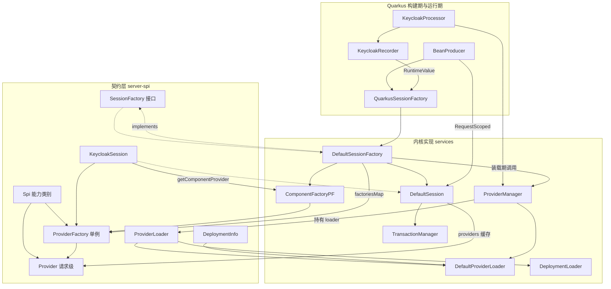
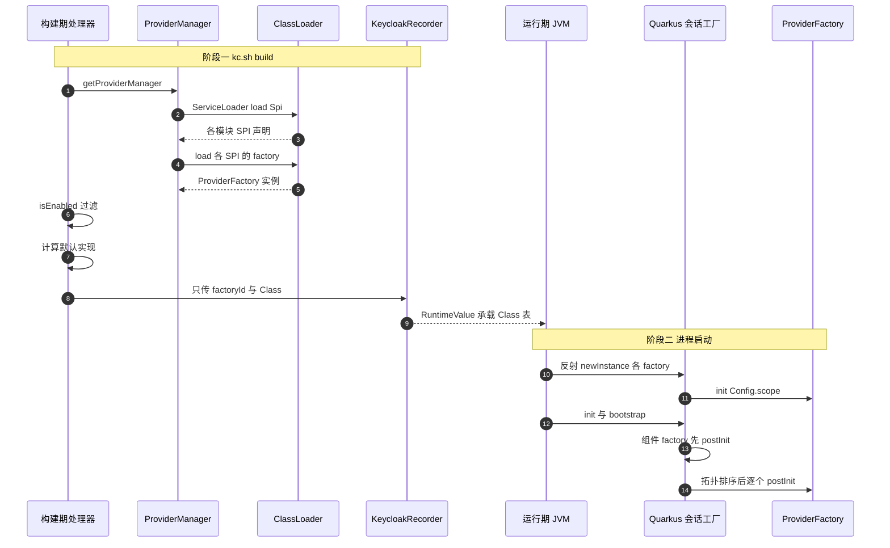
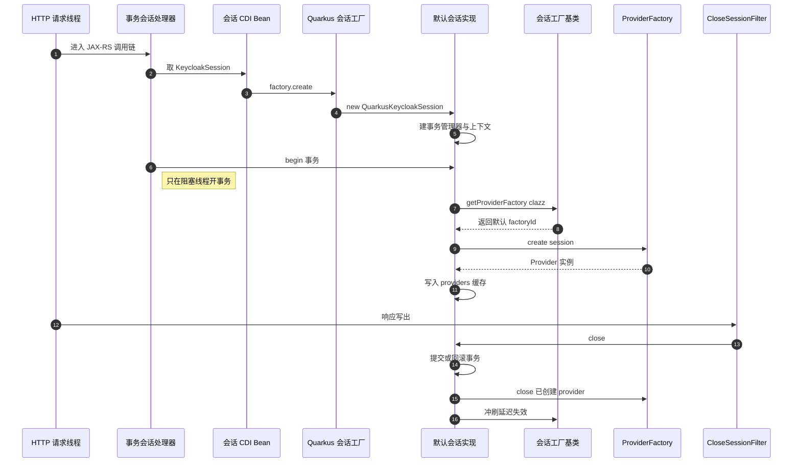

# Keycloak 内核：Provider / SPI 扩展体系

> 解读基线：Keycloak 26.7.3（`6d238b6558`）。下文所有源码引用均相对仓库根，并附程序化校验过的行号锚点。

这是整套解读的第一块砖：后面所有链路（认证流程、OIDC 端点、存储适配、身份代理、授权服务）都只是「某一个 SPI 的一个 Provider 实现」。所以在读任何具体功能之前，必须先回答一个前置问题：**Keycloak 凭什么是可插拔的，而不是一堆 if-else？**

本篇只回答内核问题：一个能力类别（SPI）如何被发现、被配置、被选为默认、被实例化、被排序初始化、被关停，以及一个新节点如何知道别的节点改了东西。它留下的缺口是：知道了「怎么装上一个 Provider」之后，「Provider 具体怎么编排成一条登录链路」——那是 [`authentication-flow.md`](authentication-flow.md) 的事。

## 模块在系统中的位置

把整套 Provider 体系整体删掉会怎样？不是「少了个插件机制」，而是这些东西同时消失：

- **`KeycloakSession` 这个对象本身**。它不是「顺便提供 getProvider 的容器」，它的公开接口里有 17 个 typed 取用方法（`realms()`、`clients()`、`clientScopes()`、`groups()`、`roles()`、`sessions()`、`loginFailures()`、`authenticationSessions()`、`singleUseObjects()`、`revokedTokens()`、`identityProviders()`、`users()`、`keys()`、`theme()`、`tokens()`、`vault()`、`clientPolicy()`），全部是「按类型取出一个 Provider」；另有 6 个 `getProvider*` / `getComponentProvider*` 查找重载（含一个已废弃重载与 `getProviderClass(String)`）。也就是说「内核」在源码层面就是一组 Provider 接口，没有别的。

[server-spi/src/main/java/org/keycloak/models/KeycloakSession.java:148-255]()
<!-- anchor: RealmProvider realms(); … ClientPolicyManager clientPolicy(); -->
[server-spi/src/main/java/org/keycloak/models/KeycloakSession.java:52-111]()
<!-- anchor: <T extends Provider> T getProvider(Class<T> clazz); … Class<? extends Provider> getProviderClass(String providerClassName); -->

- **realm 级别的可配置性**。realm 里存的不是「这个 realm 用哪套代码」，而是 `ComponentModel.providerId` 这样的字符串指针；删掉 Provider 层，realm 配置就只剩一堆布尔值和字符串，无法指向任何实现。
- **存储适配层的存在理由**。`model/jpa`、`model/infinispan`、`model/storage*` 是并列的 `RealmProvider` / `UserProvider` 实现，选谁靠 `order()` 与 `kc.spi.*.provider`；没有 Provider 层，Keycloak 只能内嵌一种存储。
- **多节点部署的缓存一致性协议**。`KeycloakSessionFactory` 本身就是 `InvalidationHandler`，跨节点失效是挂在会话工厂上的能力。

[server-spi/src/main/java/org/keycloak/models/KeycloakSessionFactory.java:35-35]()
<!-- anchor: public interface KeycloakSessionFactory extends ProviderEventManager, Invalidati -->

一句话：Provider 体系是 Keycloak 的**架构载体**，不是它的一个特性。

## 它解决的根本问题

真正的约束冲突是这一对：

- **运维侧要的是「不改代码」**：换 LDAP 服务器、换 SMTP、加一个 SMS OTP、让某个 realm 用 WebAuthn、让某个客户用 SAML——这些都必须是配置动作。
- **内核侧要的是「编译期可见、可测试、可演进」**：内核不能为了可插拔就把所有行为降级成 `Map<String, Object>`。

所以冲突的本质是：**实现的选择必须发生在运行时，而实现的契约必须固定在编译期**。

Keycloak 的解法是把这个矛盾切成三段，让「运行时可变」只发生在最小的一层：

| 段 | 生命周期 | 承受的变化 |
|---|---|---|
| `Spi` | 编译期声明的元数据 | 几乎不变（26.7.3 生产模块共 160 条声明） |
| `ProviderFactory` | **进程级单例** | 配置变化、realm 组件变化、order 冲突、feature flag |
| `Provider` | **请求级实例** | 每请求重建，允许持有请求状态 |

替代方案与它们的代价：

- **纯 SPI + ServiceLoader（不含 Factory）**。`ServiceLoader.load(Provider.class)` 的代价：无法在启动时集中读配置、无法按 order 选默认、无法表达 `dependsOn`、无法区分「全局单例」与「每 realm 多实例」。Keycloak 的 User Storage 需要同一个 Provider 类在不同 realm 用不同参数并存——纯 ServiceLoader 做不到。
- **DI 容器（CDI/Spring）托管一切**。Keycloak 已经跑在 Quarkus/Arc 上，理论上可以让每个 Provider 成为 bean。代价：Provider 的数量是**动态**的（取决于 realm 里有几个 component），且必须按 component 配置重新实例化（`DefaultComponentFactoryProviderFactory` 就是干这个的），这与 DI 的「启动时确定图」根本对立。所以 Keycloak 把 CDI 用在**外层**（一个请求级 `KeycloakSession` bean），把 Provider 图留给自己管。

[quarkus/runtime/src/main/java/org/keycloak/quarkus/runtime/integration/cdi/KeycloakBeanProducer.java:38-43]()
<!-- anchor: @RequestScoped … return factory.create(); -->

- **把所有可变量做成配置项**（一个大 Config 对象注入所有实现）。这是最容易走的歪路，代价是每加一种 LDAP 方言就改内核接口，且「某实现专有的配置项」会污染全局命名空间。Keycloak 用 `Config.Scope` 按 `<spi>.<providerId>.<option>` 分层，让配置项也跟着实现走。

[server-spi/src/main/java/org/keycloak/provider/ProviderFactory.java:63-71]()
<!-- anchor: * Returns the metadata for each configuration property supported by this factory … return Collections.emptyList(); -->

## 三角色为什么必须是三角色

### 能力类别的元数据：Spi

`Spi` 只有 5 个成员：`isInternal()`、`getName()`、`getProviderClass()`、`getProviderFactoryClass()`、`isEnabled()`（默认返回 `true`）。

[server-spi/src/main/java/org/keycloak/provider/Spi.java:23-32]()
<!-- anchor: public interface Spi { … return true; -->

它为什么必须存在、而不是用 `Class<? extends Provider>` 直接当 key？

1. **命名空间**。`factoriesMap` 的 key 是 `Class<? extends Provider>`（Java 类型），而运维看到的是 `kc.spi.<name>.*`（`Spi.getName()`）。`Spi` 是这两者之间唯一的映射表。`DefaultKeycloakSessionFactory.checkProvider()` 遍历 `spis`、用 `Config.getProvider(spi.getName())` 取值、再以 `spi.getProviderClass()` 为 key 写回 `provider` map——这三步全靠 `Spi` 把两侧粘起来。

[services/src/main/java/org/keycloak/services/DefaultKeycloakSessionFactory.java:236-252]()
<!-- anchor: protected void checkProvider() { … this.provider.put(spi.getProviderClass(), defaultProvider); -->

2. **`isInternal()` 是「API 稳定性」标记**。装载时若 `spi.isInternal()` 为 true 但 factory 不在 `org.keycloak` 包下，会打 `spiMayChange` 警告。这是在运行期强制一条契约：内部 SPI 的接口签名随时可能变。

[services/src/main/java/org/keycloak/services/DefaultKeycloakSessionFactory.java:308-310]()
<!-- anchor: if (spi.isInternal() && !isInternal(factory)) { … ServicesLogger.LOGGER.spiMayChange(factory.getId(), factory.getClass().getName() -->

3. **一个 SPI 绑一对类型**。`getProviderClass()` 与 `getProviderFactoryClass()` 一起声明，使 `ServiceLoader.load(spi.getProviderFactoryClass(), classLoader)` 成为一条通用装载语句——新增 SPI 不需要改装载代码。

[services/src/main/java/org/keycloak/provider/DefaultProviderLoader.java:57-60]()
<!-- anchor: public List<ProviderFactory> load(Spi spi) { … for (ProviderFactory f : ServiceLoader.load(spi.getProviderFactoryClass(), class -->

### 唯一的契约是 close：Provider

[server-spi/src/main/java/org/keycloak/provider/Provider.java:23-25]()
<!-- anchor: public interface Provider { … void close(); -->

这是整个体系里最反直觉的设计：`Provider` 接口**不声明任何业务方法**。业务方法在子接口里（`Authenticator.authenticate()`、`UserStorageProvider.getUserById()`）。所以 `Provider` 的角色是**生命周期标记**，而不是能力契约——它告诉 `DefaultKeycloakSession`「这个对象在请求结束时必须被 `close()`」。

这带来一个直接后果：`Provider` 是「可被 session 管理的对象」这一集合的边界。`DefaultKeycloakSession.enlistForClose(Provider)` 接受任意 `Provider`，用**引用相等**去重后放进 `closable` 列表，在 `close()` 时统一 `safeClose`（异常只 warn 不抛）。

[services/src/main/java/org/keycloak/services/DefaultKeycloakSession.java:118-126]()
<!-- anchor: @Override … closable.add(provider); -->

### 进程级单例与四阶段生命周期：ProviderFactory

`ProviderFactory` 的 javadoc 把生命周期写得很直白：发现 → `init()` → 全部 init 完后 `postInit()` → 关停时 `close()`，并且**每台服务器只有一个 factory 实例**。

[server-spi/src/main/java/org/keycloak/provider/ProviderFactory.java:28-36]()
<!-- anchor: * At boot time, keycloak discovers all factories.  For each discovered factory,  … public interface ProviderFactory<T extends Provider> { -->

[server-spi/src/main/java/org/keycloak/provider/ProviderFactory.java:40-50]()
<!-- anchor: * Only called once when the factory is first created. … void postInit(KeycloakSessionFactory factory); -->

`dependsOn()` 声明初始化与关闭的偏序：依赖的 `postInit` 一定先于自己，自己的 `close()` 一定先于依赖的 `close()`。

[server-spi/src/main/java/org/keycloak/provider/ProviderFactory.java:72-82]()
<!-- anchor: * Optional method used to declare that a ProviderFactory has a dependency on one … return Collections.emptySet(); -->

`getId()` 是配置键，`order()` 是选举权重（默认 0）。

[server-spi/src/main/java/org/keycloak/provider/ProviderFactory.java:58-61]()
<!-- anchor: String getId(); … return 0; -->

### 为什么不是两段（Factory 与 Provider 合并）

这是本篇最该想清楚的一个问题。合并成一个对象看起来更简单：一个类同时有 `init()` 和业务方法。Keycloak 不这么做，有四个各自独立、任何一条单独成立就足以否定的理由：

1. **状态隔离与线程安全**。Factory 是进程级单例，可以安全地持有连接池、线程池、缓存、配置快照；Provider 是每请求创建的。官方文档明确要求 Provider「should be light-weight object」，而 factory「possible to store state for multiple requests」。合并后，要么每请求重建昂贵资源（性能），要么多请求共享可变状态（正确性）。

[docs/documentation/server_development/topics/providers.adoc:53-54]()
<!-- anchor: NOTE: {project_name} creates a single instance of provider factories which makes … Provider instances are created by calling create on the factory for each request -->

2. **配置读取点必须唯一**。`init(Config.Scope)` 只在启动时调一次。合并后每请求都要读配置，或者配置变更永远不生效。
3. **全局屏障只对 factory 有意义**。`postInit` 的语义是「等其他 factory 都就绪」——这是一个**进程级**的拓扑排序问题。Provider 没有这个概念，强行合并会把一个全局初始化阶段引入每个请求。
4. **factory 必须可复制**。`DefaultComponentFactoryProviderFactory` 对每个 realm component 用**反射 new 一个同类型 factory**、用 `ComponentModelScope` 单独 `init()`。这是「同类型多配置实例并存」的唯一实现方式。如果 factory 与 provider 合一，「每个 LDAP 实例一套参数」这件事就无法表达——因为 provider 是每请求的，而配置需要跨请求稳定。

[services/src/main/java/org/keycloak/services/DefaultComponentFactoryProviderFactory.java:122-139]()
<!-- anchor: final ProviderFactory newFactory; … return providerFactory; -->

**代价**：每次 `getProvider(clazz)` 至少一次 map 查找 + 可能一次 `create()`；实现类在 IDE 里静态跳不过去（工厂返回的是接口）；启动必须做拓扑排序。Keycloak 接受这个代价——它的用户是运维与集成方，不是内核开发者。

## KeycloakSession 为什么同时是三种东西

`KeycloakSession extends AutoCloseable`，一个接口上叠了三种身份。

[server-spi/src/main/java/org/keycloak/models/KeycloakSession.java:35-35]()
<!-- anchor: public interface KeycloakSession extends AutoCloseable { -->

### 服务定位器

按类型取默认实现，或按 id 取指定实现：

[server-spi/src/main/java/org/keycloak/models/KeycloakSession.java:52-64]()
<!-- anchor: <T extends Provider> T getProvider(Class<T> clazz); … <T extends Provider> T getProvider(Class<T> clazz, String id); -->

按 realm 组件取实现（`getComponentProvider` 的两种重载）：

[server-spi/src/main/java/org/keycloak/models/KeycloakSession.java:75-87]()
<!-- anchor: <T extends Provider> T getComponentProvider(Class<T> clazz, String componentId); … <T extends Provider> T getComponentProvider(Class<T> clazz, String componentId,  -->

### 事务边界

`getTransactionManager()` 在构造 `DefaultKeycloakSession` 时立刻被 new 出来，而 `close()` 的第一步就是提交或回滚它。

[services/src/main/java/org/keycloak/services/DefaultKeycloakSession.java:91-95]()
<!-- anchor: public DefaultKeycloakSession(DefaultKeycloakSessionFactory factory) { … LOG.tracef("Created %s%s", this, StackUtil.getShortStackTrace()); -->

[services/src/main/java/org/keycloak/services/DefaultKeycloakSession.java:358-362]()
<!-- anchor: if (closed) { … RuntimeException re = closeTransactionManager(); -->

rollback-only 决定 commit 还是 rollback：

[services/src/main/java/org/keycloak/services/DefaultKeycloakSession.java:388-403]()
<!-- anchor: protected RuntimeException closeTransactionManager() { … return null; -->

### 缓存作用域

`DefaultKeycloakSession` 用五个字段承担这一身份：`providers`（provider 实例缓存）、`closable`（待关闭列表）、`attributes`（任意请求级状态，如 `ssf`/`fapi` 各类中间态）、`invalidationMap`（延迟到会话结束的失效请求）、以及 `datastoreProvider` 等惰性单例。

[services/src/main/java/org/keycloak/services/DefaultKeycloakSession.java:77-89]()
<!-- anchor: private final DefaultKeycloakSessionFactory factory; … private boolean closed = false; -->

`providers` 的 key 是 `List<String>` 而不是 `Class`，这是为了在同一张表里表达三种查找维度：

[services/src/main/java/org/keycloak/services/DefaultKeycloakSession.java:171-195]()
<!-- anchor: public <T extends Provider> T getProvider(Class<T> clazz) { … return getOrCreateProvider(key, () -> factory.getProviderFactory(clazz, id)); -->

- `getProvider(clazz)` → `List.of(clazz.getName())`
- `getProvider(clazz, id)` → `List.of(clazz.getName(), id)`
- `getComponentProvider(clazz, componentId)` → `List.of("component", clazz.getName(), componentId)`

注意 `getOrCreateProvider` 里那段注释：它明确回避了 `HashMap.computeIfAbsent()`，因为 remapping function 内可能再次修改同一个 map（provider 构造时可能反过来 `getProvider` 别的类型），JDK 9+ 会抛 `ConcurrentModificationException`。

[services/src/main/java/org/keycloak/services/DefaultKeycloakSession.java:176-189]()
<!-- anchor: private <T extends Provider> T getOrCreateProvider(List<String> key, Supplier<Pr … return provider; -->

### 捆在一起换来了什么

1. **请求内同一实例保证**。同一个请求里两次 `getProvider(Authenticator.class, id)` 返回同一对象，认证器可以在请求内累积状态而不必外部传参。
2. **单一初始化入口**。`users()/clients()/realms()/roles()/groups()/sessions()` 全部走 `getDatastoreProvider()` 这一个惰性单例，保证一个请求内只有一套存储栈，不会出现「两个不同的 RealmProvider 看到不同缓存视图」。

[services/src/main/java/org/keycloak/services/DefaultKeycloakSession.java:103-108]()
<!-- anchor: private DatastoreProvider getDatastoreProvider() { … return this.datastoreProvider; -->

3. **统一清理**。Provider 作者不用写清理逻辑，只要把对象登记进 `closable`。
4. **缓存与事务同生命周期**。事务提交后缓存失效可以安全地在同一作用域内完成。

### 代价

1. **忘记 `close()` 就泄漏**。为此有两道保险：`KeycloakBeanProducer` 的 CDI dispose（`@Disposes` 方法）与 `CloseSessionFilter`。流式响应是最危险的情形，专门为 `Stream`/`StreamingOutput` 把关闭延迟到字节写完。

[quarkus/runtime/src/main/java/org/keycloak/quarkus/runtime/integration/cdi/KeycloakBeanProducer.java:46-46]()
<!-- anchor: void dispose(@Disposes KeycloakSession session) { -->

2. **`providers` 是 `HashMap`**，代码里直接这么写的。会话被约定为单线程对象；把 session 传到别的线程是 bug，而不是被检测出来的错误。
3. **一个会话 = 一个事务**。想在同一请求里开两个独立事务做不到，只能用 `enlistPrepare()` 这种「提前参与」的妥协。

[services/src/main/java/org/keycloak/services/DefaultKeycloakTransactionManager.java:74-84]()
<!-- anchor: @Override … prepare.add(transaction); -->

4. **最大的代价是架构上的**：Provider 拿到 session 就拿到了整个内核，模块边界靠自觉而不靠编译器。

## 关键数据结构

| 结构 | 所属 | 一句定位 |
|---|---|---|
| `Set<Spi> spis` | `DefaultKeycloakSessionFactory` | 进程内全部能力类别，装载期一次性填满 |
| `Map<Class<? extends Provider>, String> provider` | 同上 | **默认实现选择表**：provider 类型 → 默认 factoryId |
| `volatile Map<Class<? extends Provider>, Map<String, ProviderFactory>> factoriesMap` | 同上 | **主体注册表**：两层 map，外层是能力、内层是 factoryId；volatile 以支持运行时替换（deploy） |
| `CopyOnWriteArrayList<ProviderEventListener> listeners` | 同上 | 进程级监听器，遍历多写少 |
| `ComponentFactoryProviderFactory componentFactoryPF` | 同上 | 必须最先就绪的特殊 factory |
| `Map<List<String>, Provider> providers` | `DefaultKeycloakSession` | **请求级实例缓存**，三种 key 形状 |
| `List<Provider> closable` | 同上 | 需显式登记才会被关闭的 Provider |
| `Map<InvalidableObjectType, Set<Object>> invalidationMap` | 同上 | 延迟到会话结束的失效请求 |
| `List<KeycloakTransaction> prepare / transactions / afterCompletion` | `DefaultKeycloakTransactionManager` | 三条独立的提交顺序队列 |
| `AtomicReference<ConcurrentMap<String, ProviderFactory>> componentsMap` | `DefaultComponentFactoryProviderFactory` | **组件级 factory 缓存**：componentId → 专属 factory |
| `ConcurrentMap<Object, Set<String>> dependentInvalidations` | 同上 | 失效传播图：realmId / factoryClass → 受影响的 componentId 集合 |

[services/src/main/java/org/keycloak/services/DefaultKeycloakSessionFactory.java:62-72]()
<!-- anchor: protected Set<Spi> spis = new HashSet<>(); … private volatile boolean bootstrapCompleted; -->
[services/src/main/java/org/keycloak/services/DefaultKeycloakSession.java:77-89]()
<!-- anchor: private final DefaultKeycloakSessionFactory factory; … private boolean closed = false; -->
[services/src/main/java/org/keycloak/services/DefaultKeycloakTransactionManager.java:36-44]()
<!-- anchor: private final List<KeycloakTransaction> prepare = new LinkedList<>(); … protected boolean completed; -->
[services/src/main/java/org/keycloak/services/DefaultComponentFactoryProviderFactory.java:55-60]()
<!-- anchor: private final AtomicReference<ConcurrentMap<String, ProviderFactory>> components … private final ConcurrentMap<Object, Set<String>> dependentInvalidations = new Co -->

`DefaultKeycloakTransactionManager` 的三条队列不是装饰：`prepare` 先提交（能被后续失败回滚），`transactions` 主队列，`afterCompletion` 只有主队列全部成功才提交，否则回滚——这是「事件发布/审计写入必须晚于业务数据」的实现方式。

[services/src/main/java/org/keycloak/services/DefaultKeycloakTransactionManager.java:138-187]()
<!-- anchor: public void commit() { … if (exception != null) { -->

---

## 静态结构

图里有两个细节值得单独点出：`Spi` 指向两端的双向绑定（一个 SPI 同时确定 Provider 契约与 Factory 契约），以及 `DCFPF` 是唯一一条「运行时反向找 factory」的边——这条边就是 realm 级装配的全部机制。

## 发现与装载链路

### classpath 上的 service 文件

`Spi` 自身也是通过 `ServiceLoader` 发现的，装载入口是 `DefaultProviderLoader`：只有当 `KeycloakDeploymentInfo.hasServices()` 为真时才扫描，否则直接返回空列表。

[services/src/main/java/org/keycloak/provider/DefaultProviderLoader.java:44-53]()
<!-- anchor: public List<Spi> loadSpis() { … return Collections.emptyList(); -->

每个 SPI 的 factory 由 `ServiceLoader` 按 `spi.getProviderFactoryClass()` 装载：

[services/src/main/java/org/keycloak/provider/DefaultProviderLoader.java:57-75]()
<!-- anchor: public List<ProviderFactory> load(Spi spi) { … return list; -->

一个部署单元是否算 provider 部署，由 `isProvider()` 决定：

[server-spi-private/src/main/java/org/keycloak/provider/KeycloakDeploymentInfo.java:16-17]()
<!-- anchor: public boolean isProvider() { … return services || themes || themeResources || !providers.isEmpty(); -->

`ProviderLoader` 是只有两个方法的抽象：`loadSpis()` 与 `load(Spi)`。

[server-spi-private/src/main/java/org/keycloak/provider/ProviderLoader.java:25-38]()
<!-- anchor: public interface ProviderLoader { … List<ProviderFactory> load(Spi spi); -->

### Spi 声明是 factory 被装载的必要条件

装载链路是「先枚举已声明的 `Spi`，再按该 Spi 声明的 factory 接口去 `ServiceLoader`」——两步都从 `Spi` 出发，没有任何一步会去扫描「某个 ProviderFactory 接口的全部实现」：

[services/src/main/java/org/keycloak/provider/DefaultProviderLoader.java:44-60]()
<!-- anchor: public List<Spi> loadSpis() { … for (ProviderFactory f : ServiceLoader.load(spi.getProviderFactoryClass(), class -->

构建期的 `loadFactories` 是同一形状：外层永远是 `for (Spi spi : pm.loadSpis())`，拿到 `Spi` 之后才 `pm.load(spi)` 或 `pm.load(spi, provider)`，被遍历的集合是「声明出来的 SPI」，而不是「classpath 上所有 factory 接口」：

[quarkus/deployment/src/main/java/org/keycloak/quarkus/deployment/KeycloakProcessor.java:947-960]()
<!-- anchor: for (Spi spi : pm.loadSpis()) { … loadedFactories.add(factory); -->

这两处合起来是一条容易被忽略的硬约束：**对自定义 SPI 而言，`Spi` 声明是 factory 被加载的必要条件**。若一个扩展定义了自己的 `Provider` / `ProviderFactory` 接口和 `Spi` 实现，却忘了把 `Spi` 实现类写进 `META-INF/services/org.keycloak.provider.Spi`，那么它不会出现在 `ProviderManager.loadSpis()` 的结果里，装载链路也就永远不会执行 `ServiceLoader.load(spi.getProviderFactoryClass(), classLoader)`——即使 `META-INF/services/<自定义 Factory 接口>` 文件写得完全正确，也是静默忽略、不报错。反过来，实现 Keycloak **已有** SPI 的扩展不需要自己声明 `Spi`，那份声明已经内置在 `server-spi*` 的 service 文件里。

为什么这样设计？因为「一个 factory 接口」本身不足以描述一个扩展点。装载期还需要知道这个能力类别叫什么（`Spi.getName()`，用于 `kc.spi.<name>.*` 配置命名空间）、它的 Provider 契约是什么类型（`getProviderClass()`，用于 `factoriesMap` 的 key），以及它是否属于内部 API（`isInternal()`）。把这三件事挂在 `Spi` 上，装载代码才能对任意扩展点保持同一段通用逻辑；代价就是自定义扩展的作者必须多写一行声明。

[server-spi/src/main/java/org/keycloak/provider/Spi.java:25-28]()
<!-- anchor: boolean isInternal(); … Class<? extends ProviderFactory> getProviderFactoryClass(); -->

### ProviderManager 的三重去重

`ProviderManager` 的构造器做了三件事：用 `ServiceLoader` 发现所有 `ProviderLoaderFactory`，无条件加两个默认 loader（`DefaultProviderLoader` + `DeploymentProviderLoader`），再按 `type:resource` 形式的字符串参数追加自定义 loader。

[services/src/main/java/org/keycloak/provider/ProviderManager.java:44-53]()
<!-- anchor: public ProviderManager(KeycloakDeploymentInfo info, ClassLoader baseClassLoader, … addDefaultLoaders(baseClassLoader); -->
[services/src/main/java/org/keycloak/provider/ProviderManager.java:84-86]()
<!-- anchor: private void addDefaultLoaders(ClassLoader baseClassLoader) { … loaders.add(new DeploymentProviderLoader(info)); -->

编程式注册的 factory 直接从部署信息里取：

[services/src/main/java/org/keycloak/provider/DeploymentProviderLoader.java:40-41]()
<!-- anchor: public List<ProviderFactory> load(Spi spi) { … return info.getProviders().getOrDefault(spi.getClass(), Collections.emptyList()) -->

三重去重是这一层最有信息量的部分，因为每一次去重都对应一个真实的多来源冲突：

1. **SPI 按名字去重**。多个 loader 的 classpath 可能重叠，同一个 SPI 会被加载多次。

[services/src/main/java/org/keycloak/provider/ProviderManager.java:89-100]()
<!-- anchor: public synchronized List<Spi> loadSpis() { … return new LinkedList<>(spiMap.values()); -->

2. **factory 按 `spiName + "-" + factoryId` 去重**。这是「覆盖内置实现」的落点。

[services/src/main/java/org/keycloak/provider/ProviderManager.java:103-131]()
<!-- anchor: public synchronized List<ProviderFactory> load(Spi spi) { … return rtn == null ? Collections.EMPTY_LIST : rtn; -->

3. **同 id 冲突时的裁决顺序**：order 大者胜 → order 相同则非 internal 者胜 → 再相同则先到者胜。

[services/src/main/java/org/keycloak/provider/ProviderManager.java:135-143]()
<!-- anchor: public ProviderFactory compareFactories(ProviderFactory p1, ProviderFactory p2)  … return p1; -->

第 3 条的注释写得很直接："Internal factory is supposed to be overriden by custom factory"。它用包名判定「内部」，而 `isInternal` 把 `org.keycloak.examples` 排除在外——这个例外是为了让官方示例 provider 可以被用户实现覆盖。

[services/src/main/java/org/keycloak/services/DefaultKeycloakSessionFactory.java:474-476]()
<!-- anchor: public static boolean isInternal(ProviderFactory<?> factory) { … return packageName.startsWith("org.keycloak") && !packageName.startsWith("org.ke -->

### 逐 factory 的 init 与启用过滤

`loadFactories(ProviderManager)` 对每个 SPI、每个 factory 做同一件事：取本 factory 的配置作用域、判定是否启用、调用 `init(scope)`、放入 factory map。启用判定是两条：`enabled` 配置项（默认 true）与环境判定。

[services/src/main/java/org/keycloak/services/DefaultKeycloakSessionFactory.java:287-333]()
<!-- anchor: protected Map<Class<? extends Provider>, Map<String, ProviderFactory>> loadFacto … return factoryMap; -->

多实现分支逐个 factory 单独 scope、单独 `init`：

[services/src/main/java/org/keycloak/services/DefaultKeycloakSessionFactory.java:317-330]()
<!-- anchor: } else { … logger.debugv("SPI {0} provider {1} disabled", spi.getName(), factory.getId()); -->

[services/src/main/java/org/keycloak/services/DefaultKeycloakSessionFactory.java:336-343]()
<!-- anchor: protected boolean isEnabled(ProviderFactory factory, Config.Scope scope) { … return true; -->

注意一个容易忽略的非对称：`loadFactories` 在 `Config.getProvider(spi)` 有值时**只**装载被指定的那一个 factory，其余同 SPI 实现根本不 `init()`。

[services/src/main/java/org/keycloak/services/DefaultKeycloakSessionFactory.java:296-315]()
<!-- anchor: String provider = Config.getProvider(spi.getName()); … logger.debugv("Loaded SPI {0} (provider = {1})", spi.getName(), provider); -->

这解释了一个常见困惑：为什么 `kc.spi.<spi>.provider` 会把其它实现「藏起来」。它不是「选默认」，而是「只留一个」。

### 每请求的 create

首次使用才创建，且写回会话级缓存：

[services/src/main/java/org/keycloak/services/DefaultKeycloakSession.java:182-188]()
<!-- anchor: if (provider == null) { … providers.put(key, provider); -->

这里是「factory 生命周期」与「provider 生命周期」真正分岔的地方：factory 取自 `DefaultKeycloakSessionFactory.factoriesMap`（进程级、启动期固定、`init` 只调一次），provider 由 `factory.create(session)` 现场创建并只活在本次会话里。

## 启动装配与首个请求

### 构建期增强与进程启动

三个引用支撑这张图的每一步——构建期装配、启动顺序、以及 `init()` 只做两件事：

[quarkus/deployment/src/main/java/org/keycloak/quarkus/deployment/KeycloakProcessor.java:671-704]()
<!-- anchor: SyntheticBeanBuildItem configureKeycloakSessionFactory(KeycloakRecorder recorder … loadThemesFromClassPath())).done(); -->
[services/src/main/java/org/keycloak/services/resources/KeycloakApplication.java:85-118]()
<!-- anchor: private void runBootstrap(DefaultKeycloakSessionFactory keycloakSessionFactory)  … logger.infof("Bootstrap completed in %f seconds", (double) duration.toMillis() / -->
[services/src/main/java/org/keycloak/services/DefaultKeycloakSessionFactory.java:91-95]()
<!-- anchor: public void init() { … AdminPermissions.registerListener(this); -->

### 首个 HTTP 请求里的 Provider 创建

[quarkus/runtime/src/main/java/org/keycloak/quarkus/runtime/integration/cdi/KeycloakBeanProducer.java:38-43]()
<!-- anchor: @RequestScoped … return factory.create(); -->
[quarkus/runtime/src/main/java/org/keycloak/quarkus/runtime/integration/resteasy/TransactionalSessionHandler.java:67-81]()
<!-- anchor: public void handle(ResteasyReactiveRequestContext requestContext) throws Excepti … beginTransaction(currentSession); -->
[quarkus/runtime/src/main/java/org/keycloak/quarkus/runtime/integration/jaxrs/CloseSessionFilter.java:51-75]()
<!-- anchor: public void filter(ContainerRequestContext requestContext, ContainerResponseCont … closeSession(); -->
[quarkus/runtime/src/main/java/org/keycloak/quarkus/runtime/integration/QuarkusKeycloakSessionFactory.java:77-80]()
<!-- anchor: @Override … return new QuarkusKeycloakSession(this); -->

非 HTTP 路径（定时任务、集群回调、bootstrap）走的是同一套 `create()/begin/close`，只是换了个封装。

[server-spi-private/src/main/java/org/keycloak/models/utils/KeycloakModelUtils.java:470-488]()
<!-- anchor: public static <V> V runJobInTransactionWithResult(KeycloakSessionFactory factory … return result; -->

---

## init 到 postInit：为什么需要拓扑排序

### 真实问题

`init(Config.Scope)` 只做「读自己的配置」，`postInit(KeycloakSessionFactory)` 做的是「和别的 Provider 建立关系」。后者才是麻烦：它必然要引用别的 factory 已就绪的状态。

三个真实例子，都是 26.7.3 里发生的：

1. **`ComponentFactoryProviderFactory` 必须最先 `postInit`**。它是 realm 级装配的入口，其它 factory 的 `postInit` 里如果碰 realm 组件就会用到它。

[services/src/main/java/org/keycloak/services/DefaultKeycloakSessionFactory.java:101-107]()
<!-- anchor: protected void initProviderFactories(boolean updateComponentFactory, Map<Class<? … componentFactoryPF.postInit(this); -->

2. **JPA 的过期清理类 Provider 依赖执行器与定时器**。`JpaSingleUseObjectProviderFactory`（以及 revoked token / login failure / authentication session 三个同类）在 `postInit` 里要调度周期任务，所以显式声明依赖 `ExecutorsProvider`、`TimerProvider`、`ServerConfigStorageProvider`，再加 `JpaConnectionProvider`。

[model/jpa/src/main/java/org/keycloak/singleobject/jpa/JpaSingleUseObjectProviderFactory.java:115-120]()
<!-- anchor: @Override … return Set.copyOf(deps); -->
[model/jpa/src/main/java/org/keycloak/expiration/jpa/ExpirationHelper.java:77-79]()
<!-- anchor: public static Set<Class<? extends Provider>> dependsOn() { … return Set.of(ExecutorsProvider.class, TimerProvider.class, ServerConfigStorageP -->

3. **缓存一致性依赖**。`ConditionalOtpFormAuthenticatorFactory` 与 `AbstractIdentityProviderMapper` 都声明依赖 `AlternativeLookupProvider`，注释只有两个词："for caching"。它们在自己的 `postInit` 里要往那个 provider 里注册查找路径。

[services/src/main/java/org/keycloak/authentication/authenticators/browser/ConditionalOtpFormAuthenticatorFactory.java:163-167]()
<!-- anchor: @Override … return Set.of(AlternativeLookupProvider.class); //for caching -->
[server-spi-private/src/main/java/org/keycloak/broker/provider/AbstractIdentityProviderMapper.java:99-103]()
<!-- anchor: @Override … return Set.of(AlternativeLookupProvider.class); //for caching -->

### 不这么做会怎样

`postInit` 里 `session.getProvider(X.class)` 或 `factory.getProviderFactory(X.class)` 会拿到 `null`：X 也许已 `init` 但尚未 `postInit`，内部状态没建好。表现是**依赖 HashMap 迭代顺序的偶发 NPE**——`initProviderFactories` 的外层是 `for (entry : factories.entrySet())`，而 `factoriesMap` 是 `HashMap`，顺序不稳定。同一份代码在不同 JVM/不同版本上时好时坏，是最难查的一类问题。

[services/src/main/java/org/keycloak/services/DefaultKeycloakSessionFactory.java:110-115]()
<!-- anchor: Set<Class<? extends Provider>> initializedProviders = new HashSet<>(); … initializeProviders(f.getKey(), factories, initializedProviders, recursionPreven -->

### 机制

记忆化 + 递归求值：

[services/src/main/java/org/keycloak/services/DefaultKeycloakSessionFactory.java:118-143]()
<!-- anchor: private void initializeProviders(Class<? extends Provider> provider, Map<Class<? … initializedProviders.add(provider); -->

三个部件各解决一个问题：

- **`initializedProviders`**：按 provider **类型**递记忆化，保证每个类型只 `postInit` 一次。这让依赖图可以是 DAG，而不必是树。
- **`recursionPrevention`**：一个 `Stack<ProviderFactory>`，装的是**当前递归路径**上的 factory。命中时抛出带完整路径的异常，直接指出环在哪。

[services/src/main/java/org/keycloak/services/DefaultKeycloakSessionFactory.java:127-131]()
<!-- anchor: if (recursionPrevention.contains(factory)) { … " while the initialization of the following provider factories is ongoing: " + s -->

注意它检测的是「路径重复」而非「全局已访问」，所以菱形依赖（A→B、A→C、B→D、C→D）不会误报，而 A→B→A 一定被抓到。

- **缺失依赖的早期失败**：声明了一个根本不存在的依赖时，抛 `"No provider factories exists for provider X required by Y"`，而不是等到运行期。

[services/src/main/java/org/keycloak/services/DefaultKeycloakSessionFactory.java:132-135]()
<!-- anchor: Map<String, ProviderFactory> f = factories.get(providerDep); … throw new RuntimeException("No provider factories exists for provider " + provid -->

关闭阶段是同一张依赖图的反向拓扑：构造 `dependsOn` 的逆向节点树，**先关叶子**。

[services/src/main/java/org/keycloak/services/DefaultKeycloakSessionFactory.java:425-445]()
<!-- anchor: @Override … nodes.values().forEach(this::closeProvider); -->
[services/src/main/java/org/keycloak/services/DefaultKeycloakSessionFactory.java:447-460]()
<!-- anchor: private void closeProvider(Node<Set<ProviderFactory>> node) { … it.remove(); -->

## order、isSupported 与默认实现的选举

### 一个 SPI 多个实现时的六套选择机制

| 场景 | 机制 | 生效时机 | 关键代码 |
|---|---|---|---|
| 同 id 冲突（覆盖内置实现） | `order()` 大者胜 → 相同则非 internal 者胜 → 先到者胜 | 装载期 | `services/src/main/java/org/keycloak/provider/ProviderManager.java` |
| 不同 id，要选默认实现 | `kc.spi.<spi>.provider-default` > 唯一实现 > `order() > 0` 中最大 > id 恰为 `default` | 装载期 | `services/src/main/java/org/keycloak/services/DefaultKeycloakSessionFactory.java` |
| 强制只留一个实现 | `kc.spi.<spi>.provider`，找不到实现直接启动失败 | 装载期 | 同上 |
| 按 realm 组件选 | `ComponentModel.providerId` + `ComponentModelScope` | 每请求/组件首次使用 | `services/src/main/java/org/keycloak/services/DefaultComponentFactoryProviderFactory.java` |
| 该环境不支持 | `EnvironmentDependentProviderFactory.isSupported(scope)` → 直接从注册表消失 | 装载期 | `services/src/main/java/org/keycloak/services/DefaultKeycloakSessionFactory.java` |
| 运维手工关掉 | `kc.spi.<spi>.<providerId>.enabled=false` | 装载期 | 同上 |

六套机制各自的落点：

[services/src/main/java/org/keycloak/provider/ProviderManager.java:135-143]()
<!-- anchor: public ProviderFactory compareFactories(ProviderFactory p1, ProviderFactory p2)  … return p1; -->
[services/src/main/java/org/keycloak/services/DefaultKeycloakSessionFactory.java:257-276]()
<!-- anchor: public static String resolveDefaultProvider(Map<String, ProviderFactory> factori … defaultProvider = "default"; -->
[services/src/main/java/org/keycloak/services/DefaultKeycloakSessionFactory.java:241-246]()
<!-- anchor: String provider = Config.getProvider(spi.getName()); … this.provider.put(spi.getProviderClass(), provider); -->
[services/src/main/java/org/keycloak/services/DefaultComponentFactoryProviderFactory.java:91-140]()
<!-- anchor: public <T extends Provider> ProviderFactory<T> getProviderFactory(Class<T> clazz … return providerFactory; -->
[services/src/main/java/org/keycloak/services/DefaultKeycloakSessionFactory.java:336-343]()
<!-- anchor: protected boolean isEnabled(ProviderFactory factory, Config.Scope scope) { … return true; -->

其中「手工关掉」的判定就在 `isEnabled` 的第一行读 `enabled` 配置项：

[services/src/main/java/org/keycloak/services/DefaultKeycloakSessionFactory.java:336-339]()
<!-- anchor: protected boolean isEnabled(ProviderFactory factory, Config.Scope scope) { … return false; -->

### order 的非对称语义（文档与实现的 gap）

`order()` 默认返回 0，但它在两个地方被使用，规则并不一致：

- 在 `compareFactories` 里，**任何** order 都参与比较（含负数）。
- 在 `resolveDefaultProvider` 里，只有 `order() > 0` 的实现才进入「最高优先级」候选。

[services/src/main/java/org/keycloak/services/DefaultKeycloakSessionFactory.java:269-275]()
<!-- anchor: } else { … defaultProvider = "default"; -->

后果是 `order()` 变成了双关：**正数 = 「我愿当默认」**，**负数 = 「永远别把我当默认，但同 id 冲突时我让位」**。`DockerAuthV2ProtocolFactory.order()` 返回 `-100` 就是这个用法的实例。

[services/src/main/java/org/keycloak/protocol/docker/DockerAuthV2ProtocolFactory.java:79-81]()
<!-- anchor: public int order() { … return -100; -->

官方文档只写了「highest order will be used」，没写「必须为正才能被自动选为默认」——这是文档与实现的真实缺口。

[docs/documentation/server_development/topics/providers.adoc:189-189]()
<!-- anchor: In case of multiple implementations with same provider ID, only the one with hig -->

`order()` 的默认值：

[server-spi/src/main/java/org/keycloak/provider/ProviderFactory.java:60-61]()
<!-- anchor: default int order() { … return 0; -->

### EnvironmentDependentProviderFactory 的真实用途

它的名字容易误解成「检测操作系统」。真正的语义是「**根据配置与 feature flag 决定自己是否存在**」。

[server-spi-private/src/main/java/org/keycloak/provider/EnvironmentDependentProviderFactory.java:28-36]()
<!-- anchor: public interface EnvironmentDependentProviderFactory { … boolean isSupported(Config.Scope config); -->

`isSupported` 的典型实现是读 `Profile.isFeatureEnabled(...)`。例如 `JpaSingleUseObjectProviderFactory.isSupported()` 要求 `STATELESS` feature 打开；关掉 feature 后，这个 SPI 下就只剩别的实现（或空），而**它的配置项也跟着不存在**。这是「环境」这个词在 Keycloak 里的真正含义：环境 = 服务端配置 + 启用的 feature，两者都在装载期固化。

[model/jpa/src/main/java/org/keycloak/singleobject/jpa/JpaSingleUseObjectProviderFactory.java:122-125]()
<!-- anchor: @Override … return Profile.isFeatureEnabled(Profile.Feature.STATELESS); -->

数量上这不是边缘机制：26.7.3 的非测试代码里共有 112 个文件引用该接口（含接口自身）。整个 SPI 生态里有相当一部分实现是「条件存在」的，这也解释了为什么 `isEnabled` 必须在 `init` **之前**判定——否则未启用实现的 `init` 会做无意义的副作用。

## 按 realm 装配与全局默认实现如何共存

### 两条路共享同一张注册表

全局默认实现回答的是「当没人指定时用哪个 factory」；realm 装配回答的是「这个 realm 的这一个组件用哪个 factory、带哪套参数」。它们不冲突，因为 realm 配置里存的 `ComponentModel.providerId` 本身就是**全局 factoryId**。

[services/src/main/java/org/keycloak/services/DefaultKeycloakSessionFactory.java:376-379]()
<!-- anchor: public <T extends Provider> ProviderFactory<T> getProviderFactory(Class<T> clazz … : this.componentFactoryPF.getProviderFactory(clazz, realmId, componentId, modelG -->

`DefaultComponentFactoryProviderFactory` 用 providerId 反查全局 factory，找不到即视为未启用：

[services/src/main/java/org/keycloak/services/DefaultComponentFactoryProviderFactory.java:112-120]()
<!-- anchor: final String provider = cm.getProviderId(); … return null; -->

组件级配置作用域叠加在 SPI 级配置之上：

[services/src/main/java/org/keycloak/services/DefaultComponentFactoryProviderFactory.java:130-138]()
<!-- anchor: Scope scope = Config.scope(factory.getSpi(clazz).getName(), provider); … providerFactory = initializeFactory(clazz, realmId, componentId, newFactory, con -->

### ComponentModelScope：为什么这里必须反射 new 一个 factory

这是全局默认路径里**唯一**不走单例的地方，也是最反直觉的地方。`DefaultComponentFactoryProviderFactory` 不直接用注册表里的 factory 实例，而是拿到它的 `Class` 后反射 `newInstance()`，再用 `ComponentModelScope`（SPI 级 scope 叠加组件配置）单独 `init()` + `postInit()`。

先查组件级缓存：

[services/src/main/java/org/keycloak/services/DefaultComponentFactoryProviderFactory.java:91-96]()
<!-- anchor: public <T extends Provider> ProviderFactory<T> getProviderFactory(Class<T> clazz … return res; -->

每个组件独立 init + postInit，并登记失效关系：

[services/src/main/java/org/keycloak/services/DefaultComponentFactoryProviderFactory.java:143-157]()
<!-- anchor: protected <T extends Provider> ProviderFactory<T> initializeFactory(Class<T> cla … return newFactory; -->

为什么不能共用注册表里的单例？因为 SPI 级 scope 只描述「这个实现全局的默认参数」，而两个 realm 用同一个 LDAP 实现、连不同的服务器时，参数必须并存。单例 factory 只有一个 `Config.Scope`，无法同时表达两套参数。所以 realm 级的 factory 必须是**独立的、可复制的配置载体**。

这正是「三段式」的回报：正因为 factory 与 provider 分离，factory 才能被复制成多份配置载体，而 provider 仍然每请求创建。

代价有两处，都能在代码里看到：

1. **组件 factory 必须被缓存并失效**。`componentsMap` 是 `AtomicReference<ConcurrentMap>`，`dependentInvalidations` 记录「realm 或 factory 类变化会牵连哪些 componentId」。失效分派是 `_ALL_` 清空、`COMPONENT` 按 id 摘除、`REALM`/`PROVIDER_FACTORY` 走依赖图。

[services/src/main/java/org/keycloak/services/DefaultComponentFactoryProviderFactory.java:161-186]()
<!-- anchor: public void invalidate(KeycloakSession session, InvalidableObjectType type, Obje … propagateInvalidation(session, componentsMap.get(), type, ids); -->

2. **无 cluster 时组件缓存必须关掉**。`postInit` 里检测 `ClusterProvider` 是否存在，没有就禁用组件缓存（除非显式 `cachingForced`），否则多节点之间会长期看到对方已修改的旧配置。

[services/src/main/java/org/keycloak/services/DefaultComponentFactoryProviderFactory.java:74-84]()
<!-- anchor: public void postInit(KeycloakSessionFactory factory) { … LOG.warn("No system-wide ClusterProviderFactory found. Cannot send messages acro -->

### 一个把两者都用到极致的例子：Event Listener

事件监听器同时是「多实现型」和「realm 配置型」：realm 里存一份启用的监听器 id 列表，同时 factory 可以声明自己是全局的。

[server-spi-private/src/main/java/org/keycloak/events/EventBuilder.java:88-96]()
<!-- anchor: private static List<EventListenerProvider> getEventListeners(KeycloakSession ses … .toList(); -->

这段代码把两条路的共存写在了实现里：`getProviderFactoriesStream(EventListenerProvider.class)` 拿到**所有**实现（全局默认路径的「全集」视角），再按 `realmListeners.contains(id) || factory.isGlobal()` 过滤（realm 装配路径），最后逐个 `session.getProvider(clazz, id)` 实例化。而事件存储用的是单实现路径：

[server-spi-private/src/main/java/org/keycloak/events/EventBuilder.java:79-86]()
<!-- anchor: private static EventStoreProvider getEventStoreProvider(KeycloakSession session) … return store; -->

同一个文件里两条路并存，是对「两条路如何共存」最简洁的说明。

## 事件与跨节点失效

### ProviderEvent：进程内的模型变更通知

`ProviderEvent` 只有一个方法，并且默认返回 `null`，说明它主要是个**标记接口**（tagging interface）。

[server-spi/src/main/java/org/keycloak/provider/ProviderEvent.java:26-30]()
<!-- anchor: public interface ProviderEvent { … return null; -->

[server-spi/src/main/java/org/keycloak/provider/ProviderEventListener.java:24-25]()
<!-- anchor: public interface ProviderEventListener { … void onEvent(ProviderEvent event); -->

[server-spi/src/main/java/org/keycloak/provider/ProviderEventManager.java:24-29]()
<!-- anchor: public interface ProviderEventManager { … void publish(ProviderEvent event); -->

事件类型全部声明在模型接口内部（`UserModel.UserRemovedEvent`、`ClientModel.ClientRemovedEvent`、`RoleContainerModel.RoleRemovedEvent`、`OrganizationModel.OrganizationRemovedEvent`…）。这不是随意的组织方式：**它把「模型层的状态变更点」定义成事件源**，于是「谁关心这个变更」可以完全在模型层之外声明。

监听器用 `CopyOnWriteArrayList` 承载，发布即顺序调用：

[services/src/main/java/org/keycloak/services/DefaultKeycloakSessionFactory.java:84-89]()
<!-- anchor: @Override … listener.onEvent(event); -->

### 为什么需要它：一个具体的依赖倒转

`JpaRealmProviderFactory` 需要在 role 被删除时清理 realm 的默认角色引用。但它不能在 `RoleProvider.removeRole()` 里直接做——那会让 Role 存储反向依赖 Realm 存储。用事件把方向倒过来：谁关心，谁在 `postInit` 里注册自己。

[model/jpa/src/main/java/org/keycloak/models/jpa/JpaRealmProviderFactory.java:51-55]()
<!-- anchor: @Override … onClose = () -> factory.unregister(this); -->

`onEvent` 用 `instanceof` 分派，并借事件带来的 session 做事：

[model/jpa/src/main/java/org/keycloak/models/jpa/JpaRealmProviderFactory.java:75-90]()
<!-- anchor: @Override … ((JpaRealmProvider) e.getKeycloakSession().getProvider(RealmProvider.class)).pre -->

值得注意的是 `onEvent` 里用的是 `e.getKeycloakSession().getProvider(RealmProvider.class)`——事件把会话带过来了，所以监听器不需要自己再开会话。这也是 `ProviderEvent.getKeycloakSession()` 存在的理由。

### InvalidationHandler：缓存失效的广播口

`KeycloakSessionFactory` 本身就 `extends ProviderEventManager, InvalidationHandler`：

[server-spi/src/main/java/org/keycloak/models/KeycloakSessionFactory.java:35-35]()
<!-- anchor: public interface KeycloakSessionFactory extends ProviderEventManager, Invalidati -->

`InvalidationHandler` 定义了失效对象的类型枚举与唯一方法：

[server-spi/src/main/java/org/keycloak/provider/InvalidationHandler.java:32-49]()
<!-- anchor: public interface InvalidationHandler { … void invalidate(KeycloakSession session, InvalidableObjectType type, Object... p -->

发布侧是「广播给所有实现者」：

[services/src/main/java/org/keycloak/services/DefaultKeycloakSessionFactory.java:382-390]()
<!-- anchor: @Override … .forEach(ih -> ih.invalidate(session, type, ids)); -->

会话级还有一个延迟技巧：`PROVIDER_FACTORY` 类型的失效不能立刻执行（正在用的 factory 会被关掉），所以先记进 `invalidationMap`，等 `close()` 时统一冲刷。

[services/src/main/java/org/keycloak/services/DefaultKeycloakSession.java:110-116]()
<!-- anchor: @Override … invalidationMap.computeIfAbsent(type, o -> new HashSet<>()).addAll(Arrays.asList -->

[services/src/main/java/org/keycloak/services/DefaultKeycloakSession.java:364-378]()
<!-- anchor: Consumer<? super Provider> safeClose = p -> { … factory.invalidate(this, me.getKey(), me.getValue().toArray()); -->

### 为什么必须有跨节点失效

单节点时，「改了 realm 配置 → 本地缓存失效」就够了。多节点时，A 节点改了 realm，B 节点还在用自己的缓存回答请求，表现为**配置改动要等缓存 TTL 或重启才生效**——这类问题在 IAM 里是安全事件（比如禁用了一个用户但仍能登录）。

Keycloak 的机制是「进程内失效广播 + 集群事件广播」两层：

- 进程内：`DefaultKeycloakSessionFactory.invalidate` 广播给本进程所有 `InvalidationHandler`。
- 跨节点：`CacheManager.sendInvalidationEvents` 通过 `ClusterProvider.notify` 把失效事件发给集群；收到端重新计算受影响的 key 再本地失效。

[model/infinispan/src/main/java/org/keycloak/models/cache/infinispan/CacheManager.java:218-220]()
<!-- anchor: public void sendInvalidationEvents(KeycloakSession session, Collection<Invalidat … .notify(eventKey, invalidationEvents, true); -->

[model/infinispan/src/main/java/org/keycloak/models/cache/infinispan/CacheManager.java:224-234]()
<!-- anchor: public void invalidationEventReceived(InvalidationEvent event) { … invalidateObject(invalidation); -->

协议纪律写在接口注释里，而且是唯一能防止死循环的东西：实现者**只**失效本地对象，不得再发起一次失效（不论本地还是通过网络）。

[server-spi/src/main/java/org/keycloak/provider/InvalidationHandler.java:25-28]()
<!-- anchor: * Note that implementors are expected to react to invalidation requests: … * could result in an infinite loop. -->

一个把两种事件接在同一个类里的例子是 `UserStorageEventListener`：它同时实现 `ClusterListener` 与 `ProviderEventListener`。启动期的 `PostMigrationEvent`（本地）用来注册集群监听器，而同步任务的状态变更则通过 `ClusterProvider.notify` 发给全集群。

[model/storage-private/src/main/java/org/keycloak/storage/UserStorageEventListener.java:55-71]()
<!-- anchor: public void onEvent(ProviderEvent event) { … clusterProvider.registerListener(USER_STORAGE_TASK_KEY, this); -->

[model/storage-private/src/main/java/org/keycloak/storage/UserStorageEventListener.java:125-139]()
<!-- anchor: private void notifyStoreSyncClusterUpdate(KeycloakSession session, RealmModel re … cp.notify(USER_STORAGE_TASK_KEY, event, true); -->

本篇只主张「Provider 层提供了失效广播口，跨节点传播落在缓存实现里」；Infinispan 缓存结构、全部失效事件类型与 `model/storage` 新 MAP 存储的差异属于 [`data-model.md`](data-model.md) 的范围。

---

## 自定义扩展从代码到生效的完整路径

以自定义 Authenticator、User Storage Provider、Event Listener 三类为例，路径是同一套，只是使用的取用方法不同。

### 编写与注册

实现 Factory + Provider 两个类型，再加一个 `META-INF/services/<对应 ProviderFactory 全限定名>` 文件。文档把这三件事并列成「实现 SPI 的必要条件」。

[docs/documentation/server_development/topics/providers.adoc:11-14]()
<!-- anchor: To implement an SPI you need to implement its ProviderFactory and Provider inter … `META-INF/services/org.keycloak.theme.ThemeSelectorProviderFactory`. -->

注意 service 文件的**文件名是被实现的 ProviderFactory 接口**，不是 `org.keycloak.provider.ProviderFactory`。这就是 `ServiceLoader.load(spi.getProviderFactoryClass(), classLoader)` 能通用工作的前提：SPI 元数据里的 `getProviderFactoryClass()` 正好等于 service 文件名。

自定义 SPI（不只是自定义实现）则是再加一个 `META-INF/services/org.keycloak.provider.Spi` 文件——SPI 声明本身也走同一套 ServiceLoader 机制，所以扩展点可以自我繁殖。

[docs/documentation/server_development/topics/extensions.adoc:46-77]()
<!-- anchor: . implement the interface `org.keycloak.provider.Spi` and define the ID of your  … . Create the file `META-INF/services/org.keycloak.provider.Spi` and add the clas -->

### 打包与安装

把 JAR（连同它需要的额外依赖）放进 `$KC_HOME/providers/`，然后跑一次 `kc.sh build`。

[docs/documentation/server_development/topics/providers.adoc:256-260]()
<!-- anchor: Providers are registered with the server by simply copying the JAR file to the ` … If your provider needs additional dependencies not already provided by Keycloak  -->

[docs/documentation/server_development/topics/providers.adoc:499-499]()
<!-- anchor: Once you have a JAR file with a descriptor and the scripts you want to deploy, y -->

关于一个常见说法需要澄清：**26.7.3 的 Quarkus 分发里不存在 `--providers` 这个 CLI 选项**（全仓检索不到该选项定义），等价机制就是 `providers/` 目录 + 构建。`ProviderManager` 构造器确实保留了 `String... resources` 形式的 `"type:resource"` 装载能力，但生产路径不传任何 resource。

[services/src/main/java/org/keycloak/provider/ProviderManager.java:55-70]()
<!-- anchor: if (resources != null) { … throw new RuntimeException("Provider loader for " + r + " not found"); -->

遗留的 `type:resource` 装载只认 `classpath` 前缀，支持 `DIR/*` 通配：

[services/src/main/java/org/keycloak/provider/FileSystemProviderLoaderFactory.java:36-43]()
<!-- anchor: public boolean supports(String type) { … return new DefaultProviderLoader(info, createClassLoader(baseClassLoader, resour -->

另一个内置 loader factory 的 `supports` 恒为 false，所以 `classpath:` 永远落到文件系统装载器：

[services/src/main/java/org/keycloak/provider/DefaultProviderLoaderFactory.java:26-28]()
<!-- anchor: public boolean supports(String type) { … return false; -->

生产路径只构造 classpath 部署信息，不传 resource：

[quarkus/runtime/src/main/java/org/keycloak/quarkus/runtime/Providers.java:25-31]()
<!-- anchor: public static ProviderManager getProviderManager(ClassLoader classLoader) { … return new ProviderManager(keycloakDeploymentInfo, classLoader); -->

### 构建期固化与变更检测

因为 provider 集合在构建期固化进镜像，`providers/` 目录里每个 JAR 的最后修改时间都会被持久化，启动时比对；不一致就拒绝启动并要求重新 build。

[quarkus/runtime/src/main/java/org/keycloak/quarkus/runtime/cli/Picocli.java:576-577]()
<!-- anchor: for (File jar : getProviderFiles().values()) { … properties.put(String.format(KC_PROVIDER_FILE_PREFIX + "%s.last-modified", jar.g -->

[quarkus/runtime/src/main/java/org/keycloak/quarkus/runtime/cli/Picocli.java:349-364]()
<!-- anchor: checkChangesInBuildOptions((key, oldValue, newValue) -> { … throw new PropertyException(PROVIDER_TIMESTAMP_ERROR); -->

容器场景有一个特例：Docker 通常把时间戳截断到秒，会误报变更，所以检测逻辑在容器里降级为 warning。

[quarkus/runtime/src/main/java/org/keycloak/quarkus/runtime/cli/Picocli.java:379-384]()
<!-- anchor: static boolean timestampChanged(String oldValue, String newValue) { … return ((longNewValue / 1000) * 1000) != longNewValue || ((longOldValue / 1000)  -->

### 取用方式的三种口味

扩展开发者需要知道自己的 Provider 属于哪一类，才能决定怎么被调用：

| 类型 | 取用方式 | 谁决定用哪个 |
|---|---|---|
| 单实现型（`HostnameProvider`、`EventStoreProvider`、`RealmProvider`…） | `session.getProvider(X.class)` | 装载期的默认实现选举 |
| 多实现型（`EventListenerProvider`、`Authenticator`…） | `session.getProvider(X.class, id)` | 调用点自己决定，或用 realm 配置过滤 |
| realm 组件型（`UserStorageProvider`、`IdentityProviderMapper`、`ClientPolicyExecutorProvider`…） | `session.getComponentProvider(X.class, componentId)` | realm 里的 `ComponentModel.providerId` |

官方文档对这三类的定义：

[docs/documentation/server_development/topics/providers.adoc:228-228]()
<!-- anchor: * *Single-implementation provider types* - There can be only a single active imp -->

[docs/documentation/server_development/topics/providers.adoc:243-243]()
<!-- anchor: * *Multiple implementation provider types* - Those are provider types, that allo -->

[docs/documentation/server_development/topics/providers.adoc:250-251]()
<!-- anchor: The provider ID must match the ID returned by the `ProviderFactory.getId()` of t … The provider ID must match the ID returned by the `ProviderFactory.getId()` of t -->

配置项通过 `Config.Scope` 按 `<spi>.<providerId>.*` 读取。Quarkus 侧把 CLI 的 `--spi-<spi>--<provider>--<option>` 映射为 `kc.spi.<spi>.<provider>.<option>`，靠的是把双连字符当作层级分隔符。

[quarkus/runtime/src/main/java/org/keycloak/quarkus/runtime/configuration/MicroProfileConfigProvider.java:74-80]()
<!-- anchor: public MicroProfileScope(String prefix, String... scopes) { … this.prefix = separatorPrefix.replace(OPTION_PART_SEPARATOR + OPTION_PART_SEPARA -->

读 `kc.spi.<spi>.provider`（强指定）与 `kc.spi.<spi>.provider-default`（默认实现）：

[core/src/main/java/org/keycloak/Config.java:54-70]()
<!-- anchor: public static String getProvider(String spi) { … return provider; -->

`Config` 把这三件事抽象成 `ConfigProvider` 接口，Quarkus 用 SmallRye、测试用系统属性——这也是「服务端配置与 realm 配置严格分离」的技术落点：SPI 级配置来自 ConfigProvider（构建期/启动期），组件级配置来自 `ComponentModelScope`（数据库里）。

[core/src/main/java/org/keycloak/Config.java:92-100]()
<!-- anchor: public static interface ConfigProvider { … Scope scope(String... scope); -->

## 路由层也是 Provider：两个 realm 级 REST 扩展点

「一切皆 Provider」不只体现在业务能力上，连 HTTP 路由解析不出来的那一段路径也是用 Provider 兜住的。realm 级有两个层次的 REST 扩展点：

| 扩展点 | SPI 名 | 挂载路径 | Provider 取到的上下文 |
|---|---|---|---|
| `RealmResourceSPI` | `realm-restapi-extension` | `/{realm}/{extension}`（公开面） | 只有 `KeycloakSession` |
| `AdminRealmResourceSpi` | `admin-realm-restapi-extension` | `/admin/realms/{realm}/{extension}`（管理面） | 已鉴权的 `AdminPermissionEvaluator` 与共享的 `AdminEventBuilder` |

两个 SPI 都照样声明在 `META-INF/services/org.keycloak.provider.Spi` 里，走的是与其它扩展点完全相同的装载路径：

[server-spi-private/src/main/resources/META-INF/services/org.keycloak.provider.Spi:43-43]()
<!-- anchor: org.keycloak.services.resource.RealmResourceSPI -->

[services/src/main/resources/META-INF/services/org.keycloak.provider.Spi:32-32]()
<!-- anchor: org.keycloak.services.resources.admin.ext.AdminRealmResourceSpi -->

SPI 元数据把「能力名 → Provider 契约 → Factory 契约」三件事钉死：

[server-spi-private/src/main/java/org/keycloak/services/resource/RealmResourceSPI.java:33-53]()
<!-- anchor: public class RealmResourceSPI implements Spi { … return RealmResourceProviderFactory.class; -->

[services/src/main/java/org/keycloak/services/resources/admin/ext/AdminRealmResourceSpi.java:31-51]()
<!-- anchor: public class AdminRealmResourceSpi implements Spi { … return AdminRealmResourceProviderFactory.class; -->

两个 Provider 契约本身都只有 `getResource(...)` 一个方法，差别只在管理面多拿到鉴权与审计上下文：

[server-spi-private/src/main/java/org/keycloak/services/resource/RealmResourceProvider.java:29-38]()
<!-- anchor: public interface RealmResourceProvider extends Provider { … Object getResource(); -->

[services/src/main/java/org/keycloak/services/resources/admin/ext/AdminRealmResourceProvider.java:31-39]()
<!-- anchor: public interface AdminRealmResourceProvider extends Provider { … AdminEventBuilder adminEvent); -->

装配点是两个 JAX-RS 子资源定位器，形状完全一致：把匹配不上的路径段当作 providerId 去查，查不到就抛 `NotFoundException`。公开面用 `getProvider(RealmResourceProvider.class, extension)`：

[services/src/main/java/org/keycloak/services/resources/RealmsResource.java:276-291]()
<!-- anchor: @Path("{realm}/{extension}") … throw new NotFoundException(); -->

管理面用 `getProvider(AdminRealmResourceProvider.class, extension)`，并把已鉴权的 `auth` 与共享的 `adminEvent` 一并交给 Provider：

[services/src/main/java/org/keycloak/services/resources/admin/RealmAdminResource.java:662-673]()
<!-- anchor: @Path("{extension}") … throw new NotFoundException(); -->

这解释了为什么新增一组 REST 端点不需要修改任何路由表：SSF 同时用了公开面与管理面，SCIM 与 AuthZEN 挂在公开面。

[ssf/services/src/main/java/org/keycloak/ssf/services/admin/SsfAdminRealmResourceProvider.java:13-18]()
<!-- anchor: public class SsfAdminRealmResourceProvider implements AdminRealmResourceProvider … return new SsfAdminResource(session, realm, auth, adminEvent, SsfTransmitter.of( -->

[scim/services/src/main/java/org/keycloak/scim/services/ScimRealmResourceFactory.java:30-35]()
<!-- anchor: public class ScimRealmResourceFactory implements RealmResourceProviderFactory, E … public RealmResourceProvider create(KeycloakSession session) { -->

[authzen/services/src/main/java/org/keycloak/authorization/authzen/AuthZenRealmResourceProvider.java:22-31]()
<!-- anchor: public class AuthZenRealmResourceProvider implements RealmResourceProvider { … public Object getResource() { -->

对内核而言它们和 `UserStorageProvider` 没有区别——都是「一个 SPI 的一个实现」，只是取用时机变成了「HTTP 路径匹配失败时」。这也是「路由表不是硬编码的 if-else，而是又一张 Provider 注册表」这句话的字面含义。

## Quarkus 的构建期与运行期分工

### 构建期做了什么

`configureKeycloakSessionFactory` 这个 `@BuildStep` 在**构建期**用同一个 `ProviderManager` 扫出全部 SPI 与 factory，算出每个 SPI 的默认实现，然后把结果交给 recorder。注释把动机写得很清楚：构建期装载内置 provider 以免运行期再查，用户自定义 provider 留到启动期装载。

[quarkus/deployment/src/main/java/org/keycloak/quarkus/deployment/KeycloakProcessor.java:658-662]()
<!-- anchor: * 
Load the built-in provider factories during build time so we don't spend ti … * 
User-defined providers are going to be loaded at startup
 -->

[quarkus/deployment/src/main/java/org/keycloak/quarkus/deployment/KeycloakProcessor.java:671-704]()
<!-- anchor: SyntheticBeanBuildItem configureKeycloakSessionFactory(KeycloakRecorder recorder … loadThemesFromClassPath())).done(); -->

构建期的 `loadFactories` 与运行期 `DefaultKeycloakSessionFactory.loadFactories` 逻辑几乎重复：

[quarkus/deployment/src/main/java/org/keycloak/quarkus/deployment/KeycloakProcessor.java:941-989]()
<!-- anchor: private Map<Spi, Map<Class<? extends Provider>, Map<String, ProviderFactory>>> l … return factories; -->

一个关键实现约束：**传下去的是 `Class` 而不是实例**，因为 STATIC_INIT 的记录发生在构建期 JVM，实例无法跨进程带过去。

[quarkus/deployment/src/main/java/org/keycloak/quarkus/deployment/KeycloakProcessor.java:682-688]()
<!-- anchor: for (Entry<Class<? extends Provider>, Map<String, ProviderFactory>> value : entr … .computeIfAbsent(spi.getProviderClass(), aClass -> new HashMap<>()).put(factory. -->

例外是不能无参构造的极少数（例如用户自定义 persistence unit 的 `NamedJpaConnectionProviderFactory`），它们以实例形式放进 `preConfiguredProviders`。

[quarkus/runtime/src/main/java/org/keycloak/quarkus/runtime/KeycloakRecorder.java:164-169]()
<!-- anchor: public RuntimeValue<QuarkusKeycloakSessionFactory> createSessionFactory( … return new RuntimeValue<QuarkusKeycloakSessionFactory>(new QuarkusKeycloakSessio -->

构建期与 provider 相关的其他动作只有两处，都不是对 provider 本身的字节码改写：把关键模块加入 Jandex 索引，以及扫描 JPA 实体。

[quarkus/deployment/src/main/java/org/keycloak/quarkus/deployment/KeycloakProcessor.java:805-808]()
<!-- anchor: void index(BuildProducer<IndexDependencyBuildItem> indexDependencyBuildItemBuild … indexDependencyBuildItemBuildProducer.produce(new IndexDependencyBuildItem("com. -->

[quarkus/deployment/src/main/java/org/keycloak/quarkus/deployment/KeycloakProcessor.java:642-655]()
<!-- anchor: private void configureDefaultPersistenceUnitEntities(ParsedPersistenceXmlDescrip … descriptor.addClasses(targetName); -->

### 运行期做了什么

运行期只做两件事：反射实例化 + `init`。

[quarkus/runtime/src/main/java/org/keycloak/quarkus/runtime/integration/QuarkusKeycloakSessionFactory.java:35-59]()
<!-- anchor: public QuarkusKeycloakSessionFactory( … factoriesMap.computeIfAbsent(spi.getProviderClass(), k -> new HashMap<>()).put(f -->

唯一的实例化点：

[quarkus/runtime/src/main/java/org/keycloak/quarkus/runtime/integration/QuarkusKeycloakSessionFactory.java:65-75]()
<!-- anchor: private ProviderFactory lookupProviderFactory(Class<? extends ProviderFactory> f … return factory; -->

`postInit` 仍走父类的拓扑排序（`init()` → `initProviderFactories()`）。但**默认实现表不再重算**：构造器里直接 `this.provider = defaultProviders;`，`checkProvider()` 只在 `deploy()` 里被调用，而 `deploy` 在生产路径没有调用点。这是构建期固化的直接后果，也是「改 `kc.spi.*.provider` 必须重新 build」的原因。

### 为什么必须区分构建期与运行期

这是 Quarkus 迁移带来的真实约束，不是设计偏好：

1. **启动不扫 classpath 是快速启动的前提**。Quarkus 的构建期增强把「扫描 + 决策」提前，运行期只剩「实例化」。代价就是 provider 集合被冻结在镜像里——这也解释了为什么还需要 `kc.provider.file.*.last-modified` 与 `PROVIDER_TIMESTAMP_ERROR` 这套变更检测：固化本身需要一个逃生口。
2. **`EnvironmentDependentProviderFactory.isSupported` 在两边都被调用，而且必须在两边语义一致**。构建期的版本与运行期的版本两份代码逐字对应（都是先看 `enabled`、再看 `isSupported`）。

[quarkus/deployment/src/main/java/org/keycloak/quarkus/deployment/KeycloakProcessor.java:1136-1143]()
<!-- anchor: private boolean isEnabled(ProviderFactory factory, Config.Scope scope) { … return true; -->

[services/src/main/java/org/keycloak/services/DefaultKeycloakSessionFactory.java:336-343]()
<!-- anchor: protected boolean isEnabled(ProviderFactory factory, Config.Scope scope) { … return true; -->

这是**重复实现**：任何一边改了而另一边没改，就会出现「构建时被排除、运行时期待存在」或反之的分裂。这是一个真实的可维护性风险，本篇把它列为本模块的主要问题之一。

3. **被排除的 provider 在运行期真的不存在**。因为构建期就把它从 `factoriesMap` 里剔掉了。

[quarkus/deployment/src/main/java/org/keycloak/quarkus/deployment/KeycloakProcessor.java:967-984]()
<!-- anchor: for (ProviderFactory<?> factory : loadedFactories) { … logger.debugv("SPI {0} provider {1} disabled", spi.getName(), factory.getId()); -->

构建期的默认实现选举：

[quarkus/deployment/src/main/java/org/keycloak/quarkus/deployment/KeycloakProcessor.java:1151-1165]()
<!-- anchor: private void checkProviders(Spi spi, … defaultProviders.put(spi.getProviderClass(), defaultProvider); -->

4. **WildFly 时代的动态部署机制在生产路径上已是遗留**。`DefaultKeycloakSessionFactory.deploy(ProviderManager)` / `undeploy(ProviderManager)` 两个公开方法在 26.7.3 的 `src/main` 里没有任何调用点，全仓检索到的调用方全部落在 `testsuite/*` 与 `services/src/test` 的测试辅助代码中。

[services/src/main/java/org/keycloak/services/DefaultKeycloakSessionFactory.java:155-198]()
<!-- anchor: public void deploy(ProviderManager pm) { … ((ThemeManagerFactory)getProviderFactory(ThemeManager.class)).clearCache(); -->

[services/src/main/java/org/keycloak/services/DefaultKeycloakSessionFactory.java:214-234]()
<!-- anchor: public void undeploy(ProviderManager pm) { … factory.close(); -->

[services/src/test/java/org/keycloak/services/resteasy/ResteasyKeycloakSessionFactory.java:38-38]()
<!-- anchor: factoriesMap = loadFactories(pm); -->

因此「运行期动态增删 provider」在当前生产分发里**不可用**——要新增 provider 就是重新 build。

## 与其他模块的协同

| 方向 | 模块 | 协同内容 |
|---|---|---|
| 被依赖 | `core` | `Config` / `ConfigProvider` / `Profile` 是装载期的唯一输入源：`getProvider`、`getDefaultProvider`、`scope` 决定 factory 集合与默认实现；`Profile.Feature` 通过 `isSupported` 决定实现是否存在 |
| 被依赖 | `server-spi` / `server-spi-private` | 元数据（SPI 声明、ProviderFactory 接口）与装载抽象（`ProviderLoader`、`KeycloakDeploymentInfo`） |
| 被依赖 | `services` 自身的 model 层 | `DatastoreProvider` 把 JPA / Infinispan / storage 三套存储收敛成一个入口，`KeycloakSession.users()/realms()/...` 全部经它转发 |
| 依赖 | `model/*` | `InvalidationHandler` 的实现者主要在这里（realm/user/client 缓存会话）。跨节点失效的发送/接收落在 `model/infinispan` |
| 依赖 | `quarkus/*` | 构建期装配与运行期实例化；CLI 的配置解析决定 `Config` 的内容 |
| 依赖 | `rest` | Admin REST 资源全部通过注入的 `KeycloakSession` 取 Provider，是「会话即服务定位器」的最大消费者 |
| 平行 | `federation`、`saml-core`、`authz`、`scim`、`ssf` | 各自带 `META-INF/services/org.keycloak.provider.Spi` 声明自己的扩展点 |

SPI 声明不是集中在 `server-spi` 里的，这一点值得强调：**26.7.3 的 11 个生产模块各带一个 `META-INF/services/org.keycloak.provider.Spi`，合计 160 条声明，去重后是 159 个不同的 SPI 类型**（唯一重复的是 `AuthorizationDetailsProcessorSpi`）；另有 2 个仅供测试的声明文件不计入。也就是说扩展点本身就是按模块分布的——加一个协议模块不需要改 `server-spi`。

| 模块 | 声明数 |
|---|---:|
| `server-spi-private` | 101 |
| `services` | 27 |
| `model/storage-private` | 11 |
| `server-spi` | 5 |
| `model/infinispan` | 5 |
| `model/jpa` | 4 |
| `model/storage` | 3 |
| `federation/ldap`、`scim/core`、`ssf/core`、`ssf/transmitter` | 各 1 |
| **合计** | **160** |

其中 `server-spi-private` 这一个文件的 101 条声明：

[server-spi-private/src/main/resources/META-INF/services/org.keycloak.provider.Spi:18-118]()
<!-- anchor: org.keycloak.client.clienttype.ClientTypeManagerSpi … org.keycloak.models.RevokedTokenSpi -->

## 关键设计决策

### Factory 与 Provider 拆成两个生命周期

**为什么**：进程级资源（连接池、缓存、配置快照、线程池）与请求级状态（当前认证上下文、未提交的模型修改）必须分开持有；且只有 factory 可以承担「全局初始化屏障（postInit）」与「可复制配置载体（realm 组件）」这两个角色。

**放弃的替代方案**：单对象（`init` + 业务方法）。代价是每请求重建昂贵资源，或跨请求共享可变状态；且无法表达「同类型多配置实例并存」。

**实际代价**：多一层间接、IDE 无法静态跳转实现、每请求至少一次 map 查找与一次可能的 `create()`。Keycloak 选择用**约定**（官方文档要求 Provider 必须轻量）而不是编译器来保证这一点——`Provider` 接口只有一个 `close()`，编译器无法阻止你把一个重对象放进 provider 构造函数。

### 服务定位、事务边界、缓存作用域捆在一个会话上

**为什么**：三者都必须是「每请求一份」，且生命周期必须严格一致。事务提交必须先于缓存失效、缓存失效必须先于 provider 关闭——只有同一对象持有这三件事，这个顺序才能在一个 `close()` 方法里被强制（先结算事务 → 再关 provider → 最后冲刷失效）。

[services/src/main/java/org/keycloak/services/DefaultKeycloakSession.java:351-386]()
<!-- anchor: public void close() { … throw re; -->

**放弃的替代方案**：三个独立对象（ServiceLocator / Transaction / CacheScope）由框架分别注入。代价是：provider 作者要同时拿到三个引用（签名膨胀）；三者的关闭顺序要靠框架的注解或约定，而顺序错了正是最难查的 bug 类型。另外，provider 常需要「在同一个请求里拿到别的 provider」，独立对象时这个能力必须额外暴露。

**实际代价**：会话忘记关闭就泄漏（靠 `TransactionalSessionHandler` 与 `CloseSessionFilter` 双保险，且专门处理流式/异步响应）；一个会话只能有一个事务；`providers` 是 `HashMap`，线程安全靠隐式约定；`KeycloakSession` 接口持续膨胀（17 个 typed getter + 6 个 `getProvider` 变体），每加一类存储型 Provider 就要改内核接口——`DatastoreProvider` 是对此的缓解（把模型 Provider 收口到一个入口），但没有根治。

### 装载期固化 provider 集合，把可变限制在 realm 层

**为什么**：Quarkus 的快速启动/native 前提是启动不扫 classpath。所以 factory 集合、默认实现、环境可用性全部在构建期算完，运行期只反射实例化 + `init`。剩下的「可变」只有两类，都被限制在装载期之后：realm 里的 `ComponentModel.providerId`（指向一个已经存在的 factory），以及 `Config.Scope` 的参数值。

**放弃的替代方案**：保留 WildFly 式运行期 `deploy`/`undeploy`（代码其实还在）。代价是启动必须扫 classpath、无法做 native image、启动时间随扩展数量线性增长。Keycloak 选择了启动速度，并把动态性降级为「`providers/` 目录 + 重建镜像」。

**实际代价**：新增/更新扩展必须重新 build（为此加了 `kc.provider.file.*.last-modified` 变更检测）；`isEnabled` 的判定逻辑在构建期与运行期各写一份；`deploy`/`undeploy` 变成只有测试在用的公开 API，形成对扩展作者的误导。

## 值得借鉴的设计亮点

1. **依赖治理只用二十余行却相当完整**：`initializeProviders` 同时给出记忆化、环检测（带完整路径的报错）、缺失依赖的早期失败，`close()` 用同一张图反向关闭。多数框架的依赖排序只有前两项。

[services/src/main/java/org/keycloak/services/DefaultKeycloakSessionFactory.java:118-143]()
<!-- anchor: private void initializeProviders(Class<? extends Provider> provider, Map<Class<? … initializedProviders.add(provider); -->

2. **`ComponentModelScope` 是「同一实现多套参数并存」的少见正解**：不是在 provider 里传参，而是**复制 factory、复制配置载体**。它把一个通常要靠 DI 的 prototype scope 解决的问题，用反射 + 缓存 + 失效图解决，且不要求实现者配合。
3. **`Provider` 接口只留 `close()`**：把「生命周期标记」和「能力契约」彻底分开，于是 `enlistForClose` / session 统一关闭 / 组件 factory 缓存关闭全都能写成与业务类型无关的通用逻辑。
4. **三重去重对应三类真实冲突源**：SPI 名冲突（classpath 重叠）、factory id 冲突（覆盖内置）、order 平局（多实现）。每一条都配了对应的日志，排查「我的实现没生效」时有迹可循。

[services/src/main/java/org/keycloak/provider/ProviderManager.java:114-121]()
<!-- anchor: } else { … spi.getName(), pf.getId(), currentFactory.getClass().getName(), pf.getClass().ge -->

5. **跨节点失效的纪律写在接口注释里**：`InvalidationHandler` 明确要求实现者只做本地失效，不得再次发起——这是分布式失效协议里最容易写出无限循环的地方，用契约而不是代码强制（只能靠注释，但至少写了）。

## 问题与风险

1. **`isEnabled` 在构建期与运行期各有一份实现**。两份逐字相同，但没有任何机制保证它们同步。这是本模块最实在的可维护性风险：一边改、另一边忘，会产生「构建期排除但运行期以为存在」的分裂，且症状是启动期噪声而非编译错误。

[quarkus/deployment/src/main/java/org/keycloak/quarkus/deployment/KeycloakProcessor.java:1136-1143]()
<!-- anchor: private boolean isEnabled(ProviderFactory factory, Config.Scope scope) { … return true; -->
[services/src/main/java/org/keycloak/services/DefaultKeycloakSessionFactory.java:336-343]()
<!-- anchor: protected boolean isEnabled(ProviderFactory factory, Config.Scope scope) { … return true; -->

2. **`order()` 的语义与文档不一致**：实现只把 `order() > 0` 视为默认实现候选，文档只说「higher order wins」。用负数明确弃选（如 `DockerAuthV2ProtocolFactory` 的 `-100`）是可行实践，但属于未文档化的隐含契约。
3. **`deploy` / `undeploy` 是生产路径上的死代码**，却仍是 `DefaultKeycloakSessionFactory` 的公开方法。扩展作者读到这些 API 会以为可以运行期热插拔，实际不会生效（Quarkus 用的是 `QuarkusKeycloakSessionFactory`，其 `provider` 表在构造器里就被构建期结果覆盖）。
4. **`ProviderEventListener` 缺少类型安全与异常隔离**：单方法 `onEvent` + 调用点 `instanceof` 链；`publish` 顺序调用且无 try/catch，任何一个 listener 抛异常会中断后续 listener 与调用方。

[services/src/main/java/org/keycloak/services/DefaultKeycloakSessionFactory.java:84-89]()
<!-- anchor: @Override … listener.onEvent(event); -->

对于「审计类」监听器（Keycloak 的 event listener）这尤其危险：一个 listener 的 bug 能让其他 listener 收不到事件，甚至让业务请求失败。

5. **会话的单线程约定是隐式的**：`providers`、`attributes`、`invalidationMap` 都是普通 `HashMap`。会话被传到别的线程（例如异步响应、并行流）不会有任何检测。`KeycloakModelUtils.runJobInTransaction` 这类封装实际上是靠「新会话」而不是「共享会话」来规避这个问题，但这一点没有在 `KeycloakSession` 的 javadoc 里说清。
6. **`KeycloakSession` 接口膨胀**：17 个 typed 取用方法 + 6 个 `getProvider` 变体 + attribute/invalidation 家族，接口已达 259 行。新增一类存储型 Provider（例如近期新增的 `RevokedTokenProvider`、`IdentityProviderStorageProvider`）都要改这个内核接口，与「内核只保留模型 SPI + 执行编排」的自我定位有张力。
7. **`initializedProviders` 的标记粒度与 `postInit` 的调用粒度不一致**。`initializedProviders.add(provider)` 写在 per-factory 循环体内，而循环遍历的是**同一 provider 类型下的所有 factory**：第一个 factory 处理完就把整个类型标记为已初始化。循环没有 `break`，同类型后续 factory 仍会被 `postInit`；但当后续 factory 的 `dependsOn` 触发对同一类型的递归调用时，会因「已初始化」而提前返回——即依赖方可能在该类型的部分 factory 尚未 `postInit` 时先完成 `postInit`。由于有 `recursionPrevention` 兜底不会死循环，代码里也没有注释或测试说明这是有意设计，本篇把它作为一处语义不一致记录，不作缺陷断言。

[services/src/main/java/org/keycloak/services/DefaultKeycloakSessionFactory.java:118-143]()
<!-- anchor: private void initializeProviders(Class<? extends Provider> provider, Map<Class<? … initializedProviders.add(provider); -->
