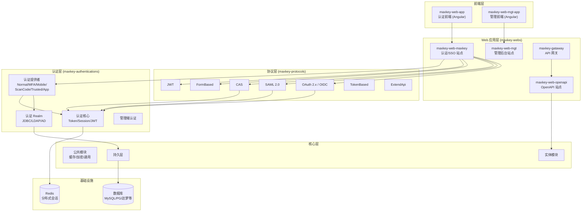

# MaxKey — 企业级 IAM-IDaas 身份管理和单点登录系统解读

> **GitHub:** [github.com/dromara/MaxKey](https://github.com/dromara/MaxKey) | **网站:** [www.maxkey.top](https://www.maxkey.top) | **许可:** Apache-2.0 | **版本:** v4.1.11

## 第一部分：快速概览

### 这是什么

MaxKey（马克思的钥匙）是 Dromara 开源社区旗下的 IAM-IDaas（身份管理和身份即服务）产品。它是一个全面的**单点登录认证系统**，提供用户身份管理（IDM）、身份认证（AM）、单点登录（SSO）、RBAC 权限管理和基于协议的第三方认证网关。

项目谐音"马克思的钥匙"——寓意安全、信任和打开数字世界大门的钥匙。

### 解决的痛点

大中型组织的认证体系面临四重挑战：

- **协议碎片化**：OAuth2/OIDC、SAML2、CAS、JWT 各自为政，每个业务系统各自对接
- **认证源多样化**：本地密码、LDAP/AD、社交账号、Kerberos、扫码登录——统一管理困难
- **多租户隔离**：大型企业、SaaS 平台的租户级身份隔离需求
- **合规与审计**：等保、GDPR 等对登录历史和权限变更的完整审计要求

MaxKey 通过**协议适配层 + 可插拔认证提供者 + 多租户架构**在这四个维度统一解决。

### 适用场景

- 企业内部的统一认证中心（替换多个系统的独立登录）
- SaaS 平台的多租户身份隔离
- 政务系统的信创环境部署（支持国密 SM3、国产数据库）
- 需要同时对接 OAuth2、SAML、CAS 协议的应用集群
- 教育/医疗等需要 LDAP/AD 域集成的组织

### 核心能力清单

| 能力 | 说明 |
|------|------|
| 单点登录（SSO） | 一次登录访问所有已授权应用，支持跨域 Cookie/Token/Congress 三种传递机制 |
| 身份管理（IDM） | 完整的用户/组织/组/岗位管理，支持 LDAP/AD/钉钉/飞书/企微同步 |
| 认证协议 | OAuth 2.x / OpenID Connect 1.0、SAML 2.0、JWT、CAS、FormBased、TokenBased、ExtendApi |
| 多因素认证 | TOTP 时间令牌、短信验证码、邮件验证码、WebAuthn/Passkey |
| 认证源 | 本地密码、LDAP、Active Directory、Kerberos、社交登录（微信/QQ/钉钉/飞书等）、扫码登录 |
| RBAC 权限 | 角色-权限-应用三级权限模型，细粒度资源授权 |
| 多租户 | 机构（Inst）级隔离，每个机构可独立配置认证策略和登录界面 |
| 审计与合规 | 完整的登录历史、操作审计、密码策略、IP 地理位置解析 |
| 协议扩展 | 开放 ExtendApi 接口，支持自定义协议适配 |
| 部署 | 支持 MySQL/PostgreSQL/达梦/人大金仓等数据库，Redis 分布式会话，Docker 部署 |

### 技术栈一览

| 层面 | 技术 |
|------|------|
| 语言 | Java 17+ |
| 框架 | Spring Boot 3.x |
| 构建 | Gradle |
| 数据库 | MySQL 8.4+ / PostgreSQL / 达梦 / 人大金仓 / Oracle |
| 缓存/会话 | Redis（分布式 Session）/ Caffeine（单机 Session） |
| 前端 | Angular（认证端 + 管理端） |
| 认证核心 | 自研认证框架（非 Spring Security 标准流程） |
| JWT | Nimbus JOSE + JWT（HMAC512） |
| OAuth 2.0 | 自研 OAuth 2.x / OIDC 实现 |
| SAML 2.0 | OpenSAML |
| CAS | 自研 CAS 协议兼容 |
| 密码加密 | 支持 BCrypt / SHA-256 / SM3 / MD4 / LDAP-SHA / MD5 |
| 容器 | Docker / Docker Compose |
| 代理/Gateway | Spring Cloud Gateway |

---

## 第二部分：架构深读

### 架构总览



MaxKey 采用**四层架构**：前端（Angular SPA） → Web 应用层（Spring Boot Controller） → 协议/认证层 → 持久层。亮点在于**协议适配层**作为"翻译官"，将不同协议请求统一转化为内部认证模型。

### 模块组织与关键目录

MaxKey 共有约 **40+ 个 Gradle 子模块**，顶层按职责分为：

```
MaxKey/
├── maxkey-authentications/     # 认证框架
│   ├── maxkey-authentication-core/        # 核心抽象：Session/Token/JWT
│   ├── maxkey-authentication-provider/    # 认证提供者 + Realm
│   └── maxkey-authentication-provider-mgt/ # 管理端认证提供者
├── maxkey-commons/             # 公共组件
│   ├── maxkey-core/            # 核心工具
│   ├── maxkey-crypto/          # 密码编码器（BCrypt/SM3等）
│   ├── maxkey-cache/           # 缓存抽象
│   └── maxkey-ldap/            # LDAP 客户端
├── maxkey-entity/              # JPA 实体（所有数据表映射）
├── maxkey-persistence/         # MyBatis Mapper（数据访问层）
├── maxkey-protocols/           # 认证协议实现
│   ├── maxkey-protocol-authorize/      # 授权路由总入口
│   ├── maxkey-protocol-oauth-2.0/      # OAuth 2.x / OIDC
│   ├── maxkey-protocol-saml-2.0/       # SAML 2.0
│   ├── maxkey-protocol-cas/            # CAS
│   ├── maxkey-protocol-jwt/            # JWT
│   ├── maxkey-protocol-formbased/      # 表单代理
│   ├── maxkey-protocol-tokenbased/     # Token 代理
│   └── maxkey-protocol-extendapi/      # 扩展 API
├── maxkey-starter/             # Spring Boot Starter
│   ├── maxkey-starter-web/           # Web 基础设施
│   ├── maxkey-starter-captcha/       # 图形验证码
│   ├── maxkey-starter-otp/           # OTP 令牌
│   ├── maxkey-starter-sms/           # 短信服务
│   ├── maxkey-starter-social/        # 社交登录
│   ├── maxkey-starter-passkey/       # Passkey/WebAuthn
│   └── maxkey-starter-ip2location/   # IP 地理位置
├── maxkey-webs/                # Web 应用
│   ├── maxkey-web-maxkey/           # 认证/SSO 站点
│   ├── maxkey-web-mgt/              # 管理后台站点
│   ├── maxkey-web-openapi/          # OpenAPI 接口
│   └── maxkey-gataway/              # Spring Cloud Gateway
├── maxkey-web-apis/            # REST API 模块
│   ├── maxkey-web-api-rest/         # REST API
│   └── maxkey-web-api-scim/         # SCIM 2.0
├── maxkey-web-frontend/        # 前端应用
│   ├── maxkey-web-app/              # 认证端 (Angular)
│   └── maxkey-web-mgt-app/          # 管理端 (Angular)
├── maxkey-synchronizers/       # 身份同步器
│   ├── synchronizer-ldap/
│   ├── synchronizer-activedirectory/
│   ├── synchronizer-feishu/
│   ├── synchronizer-dingtalk/
│   └── synchronizer-work-weixin/
└── sql/                        # 数据库 SQL 脚本
```

### 关键模块代码规模

| 模块 | 核心代码行（估算） | 职责 |
|------|-------------------|------|
| `maxkey-authentication-core` | ~3000 行 | Token 生成/校验、Session 管理、核心认证模型 |
| `maxkey-authentication-provider` | ~5000 行 | 6 种认证 Provider + JDBC/LDAP Realm + Kerberos/RememberMe |
| `maxkey-protocol-oauth-2.0` | ~8000 行 | 完整的 OAuth 2.x/OIDC 实现（授权码/隐式/密码/客户端） |
| `maxkey-protocol-saml-2.0` | ~5000 行 | IdP/SP 双角色，元数据管理，断言生成 |
| `maxkey-protocol-cas` | ~3000 行 | CAS 1.0/2.0/3.0 协议兼容 |
| `maxkey-entity` | ~6000 行 | 200+ 实体类，覆盖全业务模型 |
| `maxkey-persistence` | ~8000 行 | MyBatis Mapper + XML，全部数据库操作 |
| `maxkey-web-maxkey` | ~4000 行 | 认证/登录/登出 Controller，前端交互 |

### 启动流程

```
Spring Boot 应用启动
  │
  ▼
AutoConfiguration 加载 (各 starter 模块)
  │
  ├── MvcSecurityAutoConfiguration     → Spring Security 基础安全配置
  ├── AuthnProviderAutoConfiguration   → 注册认证 Providers 到工厂
  ├── JwtAuthnAutoConfiguration        → 初始化 AuthJwtService/TokenService
  ├── SessionAutoConfiguration         → 初始化 SessionManager (Redis/Caffeine)
  ├── Oauth20AutoConfiguration         → OAuth 端点注册
  ├── Saml20AutoConfiguration          → SAML 端点注册
  ├── CasAutoConfiguration             → CAS 端点注册
  ├── SocialSignOnAutoConfiguration    → 社交登录 Provider 加载
  ├── KaptchaAutoConfiguration         → 图形验证码初始化
  ├── OneTimePasswordAutoConfiguration → OTP 服务初始化
  └── PasskeyAutoConfiguration         → WebAuthn 初始化
  │
  ▼
Web 应用路由注册
  │
  ├── /login/*        → LoginEntryPoint（登录入口）
  ├── /logout*        → LogoutEndpoint（登出端点）
  ├── /authz/{id}     → AuthorizeEndpoint（协议路由总入口）
  ├── /auth/token/refresh → AuthTokenRefreshPoint
  ├── /passkey/*      → PasskeyAuthenticationEndpoint
  └── /force/logout   → 强制登出
  │
  ▼
数据库初始化 (sql/ 目录下的 DDL/DML 脚本)
  │
  └── 创建 80+ 张业务表（用户/机构/应用/权限/审计等）
```

---

## 第三部分：认证体系总览

MaxKey 的认证体系是其最核心、最复杂的子系统。它使用**自研认证框架**，通过 `AbstractAuthenticationProvider` 的子类实现不同认证策略，由 `AuthenticationProviderFactory` 根据 `authType` 字段路由。

### 认证类型矩阵

| authType | Provider 类 | 密码验证 | 附加验证 | 使用场景 |
|----------|------------|---------|---------|---------|
| `normal` | NormalAuthenticationProvider | 密码匹配 | 图形验证码（可选） | 标准 Web 登录 |
| `tfa` | MfaAuthenticationProvider | 密码匹配 | TOTP OTP | 双因素认证 |
| `mobile` | MobileAuthenticationProvider | 无密码 | 短信验证码 | 手机验证码登录 |
| `trusted` | TrustedAuthenticationProvider | 无 | 无 | RememberMe / 第三方信任登录 |
| `scancode` | ScanCodeAuthenticationProvider | 无 | 二维码票据 | 扫码登录 |
| `app` | AppAuthenticationProvider | 密码匹配 | 图形验证码（可选） | App 端登录 |

### 认证数据源（Realm）

| Realm | 密码验证方式 | 用户数据源 |
|-------|------------|-----------|
| JdbcAuthenticationRealm | BCrypt/SHA-256/SM3 等编码器比对 | MySQL/PostgreSQL 等数据库 |
| Jdbc + LDAP 混合 | JDBC 优先，失败后 LDAP 兜底，LDAP 成功则回写密码 | 数据库 + LDAP |
| LdapAuthenticationRealm | LDAP bind 验证 | 多 LDAP/AD 服务器轮询 |

### 登录方式汇总

| 登录方式 | 实现机制 | 关键模块 |
|---------|---------|---------|
| 用户名 + 密码 | NormalAuthenticationProvider + JdbcAuthenticationRealm | authentication-provider |
| 用户名 + 密码 + TOTP | MfaAuthenticationProvider + TwoFactorTotpAuthenticationProvider | authentication-provider |
| 用户名 + 密码 + 短信 | MfaAuthenticationProvider + TwoFactorMobileAuthenticationProvider | authentication-provider |
| 用户名 + 密码 + 邮件 | MfaAuthenticationProvider + TwoFactorEmailAuthenticationProvider | authentication-provider |
| 手机号 + 短信验证码 | MobileAuthenticationProvider | authentication-provider |
| 扫码登录 | ScanCodeAuthenticationProvider + ScanCodeService | authentication-provider |
| 社交登录（微信/QQ/钉钉等） | SocialSignOnEndpoint（OAuth 回调） | starter-social |
| Kerberos/AD 域 | HttpKerberosEntryPoint + KerberosService | authentication-provider |
| Passkey/WebAuthn | PasskeyAuthenticationEndpoint + PasskeyServiceImpl | starter-passkey |
| JWT Header | HttpJwtEntryPoint + AuthorizationUtils | authentication-provider |
| HTTP Basic | BasicEntryPoint | authentication-provider |
| Remember Me | AbstractRemeberMeManager（JWT Cookie，7天有效） | authentication-provider |

> 详细的登录、登出流程和所有认证方式的时序分析，请参阅：[登录/登出流程详细分析](login-logout-flow.md)

---

## 第四部分：协议适配层

MaxKey 的一个核心设计是**协议适配层**（Protocol Adapter），它让不同协议的接入应用都能通过统一的 SSO 认证中心完成身份验证。

### 协议分发总入口

`AuthorizeEndpoint` 是协议分发的总路由器：

```
GET /authz/{appId}
  │
  ├── 读取应用配置 (AppsService)
  │
  └── 根据 app.getProtocol() 分发：
      ├── EXTEND_API          → forward /authz/api/{id}
      ├── FORMBASED           → forward /authz/formbased/{id}
      ├── OAUTH20/OIDC10      → forward /authz/oauth/v20/{id}
      ├── OAUTH21             → redirect app.getLoginUrl()
      ├── SAML20              → forward /authz/saml20/idpinit/{id}
      ├── TOKENBASED          → forward /authz/tokenbased/{id}
      ├── CAS                 → forward /authz/cas/{id}
      ├── JWT                 → forward /authz/jwt/{id}
      └── 其他 (BASIC等)      → redirect app.getLoginUrl()
```

### 各协议适配特点

| 协议 | 适配器基类 | 签名/加密支持 | 账号策略 |
|------|----------|-------------|---------|
| OAuth 2.x / OIDC | TokenEndpoint + AuthorizationEndpoint | JWT (HS512/RS256) | User-Defined / Shared / System / None |
| SAML 2.0 | SingleSignOnEndpoint + AssertionEndpoint | XML 断言签名 | 同 OAuth |
| CAS | CasAuthorizeEndpoint + TicketGrantingTicket | CAS TGT/ST | 共享凭证 |
| JWT | JwtLoginService | HMAC512 JWT | User-Defined |
| FormBased | FormBasedAdapter | 可选签名+加密 | User-Defined / Shared |
| TokenBased | TokenBasedAdapter | Token 直传 | User-Defined / Shared |
| ExtendApi | ExtendApiAdapter | 自定义 | 自定义 |

### 账号凭证策略

`AbstractAuthorizeAdapter` 中定义了四种凭证策略，控制认证后将什么凭据传递给应用：

| 策略 | 行为 |
|------|------|
| `USER_DEFINED` | 用户自己对应用绑定的独立账号/密码 |
| `SHARED` | 应用级别的共享账号/密码（所有用户共用） |
| `SYSTEM` | 从用户属性映射到应用账号体系（如 employeeNumber → AppUsername） |
| `NONE` | 使用 MaxKey 用户名/密码直接传递 |

这个设计让不同应用可以使用不同的账号体系，而用户只需记住 MaxKey 一套密码。

---

## 第五部分：Session 与 Token 管理

### 会话模型

MaxKey 的 Session 管理采用**自建 Session 模型**（非 Servlet HttpSession），支持两种存储后端：

| 存储后端 | 实现类 | 默认有效期 | 过期策略 |
|---------|--------|-----------|---------|
| 内存（Caffeine） | InMemorySessionManager | 1800 秒（30 分钟） | expireAfterWrite |
| Redis | RedisSessionManager | 1800 秒（30 分钟） | SETEX 自动过期 |

核心字段：

```
Session {
    id              // UUID 或自定义 session ID
    authentication  // Spring Security UsernamePasswordAuthenticationToken
    startTimestamp  // 会话创建时间
    lastAccessTime  // 最后访问时间（刷新时更新）
    expiredTime     // 过期时间（创建/刷新时计算）
    visited         // Map<appId, VisitedDto> 记录单点登录访问过的应用
}
```

### Token 体系

MaxKey 使用**两层 Token 结构**，签发密钥分离：

```
AuthTokenService (access_token 密钥)
  └── genAuthJwt()
       ├── refreshTokenService.genRefreshToken()  → 使用 refresh 密钥签发 refresh_token
       └── genJwt()                                → 使用 access 密钥签发 access_token
```

| Token 类型 | 签发服务 | 密钥 | 用途 |
|-----------|---------|------|------|
| `access_token` | AuthTokenService | `authJwkConfig.getSecret()` | 访问令牌，携带用户身份 |
| `refresh_token` | AuthRefreshTokenService | `authJwkConfig.getRefreshSecret()` | 刷新令牌，延长会话 |
| `rememberMe JWT` | AuthTokenService | `authJwkConfig.getSecret()` | 记住我功能，7 天有效期 |
| `state JWT` | AuthTokenService.genRandomJwt() | 同 access | CSRF 防护 token |
| `congress` | AuthTokenService.createCongress() | 同 access | 跨应用一次性凭证传递 |

Refresh Token 的刷新端点：

```
GET/POST /auth/token/refresh
  1. 用 refresh 密钥验证 JWT 有效性
  2. 解析 sessionId，刷新 Session
  3. 重新生成 access_token + refresh_token
```

### 认证状态维护

`AuthorizationUtils` 是认证状态的静态工具类，提供完整的认证状态读写：

```
Cookie 方式:  从 "congress" Cookie 读取 → doJwtAuthenticate()
Header 方式:  从 HTTP Authorization Bearer 读取 → doJwtAuthenticate()
Session 方式: HTTP Session 中 key="AUTHENTICATION" 存取 Authentication 对象

doJwtAuthenticate():
  1. 验证 JWT → 解析 sessionId
  2. sessionManager.get(sessionId) → 获取 Session
  3. session != null → setAuthentication(session.getAuthentication())
  4. session == null → clearAuthentication()
```

---

## 第六部分：安全设计

### 密码策略

- 支持 BCrypt / SHA-256 / SM3 / MD4 / LDAP-SHA / MD5 等多种编码器
- 密码错误计数：超过配置次数后锁定账户
- 密码过期策略：可配置强制修改周期
- `LoginCredential.toString()` 中将密码替换为 `"********"`，防止泄露到日志

### CSRF 防护

登录请求中的 `state` 字段是一个随机生成的 JWT：

```
LoginEntryPoint.get():
  → authTokenService.genRandomJwt() 生成 state JWT
  → 返回给前端，提交时回传

LoginEntryPoint.signin():
  → authTokenService.validateJwtToken(credential.getState())
  → 验证通过才继续认证
```

### 登录失败防护

- 图形验证码：登录前需通过验证码校验（可配置开关）
- 密码错误递增计数：`loginService.plusBadPasswordCount()`
- IP 地理位置记录：`ipLocationParser.region()` 解析，用于异常登录检测

### 二次认证

首次认证成功后，若用户启用了 MFA：

```
createOnlineTicket():
  authType == NORMAL && userInfo.authnType > NONE:
    → sessionManager.createTwoFactor()  // 创建临时 2FA 会话
    → 返回 twoFactor 类型给前端

前端跳转到 TFA 页面 → 输入 OTP → POST /login/signin (authType=tfa):

MfaAuthenticationProvider:
  → sessionManager.getTwoFactor(sessionId)  // 获取临时会话
  → twoFactorProvider.doTwoFactorAuthenticate()  // 校验 OTP
  → 成功后 sessionManager.create() 正式创建会话
  → sessionManager.removeTwoFactor() 清理临时会话
```

### 审计日志

每次登录/登出/操作均记录到 `mxk_history_login` 表：

- 登录成功/失败原因
- IP 地址和地理位置
- 浏览器 User-Agent
- 时间戳
- 认证类型和提供商

---

## 第七部分：同类项目对比

| 方面 | MaxKey | Keycloak | Casdoor | Authelia |
|------|--------|----------|---------|----------|
| **语言** | Java 17 | Java | Go | Go |
| **部署体积** | ~200MB（含 JVM） | ~400MB | ~100MB 单二进制 | ~30MB 单二进制 |
| **部署复杂度** | 中（需数据库） | 高（需数据库） | 低（单二进制+DB） | 中（需 Redis/DB） |
| **OAuth2/OIDC** | 自研完整实现 | 原生支持 | 基于 Casdoor OAuth | 不提供 |
| **SAML 2.0** | 完整 IdP 实现 | 原生支持 | 支持 | 不支持 |
| **CAS** | 完整 1.0/2.0/3.0 | 不支持 | 支持 | 不支持 |
| **JWT** | 原生支持 | 原生支持 | 原生支持 | 不支持 |
| **LDAP/AD** | 完整集成+同步 | 完整集成 | 完整集成 | 支持 |
| **多因素认证** | TOTP/SMS/Email | TOTP/WebAuthn | TOTP/SMS/Email | TOTP/Duo |
| **WebAuthn/Passkey** | 完整实现 | 完整实现 | 支持 | 不支持 |
| **社交登录** | 微信/QQ/钉钉/飞书等 | 通用+Keycloak | GitHub/Google/QQ/微信等 | OAuth2 Provider 通用 |
| **多租户** | 原生机构隔离 | Realm 隔离 | Organization | 不支持 |
| **管理 UI** | 完整 Angular 管理后台 | 完整管理控制台 | 完整 React 管理 UI | 文件编辑配置 |
| **国密支持** | SM3/SM4 | 不支持 | 不支持 | 不支持 |
| **身份同步** | 钉钉/飞书/企微/LDAP/AD/JDBC | LDAP/Kerberos | LDAP | 不支持 |
| **学习曲线** | 中高 | 高 | 中 | 低 |
| **信创适配** | 达梦/人大金仓 | 不支持 | 不支持 | 不支持 |

**MaxKey 的差异化优势：**

1. **协议覆盖最广** — 同时支持 OAuth2、OIDC、SAML2、CAS、JWT 五大协议，且为自研实现
2. **国内生态深度适配** — 微信/QQ/钉钉/飞书/企微社交登录、国密 SM3/SM4、信创数据库
3. **身份同步器** — 内建钉钉/飞书/企微/LDAP/AD 等同步器，非简单集成
4. **多租户** — 机构级隔离，适合 SaaS 平台
5. **Caffeine 内存会话** — 无需 Redis 也可运行，降低小型部署成本

**MaxKey 的局限性：**

1. **体积较大** — Java + Spring Boot 不如 Go 方案轻量
2. **学习曲线较高** — 自研认证框架，非标准 Spring Security 流程
3. **配置项多** — 功能丰富带来的配置复杂性
4. **前端技术栈分裂** — 两套 Angular 应用（认证端 + 管理端）

---

## 第八部分：总结与评价

MaxKey 是一个功能极其完整的 IAM-IDaas 产品，其**协议适配层 + 可插拔认证提供者**的架构设计让它在面对多样化的企业认证需求时表现出出色的灵活性。

**最值得学习的设计决策：**

1. **协议适配层（AuthorizeEndpoint 路由分发）** — 一个入口路由根据 `app.getProtocol()` 分派到不同协议端点，以策略模式隔离协议差异，新增协议只需增加适配器和对应端点
2. **认证提供者工厂模式** — `AuthenticationProviderFactory` + `ConcurrentHashMap<String, AbstractAuthenticationProvider>` 实现了按 `authType` 的动态路由，新增认证方式只需注册一个 Provider
3. **Realm 的 JDBC+LDAP 混合认证** — JDBC 优先，LDAP 兜底，LDAP 成功后自动回写密码，实现用户无感知的认证源切换
4. **两层 Token 分离密钥** — access_token 和 refresh_token 使用不同密钥签名，降低单一密钥泄露的爆破面
5. **Session 存储双模式** — Caffeine（内存）和 Redis（分布式）共享同一接口，按部署规模灵活切换
6. **密码策略+审计日志** — 完整的安全闭环，错误计数、IP 解析、UA 追踪、历史审计

对于需要搭建企业级统一认证中心、研究 SSO 协议实现、或了解大型 Java Monorepo 工程组织方式的开发者，MaxKey 是一个值得深入研究的项目。

> **仓库：** [github.com/dromara/MaxKey](https://github.com/dromara/MaxKey) | **网站：** [www.maxkey.top](https://www.maxkey.top)

---

*本项目解读目录下后续可扩展各维度的独立分析文档，例如：[登录/登出流程详细分析](login-logout-flow.md)、[协议适配层深度分析](protocol-adapters.md)、[身份同步器实现](synchronizers.md) 等。*
