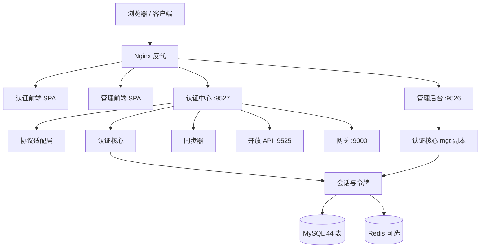

> 解读基线：MaxKey `4.1.12`（`3a3a5c765`）。下文所有源码引用均相对仓库根，并附程序化校验过的行号锚点。

## 项目定位

MaxKey 是一套**应用注册表驱动**的企业级身份与访问管理平台（IAM / IDaaS）。它要解决的问题是：企业内部往往并存大量异构系统，各自维护账号与登录，既无法统一身份，也无法统一审计。MaxKey 把这些系统登记为「应用」，再以单一入口对外提供 SSO、单点登出与协议适配。

它的差异化不在单点技术深度，而在**覆盖面**：同一个部署里同时提供 OAuth 2.0 / OIDC / SAML 2.0 / CAS / JWT / 表单 / Token 等多种协议，加上社交登录、扫码登录、多因素认证、LDAP/AD 同步与 SCIM 供给，属于「一套系统包住全部身份场景」的重型方案。代价是模块数量多、部署形态分散、部分能力存在宣传与实现的落差——本解读的重点正是把这些落差用可验证的源码位置说清楚。

## 项目规模

| 指标 | 数值 | 说明 |
|------|------|------|
| Gradle 子模块 | 39 | `settings.gradle` 中的 `include` 条目 |
| Java 文件 / 行数 | 1089 / 122,281 | 不含 `build/` 产物 |
| 测试文件 | 70 | `src/test` 下的 Java 文件 |
| 控制器类 | 120 | 含 `@RestController` / `@Controller` 的文件 |
| 数据库表 | 44 | `sql/v4.1.11/maxkey.sql` 中的 `CREATE TABLE` |
| 前端 TS 文件 | 518 | 两个 Angular SPA |
| 许可 / 语言 | Apache-2.0 / Java 17 | — |

模块按职责分为四层：公共基础（`maxkey-commons`）、领域与持久化（`maxkey-entity` / `maxkey-persistence`）、能力装配（`maxkey-authentications` / `maxkey-protocols` / `maxkey-synchronizers` / `maxkey-starter`）、运行形态（`maxkey-webs` 下的 4 个可部署应用与 2 个前端 SPA）。

## 技术栈一览

| 层面 | 选型 |
|------|------|
| 语言 / 运行时 | Java 17 |
| 应用框架 | Spring Boot 3.5.16、Spring Framework 6.2.19、Spring Security 6.5.11、Spring Data 3.5.13 |
| Servlet 容器 | Tomcat 10.1.56（内嵌） |
| 构建 | Gradle 多模块（`*_boot.jar` 打包） |
| 持久化 | MyBatis + `mybatis-jpa-extra`，自带 MySQL / PostgreSQL / 达梦 / 人大金仓方言目录 |
| 缓存 | Caffeine（进程内）+ Redis（可选，分布式会话） |
| 前端 | Angular 13.3 + ng-alain（认证端与管理端两套 SPA） |
| 日志 | Log4j2（非 Logback），支持 `monitorInterval` 热调级 |
| 默认数据库 | MySQL 8.x（仓库仅提供 MySQL 建库脚本） |

## 子文档索引

- `architecture.md` —— 总体架构与设计哲学：39 个模块的边界划分、4 个可部署应用的职责、`/authz/{id}` 单入口分发、认证与授权分离的落地方式，以及这套架构的根因与代价。
- `protocol-gateway.md` —— 协议适配层：OAuth2/OIDC/SAML2/CAS/JWT 的适配器结构、协议常量与授权端点、SAML 断言签名策略、以及「OAuth2 实为 Spring Security OAuth 私有 fork」这一关键事实。
- `authentication.md` —— 认证核心：`AuthenticationProviderFactory` 的选路机制、`createOnlineTicket` 单点收敛、多因素被建模为「又一个 Provider」、trusted 直通通道的风险面与两个 provider 模块的复制式分叉。
- `session-token.md` —— 会话与令牌：容器会话 600s 与 MaxKey 会话 1800s 的落差如何决定整体设计、JWT 作为「被签名的 sessionId 句柄」、两级会话存储、单点登出与记住我。
- `identity-provisioning.md` —— 身份供给与同步：Connectors 与 Synchronizers 的分工、LDAP/AD/飞书/钉钉/企微/JDBC 的同步实现、SCIM 2.0 入站供给，以及定时路径与手动触发的能力差异。
- `multi-tenancy-rbac.md` —— 多租户与权限：`instId` 行级隔离的读写不对称、两套并行 RBAC 中只有一套在运行时生效、`PermissionInterceptor` 的粗粒度门禁与水平越权面。
- `data-model.md` —— 数据模型：44 张表的实体关系、核心表字段设计、存储选型取舍、Schema 演进策略，以及登录热路径的读写与缓存分层。
- `deployment.md` —— 部署与运维：四个后端应用与两个前端的端口/上下文路径、Docker Compose 的真实覆盖范围、默认口令与密钥管理、备份升级与「部署孤儿」问题。
- `frontend-and-infrastructure.md` —— 前后端分层与运行时基础设施：依赖方向、密码编码器表驱动装配、starter 的按需裁剪能力、国密支持的真实覆盖度、前端令牌存储与 XSS 面、网关与 Nacos 的实际状态。

## 核心模块导读表

| 关注面 | 核心模块 / 入口 | 关键结论 | 详见 |
|--------|----------------|----------|------|
| 协议适配 | `maxkey-protocols/maxkey-protocol-authorize` | 所有协议收敛到 `/authz/{id}`，按 `app.getProtocol()` 中央分发 | [`protocol-gateway.md`](protocol-gateway.md) |
| 认证选路 | `AuthenticationProviderFactory` | 按凭据类型选择 Provider，认证成功后统一走 `createOnlineTicket` | [`authentication.md`](authentication.md) |
| 会话状态 | `SessionManagerImpl` | L1 Caffeine + L2 Redis + DB 状态位的两级组合器，默认单机 | [`session-token.md`](session-token.md) |
| 令牌 | `AuthTokenService` / `Hmac512Service` | JWT 载荷只承载 sessionId，权限始终以服务端会话为准 | [`session-token.md`](session-token.md) |
| 身份同步 | `maxkey-synchronizers` | 一个来源需聚合器 + 用户 + 机构三类 + 映射表配置 + DB 记录 | [`identity-provisioning.md`](identity-provisioning.md) |
| 租户隔离 | `PersistFieldAutoFillHandler` | 写入自动填充 `instId`，读取依赖控制器显式赋值，遗漏点在「读」 | [`multi-tenancy-rbac.md`](multi-tenancy-rbac.md) |
| 权限模型 | `mxk_groups` / `mxk_access` | 运行时生效的一套；`mxk_roles` 系列未定位到运行时消费者 | [`multi-tenancy-rbac.md`](multi-tenancy-rbac.md) |
| 数据存储 | `maxkey-persistence` | 全库 0 外键，索引内联，登录热路径部分用裸 `JdbcTemplate` | [`data-model.md`](data-model.md) |
| 部署形态 | `maxkey-webs` 下 4 个应用 | 开放 API 与网关有产物但无编排、无入口，属「部署孤儿」 | [`deployment.md`](deployment.md) |
| 基础设施 | `maxkey-starter` × 8 | starter 只能按 Gradle 依赖裁剪，引入后运行时关不掉 | [`frontend-and-infrastructure.md`](frontend-and-infrastructure.md) |

## 整体架构

图中「认证核心 mgt 副本」不是笔误：管理端与门户各自持有一份同名同包的认证实现，二者无法同时存在于同一 classpath，这既是当前的架构债，也解释了为什么两个应用的认证能力并不等价。

## 核心能力清单

| 能力 | 说明 | 详见 |
|------|------|------|
| 单点登录 SSO | 以应用注册表为中心，单入口 `/authz/{id}` 统一受理 | [`architecture.md`](architecture.md) |
| 单点登出 SLO | 支持反向前端/后端通道，应用清单来自会话的 `visited` 记录 | [`session-token.md`](session-token.md) |
| 协议适配 | OAuth 2.0、OIDC、SAML 2.0、CAS、JWT、表单、Token 等多种协议 | [`protocol-gateway.md`](protocol-gateway.md) |
| 多因素认证 | TOTP、邮件、短信；建模为一个独立 Provider 并配半成品会话 | [`authentication.md`](authentication.md) |
| 无密码登录 | Passkey / WebAuthn 由独立 starter 提供，不经过认证核心 | [`authentication.md`](authentication.md) |
| 社交与扫码 | 社交登录与扫码登录统一走 trusted 直通通道 | [`authentication.md`](authentication.md) |
| 目录集成 | LDAP / AD 按实例动态装配，配置存库表并带本地缓存 | [`identity-provisioning.md`](identity-provisioning.md) |
| 身份供给 | 同步器 + SCIM 2.0 入站，覆盖飞书/钉钉/企微/JDBC 等来源 | [`identity-provisioning.md`](identity-provisioning.md) |
| 多租户 | `mxk_institutions` 为租户边界，共享表 + 行级 `instId` 过滤 | [`multi-tenancy-rbac.md`](multi-tenancy-rbac.md) |
| 权限管理 | 组/角色/应用访问白名单 + 管理端粗粒度门禁 | [`multi-tenancy-rbac.md`](multi-tenancy-rbac.md) |
| 审计 | 登录历史与在线状态落库（`mxk_history_login`） | [`data-model.md`](data-model.md) |
| 部署 | Docker Compose 覆盖 2 后端 + 2 前端 + MySQL + Nginx | [`deployment.md`](deployment.md) |

## 设计亮点

- **应用注册表驱动的可扩展性**。新增一种协议或一种认证方式不需要改主流程：协议侧按注册的 `protocol` 分发，认证侧按凭据类型选 Provider，两侧最终都收敛到同一个「登录成功后建立系统状态」的入口。这是全项目最值得借鉴的一处结构决策。
- **密码编码器的表驱动装配**。启动时把一个「算法名 → 编码器」的映射一次性注册进委托式编码器，默认算法由配置项决定，与具体算法实现解耦。
- **窄接口 + 配置整数做实现二选一**。缓存只暴露三个方法的窄接口，用同一个 `persistence` 配置整数在启动时决定装配进程内还是分布式实现，把「单机/集群」的差异压在装配期而不是运行期。
- **协议无关的登出应用清单**。单点登出时下发的是与会话关联的应用记录，而不是协议特有的凭据，使具体登出报文的编码方式成为可替换的细节。

## 值得警惕的问题

- **默认凭据与密钥**。初始化脚本内置管理员账号且口令以明文编码器前缀存储、绕过配置的强哈希算法；JWT 签名密钥在配置文件中有硬编码默认值且访问令牌与刷新令牌共用同一密钥，未改默认值的部署可被自签令牌。
- **网关名不副实**。`maxkey-gataway` 中标称做鉴权与日志的过滤器，方法体只是把请求原样转发；同时其路由使用服务发现协议前缀，而服务发现默认关闭，按默认配置启动无法解析上游。
- **协议层的安全实现有缺口**。CAS 的服务票据未与 `service` 参数绑定、SAML 断言签名校验失败后仍继续返回断言、令牌自省端点未做调用方认证、重定向地址采用前缀匹配。
- **认证与授权链路上的既有缺陷**。用户锁定状态在认证核心中只记日志不拦截；扫码登录缺少独立的「确认」状态，构成扫码劫持面；管理端存在多个未带租户过滤的按 ID 读写端点，属可复现的水平越权。
- **权限模型存在「配置态」与「生效态」断层**。库里并存两套角色/权限表，但只有基于组与访问白名单的一套在运行时生效，另一套未定位到消费方，容易误导二次开发。
- **交付承诺与仓库内容不符**。仓库只提供 MySQL 建库脚本，而方言目录中的 PostgreSQL 与人大金仓映射仍是旧包名、缺少对应接口，相关「完全兼容」的宣传无法自证；建库脚本是销毁型的全量脚本，没有版本间迁移脚本。
- **规模化能力受限**。默认配置下会话不共享，认证中心无法水平扩容；强制下线在多节点不能立即生效；定时同步路径与手动触发的凭据处理不一致，可能导致定时任务整体不可用。
- **大量死代码与复制式分叉**。路由服务整类被注释、若干工厂实现分支被注释、多个映射构建器无调用方；管理端与门户的认证实现逐字节重复，任何修复都需要改两处。

## 同类对比

在自建 IAM 的选型谱系中，MaxKey 的生态位是「**Spring 技术栈上的广覆盖整合方案**」：协议与认证方式的种类齐全、目录与同步来源覆盖国内办公套件、管理界面开箱可用，适合希望以单套系统承接历史协议与国产目录的中国企业环境。

相对的取舍也很明确：它的细粒度授权、可配置认证流程、集群化与迁移工具链都不是强项，部分能力停留在「有入口、无实现」的状态。若诉求是完整的授权模型与可编排的认证流程，或需要成熟的分布式与升级路径，同类中更专注的方案会更合适；若诉求是尽快把一堆异构系统的登录收敛到一处，MaxKey 的覆盖面是它的主要价值。跨项目的逐项能力对照见 [`../capability-matrix.md`](../capability-matrix.md)。

## 解读类型说明

本文档集按**管理员视角**规格撰写：以产品使用者与二次开发者的决策需求为主线，优先回答「这套东西怎么组织的、能不能满足我的场景、有什么坑」，而非逐文件讲解源码。因此每一篇都聚焦于成因、权衡与代价，并保留可点开验证的源码位置；涉及 JVM/Java 生态惯用法的部分（编码器装配、自动配置、窄接口多实现）按语言惯例另行标注。

## 阅读路线

先读 `architecture.md` 建立整体认识，再按关心的问题选读：做协议对接看 `protocol-gateway.md`，做登录与风控看 `authentication.md` 与 `session-token.md`，做组织与权限看 `multi-tenancy-rbac.md`，做数据与运维看 `data-model.md` 与 `deployment.md`，评估工程化程度看 `frontend-and-infrastructure.md`。
