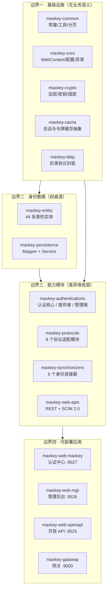
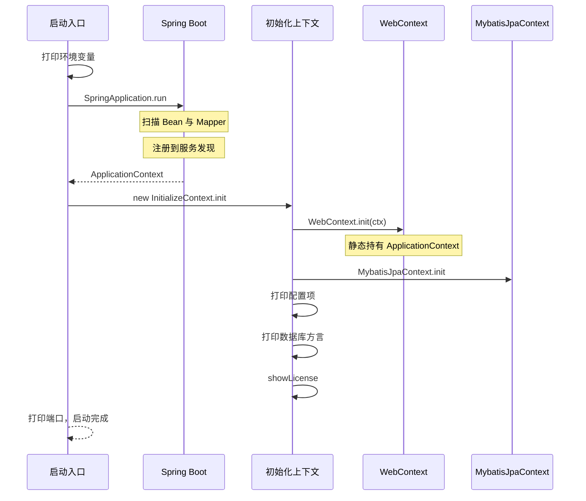
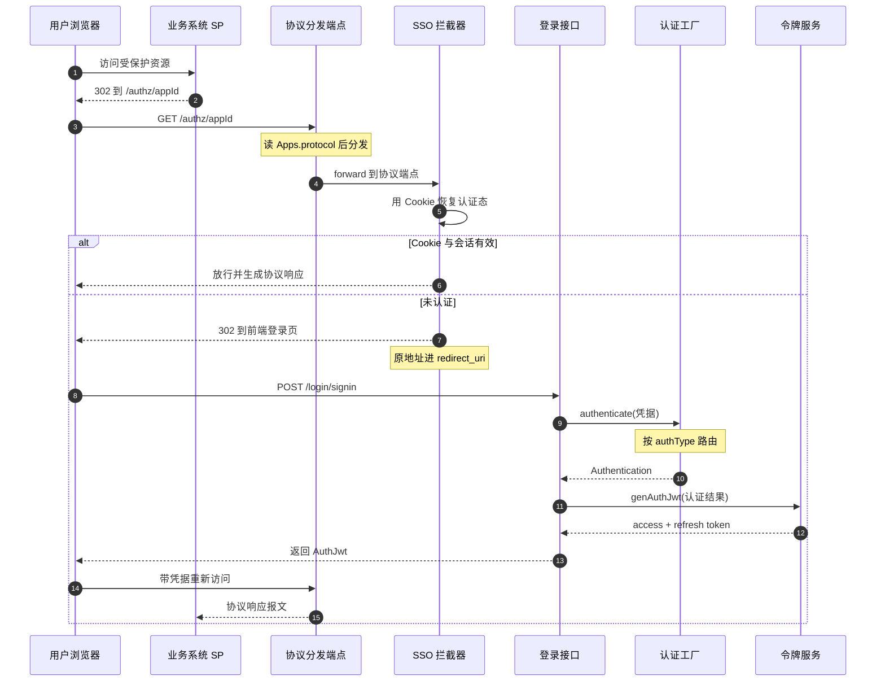

> 本解读按 **admin 类规格**产出（叠加"可部署服务""有数据存储""长业务流程"三组产品类型关注面）。解读基线：`4.1.12`（`3a3a5c765`）。

## 根因：一次登录，要让 N 个异构系统都认账

MaxKey 要解决的根本问题不是"做一个登录页"，而是**在一个组织内部，把"用户是谁"这件事从 N 个业务系统各自的账号体系里抽出来，收敛成一次认证、N 处采信**。

这个问题之所以难，难在三处不对称：

- **协议不对称**。新系统说 OAuth2/OIDC，老系统只认 CAS，政务/教育系统要 SAML2，内部微服务想要一个 JWT。认证中心不能要求对方改造，只能自己长出对应的"方言"。
- **身份源不对称**。账号可能来自本地库、AD 域、OpenLDAP、钉钉/飞书/企微，甚至是另一个 IdP 推过来的 SCIM 报文。对认证中心而言这些都是"同一个人的不同副本"。
- **管理边界不对称**。集团-子公司-部门天然需要数据隔离，但超级管理员又要能跨机构看全局。

MaxKey 的答案是把这三处不对称分别交给三层：**协议适配层**吃掉协议差异，**认证/同步层**吃掉身份源差异，**Inst（机构）租户字段 + RBAC** 吃掉管理边界差异，而三者之间靠一个统一的内部身份对象（`SignPrincipal`）和一份统一的身份库（44 张 `mxk_*` 表）对接。

> 这个"三层吃三种差异"的切法是全篇的锚点——后面每一篇子文档讲的都是其中一层怎么落地。

## 四道边界：39 个 Gradle 模块怎么切

`settings.gradle` 用 39 条 `include` 把仓库切成 39 个子模块（`settings.gradle:24-28`）。数量看着碎，但依赖方向是严格单向的，实际只有四道边界：

[settings.gradle:24-28]()
<!-- anchor: include ('maxkey-commons:maxkey-cache') … include ('maxkey-commons:maxkey-ldap') -->

[settings.gradle:73-79]()
<!-- anchor: include ('maxkey-webs:maxkey-web-maxkey') … include ('maxkey-webs:maxkey-gataway') -->

四道边界的职责可以用一句话各自概括：

| 边界 | 模块 | 职责 | 依赖谁 | 关键约束 |
|------|------|------|--------|----------|
| 基础设施 | `maxkey-commons/*` | 常量、加密、缓存、LDAP、Web 上下文 | 无 | 不含业务语义，被所有层反向依赖 |
| 身份数据 | `maxkey-entity` / `maxkey-persistence` | 44 张表的实体与 MyBatis 访问 | commons | 全系统唯一权威身份源 |
| 能力模块 | `authentications` / `protocols` / `synchronizers` / `web-apis` | 吸收协议、认证源、外部身份源三类差异 | commons + entity/persistence | 能力模块之间**互不依赖** |
| 可部署应用 | `maxkey-webs/*` | 组装能力模块，按流量类型暴露端口 | 全部 | 4 个应用可独立部署、共享一套库 |

**为什么切这么细？** 关键收益在第三层：`maxkey-protocols` 只依赖 `maxkey-authentications:maxkey-authentication-core`（`maxkey-protocols/maxkey-protocol-authorize/build.gradle:15`），反过来认证核心不依赖任何协议模块。这样一来"新增一种认证方式"和"新增一种协议"是两个正交的扩展方向，改一边不会碰到另一边——这正是上面"三层吃三种差异"能成立的结构前提。

代价也很直接：39 个子模块意味着 39 份 `build.gradle`、更长的构建链路，以及初学者需要先理解分层才能找到代码位置。对一个定位为"企业级 IAM 底座、要被二次开发"的产品，这个代价换扩展性是可接受的；但如果只是想要一个开箱即用的 SSO 网关，这套分层就显得过重。

## 四个可部署应用：一次拆分换来的三种隔离

第四层的四个应用不是四个微服务，而是**同一个代码基座上按流量类型切出的四个入口**，共享同一份 `maxkey-entity`/`maxkey-persistence` 和同一个数据库：

| 应用 | 端口 | context-path | 装入的能力模块 | 面向谁 |
|------|------|--------------|----------------|--------|
| `maxkey-web-maxkey` | 9527 | `/sign` | 全部 8 个协议 + 全部认证提供者 | 终端用户（登录、SSO、自助服务） |
| `maxkey-web-mgt` | 9526 | `/maxkey-mgt-api` | 2 个协议 + **全部 6 个同步连接器** + 管理端认证提供者 | 管理员 |
| `maxkey-web-openapi` | 9525 | `/maxkey-openapi` | REST API + SCIM 2.0 | 外部系统集成 |
| `maxkey-gataway` | 9000 | — | Spring Cloud Gateway | 统一入口（可选） |

端口与上下文路径都来自各自的 properties（`maxkey-webs/maxkey-web-maxkey/src/main/resources/application-maxkey.properties:19-27`）：

[maxkey-webs/maxkey-web-maxkey/src/main/resources/application-maxkey.properties:19-27]()
<!-- anchor: server.port                                     =${SERVER_PORT:9527} … server.servlet.context-path                     =/sign -->

**这个拆分做出了三种隔离**，逐条对着依赖清单看：

- **认证流量与管理流量隔离**。`maxkey-web-mgt` 不引入 CAS/SAML 的 SP 侧端点与 JWT 协议模块，`maxkey-web-maxkey` 则不引入 `maxkey-synchronizers`——同步连接器会持有钉钉/飞书的 AppKey/Secret 并周期性拉全量通讯录，这类高权限、易被滥用的能力不进面向公网的认证进程（对比 `maxkey-webs/maxkey-web-maxkey/build.gradle:51-61` 与 `maxkey-webs/maxkey-web-mgt/build.gradle:57-63`）。
- **开放 API 独立限流与暴露面**。`maxkey-web-openapi` 只装 REST + SCIM（`maxkey-web-apis/maxkey-web-api-scim` 自身只依赖 commons + entity + persistence，是全部能力模块里依赖最干净的一个），对外可以单独挂网关策略。
- **前端静态资源与后端解耦**。`maxkey-web-frontend` 下是两个独立的 Angular 工程（`maxkey-web-app` 用户门户 / `maxkey-web-mgt-app` 管理端），后端只提供 JSON 接口，两者通过下面的 `redirect_uri` 约定衔接。

**为什么不合成一个单体？** 单体的部署运维更省事，但会让"钉钉通讯录同步凭据"和"公网 SSO 登录页"跑在同一个 JVM、同一份 classpath 里——一旦认证入口出现反序列化一类的 RCE，攻击者直接拿到全部连接器凭据。这个拆分本质上是用**运维复杂度换爆炸半径**，对 IAM 这类"一旦失守等于全线失守"的系统，是合理倾斜。

反过来说，代价也真实：四个进程、四份配置、四次升级，且它们**共享同一个数据库 schema**，所以并不能独立演进数据模型——这是"按流量切"而非"按领域切"的必然结果。

## 启动流程

四个应用共用同一个启动骨架。以认证中心为例，`MaxKeyApplication` 用 `@SpringBootApplication` + `@MapperScan` 完成标准 Spring Boot 装配后，**手动**执行了一段初始化（`maxkey-webs/maxkey-web-maxkey/src/main/java/org/dromara/maxkey/MaxKeyApplication.java:34-52`）：

[maxkey-webs/maxkey-web-maxkey/src/main/java/org/dromara/maxkey/MaxKeyApplication.java:34-52]()
<!-- anchor: @SpringBootApplication … _logger.info("MaxKey started."); -->

这段初始化的内容在 `InitializeContext.init()` 里，共五步（`maxkey-commons/maxkey-core/src/main/java/org/dromara/maxkey/web/InitializeContext.java:52-64`）：

[maxkey-commons/maxkey-core/src/main/java/org/dromara/maxkey/web/InitializeContext.java:52-64]()
<!-- anchor: public void init() { … showLicense(); -->

三个细节值得单独说：

- **`WebContext` 是全局静态上下文**。它让任意深度的代码都能取到当前请求/当前机构/当前用户，代价是可测试性下降、且必须严格区分"请求线程内"与"调度线程内"的使用——这也是为什么同步连接器这类后台任务要自己再取一次机构上下文。
- **数据库元数据在启动时被主动读取并打印**（`listDataBaseVariables()`），因为它要支持 MySQL/PostgreSQL/达梦/人大金仓多种方言，启动日志里的方言信息是排障的第一手线索。
- **`@EnableDiscoveryClient` 让认证中心也参与服务发现**，这说明 Nacos 在本项目里不是可选项的小配件——网关的动态路由依赖它（详见 [`deployment.md`](deployment.md)）。

## 主请求链路：一个未登录用户是怎么被送回原地的

把上面四层串起来的最小闭环，就是 SSO 最典型的那条路径：**用户访问业务系统 → 被弹到认证中心 → 登录 → 带着凭据回到业务系统**。链路有三段，每段落在不同的层。

三段落的落点：

**第一段是协议分发。** 所有 SSO 入口都收在一个 URL 模板 `/authz/{id}` 上，由 `AuthorizeEndpoint.authorize` 读 `Apps.protocol` 做一次 `if-else` 分发（`maxkey-protocols/maxkey-protocol-authorize/src/main/java/org/dromara/maxkey/authz/endpoint/AuthorizeEndpoint.java:56-78`）：EXTEND_API/FORMBASED/OAUTH20/OIDC/SAML20/TOKENBASED/CAS/JWT 各自 `forward` 到对应端点，OAUTH21 与 BASIC 则直接 `redirect` 到应用自己的登录地址。

[maxkey-protocols/maxkey-protocol-authorize/src/main/java/org/dromara/maxkey/authz/endpoint/AuthorizeEndpoint.java:56-78]()
<!-- anchor: public ModelAndView authorize(HttpServletRequest request,@PathVariable String id){ … modelAndView=WebContext.forward("/authz/jwt/"+app.getId()); -->

**为什么用单入口而不是每协议一个 URL？** 因为"应用"是 MaxKey 的一等公民：每个接入系统在 `mxk_apps` 里是一条记录，带一个 id、一个协议类型和若干协议明细。单入口让"接入一个新系统"退化成"在管理后台加一条记录"，而不是"改代码加一个路由"。代价是这个 `if-else` 链会随协议增加而变长，且协议字符串与常量必须严格对齐——一把双刃剑，但方向是对的。

**第二段是认证态恢复。** 协议端点被 `SingleSignOnInterceptor` 拦截，它先尝试用 Cookie 恢复登录态；恢复不了就 302 到前端登录页，并把**原始地址** base64 编码后塞进 `redirect_uri`（`maxkey-webs/maxkey-web-maxkey/src/main/java/org/dromara/maxkey/web/interceptor/SingleSignOnInterceptor.java:64-78`）：

[maxkey-webs/maxkey-web-maxkey/src/main/java/org/dromara/maxkey/web/interceptor/SingleSignOnInterceptor.java:64-78]()
<!-- anchor: public boolean preHandle(HttpServletRequest request, … return false; -->

同一段代码里还有第二道判定：如果用户已认证，就用 `principal.getGrantedAuthorityApps()` 判断这个应用在不在他的授权列表里，不在就跳 `/authz/refused`。**这一步是"授权"而非"认证"**——它能放在拦截器里，是因为授权数据已经在登录时算好并挂在了 `SignPrincipal` 上。

**第三段是登录与令牌签发。** 前端登录页收集 `authType` 与凭据打到 `/login/signin`，控制器把凭据交给 provider 工厂（`maxkey-webs/maxkey-web-maxkey/src/main/java/org/dromara/maxkey/web/controller/LoginEntryPoint.java:222-230`）：

[maxkey-webs/maxkey-web-maxkey/src/main/java/org/dromara/maxkey/web/controller/LoginEntryPoint.java:222-230]()
<!-- anchor: public Message<AuthJwt> signin( HttpServletRequest request, HttpServletResponse response,@RequestBody LoginCredential credential) { … AuthJwt authJwt = authTokenService.genAuthJwt(authentication); -->

工厂本身极薄——一个静态 `ConcurrentHashMap`，按 `authType + PROVIDER_SUFFIX` 取 provider（`maxkey-authentications/maxkey-authentication-provider/src/main/java/org/dromara/maxkey/authn/provider/AuthenticationProviderFactory.java:28-45`）：

[maxkey-authentications/maxkey-authentication-provider/src/main/java/org/dromara/maxkey/authn/provider/AuthenticationProviderFactory.java:28-45]()
<!-- anchor: public Authentication authenticate(LoginCredential authentication){ … providers.put(provider.getProviderName(), provider); -->

成功后由 `AuthTokenService` 一次性产出 access token 与 refresh token（`maxkey-authentications/maxkey-authentication-core/src/main/java/org/dromara/maxkey/authn/jwt/AuthTokenService.java:66-77`）：

[maxkey-authentications/maxkey-authentication-core/src/main/java/org/dromara/maxkey/authn/jwt/AuthTokenService.java:66-77]()
<!-- anchor: public AuthJwt genAuthJwt(Authentication authentication) { … return null; -->

至此认证完成。**回到协议端点把内部身份翻译成对方认识的报文**这件事，由第一段分发到的那个协议端点负责——这条"出口侧"的完整链路见 [`protocol-gateway.md`](protocol-gateway.md)。

## 全系统共享的那一个对象：SignPrincipal

四层之间之所以能解耦，靠的是它们只共享一个契约对象。`SignPrincipal` 同时实现了 Spring Security 的 `UserDetails` 和 MaxKey 自己的身份语义（`maxkey-authentications/maxkey-authentication-core/src/main/java/org/dromara/maxkey/authn/SignPrincipal.java:29-50`）：

[maxkey-authentications/maxkey-authentication-core/src/main/java/org/dromara/maxkey/authn/SignPrincipal.java:29-50]()
<!-- anchor: public class SignPrincipal implements  UserDetails { … private  boolean accountNonExpired; -->

它同时承载了**四类语义**，这正是它值得单独看的原因：

| 字段 | 语义类别 | 谁写 | 谁读 |
|------|----------|------|------|
| `userInfo` / `userDetails` | 身份数据 | 认证层 | 协议层（拼装用户属性） |
| `instId` | 租户边界 | 认证层 | 所有查询（行级过滤） |
| `sessionId` | 会话追踪 | 会话层 | 单点登出、在线会话管理 |
| `grantedAuthority` | 功能权限 | 认证层 | 管理端拦截器 |
| `grantedAuthorityApps` | 应用权限 | 认证层 | SSO 拦截器 |
| `twoFactor` | 认证状态机 | 认证层 | 二次认证判定 |
| `roleAdministrators` | 角色快捷判定 | 认证层 | 管理端 |

**一个对象塞下四类语义，是这个架构最典型的取舍。** 好处是协议层、会话层、拦截器层都能从同一个对象拿到自己需要的东西，不必到处查库；代价是它成了一个"上帝对象"——任何一层新增需求都会倾向于往它上面加字段，而它是要进 Session 序列化的，字段膨胀直接影响会话存储体积。

## 设计哲学：四条贯彻始终的约定

从上面几条链路能看出四条反复出现的设计约定，它们解释了大部分"为什么这里这么写"：

- **应用注册项（Apps）是唯一的接入单位**。协议、授权范围、登录地址、图标、明细配置全部挂在 `mxk_apps` 及其 6 张协议明细表上。系统里几乎不存在"为某个协议硬编码某个应用"的代码，所有差异化都下沉成数据行。
- **认证与授权在代码路径上就是分开的**。认证发生在 `/login/*`（`LoginEntryPoint`），授权判定发生在拦截器（`SingleSignOnInterceptor` 判应用级、`PermissionInterceptor` 判操作级），两者的数据载体是同一个 `SignPrincipal` 的不同字段。这样拆之后，"改授权规则"不需要碰认证流程。
- **配置化优先于代码化**。短信/邮件服务商、密码策略、LDAP 上下文、连接器字段映射都在 `mxk_cnf_*` / `sync_job_config_field` 里，而不是枚举或常量。
- **租户边界靠一个字段贯穿**。`instId` 出现在几乎每张业务表上，隔离靠查询条件而非物理分库。这让"一套代码服务多租户"成立，但也把"漏加一个 `instId` 条件就是跨租户越权"变成了持续性风险（评估见 [`multi-tenancy-rbac.md`](multi-tenancy-rbac.md)）。

## 分层的代价与边界

诚实地说，这套架构并非没有张力：

- **39 个模块与"按流量切 4 个应用"叠加，运维面偏大**。四个进程共享一个 schema，升级时 DDL 变更无法灰度——这是"共享权威源"的必然成本。
- **能力模块之间"互不依赖"的约定，现实中靠协议模块单向依赖认证核心来维持**。一旦某个协议需要回调认证逻辑（例如协议端点内触发二次认证），这条边界就会被迫让步。
- **`SignPrincipal` 的字段膨胀**是最值得后续观察的点：它是四层共享契约，也是四层共同的扩展热点。

把这些边界记住，后面几篇子文档就是在逐层展开：先看出口侧怎么把身份翻译成协议报文（[`protocol-gateway.md`](protocol-gateway.md)），再看入口侧怎么把各种凭据收成身份（[`authentication.md`](authentication.md)），然后是中间的状态层（[`session-token.md`](session-token.md)）、身份从哪来（[`identity-provisioning.md`](identity-provisioning.md)）、权限怎么判（[`multi-tenancy-rbac.md`](multi-tenancy-rbac.md)）、数据怎么存（[`data-model.md`](data-model.md)），最后是怎么把它跑起来（[`deployment.md`](deployment.md)）。
